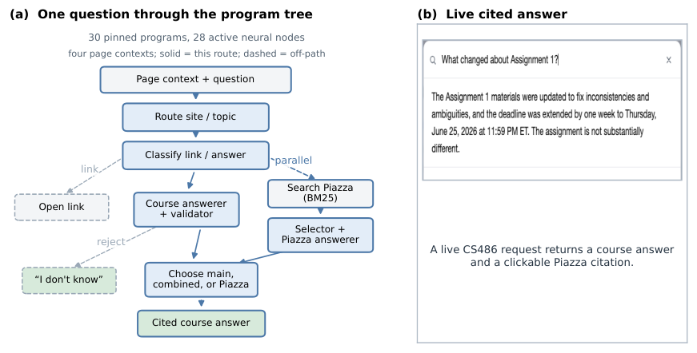
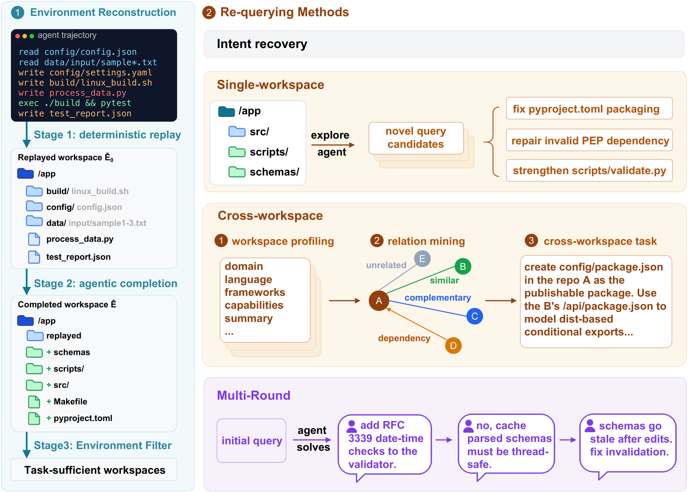
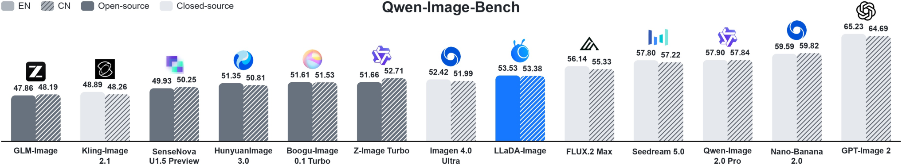
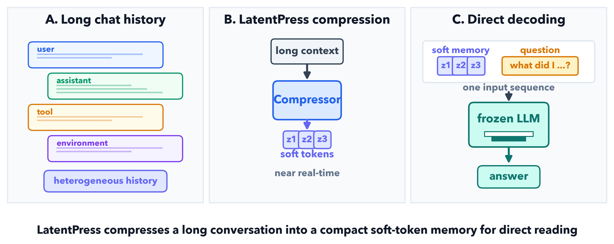
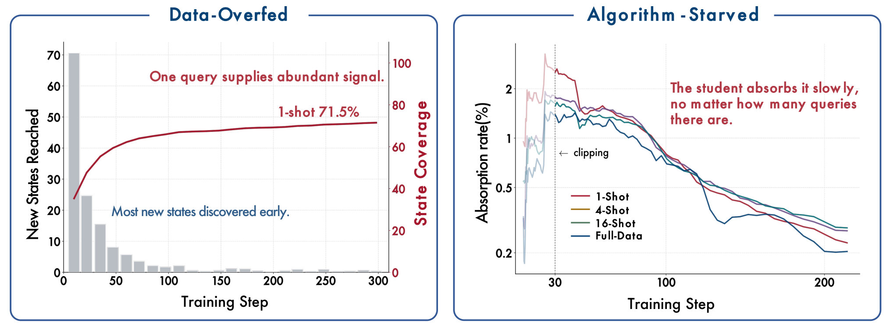
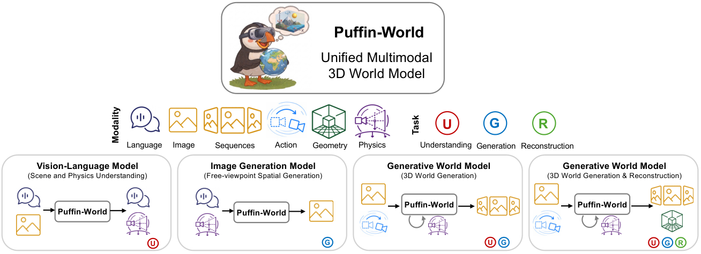
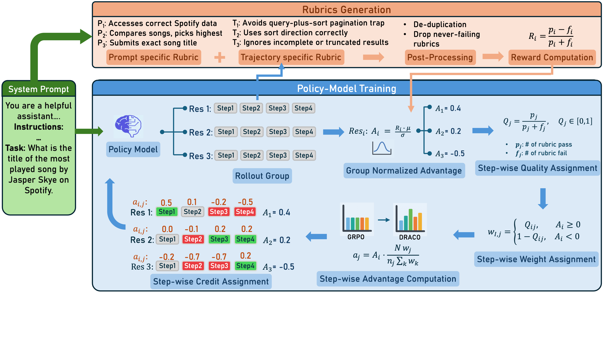
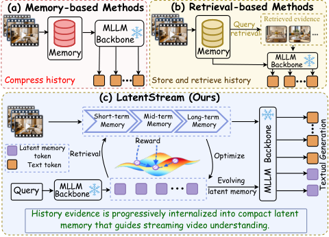
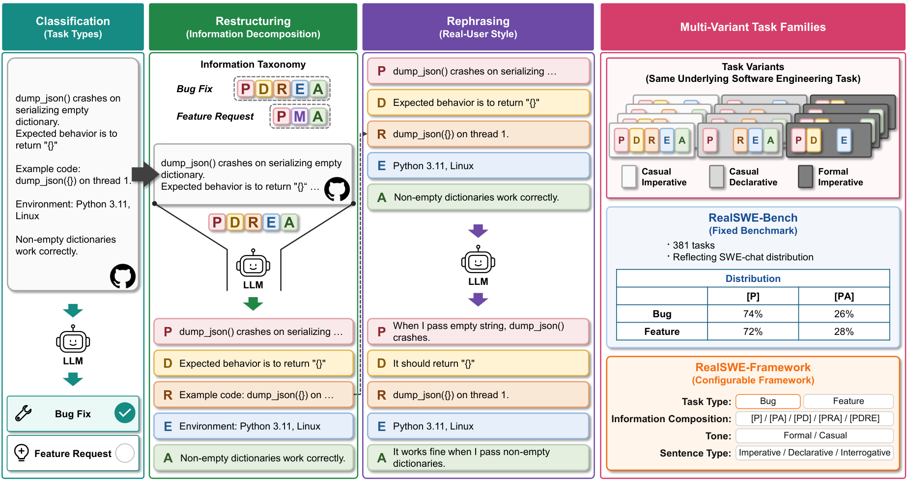
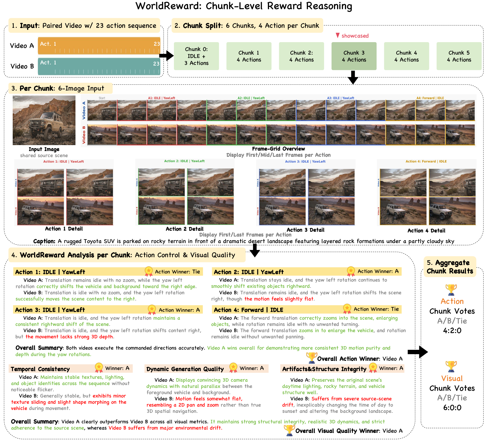

# Daily AI papers — 2026-09-06

*Curated from HF Daily Papers. 15 of ~31 papers kept after relevance filter.*

## Papers at a glance

| # | Title | Topics | Org |
| --- | --- | --- | --- |
| 1 | [Compile by Training: Turning Natural-Language Specifications into Local Neural Functions](#1-compile-by-training) | `LLM`, `distillation`, `agents` | Waterloo / Harvard |
| 2 | [Terminal-Universe: Turning Agent Trajectories into Scalable Terminal Environments](#2-terminal-universe) | `agents`, `RL`, `data` | Qwen / Alibaba |
| 3 | [LLaDA-Image: Building Strong Image Generators with Fully Open Training Recipes](#3-llada-image) | `diffusion`, `multimodal` | Ant Group / LLaDA |
| 4 | [Random Attention: Rethinking KV Cache Eviction for Efficient Reasoning](#4-random-attention) | `efficient-inference`, `reasoning` | Salesforce AI Research |
| 5 | [Knowing When Not to Reuse: Conditional Experience Transfer (BCIT)](#5-bcit) | `post-training`, `RL`, `agents` | Alibaba Cloud |
| 6 | [LatentPress: Context Compression Beyond Text and Vision](#6-latentpress) | `efficient-inference`, `LLM` | Arizona State |
| 7 | [Rethinking On-Policy Distillation II: One Training Example](#7-opd-ii) | `post-training`, `distillation` | Tsinghua |
| 8 | [Why Gated DeltaNet Survives 4-Bit Quantization (Minima)](#8-minima-nvfp4) | `quantization`, `architectures`, `efficient-inference` | Minima-AI |
| 9 | [Puffin-World: Unified Multimodal Model with Native 3D World States](#9-puffin-world) | `multimodal`, `world-model`, `diffusion` | S-Lab NTU |
| 10 | [DRACO: Fine-Grained Credit Assignment with Dynamic Rubrics for Long-Horizon Agent Training](#10-draco) | `agents`, `RL`, `reward` | IBM Research |
| 11 | [Environment Evolution for Terminal Agents](#11-env-evolution) | `agents`, `RL`, `data` | (unspecified) |
| 12 | [LatentStream: Progressive Latent Memory Evolution for Streaming Video Understanding](#12-latentstream) | `multimodal`, `RL`, `video` | Nanjing U. / Tencent |
| 13 | [Locked at the Entrance, Open Inside: Where RLVR Narrows the Solution Space](#13-rlvr-entrance) | `RL`, `reasoning`, `interp` | Birmingham |
| 14 | [RealSWE: A Compositional Evaluation of Coding Agents under Realistic User Requests](#14-realswe) | `eval`, `agents`, `code` | Sungkyunkwan |
| 15 | [WorldReward: Reward Modeling for Camera-Conditioned World Models](#15-worldreward) | `reward`, `multimodal`, `world-model` | Fudan / Tencent Hunyuan |

---

## 1. Compile by Training

**Authors:** Yuntian Deng, Pengyu Nie, Stuart Shieber — *University of Waterloo / Harvard*
**Links:** [arXiv:2609.04199](https://arxiv.org/abs/2609.04199) · [HF](https://huggingface.co/papers/2609.04199) · [AlphaXiv](https://www.alphaxiv.org/abs/2609.04199)
**Topics:** `LLM`, `distillation`, `agents`

### TL;DR

A "compiler" that takes a natural-language spec ("translate English to Klingon", "extract key claims from any URL", …) and emits a small local neural function that runs without any remote API call. At compile time, a teacher LLM generates task-specific examples that train a task adapter on top of a compact interpreter model; the resulting function is versioned like ordinary software.

### Key idea

Reframe on-the-fly LLM calls as *ahead-of-time compilation*: for a natural-language spec, generate synthetic examples with a frontier teacher, distill them into a small task-specific adapter (LoRA-style) on top of a fixed compact interpreter, then ship the adapter as an artifact. The teachers are no longer required at inference.

### Main finding

On FuzzyBench-Hard — a subset where an earlier "Program-as-Weights" fast compiler scored 0 exact matches — compile-by-training reaches **83.6% semantic accuracy**, at a compile-time cost of ~1 minute vs. seconds for the fast compiler. Demonstrated in a public interactive service, a multi-site web helper, an avatar controller, and a bidirectional translator.

### Why it matters

Puts a concrete engineering process behind "distill a small model per task": treats each recurring text function as a reusable software artifact with its own versioning, and quantifies the accuracy/compile-time tradeoff against faster forward-only compilers.

### Knowledge graph integration

**Builds on / relates to existing pages:**
- [../post-training/fine-tuning/README.md](../post-training/fine-tuning/README.md) — task-adapter distillation is a fine-tuning specialization.
- [../post-training/rejection-sampling.md](../post-training/rejection-sampling.md) — teacher-generated example generation and filtering shares the rejection-sampling pattern.
- [../agents/README.md](../agents/README.md) — compiled functions are agent-callable primitives.

**Suggested new pages:**
- `post-training/fine-tuning/spec-to-adapter.md` *(depth)* — the compile-by-training pipeline as a canonical spec-to-adapter recipe.

---

## 2. Terminal-Universe

**Authors:** Jie Wu, Zhenru Zhang, Beichen Zhang, Xuwu Wang, Yuhui Su, Mouxiang Chen, Peng Wang, Zhihai Wang, Que Shen, Hao Zhou, An Yang, Fei Huang, Yujiu Yang, Dayiheng Liu — *Qwen / Alibaba*
**Links:** [arXiv:2609.04148](https://arxiv.org/abs/2609.04148) · [HF](https://huggingface.co/papers/2609.04148) · [AlphaXiv](https://www.alphaxiv.org/abs/2609.04148)
**Topics:** `agents`, `RL`, `data`

### TL;DR

Turns each frozen terminal-agent trajectory (bash / code interpreter sessions) into a *replayable, verifiable environment*. A completion agent restores missing files and dependencies from the tool-execution history, so one trajectory yields many new tasks, both the original intent and synthesized ones — solving the scarcity of realistic executable envs for training coding agents.

### Key idea

Replay the file-operation trace inside a trajectory to reconstruct the pre-modification workspace, then let a completion agent fill in the missing files and packages. On top of the recovered workspace, mine cross-workspace dependency edges (breadth) and unfold single-turn queries into iterative multi-round user sessions (depth) to synthesize new tasks.

### Main finding

From public terminal-agent trajectories, produces **37.3k task-sufficient environments**. SFT of **Qwen3.5-27B** on this corpus gains **+11.9 pts on Terminal-Bench 2.1** (single-round) and **+13.8 pts on EvoCode-Bench v2 MT@4** (multi-round).

### Why it matters

Environments — not trajectories — are what agent RL/SFT actually needs. Recycling existing trajectories into environments unlocks orders-of-magnitude more executable, verifiable training substrate than synthesizing environments from scratch.

### Knowledge graph integration

**Builds on / relates to existing pages:**
- [../agents/README.md](../agents/README.md) — a data-engine for agent post-training.
- [../post-training/rlvr.md](../post-training/rlvr.md) — reconstructed environments provide the executable verifier that RLVR needs.
- [../data/quality-filtering.md](../data/quality-filtering.md) — task-sufficiency check filters low-signal environments.

**Suggested new pages:**
- `agents/trajectory-to-environment.md` *(depth)* — recovering executable envs from frozen agent trajectories.
- `agents/agent-training-environments.md` *(taxonomy)* — synthesized-from-scratch vs. trajectory-recovered vs. co-evolved.

---

## 3. LLaDA-Image

**Authors:** Chuyan Chen, Haoxing Chen, Kun Chen, Zhenglin Cheng, Long Cui, Ruishan Fang, Zhangxuan Gu, Zhicheng Huang, Zhenzhong Lan, et al. — *Ant Group / LLaDA*
**Links:** [arXiv:2609.03796](https://arxiv.org/abs/2609.03796) · [HF](https://huggingface.co/papers/2609.03796) · [AlphaXiv](https://www.alphaxiv.org/abs/2609.03796)
**Topics:** `diffusion`, `multimodal`, `DiT`

### TL;DR

A fully open image generator: a 6B DiT trained from scratch alongside a frozen LLaDA2.0-Mini diffusion-LM as understanding module. Rather than lean on paired image-text data early, it builds a visual generative prior through image-only pre- and mid-training (220M images), then distills into a 2–4-step turbo variant.

### Key idea

Two structural bets: (i) a **frozen diffusion-LM understanding backbone** (LLaDA2.0-Mini) paired with a **6B DiT** trained from scratch, decoupling understanding from generation training; (ii) parameter-free **RMSNorm everywhere** in the DiT together with the **Muon optimizer** for scalable optimization. Distillation into LLaDA-Image-Turbo cuts sampling to 2–4 steps.

### Main finding

On Qwen-Image-Bench, LLaDA-Image reaches **53.53 (EN) / 53.38 (ZH)** — a new SOTA among open-source image generators on both tracks. Full weights, code, and recipes are released.

### Why it matters

An open, reproducible recipe combining a diffusion-LM understanding half with a scratch-trained DiT that also validates Muon + RMSNorm at DiT scale. Materials-first (image-only) pretraining lowers the paired-data floor for competitive text-to-image models.

### Knowledge graph integration

**Builds on / relates to existing pages:**
- [../architectures/_normalization.md](../architectures/_normalization.md) — parameter-free RMSNorm in DiT is a variant this covers.
- [../pre-training/mid-training.md](../pre-training/mid-training.md) — image-only mid-training stage before paired data.

**Suggested new pages:**
- `multimodal/llada-image.md` *(depth)* — the DiT + frozen diffusion-LM understanding recipe.
- `pre-training/muon-optimizer.md` *(depth)* — Muon optimizer for large-scale generative model training.

---

## 4. Random Attention

**Authors:** Heng Wang, Jielin Qiu, Wenting Zhao, Cheng Qian, Liangwei Yang, Jiawei Han, Heng Ji, Silvio Savarese, Shelby Heinecke, Huan Wang — *Salesforce AI Research*
**Links:** [arXiv:2609.03430](https://arxiv.org/abs/2609.03430) · [HF](https://huggingface.co/papers/2609.03430) · [AlphaXiv](https://www.alphaxiv.org/abs/2609.03430)
**Topics:** `efficient-inference`, `reasoning`, `KV-cache`

### TL;DR

Keeps the prompt, then evicts KV-cache tokens **uniformly at random** per attention head — no importance scoring at all. Across four LLMs and six reasoning tasks it matches the strongest scored evictor while running 32–43% faster in vLLM. The whole KV-eviction literature's selection signal, they argue, contributes almost nothing.

### Key idea

Two claims backed by controlled experiments: (1) the **prompt** is the fragile part of the cache; the gap between eviction strategies is mostly about whether they happen to keep the prompt intact. (2) The **reasoning trace** self-heals via redundancy — the model restates what it still needs, and each attention head keeps its own copy. Once the prompt is protected, random eviction preserves enough copies of whatever matters. Result: a scoreless, throughput-friendly evictor.

### Main finding

Matches the best prior evictor on reasoning benchmarks across 4 model / 6 task combinations, with **+32–43% throughput** vs. the top prior evictor in vLLM. Code open at SalesforceAIResearch/Random-Attention.

### Why it matters

A serious null result for scored KV-eviction: expensive per-token importance scores may be paying for what redundancy already provides for free. Realigns future work to *what to protect* (prompt, sinks) rather than *what to score*.

### Knowledge graph integration

**Builds on / relates to existing pages:**
- [../inference/README.md](../inference/README.md) — KV-cache management for long reasoning contexts.
- [../architectures/multi-head-attention.md](../architectures/multi-head-attention.md) — head-level redundancy is what enables random eviction to succeed.
- [../post-training/reasoning/long-cot-rl.md](../post-training/reasoning/long-cot-rl.md) — long CoT rollouts are precisely the workload where this pays off.

**Suggested new pages:**
- `inference/kv-cache-eviction.md` *(depth)* — the eviction problem, prompt-protection, and the random baseline result.

---

## 5. BCIT

**Authors:** Wenfeng Feng, Weiqing Li, Abudukelimu Wuerkaixi, Guohua Liu, Yuewei Zhang — *Alibaba Cloud Computing*
**Links:** [arXiv:2608.26730](https://arxiv.org/abs/2608.26730) · [HF](https://huggingface.co/papers/2608.26730) · [AlphaXiv](https://www.alphaxiv.org/abs/2608.26730)
**Topics:** `post-training`, `RL`, `agents`

### TL;DR

Autonomous post-training loops recycle "past updates that worked" as future proposals. BCIT (Boundary-Calibrated Intervention Transfer) argues that past success is *conditional* on the parent-model context — reusing it without checking wastes compute or actively poisons the descendant. It binds each observed effect to its source context, gates reuse on applicability, and vetoes hard conflicts.

### Key idea

**Conditional experience transfer** as a first-class problem: authorize (or veto) experience reuse *before* weight-changing training. BCIT (1) binds effects to their parent model + data + stage, (2) checks applicability conditions, (3) vetoes proposals with named hard conflicts, (4) triggers a bounded training trial when uncertain. Only observed events (not extrapolations) extend the memory.

### Main finding

On one 4B model adapted across finance reasoning, text-to-SQL, and function calling, under matched candidates / evidence / compute, BCIT **authorizes fewer harmful updates and attains higher equal-budget final-model quality** than baselines. Candidate updates show heterogeneous target and retention effects across contexts.

### Why it matters

Autonomous post-training pipelines silently drift when they treat past successes as context-free. Naming *experience authorization* as its own problem — separate from proposal generation and evaluation — is the piece that makes the loop compounding rather than degrading.

### Knowledge graph integration

**Builds on / relates to existing pages:**
- [../post-training/_post-training.md](../post-training/_post-training.md) — governance layer over the post-training loop.
- [../post-training/_rewards.md](../post-training/_rewards.md) — observed reward is context-conditional evidence, not a global signal.

**Suggested new pages:**
- `post-training/autonomous-post-training.md` *(taxonomy)* — the emerging loop that proposes, trains, evaluates, and reuses updates.

---

## 6. LatentPress

**Authors:** Hejian Sang — *Arizona State University*
**Links:** [arXiv:2609.01507](https://arxiv.org/abs/2609.01507) · [HF](https://huggingface.co/papers/2609.01507) · [AlphaXiv](https://www.alphaxiv.org/abs/2609.01507)
**Topics:** `efficient-inference`, `LLM`, `context-compression`

### TL;DR

Compresses conversation history and long documents into **continuous memory tokens** that a frozen decoder consumes through its input-embedding interface — no textual reconstruction at inference. Skips both text and rendered-image compression, treating soft embeddings as a machine-facing context channel.

### Key idea

Instead of "compress → decode → feed as text" (or as an image), map the context directly into embedding-space *memory tokens* that the frozen decoder reads via its normal input-embedding path. The compression module is trained to make those tokens carry the semantics the decoder needs; the decoder itself is untouched.

### Main finding

Validated across text and vision benchmarks: soft memory tokens deliver competitive downstream accuracy at higher effective compression than text-based schemes — establishing embeddings as a practical machine-facing interface for context compression. (Exact ratios and benchmark scores not fully surfaced in the abstract.)

### Why it matters

If accepted, this deprecates a class of "prompt-compression" pipelines that pay for round-trip decoding. Memory tokens generalize the trick behind long-context prefix / soft-prompt work to arbitrary long inputs.

### Knowledge graph integration

**Builds on / relates to existing pages:**
- [../fundamentals/attention.md](../fundamentals/attention.md) — memory tokens act as compressed prefix keys/values.
- [../inference/README.md](../inference/README.md) — context compression as an inference-time efficiency lever.

**Suggested new pages:**
- `inference/context-compression.md` *(taxonomy)* — text vs. rendered-image vs. latent-token compression.
- `inference/latent-memory-tokens.md` *(depth)* — soft memory tokens as a machine-facing context channel.

---

## 7. OPD II

**Authors:** Zixuan Fu, Bingxiang He, Yuxin Zuo, Haohuan Huang, Jinqian Zhang, Ruhang Xiao, Cheng Qian, Qinyu Luo, Huan-ang Gao, Yudong Wang, Zhiyuan Liu, Ning Ding, Chaojun Xiao — *Tsinghua*
**Links:** [arXiv:2609.04172](https://arxiv.org/abs/2609.04172) · [HF](https://huggingface.co/papers/2609.04172) · [AlphaXiv](https://www.alphaxiv.org/abs/2609.04172)
**Topics:** `post-training`, `distillation`, `RL`

### TL;DR

On-policy distillation (OPD) trains a student on its own rollouts with dense token-level supervision from a teacher. Here they push it to the data-minimal limit: a **single query** keeps improving for hundreds of steps and recovers most of full-data OPD's gain. OPD is **data-overfed but algorithm-starved** — rollouts expose broad supervision fast, but the student absorbs it slowly.

### Key idea

Frame OPD around **state coverage** — the fraction of full-data-OPD-visited states that a query set's rollouts reach. One query hits **71.5%** coverage, mostly within the first 100 steps; **16 semantically distinct queries** reach 98.9% and match full-data training. Yet alignment (student-teacher agreement) slows at a similar rate regardless of data volume — pointing to a step-efficiency bottleneck in the algorithm, not a data bottleneck. Extends to multi-teacher OPD and even to content-light templates and off-domain WildChat queries.

### Main finding

**One query ≈ full-data OPD** across task domains and model families for hundreds of steps; **16 queries ≈ full-data** in both single- and multi-teacher settings; task content and induced state coverage can decouple entirely.

### Why it matters

Reframes recent OPD successes as almost content-independent, and points future work at the algorithm's absorption rate rather than at more data. Cheap and provocative — a single prompt for post-training distillation is an unusually clean lever.

### Knowledge graph integration

**Builds on / relates to existing pages:**
- [../post-training/rejection-sampling.md](../post-training/rejection-sampling.md) — rejection-sampling distillation is the off-policy sibling.
- [../post-training/rlvr.md](../post-training/rlvr.md) — on-policy rollouts are shared with RLVR.
- [../post-training/rl-prompt-curation.md](../post-training/rl-prompt-curation.md) — 16-query result is a strong curation lower bound.

**Suggested new pages:**
- `post-training/on-policy-distillation.md` *(depth)* — OPD, one-shot / multi-teacher variants, state-coverage view.

---

## 8. Minima NVFP4

**Authors:** Sergii Kozyrev, Davyd Maiboroda — *Minima-AI*
**Links:** [arXiv:2609.04098](https://arxiv.org/abs/2609.04098) · [HF](https://huggingface.co/papers/2609.04098) · [AlphaXiv](https://www.alphaxiv.org/abs/2609.04098)
**Topics:** `quantization`, `architectures`, `efficient-inference`, `hybrid-attention`

### TL;DR

Community 4-bit quantizations of the hybrid Qwen3.8-27B (48 Gated-DeltaNet layers + 16 softmax-attention layers) always kept the DeltaNet recurrence in ≥8-bit precision, fearing error accumulation. **Minima** goes NVFP4 W4A4 across **all 496 linear layers, GDN included**, matches BF16 within seed noise, and lands as the smallest (17.5 GiB) and fastest-prefill of the recipes tested — while explaining *why* the recurrent half is actually the **easy** half to quantize.

### Key idea

Quantize everything in NVFP4 (block-scaled FP4). Four mechanism claims: (i) NVFP4's 16-element block scaling **localizes** the residual-stream outliers so activation error is equal across roles; (ii) the "fragile" gate projections use softplus/exp and sigmoid non-linearities that **compress an ~11% GEMM error into a ~2% output error**; (iii) the delta-rule recurrence writes overwrite state along the current key direction, so injected quantization noise is bounded at a flat plateau and forgotten within hundreds of steps — well before the decay horizons; (iv) per-token quantization cost *washes out* with context instead of compounding. Also fixes a global-scale mismatch when per-module NVFP4 checkpoints are served through fused GEMM kernels, and re-uses calibrated FP8 KV-cache scales.

### Main finding

On perplexity (4K/32K), MMLU-Pro, GSM8K, AIME'25, GPQA-Diamond, LiveCodeBench, and RULER to 64K, Minima matches BF16 within seed noise (5-task avg -0.52). **17.5 GiB** on disk, **+14–19% prefill throughput** vs. the strongest comparison recipe, and the 32K perplexity gap **shrinks** further into the context. Checkpoint released.

### Why it matters

Overturns the folk wisdom that linear-attention recurrences must be kept in high precision. Practical recipe: quantize the whole hybrid stack, ship FP8 KV-cache scales, keep BF16 accuracy at 65% memory.

### Knowledge graph integration

**Builds on / relates to existing pages:**
- [../quantization/_number-formats.md](../quantization/_number-formats.md) — NVFP4 W4A4 is a specific block-scaled FP4 configuration.
- [../quantization/fp8.md](../quantization/fp8.md) — FP8 KV-cache scales appear as a companion technique.
- [../architectures/mla.md](../architectures/mla.md) — a sibling attention-family variant, useful for contrast.

**Suggested new pages:**
- `quantization/nvfp4.md` *(depth)* — the NVFP4 format, block scaling, and W4A4 recipe.
- `architectures/gated-deltanet.md` *(depth)* — the recurrent linear-attention block used in the Qwen3.8-27B hybrid.
- `quantization/hybrid-model-quantization.md` *(depth)* — quantizing linear-attention / softmax-attention hybrids.

---

## 9. Puffin-World

**Authors:** Yihang Luo, Xiao-Ming Wu, Linyi Jin, Size Wu, Chunyu Lin, Yao Zhao, Fei Wang, Wei Li, Chen Change Loy — *S-Lab, Nanyang Technological University*
**Links:** [arXiv:2609.04196](https://arxiv.org/abs/2609.04196) · [HF](https://huggingface.co/papers/2609.04196) · [AlphaXiv](https://www.alphaxiv.org/abs/2609.04196)
**Topics:** `multimodal`, `world-model`, `diffusion`, `3D`

### TL;DR

A unified multimodal architecture that jointly models three native world states — **physics** (gravity, latitude), **geometry** (depth), and **appearance** (image) — with an Omni-Camera representation that supports diverse tasks and motions. Enables physically consistent camera-controlled 3D world generation without external offline modules, on a new 15M vision-language-camera dataset and 1M trajectories.

### Key idea

Instead of stacking task-specific modules, treat physics + geometry + appearance as jointly generated *world states* under a shared Omni-Camera parameterization. Ground absolute camera properties to the real world, propagate physical dynamics across future frames, and jointly synthesize each future view + reconstruct its geometry in a single generative pass.

### Main finding

Interleaved closed-loop applications (mimic exploration, self-calibrated exploration) work under one model. Scaled with **Puffin-16M** (15M triplets + 1M trajectories). Code, models, and datasets released.

### Why it matters

Pushes video / world models toward integrating physical priors natively rather than post-hoc, and shows that geometry and appearance can be co-synthesized in one generative process — a step toward physically consistent interactive video.

### Knowledge graph integration

**Builds on / relates to existing pages:**
- [../multimodal/README.md](../multimodal/README.md) — a native-3D unified multimodal model.

**Suggested new pages:**
- `multimodal/world-model.md` *(taxonomy)* — camera-conditioned, physically-grounded video / 3D generative models.
- `multimodal/omni-camera.md` *(depth)* — the joint camera parameterization used by Puffin-World.

---

## 10. DRACO

**Authors:** Shubham Gandhi, Saurabh Goyal, Kiran Kate, Yara Rizk — *IBM Research*
**Links:** [arXiv:2609.04094](https://arxiv.org/abs/2609.04094) · [HF](https://huggingface.co/papers/2609.04094) · [AlphaXiv](https://www.alphaxiv.org/abs/2609.04094)
**Topics:** `agents`, `RL`, `reward`

### TL;DR

Long-horizon agent domains rarely have a programmatic verifier, and single-scalar rubric rewards are a poor per-step signal. DRACO generates **multi-criteria rubrics dynamically during training** (matched to the policy's evolving capability), scores them once per trajectory, then **closed-form redistributes** that judgment into per-step advantages for GRPO — no trained attribution module.

### Key idea

Three pieces bolted onto GRPO: (i) rubrics evolve with the policy so they keep being *just above* current capability; (ii) each rubric is annotated to specific steps; (iii) a closed-form mapping turns the once-per-trajectory rubric verdict into differentiated per-step advantages, sidestepping learned credit assignment.

### Main finding

On **AppWorld**, DRACO gains **+15.9 pts over base** and **+5.3 pts over GRPO with sparse ground-truth reward** — despite using no verifiers. On out-of-domain **Tau-Bench**, +5.3 pts over base even without a frontier judge, beating both ground-truth-reward training and other rubric-based settings.

### Why it matters

Provides a verifier-free, credit-assignment-friendly reward for outcome-blind long-horizon agent training, and beats sparse ground-truth reward in-domain — a plausible replacement for RLVR when no checker exists.

### Knowledge graph integration

**Builds on / relates to existing pages:**
- [../post-training/grpo.md](../post-training/grpo.md) — DRACO plugs into the GRPO advantage.
- [../post-training/rlvr.md](../post-training/rlvr.md) — targets the outcome-blind regime where RLVR does not apply.
- [../post-training/_rewards.md](../post-training/_rewards.md) — rubric-based dense reward.
- [../post-training/cot-reward-model.md](../post-training/cot-reward-model.md) — per-step reward from a whole-trajectory judgment.

**Suggested new pages:**
- `post-training/dynamic-rubrics.md` *(depth)* — rubric evolution + closed-form step-wise credit assignment.

---

## 11. Environment Evolution

**Authors:** Zhiyuan Fan, Tinghao Yu, Yuanjun Cai, Jiang Zhou, Jiangtao Guan, Jincheng Liu, Yun Yang, Dingxin Hu, Zhuo Han, Xing Wu, Feng Zhang, Lilin Wang — *(affiliation not disclosed on HF page)*
**Links:** [arXiv:2609.04128](https://arxiv.org/abs/2609.04128) · [HF](https://huggingface.co/papers/2609.04128) · [AlphaXiv](https://www.alphaxiv.org/abs/2609.04128)
**Topics:** `agents`, `RL`, `data`

### TL;DR

Environments synthesized from scratch quickly become too easy for frontier terminal agents; existing co-evolution methods tie environment growth to on-policy rollouts. Environment Evolution instead grows env difficulty **off-policy** and schedules the evolved environments generation-by-generation, providing continuous learning signal.

### Key idea

Derive three evolution directions from the multi-turn RL objective that *provably* raise environment difficulty. Implement them through a loop-engineered multi-agent harness that mutates environments off-policy, and schedule the resulting cohorts across training generations so the difficulty curve stays just ahead of the model.

### Main finding

Difficulty gains confirmed under rollouts with Hy4 preview, Claude Opus 5, and GPT-5.6 Sol. On **Qwen3.6-27B** and **Qwen3.6-35B-A3B**, simple long-horizon RL training over the evolved envs improves **Terminal-Bench 2.1 by +14.4 and +18.0 pts** respectively.

### Why it matters

Off-policy environment growth breaks the model-dependent bottleneck of co-evolution and works at the scale where synthesized-from-scratch envs saturate. Together with Terminal-Universe (this same digest), a two-pronged reply to the environments-scarcity problem in agent RL.

### Knowledge graph integration

**Builds on / relates to existing pages:**
- [../agents/README.md](../agents/README.md) — agent-training environments.
- [../post-training/rlvr.md](../post-training/rlvr.md) — the executable-env verifier RLVR consumes.
- [../post-training/rl-prompt-curation.md](../post-training/rl-prompt-curation.md) — evolving difficulty is prompt-curation at the env level.

**Suggested new pages:**
- `agents/environment-evolution.md` *(depth)* — off-policy environment difficulty growth.

---

## 12. LatentStream

**Authors:** Hongyu Qu, Guangming Yao, Ling Xing, Xiaobin Hu, Rongxing Ding, Guibin Zhang, Fan Zhang, Yi Yuan, Xiangbo Shu, Shuicheng Yan — *Nanjing U. / Tencent*
**Links:** [arXiv:2609.04131](https://arxiv.org/abs/2609.04131) · [HF](https://huggingface.co/papers/2609.04131) · [AlphaXiv](https://www.alphaxiv.org/abs/2609.04131)
**Topics:** `multimodal`, `video`, `RL`

### TL;DR

Streaming-video MLLMs typically store past frames in an external memory bank and retrieve query-relevant chunks. LatentStream *internalizes* the retrieval: hierarchical latent memory tokens whose receptive fields expand progressively — so query-relevant history becomes part of a compact, evolving latent memory rather than an appended visual context.

### Key idea

Three components: (i) **Query-agnostic Hierarchical Streaming Memory** organizes visual history into short/mid/long-term tiers under a fixed budget with Jenks-guided consolidation; (ii) **Hierarchical Latent Memory Evolution** assigns groups of latent tokens with progressively expanding memory receptive fields that retrieve from their scope and internalize what they read; (iii) **Progressive Confidence-guided Latent Memory Optimization** turns group-wise predictive entropy into a hierarchical progression reward that jointly refines latent memory and retrieved evidence.

### Main finding

New SOTA on existing online and offline streaming-video benchmarks. Trades an ever-growing store-and-retrieve context for a bounded, evolving latent working memory.

### Why it matters

A blueprint for turning retrieval into an internal latent state — plausibly generalizes to long-context text LLMs and streaming audio agents, and pairs naturally with per-view compression tricks.

### Knowledge graph integration

**Builds on / relates to existing pages:**
- [../multimodal/README.md](../multimodal/README.md) — streaming video MLLMs.
- [../post-training/_rewards.md](../post-training/_rewards.md) — entropy-derived progression reward is a self-supervision signal.

**Suggested new pages:**
- `multimodal/streaming-video-mllm.md` *(taxonomy)* — external-retrieval vs. latent-memory approaches to streaming video.

---

## 13. RLVR Entrance

**Authors:** Ruizhe Li — *University of Birmingham*
**Links:** [arXiv:2608.29188](https://arxiv.org/abs/2608.29188) · [HF](https://huggingface.co/papers/2608.29188) · [AlphaXiv](https://www.alphaxiv.org/abs/2608.29188)
**Topics:** `RL`, `reasoning`, `interp`

### TL;DR

RLVR raises pass@1 but shrinks the solution space — hurting test-time-scaling returns. This paper localizes *where* breadth is lost in a reasoning trajectory. On Countdown (fully enumerable solution families), coverage drops by up to 67% under PPO/GRPO on Qwen2.5-3B; the drop is concentrated at the **entrance** — the first operand + operator — where per-token likelihood shifts are 11–16× larger than downstream.

### Key idea

Split reasoning-space contraction into two failure modes: (1) **access** — cannot reach a family's entry token; (2) **execution** — reaches it but cannot compute. Countdown lets you enumerate families explicitly, so you can measure each. Supplying just an unselected entrance prefix restores completion rates in low-access families by an order of magnitude (0.018 → 0.212 under PPO): downstream execution *still works*, the policy just refuses to open the door.

### Main finding

Entrance-targeted **late-layer parameter interpolation with early checkpoints** recovers **+37% solution coverage at no loss in pass@1**. Early-step entropy collapse recurs across six math benchmarks on 7B/14B models. An SFT baseline preserves >2× the coverage of pure RLVR; **staged SFT → DPO → RLVR** pipelines preserve early-step entropy.

### Why it matters

Names a concrete diversity-loss mechanism ("locked at the door") and shows two constructive fixes: staged post-training pipelines and entrance-specific late-layer interpolation. Directly relevant to any team seeing pass@k collapse after RLVR.

### Knowledge graph integration

**Builds on / relates to existing pages:**
- [../post-training/rlvr.md](../post-training/rlvr.md) — this is a mechanism study of RLVR's breadth loss.
- [../post-training/grpo.md](../post-training/grpo.md) — GRPO is one of the two studied training regimes.
- [../post-training/ppo.md](../post-training/ppo.md) — PPO is the other.
- [../post-training/dpo.md](../post-training/dpo.md) — staged SFT-DPO-RLVR is the recommended remedy.

**Suggested new pages:**
- `post-training/reasoning/entropy-collapse.md` *(depth)* — early-step entropy collapse under RLVR and the entrance-fix.
- `pre-training/model-souping.md` — *(edit)* add late-layer interpolation with earlier checkpoints as a diversity-preservation recipe.

---

## 14. RealSWE

**Authors:** Hyojung Gwon, Jeonghyeon Kim, Kyuhong Shim, Sunjae Lee — *Sungkyunkwan University*
**Links:** [arXiv:2608.27831](https://arxiv.org/abs/2608.27831) · [HF](https://huggingface.co/papers/2608.27831) · [AlphaXiv](https://www.alphaxiv.org/abs/2608.27831)
**Topics:** `eval`, `agents`, `code`

### TL;DR

SWE-bench tasks are long, structured, information-rich — real user prompts are short and casual. RealSWE builds **381 multi-variant task families** from SWE-bench Verified and Pro that share the same task and gold patch but vary the *information content* and *linguistic style* to mimic real requests. Realistic inputs drop resolution rates by 6.4 pp and can flip model rankings.

### Key idea

A six-category information taxonomy and four style dimensions applied to both real user prompts (from SWE-chat) and benchmark prompts. Findings: **88%** of real prompts carry only a problem statement (± limited context) vs. **7%** of benchmark ones; **87%** of real prompts are casually written vs. **94%** of benchmark prompts formal. RealSWE materializes controlled per-family variants along both axes.

### Main finding

Across seven contemporary LLMs: realistic inputs cost **-6.4 pp resolution** on average and change rankings. Including *Desired Behavior* and *Motivation* helps significantly; *Environment Info* and *Reproduction Steps* mostly add tokens without benefit. Linguistic style has small, model-dependent effects.

### Why it matters

Turns "the SWE-bench score you see is the score you get" into a testable claim, and it doesn't hold. Also gives users a concrete prescription: state desired behavior and motivation.

### Knowledge graph integration

**Builds on / relates to existing pages:**
- [../evaluation/README.md](../evaluation/README.md) — realistic-user variant of SWE-bench.
- [../agents/README.md](../agents/README.md) — realistic prompt inputs for coding agents.

**Suggested new pages:**
- `evaluation/realswe.md` *(depth)* — the six-info + four-style taxonomy and its use as a benchmark.

---

## 15. WorldReward

**Authors:** Zehan Wang, Junshu Tang, Zhimin Li, Yujie Zhou, Jiazi Bu, Pengyang Ling, Feng Han, Zhixiong Zhang, Long Xing, Shengyuan Ding, Ziang Li, Cheng Jin, Yuhang Zang, Jiaqi Wang, Tianyu Pang — *Fudan / Tencent Hunyuan / SJTU / SAIL*
**Links:** [arXiv:2609.03952](https://arxiv.org/abs/2609.03952) · [HF](https://huggingface.co/papers/2609.03952) · [AlphaXiv](https://www.alphaxiv.org/abs/2609.03952)
**Topics:** `reward`, `multimodal`, `world-model`

### TL;DR

Camera-conditioned world models need a reward that jointly grades **action execution** and **visual quality**. WorldReward is a VLM-based pairwise reward that decomposes paired videos into action-aligned chunks, evaluates each chunk with structured evidence, then aggregates by voting into video-level preferences. Beats GPT-5.5 on their new WorldReward-Bench and boosts HY-WorldPlay 1.5's RL post-training.

### Key idea

Do not judge a whole long video against a full action sequence in one prompt (dilutes short-lived local action evidence). Instead: **action-aligned chunking**, per-chunk structured visual evidence for a VLM judge, then vote-based aggregation of chunk decisions into separate video-level action and visual-quality preferences. Training uses a large reasoning-augmented preference dataset built via VLM structured judgments + multi-turn tool-based agent auditing + targeted human review.

### Main finding

On **WorldReward-Bench**, WorldReward exceeds GPT-5.5 by **+3.42 pp (action) / +1.45 pp (appearance) / +3.56 pp (motion)**. Used for RL post-training of HY-WorldPlay 1.5, it consistently improves both action execution and visual quality across horizons.

### Why it matters

The camera-conditioned world-model reward gap has been a bottleneck for RL post-training in that regime. Chunk-and-vote generalizes to long-video judging in general and turns local evidence dilution into a design choice rather than an unfixable limit.

### Knowledge graph integration

**Builds on / relates to existing pages:**
- [../post-training/_rewards.md](../post-training/_rewards.md) — a pairwise VLM reward variant.
- [../post-training/cot-reward-model.md](../post-training/cot-reward-model.md) — chunked structured-evidence judging.
- [../multimodal/README.md](../multimodal/README.md) — camera-conditioned world models.

**Suggested new pages:**
- `post-training/vlm-judge-reward.md` *(depth)* — chunked, evidence-structured VLM pairwise reward for long-horizon multimodal tasks.

---

## Notes

- Hero figures live in `assets/2026-09-06/`. Papers **2609.03430**, **2608.26730**, **2609.04098**, **2609.04128**, **2608.29188** did not expose HTML-rendered figures on arXiv, so no hero image was downloaded for them.
- This digest is informational. No existing concept files, `READING-LIST.md`, or `PAPERS.md` were modified to produce it.
