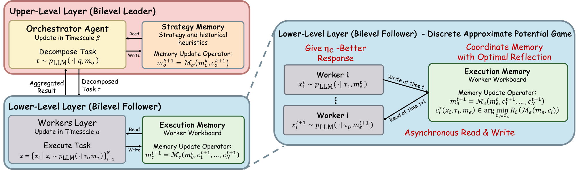
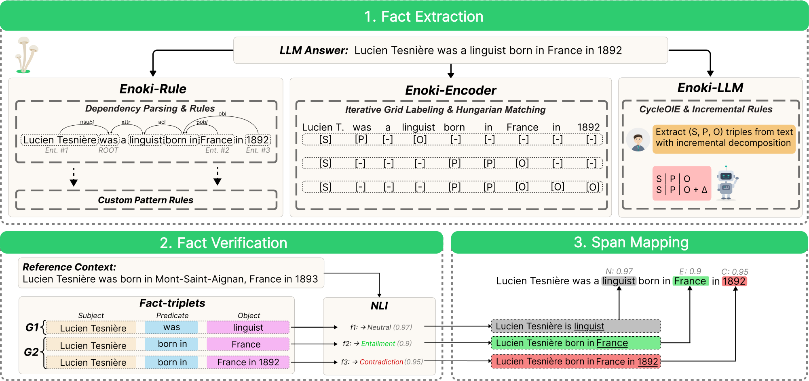
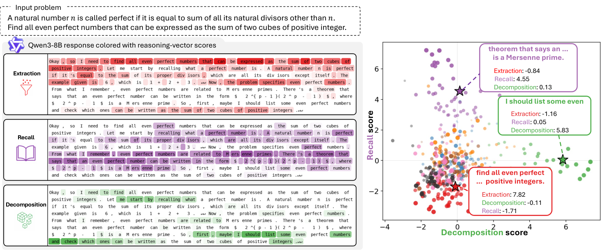
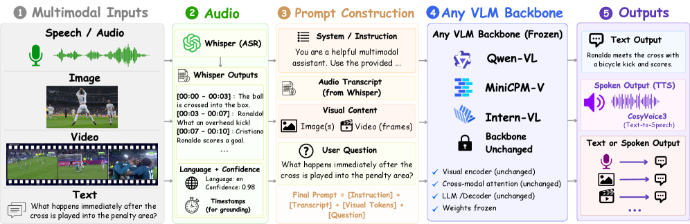

# Daily AI papers — 2026-09-07

*Curated from HF Daily Papers. 14 of 28 papers kept after relevance filter.*

## Papers at a glance

| # | Title | Topics | Org |
| --- | --- | --- | --- |
| 1 | [Bilevel Coordinated Reflection](#1-bilevel-coordinated-reflection) | `agents`, `multi-agent`, `RL` | UCL / Huawei |
| 2 | [Iris: Climbing to the Search Frontier](#2-iris-climbing-to-the-search-frontier) | `agents`, `RL`, `search`, `LLM` | (open-source consortium) |
| 3 | [Enoki: Multi-Level Hallucination Detection](#3-enoki-multi-level-hallucination-detection) | `eval`, `safety`, `LLM` | AIRI / Skoltech |
| 4 | [Don't Drop Dropout](#4-dont-drop-dropout) | `efficient-inference`, `pre-training` | Cerebras |
| 5 | [Beneath the Surface of Chains-of-Thought](#5-beneath-the-surface-of-chains-of-thought) | `interp`, `reasoning`, `LLM` | KAIST/NRF-KR |
| 6 | [RISE: Self-Extrapolating Policy Distillation](#6-rise-self-extrapolating-policy-distillation) | `RL`, `distillation`, `reasoning` | Salesforce Research |
| 7 | [MaxKernel: Agentic TPU Kernel Generation](#7-maxkernel-agentic-tpu-kernel-generation) | `agents`, `systems`, `code` | Google / DeepMind |
| 8 | [Group Adaptive Clipping Policy Optimization](#8-group-adaptive-clipping-policy-optimization) | `RL`, `RLVR`, `reasoning` | (undisclosed) |
| 9 | [τ^τ-Bench](#9-tt-bench) | `agents`, `eval`, `code` | Princeton |
| 10 | [When Models Edit Too Much](#10-when-models-edit-too-much) | `eval`, `code`, `LLM` | NUS |
| 11 | [Training-Free Speech-Centric Omni (TFO)](#11-training-free-speech-centric-omni-tfo) | `multimodal`, `VLM`, `speech` | (undisclosed) |
| 12 | [When Quantization Breaks Memory](#12-when-quantization-breaks-memory) | `quantization` | Rensselaer (RPI) |
| 13 | [KoNA: Selective Non-Compliance in VLMs](#13-kona-selective-non-compliance-in-vlms) | `safety`, `multimodal`, `eval` | POSTECH |
| 14 | [Refuse without Refusal](#14-refuse-without-refusal) | `safety`, `LLM` | POSTECH |

---

## 1. Bilevel Coordinated Reflection

**Authors:** Yuxiang Chen, Yuxuan Huang, Meng Fang, Weilin Luo, Jun Wang — *UCL Centre for AI, University of Liverpool, Huawei*
**Links:** [arXiv:2609.02750](https://arxiv.org/abs/2609.02750) · [HF](https://huggingface.co/papers/2609.02750) · [AlphaXiv](https://www.alphaxiv.org/abs/2609.02750)
**Topics:** `agents`, `multi-agent`, `RL`

### TL;DR

Multi-agent LLM systems where an orchestrator delegates to workers and iterates via textual reflection lack theoretical grounding. The authors model this as a bilevel coordination game, show that free-form textual reflection can only converge under limited conditions, and introduce **Stochastic Reflective Memory Ascent (SRMA)** — a reflection rule that only commits memory updates when a grounded evaluator certifies strict risk reduction.

### Key idea

Cast orchestrator ↔ worker interaction as a bilevel game where decomposition quality controls "worker equilibrium slack," then treat reflection as a stochastic Markov chain over semantic memory states. Prove that text-only evaluation gates cannot uniformly improve across all environments (impossibility), then define SRMA: accept a memory edit iff a grounded evaluator returns a certified reduction in expected risk. Under calibration assumptions this yields geometric or polynomial convergence to the exact optimum.

### Main finding

SRMA converges empirically on three qualitatively different tasks — resource-contest game, Overcooked coordination, and SWE-bench code repair — validating the theoretical prediction that grounded (not text-only) evaluators are the deciding factor for reliable reflection.

### Why it matters

Gives a first honest picture of when "just add more reflection" helps and when it degenerates. Suggests the industry's default LLM-judge reflection loop is provably weaker than reflection gated by a task-grounded verifier — a shift toward RLVR-style verification signals for agentic systems.

### Knowledge graph integration

**Builds on / relates to existing pages:**
- [../agents/README.md](../agents/README.md) — bilevel orchestrator/worker is the canonical multi-agent LLM topology.
- [../post-training/rlvr.md](../post-training/rlvr.md) — grounded evaluator = verifiable reward transplanted from RLVR to reflection.
- [../post-training/reasoning/orm.md](../post-training/reasoning/orm.md) — grounded evaluation is functionally an ORM at inference time.

**Suggested new pages:**
- `agents/srma.md` *(depth)* — the reflection accept/reject rule, its convergence bounds, and its impossibility proof for text-only gates.
- `agents/_multi-agent-orchestration.md` *(taxonomy)* — where SRMA sits among reflexion / role-play / debate style multi-agent methods.

---

## 2. Iris: Climbing to the Search Frontier

**Authors:** Ziyuan Liu, Hengqi Liu, Zichuan Wang, Yang Qin, Jiachen Liang, Xu Chu, Shaowei Chen, Yuantao Gu, Mu Chuan — *affiliations not published*
**Links:** [arXiv:2609.04304](https://arxiv.org/abs/2609.04304) · [HF](https://huggingface.co/papers/2609.04304) · [AlphaXiv](https://www.alphaxiv.org/abs/2609.04304)
**Topics:** `agents`, `RL`, `search`, `LLM`

### TL;DR

Iris-mini (35B-A3B) and Iris-pro (397B-A17B) are two open-source search agents built with a data pipeline that *reverse-constructs* multi-hop questions from a web corpus's hyperlink graph, plus an **SFT ⇄ RL climbing** loop that alternates supervised fine-tuning on the hardest solved rollouts with RL against live search.

### Key idea

Two ideas fused: (1) build training questions by walking an entity graph inferred from a seed page's out-links, rewriting every non-answer entity into a descriptive reference so nothing is solvable by string matching, and admitting only questions the reference model fails closed-book but solves given evidence; (2) alternate SFT and live-search RL, where each RL round hands its hardest-solved and most-efficient rollouts back to the next SFT pass (SFT-RL climbing). RL rollouts are checkpointed at the request level so over-long trajectories resume from their committed prefix on the next step.

### Main finding

With inference-time context management: BrowseComp 82.2/88.6, BrowseComp-ZH 84.8/85.1, DeepSearchQA 86.9/92.9, HLE 52.3/56.4 for Iris-mini/Iris-pro — best-in-class among open-source search agents at each parameter tier, from a single ReAct loop with no sub-agents and no test-time verification.

### Why it matters

Concrete recipe for open search-agent RL that (a) sidesteps the "leakable-clue" problem in existing benchmarks, (b) demonstrates SFT-RL alternation as a practical curriculum, and (c) shows the correct baseline is *always with inference-time context management* — which the paper argues dominates most reported system differences.

### Knowledge graph integration

**Builds on / relates to existing pages:**
- [../post-training/_rl.md](../post-training/_rl.md) — SFT-RL climbing is a curriculum variant of alternating RL and supervised passes.
- [../post-training/rejection-sampling.md](../post-training/rejection-sampling.md) — "hardest solved + most efficient" rollouts are the rejection-sampled positives.
- [../post-training/rlvr.md](../post-training/rlvr.md) — RL against live search with a judge model is verifiable-reward RL on retrieval.
- [../agents/README.md](../agents/README.md) — end-to-end open search-agent recipe.

**Suggested new pages:**
- `agents/search-agent.md` *(depth)* — Iris as the primary source for the reverse-constructed question pipeline.
- `post-training/sft-rl-climbing.md` *(depth)* — the alternation curriculum and its rollout-return rule.

---

## 3. Enoki: Multi-Level Hallucination Detection

**Authors:** Timur Ionov, Nikolay Ivanov, Maksim Savkin, Maksim Makarenko, Alexander Panchenko, Vasily Konovalov, Julia Belikova — *AIRI, Skoltech, ITMO, Sber AI Lab*
**Links:** [arXiv:2609.00581](https://arxiv.org/abs/2609.00581) · [HF](https://huggingface.co/papers/2609.00581) · [AlphaXiv](https://www.alphaxiv.org/abs/2609.00581)
**Topics:** `eval`, `safety`, `LLM`

### TL;DR

Enoki is an Open Information Extraction (OpenIE) framework that catches LLM hallucinations at **both** claim and span granularity in one pass, by extracting text-anchored relational facts, verifying them against a source, and projecting unverified facts back onto the offending answer spans. It ships alongside EnokiQA — 3,990 examples with aligned claim- and span-level labels.

### Key idea

Unified pipeline (extract → verify → project) rather than the usual separate claim-level and span-level detectors. Runs in three swappable modes: LLM-based (highest accuracy), encoder-based, or rule-based (cheapest), letting the deployer pick a cost/accuracy point.

### Main finding

Fine-grained localization *and* interpretable claim-level verification without a separate alignment stage. EnokiQA gives the community a dual-granularity benchmark that isolates the projection step directly.

### Why it matters

Hallucination detectors have been fragmenting into claim-level (interpretable but coarse) vs span-level (fine but hard to explain) camps. Enoki collapses them, and the modular extractor makes it a natural drop-in for RAG pipelines that already produce (answer, source) pairs.

### Knowledge graph integration

**Builds on / relates to existing pages:**
- [../evaluation/README.md](../evaluation/README.md) — hallucination detection is a core LLM evaluation axis.
- [../safety/README.md](../safety/README.md) — factuality/hallucination is a safety-adjacent capability.

**Suggested new pages:**
- `evaluation/hallucination-detection.md` *(depth)* — Enoki as primary source for the extract–verify–project framing.

---

## 4. Don't Drop Dropout

**Authors:** Mostafa Elhoushi, Alex Pretko, Nolan Dey, Bin Claire Zhang, Gavia Gray, Gurpreet Gosal, Abdulrahman Mahmoud, Shane Bergsma, Joel Hestness — *Cerebras Systems*
**Links:** [arXiv:2609.05275](https://arxiv.org/abs/2609.05275) · [HF](https://huggingface.co/papers/2609.05275) · [AlphaXiv](https://www.alphaxiv.org/abs/2609.05275)
**Topics:** `efficient-inference`, `pre-training`, `LLM`

### TL;DR

Layer dropout ("stochastic depth") has quietly disappeared from LLM pre-training recipes. This paper runs 2,400+ experiments across 271M–8.2B parameters on up to 160B tokens and shows that with the right dropout schedule and layer distribution, LLM pre-training gets *lower* loss per FLOP and gains free inference-time acceleration.

### Key idea

Layer dropout, when tuned across three axes (which layers get dropped, the dropout time schedule, and rebalanced optimizer hyperparameters), is not just a regularizer but a training-efficiency lever that also seeds the model with layer-independence — enabling early-exit, layer-skipping, and self-speculative decoding at inference with negligible accuracy loss.

### Main finding

Same-FLOP-budget training: layer dropout **reduces loss**. Same-loss-target training: **up to 25% FLOPs saved**. Inference: up to **1.5× speedup** from self-speculative decoding on the same layer-dropout model. Consistent across the sweep of 271M–8.2B parameters and 160B-token runs on Cerebras CS-3.

### Why it matters

Reverses the ambient consensus that dropout is a small-model artifact. Provides a single training-time change that pays off at both pre-training and inference, and re-connects layer-skipping / speculative-decoding lines of work to their prerequisite: a model that's been trained to survive dropped layers.

### Knowledge graph integration

**Builds on / relates to existing pages:**
- [../pre-training/_training-stability.md](../pre-training/_training-stability.md) — training stability techniques a layer-dropout recipe interacts with.
- [../inference/README.md](../inference/README.md) — self-speculative decoding uses dropout-trained sub-networks as drafters.
- [../pre-training/wsd-schedule.md](../pre-training/wsd-schedule.md) — dropout's *time* schedule is the flip side of the LR schedule.

**Suggested new pages:**
- `pre-training/layer-dropout.md` *(depth)* — the tri-axis tuning story and the same-FLOP loss reduction.
- `inference/self-speculative-decoding.md` *(depth)* — using the layer-dropout-trained shallow sub-network as its own draft model.

---

## 5. Beneath the Surface of Chains-of-Thought

**Authors:** (author list not published; funded by NRF-Korea)
**Links:** [arXiv:2609.04753](https://arxiv.org/abs/2609.04753) · [HF](https://huggingface.co/papers/2609.04753) · [AlphaXiv](https://www.alphaxiv.org/abs/2609.04753)
**Topics:** `interp`, `reasoning`, `LLM`

### TL;DR

CoT text contains functionally distinct **reasoning operations** — problem formulation, goal decomposition, deduction, etc. The paper probes whether these are also geometrically distinguishable in hidden states, finds they are (peaking in middle layers, robust to lexical/positional confounds), and shows via attention-masking that operation-aligned representations at chunk onset **depend on preceding reasoning context**, not on the token identity alone.

### Key idea

Treat each CoT chunk as labeled with a reasoning operation, then measure separability of hidden representations across operations. Middle layers show peak operation separability; the same surface token maps to different operation-aligned representations depending on the surrounding chunk. Attention-masking interventions confirm that the operation "signal" is *inherited* from prior reasoning context.

### Main finding

Reasoning operations are linearly separable in mid-layer activations, and the separability is not explained by lexical or positional features. Chunk-onset representations collapse under attention masking of the preceding CoT context — pinning the mechanism.

### Why it matters

Provides the first mechanistic evidence that CoT is not merely surface-level scratchpad text but exposes structured internal computation. Opens a probing / steering surface for "which operation the model is in," useful for both interpretability research and interventions (e.g. steering toward deduction when the model is stuck in formulation).

### Knowledge graph integration

**Builds on / relates to existing pages:**
- [../post-training/reasoning/long-cot-rl.md](../post-training/reasoning/long-cot-rl.md) — the "reasoning operations" studied are those emergent from long-CoT RL training.
- [../interpretability/README.md](../interpretability/README.md) — probing + attention-masking → mech-interp of reasoning.

**Suggested new pages:**
- `interpretability/reasoning-operations-probing.md` *(depth)* — probing setup and the mid-layer separability finding as the primary contribution.

---

## 6. RISE: Self-Extrapolating Policy Distillation

**Authors:** Yang Li, Semih Yavuz, Shafiq Joty — *Salesforce Research*
**Links:** [arXiv:2609.05295](https://arxiv.org/abs/2609.05295) · [HF](https://huggingface.co/papers/2609.05295) · [AlphaXiv](https://www.alphaxiv.org/abs/2609.05295)
**Topics:** `RL`, `distillation`, `reasoning`

### TL;DR

On-policy distillation (OPD) needs a good teacher. External teachers mismatch the student; self-distillation with privileged conditioning is capped by in-context learning capacity. RISE synthesizes a teacher **from the student's own training trajectory** by extrapolating parameter- or logit-space differences, turning sparse outcome rewards into dense per-token supervision — then loops.

### Key idea

Take two snapshots of the model along its RL trajectory; extrapolate the delta in parameter or logit space to project a "future" model that is a stronger teacher than either snapshot. Use that as the OPD teacher for the current student, giving dense token-level signal derived entirely from the model's own path. Combine value-reward RL with OPD in a recursive loop (train → extrapolate → distill → repeat).

### Main finding

Improvements over standard OPD baselines across math reasoning, STEM domains, code generation, and multi-turn tasks — showing that self-extrapolated teachers dominate both external-teacher OPD and vanilla self-distillation, without pulling in any external model.

### Why it matters

A path to convert sparse-reward RL into dense-supervision distillation without a bigger teacher — attractive when frontier teachers are unavailable, expensive, or distribution-mismatched. Recursive self-improvement without external supervision is exactly the regime frontier post-training is stuck in.

### Knowledge graph integration

**Builds on / relates to existing pages:**
- [../post-training/_rl.md](../post-training/_rl.md) — value-reward RL leg of the loop.
- [../post-training/rlvr.md](../post-training/rlvr.md) — verifiable rewards for the outcome-based updates that RISE densifies.
- [../post-training/reasoning/long-cot-rl.md](../post-training/reasoning/long-cot-rl.md) — reasoning is the primary evaluation surface.

**Suggested new pages:**
- `post-training/rise-self-distillation.md` *(depth)* — parameter/logit extrapolation as the teacher-synthesis mechanism.
- `post-training/_distillation.md` *(taxonomy)* — home for RISE, on-policy distillation, MiniLLM, hard-label SFT, etc.

---

## 7. MaxKernel: Agentic TPU Kernel Generation

**Authors:** Nina Cai, Charles Hong, Julian Walker, Gerson Kroiz, George Vanica, Deepak Patil, Andi Gavrilescu, Hassan Sipra, Sethu Sankaran — *Google, Google DeepMind*
**Links:** [arXiv:2609.04523](https://arxiv.org/abs/2609.04523) · [HF](https://huggingface.co/papers/2609.04523) · [AlphaXiv](https://www.alphaxiv.org/abs/2609.04523)
**Topics:** `agents`, `systems`, `code`

### TL;DR

MaxKernel is a multi-agent system that authors and tunes custom TPU kernels using real-time compiler feedback. It offers three modes: a Human-in-the-Loop step-by-step co-design agent, a fully autonomous metric- and trace-driven optimization loop, and a graph-based autonomous search that scales the autonomous agent for global exploration of the kernel design space.

### Key idea

LLMs + a live compiler-feedback loop can close the write-compile-profile-edit loop on hardware kernels the same way coding agents close it on application code, provided the feedback signal is the compiler trace (not just pass/fail). The graph-based search variant reuses the autonomous agent as a node expander to search over kernel design decisions globally.

### Main finding

The three-paradigm split isolates the value of feedback structure: HITL for interpretability, autonomous for throughput, graph-search for coverage — with autonomous graph search being the strongest configuration.

### Why it matters

Custom kernels (attention, MoE gating, quantized matmul) are still hand-tuned by scarce specialists. If an LLM+compiler loop can reliably generate near-expert TPU kernels, it directly reduces the cost of trying new architectures and quantization formats — an accelerator for the rest of the KG.

### Knowledge graph integration

**Builds on / relates to existing pages:**
- [../systems/README.md](../systems/README.md) — kernels are the substrate `systems/` documents.
- [../agents/README.md](../agents/README.md) — MaxKernel is an agent-plus-compiler-feedback design.

**Suggested new pages:**
- `systems/agentic-kernel-generation.md` *(depth)* — the compiler-feedback loop and the HITL/Auto/Graph-Search trichotomy.

---

## 8. Group Adaptive Clipping Policy Optimization

**Authors:** Sheng Jia, Xiao Wang, Shiva Prasad Kasiviswanathan, Rein Houthooft
**Links:** [arXiv:2609.00444](https://arxiv.org/abs/2609.00444) · [HF](https://huggingface.co/papers/2609.00444) · [AlphaXiv](https://www.alphaxiv.org/abs/2609.00444)
**Topics:** `RL`, `RLVR`, `reasoning`

### TL;DR

GRPO-family methods use a fixed importance-sampling clip range for all rollouts. GAPO makes the clip range **adaptive to rollout advantage**: rare correct rollouts on hard problems get more update headroom than easy ones, motivated by a reverse-KL trust-region view. Drop-in change to PPO/GSPO surrogates, no reward shaping.

### Key idea

Fixed IS clipping penalizes exactly the rollouts that matter most — the low-group-success ones that carry the strongest exploration signal. GAPO scales the clip threshold with per-rollout advantage, giving rollouts with larger learning signal proportionally larger allowed update magnitude. The reverse-KL trust region motivates the scaling functional form.

### Main finding

Across Qwen and Llama base models, GAPO consistently improves Pass@1 *and* Pass@k over fixed clipping and prior advantage-shaping baselines on math reasoning and coding benchmarks where the base pass rate is low — i.e. the regime where the rare-correct-rollout problem bites hardest.

### Why it matters

Practical, minimal fix for the dominant RLVR clip pathology. Because it plugs into the existing PPO/GSPO surrogate, it composes with any of the current post-training stacks (GRPO, DAPO, GSPO, RLOO) without changing the reward model.

### Knowledge graph integration

**Builds on / relates to existing pages:**
- [../post-training/grpo.md](../post-training/grpo.md) — GAPO is a drop-in GRPO variant.
- [../post-training/ppo.md](../post-training/ppo.md) — inherits the PPO clipped surrogate.
- [../post-training/rlvr.md](../post-training/rlvr.md) — the pathology GAPO fixes is specific to RLVR-style verifiable rewards.

**Suggested new pages:**
- `post-training/gapo.md` *(depth)* — the adaptive-clipping mechanism and reverse-KL derivation as primary source.

---

## 9. τ^τ-Bench

**Authors:** Quan Shi, Keshav Dhandhania, Karthik Narasimhan, Victor Barres — *Princeton (Narasimhan lab) and collaborators*
**Links:** [arXiv:2609.04611](https://arxiv.org/abs/2609.04611) · [HF](https://huggingface.co/papers/2609.04611) · [AlphaXiv](https://www.alphaxiv.org/abs/2609.04611)
**Topics:** `agents`, `eval`, `code`

### TL;DR

τ^τ-bench ("hyper-tau-bench") makes **building an agent** the task: a developer agent inherits records, a client, a production API, and a codebase, then must ship a customer-service agent that is scored by running it against held-out simulated users. Under Claude Code, Claude Opus 5 clears just 23.9% of 53 tasks vs. an 82.2% expert-authored ceiling.

### Key idea

Move up one meta-level from the original τ-bench: instead of evaluating an agent on tool use, evaluate a *coding agent's* ability to construct a working customer-service agent given the same starting materials a real engagement would provide (business data, live API, budget limits, existing codebase, a client that holds requirements). Scoring runs the delivered agent against simulated users.

### Main finding

The strongest configuration (Claude Opus 5 under Claude Code) reaches 23.9% pass rate across 53 tasks in 4 domains — a 3.4× gap to expert authors. Diagnosed failure modes: shallow queries into records, near-zero client communication, and premature commitment to the first working architecture.

### Why it matters

Turns agent construction — currently the sharpest end of frontier deployments — into a measurable target. Also formalizes the "coding-agent-builds-agent" recursion, which is where a lot of the expected economic value of AI dev tools lives.

### Knowledge graph integration

**Builds on / relates to existing pages:**
- [../agents/README.md](../agents/README.md) — the meta-agent construction task.
- [../evaluation/README.md](../evaluation/README.md) — a benchmark for coding agents at engagement scale.

**Suggested new pages:**
- `evaluation/tau-tau-bench.md` *(depth)* — the "agent-that-builds-an-agent" benchmark protocol as primary source.

---

## 10. When Models Edit Too Much

**Authors:** Tongyao Zhu, Wei Hern Lim, Min-Yen Kan — *NUS*
**Links:** [arXiv:2609.04061](https://arxiv.org/abs/2609.04061) · [HF](https://huggingface.co/papers/2609.04061) · [AlphaXiv](https://www.alphaxiv.org/abs/2609.04061)
**Topics:** `eval`, `code`, `LLM`

### TL;DR

Frontier code-editing models frequently rewrite more than needed. This paper builds a 400-problem benchmark from BigCodeBench by injecting controlled AST-level corruptions (so the minimal fix is known), and shows preservation instructions, RL post-training, and (partially) more reasoning tokens push models toward minimal edits — while SFT overfits.

### Key idea

Introduce **edit fidelity** as an axis orthogonal to correctness: given a known minimal patch, measure excess Levenshtein distance and added cognitive complexity of the model's edit. Compare interventions: a preservation instruction, larger reasoning budget, SFT on minimal patches, and RL on the same targets.

### Main finding

Even GPT-5.5 over-edits at high Pass@1. Preservation prompt: excess Levenshtein 0.195 → 0.131, added cognitive complexity down 26.6%, Pass@1 up 2.3 pts. Bigger model or bigger reasoning budget alone does *not* fix it. SFT overfits to seen corruption patterns; **RL gives the best out-of-domain edit-fidelity vs. performance-retention trade-off**.

### Why it matters

Names and measures a failure mode that has been visible to every coding-agent user but had no benchmark. Also lands a clean SFT-vs-RL comparison that echoes the broader post-training story: RL generalizes, SFT memorizes.

### Knowledge graph integration

**Builds on / relates to existing pages:**
- [../evaluation/humaneval.md](../evaluation/humaneval.md) — code eval lineage.
- [../evaluation/livecodebench.md](../evaluation/livecodebench.md) — sibling code benchmark.
- [../post-training/_rl.md](../post-training/_rl.md) — the SFT-vs-RL edit-fidelity comparison.

**Suggested new pages:**
- `evaluation/edit-fidelity.md` *(depth)* — excess-Levenshtein + cognitive-complexity metric on AST-corrupted BigCodeBench.

---

## 11. Training-Free Speech-Centric Omni (TFO)

**Authors:** (author list not published)
**Links:** [arXiv:2609.04242](https://arxiv.org/abs/2609.04242) · [HF](https://huggingface.co/papers/2609.04242) · [AlphaXiv](https://www.alphaxiv.org/abs/2609.04242)
**Topics:** `multimodal`, `VLM`, `speech`

### TL;DR

TFO converts a frozen VLM into a competitive speech+vision "omni" model without any architectural change or multimodal re-alignment. Whisper produces confidence-filtered, timestamped transcripts that are routed through the VLM's existing language interface; the visual pathway is untouched.

### Key idea

Ask whether native omni training is really necessary. Modular routing: Whisper → confidence filter → timestamped transcript → VLM prompt. Because the VLM stays frozen, its visual/reasoning/coding abilities are preserved verbatim.

### Main finding

Across 56 benchmarks and 21 languages, TFO is competitive with native omni models on audio-visual understanding, improves average audio-only performance across 5 backbone settings, and delivers substantial multilingual speech gains — while preserving stronger image/video, grounding, coding, math, and medical-QA scores than the corresponding native omni checkpoints.

### Why it matters

Suggests the standard "we jointly train audio + vision + text" pipeline is over-invested: for speech-centric tasks, a routing layer over Whisper + frozen VLM captures most of the benefit without the alignment tax. A cheap, reversible way to add speech to any VLM.

### Knowledge graph integration

**Builds on / relates to existing pages:**
- [../multimodal/README.md](../multimodal/README.md) — omni-modal integration lives here.

**Suggested new pages:**
- `multimodal/training-free-omni.md` *(depth)* — the Whisper-routing recipe and its ablations vs. native-omni training.

---

## 12. When Quantization Breaks Memory

*Borderline: kept because the write-back mechanism for recurrent-state accumulation under low-precision storage is directly transferable to LLM streaming/decoder KV-cache quantization.*

**Authors:** Ismail Erbas, Xavier Intes, Vikas Pandey — *Rensselaer Polytechnic Institute*
**Links:** [arXiv:2609.04490](https://arxiv.org/abs/2609.04490) · [HF](https://huggingface.co/papers/2609.04490) · [AlphaXiv](https://www.alphaxiv.org/abs/2609.04490)
**Topics:** `quantization`

### TL;DR

Quantizing the *state* channel of a recurrent inference loop (not just the weights) silently discards sub-quantum updates that accumulate over time — the paper reports ≈70× and ≈300× error blow-up on two lifetime-imaging parameters. Error-feedback and direction-memory write-back recover accuracy without retraining.

### Key idea

Recurrent-state quantization is qualitatively different from weight/activation quantization: small residual updates below the LSB are lost on every step, and the loss compounds. Borrow error-feedback (return the residual to the next step) and direction-memory (track update sign) from communication/coding to recover the lost signal at store-time.

### Main finding

Replacing continuous state propagation with plain 4-bit state storage inflates estimated τ1/τ2 errors by ≈70× / ≈300×. Error-feedback + direction-memory write-back restores accuracy without any retraining of the underlying network.

### Why it matters

Directly analogous to KV-cache quantization for LLM decoders: the KV cache is the transformer's persistent state. As INT4/FP4 KV-cache serving becomes standard, the same silent accumulation of below-LSB errors will hit long-context decoding — and the same write-back cure applies.

### Knowledge graph integration

**Builds on / relates to existing pages:**
- [../quantization/_number-formats.md](../quantization/_number-formats.md) — quantization arithmetic prerequisite.
- [../quantization/fp8.md](../quantization/fp8.md) — related low-precision inference format.
- [../inference/README.md](../inference/README.md) — KV-cache is the closest LLM analog.

**Suggested new pages:**
- `quantization/state-writeback.md` *(depth)* — error-feedback + direction-memory as a write-back rule for quantized recurrent / KV state.

---

## 13. KoNA: Selective Non-Compliance in VLMs

**Authors:** Minji Kim, Jihyoung Jang, Hyounghun Kim — *POSTECH*
**Links:** [arXiv:2609.04720](https://arxiv.org/abs/2609.04720) · [HF](https://huggingface.co/papers/2609.04720) · [AlphaXiv](https://www.alphaxiv.org/abs/2609.04720)
**Topics:** `safety`, `multimodal`, `eval`

### TL;DR

Existing VLM safety benchmarks assume each query is entirely comply-or-refuse. Real queries mix answerable and non-compliant parts. KoNA evaluates **selective non-compliance** — a VLM should answer the answerable portion while withholding the rest — across five categories: False Premise, Visual Inaccessibility, Universal Unknown, Task Feasibility, and Safety.

### Key idea

Frame non-compliance at the *span* level of a multi-part query. Categorize the kinds of "should not comply" a VLM must recognize when they are entangled with legitimate content: hallucinated visual claims, occluded content, unknowable facts, infeasible tasks, harmful sub-requests.

### Main finding

Benchmark spans all five categories with query mixtures, exposing that current frontier VLMs default to whole-query compliance or whole-query refusal, both wrong.

### Why it matters

Aligns VLM safety evaluation with how users actually query — mixed intents, mixed answerability. Points at the training gap: safety tuning has been binary; selective compliance requires per-component decisions.

### Knowledge graph integration

**Builds on / relates to existing pages:**
- [../safety/README.md](../safety/README.md) — refusal/non-compliance is a core safety axis.
- [../safety/refusal-suppression.md](../safety/refusal-suppression.md) — sibling: KoNA measures the *inverse* failure (over-compliance on partly-bad queries).
- [../multimodal/README.md](../multimodal/README.md) — VLM-specific safety.

**Suggested new pages:**
- `safety/selective-non-compliance.md` *(depth)* — the mixed-answerability framing and KoNA's five categories.

---

## 14. Refuse without Refusal

**Authors:** Minji Kim, Hyounghun Kim — *POSTECH*
**Links:** [arXiv:2609.04714](https://arxiv.org/abs/2609.04714) · [HF](https://huggingface.co/papers/2609.04714) · [AlphaXiv](https://www.alphaxiv.org/abs/2609.04714)
**Topics:** `safety`, `LLM`

### TL;DR

Safety-tuning responses come in two parts: a boilerplate refusal statement ("I can't help with…") and a rationale ("…because it could cause harm"). This paper shows training **on rationales only** — dropping the boilerplate — reduces false refusals on benign-but-scary queries while keeping safety intact.

### Key idea

Refusal boilerplate teaches the model to lean on superficial trigger words ("shoot", "kill") and misfires on benign queries containing them. Rationales alone force the model to actually explain *why* something is harmful, which forces the internal representation to distinguish harmful vs. benign correctly.

### Main finding

Training only on rationales: fewer false refusals on benign-look-alike queries, comparable true-refusal rates on genuinely harmful ones. Analysis shows the boilerplate itself is what induces the superficial-cue shortcut.

### Why it matters

Cheap, purely data-side intervention against over-refusal — a top complaint about safety-tuned assistants. Also a clean example of "the label is the problem" in RLHF: the boilerplate label was training the wrong function.

### Knowledge graph integration

**Builds on / relates to existing pages:**
- [../safety/README.md](../safety/README.md) — refusal training.
- [../safety/refusal-suppression.md](../safety/refusal-suppression.md) — the attacker's-side counterpart; this paper is the defender's over-refusal side.
- [../post-training/_rl.md](../post-training/_rl.md) — an SFT dataset design intervention that supersedes a fragment of RLHF.

**Suggested new pages:**
- `safety/rationale-only-safety-tuning.md` *(depth)* — the decompose-and-drop-boilerplate recipe for false-refusal reduction.

---

## Notes

- Borderline inclusions are flagged in-section with an italic *Borderline: …* note.
- Hero figures live in `assets/2026-09-07/`. Missing figures mean no `og:image` was set on HF and the fallback figure paths on arXiv HTML returned nothing usable. Downloaded: 4 of 14.
- This digest is informational. No existing concept files, `READING-LIST.md`, or `PAPERS.md` were modified to produce it.
