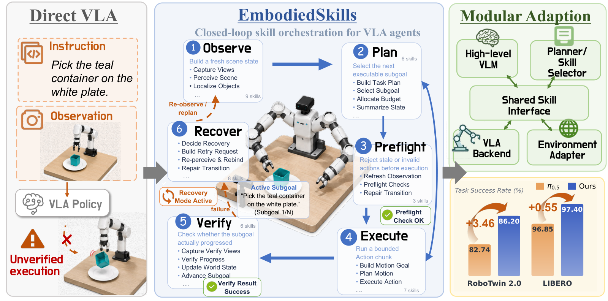

# Daily AI papers — 2026-09-08

*Curated from HF Daily Papers. 11 of 12 papers kept after relevance filter.*

## Papers at a glance

| # | Title | Topics | Org |
| --- | --- | --- | --- |
| 1 | [Unlocking Lossless Speedups in LLMs via Discrete Diffusion](#1-diffusion-augmented-llms) | `efficient-inference`, `diffusion`, `LLM` | Institute of Foundation Models |
| 2 | [FlowBalance: Verifier-Grounded Self-Improvement from On-Policy Reasoning Experience](#2-flowbalance) | `RL`, `reasoning`, `post-training` | (multi-author) |
| 3 | [EmbodiedSkills: A Unified Framework for Orchestrating, Training, and Deploying VLA Agents](#3-embodiedskills) | `agents`, `VLA`, `multimodal` | Zhejiang U. / DEEP Robotics |
| 4 | [Verify Before You Distill: Prompt-Level Teacher Gating for On-Policy Distillation](#4-tgopd) | `post-training`, `distillation`, `RL` | (multi-author) |
| 5 | [One Symptom, Three Levers: A Critical Review of On-Policy Self-Distillation](#5-opsd-review) | `post-training`, `distillation`, `reasoning`, `eval` | (independent) |
| 6 | [Unifying Conformal Language Tasks with In-Context Ensembles](#6-conformal-relevance) | `eval`, `LLM`, `ICL` | (multi-author) |
| 7 | [Safety for Whom? Boundary-Aware Self-Distillation for Controlled LLM Safety Refusal](#7-boundary-aware-refusal) | `safety`, `post-training`, `refusal` | (multi-author) |
| 8 | [Privacy Failure in Split-LLM Training](#8-split-llm-privacy) | `safety`, `systems`, `privacy` | (multi-author) |
| 9 | [What Else Needs Fixing? Cost-Effective Test-Time Compute for Revision Propagation](#9-revision-propagation) | `eval`, `test-time-compute`, `LLM` | NTT |
| 10 | [SimpleMemVLA: A Simple but Effective Native-Video Memory for VLA Models](#10-simplememvla) | `multimodal`, `VLA`, `agents` | Tsinghua / Renmin U. |
| 11 | [Causal Foundation Models](#11-causal-foundation-models) | `foundation-models`, `ICL`, `survey` | Layer 6 AI |

---

## 1. Unlocking Lossless Speedups in LLMs via Discrete Diffusion

**Authors:** Subham Sekhar Sahoo, Lingjie Chen, Khiem Pham, Jonathan Geuter, Chaitanya Dwivedi, Varad Pimpalkhute, Yash Akhauri, Alexander Moreno, Mikhail Yurochkin, Zhenting Wang, Mostafa Elhoushi, Nolan Dey, Shane Bergsma, Joel Hestness, John Thickstun, Eric Xing, Zhengzhong Liu — *Institute of Foundation Models*
**Links:** [arXiv:2609.04010](https://arxiv.org/abs/2609.04010) · [HF](https://huggingface.co/papers/2609.04010) · [AlphaXiv](https://www.alphaxiv.org/abs/2609.04010)
**Topics:** `efficient-inference`, `diffusion`, `LLM`

### TL;DR

A "diffusion-augmented" autoregressive LLM: keep the base model's next-token-prediction distribution, but *sample* multiple tokens in parallel using distilled discrete-diffusion weights and a matched sampler. No draft model, no acceptance-rejection quality loss — just a parallel decoder that respects the AR marginals.

### Key idea

The AR model implicitly defines a joint distribution over all future tokens. Rather than emit them one at a time, train a small **discrete diffusion** side-model whose stationary distribution matches the AR one, then use a "specialized sampler" that draws multiple tokens in parallel from that joint. Because the sampler is calibrated to the AR distribution, outputs remain in-distribution — the speedup is *lossless* rather than a draft-verify tradeoff.

### Main finding

Parallel-decoding speedups without the quality hit and without maintaining a separate draft model. Positioning it against speculative decoding (Medusa, EAGLE) is the whole selling point — the paper claims strictly lossless in a regime where draft-verify is only approximately so.

### Why it matters

Decoding latency is the last bottleneck of LLM serving after KV-cache and prefill/decode tricks. If diffusion-augmentation actually reaches non-trivial multi-token parallelism with *no* rollback overhead, it changes the throughput/latency Pareto for long generations (reasoning traces, agent trajectories) without the operational complexity of running two models in lockstep.

### Knowledge graph integration

**Builds on / relates to existing pages:**
- [../fundamentals/attention.md](../fundamentals/attention.md) — replaces sequential decoding with a parallel diffusion sampler over the AR marginals.
- [../pre-training/mtp.md](../pre-training/mtp.md) — same objective (produce multiple future tokens per step), different mechanism (diffusion sampler vs. auxiliary MTP head).
- [../inference/README.md](../inference/README.md) — sits in the same decoding-acceleration niche as speculative decoding, but avoids the verify step.

**Suggested new pages:**
- `inference/diffusion-augmented-decoding.md` *(depth)* — the lossless parallel-sampling mechanism.
- `inference/_decoding-acceleration.md` *(taxonomy)* — umbrella for speculative decoding, MTP-based drafts, Medusa/EAGLE, diffusion augmentation.

---

## 2. FlowBalance: Verifier-Grounded Self-Improvement from On-Policy Reasoning Experience

**Authors:** Zixun Huang, Kishan Panaganti, Haitao Mi, Leowei Liang
**Links:** [arXiv:2609.03241](https://arxiv.org/abs/2609.03241) · [HF](https://huggingface.co/papers/2609.03241) · [AlphaXiv](https://www.alphaxiv.org/abs/2609.03241)
**Topics:** `RL`, `reasoning`, `post-training`

### TL;DR

A verifier-grounded self-improvement loss that combines dense same-model guidance with sparse outcome verification. For each on-policy rollout, a frozen "privileged" view of the same policy scores tokens; those per-token gains are summed into a trajectory self-guidance signal that gets *retained*, *reversed*, or *zeroed* depending on the group-relative advantage from the verifier.

### Key idea

The core trick is **outcome-calibrated self-guidance**: the trajectory self-guidance score is multiplied by the sign of the GRPO-style group advantage. Positive-advantage trajectories keep their guidance, negative-advantage trajectories flip it (a false-positive correction), and no-preference groups fall back to pure verifier training. Fit as trajectory balance on the resulting energy-reweighted reference policy — one log-partition estimate per rollout group, no separate imitation loss.

### Main finding

On math (AIME24 diagnostic), improves over FlowRL on both Qwen3-4B and Qwen3-8B, with faster/more stable training and — crucially — higher *correct-strategy diversity*, avoiding the response-length collapse of On-Policy Self-Distillation (OPSD).

### Why it matters

Two failure modes plague on-policy reasoning RL: sparse verifiers give reliable but weak signal, and dense self-guidance quietly reinforces wrong-but-confident traces. FlowBalance turns the sign of the verifier advantage into a *gate* over dense guidance — a clean composition of the two signals — and gives a mode-collapse-resistant recipe for training reasoners from their own experience.

### Knowledge graph integration

**Builds on / relates to existing pages:**
- [../post-training/grpo.md](../post-training/grpo.md) — reuses the group-relative advantage as the verifier gate.
- [../post-training/rlvr.md](../post-training/rlvr.md) — a specific RLVR variant that fuses verifier reward with self-guidance.
- [../post-training/reasoning/long-cot-rl.md](../post-training/reasoning/long-cot-rl.md) — targets the same reasoning-RL regime; diagnoses collapse.
- [../post-training/_rl.md](../post-training/_rl.md) — new member of the LLM-RL algorithm family.

**Suggested new pages:**
- `post-training/reasoning/flowbalance.md` *(depth)* — the outcome-calibrated self-guidance loss and its trajectory-balance fit.

---

## 3. EmbodiedSkills: A Unified Framework for Orchestrating, Training, and Deploying VLA Agents

**Authors:** Wenqiao Zhang, Yutong Lin, Yuqian Yuan, Tianwei Lin, Jinhao Mao, Zhenxuan Fan, Mingjian Gao, Yang Dai, Wentong Li, Zheqi Lv, Zheng Dong, Yingjie Niu, Jiaqi Zhu, Jun Xiao, Chao Li, Yueting Zhuang — *Zhejiang University / NUAA / Cornell / NUS / DEEP Robotics*
**Links:** [arXiv:2609.01281](https://arxiv.org/abs/2609.01281) · [HF](https://huggingface.co/papers/2609.01281) · [AlphaXiv](https://www.alphaxiv.org/abs/2609.01281)
**Topics:** `agents`, `VLA`, `multimodal`

### TL;DR

Wraps a VLA policy in an agent loop that treats every skill choice as an "execution proposal" with pre-condition checks and post-hoc outcome verification. A fixed executable-skill interface lets the low-level VLA (Qwen3-VL + OpenPI/π₀.₅) be swapped without touching the planner, and the loop's structured trajectories become supervision for training or online adaptation.

### Key idea

Instead of training one monolithic VLA to plan + act + verify, factor the agent into (a) a high-level skill selector, (b) a bounded low-level VLA execution, (c) prerequisite check, (d) post-action verifier. All four communicate through one shared "executable-skill interface" that logs planning/execution/verification/recovery events into structured trajectories usable both as training data and for online adaptation.

### Main finding

86.20% average success across 50 RoboTwin 2.0 tasks and 97.40% across the four LIBERO suites, using task-adapted low-level VLA policies. On four memory-dependent RMBench tasks, the same execution approach hits 12.5% — a signal that memory is where the current stack still breaks.

### Why it matters

VLAs are good at short-horizon action prediction but brittle on long-horizon tasks that need planning and error recovery. EmbodiedSkills makes the recovery loop *explicit and inspectable* — a training-time and deployment-time contract between planner and policy — which is closer to how frontier agent systems (browser-use, computer-use) already work.

### Knowledge graph integration

**Builds on / relates to existing pages:**
- [../agents/README.md](../agents/README.md) — an agent-loop with tool-call-style skill invocations and verification.
- [../multimodal/README.md](../multimodal/README.md) — VLA is the multimodal-LLM extension into robot action space.

**Suggested new pages:**
- `agents/executable-skill-interface.md` *(depth)* — the prerequisite/post-condition contract for VLA skills.
- `multimodal/_vla.md` *(taxonomy)* — overview of Vision-Language-Action models and their planning/execution decomposition.

---

## 4. Verify Before You Distill: Prompt-Level Teacher Gating for On-Policy Distillation

**Authors:** Zhiwei Zhang, Zechen Sun, Fei Zhao, Kang Peng, Bin Liang, Huayu Deng, Yao Hu, Kam-Fai Wong, Mu Chuan
**Links:** [arXiv:2609.02998](https://arxiv.org/abs/2609.02998) · [HF](https://huggingface.co/papers/2609.02998) · [AlphaXiv](https://www.alphaxiv.org/abs/2609.02998)
**Topics:** `post-training`, `distillation`, `RL`

### TL;DR

TGOPD — Teacher-Gated On-Policy Distillation. Before applying dense teacher supervision to a student rollout, probe the teacher with a verifier on the same prompt; if the teacher's probes verify, apply on-policy distillation, otherwise fall back to verifier-grounded GRPO on that prompt.

### Key idea

Vanilla on-policy distillation applies teacher supervision uniformly, but reverse-KL is mode-seeking — a confidently-wrong teacher on a prompt drags the student toward that wrong mode. Rather than trust distributional proxies (entropy, likelihood), gate at the *prompt level* using verifier-scored teacher probes. Prompts the teacher passes → dense OPD; prompts it fails → GRPO with the verifier as the reward. As a side effect, the reliability check uses spare teacher GPU cycles.

### Main finding

Beats vanilla OPD across all six single-domain (math, code, instruction-following) settings at 4B and 35B student scale, and beats it on multi-domain averages at both scales. Reliability-check probes raise teacher-node GPU utilization from 9.8% → 78.9% in the 4B single-domain configuration.

### Why it matters

On-policy distillation was a promising middle ground between SFT and RL, but its "always trust the teacher" mode is a silent failure risk. TGOPD is a clean per-prompt router between distillation and RL, and — bonus — a rare recipe where compute *waste* becomes reliability budget.

### Knowledge graph integration

**Builds on / relates to existing pages:**
- [../post-training/grpo.md](../post-training/grpo.md) — used as the fallback branch when the teacher fails verification.
- [../post-training/rlvr.md](../post-training/rlvr.md) — verifier-grounded reward for the ungated branch.
- [../post-training/rejection-sampling.md](../post-training/rejection-sampling.md) — a coarse-grained cousin of prompt-level gating.
- [../post-training/fine-tuning/README.md](../post-training/fine-tuning/README.md) — distillation is a fine-tuning class.

**Suggested new pages:**
- `post-training/on-policy-distillation.md` *(depth)* — the core OPD algorithm (with TGOPD as the reliability-gated variant).

---

## 5. One Symptom, Three Levers: A Critical Review of On-Policy Self-Distillation

**Authors:** Justin Robert, Raheel Qader
**Links:** [arXiv:2608.25936](https://arxiv.org/abs/2608.25936) · [HF](https://huggingface.co/papers/2608.25936) · [AlphaXiv](https://www.alphaxiv.org/abs/2608.25936)
**Topics:** `post-training`, `distillation`, `reasoning`, `eval`

### TL;DR

A structural review of On-Policy Self-Distillation (OPSD): the technique where the "teacher" is the same model conditioned on privileged information (a reference solution, a plan, environment feedback). The paper argues collapse — progressive narrowing of reasoning paths — is *the* dominant failure mode, and organizes the design space around three levers.

### Key idea

Three levers:
1. **Where the signal is applied** — how tokens are weighted along a trajectory.
2. **What the teacher is shown** — the nature of the privileged information.
3. **When the signal changes** — the teacher's dynamics and the decay of guidance.

No new experiments; the contribution is a shared vocabulary and taxonomy that maps the disparate published methods onto the same axes.

### Main finding

Collapse is not OPSD-specific but is aggravated by the privileged-teacher asymmetry, and the three-lever framing subsumes the fixes proposed across the recent OPSD literature.

### Why it matters

OPSD papers have proliferated with different names for overlapping phenomena. A canonical taxonomy is exactly what a knowledge graph needs to slot the individual method papers (FlowBalance, TGOPD, DAGGER-derived methods) into one comparable space.

### Knowledge graph integration

**Builds on / relates to existing pages:**
- [../post-training/fine-tuning/README.md](../post-training/fine-tuning/README.md) — distillation is a fine-tuning class.
- [../post-training/reasoning/long-cot-rl.md](../post-training/reasoning/long-cot-rl.md) — OPSD is often applied to long-CoT reasoning models where collapse hurts most.

**Suggested new pages:**
- `post-training/_on-policy-distillation.md` *(taxonomy)* — the three-lever design space; links to OPSD variants + TGOPD + FlowBalance.

---

## 6. Unifying Conformal Language Tasks with In-Context Ensembles

**Authors:** Xiao Shi Huang, Chen-Yuan Lin, Bruce Kuwahara, Kin Kwan Leung, Jesse C. Cresswell
**Links:** [arXiv:2609.03005](https://arxiv.org/abs/2609.03005) · [HF](https://huggingface.co/papers/2609.03005) · [AlphaXiv](https://www.alphaxiv.org/abs/2609.03005)
**Topics:** `eval`, `LLM`, `ICL`

### TL;DR

A **Conformal Relevance** framework for NLP retrieval-style tasks (summarization, extractive QA): use in-context-learning example ensembling instead of hand-engineered prompts to construct the score function that a conformal prediction wrapper needs. Guarantees coverage, improves conciseness, and does it across seven tasks with minimal manual prompt work.

### Key idea

Conformal prediction gives you coverage guarantees for free — but the *conciseness* of the output depends entirely on the score function. State of the art uses hand-tuned LLM prompts as scorers, which are labor-intensive and per-task. Replace prompt engineering with a curated in-context-learning ensemble: multiple ICL demonstrations, aggregated. Bonus theory: a diversity/complementarity condition for when ensembling improves worst-case sentence scores, plus a saturation bound.

### Main finding

Seven NLP tasks unified under one framework, with coverage guarantees preserved and conciseness improved over prompt-engineered baselines. Theoretical characterization of when ICL ensembling helps.

### Why it matters

Conformal prediction is one of the cleanest routes to *calibrated* LLM outputs, but it has been task-siloed. A unifying framework that removes the prompt-engineering barrier is a real step toward calibrated LLMs as a general primitive.

### Knowledge graph integration

**Builds on / relates to existing pages:**
- [../evaluation/README.md](../evaluation/README.md) — calibration/coverage as an evaluation-side guarantee.

**Suggested new pages:**
- `evaluation/conformal-relevance.md` *(depth)* — the ICL-ensembled scorer + coverage guarantee framework.

---

## 7. Safety for Whom? Boundary-Aware Self-Distillation for Controlled LLM Safety Refusal

**Authors:** Alejo López-Ávila, Iker García-Ferrero, Jezabel Garcia, Antonio Tiene, Román Orús
**Links:** [arXiv:2609.04482](https://arxiv.org/abs/2609.04482) · [HF](https://huggingface.co/papers/2609.04482) · [AlphaXiv](https://www.alphaxiv.org/abs/2609.04482)
**Topics:** `safety`, `post-training`, `refusal`

### TL;DR

Different deployments of the same base model need different refusal boundaries — a legal assistant should refuse persuasion techniques a debate coach should teach. Boundary-Aware Self-Distillation is an offline, self-generated data pipeline (controlled topic generation, coverage repair, in-distribution compensation, harmful-benign pairs) that trains a narrow, controllable refusal boundary.

### Key idea

Frame refusal not as a global on/off but as a *narrow boundary within a topic*. The pipeline generates controlled topic variations, iteratively repairs coverage gaps by escalating retries, and uses harmful-benign pairs to teach the model exactly where the boundary sits — all without external labels.

### Main finding

Escalating retries drove prompts lacking accepted refusal traces from 19.88% → 0.20%. Training on political-persuasion data with Qwen3-8B: target-domain refusal 9.47% → 84.75%; unsafe responses across benchmarks 26.26% → 0.14%. Tradeoff: XSTest over-refusal jumps to 74.00% — the safety-usability dial is visible.

### Why it matters

"Refusal" has been treated as a blanket capability, but productization needs *per-deployment* refusal boundaries. This paper explicitly evaluates both sides of the boundary (under-refusal *and* over-refusal), which is the correct evaluation shape for controllable safety.

### Knowledge graph integration

**Builds on / relates to existing pages:**
- [../safety/README.md](../safety/README.md) — narrow-boundary refusal training is a positive-safety complement to the attack pages.
- [../safety/mismatched-generalization.md](../safety/mismatched-generalization.md) — over-refusal is the mismatched-generalization failure mode of safety training.
- [../post-training/fine-tuning/README.md](../post-training/fine-tuning/README.md) — self-distilled SFT recipe.

**Suggested new pages:**
- `safety/boundary-aware-refusal.md` *(depth)* — the topic-scoped, self-distilled refusal-training recipe.
- `safety/_refusal-training.md` *(taxonomy)* — umbrella for refusal-training methods (blanket refusal, boundary-aware, constitutional).

---

## 8. Privacy Failure in Split-LLM Training: The Returned Gradient Nullifies the Decoys

**Authors:** Georgios Politis, Evangelos Pappas
**Links:** [arXiv:2609.04382](https://arxiv.org/abs/2609.04382) · [HF](https://huggingface.co/papers/2609.04382) · [AlphaXiv](https://www.alphaxiv.org/abs/2609.04382)
**Topics:** `safety`, `systems`, `privacy`

*Borderline: included because split-LLM training is an emerging LLM training paradigm and the attack targets a defense pattern (decoy rows) that will show up in future LLM privacy work.*

### TL;DR

A two-node split-LLM training protocol (Trusted Local Node ↔ Untrusted Cloud Node) uses decoy rows to protect activations. The paper shows a trivial vulnerability: decoy gradients are zero, so the *returned gradient* immediately reveals which rows were real. Gradient clipping + per-row noise mitigates, at ~0.01 nats of held-out cross-entropy.

### Key idea

Any defense that produces a distinguishable pattern in the untrusted side's *outputs* leaks the secret. Zero-gradient decoys are the canonical example: the untrusted side never sees the decoy labels, but it sees zero rows in the returned gradient. Nine seeds → all real rows identified consistently; recovery of ~1 extra token per 100 over baseline guessing.

### Main finding

Systematic recovery of real rows across nine seeds; token-level recovery gain ~1/100 over baseline. Clip+noise defense costs ~0.01 nats of cross-entropy. Five additional attack classes named but not measured, including gradient-observation accumulation across training steps.

### Why it matters

Split-LLM training is starting to be pitched as a privacy-preserving alternative to full outsourcing. This paper is the "the emperor has no clothes" note — the naive decoy defense is trivially broken, and a proper analysis needs to account for the *whole* forward + backward channel.

### Knowledge graph integration

**Builds on / relates to existing pages:**
- [../systems/README.md](../systems/README.md) — split-LLM training is a distributed-training system pattern.

**Suggested new pages:**
- (none — the paper is a targeted vulnerability disclosure; not a good candidate for a standalone concept page in a training-focused graph.)

---

## 9. What Else Needs Fixing? Cost-Effective Test-Time Compute for Revision Propagation in Conversation

**Authors:** Daisuke Kikuta — *NTT*
**Links:** [arXiv:2609.03254](https://arxiv.org/abs/2609.03254) · [HF](https://huggingface.co/papers/2609.03254) · [AlphaXiv](https://www.alphaxiv.org/abs/2609.03254)
**Topics:** `eval`, `test-time-compute`, `LLM`

### TL;DR

When a user asks for a local edit in an iterative-generation conversation, the LLM must find and update every dependent part of the artifact. New benchmark for this "revision propagation" ability; systematic sweep of 9 test-time compute strategies (sequential reflection variants and parallel sampling variants).

### Key idea

Revision propagation is a distinct capability from single-turn generation and single-turn edit: the model must maintain a dependency graph across the conversation history. The paper measures nine strategies (best-of-N via LLM judge, medoid selection, sequential self-reflection, etc.) and finds the cost-effective winner is *3-parallel + LLM/medoid selection*.

### Main finding

Baseline accuracies 68.3–93.0% across gpt-oss-20b/120b, gpt-5.4-mini, and qwen3.5-9b/27b/122b. Best method (3 parallel samples + LLM or medoid selection) improves accuracy by 2.2–9.7%.

### Why it matters

Iterative LLM-driven artifact generation (code, docs, designs) is where most real-world usage lives. Revision propagation is the failure mode people actually hit, and a low-cost test-time-compute recipe for it is directly deployable.

### Knowledge graph integration

**Builds on / relates to existing pages:**
- [../post-training/rejection-sampling.md](../post-training/rejection-sampling.md) — parallel-sampling-plus-selection is the training-time cousin of the test-time recipe.
- [../evaluation/README.md](../evaluation/README.md) — introduces a new benchmark and evaluation shape.

**Suggested new pages:**
- `inference/_test-time-compute.md` *(taxonomy)* — sequential reflection vs. parallel sampling + selection, with revision propagation as a canonical task.

---

## 10. SimpleMemVLA: A Simple but Effective Native-Video Memory for VLA Models

**Authors:** Cheng Yin, Wang Xu, Junpeng Yang, Sikyuen Tam, Hanyu Liu, Yuan Yao, Xiangrui Zeng, Junbo Cui, Yequan Wang, Zhouping Yin, Yankai Lin — *Tsinghua / Renmin University*
**Links:** [arXiv:2609.05533](https://arxiv.org/abs/2609.05533) · [HF](https://huggingface.co/papers/2609.05533) · [AlphaXiv](https://www.alphaxiv.org/abs/2609.05533)
**Topics:** `multimodal`, `VLA`, `agents`

### TL;DR

For long-horizon manipulation, drop the retrieval bank / learned compressor / recurrent state entirely and just feed the sampled history to the VLM backbone as a timestamped video — the format the backbone was already pretrained on. A flow-matching action head reads the backbone's hidden states.

### Key idea

Memory-mechanism papers assume raw history is too large to process; modern VLM backbones (with long context) make that assumption false. So: keep the raw timestamped-video history, let the backbone consume it directly, and use prefix-sharing across consecutive decisions so per-frame latency stays close to a single-frame VLA. The action head is a standard flow-matching decoder over the backbone's hidden states of a generated sub-task token.

### Main finding

New SOTA on four memory benchmarks with the backbone and training setup held fixed; beats retrieval, compression, and recurrent-state baselines by "a wide margin." Causal interventions confirm the policy is genuinely reading history rather than exploiting a shortcut.

### Why it matters

The "no bespoke memory module" bitter lesson — long-context VLMs subsume the retrieval-bank generation of memory work, provided the video-format history is respected. Cleaner recipe, and the memory-benchmark gap (RMBench 12.5% in EmbodiedSkills) becomes an evaluation-side rather than architecture-side problem.

### Knowledge graph integration

**Builds on / relates to existing pages:**
- [../multimodal/README.md](../multimodal/README.md) — VLM-native video memory in the multimodal stack.
- [../agents/README.md](../agents/README.md) — long-horizon agent memory without a bespoke module.

**Suggested new pages:**
- `multimodal/native-video-memory.md` *(depth)* — the prefix-shared, backbone-native video-history mechanism for VLAs.

---

## 11. Causal Foundation Models

**Authors:** Christopher Stith, Hossein Rahmani, Jesse C. Cresswell — *Layer 6 AI*
**Links:** [arXiv:2609.03003](https://arxiv.org/abs/2609.03003) · [HF](https://huggingface.co/papers/2609.03003) · [AlphaXiv](https://www.alphaxiv.org/abs/2609.03003)
**Topics:** `foundation-models`, `ICL`, `survey`

*Borderline: included because it explicitly frames a pretraining-once/in-context-inference paradigm outside NLP — a signal about how the foundation-model recipe generalizes.*

### TL;DR

A practical introduction to **Causal Foundation Models** (CFMs): neural networks pretrained once and then used to estimate causal quantities (e.g. average treatment effect) on new datasets via in-context learning, no fine-tuning. Includes example code and notebooks.

### Key idea

Take the foundation-model recipe — big-pretrain, ICL at inference — and apply it to *causal inference*, where each new problem traditionally required its own bespoke estimator and pipeline. The paper positions CFMs as an emerging class and gives the necessary background to work with them.

### Main finding

Tutorial paper — no new experimental result claimed. Contribution is exposition and a working notebook stack for the CFM paradigm.

### Why it matters

The "one big pretrained model handles many tasks via ICL" recipe is spreading beyond language into scientific-workflow-style problems. Watching where it works and where it doesn't is instructive for anyone thinking about foundation models as a general primitive.

### Knowledge graph integration

**Builds on / relates to existing pages:**
- (no direct depth pages exist yet — this is a paradigm-level observation.)

**Suggested new pages:**
- (none — a tutorial paper; the KG will pick up the class when a specific CFM method paper lands.)

---

## Notes

- Borderline inclusions are flagged in-section with an italic *Borderline: …* note.
- Hero figures live in `assets/2026-09-08/`. Only paper 3 (EmbodiedSkills) had an extractable teaser figure; the others' Hugging Face pages did not expose an `og:image` and their arXiv HTML previews did not have a discoverable teaser at the standard paths.
- This digest is informational. No existing concept files, `READING-LIST.md`, or `PAPERS.md` were modified to produce it.
