# Daily AI papers — 2026-09-09

*Curated from HF Daily Papers. 15 of 47 papers kept after relevance filter.*

## Papers at a glance

| # | Title | Topics | Org |
| --- | --- | --- | --- |
| 1 | [NeoHorse-1: Recursive Self-Improvement via Agentic Post-Training](#1-neohorse-1) | `agents`, `RL`, `post-training` | NeoHorse Team (Huawei et al.) |
| 2 | [AuK: Open-Source Foundational Speech Model](#2-auk) | `multimodal`, `audio-LLM` | SJTU / MoE-Key |
| 3 | [Gander: Omni Interaction Agent](#3-gander-omni-interaction-agent) | `multimodal`, `agents`, `speech` | Tencent Hunyuan |
| 4 | [OPRD: Weak-to-Strong via On-Policy Reverse Distillation](#4-oprd) | `post-training`, `distillation`, `alignment` | KAIST / Mila / Microsoft |
| 5 | [Miles v0.1: Production-Level Post-Training](#5-miles-v0-1) | `post-training`, `RL`, `systems` | RadixArk |
| 6 | [Mask Forcing: AR Video Diffusion Distillation](#6-mask-forcing) | `diffusion`, `video`, `distillation` | HKUST / HKU / others |
| 7 | [BeaconKV: Cache Compression for Long Reasoning](#7-beaconkv) | `inference`, `KV-cache`, `reasoning` | Hanyang University |
| 8 | [CVRR: Making Latent Visual Reasoning Necessary](#8-cvrr) | `multimodal`, `reasoning`, `interp` | Korea University |
| 9 | [Steering Geometry: Human Values in Steering Space](#9-steering-geometry) | `interp`, `safety` | Sharif / UBC / Queen's |
| 10 | [Kalman Delta Networks: Uncertainty-aware Linear Attention](#10-kalman-delta-networks) | `architectures`, `linear-attention` | Yale |
| 11 | [Online Draft Co-Training for Speculative RL Rollouts](#11-online-draft-co-training) | `inference`, `systems`, `RL` | NVIDIA |
| 12 | [Procedural Graphs for LLM Agents](#12-procedural-graphs) | `agents` | Google |
| 13 | [FEE: Environments as Scaffold for Self-Evolving Agents](#13-fee) | `agents`, `RL` | CAS / Fudan |
| 14 | [CoVeR: Coverage-Based Token Pruning for Multi-View VLMs](#14-cover) | `multimodal`, `efficient-inference` | Meta / CMU |
| 15 | [Recognition-Refusal Misalignment in LLMs](#15-recognition-refusal-misalignment) | `interp`, `safety` | Purdue |

---

## 1. NeoHorse-1: Towards Recursive Self-Improvement via Agentic Post-Training with Routing Harness

**Authors:** NeoHorse Team — Yunhe Wang, Kai Han, Tianyu Guo, Yu Wang, et al. — *Huawei Noah's Ark Lab and collaborators*
**Links:** [arXiv:2609.08183](https://arxiv.org/abs/2609.08183) · [HF](https://huggingface.co/papers/2609.08183) · [AlphaXiv](https://www.alphaxiv.org/abs/2609.08183)
**Topics:** `agents`, `RL`, `post-training`, `self-improvement`

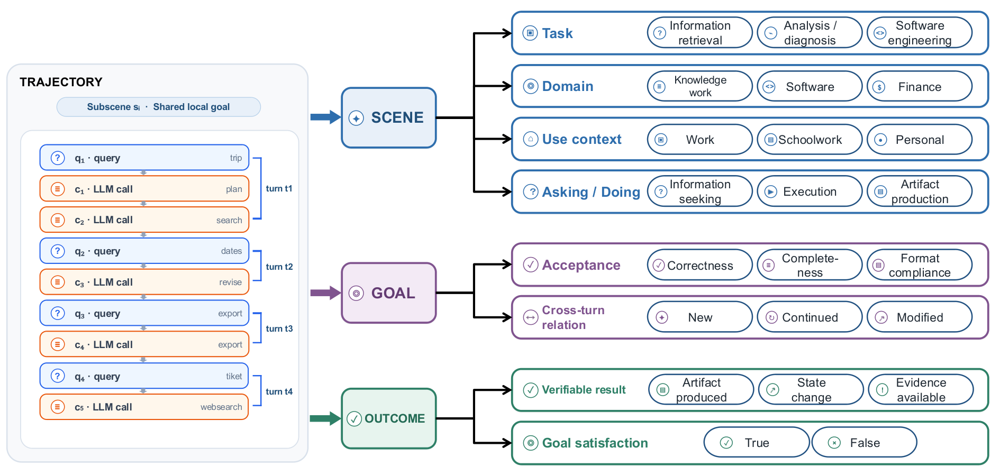

### TL;DR

NeoHorse-1 is a family of agent-native LLMs post-trained through a loop that turns benchmark evidence into the next training mixture. A router dispatches queries across a heterogeneous model pool and a validator combines structural and semantic checks; capability-guided allocation feeds evaluation deltas back into curriculum stages, producing gains across eleven agent-tool-code-instruction benchmarks.

### Key idea

Recursive self-improvement (RSI) framed as a concrete pipeline: (i) heterogeneous model pool + learned routing harness for query dispatch, (ii) structural validators alongside semantic evaluators as reward proxies, (iii) capability-guided allocation that converts per-benchmark evidence into the next SFT/RL mixture in the curriculum.

### Main finding

Curriculum stages plus feedback-driven allocation lift performance across eleven benchmarks spanning agentic tool use, coding, and instruction-following, with the router meaningfully outperforming any single expert in the pool.

### Why it matters

Turns "self-improvement" from a vague slogan into an auditable loop: the routing harness makes it explicit which expert made which token, and the validator/allocator wire measurement directly to the next training mixture. A concrete template for open-model teams chasing R1-style RSI without a single frontier base.

### Knowledge graph integration

**Builds on / relates to existing pages:**
- [_rl.md](../post-training/_rl.md) — same RL-post-training family, adds routing + curriculum control loop.
- [rlvr.md](../post-training/rlvr.md) — validator-driven rewards are the RLVR pattern applied to agent traces.
- [_moe.md](../architectures/_moe.md) — heterogeneous model pool + router generalises MoE routing beyond a single model.

**Suggested new pages:**
- `post-training/recursive-self-improvement.md` *(depth)* — the RSI loop as an object of study.
- `agents/routing-harness.md` *(depth)* — inference-time router across a heterogeneous model pool.

---

## 2. AuK: An Open-Source Foundational Model for Speech Generation and Editing

**Authors:** Ziyang Ma, Zhikang Niu, Wenming Tu, Tianrui Wang, Ruiqi Yan, Junxi Liu, Yanru Huo, Xie Chen (corresp.) — *SJTU MoE Key Lab and collaborators*
**Links:** [arXiv:2609.08936](https://arxiv.org/abs/2609.08936) · [HF](https://huggingface.co/papers/2609.08936) · [AlphaXiv](https://www.alphaxiv.org/abs/2609.08936)
**Topics:** `multimodal`, `audio-LLM`, `speech`, `tech-report`

### TL;DR

AuK is an open-source foundation model unifying speech generation, content/paralinguistic/acoustic editing, enhancement, and separation behind a natural-language + audio-context interface. It's trained on ~3.03B instruction–audio pairs and ~1.95M hours of effective supervision, with weights and code released.

### Key idea

Instruction-tuned speech-LLM with five task families sharing one interface: user gives a natural-language instruction and (optionally) an audio context, model emits speech. The scale — instructions and hours — plus a single unified formulation is what enables generalisation across generation and editing.

### Main finding

Across a broad benchmark suite AuK reaches SOTA-competitive quality in speech generation and editing while covering enhancement, separation, and paralinguistic controls in the same weights.

### Why it matters

Open-source speech models have been fragmented per-task (TTS vs. editing vs. enhancement); AuK is the first serious attempt at a Llama-scale unified stack for speech. If the release includes real training data recipes, it sets the reference recipe for the next wave of speech LLMs.

### Knowledge graph integration

**Builds on / relates to existing pages:**
- [multimodal/README.md](../multimodal/README.md) — same multimodal-LLM class, extended to audio-in/audio-out.

**Suggested new pages:**
- `multimodal/speech-llm.md` *(depth)* — instruction-tuned speech generation as a modality.
- `case-studies/auk.md` *(case study)* — if the tech report holds up on scale details.

---

## 3. Gander: Omni Interaction Agent Technical Report

**Authors:** Shengpeng Ji, Junlong Tong, Jialong Zuo, Dongchao Yang, Zhou Zhao, et al. — *Tencent Hunyuan Speech, ZJU, SJTU, CUHK, NTU*
**Links:** [arXiv:2609.08977](https://arxiv.org/abs/2609.08977) · [HF](https://huggingface.co/papers/2609.08977) · [AlphaXiv](https://www.alphaxiv.org/abs/2609.08977)
**Topics:** `multimodal`, `agents`, `speech`, `tech-report`

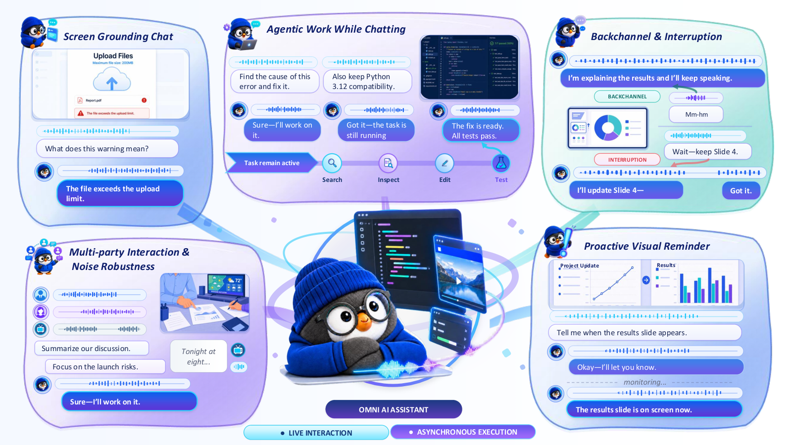

### TL;DR

Gander is an end-to-end streaming model that combines omni perception (video + speech + text), true full-duplex interaction, and agentic tool use in one system. A "Cerebellum" handles low-latency chunked I/O and everyday dialogue while a "Brain" handles reasoning and orchestration.

### Key idea

Cerebellum-Brain split: Cerebellum runs a streaming Thinker-Talker over a chunked token stream that interleaves user and model tokens, giving barge-in and backchannel out of the box; Brain is invoked through tool calls and an agent orchestration runtime for higher-level tasks.

### Main finding

Matches SOTA open-source spoken-dialogue quality while remaining competitive on omni understanding and agentic tasks, and is robust to noisy multi-party settings, background interruptions, and backchannels. Weights, code and data released.

### Why it matters

The full-duplex + omni + agent bundle in one open release is the closest open template to the GPT-4o-style conversational agent. The chunked interleaved-token interface is worth learning from — it's what makes barge-in cheap.

### Knowledge graph integration

**Builds on / relates to existing pages:**
- [agents/README.md](../agents/README.md) — extends agent tool-calling to a streaming full-duplex interface.
- [multimodal/README.md](../multimodal/README.md) — omni encoder + streaming decoder in one system.

**Suggested new pages:**
- `multimodal/full-duplex-speech.md` *(depth)* — streaming Thinker-Talker + interleaved token stream.
- `case-studies/gander.md` *(case study)* — the Cerebellum-Brain system as a whole.

---

## 4. Eliciting Weak-to-Strong Generalization with On-Policy Reverse Distillation

**Authors:** Youngrok Park, Sangmin Bae, Hojung Jung, Jongwoo Ko, Yunseon Choi, Young Jin Kim, Pashmina Cameron, Aaron Courville, Se-Young Yun — *KAIST, Mila, Microsoft Research*
**Links:** [arXiv:2609.08798](https://arxiv.org/abs/2609.08798) · [HF](https://huggingface.co/papers/2609.08798) · [AlphaXiv](https://www.alphaxiv.org/abs/2609.08798)
**Topics:** `post-training`, `distillation`, `alignment`, `weak-to-strong`

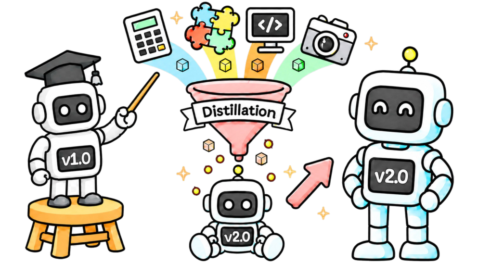

### TL;DR

Reverse-KL distillation with a twist: the teacher's policy divergence from its own reference is measured on the student's rollouts, and gradient updates supported by a verifier get amplified along that direction. This lets a strong student learn from a weaker teacher and surpass it, without the PPO-style stability loss.

### Key idea

**OPRD (On-Policy Reverse Distillation)**: instead of forward-KL fitting the teacher, evaluate the teacher–reference policy gap *on the student's on-policy trajectories*, then use verifier signal to amplify only the supported gradient directions. Behaves like a policy-gradient step with a teacher-derived direction and a verifier-derived weight.

### Main finding

Consistent gains over standard distillation and prior weak-to-strong methods across successive-model transfer, multi-teacher, and vanilla distillation regimes, while preserving policy-optimization stability.

### Why it matters

Weak-to-strong is a load-bearing pillar of scalable oversight. OPRD gives a concrete, on-policy recipe that fits inside the same RL-post-training loops teams already run, which lowers the cost of the ideal-supervisor gap experiments Anthropic, OpenAI and DeepMind have been publishing.

### Knowledge graph integration

**Builds on / relates to existing pages:**
- [grpo.md](../post-training/grpo.md) — same on-policy gradient shape, teacher divergence replaces group-relative baseline.
- [rlvr.md](../post-training/rlvr.md) — verifier-supported amplification is RLVR reused as a per-token gate.
- [_rl.md](../post-training/_rl.md) — a new entry in the on-policy RL family.

**Suggested new pages:**
- `post-training/weak-to-strong.md` *(depth)* — OPRD as the anchor for a family we don't yet cover.
- `post-training/reverse-distillation.md` *(depth)* — teacher-on-student-rollouts objective family.

---

## 5. Miles v0.1: Production-Level Post-Training

**Authors:** Tom Chen, Mao Cheng, Shi Dong, Kangrui Du, Yanbin Jiang, Jiajun Li, Yiming Li, Tao Lin, Yusheng Su, Andy Ye, Yueming Yuan, Zhichen Zeng — *RadixArk*
**Links:** [arXiv:2609.08368](https://arxiv.org/abs/2609.08368) · [HF](https://huggingface.co/papers/2609.08368) · [AlphaXiv](https://www.alphaxiv.org/abs/2609.08368)
**Topics:** `post-training`, `RL`, `systems`, `tech-report`

*(No hero figure available: paper has no arxiv HTML render.)*

### TL;DR

Miles is a full-stack RL post-training system: SGLang rollouts, a trainer with Megatron-LM or PyTorch FSDP backends, and three weight-sync transports for different topologies. Beyond full-parameter RL it covers LoRA RL, on-policy distillation, SFT, and true on-policy rollout–training alignment; the same architecture extends to diffusion.

### Key idea

Design each stage of the RL loop around one principle — verified, clean, customisable components — with explicit modules for rollout engine, trainer backend, and weight-sync transport, so operators can swap topologies without rewriting the loop.

### Main finding

A single system reproduces the frontier post-training regimes (full-param RL, LoRA RL, on-policy distillation, SFT) and matches specialised codebases on accuracy and throughput while adding true on-policy rollout–training alignment as a first-class option.

### Why it matters

Post-training frameworks have been the bottleneck for open reproductions of R1/Kimi-style pipelines. A clean, production-oriented alternative to verl/OpenRLHF broadens the pool of teams that can run frontier RL, and the diffusion extension hints at unified RL infra across modalities.

### Knowledge graph integration

**Builds on / relates to existing pages:**
- [systems/ray.md](../systems/ray.md) — the orchestration layer these frameworks all sit on.
- [systems/partial-rollouts.md](../systems/partial-rollouts.md) — same rollout-worker discipline; Miles formalises the transports.
- [_rl.md](../post-training/_rl.md) — reference implementation surface for the RL algorithms in this taxonomy.

**Suggested new pages:**
- `systems/rl-post-training-framework.md` *(depth)* — the SGLang-rollout + Megatron/FSDP-trainer + weight-sync pattern.
- `systems/on-policy-distillation.md` *(depth)* — a technique Miles calls out as first-class.

---

## 6. Mask Forcing: Improving Autoregressive Video Diffusion Distillation via Dual-Noise Masking Rollout

**Authors:** Zhuoran Zhao, Shengju Qian, Tongtong Liang, Xianghao Kong, Songchun Zhang, Junchao Huang, Guian Fang, Xin Wang, Pan Hui, Anyi Rao — *HKUST(GZ), HKU and collaborators*
**Links:** [arXiv:2609.09123](https://arxiv.org/abs/2609.09123) · [HF](https://huggingface.co/papers/2609.09123) · [AlphaXiv](https://www.alphaxiv.org/abs/2609.09123)
**Topics:** `diffusion`, `video`, `distillation`, `generation`

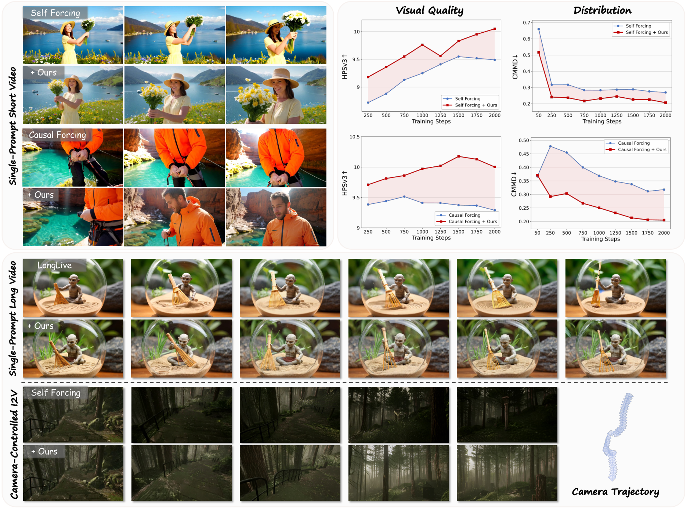

### TL;DR

Distribution Matching Distillation (DMD) for AR video diffusion collapses onto a few teacher modes, giving over-saturated over-smoothed videos. Mask Forcing perturbs student rollouts with random spatial/temporal masks that inject cleaner tokens, forcing exploration of more of the teacher distribution and reducing error accumulation — all without real video data.

### Key idea

Dual-Noise Masking Rollout: during self-rollout, randomly mask a fraction of tokens along both spatial and temporal axes and replace them with cleaner draws, so the reverse-KL DMD signal covers regions the student wasn't seeking on its own. Cleaner tokens double as denoising guidance for their noisier neighbours.

### Main finding

Consistent visual-quality gains over several AR video-diffusion distillation methods, without adding real video data or extra post-training stages.

### Why it matters

Reverse-KL mode collapse is the standard failure mode of one-step / few-step distillation in image and video diffusion; a data-free perturbation that widens coverage is a cheap plug-in with obvious carry-over to image diffusion and text diffusion.

### Knowledge graph integration

**Builds on / relates to existing pages:**
- No existing diffusion pages in the graph yet — this is a green-field area.

**Suggested new pages:**
- `multimodal/_diffusion-distillation.md` *(taxonomy)* — DMD, consistency distillation, Mask Forcing.
- `multimodal/mask-forcing.md` *(depth)* — the dual-noise mask rollout trick.

---

## 7. BeaconKV: Key-Value Cache Compression Guided by Beacon Queries for Efficient Large Reasoning Model Inference

**Authors:** Janghyeon Kim, Minsoo Kim, Kyuhong Shim, Jungwook Choi — *Hanyang University*
**Links:** [arXiv:2609.04971](https://arxiv.org/abs/2609.04971) · [HF](https://huggingface.co/papers/2609.04971) · [AlphaXiv](https://www.alphaxiv.org/abs/2609.04971)
**Topics:** `inference`, `KV-cache`, `reasoning`, `efficient-inference`

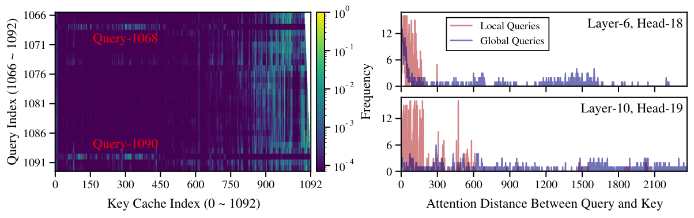

### TL;DR

Existing KV-cache compressors assume recent queries predict future attention. In long CoT, "Thought Revisiting Tokens" re-attend to plans laid out early — those queries cluster into a few groups. BeaconKV keeps one beacon per cluster and uses it to guard the KV entries that will be revisited, giving 5.8× memory reduction and 4.3× throughput at near-full accuracy, training-free.

### Key idea

Cluster the query history in embedding space and keep only per-cluster beacon queries; before evicting a KV pair, score it against the beacons rather than only the most-recent queries. This preserves cache entries that will be re-attended to by future revisits without storing all past queries.

### Main finding

Across four open-source large reasoning models and diverse reasoning benchmarks: up to **5.8× KV-cache memory reduction**, **>4.3× throughput**, near-full-cache accuracy, and consistent wins over prior KV-cache compressors.

### Why it matters

Long-CoT reasoning inference is bottlenecked by KV cache growing linearly with the trace. A training-free method that keeps quality at ~1/6 memory is directly applicable to R1-style serving and unblocks longer traces at the same GPU budget.

### Knowledge graph integration

**Builds on / relates to existing pages:**
- [long-cot-rl.md](../post-training/reasoning/long-cot-rl.md) — the traces this optimises are exactly the long-CoT outputs of these models.
- [inference/README.md](../inference/README.md) — the inference folder is currently a stub; this is the anchor depth file for KV-cache compression.

**Suggested new pages:**
- `inference/_kv-cache-compression.md` *(taxonomy)* — recent-query, attention-score, beacon, eviction families.
- `inference/beacon-kv.md` *(depth)* — the beacon-query mechanism as a standalone.

---

## 8. CVRR: Reason Through the Latent! Making Latent Visual Reasoning Necessary

**Authors:** Suhyeong Park, Junha Jung, Jaewoo Kang — *Korea University*
**Links:** [arXiv:2609.06746](https://arxiv.org/abs/2609.06746) · [HF](https://huggingface.co/papers/2609.06746) · [AlphaXiv](https://www.alphaxiv.org/abs/2609.06746)
**Topics:** `multimodal`, `reasoning`, `interp`, `latent-reasoning`

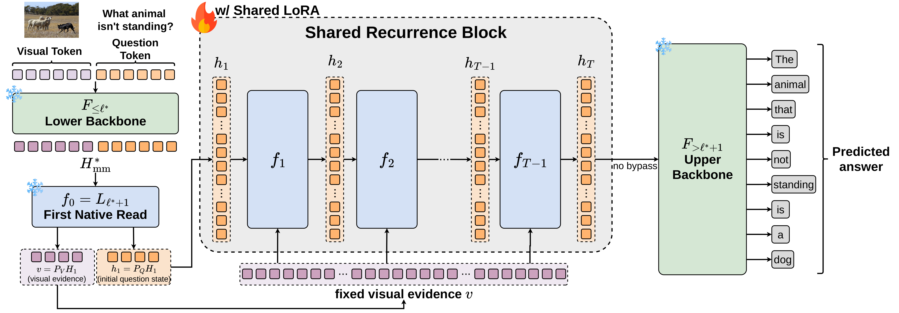

### TL;DR

Latent visual reasoning is not the same as latent visual computation *being used*: alternative image-conditioned paths often let the model bypass the recurrent state. Causal Visual Recurrent Reasoning (CVRR) removes those alternative paths — after recurrence, it deletes the visual KV cache — forcing the final answer to route through the recurrent state.

### Key idea

Initialise recurrence from the post-image question hidden state, repeatedly update it while re-reading the fixed visual evidence, then remove visual states and the multimodal KV cache before decoding. Only the recurrent state can carry image information to the answer, so predictions are causally forced through it.

### Main finding

CVRR preserves strong performance on V*, MMVP, BLINK, and MME-RealWorld-Lite under this strict interface, while alternative latent reasoners fail to recover comparable competence even when retrained with the same constraint. Causal interventions confirm predictions are actually sensitive to recurrent content.

### Why it matters

A clean example of *interpretability as design constraint*: forcing the answer through a bottleneck is the only way to prove the model uses the latent computation you thought it did. Directly relevant to the CoT-faithfulness debate.

### Knowledge graph integration

**Builds on / relates to existing pages:**
- [cot-monitoring.md](../safety/cot-monitoring.md) — same "does the reasoning trace actually carry the computation" question, at the latent level.
- [interpretability/README.md](../interpretability/README.md) — anchor for causal-intervention work in VLMs.

**Suggested new pages:**
- `multimodal/latent-visual-reasoning.md` *(depth)* — the recurrence-forced VLM reasoning family.

---

## 9. Steering Geometry: Validating Human Value Geometry in LLM Steering Space

**Authors:** Mohammad Mahdi Abootorabi, Armin Saghafian, Ali Bazshoushtari, Hamid Rezaei, EunJeong Hwang, Vered Shwartz, Parvin Mousavi, Purang Abolmaesumi — *Sharif U. / Queen's U. / UBC*
**Links:** [arXiv:2609.06289](https://arxiv.org/abs/2609.06289) · [HF](https://huggingface.co/papers/2609.06289) · [AlphaXiv](https://www.alphaxiv.org/abs/2609.06289)
**Topics:** `interp`, `safety`, `alignment`, `steering`

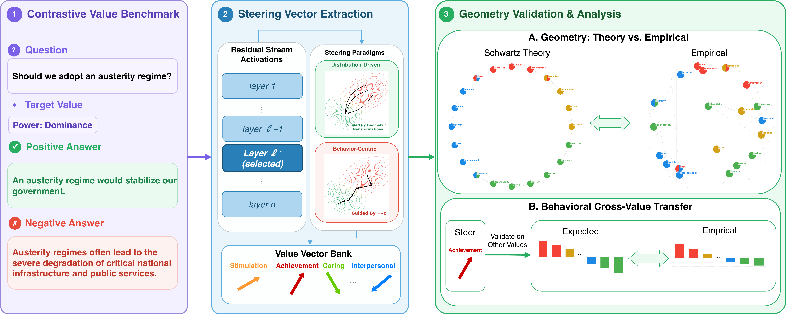

### TL;DR

The paper asks whether steering vectors encode a coherent value structure or just per-behavior shortcuts. Using Schwartz's Theory of Basic Human Values as ground truth and a new 26K-sample benchmark over 20 values, distribution-driven methods (CAA, SphericalSteer, ODESteer) recover the theoretical topology (Spearman ρ up to 0.51, p<10⁻¹³); behavior-centric methods (COLD-Steer, BiPO) don't.

### Key idea

Ask a geometric-fidelity question rather than a behavioral one: after fitting steering vectors for 20 human values, does their pairwise geometry match a psychological theory of value opposition/compatibility? Distribution-driven methods encode the theory; behavior-centric methods don't, even when they steer as well behaviourally.

### Main finding

Geometric alignment improves with model scale but drops after instruction tuning. Better geometry also predicts better transfer: steering one value correctly lifts compatible values and suppresses opposing ones.

### Why it matters

A rigorous separation of "steering works" from "steering encodes structure". Suggests distribution-driven methods should be the default when the goal is coherent value alignment rather than one-shot behavior nudging, and gives an empirical warning about the geometric cost of instruction tuning.

### Knowledge graph integration

**Builds on / relates to existing pages:**
- [interpretability/README.md](../interpretability/README.md) — mech-interp anchor; this paper argues geometry is the correct evaluation.
- [safety/README.md](../safety/README.md) — value-steering as an alignment lever.

**Suggested new pages:**
- `interpretability/activation-steering.md` *(depth)* — CAA and the modern steering-vector family.
- `interpretability/_steering-methods.md` *(taxonomy)* — distribution-driven vs. behavior-centric families.

---

## 10. Kalman Delta Networks: Uncertainty-aware Associative Memory

**Authors:** Ngoc Bui, Tinglin Huang, Rex Ying — *Yale University*
**Links:** [arXiv:2609.07816](https://arxiv.org/abs/2609.07816) · [HF](https://huggingface.co/papers/2609.07816) · [AlphaXiv](https://www.alphaxiv.org/abs/2609.07816)
**Topics:** `architectures`, `linear-attention`, `long-context`

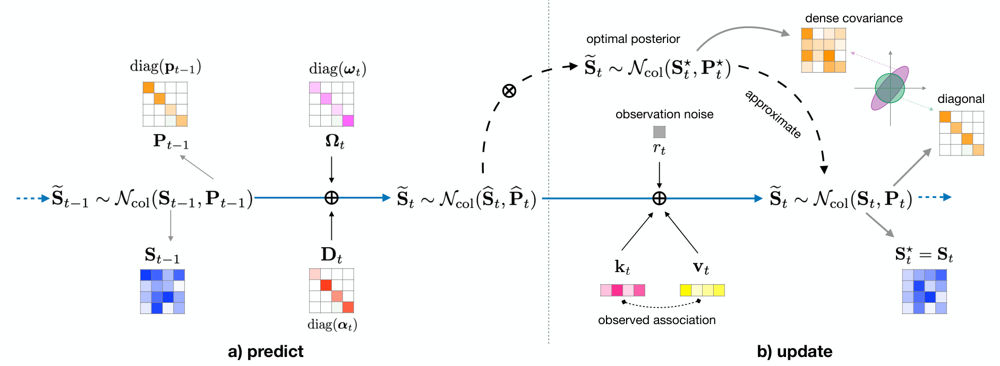

### TL;DR

Delta-rule linear attention writes to a fixed-size associative memory without tracking confidence in its estimate. KDN reformulates the memory as a linear-Gaussian state-space model and uses the Kalman filter, so each write weighs its update by accumulated evidence. Two GPU-friendly approximations (Diagonal and Isotropic) give scan-compatible recursions and consistent PPL / accuracy gains over SOTA linear-attention at 750M and 1.3B.

### Key idea

Model recurrent associative memory as a linear-Gaussian SSM; the Kalman gain then weights each residual write by predictive covariance. Exact tracking needs a state-dependent Riccati recursion (poorly parallel), so approximate the covariance as diagonal (mean-field VI) or isotropic (scalar per head); both give Möbius-map recursions with logarithmic-depth associative scans.

### Main finding

Delta-style updates fall out as a special case of KDN. Diagonal and Isotropic KDN improve perplexity and mean downstream accuracy over SOTA linear-attention at 750M and 1.3B controlled pretraining.

### Why it matters

Linear-attention families (Mamba, DeltaNet, Gated DeltaNet, Titans) all share the "fixed-memory + write rule" pattern; KDN gives a principled way to derive that rule from filtering theory, and shows uncertainty-aware writes carry measurable gains on today's benchmarks. Likely to reshape the design space for the next generation of long-context recurrent LMs.

### Knowledge graph integration

**Builds on / relates to existing pages:**
- [multi-head-attention.md](../architectures/multi-head-attention.md) — the softmax-attention baseline these methods replace at long context.

**Suggested new pages:**
- `architectures/_linear-attention.md` *(taxonomy)* — Mamba, DeltaNet, gated variants, KDN.
- `architectures/kalman-delta-network.md` *(depth)* — the KDN mechanism and its two scan-compatible approximations.

---

## 11. Online Draft Co-Training for Speculative Decoding in Large-Scale, Long-Context RL Post-Training

**Authors:** Zili Wang, Zhaopeng Qiu, Yuekai Zhang, Shuang Yu, Junjie Lai — *NVIDIA (NeMo-RL)*
**Links:** [arXiv:2609.07108](https://arxiv.org/abs/2609.07108) · [HF](https://huggingface.co/papers/2609.07108) · [AlphaXiv](https://www.alphaxiv.org/abs/2609.07108)
**Topics:** `inference`, `systems`, `RL`, `speculative-decoding`

*(No hero figure available: paper has no arxiv HTML render.)*

### TL;DR

Speculative decoding accelerates RL rollouts, and co-training the draft online improves its accuracy — but scaling that to 100B-scale long-context models breaks on branch attention under context parallelism and target-feature transport across pipeline stages. This paper fixes both: a merged branch/main causal ring attention for CP, and TapChannel, an off-schedule intermediate-feature pipe for PP.

### Key idea

For **context-parallel (CP)**: extend packed load-balanced zigzag ring attention so rank-local branch attention merges with the causal main-sequence attention in one kernel. For **pipeline-parallel (PP)**: transport target intermediate features on a separate channel ("TapChannel") that doesn't touch the main pipeline schedule.

### Main finding

Co-trained drafts track the policy baseline while giving substantial per-rollout and end-to-end RL speedups at model scales up to **122B**, at **256K-token** contexts, with strong CP scaling and only modest PP overhead.

### Why it matters

Rollouts dominate RL post-training cost; speculative decoding is the standard trick, but scaling it to modern long-context RL runs was a systems open problem. This is the first public design that makes it work end-to-end at frontier scale.

### Knowledge graph integration

**Builds on / relates to existing pages:**
- [systems/partial-rollouts.md](../systems/partial-rollouts.md) — rollout-worker scheduling; specdec is the natural next lever.
- [systems/dualpipe.md](../systems/dualpipe.md) — pipeline-parallel; TapChannel adds an off-schedule feature transport.
- [_rl.md](../post-training/_rl.md) — RL post-training this speedup targets.

**Suggested new pages:**
- `inference/speculative-decoding.md` *(depth)* — the base technique the graph doesn't yet cover.
- `systems/online-draft-co-training.md` *(depth)* — the CP + PP systems design in this paper.

---

## 12. Procedural Graphs: Self-Evolving Execution Structures for LLM Agents

**Authors:** Yuxing Lu, Yicheng Chen, Shanchan Wu, Sercan Ö. Arık — *Google*
**Links:** [arXiv:2609.09153](https://arxiv.org/abs/2609.09153) · [HF](https://huggingface.co/papers/2609.09153) · [AlphaXiv](https://www.alphaxiv.org/abs/2609.09153)
**Topics:** `agents`, `procedural-memory`

### TL;DR

Where knowledge graphs answer "what is", Procedural Graphs answer "what to do": nodes are procedures and edges are their sequencing/conditioning relations. At each step the agent's active node is localised, a guidance model translates the surrounding subgraph into step-level advice, and an LLM refiner edits the graph after each rollout — keeping edits that hold up on validation, retaining rejected ones as anti-patterns.

### Key idea

External procedural memory as a mutable graph, with two model roles: a **guidance** model that turns a subgraph into next-action bias, and a **refiner** that contrasts successful vs. failed trajectories to propose topology and attribute edits. Rejected edits are kept to actively discourage rediscovery.

### Main finding

Consistent gains over memory-based agent baselines across multiple datasets, task types, and LLMs. Starting from a minimal skeleton the loop grows a graph that matches or surpasses hand-designed ones; it can also repair a flawed expert prior.

### Why it matters

Agent memory has mostly meant embedding stores; procedural graphs are a testable formalism for the "what to do" half of memory, with an evolution loop that's cheap to bolt onto existing agents. A promising alternative to fine-tuning as the way agents accumulate know-how.

### Knowledge graph integration

**Builds on / relates to existing pages:**
- [agents/README.md](../agents/README.md) — anchor for agent-memory and orchestration approaches.

**Suggested new pages:**
- `agents/procedural-memory.md` *(depth)* — Procedural Graphs as the anchor technique.

---

## 13. FEE: Environments as Scaffold — Enriching Feedback to Bootstrap Self-Evolving Agents in Long-Horizon Tasks

**Authors:** Hongbang Yuan, Zhuoran Jin, Yixin Cao — *CAS / Fudan University*
**Links:** [arXiv:2609.08404](https://arxiv.org/abs/2609.08404) · [HF](https://huggingface.co/papers/2609.08404) · [AlphaXiv](https://www.alphaxiv.org/abs/2609.08404)
**Topics:** `agents`, `RL`, `environment-design`

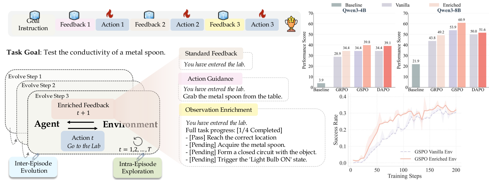

### TL;DR

Instead of warming up long-horizon agents with SFT to fight reward sparsity, reshape the environment: Feedback-Enriched Environments switch from action guidance to observation enrichment as training progresses, both within an episode and across episodes. On SciWorld and BFCL, FEE consistently improves GRPO / GSPO / DAPO across Qwen3 scales.

### Key idea

Environment-side adaptation, not agent-side warmup. A pilot study yields a scheduling rule: early on, add explicit action guidance; later, remove guidance and instead enrich the observation channel. The transition shifts pressure from imitation to grounded exploration.

### Main finding

Across SciWorld and BFCL and multiple Qwen3 sizes, FEE improves standard RL setups by (1) reducing entropy volatility, (2) inducing proactive state-space exploration on hard tasks, (3) internalising environmental guidance into policy weights rather than acting as an inference-time prior, and (4) identifying intra-group feedback consistency as a stability boundary.

### Why it matters

Sparse-reward long-horizon RL is where agent training breaks. Reshaping the environment (rather than paying for more SFT data) reframes the reward-sparsity fix as a curriculum-of-observations problem, and gives a plug-in that composes with any on-policy RL algorithm.

### Knowledge graph integration

**Builds on / relates to existing pages:**
- [grpo.md](../post-training/grpo.md) — direct baseline for the RL algorithm this stacks on.
- [rlvr.md](../post-training/rlvr.md) — verifier-style feedback shaping done at the environment level.
- [rl-prompt-curation.md](../post-training/rl-prompt-curation.md) — same "shape what the model sees" instinct on a different axis.

**Suggested new pages:**
- `agents/feedback-enriched-environments.md` *(depth)* — the observation-enrichment schedule for agent RL.

---

## 14. CoVeR: Coverage-Based Token Pruning for Multi-View 3D Reasoning in VLMs

**Authors:** Nhat-Tan Bui, Varshini Elangovan, Arun Reddy Anugu, Sreyas Mohan, Wei Ye, Dilin Wang, JQ Huang, Rakesh Ranjan, Aviral Chharia, Fernando De la Torre — *Meta / CMU*
**Links:** [arXiv:2609.08345](https://arxiv.org/abs/2609.08345) · [HF](https://huggingface.co/papers/2609.08345) · [AlphaXiv](https://www.alphaxiv.org/abs/2609.08345)
**Topics:** `multimodal`, `efficient-inference`, `token-pruning`

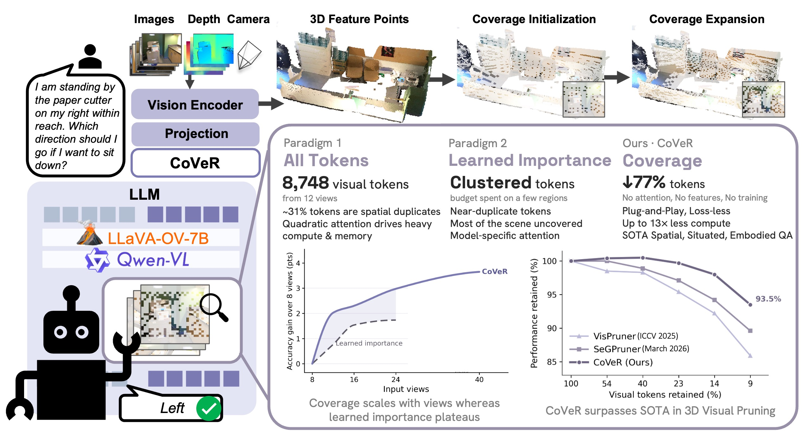

### TL;DR

Multi-view VLM inputs create thousands of overlapping visual tokens. Learned-importance pruners keep near-duplicates from a few salient regions; voxelisation pruners saturate under overlap. CoVeR is a deterministic, training-free selector that uses only token 3D coordinates to pick a fixed budget covering the whole scene; it beats prior SOTA on all three 3D-reasoning benchmarks.

### Key idea

Reframe multi-view token selection as a spatial coverage problem: given a per-scene budget, deterministically pick tokens whose coordinates collectively cover the scene. No learned signals, no re-training, and the budget is exactly enforceable.

### Main finding

On three 3D-reasoning benchmarks, plug-and-play across four VLMs, with only ~8% of visual tokens CoVeR retains **93.5% of full-token accuracy** and beats SOTA by **+3.9 pts** on average.

### Why it matters

Says something clean: for 3D-VLM inputs, spatial coverage is the right prior, not learned importance. Training-free, generalises across VLM backbones, and cuts visual-token cost by ~12×.

### Knowledge graph integration

**Builds on / relates to existing pages:**
- [multimodal/README.md](../multimodal/README.md) — anchor for VLM-side inference cost.
- [inference/README.md](../inference/README.md) — visual-token pruning is a VLM-side complement to KV-cache compression.

**Suggested new pages:**
- `multimodal/visual-token-pruning.md` *(depth)* — coverage vs. importance vs. voxelisation.

---

## 15. Recognition-Refusal Misalignment in LLMs: Why Models Answer Structurally Unanswerable Questions

**Authors:** Yucheng Du, Xiyang Hu — *Purdue University*
**Links:** [arXiv:2608.29109](https://arxiv.org/abs/2608.29109) · [HF](https://huggingface.co/papers/2608.29109) · [AlphaXiv](https://www.alphaxiv.org/abs/2608.29109)
**Topics:** `interp`, `safety`, `refusal`

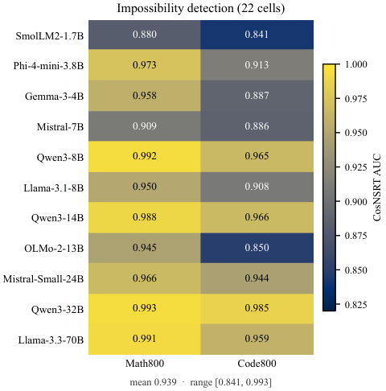

### TL;DR

Instruct-tuned models often answer structurally impossible questions (`cot(-540°)`, `(1).startswith("1")`) instead of abstaining. A single linear direction in the hidden state separates answerable from impossible prompts — so the recognition is there — but that direction is nearly orthogonal to the trained safety-refusal direction. The failure is a routing bug from recognition to refusal, not a missing signal.

### Key idea

Two probes: (i) fit a "recognition" direction that separates answerable from structurally impossible math/code prompts, and (ii) fit the canonical safety-refusal direction. Measure their alignment; find they are near-orthogonal. Generation-time steering along the recognition direction changes invalidity-aware behavior bidirectionally and dose-responsively.

### Main finding

Across 1.7B–70B instruct models, the recognition direction is present at pretraining, the safety-refusal direction is trained separately, and the two are nearly orthogonal. Random directions have no effect; the recognition direction steers invalidity behavior in a controlled way.

### Why it matters

Reframes a whole class of hallucination as a *routing* problem inside the model: the model already knows the question is impossible; RLHF-taught refusal just doesn't use that channel. Suggests specific alignment training that ties recognition-of-impossibility to refusal, and gives a mechanistic hallucination benchmark.

### Knowledge graph integration

**Builds on / relates to existing pages:**
- [refusal-suppression.md](../safety/refusal-suppression.md) — refusal viewed from the attack side; here viewed from the internal-representation side.
- [_attacks.md](../safety/_attacks.md) — the same refusal circuit, examined for capability gaps.
- [interpretability/README.md](../interpretability/README.md) — canonical probing/steering result on the refusal circuit.

**Suggested new pages:**
- `interpretability/refusal-direction.md` *(depth)* — the linear refusal direction as an object.
- `safety/recognition-refusal-misalignment.md` *(depth)* — the routing-gap framing and its implications.

---

## Notes

- Borderline inclusions are flagged in-section with an italic *Borderline: …* note.
- Hero figures live in `assets/2026-09-09/`. Missing figures for Miles v0.1 and Online Draft Co-Training: neither paper has an arXiv HTML render, so no first-figure URL was extractable without parsing the PDF.
- This digest is informational. No existing concept files, `READING-LIST.md`, or `PAPERS.md` were modified to produce it.
