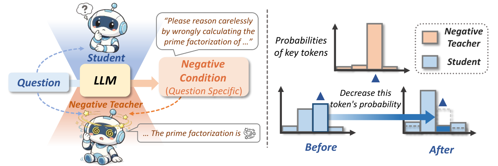
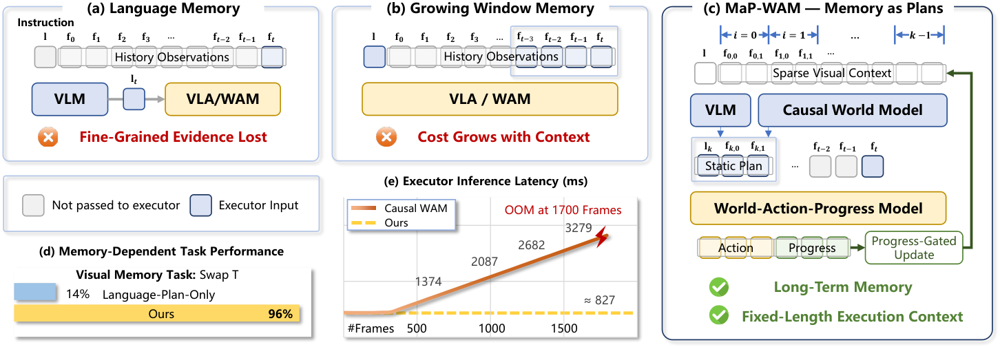

# Daily AI papers — 2026-09-12

*Curated from HF Daily Papers. 15 of ~26 papers kept after relevance filter.*

## Papers at a glance

| # | Title | Topics | Org |
| --- | --- | --- | --- |
| 1 | [NCP-ArchPreview: Latent-Space LMs via Next Concept Prediction](#1-ncp-archpreview) | `LLM`, `pretraining`, `architecture` | Intern-NCP Team (Shanghai AI Lab) |
| 2 | [SenseNova-U1.5: Native Unified Visual Intelligence](#2-sensenova-u15) | `multimodal`, `unified-model`, `RL` | SenseTime |
| 3 | [An Open Recipe for IMO Gold: Nemotron for Olympiad Math](#3-imo-nemotron) | `reasoning`, `RL`, `test-time-compute` | NVIDIA |
| 4 | [Negative Self-Distillation: Reasoning by Avoiding Flaws](#4-negative-self-distillation) | `reasoning`, `post-training`, `distillation` | UVA / UChicago |
| 5 | [HyQuant: Hybrid-Precision Quantization for LLM Attention](#5-hyquant) | `quantization`, `efficient-inference`, `attention` | XMU / SJTU / Tencent |
| 6 | [Multilingual Bridges: Data Mixing for In-Language Reasoning](#6-multilingual-bridges) | `data`, `reasoning`, `SFT`, `multilingual` | Cohere Labs |
| 7 | [Generative Reward Models for Autoformalization](#7-genv-autoformalization) | `reward-model`, `interp`, `verifier` | Case Western / Argonne |
| 8 | [World in World: Explore the World with World Models](#8-world-in-world) | `diffusion`, `video`, `world-model` | Westlake AGI Lab |
| 9 | [Recursive Code World Models](#9-recursive-code-world-models) | `agents`, `world-model`, `multimodal` | (academic) |
| 10 | [Studying Image Tokenizers as Visual Languages](#10-image-tokenizers) | `multimodal`, `tokenization`, `eval` | Amazon / UW |
| 11 | [Memory as Plans: World-Action Modeling](#11-memory-as-plans) | `agents`, `VLA`, `memory` | NTU / HIT / Shandong |
| 12 | [X-AuT: Progressive Audio-Encoder Compression for Speech LLMs](#12-x-aut) | `multimodal`, `audio`, `distillation`, `efficient-inference` | XPENG AI |
| 13 | [EvoSafeHarness: Evolving Harnesses for Securing Agents](#13-evosafeharness) | `safety`, `agents`, `prompt-injection` | UChicago / NVIDIA / Cornell |
| 14 | [SpatialBlock: Spatial Intelligence in LVLMs via Block-Stacking](#14-spatialblock) | `multimodal`, `data`, `synthetic` | KAIST |
| 15 | [TempCloze: Can Video-LLMs Identify the Missing Middle?](#15-tempcloze) | `multimodal`, `video`, `eval` | HKU |

---

## 1. NCP-ArchPreview

**Authors:** Intern-NCP Team — Jiaqi Cao, Chiyu Chen, Yuliang Liu, Bowen Zhou, Dahua Lin, et al. — *Shanghai AI Laboratory (Intern-NCP Team)*
**Links:** [arXiv:2609.10715](https://arxiv.org/abs/2609.10715) · [HF](https://huggingface.co/papers/2609.10715) · [AlphaXiv](https://www.alphaxiv.org/abs/2609.10715)
**Topics:** `LLM`, `pretraining`, `architecture`

### TL;DR

A pretraining scheme that predicts **discrete "concepts" spanning multiple tokens** in parallel with standard next-token prediction. The concept stream operates in a shared latent space and provides denser supervision per position without changing the token-level generation contract. An 8.9B model trained on 5.73T tokens of Dolma-3 matches OLMo-3-7B's pretraining loss using **51.3% of the token budget** and beats it by 2.45 points on downstream macro-average.

### Key idea

Next Concept Prediction (NCP) sits alongside standard NTP. At each position, one head predicts token $t{+}1$ (as usual) and another head predicts a *discrete concept* representing a short span $t{+}1..t{+}k$ in latent space. The concept vocabulary is learned; the concept head shares the backbone's hidden state. Training minimizes a weighted sum of the two objectives; generation is token-only, so nothing changes at inference time.

### Main finding

At 8.9B parameters, NCP-ArchPreview matches OLMo-3-7B's final pretraining loss on **51.3% of the training tokens** and outperforms it by **+2.45 points** on the downstream macro-average (aggregate benchmark suite). Multiple stage-1 and stage-2 checkpoints are released via the ArchSpace collection on Hugging Face.

### Why it matters

If concept-level supervision is really this token-efficient, it directly attacks the pretraining compute wall — a ~2× reduction in tokens-to-target is the same order of magnitude as MTP's speedup, but from a *representation* signal rather than an inference one. It also opens a route to "latent language models" where reasoning happens in a compressed concept space, without giving up token-level fluency.

### Knowledge graph integration

**Builds on / relates to existing pages:**
- [../pre-training/mtp.md](../pre-training/mtp.md) — same "denser per-position supervision" motivation as MTP, but the extra head predicts concepts, not the $t{+}2$ token.
- [../data/dolma.md](../data/dolma.md) — trained on Dolma-3 (5.73T tokens).
- [../case-studies/olmo-2.md](../case-studies/olmo-2.md) — matched-baseline reference point (OLMo-3-7B).
- [../pre-training/mid-training.md](../pre-training/mid-training.md) — a stage-2 checkpoint that shifts the mixture mid-run is standard here too.

**Suggested new pages:**
- `pre-training/next-concept-prediction.md` *(depth)* — the NCP objective, concept vocabulary, weighting schedule.

---

## 2. SenseNova-U1.5

**Authors:** Haiwen Diao, Jiahao Wang, Chenjing Ding, Wenxiu Sun, Ruihao Gong, Lewei Lu, Ziwei Liu, Dahua Lin, et al. — *SenseTime (with S-Lab NTU, MMLab CUHK collaborators)*
**Links:** [arXiv:2609.11929](https://arxiv.org/abs/2609.11929) · [HF](https://huggingface.co/papers/2609.11929) · [AlphaXiv](https://www.alphaxiv.org/abs/2609.11929)
**Topics:** `multimodal`, `unified-model`, `RL`

### TL;DR

An 8B "MoT" (mixture-of-transformers) unified multimodal model that both understands and generates images inside a single encoder-free, VAE-free architecture. Post-training uses specialized experts for aesthetics, bilingual text rendering, infographics, and editing, then consolidates them via **multi-expert on-policy distillation**. Emits up to 4K native resolution and generalizes to long, structured visual instructions.

### Key idea

Instead of bolting a vision encoder onto an LLM (LLaVA-style) or a VAE onto a diffusion model (LDM-style), SenseNova operates directly on patches in a shared MoT backbone. The training loop: (1) spatially coherent patch reconstruction as the visual interface, (2) task-specialized experts (aesthetics, text, infographic, edit) trained on curated data, (3) **on-policy distillation** collapses the experts into a single generalist that inherits each expert's strengths while preserving base-model instruction following.

### Main finding

Advances image fidelity, complex composition, multi-reference editing, and interleaved understanding+generation while preserving unmodified regions during edits. Generalizes to long, structured visual prompts despite limited training exposure to that format. Training code (SFT, RL, and on-policy distillation) to be open-sourced.

### Why it matters

The unified encoder-free/VAE-free thread (Janus, Chameleon, Show-o) has been catching up with dedicated diffusion models; SenseNova pushes native resolution to 4K and lands multi-expert distillation as the recipe for merging specialists without adding inference cost. If the on-policy distillation step generalizes, it's a template for building capable generalists out of tightly-scoped experts.

### Knowledge graph integration

**Builds on / relates to existing pages:**
- [../architectures/_moe.md](../architectures/_moe.md) — MoT is a multimodal cousin of MoE; per-modality expert routing.
- [../post-training/_post-training.md](../post-training/_post-training.md) — on-policy distillation for expert consolidation.

**Suggested new pages:**
- `multimodal/unified-multimodal-models.md` *(taxonomy)* — encoder-free/VAE-free unified stack (Janus, Chameleon, Show-o, SenseNova-U).
- `post-training/multi-expert-on-policy-distillation.md` *(depth)* — the specific expert-merge recipe used here.
- `case-studies/sensenova-u1-5.md` *(case study)* — full system breakdown.

---

## 3. IMO Nemotron

**Authors:** Ivan Moshkov, Stephen Ge, George Armstrong, Wei Du, Sadegh Mahdavi, Igor Gitman — *NVIDIA*
**Links:** [arXiv:2609.10712](https://arxiv.org/abs/2609.10712) · [HF](https://huggingface.co/papers/2609.10712) · [AlphaXiv](https://www.alphaxiv.org/abs/2609.10712)
**Topics:** `reasoning`, `RL`, `test-time-compute`

### TL;DR

An open recipe for training Nemotron 3 Ultra to olympiad-level math. Two specialist checkpoints (SFT-heavy and RL-heavy) plus a **generate-verify-refine** iterative inference pipeline scored **30/42 at IMO 2026 — the gold-medal threshold** — using only natural-language proofs (no formal prover, no tools, no internet). Training data, code, both checkpoints, submitted solutions, and a new 200-problem Nemotron-IMO-Bench are all released.

### Key idea

Split the work: an SFT-refined "generator" and an RL-refined "verifier/refiner" that iteratively critique and repair proofs. At submission time, a separate high-compute selector chooses one candidate per problem. Everything happens in natural language — no Lean, no external verifier — which keeps the pipeline transferable to problems where a formal spec doesn't exist.

### Main finding

**30/42 at IMO 2026 (gold medal boundary)** with a fully open, natural-language pipeline. Also releases Nemotron-IMO-Bench, a fresh 200-problem contamination-safe benchmark, plus both post-trained checkpoints, training data, and inference code.

### Why it matters

The frontier gold-medal claims from DeepMind and OpenAI in 2024–25 were closed systems; this is an open, reproducible recipe that gets to the same threshold without a formal prover. The generate-verify-refine loop is a general test-time-compute pattern applicable well beyond math — the paper is effectively an inference-time RL playbook.

### Knowledge graph integration

**Builds on / relates to existing pages:**
- [../post-training/rlvr.md](../post-training/rlvr.md) — the RL stage uses verifiable-reward-style objectives on math proofs.
- [../post-training/reasoning/long-cot-rl.md](../post-training/reasoning/long-cot-rl.md) — long-CoT proofs are the training substrate.
- [../post-training/rejection-sampling.md](../post-training/rejection-sampling.md) — the iterative refine step is a richer form of rejection sampling with verifier feedback.
- [../post-training/reasoning/orm.md](../post-training/reasoning/orm.md) — the verifier is a natural-language ORM.
- [../case-studies/deepseek-r1.md](../case-studies/deepseek-r1.md) — sibling recipe: RL-heavy reasoning specialization on top of a strong base.
- [../evaluation/aime.md](../evaluation/aime.md) — adjacent math-eval reference (Nemotron-IMO-Bench is IMO-flavored).

**Suggested new pages:**
- `post-training/reasoning/generate-verify-refine.md` *(depth)* — iterative natural-language proof search with verifier + refiner.
- `evaluation/nemotron-imo-bench.md` *(depth)* — 200 novel olympiad problems, contamination-safe.
- `case-studies/nemotron-imo.md` *(case study)* — full pipeline: two checkpoints + iterative search + selection.

---

## 4. Negative Self-Distillation

**Authors:** Rongcan Pei, Zhepei Wei, Shuyao Xu, Xinyu Zhu, Wei-Lin Chen, Yu Meng — *University of Virginia*
**Links:** [arXiv:2609.11699](https://arxiv.org/abs/2609.11699) · [HF](https://huggingface.co/papers/2609.11699) · [AlphaXiv](https://www.alphaxiv.org/abs/2609.11699)
**Topics:** `reasoning`, `post-training`, `distillation`

### TL;DR

Standard on-policy self-distillation (OPSD) trains a model to imitate its own correct chains-of-thought; the authors show this **degrades** complex reasoning. Their fix: **Negative Self-Distillation (NSD)** — increase the KL to *flawed* traces rather than decrease it to correct ones. A learned token-level gate limits the negative gradient to reasoning-critical tokens, sparing linguistic tokens.

### Key idea

Symmetric to OPSD: pick the model's own flawed generations, use their token distributions as an *anti-teacher*, and take a step *away* from them. A per-token gate — trained end-to-end — decides which tokens are "reasoning-critical" and eligible for the negative signal; low-content tokens (articles, connectives) get zero gradient so grammar isn't damaged. The gate turns NSD into a targeted repellent instead of blanket unlearning.

### Main finding

NSD reverses OPSD's reasoning-quality regression on math and code benchmarks and beats vanilla OPSD by a clear margin under matched compute. Ablations on the KL penalty show the gate is what makes negative KL safe at scale.

### Why it matters

Positive self-distillation is the default recipe for "polish the model with its own rollouts," and it's been quietly failing on reasoning. Framing distillation *negatively* + gating by token role gives a principled way to remove specific behavioral flaws — a lightweight alternative to full RL from a reward model.

### Knowledge graph integration

**Builds on / relates to existing pages:**
- [../post-training/_post-training.md](../post-training/_post-training.md) — self-distillation as a post-training recipe.
- [../post-training/reasoning/long-cot-rl.md](../post-training/reasoning/long-cot-rl.md) — comparable in intent to long-CoT RL for reasoning uplift.
- [../post-training/dpo.md](../post-training/dpo.md) — token-level negative-example weighting has a similar flavor to DPO's implicit reward.

**Suggested new pages:**
- `post-training/negative-self-distillation.md` *(depth)* — the NSD objective, gate, and KL-schedule.

---

## 5. HyQuant

**Authors:** Bingxin Xing, Yu Zhang, Dian Ding, Xiaodong Yi, Xianbin Ouyang, Feihu Zhou, Kun Zhang, Zhenyu Guo, Hao Pan, Guangtao Xue, Yiming Zhang — *Xiamen University, SJTU, XJTU, Tencent Penglai Lab*
**Links:** [arXiv:2608.27875](https://arxiv.org/abs/2608.27875) · [HF](https://huggingface.co/papers/2608.27875) · [AlphaXiv](https://www.alphaxiv.org/abs/2608.27875)
**Topics:** `quantization`, `efficient-inference`, `attention`

### TL;DR

Low-bit attention quantization blows up because a few outlier tokens (the "vertical lines" in the attention map) and the local window carry a disproportionate share of the signal. HyQuant keeps those regions in high precision and quantizes everything else to low bits, selecting the exceptions with a lightweight attention-pattern probe.

### Key idea

Rather than fight outliers with global smoothing (SmoothQuant-style), *route* them to a high-precision path. A cheap "vertical-line-aware" signal identifies the few token positions whose attention distribution matters most; those plus the local window stay in fp8/16, and the rest go to very low bit-widths. Overhead of the selector is tiny relative to the attention op itself.

### Main finding

Retains near-full-precision accuracy at very low bit-widths for the attention module — a regime where uniform low-bit quantization collapses. The vertical-line + local-window scheme is architecture-agnostic and drops into standard attention kernels with modest engineering.

### Why it matters

Attention has been the last stubborn piece of LLM inference to survive aggressive quantization: KV cache is easy, MLPs are easy, but attention scores + softmax are numerically fragile. If hybrid-precision routing works robustly, memory and bandwidth savings on the attention path finally become practical for long-context serving.

### Knowledge graph integration

**Builds on / relates to existing pages:**
- [../quantization/_number-formats.md](../quantization/_number-formats.md) — HyQuant is a mixed-precision scheme across bit-widths.
- [../quantization/fp8.md](../quantization/fp8.md) — the high-precision fallback lane.
- [../fundamentals/attention.md](../fundamentals/attention.md) — attention pattern structure (vertical lines, sink tokens) is the exploited property.
- [../architectures/multi-head-attention.md](../architectures/multi-head-attention.md) — hybrid quantization applies per-head.

**Suggested new pages:**
- `quantization/hybrid-precision-attention.md` *(depth)* — vertical-line-aware token routing for attention quantization.

---

## 6. Multilingual Bridges

**Authors:** Mehrnaz Mofakhami, Ananya Sahu, Alejandro R. Salamanca, Daniel D'souza, Alexandre Bérard, Thomas Euyang, Marzieh Fadaee, Julia Kreutzer — *Cohere Labs*
**Links:** [arXiv:2609.10445](https://arxiv.org/abs/2609.10445) · [HF](https://huggingface.co/papers/2609.10445) · [AlphaXiv](https://www.alphaxiv.org/abs/2609.10445)
**Topics:** `data`, `reasoning`, `SFT`, `multilingual`

### TL;DR

Reasoning models overwhelmingly *think in English* even when prompted in another language. The paper studies **data-mixture optimization for SFT** as the mechanism to fix this, and ships **Tiny Aya L2-Thinker (3.35B)**, which reasons in the user's language at **>93% rate across 60 languages** on 6 benchmarks (math, commonsense, IF, generation, cultural) — while keeping general capability.

### Key idea

Reasoning capability is largely language-agnostic once instilled, so the lever is *how much of each language* to include in reasoning-style SFT data. The authors sweep mixtures and find compact recipes that transfer L2 reasoning across typologically diverse languages without collapsing English capability. Careful data ratios beat language-specific fine-tunes.

### Main finding

Tiny Aya L2-Thinker (3.35B) reasons in-language >93% of the time across **60 languages, 6 benchmarks**, matching or beating larger English-first reasoning models on the same tasks in-language.

### Why it matters

The "reason-in-English, respond-in-Chinese" behavior of frontier reasoners has been a stubborn UX problem and a source of drift on cultural tasks. This paper makes it a solvable *data engineering* problem: the recipe is a mixture spec, not a new architecture. It's also strong evidence that reasoning is a transferable substrate rather than a language-specific skill.

### Knowledge graph integration

**Builds on / relates to existing pages:**
- [../data/_data-curation.md](../data/_data-curation.md) — data-mixture optimization is the whole method.
- [../data/quality-filtering.md](../data/quality-filtering.md) — related to selecting per-language reasoning traces.
- [../post-training/reasoning/long-cot-rl.md](../post-training/reasoning/long-cot-rl.md) — the base capability being transferred cross-lingually.
- [../post-training/fine-tuning/README.md](../post-training/fine-tuning/README.md) — SFT on reasoning traces is the delivery vehicle.

**Suggested new pages:**
- `data/multilingual-reasoning-mixtures.md` *(depth)* — how to compose per-language shares to preserve L2 reasoning.

---

## 7. GenV (Autoformalization)

**Authors:** Vikash Singh, Debargha Ganguly, Aman Goel, Ali Torkamani, Xiaoxue Han, Joseph Lilien, Ferhat Erata, Vipin Chaudhary — *Case Western Reserve, Yale, Argonne*
**Links:** [arXiv:2609.11085](https://arxiv.org/abs/2609.11085) · [HF](https://huggingface.co/papers/2609.11085) · [AlphaXiv](https://www.alphaxiv.org/abs/2609.11085)
**Topics:** `reward-model`, `interp`, `verifier`

### TL;DR

In neurosymbolic pipelines, a Z3-style solver's "verdict" (SAT/UNSAT) can match the expected answer even when the LLM's formalization is semantically wrong — the authors call this **Verdict-Preserving-Unfaithfulness (VPU)**. They prove verdict-only heuristics are chance-level detectors and introduce **GenV**, a reference-free generative reward model that reads out equivalence probabilities from the LLM's own vocabulary space. Reaches **0.961 AUROC** and adds **+11.3 pts** to downstream agentic accuracy.

### Key idea

Distill an offline Z3-equivalence oracle into a *generative* score by repurposing the base LLM's own vocabulary as the readout channel: prompt the model, project its logits onto a designed "equivalence" axis, and use that as a continuous reference-equivalence score. Mechanistic analysis (decision-projected logit lens + SAEs) shows the generative readout also localizes *where* the translation errs, for free.

### Main finding

**GenV+HN**: 0.961 AUROC on reference-equivalence verification, zero-shot generalization to unseen translators / formal styles, and **+11.3 pts** on downstream test-time-compute allocation for agentic pipelines. Establishes VPU as a distinct failure mode and shows verdict-only checks are provably no better than chance on it.

### Why it matters

Reward models for reasoning have been converging on classifier-style scalar heads; GenV shows a *generative* readout inherits the base model's world-knowledge and gives interpretable localization for free (via logit lens / SAEs). It also names a concrete safety hole in neurosymbolic evals: solver agreement is not a proof of correctness.

### Knowledge graph integration

**Builds on / relates to existing pages:**
- [../post-training/_rewards.md](../post-training/_rewards.md) — a new class of reward model (reference-equivalence over formal translations).
- [../post-training/reasoning/orm.md](../post-training/reasoning/orm.md) — outcome-style RM; here the "outcome" is semantic-equivalence to a target.
- [../post-training/reasoning/prm.md](../post-training/reasoning/prm.md) — GenV's SAE analysis localizes errors in a PRM-like way.
- [../interpretability/README.md](../interpretability/README.md) — the readout uses logit lens + SAEs to attribute error location.

**Suggested new pages:**
- `post-training/generative-reward-model.md` *(depth)* — vocabulary-space readout for reward scoring.
- `evaluation/verdict-preserving-unfaithfulness.md` *(depth)* — the VPU failure mode + why verdict-only checks are chance-level.

---

## 8. World in World

**Authors:** Chenxi Song, Yanming Yang, Chi Zhang — *Westlake AGI Lab*
**Links:** [arXiv:2609.11548](https://arxiv.org/abs/2609.11548) · [HF](https://huggingface.co/papers/2609.11548) · [AlphaXiv](https://www.alphaxiv.org/abs/2609.11548)
**Topics:** `diffusion`, `video`, `world-model`

### TL;DR

**Training-free** control interface for frozen causal video world models. Heterogeneous control inputs (camera trajectories, reference points, sparse edits) are translated into camera- and time-labelled clean visual states that are consumed through the model's native self-attention. Enables re-rendering along new camera trajectories, extended revisiting, and motion transfer without touching the backbone.

### Key idea

Instead of fine-tuning a control head onto the video model, express every kind of user input as *visual evidence* — labelled patches placed into the attention context. Correspondence routing propagates identity across frames; an "Evidence-wise Attention CFG" separately scales the influence of these auxiliary channels. The frozen backbone does all the work; the interface just curates its context.

### Main finding

Zero-shot camera control, revisiting, and motion transfer on frozen causal video models, without any additional training. Preserves original appearance and temporal progression while filling in newly-visible regions.

### Why it matters

Control finetunes have been the bottleneck for large video world models — every new capability meant a new head. Training-free interfaces that repurpose the frozen model's own attention are much cheaper to iterate on and inherit the backbone's quality by construction. It's the ControlNet story played forward for causal video.

### Knowledge graph integration

**Builds on / relates to existing pages:**
- [../fundamentals/attention.md](../fundamentals/attention.md) — the mechanism is entirely attention-based control injection.

**Suggested new pages:**
- `multimodal/video-world-models.md` *(taxonomy)* — the emerging class of causal video world models and their control interfaces.
- `multimodal/attention-based-visual-control.md` *(depth)* — training-free control via labelled visual evidence in the attention context.

---

## 9. Recursive Code World Models

**Authors:** Zhiqi Li, Yuxuan Liao, Bo Zhu — *(academic)*
**Links:** [arXiv:2609.11499](https://arxiv.org/abs/2609.11499) · [HF](https://huggingface.co/papers/2609.11499) · [AlphaXiv](https://www.alphaxiv.org/abs/2609.11499)
**Topics:** `agents`, `world-model`, `multimodal`

### TL;DR

Represent a 3D scene as a **Recursive Scene Program** and reconstruct it from one image by a solver that calls itself. Each recursion establishes the whole, refines unresolved parts, and returns to reconcile the whole — a global-local-global loop that a vision-language coding agent drives by comparing renders to the reference image.

### Key idea

Two coupled pieces: (1) an executable "scene program" representation that is compositional and edit-friendly, and (2) a recursive solver where each call has the same shape (whole → parts → whole). A VLM coding agent proposes edits by looking at the render vs. the reference; parent revisitation catches boundary artifacts introduced by local refinement. Deeper recursion helps finer-scale reconstruction.

### Main finding

Outperforms prior code-based image-to-scene reconstruction on complex scenes. Ablations confirm recursion depth is the lever: deeper calls consistently improve finer-scale structure without breaking scene-wide geometry.

### Why it matters

"Code as world representation" is picking up steam because it composes and edits cleanly; the recursive solver here is a template for how a coding agent should *interact* with such a representation. It also nudges VLM-driven agents toward multi-step, hierarchical refinement instead of one-shot generation.

### Knowledge graph integration

**Builds on / relates to existing pages:**
- [../agents/README.md](../agents/README.md) — the driving loop is a VLM coding agent.

**Suggested new pages:**
- `agents/code-as-world-model.md` *(depth)* — programs as scene/world representations for agent perception+edit.

---

## 10. Image Tokenizers

**Authors:** Siting Li, Zhengyang Wang, Simon Shaolei Du, Xi Chen, Yang Liu — *University of Washington / Amazon*
**Links:** [arXiv:2609.09143](https://arxiv.org/abs/2609.09143) · [HF](https://huggingface.co/papers/2609.09143) · [AlphaXiv](https://www.alphaxiv.org/abs/2609.09143)
**Topics:** `multimodal`, `tokenization`, `eval`

### TL;DR

Systematic study of **image tokenizers as visual languages** in unified multimodal models. A controlled pretraining harness measures four losses (text, image, T→I, I→T) as a function of tokenizer choice. Findings: task losses rank tokenizers *differently*; reconstruction quality is a bad proxy for downstream utility; and the tokenizer even affects *text* modeling under joint training. Revisits discriminator, semantic supervision, and vocabulary size as the design levers.

### Key idea

Treat the image tokenizer the way an NLP practitioner treats a BPE tokenizer: not a free choice, but a language whose properties shape the model's whole loss surface. Fix the backbone, sweep tokenizers, and measure the four component losses under identical training compute. The relationship between reconstruction fidelity and joint-training utility turns out to be non-monotone.

### Main finding

- Different tasks rank tokenizers differently — a tokenizer optimal for image reconstruction is not optimal for T→I or I→T.
- Better image reconstruction does **not** imply stronger downstream unified performance.
- Tokenizer choice shifts *text* loss under joint pretraining, contradicting the "text and image are independent" assumption.

### Why it matters

Every serious unified multimodal effort has to pick an image tokenizer; the field has been treating it as a hyperparameter. This paper argues it is a **first-class language design decision** and gives a controlled protocol for evaluating it — likely to become the standard reference for tokenizer comparisons in unified stacks.

### Knowledge graph integration

**Builds on / relates to existing pages:**
- [../fundamentals/_tokenization.md](../fundamentals/_tokenization.md) — same discipline as BPE tokenizer analysis, applied to visual vocabularies.
- [../fundamentals/bpe.md](../fundamentals/bpe.md) — reference point for "tokenizer as language" framing.

**Suggested new pages:**
- `multimodal/image-tokenizers.md` *(taxonomy)* — VQ-GAN, semantic tokenizers, discriminator-based, unified-vs-generation tokenizers.

---

## 11. Memory as Plans (MaP-WAM)

*Borderline: this is a VLA / robotics policy, but the memory-grounded planning + long-horizon multimodal context mechanism is directly transferable to LLM agents.*

**Authors:** Haozhe Xie, Weiyu Zhao, Chenchu Zhang, Huan Wang, Chenyang Wang, Qinglin Liu, Shengping Zhang — *NTU Singapore / HIT / Shandong University*
**Links:** [arXiv:2609.11561](https://arxiv.org/abs/2609.11561) · [HF](https://huggingface.co/papers/2609.11561) · [AlphaXiv](https://www.alphaxiv.org/abs/2609.11561)
**Topics:** `agents`, `VLA`, `memory`

### TL;DR

Decomposes long-horizon world-action modeling into **memory-grounded planning** + **plan-conditioned execution**. Episodic memory (completed segment records with language + sparse visual context) becomes a compact plan; a World-Action-Progress (WAP) model executes each plan for an unknown duration, calibrating progress via plan-observation alignment. Executor context length stays fixed as task history grows.

### Key idea

Two-model split: a planner reads long history to emit the next language plan + visual guidance; an executor conditions only on the plan (fixed-length input) and predicts action chunks plus a *progress* head. Plan-observation alignment closes the loop by triggering the next plan when progress saturates. Structured attention allows KV-cache reuse in both models.

### Main finding

83.3% on RMBench and 78.0% on real-robot tasks (SOTA on both). Executor latency stays roughly constant as history length grows, unlike full-history baselines that scale linearly.

### Why it matters

The "planner + executor with fixed-length context" split is the same pattern LLM agents keep re-inventing (React → Reflexion → Voyager); MaP-WAM formalizes it with a *progress head* that decides when to replan, which is often the missing piece for open-ended agentic loops.

### Knowledge graph integration

**Builds on / relates to existing pages:**
- [../agents/README.md](../agents/README.md) — planner + executor is the agent scaffold; adds a progress signal for replanning.

**Suggested new pages:**
- `agents/planner-executor-progress.md` *(depth)* — the two-model + progress-head recipe for long-horizon agents.

---

## 12. X-AuT

**Authors:** Haojun Zhang, Yi Zou, Min Chen, Qize Yu, Lianrui Fan, Xini Ding, Hao Li, Shuchang Zhou, Xianming Liu, Shiyu Huang — *XPENG AI*
**Links:** [arXiv:2609.11412](https://arxiv.org/abs/2609.11412) · [HF](https://huggingface.co/papers/2609.11412) · [AlphaXiv](https://www.alphaxiv.org/abs/2609.11412)
**Topics:** `multimodal`, `audio`, `distillation`, `efficient-inference`

### TL;DR

Progressive framework for pruning **audio-encoder layers** in speech LLMs. Behavioral probes pick which layer combinations to drop; representation alignment, cross-scale distillation, scheduled student-policy supervision, and LoRA finetuning restore accuracy. Fixes the "removing full blocks causes deletion and premature EOS" pathology of naïve depth-pruning in ASR-conditioned decoders.

### Key idea

Depth-pruning encoders is dangerous because the decoder is exquisitely calibrated to the encoder's embeddings; drop a block and the decoder starts emitting EOS early. X-AuT staggers the drops through short behavioral probes, then repairs three ways: representation alignment (match student to teacher features), cross-scale distillation (multiple pruning depths distill into one target), and a scheduled shift from teacher-forced to student-policy supervision. LoRA does the final adaptation without touching the decoder.

### Main finding

Multi-stage progressive pruning + distillation preserves accuracy under aggressive audio-encoder depth reduction, in a regime where uniform depth-pruning collapses. Reported gains on inference cost proportional to pruned depth.

### Why it matters

Speech LLMs have quietly become bottlenecked at the audio encoder — the decoder is small, the encoder is disproportionately expensive. If encoder-side depth-pruning composes cleanly with normal LLM inference tricks (KV-cache, quantization), the whole speech-LLM stack becomes much cheaper to serve.

### Knowledge graph integration

**Builds on / relates to existing pages:**
- [../multimodal/README.md](../multimodal/README.md) — encoder-decoder speech LLMs live here.
- [../post-training/fine-tuning/README.md](../post-training/fine-tuning/README.md) — LoRA is the final adaptation step.

**Suggested new pages:**
- `multimodal/audio-encoder-pruning.md` *(depth)* — progressive depth-pruning + distillation for speech LLM encoders.

---

## 13. EvoSafeHarness

**Authors:** Nanxi Li, Yingzi Ma, Yulong Cao, Edward Suh, Bo Li, Dawn Song, Chaowei Xiao — *UChicago, NVIDIA, Cornell, UC Berkeley*
**Links:** [arXiv:2609.05903](https://arxiv.org/abs/2609.05903) · [HF](https://huggingface.co/papers/2609.05903) · [AlphaXiv](https://www.alphaxiv.org/abs/2609.05903)
**Topics:** `safety`, `agents`, `prompt-injection`

### TL;DR

An optimization framework that **evolves** per-model, per-domain safety harnesses by combining natural-language policy directives with executable code checks. On DecodingTrust-Agent it cuts attack success rate to **10%** while preserving utility; on AgentDojo it hits **82.8% utility at 0% ASR** with strong transfer to unseen domains.

### Key idea

Instead of a single monolithic safety filter, treat the harness itself as an optimizable artifact: a mixture of natural-language directives (LLM-checked) and executable code (deterministic checks). A search loop mutates and selects harness variants against attack + utility benchmarks. Because harnesses are composable, one evolved for a domain can be transplanted to related agents.

### Main finding

ASR ↓ to 10.0% on DecodingTrust-Agent with utility preserved. **82.8% utility at 0% ASR** on AgentDojo, and the evolved harnesses transfer to unseen domains — a rare property for safety filters.

### Why it matters

Agent safety has been polarized between heavy, opaque model-side alignment and brittle handcrafted allowlists. Evolving hybrid natural-language + code harnesses is a middle path: interpretable, patchable, and empirically stronger. It also gives a template for measuring safety-utility Pareto fronts per deployment.

### Knowledge graph integration

**Builds on / relates to existing pages:**
- [../safety/_attacks.md](../safety/_attacks.md) — the attack taxonomy the harnesses are evolved against.
- [../safety/_jailbreaks.md](../safety/_jailbreaks.md) — direct-request jailbreak resistance is one of the target axes.
- [../safety/cot-monitoring.md](../safety/cot-monitoring.md) — deployment-time filtering; sibling deployment-side defense.
- [../agents/README.md](../agents/README.md) — agent-loop deployment is the setting.

**Suggested new pages:**
- `safety/agent-harness.md` *(depth)* — evolved NL+code safety harnesses for agents.

---

## 14. SpatialBlock

*Borderline: LVLM spatial reasoning is close to pure CV, but the synthetic-data recipe is a general LVLM training technique.*

**Authors:** Soohyun Ryu, Sohee Kim, Eunho Yang — *KAIST*
**Links:** [arXiv:2609.07064](https://arxiv.org/abs/2609.07064) · [HF](https://huggingface.co/papers/2609.07064) · [AlphaXiv](https://www.alphaxiv.org/abs/2609.07064)
**Topics:** `multimodal`, `data`, `synthetic`

### TL;DR

A **15k-sample synthetic dataset of block-stacking problems** that teaches large vision-language models foundational spatial skills — 3D-to-2D projection, viewpoint transformation, and structural combination. Compact, cheap, and *generalizes*: models trained on it beat baselines on downstream real-world spatial tasks.

### Key idea

Isolate the atomic spatial primitives (projection, viewpoint change, part-composition) that natural-image spatial tasks decompose into, then generate a large controlled synthetic dataset that exercises each primitive with color cues for reasoning steps. Because the primitives are explicit, the dataset can be tiny yet dense in learning signal.

### Main finding

Significant gains over LVLM baselines on real-world spatial reasoning benchmarks after training on the 15k synthetic block-stacking set — the transfer suggests real-image spatial reasoning is well-approximated by these primitives.

### Why it matters

Confirms once more that carefully-designed *synthetic* data can substitute for large natural-image supervision on skill-shaped tasks. It's also a nice demonstration that "spatial reasoning" isn't a monolith — it decomposes into a small set of primitives you can teach explicitly.

### Knowledge graph integration

**Builds on / relates to existing pages:**
- [../data/README.md](../data/README.md) — synthetic data curation is the delivery mechanism.
- [../multimodal/README.md](../multimodal/README.md) — LVLM training data.

**Suggested new pages:**
- `data/synthetic-spatial-primitives.md` *(depth)* — primitive-decomposition approach to synthesizing spatial supervision for LVLMs.

---

## 15. TempCloze

**Authors:** Wenqi Pei, Henry Hengyuan Zhao, Yilai Liu, Jiahao Meng, Han Chen, Ziyu Wang, Hongyang Du — *University of Hong Kong*
**Links:** [arXiv:2609.01515](https://arxiv.org/abs/2609.01515) · [HF](https://huggingface.co/papers/2609.01515) · [AlphaXiv](https://www.alphaxiv.org/abs/2609.01515)
**Topics:** `multimodal`, `video`, `eval`

### TL;DR

A **video cloze benchmark** for temporal reasoning: given a video's beginning and ending clips, pick the true middle from four distractors. 1,521 filtered long-take / egocentric videos with distractors along three axes (Semantic, Alignment, Progression). Across 10 proprietary and 21 open-source Video-LLMs, **Alignment** — knowing *when* an event should occur — is the primary bottleneck.

### Key idea

Existing temporal-reasoning benchmarks let models exploit linguistic priors from option wording; TempCloze uses same-source distractors that share scenes and objects with the correct answer, forcing the model to rely on *visual* temporal evidence. The three distractor axes disentangle "what should happen" (Semantic), "when it should happen" (Alignment), and "how it unfolds" (Progression).

### Main finding

Across 31 Video-LLMs, models handle Semantic and Progression comparably well but struggle with Alignment — they know *what* plausibly happens but not *when* it should occur relative to context. Clean separation of bottlenecks for future work.

### Why it matters

Video-LLM benchmarks have been quietly leaky (language shortcuts); TempCloze plugs that leak and isolates alignment as the current frontier bottleneck. Cloze-style visual evaluation is a general pattern likely to migrate to other multimodal-reasoning benchmarks.

### Knowledge graph integration

**Builds on / relates to existing pages:**
- [../multimodal/README.md](../multimodal/README.md) — Video-LLM evaluation.
- [../evaluation/README.md](../evaluation/README.md) — benchmark methodology; visual cloze as an evaluation pattern.

**Suggested new pages:**
- `evaluation/tempcloze.md` *(depth)* — video-cloze benchmark with Semantic/Alignment/Progression distractor axes.

---

## Notes

- Borderline inclusions are flagged in-section with an italic *Borderline: …* note.
- Hero figures live in `assets/2026-09-12/`. Only 5 of 15 papers had accessible arXiv HTML teaser images (2609.07064, 2609.09143, 2609.11548, 2609.11561, 2609.11699); the rest of the HF gradient thumbnails were not reachable, so `![Hero figure]` lines were omitted for those papers rather than leaving broken references.
- This digest is informational. No existing concept files, `READING-LIST.md`, or `PAPERS.md` were modified to produce it.
