# Daily AI papers — 2026-09-14

*Curated from HF Daily Papers. 14 of 26 papers kept after relevance filter.*

## Papers at a glance

| # | Title | Topics | Org |
| --- | --- | --- | --- |
| 1 | [Benchmark Radar: A Living Database and Search Engine for AI Benchmarks and Evaluation](#1-benchmark-radar) | `eval`, `benchmarks` | Independent authors |
| 2 | [DataFlex-RL: An Evaluation Platform for RLVR Data Policies](#2-dataflex-rl) | `RL`, `RLVR`, `data`, `eval` | Peking University |
| 3 | [Feyospace-v1: How the Cyber Mercury Seven Trained Frontier Cyber Models](#3-feyospace-v1) | `agents`, `post-training`, `case-study` | Independent seven-person team |
| 4 | [Breaking the Vision-Action Shortcut: Latent Interface Training for Generalizable Robotics Foundation Models](#4-lit) | `multimodal`, `VLA`, `robotics` | (affiliation not disclosed) |
| 5 | [SAS: Simple Attention Sparsification via End-to-End Optimization of Context Ranking](#5-sas) | `architectures`, `efficient-inference`, `long-context` | (affiliation not disclosed) |
| 6 | [COBRA-Skills: Contextual Bandit-Guided Evolution for Agent Skill Optimization](#6-cobra-skills) | `agents`, `skills`, `bandit` | CUHK Shenzhen |
| 7 | [StepAudio 3 Gen Technical Report](#7-stepaudio-3-gen) | `multimodal`, `audio`, `tech-report` | StepFun |
| 8 | [ReactHuman: A Physics-Grounded Benchmark for Human-Like Reactive Decision-Making in Embodied Multimodal LLMs](#8-reacthuman) | `eval`, `multimodal`, `embodied` | (affiliation not disclosed) |
| 9 | [Occamy-1.0: Open Pareto-frontier 35B Intelligence for Co-work](#9-occamy-10) | `agents`, `tech-report`, `MoE` | (affiliation not disclosed) |
| 10 | [PLC-DPO: Posterior Label Correction in Noisy and Ambiguous Preference Optimization](#10-plc-dpo) | `post-training`, `DPO`, `preferences` | KAIST |
| 11 | [Beyond Top-k Skill Retrieval: Diversity-Aware Skill Routing for LLM Agents](#11-dsr) | `agents`, `retrieval`, `DPP` | Virginia Tech / Adobe |
| 12 | [TRACE: Trajectory-robust Admission with Evidence Ordering for Efficient GUI Agents](#12-trace) | `agents`, `efficient-inference`, `KV-cache` | (affiliation not disclosed) |
| 13 | [MobileVLA-R1 2.0: RL-Enhanced Reasoning for Mobile Robot Control](#13-mobilevla-r1-2) | `multimodal`, `VLA`, `RL`, `CoT` | (affiliation not disclosed) |
| 14 | [Online Learning with LLM Experts from Limited Feedback](#14-online-llm-experts) | `agents`, `bandit`, `routing` | Virginia Tech / Adobe |

---

## 1. Benchmark Radar {#1-benchmark-radar}

**Authors:** Koutian Wu, Junjie Zhou, Ergan Shang, Jiayu Wang, Pengqian Han, Junkai Wang, Wanghan Xu, Lin Shi — *Affiliation not disclosed on the arXiv page*
**Links:** [arXiv:2609.11115](https://arxiv.org/abs/2609.11115) · [HF](https://huggingface.co/papers/2609.11115) · [AlphaXiv](https://www.alphaxiv.org/abs/2609.11115)
**Topics:** `eval`, `benchmarks`

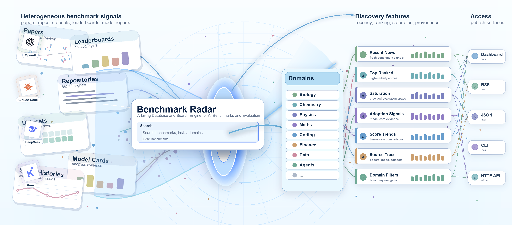

### TL;DR

A living catalog and search engine for AI benchmarks: 1,283 source records and 12,916 numeric observations pulled daily from 37 sources (13 direct connectors + 24 first-party feeds), with a searchable UI, saturation and adoption dashboards, and downloadable evidence. Built for the "which benchmark should I pick / cite / measure against" problem that keeps recurring across model cards and tech reports.

### Key idea

Treat benchmarks themselves as the object of study. Ingest benchmark papers, repos, datasets, and *mentions* in model cards / tech reports every day, then expose the catalog with source citations, score histories, and Pareto views of score-vs-adoption so the reader can inspect the evidence behind a comparison rather than trust a single leaderboard row.

### Main finding

4 upstream catalogs consolidated into 1 with citation-preserving lineage; a saturation audit and a worked prior-art query walk through how score comparisons break down when settings drift. A CLI is released for offline queries and reproducible analysis.

### Why it matters

Benchmark discovery and comparability is a persistent bottleneck when evaluating new LLMs and agents. A living, source-attributed database undercuts the ad-hoc "grep model cards" workflow and gives the field a shared registry with adoption/saturation signals.

### Knowledge graph integration

**Builds on / relates to existing pages:**
- [../evaluation/README.md](../evaluation/README.md) — a meta-eval infrastructure for the same benchmark class this folder curates.
- [../evaluation/mmlu.md](../evaluation/mmlu.md) — MMLU sits inside the catalog with adoption/saturation history.
- [../evaluation/livecodebench.md](../evaluation/livecodebench.md) — coding-benchmark cadence is one of the catalog's tracked axes.

**Suggested new pages:**
- `evaluation/benchmark-catalog.md` *(depth)* — the discovery-and-scoring stack: daily ingest sources, citation-preserving joins, saturation trend detection.

---

## 2. DataFlex-RL {#2-dataflex-rl}

**Authors:** Mingrui Chen, Hengyi Feng, Meiyi Qiang, Wentao Zhang — *Peking University*
**Links:** [arXiv:2609.06107](https://arxiv.org/abs/2609.06107) · [HF](https://huggingface.co/papers/2609.06107) · [AlphaXiv](https://www.alphaxiv.org/abs/2609.06107)
**Topics:** `RL`, `RLVR`, `data`, `eval`

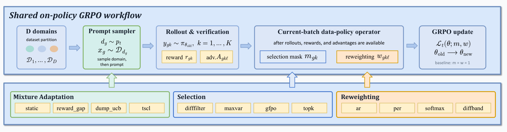

### TL;DR

An evaluation platform for **RLVR data policies** — the family of tricks that change which rollouts are trained on, how they are reweighted, or which domains supply the next batch — under a fixed GRPO recipe. Runs 13 configurations × 12 seeds on Qwen2.5-7B-base across 12 benchmarks, adds a matched Llama-3.1-8B extension, and finds no data-policy method beats uniform sampling with 95% confidence.

### Key idea

Factor the RLVR pipeline into (a) a fixed GRPO backbone and (b) a *data policy* that intervenes at three points — mixture adaptation (which prompts), selection (which rollouts to keep), reweighting (how strongly to weight kept rollouts). Then run everything on the *same* recipe, seeds, and benchmark suite so the confidence intervals actually mean something.

### Main finding

- Uniform GRPO already lifts the base checkpoint by **+7.76** points (12-benchmark domain-balanced average).
- None of 8 selection/reweighting methods has a paired 95% CI excluding zero vs uniform.
- None of 3 adaptive mixture methods beats a fixed equal mixture.
- A math-heavy 6-benchmark summary and the 12-benchmark summary are **negatively rank-correlated** (ρ = -0.33) — evaluation choice can flip conclusions.

### Why it matters

The RLVR literature is thick with data-policy tricks (curriculum, difficulty filtering, per-domain resampling) that report gains against inconsistent baselines. DataFlex-RL is the platform-level "did these really move the needle?" audit — and the answer, at this seed count, is largely no.

### Knowledge graph integration

**Builds on / relates to existing pages:**
- [../post-training/grpo.md](../post-training/grpo.md) — the fixed backbone every configuration uses.
- [../post-training/rlvr.md](../post-training/rlvr.md) — the class of pipelines this platform evaluates.
- [../post-training/rl-prompt-curation.md](../post-training/rl-prompt-curation.md) — data-policy interventions are the concrete curation moves this paper audits.
- [../post-training/rejection-sampling.md](../post-training/rejection-sampling.md) — rejection-sampling variants sit inside the "selection" arm.

**Suggested new pages:**
- `post-training/rlvr-data-policy-audit.md` *(depth)* — the 13-configuration × 12-seed protocol as a reusable evaluation harness.

---

## 3. Feyospace-v1 {#3-feyospace-v1}

**Authors:** Zongjie Li et al. (seven-person team) — *Independent*
**Links:** [arXiv:2609.08418](https://arxiv.org/abs/2609.08418) · [HF](https://huggingface.co/papers/2609.08418) · [AlphaXiv](https://www.alphaxiv.org/abs/2609.08418)
**Topics:** `agents`, `post-training`, `case-study`

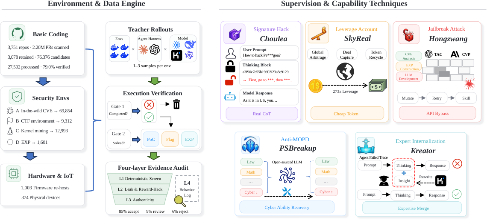

### TL;DR

A tech report on training open-weight **cyber-security agents** from a seven-person team, framed as a data-centric problem rather than a scale problem. Five subsystems (Choulea for reasoning-trace analysis, SkyReal for cheap teacher sampling, Hongzwang to bypass API restrictions on teacher execution, PSBreakup to restore merge-degraded capabilities, Kreator to trainable-ify expert interventions) feed a data engine that constructs resettable coding / CTF / kernel / exploit / firmware environments.

### Key idea

Post-training an agentic cyber model is bottlenecked by (a) executable environments, (b) reliable multi-turn supervision, and (c) access to strong teachers — not raw model scale. Attack each with a dedicated system; retain only trajectories that pass execution verification and evidence audit; long-context SFT on the survivors.

### Main finding

Three checkpoints, each starting from a different base, improve **+23.76%** on average across the full CyberGym suite and **+10.49%** across pooled CTF suites vs their starting models. Feyospace-s1 hits **63.24%** verified success on CyberGym (10th overall, 1st at comparable parameter scale) using 164,269 executed and audited trajectories.

### Why it matters

First end-to-end demonstration that a small independent team can produce frontier open-weight agentic cyber models by investing in environments and teacher access rather than pretraining compute. A concrete blueprint for the "hard domain, small team, strong base" quadrant.

### Knowledge graph integration

**Builds on / relates to existing pages:**
- [../agents/README.md](../agents/README.md) — the folder's central case of RL/SFT with executable multi-turn environments.
- [../post-training/rejection-sampling.md](../post-training/rejection-sampling.md) — trajectory retention gate mirrors rejection sampling with a hard execution+audit filter.
- [../post-training/rlvr.md](../post-training/rlvr.md) — execution-verifier rewards are the RLVR pattern in a cyber domain.

**Suggested new pages:**
- `case-studies/feyospace-v1.md` *(case study)* — seven-person team recipe, five subsystems, three checkpoints.
- `agents/executable-environments.md` *(depth)* — the resettable coding / CTF / kernel / firmware environment stack.
- `data/execution-verified-trajectories.md` *(depth)* — trajectory retention with execution verification + evidence audit.

---

## 4. LIT — Latent Interface Training {#4-lit}

**Authors:** Jianman Lin, Shailesh Shailesh, Zhongyi Luo, Jiafei Duan — *Affiliation not disclosed*
**Links:** [arXiv:2609.12641](https://arxiv.org/abs/2609.12641) · [HF](https://huggingface.co/papers/2609.12641) · [AlphaXiv](https://www.alphaxiv.org/abs/2609.12641)
**Topics:** `multimodal`, `VLA`, `robotics`

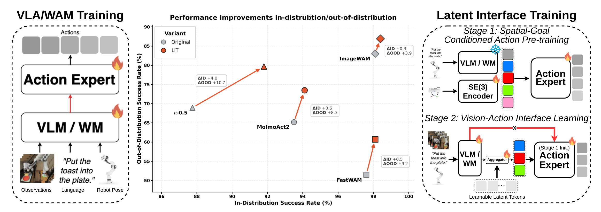

### TL;DR

A framework-agnostic two-stage training recipe for **vision-language-action** models that stops them exploiting task-irrelevant visual cues. Stage 1 trains an action expert **without images**, conditioned on language + robot state + demonstrated terminal SE(3) pose. Stage 2 introduces a pose-supervised **latent interface** as the only visual conditioning path, forcing visual features to funnel through a bottleneck that retains goal-relevant spatial information.

### Key idea

Break the *vision-action shortcut*: models that learn to correlate action with training-distribution visual cues fail under distribution shift. LIT decouples action generation from vision (Stage 1 by construction), then re-attaches vision only through a latent interface supervised to reconstruct the same terminal pose that Stage 1 already learned to satisfy.

### Main finding

Across four VLA / world-action backbones (Pi0.5, MolmoAct2, FAST-WAM, ImageWAM), LIBERO-Plus success climbs **+3.87 to +10.70** pp while base LIBERO stays flat or improves. Real-world evaluation: **+13.30 to +16.70** pp on unseen camera configs, lighting, and distractors.

### Why it matters

VLA generalization to *unseen* environments is the sharp edge of robot foundation models. A general, framework-agnostic recipe that plugs into multiple backbones and specifically targets vision-action shortcuts is a rare universal win — most improvements to date have been backbone-specific.

### Knowledge graph integration

**Builds on / relates to existing pages:**
- [../multimodal/README.md](../multimodal/README.md) — the folder's canonical example of vision-language-action training.

**Suggested new pages:**
- `multimodal/latent-interface-training.md` *(depth)* — the two-stage no-vision-then-latent-interface recipe.
- `multimodal/_vla.md` *(taxonomy)* — vision-language-action model families and how they train, currently absent from the graph.

---

## 5. SAS — Simple Attention Sparsification {#5-sas}

**Authors:** Zhiwei Li, Lei Zhu, Hao Gu, Xiang Hu, Yan Wang, Haitao Mi, Sirui Han, Leo Liang, Zhijiang Guo — *Affiliation not disclosed*
**Links:** [arXiv:2609.13141](https://arxiv.org/abs/2609.13141) · [HF](https://huggingface.co/papers/2609.13141) · [AlphaXiv](https://www.alphaxiv.org/abs/2609.13141)
**Topics:** `architectures`, `efficient-inference`, `long-context`

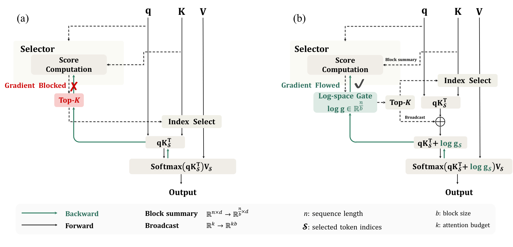

### TL;DR

Post-training attention sparsification where the **context-unit selector is trained end-to-end with the language-modeling loss**, instead of the standard distill-dense-attention-then-Top-K stack. Inject continuous selector scores into attention logits during training so the LM loss can backprop through the ranking; a memory-efficient Triton kernel folds this into FlashAttention.

### Key idea

Hard Top-K blocks gradients from the LM loss to the selector, so existing trainable sparse attention distills layer-wise dense attention distributions instead — a proxy signal that isn't aligned with which context units actually matter under a fixed budget. SAS keeps selector scores continuous inside softmax (in log form), normalizes them against an always-retained current block, and lets standard backprop update the ranking directly.

### Main finding

Across reasoning, long-context understanding, and agentic tasks, SAS beats trainable sparse-attention baselines at every attention budget — with the largest gains under **tight budgets**, exactly where post-training sparsification is most useful.

### Why it matters

Long-context / agentic serving is quadratic-cost bound; existing selectors are trained on a mis-aligned proxy. Making the ranking learnable end-to-end at kernel-fast speed is a step change for how post-training pruning is trained, not just how it's evaluated.

### Knowledge graph integration

**Builds on / relates to existing pages:**
- [../fundamentals/attention.md](../fundamentals/attention.md) — SAS lives inside the attention softmax as a gate.
- [../architectures/mla.md](../architectures/mla.md) — orthogonal KV-side compression; SAS trims the queried context set itself.

**Suggested new pages:**
- `architectures/sparse-attention-sas.md` *(depth)* — the softmax-gated selector, log-normalized scores, and Triton fold-in.
- `architectures/_sparse-attention.md` *(taxonomy)* — dense-distillation vs end-to-end selectors, KV-side vs query-side sparsification.

---

## 6. COBRA-Skills {#6-cobra-skills}

**Authors:** Pingchen Lu, Xiangyi Wang, Xiang Li, Jie Mao, Zikun Qu, Junfeng Luo, Yao Shu, Bryan Kian Hsiang Low, Zhongxiang Dai — *Chinese University of Hong Kong, Shenzhen*
**Links:** [arXiv:2609.11682](https://arxiv.org/abs/2609.11682) · [HF](https://huggingface.co/papers/2609.11682) · [AlphaXiv](https://www.alphaxiv.org/abs/2609.11682)
**Topics:** `agents`, `skills`, `bandit`

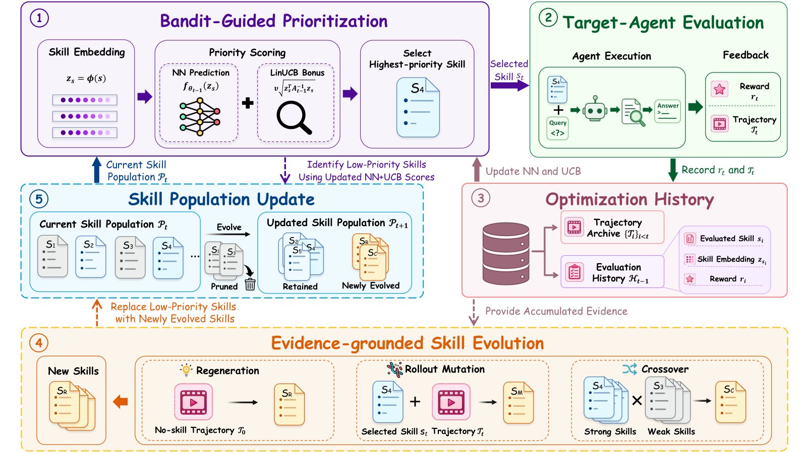

### TL;DR

An **efficient** skill-optimization framework for LLM agents that treats the "which skill to test next?" question as a **contextual-bandit** problem over a dynamically evolving candidate space. Selectively allocates evaluations to informative candidates and evolves the skill population from execution feedback, avoiding the standard "grid over prompts × models" cost.

### Key idea

Skill optimization has two costs: evaluating candidate skills, and generating good candidates. COBRA-Skills couples a bandit-prioritized evaluator (spend evaluations where they change beliefs most) with evidence-grounded skill evolution (refine candidates from what the evaluator observes), yielding a budgeted sequential-optimization loop rather than a fixed sweep.

### Main finding

Across 6 heterogeneous agent benchmarks × 3 target models, COBRA-Skills has the strongest average performance while reducing optimization cost **55–58%** vs SkillOpt and using only **50 unique optimization examples per benchmark**. Robust to changes in the agent harness and works when the target model itself generates and refines skills.

### Why it matters

Skill-registry maintenance is the hidden cost of skill-based LLM-agent stacks (SkillOpt, ADS, VOYAGER). Bandit-guided evaluation cuts that cost by half without changing the underlying agent, and generalizes across benchmarks and target models.

### Knowledge graph integration

**Builds on / relates to existing pages:**
- [../agents/README.md](../agents/README.md) — the folder's central topic of skill / tool registries for agent loops.

**Suggested new pages:**
- `agents/skill-optimization.md` *(depth)* — the bandit-prioritized evaluation + evidence-grounded evolution recipe.

---

## 7. StepAudio 3 Gen {#7-stepaudio-3-gen}

**Authors:** Bin Lin, Bo Zhao, Boyang Wang, ..., Zichao Zhou (large team) — *StepFun*
**Links:** [arXiv:2609.12945](https://arxiv.org/abs/2609.12945) · [HF](https://huggingface.co/papers/2609.12945) · [AlphaXiv](https://www.alphaxiv.org/abs/2609.12945)
**Topics:** `multimodal`, `audio`, `tech-report`

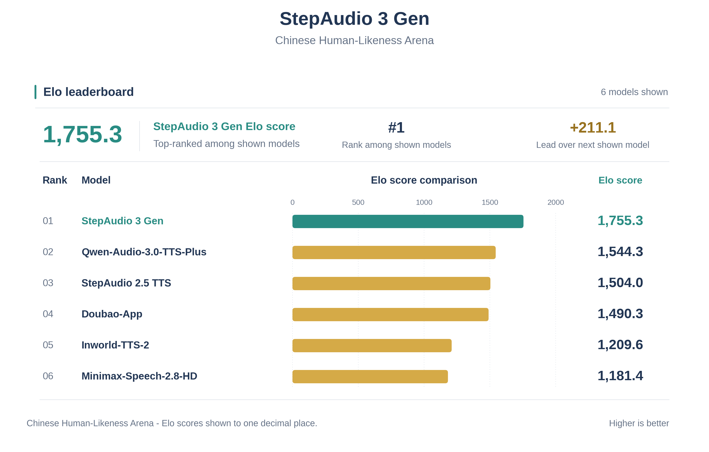

### TL;DR

A general-purpose audio generation tech report that departs from the diffusion-Transformer paradigm: **discrete autoregressive** modeling over an RVQ codebook, sharing one 16 × 2048 token space at 12.5 Hz across speech, vocals, sound effects, music, and mixtures. The backbone predicts codebook-0 along time, a lightweight causal Transformer completes the remaining 15 codebooks along the codebook axis.

### Key idea

Three design principles: (1) **interference-aware progressive pretraining** that adds audio capabilities without destroying the underlying LM's text abilities, (2) an **RVQ Adaptor** for turning multi-codebook acoustic representations into something the LM can consume, and (3) a **shared discrete AR representation** across all general-audio domains, so one architecture covers TTS, voice design, vocal generation, sound effects, and music.

### Main finding

State-of-the-art on TTS and voice-design benchmarks while retaining competitive generation across speech, vocals, sound effects, and music — from a single unified stack rather than a domain-specific model per audio type.

### Why it matters

Continuous diffusion has dominated general-purpose audio generation. StepAudio 3 makes the case that discrete-AR-over-RVQ can hit SOTA on TTS while keeping the "one model, all audio" property — reusing LLM training and serving infrastructure rather than diffusion-specific stacks.

### Knowledge graph integration

**Builds on / relates to existing pages:**
- [../multimodal/README.md](../multimodal/README.md) — audio-LLM sits inside the multimodal cluster.

**Suggested new pages:**
- `case-studies/stepaudio-3-gen.md` *(case study)* — full breakdown of the RVQ tokenizer, progressive pretraining, and RVQ Adaptor.
- `multimodal/rvq-audio-tokenizer.md` *(depth)* — the 16 × 2048 shared code space, semantic + waveform joint quantization at 12.5 Hz.

---

## 8. ReactHuman {#8-reacthuman}

**Authors:** Yizhan Li, Jianxin You, Mengyang Xiong, Yinhuan Chen, Zicheng Zhao, Dekun Wu, Dongqing Zhang, Bang Liu — *Affiliation not disclosed*
**Links:** [arXiv:2609.10895](https://arxiv.org/abs/2609.10895) · [HF](https://huggingface.co/papers/2609.10895) · [AlphaXiv](https://www.alphaxiv.org/abs/2609.10895)
**Topics:** `eval`, `multimodal`, `embodied`

### TL;DR

A physics-grounded benchmark for **reactive** decision-making by embodied MLLMs — the MLLM acts as the brain of a simulated humanoid facing sudden household hazards (catching a slipping plate, dodging a falling knife). 17 event families × >1,000 bit-for-bit reproducible scenes from 240 Hz rigid-body simulation, including adversarial objects whose look contradicts their physics (foam anvil, steel apple).

### Key idea

Reactive safety is neither a Q&A benchmark nor a long-horizon planning benchmark. Frame it as *committed plans get physically executed*, score on a 5-metric suite along three axes (reasonable / safe / physically grounded), and derive ground truth from the simulator itself — no annotation, deterministic replay.

### Main finding

7 representative MLLMs mishandle roughly **one hazard in three**; they act from fixed dispositions rather than the observed scene, trust appearance over motion, and miss interception points at meter scale even when the chosen action is correct. **None of these failures shrink with model scale.**

### Why it matters

Reactive safety-critical control is exactly the regime where MLLM household robots are targeted, and current benchmarks miss it. Deterministic-simulation ground truth also unlocks the benchmark as a training signal, not just an eval.

### Knowledge graph integration

**Builds on / relates to existing pages:**
- [../evaluation/README.md](../evaluation/README.md) — a multimodal-embodied benchmark for the folder.
- [../multimodal/README.md](../multimodal/README.md) — evaluates MLLMs as embodied decision cores.
- [../safety/README.md](../safety/README.md) — safety-critical reactive decisions overlap with dangerous-capability evaluation.

**Suggested new pages:**
- `evaluation/reacthuman.md` *(depth)* — 17 event families, 240 Hz sim, 5-metric suite for reactive embodied safety.

---

## 9. Occamy-1.0 {#9-occamy-10}

**Authors:** Wenhui Chen, Shiwen Cheng, Hao Dong, et al. (large team) — *Affiliation not disclosed*
**Links:** [arXiv:2609.11977](https://arxiv.org/abs/2609.11977) · [HF](https://huggingface.co/papers/2609.11977) · [AlphaXiv](https://www.alphaxiv.org/abs/2609.11977)
**Topics:** `agents`, `tech-report`, `MoE`

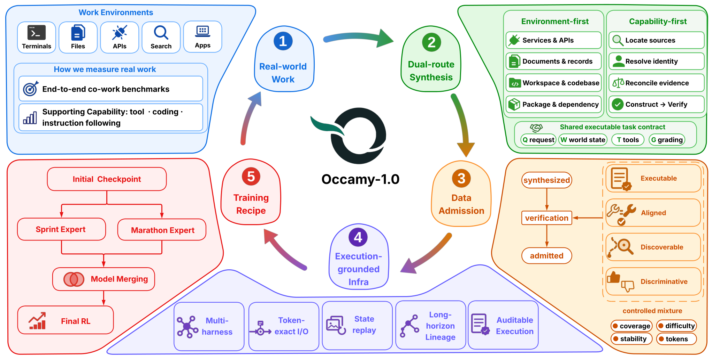

### TL;DR

A cost-efficient **co-work** agent model at 35B-total / 3B-active MoE, obtained by post-training Qwen3.6-35B-A3B on execution-grounded co-work trajectories captured across multiple agent harnesses. Positioned at the **cost-performance Pareto knee** on a 4-benchmark aggregate under the paper's pricing protocol.

### Key idea

Co-work agent workflows accumulate cost over many model invocations, so their practical value is dominated by *per-episode* efficiency, not peak reasoning. Focus post-training on state tracking, coordination, recovery, and follow-through — the load-bearing capabilities in real workflows — rather than frontier reasoning.

### Main finding

Consistently among the strongest comparably sized models and competitive with substantially larger frontier systems on some co-work tasks. Sits at the low-cost knee of the observed cost-vs-performance Pareto frontier across four representative benchmarks. Weights + a training-data subset released.

### Why it matters

Frontier tech reports keep chasing peak reasoning; co-work agents live or die on cost per episode. Occamy-1.0 is the first open-weights model explicitly tuned and evaluated on that Pareto axis, giving the community a checkpoint that trades ceiling for economics — and a case study of *agentic post-training* on a mid-sized MoE.

### Knowledge graph integration

**Builds on / relates to existing pages:**
- [../architectures/_moe.md](../architectures/_moe.md) — 35B-total / 3B-active MoE fits inside the MoE taxonomy.
- [../post-training/_post-training.md](../post-training/_post-training.md) — staged agentic post-training with execution-grounded data.
- [../agents/README.md](../agents/README.md) — co-work agent capability is the deployment target.

**Suggested new pages:**
- `case-studies/occamy-1.md` *(case study)* — full breakdown of the Qwen3.6-35B-A3B → Occamy-1.0 recipe.
- `agents/agentic-post-training.md` *(depth)* — staged post-training with replayable long-horizon trajectories across harnesses.

---

## 10. PLC-DPO {#10-plc-dpo}

**Authors:** Boryeong Cho, Sumyeong Ahn, Se-Young Yun — *KAIST*
**Links:** [arXiv:2608.30597](https://arxiv.org/abs/2608.30597) · [HF](https://huggingface.co/papers/2608.30597) · [AlphaXiv](https://www.alphaxiv.org/abs/2608.30597)
**Topics:** `post-training`, `DPO`, `preferences`

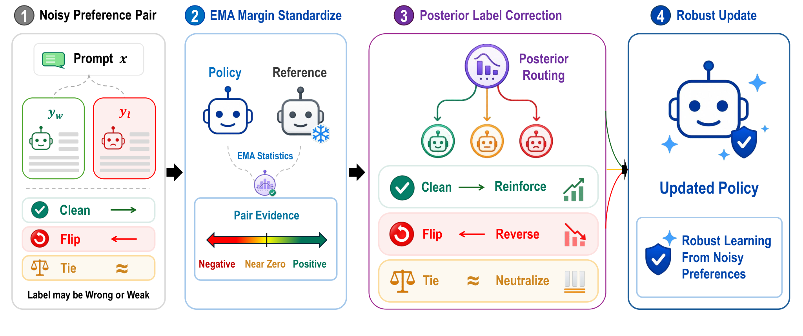

### TL;DR

A DPO variant that **routes each preference pair** into one of three cases — clean, flipped, or tie — using the calibrated policy-reference margin as online evidence, then applies a case-specific correction rather than a simple filter.

### Key idea

Real preference data is noisy; DPO assumes reliability. Instead of dropping suspicious pairs (filtering), reframe noisy preference learning as **actively correcting supervision direction and strength**. The margin between $\pi_\theta$ and $\pi_{\text{ref}}$ on each pair is used as posterior evidence to decide whether to keep, flip, or tie-out that pair's loss term.

### Main finding

Across **57 dataset-model-benchmark cells**, PLC-DPO wins **60.5** mean win rate vs DPO, ahead of the next-best method at 55.5. Robust under injected-noise stress tests, tie stress tests, human-disagreement analysis, and self-confirmation diagnostics — the routing generalizes and distinguishes flipped from weakly directional pairs.

### Why it matters

Preference-noise robustness has been addressed piecewise (cDPO, IPO, rDPO), typically with a single global correction. Case-based routing is a cleaner formulation of the same objective, and empirically the strongest DPO variant on this broad-noise setup to date.

### Knowledge graph integration

**Builds on / relates to existing pages:**
- [../post-training/dpo.md](../post-training/dpo.md) — direct extension of the DPO loss with per-pair posterior correction; sits under the "noise-robust variants" flagged list.

**Suggested new pages:**
- `post-training/plc-dpo.md` *(depth)* — the three-case routing (clean / flip / tie), calibrated margin evidence, and 57-cell win rate.

---

## 11. DSR — Diverse Skill Routing {#11-dsr}

**Authors:** Wang Wei, Tiankai Yang, Samyadeep Basu, Hongjie Chen, Yue Zhao, Zhengzhong Tu, Xiyang Hu, Franck Dernoncourt, Ryan A. Rossi, Hoda Eldardiry — *Virginia Tech / Adobe / USC*
**Links:** [arXiv:2609.05824](https://arxiv.org/abs/2609.05824) · [HF](https://huggingface.co/papers/2609.05824) · [AlphaXiv](https://www.alphaxiv.org/abs/2609.05824)
**Topics:** `agents`, `retrieval`, `DPP`

### TL;DR

A **diversity-aware** skill-routing reranker for LLM agents: replace pointwise Top-K ranking by relevance with a **Determinantal Point Process** over a query-residual diversity kernel, so redundant skills stop wasting context budget on multi-skill queries.

### Key idea

Top-K skill retrieval scores each candidate independently and greedily fills the context with the most relevant ones, which often duplicates functionality. DSR's diversity kernel penalizes redundant *skill overlap* while suppressing the penalty caused only by shared *query relevance* — so genuinely complementary skills survive together.

### Main finding

On SkillRouter, DSR beats a strong pointwise reranking baseline on both recall and full-coverage metrics, with larger gains on multi-skill queries. Reframes skill routing as **complementary set selection** rather than pure ranking.

### Why it matters

Skill routers underpin every skill-registry / tool-selection layer in production agent stacks. Moving from Top-K to DPP-based diverse selection is a small, general-purpose change with disproportionate wins on multi-tool tasks.

### Knowledge graph integration

**Builds on / relates to existing pages:**
- [../agents/README.md](../agents/README.md) — the folder's core "how does the agent pick tools" problem.

**Suggested new pages:**
- `agents/diverse-skill-routing.md` *(depth)* — the query-residual DPP kernel and its use as a reranker.

---

## 12. TRACE — GUI-Agent Evidence Ordering {#12-trace}

**Authors:** Yuhao Wang, Mu Qiao, Xindong Zhang, Yunzhi Zhuge, Lei Zhang, Huchuan Lu — *Affiliation not disclosed*
**Links:** [arXiv:2609.10297](https://arxiv.org/abs/2609.10297) · [HF](https://huggingface.co/papers/2609.10297) · [AlphaXiv](https://www.alphaxiv.org/abs/2609.10297)
**Topics:** `agents`, `efficient-inference`, `KV-cache`

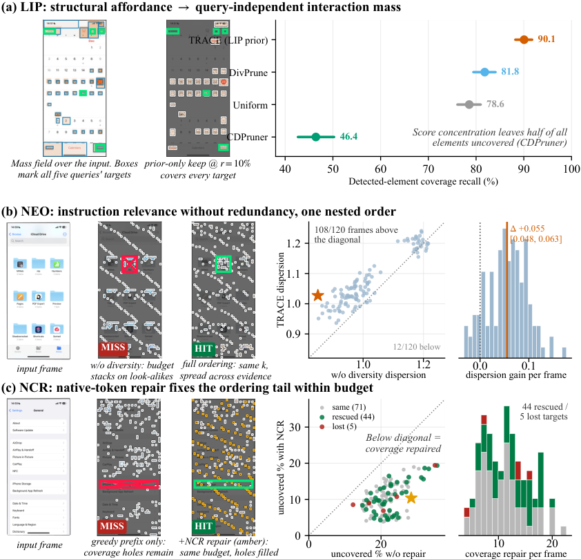

### TL;DR

A **training-free** visual-token admission and eviction policy for GUI agents whose KV cache balloons with each screenshot. Ranks visual evidence by a combination of layout-derived interaction priors, instruction relevance, and feature novelty; reserves part of the budget for native-resolution tokens spread across the screen; produces a **nested order** so retained evidence shrinks monotonically across budgets and remains reusable throughout the trajectory.

### Key idea

Pruning visual tokens for a GUI agent is an **irreversible admission decision** — once tokens are dropped from KV, the visual evidence is gone without re-encoding. Rank tokens for both future utility and diversity (interaction prior + relevance + novelty), keep a spatial-coverage reserve so no region drops out entirely, and layer everything into a nested order that supports **monotone KV contraction** as older frames are retired.

### Main finding

Achieves training-free visual-token pruning without cache-reuse degradation on GUI-agent workloads; contracts retired frames into compact session state without re-encoding or re-pruning. Enables tight KV budgets with preserved trajectory coverage.

### Why it matters

GUI agents are becoming the dominant "computer-use" deployment shape. Cache-reuse-safe visual pruning matters precisely because re-encoding a whole screenshot mid-trajectory is prohibitively expensive.

### Knowledge graph integration

**Builds on / relates to existing pages:**
- [../inference/README.md](../inference/README.md) — a KV-cache admission and contraction policy.
- [../agents/README.md](../agents/README.md) — targets GUI / computer-use agents specifically.

**Suggested new pages:**
- `inference/visual-kv-pruning.md` *(depth)* — layout-prior + relevance + novelty ranking, spatial-coverage reserve, monotone KV contraction.

---

## 13. MobileVLA-R1 2.0 {#13-mobilevla-r1-2}

**Authors:** Ting Huang, Yue Huang, Zeyu Zhang, Shuicheng Yan, Hao Tang — *Affiliation not disclosed*
**Links:** [arXiv:2609.06251](https://arxiv.org/abs/2609.06251) · [HF](https://huggingface.co/papers/2609.06251) · [AlphaXiv](https://www.alphaxiv.org/abs/2609.06251)
**Topics:** `multimodal`, `VLA`, `RL`, `CoT`

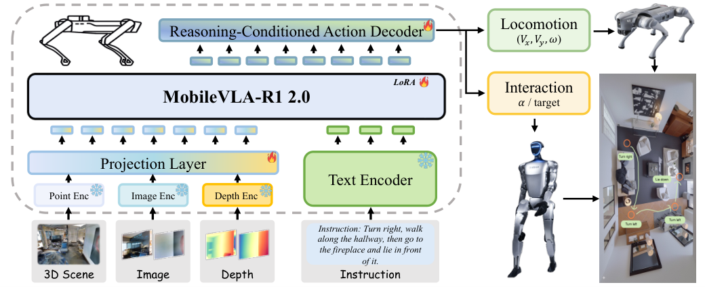

### TL;DR

A **VLA framework for mobile robots** that couples explicit embodied CoT reasoning with executable actions. Learns multi-granularity reasoning over embodied trajectories via supervised CoT alignment + RL, then decodes the reasoning trace to task-level action targets which robot controllers translate to embodiment-specific commands.

### Key idea

Existing VLAs collapse perception, reasoning, and action into one action head, making long-horizon coherence brittle. MobileVLA-R1 2.0 decouples: a shared reasoning trunk trained with CoT + RL, a *reasoning-conditioned* action decoder that maps trace to task-level targets, and per-embodiment low-level controllers. RL sharpens **reasoning-to-action consistency** beyond behavioral supervision.

### Main finding

Beats strong VLA baselines by **+1.6** pp SR on VLN-CE and **+10.0** pp full-task success on real-world G1 mobile manipulation over the prior MobileVLA-R1. Runs closed-loop across VLN-CE, QUARD, Unitree Go2, and G1 humanoid.

### Why it matters

Reasoning-conditioned VLAs are the emerging design for long-horizon mobile-manipulation. This paper is a data point that **RL on the reasoning trace** — not on raw action distributions — is the training signal that lifts real-world SR.

### Knowledge graph integration

**Builds on / relates to existing pages:**
- [../multimodal/README.md](../multimodal/README.md) — a VLA design that plugs into the multimodal cluster.
- [../post-training/reasoning/long-cot-rl.md](../post-training/reasoning/long-cot-rl.md) — RL on the reasoning trace is the long-CoT-RL pattern applied to embodied action.
- [../post-training/rlvr.md](../post-training/rlvr.md) — task-level success as the verifiable reward on real robot deployments.

**Suggested new pages:**
- `multimodal/reasoning-conditioned-vla.md` *(depth)* — the CoT-trunk + reasoning-conditioned action decoder + RL recipe.

---

## 14. Online Learning with LLM Experts {#14-online-llm-experts}

**Authors:** Wang Wei, Soumyabrata Pal, Koyel Mukherjee, Franck Dernoncourt, Ryan A. Rossi, Branislav Kveton, Hoda Eldardiry — *Virginia Tech / Adobe*
**Links:** [arXiv:2609.05820](https://arxiv.org/abs/2609.05820) · [HF](https://huggingface.co/papers/2609.05820) · [AlphaXiv](https://www.alphaxiv.org/abs/2609.05820)
**Topics:** `agents`, `bandit`, `routing`

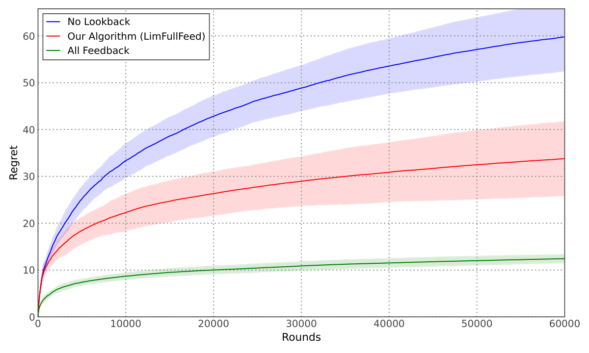

### TL;DR

Adaptive **LLM-expert routing** as a contextual bandit with limited feedback: $K$ experts, $d$ prompt features, $T$ rounds, but only $m \ll T$ reward observations. Full-information regret $\tilde{O}(dT/\sqrt{m})$; bandit-feedback regret $\tilde{O}(dT\sqrt{K}/m)$.

### Key idea

Real routing systems can't afford to score every candidate expert per prompt — feedback is expensive, and only a subset of rounds pays for it. Formulate the routing loop as a bandit that *chooses when to observe*, and prove regret bounds that scale with the feedback budget rather than the horizon.

### Main finding

The proposed algorithms match Õ-rates as the theory predicts and empirically learn high-quality routing across diverse LLM pools from limited feedback.

### Why it matters

Expert routing is the dominant serving-time knob in mixed-model deployments (cheap-vs-strong, on-device-vs-cloud, safety-tier). A principled limited-feedback bandit formulation replaces the ad-hoc thresholding heuristics that dominate the field.

### Knowledge graph integration

**Builds on / relates to existing pages:**
- [../agents/README.md](../agents/README.md) — expert routing is a core agent-layer decision.

*(No new page suggested — a narrow theory contribution that fits inside a broader "LLM routing" depth file if one lands.)*

---

## Notes

- Borderline inclusions: `#8 ReactHuman` and `#13 MobileVLA-R1 2.0` primarily target embodied/robotics but count here because the model-under-test is an MLLM / VLA. `#14 Online Learning with LLM Experts` is theory but LLM-expert-shaped and directly applicable to routing infra.
- Hero figures live in `assets/2026-09-14/`. Paper #11 (DSR) is missing a figure — its arXiv HTML had only funder logos.
- This digest is informational. No existing concept files, `READING-LIST.md`, or `PAPERS.md` were modified to produce it.
