# Daily AI papers — 2026-09-18

*Curated from HF Daily Papers. 15 of 24 papers kept after relevance filter.*

## Papers at a glance

| # | Title | Topics | Org |
| --- | --- | --- | --- |
| 1 | [DeepSeek-V4.1-Flash: Pushing the Limits of KV Cache Compression](#1-deepseek-v41-flash) | `LLM`, `MoE`, `efficient-inference`, `quantization`, `multimodal` | DeepSeek-AI |
| 2 | [SoL-Pi: Recursively Scaling Auto-Research Loops for Efficient Agent Harness](#2-sol-pi) | `agents`, `efficient-inference` | (author-consortium; NVIDIA/HKUST-affiliated) |
| 3 | [An Empirical Study of Harness Design for Coding Agents](#3-harness-design) | `agents`, `eval` | (Fan et al. — UMass-affiliated) |
| 4 | [When EOS Tokens Disagree: Length Inflation in On-Policy Distillation](#4-when-eos-tokens-disagree) | `post-training`, `distillation`, `reasoning` | (UNC / MSR / other) |
| 5 | [JEPA-Anything: Learning Predictive Models across Different Worlds](#5-jepa-anything) | `world-model`, `representation-learning` | (multi-inst.; Shanghai AI Lab / CUHK) |
| 6 | [RiskChainBench: Obfuscated Platform Message Restoration and Web Investigation](#6-riskchainbench) | `eval`, `safety`, `agents` | (Liu et al.) |
| 7 | [RetireOPD: Self-Retiring On-Policy Distillation for Agentic RL](#7-retireopd) | `RL`, `distillation`, `agents` | Zhejiang U. |
| 8 | [Verifiable Social Reasoning for LLM Assistants (Fuse)](#8-verifiable-social-reasoning) | `eval`, `reasoning`, `agents` | Google |
| 9 | [Reflect, Revise, Reuse: Training-Free Skill Evolution for GUI Agents](#9-evoskill-gui) | `agents`, `multimodal` | Zhejiang U. |
| 10 | [Video DeltaNet: A Video-Native Hybrid Attention for Livestream Video Generation](#10-video-deltanet) | `diffusion`, `video`, `attention`, `efficient-inference` | (multi-inst.; UC Berkeley / Meta) |
| 11 | [When2Think: Difficulty-Aware Length Control for Efficient Hybrid Reasoning](#11-when2think) | `reasoning`, `RL`, `efficient-inference` | Microsoft |
| 12 | [What Does Privileged Information Add to On-Policy Self-Distillation?](#12-privileged-opsd) | `post-training`, `distillation`, `reasoning` | NUS |
| 13 | [Don't Mask the Environment: Observation Supervision Under RL (ActObs)](#13-actobs) | `RL`, `agents`, `post-training` | (Zhang et al. — AWS-affiliated) |
| 14 | [Region-Level Policy Optimization for Fine-grained MLLM Perception (Vision-RL2)](#14-vision-rl2) | `RL`, `multimodal`, `efficient-inference` | U. Sydney / City U. HK |
| 15 | [Sample Count Is Not Enough: Candidate-Generation Strategy in LLM Test-Time Scaling](#15-test-time-schedule) | `efficient-inference`, `eval`, `reasoning` | Iowa State U. |

---

## 1. DeepSeek-V4.1-Flash

**Authors:** DeepSeek-AI et al. (~590 authors) — *DeepSeek-AI*
**Links:** [arXiv:2609.19969](https://arxiv.org/abs/2609.19969) · [HF](https://huggingface.co/papers/2609.19969) · [AlphaXiv](https://www.alphaxiv.org/abs/2609.19969)
**Topics:** `LLM`, `MoE`, `efficient-inference`, `quantization`, `multimodal`

### TL;DR

A 552B multimodal MoE tuned for long-horizon agent workloads where the bottleneck is prefill cost and KV-cache bandwidth. Introduces a Causal Encoder-Decoder (CED) that activates only 8B params during prefill (16B during decode) and combines cross-layer KV-cache reuse (CSA2) with FP4 KV caching to shrink the global cache to ~890 bytes/token — roughly 1/4 of V4-Flash — while beating it on quality.

### Key idea

Three interacting cost cuts: (1) **CED** splits the network so the prefill pass sees a lighter tower than decode, cheapening the long-input phase agents suffer under; (2) **Compressed Sparse Attention 2 (CSA2)** reuses one compressed KV projection across layers, complementing FP4 quantization of what remains; (3) **SWA Bounded Replay** at deployment bounds sliding-window replay so the persistent KV footprint on SSD/host is another ~2× smaller than the HBM one. Together they attack HBM residency, SSD residency, and bandwidth in one architecture.

### Main finding

Global KV cache in HBM: ~890 B/token (~4× denser than V4-Flash). Persistent KV on SSD/host: ~8× smaller than V4-Flash. Despite the compression, V4.1-Flash outperforms V4-Flash across text and multimodal agentic evals. Pretrained on 45T multimodal tokens; weights released.

### Why it matters

Agent workloads have flipped the LLM-serving cost model: prompts dwarf outputs, and KV cache is the choke point, not FLOPs. V4.1-Flash is the first public frontier system where every architectural knob (decode/prefill split, attention shape, KV precision, sliding-window replay) is co-designed for that regime. Cross-layer KV reuse plus FP4 caching sets a new reference point that other MoE inference stacks will now be compared against.

### Knowledge graph integration

**Builds on / relates to existing pages:**
- [../case-studies/deepseek-v3.md](../case-studies/deepseek-v3.md) — direct architectural descendant; V3's MLA and MoE recipes evolve here into CSA2 + CED.
- [../architectures/mla.md](../architectures/mla.md) — MLA compressed KV cache is the ancestor of CSA2's cross-layer reuse.
- [../architectures/deepseek-moe.md](../architectures/deepseek-moe.md) — same fine-grained + shared-expert layout, scaled up.
- [../architectures/aux-loss-free-balancing.md](../architectures/aux-loss-free-balancing.md) — the balancing regime the V4-line inherits.
- [../quantization/fp8.md](../quantization/fp8.md) — FP4 KV caching pushes the same low-precision agenda further.
- [../quantization/_number-formats.md](../quantization/_number-formats.md) — FP4 slots into the number-format landscape below FP8.
- [../pre-training/fp8-training.md](../pre-training/fp8-training.md) — low-precision co-design in training is what makes low-precision cache viable.
- [../pre-training/mtp.md](../pre-training/mtp.md) — DeepSeek's multi-token-prediction line likely still applies here.

**Suggested new pages:**
- `case-studies/deepseek-v4-1-flash.md` *(case study)* — end-to-end system: CED, CSA2, FP4 KV, SWA Bounded Replay, 45T-token multimodal pretraining, post-training.
- `architectures/csa2.md` *(depth)* — Compressed Sparse Attention 2 with cross-layer KV reuse.
- `architectures/ced.md` *(depth)* — Causal Encoder-Decoder: asymmetric prefill/decode compute.
- `inference/fp4-kv-cache.md` *(depth)* — FP4 quantization of KV cache and its accuracy/bandwidth tradeoffs.
- `inference/swa-bounded-replay.md` *(depth)* — bounded sliding-window replay for shrinking persistent KV on SSD/host.

---

## 2. SoL-Pi

**Authors:** Haozhe Liu, Tian Ye, Sensen Gao, Qihang Cao, Yitong Li, Mingchen Zhuge, Duomin Wang, Ruihua Zhang, Ping Luo, Jiawang Bian, Lei Zhu, Ligeng Zhu, Enze Xie, Song Han — *multi-institutional (NVIDIA / HKUST-affiliated)*
**Links:** [arXiv:2609.20519](https://arxiv.org/abs/2609.20519) · [HF](https://huggingface.co/papers/2609.20519) · [AlphaXiv](https://www.alphaxiv.org/abs/2609.20519)
**Topics:** `agents`, `efficient-inference`

### TL;DR

Applies recursive self-improvement (RSI) at the *agent-harness* layer: an outer loop discovers, tests, and keeps token-efficiency mechanisms across many coding environments rather than fine-tuning the model. Four surviving mechanisms — action execution, context compaction, observation handling, and delegated reading — combine into SoL-Pi, hitting Pi-level accuracy on EdgeBench while cutting token traffic by ~45–49% and API cost by ~1/3.

### Key idea

Instead of fine-tuning the coder, treat the harness itself as the target of an evolutionary auto-research loop over diverse environments. Each proposed mechanism is judged by cross-environment transfer, so surviving primitives generalize outside their discovery setting. SoL-Pi is the concrete four-primitive checkpoint of that process.

### Main finding

51-task EdgeBench, on top of GPT-5.6-Sol and Opus 5: SoL-Pi matches Pi's accuracy with 44.7–49.0% less recorded token traffic and roughly one-third lower API cost.

### Why it matters

Most agent research either scales models or hand-tunes prompts; harness-level search is the neglected third axis. Making it recursive and cross-environmental produces primitives that are *portable across backend models*, which is what production deployments need.

### Knowledge graph integration

**Builds on / relates to existing pages:**
- [../agents/README.md](../agents/README.md) — the agents area currently has no depth files; this is a canonical harness paper.

**Suggested new pages:**
- `agents/agent-harness.md` *(depth)* — what a coding-agent harness is, and the layers auto-research targets.
- `agents/_context-management.md` *(taxonomy)* — context compaction / elision / summarization strategies across harnesses.
- `agents/recursive-harness-search.md` *(depth)* — RSI-style loop over harness primitives across environments.

---

## 3. Harness Design for Coding Agents

**Authors:** Run-Ze Fan, Zihao Zhang, Simin Ma, Yebowen Hu, Shouju Wang, Kaiqiang Song, Fei Liu, Hamed Zamani, Xiaoyang Wang — *UMass Amherst-affiliated (per template asset)*
**Links:** [arXiv:2609.20804](https://arxiv.org/abs/2609.20804) · [HF](https://huggingface.co/papers/2609.20804) · [AlphaXiv](https://www.alphaxiv.org/abs/2609.20804)
**Topics:** `agents`, `eval`

### TL;DR

A component-level ablation of coding-agent harnesses. Fixes the outer loop and varies three parts — planning, action space, context management — across 176 matched configurations on SWE-Bench Verified and Terminal-Bench 2.1 with four models. Findings: context management dominates once the window tightens; rule-based elision before LLM summarization is the best cheap default; planning helps weak models on accuracy but only cost for strong models; predefined tools help models with weak bash skills, while bash-only wins on cost when the model can drive a shell.

### Key idea

Break the harness into "small, orthogonal knobs" and test them independently against fixed models. The framing lets each knob's marginal effect be attributed instead of buried inside a bespoke agent.

### Main finding

Four crisp empirical rules across 176 settings; recoverable-elision "machinery" turns out to be dead weight (models rarely use it, no accuracy gain), while staged rule-then-LLM elision is strictly best on cost/accuracy.

### Why it matters

Complements SoL-Pi from a scientific angle: SoL-Pi searches, this paper explains. Together they mark a shift from monolithic agent frameworks to component-level harness design as its own research object.

### Knowledge graph integration

**Builds on / relates to existing pages:**
- [../agents/README.md](../agents/README.md) — foundational reference for what "harness" means in the graph.
- [../evaluation/livecodebench.md](../evaluation/livecodebench.md) — sibling coding-agent benchmark for context.

**Suggested new pages:**
- `evaluation/swe-bench.md` *(depth)* — SWE-Bench Verified / Terminal-Bench as the standard coding-agent evals.
- `agents/_context-management.md` *(taxonomy)* — populate the same file suggested by paper 2 with the empirical taxonomy from this paper (rule-based elision, LLM summarization, recoverable-elision).

---

## 4. When EOS Tokens Disagree

**Authors:** Yuxiao Yang, Tianrun Yu, Shangzhe Li, Kaixiang Zhao, Xuchao Zhang, Chetan Bansal, Huaxiu Yao, Taylor W. Killian, Weitong Zhang — *UNC Chapel Hill / Microsoft Research*
**Links:** [arXiv:2609.20511](https://arxiv.org/abs/2609.20511) · [HF](https://huggingface.co/papers/2609.20511) · [AlphaXiv](https://www.alphaxiv.org/abs/2609.20511)
**Topics:** `post-training`, `distillation`, `reasoning`

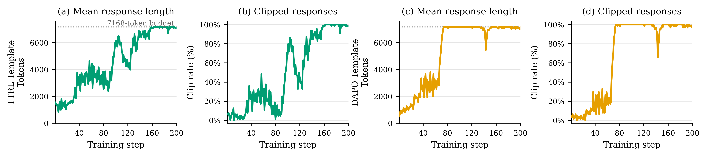

### TL;DR

Diagnoses why on-policy distillation (OPD) blows up student response length. Root cause: base students and post-trained teachers concentrate stopping probability on *different* EOS tokens even when their declared stop sets are identical. The mismatch suppresses the student's preferred termination without transferring the teacher's, so the student never learns to stop. Treating functionally equivalent EOS tokens as one semantic stop mitigates this across Qwen3, Llama, and Gemma.

### Key idea

Distinguish declared-stop-set alignment from *distributional* stop-token alignment. Merge functionally equivalent EOS tokens into a shared semantic stop action inside the OPD loss so gradient flows correctly during token-level KL.

### Main finding

Across Qwen3 / Llama / Gemma, alignment of stopping sets alone is insufficient; the semantic-stop treatment substantially reduces length inflation. A stage-wise study on K2-Horizon further reveals a distinct *late-training* length inflation that survives even after termination is fixed — i.e. termination mismatch is important but not the only cause.

### Why it matters

On-policy distillation is now the standard way to compress reasoning models. If distillers silently inflate length, they inflate serving cost and hide accuracy differences. This is a mechanical explanation with a drop-in fix.

### Knowledge graph integration

**Builds on / relates to existing pages:**
- [../post-training/reasoning/length-penalty.md](../post-training/reasoning/length-penalty.md) — related to but distinct from length-penalty tricks: this is about *why* length inflates in the first place.
- [../post-training/reasoning/long2short.md](../post-training/reasoning/long2short.md) — long2short-style compression relies on stable termination; this paper explains a failure mode.
- [../fundamentals/_tokenization.md](../fundamentals/_tokenization.md) — EOS tokens are a tokenizer artifact; the mismatch is between tokenizer stop-set semantics.

**Suggested new pages:**
- `post-training/on-policy-distillation.md` *(depth)* — the OPD recipe itself is currently unrepresented in the graph.
- `post-training/eos-alignment.md` *(depth)* — semantic-EOS merging for KL-based distillation.

---

## 5. JEPA-Anything

**Authors:** Taoyong Cui, Zhongyao Wang, Xinyue Xu, Weiyang Liu, Zhaochen Yu, Yuying Zhang, Qiang Gao, Mengyue Yang, Wanli Ouyang, Pheng Ann Heng, Yingcheng Wu, Zhenfei Yin, Ling Yang — *multi-institutional (Shanghai AI Lab / CUHK)*
**Links:** [arXiv:2609.20800](https://arxiv.org/abs/2609.20800) · [HF](https://huggingface.co/papers/2609.20800) · [AlphaXiv](https://www.alphaxiv.org/abs/2609.20800)
**Topics:** `world-model`, `representation-learning`

*Borderline: included because the OPF factorization is the sort of predictive-representation primitive that gets ported into VLM/VLA pretraining and diffusion world models — the same shape as V-JEPA / I-JEPA papers already tracked in the field.*

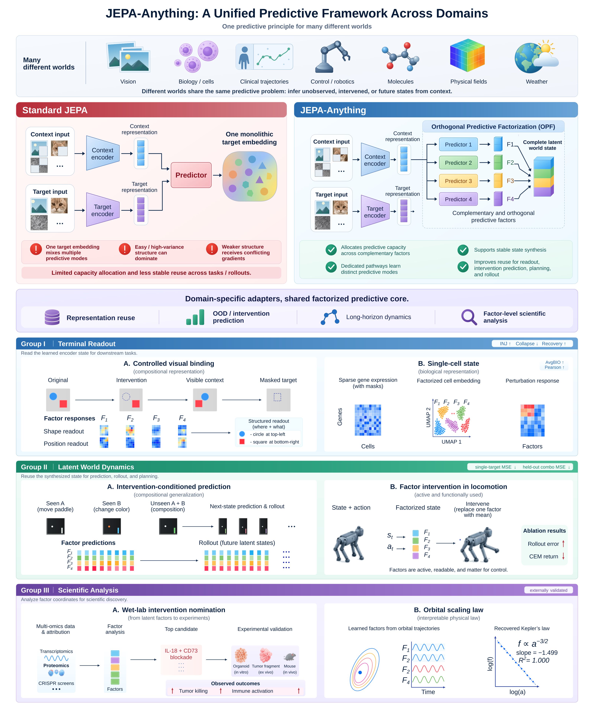

### TL;DR

Extends the Joint-Embedding Predictive Architecture family with **orthogonal predictive factorization (OPF)**: latent targets are decomposed into complementary factors trained on dedicated pathways and recombined in one predictor. Reports gains across seven wildly different domains (vision, biology, clinical, control, molecular dynamics, physical fields, weather) as a single principle.

### Key idea

Where standard JEPA predicts one latent target, OPF splits the target into orthogonal factors so different predictive pathways specialize but combine into one shared predictor. Empirically this reduces interference across factors and produces cleaner intervention prediction.

### Main finding

Improves 10/10 matched dynamics tasks over JEPA baselines; cuts single-intervention error on Interventional Pong by 34.8%; best-in-class one-step and 100-step molecular prediction across four systems; a factor-nominated biological intervention reproduces in wet-lab.

### Why it matters

If OPF generalizes, JEPA-family world models — already the leading candidate representation-learning backbone for multimodal LLMs — get a structurally cleaner predictive head that could ride into V-JEPA / V-JEPA-2 successors and VLA training.

### Knowledge graph integration

**Builds on / relates to existing pages:**
- [../multimodal/README.md](../multimodal/README.md) — JEPA-style predictive encoders sit under multimodal representation learning.
- [../fundamentals/attention.md](../fundamentals/attention.md) — predictor shape is transformer-based; downstream architecture background.

**Suggested new pages:**
- `multimodal/_jepa.md` *(taxonomy)* — the JEPA family (I-, V-, V-JEPA-2, JEPA-Anything).
- `multimodal/jepa-anything.md` *(depth)* — the OPF factorization specifically.

---

## 6. RiskChainBench

**Authors:** ZhuoXin Liu, Zhiming Ma, Ying Zhang, Mengzheng Yang, Yifan Wang, Zhengqi Huang, Yanhan Zhou, Zekun Lin, Jun Zhang, Shun Zhang, Yue Chen, Qiao Zhao, Peng Chen — *affiliation not disclosed on HF page*
**Links:** [arXiv:2609.16900](https://arxiv.org/abs/2609.16900) · [HF](https://huggingface.co/papers/2609.16900) · [AlphaXiv](https://www.alphaxiv.org/abs/2609.16900)
**Topics:** `eval`, `safety`, `agents`

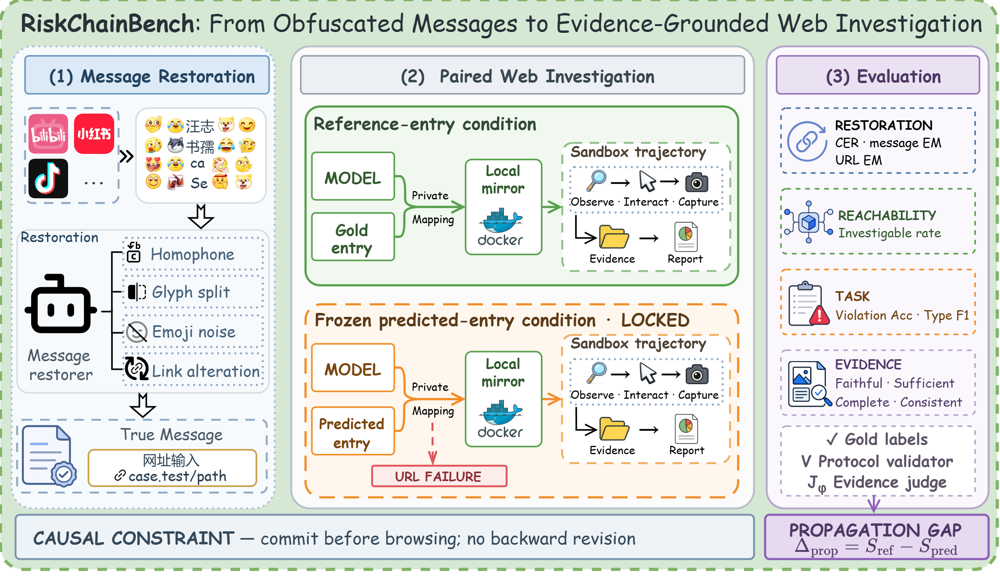

### TL;DR

A two-stage benchmark for agent safety on real platform-abuse traffic. Stage 1: restore obfuscated messages (emojis, homophones, character decomposition, redundant symbols) that hide redirection to porn/fraud/gambling/illicit services. Stage 2: given restored links, an agent investigates 600 human-labeled web environments and files an evidence-grounded risk report. Entry Top-1 accuracy spans 35.2%–95.2% across models; downstream web-decision accuracy spans 26.3%–62.8%.

### Key idea

Move safety benchmarks off toy prompts and onto the actual obfuscation-and-redirect chain used in abuse. Web-investigation stage forces models to combine tool use, retrieval, and evidence assembly rather than pure classification.

### Main finding

Wide model spread: current models handle restoration but collapse on the evidence-grounded web-investigation stage; this is where the benchmark bites.

### Why it matters

A missing genre in the safety-eval landscape: agent-driven abuse investigation, not passive refusal. Fills a gap between jailbreak benches (safety/_jailbreaks) and pure agent benches (Terminal-Bench, WebArena).

### Knowledge graph integration

**Builds on / relates to existing pages:**
- [../safety/_attacks.md](../safety/_attacks.md) — obfuscation attacks (homophone, character decomposition) already covered as attack primitives.
- [../safety/character-encoding-obfuscation.md](../safety/character-encoding-obfuscation.md) — this benchmark stresses exactly this class of obfuscation.
- [../safety/payload-splitting.md](../safety/payload-splitting.md) — related in spirit: hidden intent behind decomposed content.
- [../evaluation/README.md](../evaluation/README.md) — a new evaluation-side entry.

**Suggested new pages:**
- `evaluation/riskchainbench.md` *(depth)* — the benchmark itself and its two-stage protocol.

---

## 7. RetireOPD

**Authors:** Yan Yu, Zhengxi Lu, Yizhou Liu, Yichen Pan, Aozhe Wang, Qipeng Chen, Hua Yang, Wenqi Zhang, Weiming Lu, Qianglong Chen, Yongliang Shen — *Zhejiang U.*
**Links:** [arXiv:2609.20784](https://arxiv.org/abs/2609.20784) · [HF](https://huggingface.co/papers/2609.20784) · [AlphaXiv](https://www.alphaxiv.org/abs/2609.20784)
**Topics:** `RL`, `distillation`, `agents`

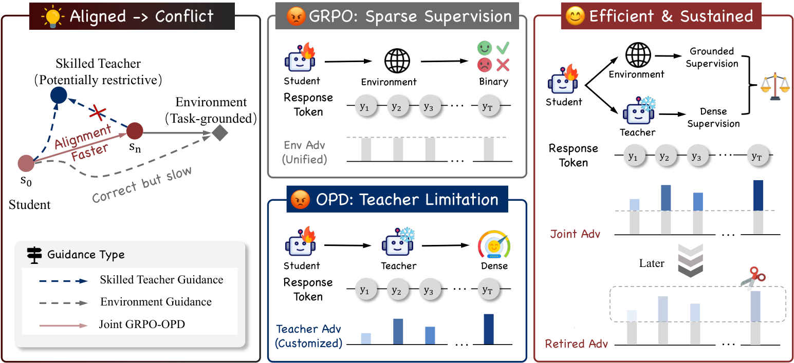

### TL;DR

Fixes two problems with on-policy self-distillation for multi-turn agent RL: privileged-info teachers are not always reliable, and teacher supervision helps only for a stage. RetireOPD trains a decoupled skill-conditioned teacher with environment rewards, then trains a skill-free student with joint RL + OPD, and uses **Adaptive Retirement** — the student drops the teacher on its own once discrepancy stops shrinking and it reaches a target fraction of teacher success.

### Key idea

Two-stage: (i) train the teacher with environment rewards on privileged skills; (ii) run joint RL+OPD on the student *until an on-line criterion says the teacher is now a drag*, then continue RL alone. No hand-tuned distillation schedule.

### Main finding

The paper documents that fixed-schedule OPD hurts agentic-RL late-stage — Adaptive Retirement removes that regression. Full numbers not in the abstract.

### Why it matters

Distillation-into-RL is the modern recipe for agent training (Kimi-K1.5, DeepSeek-R1). RetireOPD proposes a principled criterion for when to turn distillation off; the criterion is model-agnostic and drop-in for GRPO-style loops.

### Knowledge graph integration

**Builds on / relates to existing pages:**
- [../post-training/grpo.md](../post-training/grpo.md) — the RL backbone that OPD is layered on.
- [../post-training/rejection-sampling.md](../post-training/rejection-sampling.md) — related family of teacher-filtered student updates.
- [../post-training/reasoning/long-cot-rl.md](../post-training/reasoning/long-cot-rl.md) — long-CoT RL is exactly the regime where late-stage OPD interference matters.
- [../case-studies/kimi-k1-5.md](../case-studies/kimi-k1-5.md) — precedent for agentic distill-into-RL.

**Suggested new pages:**
- `post-training/on-policy-distillation.md` *(depth)* — shared with paper 4: OPD as a family.
- `post-training/adaptive-retirement.md` *(depth)* — RetireOPD's criterion for auto-disabling the teacher.

---

## 8. Verifiable Social Reasoning (Fuse)

**Authors:** Amir Taubenfeld, Zorik Gekhman, Avigail Grinstein-Dabush, Itay Laish, Ariel Goldstein, Marian Croak, Avinatan Hassidim, Yossi Matias, Amir Feder — *Google*
**Links:** [arXiv:2609.17496](https://arxiv.org/abs/2609.17496) · [HF](https://huggingface.co/papers/2609.17496) · [AlphaXiv](https://www.alphaxiv.org/abs/2609.17496)
**Topics:** `eval`, `reasoning`, `agents`

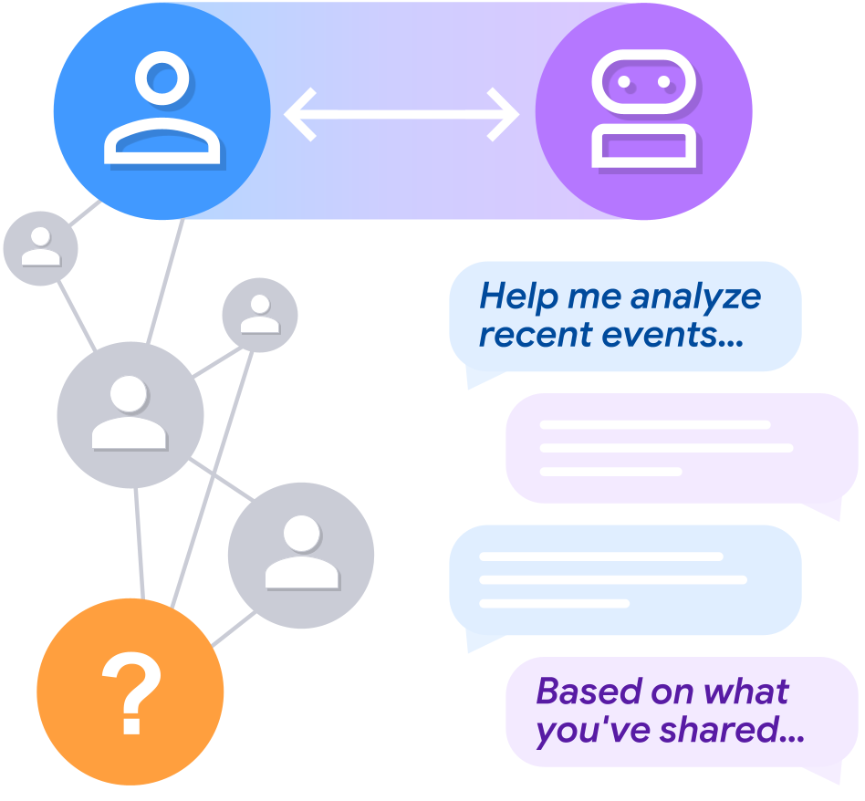

### TL;DR

A multi-agent simulator for social reasoning where the ground truth is verifiable *by construction*: a target agent with a hidden motive interacts with other agents including a user proxy that then consults the evaluated LLM assistant. Because the hidden motive was set up-front, the assistant's inference has a real answer. Applied to 12 LLMs with 24k-annotation human validation; 21k-example dataset released.

### Key idea

Build the ground truth into the simulator rather than asking humans to label subjective social judgments. Everything the assistant sees is user-mediated (via the user proxy), preserving the real deployment setting.

### Main finding

Four failure patterns: user-mediation compounds difficulty; systematic sensitivity to biased user framing; assistants need more details than humans to reach the same answer; longer conversations don't reliably help.

### Why it matters

First simulator I've seen that makes *social* reasoning verifiable at scale, letting reward-model and RL work extend into consultation-style social settings where labels used to be impossible.

### Knowledge graph integration

**Builds on / relates to existing pages:**
- [../post-training/_rewards.md](../post-training/_rewards.md) — verifiable rewards for previously-unverifiable domains extends RLVR.
- [../post-training/rlvr.md](../post-training/rlvr.md) — RLVR pattern extended to social settings.
- [../evaluation/README.md](../evaluation/README.md) — new eval domain.

**Suggested new pages:**
- `evaluation/fuse.md` *(depth)* — the Fuse simulator and its user-mediated protocol.

---

## 9. Reflect, Revise, Reuse (EvoSkill-GUI)

**Authors:** Bofan Chen, Boxuan Zhang, Fei Tang, Zhengxi Lu, Yong Du, Tongbo Chen, Weiming Lu, Jun Xiao, Yueting Zhuang, Yongliang Shen — *Zhejiang U.*
**Links:** [arXiv:2609.17653](https://arxiv.org/abs/2609.17653) · [HF](https://huggingface.co/papers/2609.17653) · [AlphaXiv](https://www.alphaxiv.org/abs/2609.17653)
**Topics:** `agents`, `multimodal`

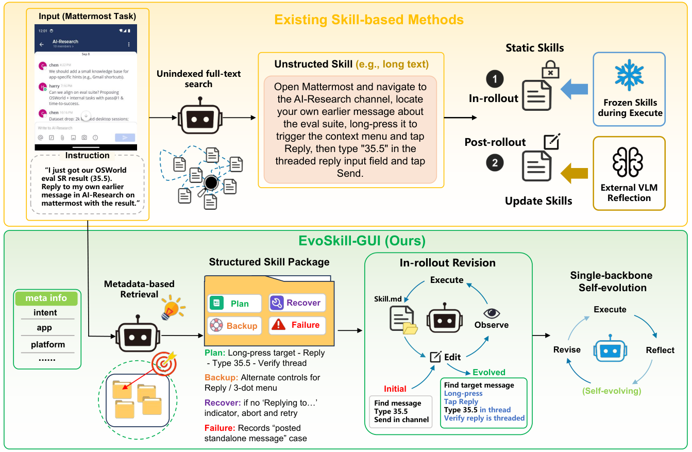

### TL;DR

Training-free skill evolution for GUI agents. Each "skill" is a multi-file package (retrieval metadata, executable plan, backup localization, failure-recovery rules, accessibility utilities, failure cases). A reflect-revise-reuse cycle runs at deployment: executor adjusts in real time, a critic diagnoses failures under information isolation, and the executor edits specific skill files via restricted tools. +16.2% MobileWorld, +6.0% AndroidWorld, +10.5% OSWorld.

### Key idea

Persistent, structured "skill packages" that the agent can edit at deployment. Isolation prevents the critic from spoiling the executor's later diagnosis; restricted tools limit edits to specific files. No gradient updates.

### Main finding

Consistent gains on three GUI benchmarks; evolved skills transfer across related tasks (skills are portable, not per-task overfit).

### Why it matters

Alternative to fine-tuning on trajectory data: keep the model frozen and let the *skill library* evolve. Complements harness-level papers (2, 3) by targeting a different layer.

### Knowledge graph integration

**Builds on / relates to existing pages:**
- [../agents/README.md](../agents/README.md) — GUI-agents area is under-covered.

**Suggested new pages:**
- `agents/skill-libraries.md` *(depth)* — persistent editable skill packages for agents.
- `agents/gui-agents.md` *(depth)* — GUI-agent stack and standard benchmarks (Mobile/Android/OSWorld).

---

## 10. Video DeltaNet

**Authors:** Haocheng Xi, Yiming Xie, Hexu Zhao, Yiwen Zhang, Michael Liu, Thomas Creavin, Kurt Keutzer, Xiuyu Li, Zhaoyang Lv, Chenfeng Xu, Haiwen Feng — *UC Berkeley / Meta*
**Links:** [arXiv:2609.20744](https://arxiv.org/abs/2609.20744) · [HF](https://huggingface.co/papers/2609.20744) · [AlphaXiv](https://www.alphaxiv.org/abs/2609.20744)
**Topics:** `diffusion`, `video`, `attention`, `efficient-inference`

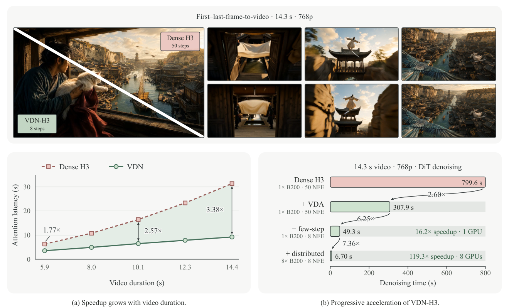

### TL;DR

Hybrid attention for video-diffusion DiTs: local Softmax attention plus a bidirectional linear-memory branch, **Video Delta Attention (VDA)**, that updates memory once per frame using all the frame's spatial tokens jointly. Separate output projections and learnable gates combine the two branches; a staged teacher-alignment recipe grafts the hybrid into a pretrained model. Instantiated on MiniMax H3 as **VDN-H3**: 14.3s of 768p video in 6.7s on 8×B200 with 8-step distillation and SGLang — 14.5× over 50-step dense H3.

### Key idea

Frame-granular linear-memory updates (VDA) preserve enough long-range context to keep video quality without paying quadratic attention across the full spatiotemporal grid; retain Softmax only for cross-modality (text, audio) interactions where it matters most.

### Main finding

14.5× end-to-end speedup at matched quality on VDN-H3; the hybrid ports into a pretrained video DiT without full retraining.

### Why it matters

Livestream/interactive video generation was throughput-bound by dense attention. VDA extends the successful "Softmax + linear-memory" hybrid pattern (DeltaNet, Gated DeltaNet) into video, which turns diffusion-based interactive video into a practical serving target.

### Knowledge graph integration

**Builds on / relates to existing pages:**
- [../architectures/multi-head-attention.md](../architectures/multi-head-attention.md) — the local Softmax branch is standard MHA.
- [../fundamentals/attention.md](../fundamentals/attention.md) — foundation for the branch analysis.

**Suggested new pages:**
- `architectures/_linear-attention.md` *(taxonomy)* — DeltaNet, Gated DeltaNet, Mamba-style linear-memory attention as one family.
- `architectures/video-delta-attention.md` *(depth)* — VDA specifically: frame-level memory updates for video DiTs.
- `inference/hybrid-attention.md` *(depth)* — the "local Softmax + linear memory" hybrid pattern and its serving implications.

---

## 11. When2Think

**Authors:** Jaejun Shim, HyunJin Kim, Young Jin Kim, JinYeong Bak — *Microsoft*
**Links:** [arXiv:2609.19671](https://arxiv.org/abs/2609.19671) · [HF](https://huggingface.co/papers/2609.19671) · [AlphaXiv](https://www.alphaxiv.org/abs/2609.19671)
**Topics:** `reasoning`, `RL`, `efficient-inference`

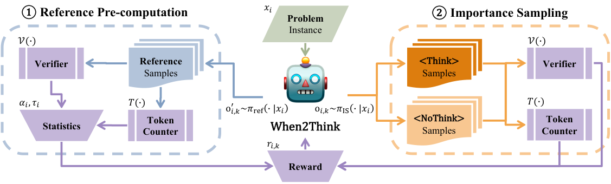

### TL;DR

Post-training framework that teaches a hybrid reasoning model *when* to think. Uses **Instance-level Difficulty-Aware Control (IDAC)** — a reward-shaping mechanism keyed on pre-computed reference statistics — to encourage direct answering on easy problems and preserve extended CoT on hard ones. On AIME24, Pass@3 rises 10.0% while token usage drops 27.9%; AIME25 Pass@3 hits 40.0%.

### Key idea

Reward shaping conditioned on *per-instance* difficulty rather than a global length penalty. Uses reference statistics from an oracle/prior pass so the reward "knows" whether this specific problem should have a long or short response.

### Main finding

Beats uniform length penalties and rigid routing on accuracy-efficiency Pareto at AIME24/25 scale.

### Why it matters

Hybrid reasoning models are the near-term default (they replace the "always think" R1-style). When2Think is a clean template for the reward-shaping side of that hybrid.

### Knowledge graph integration

**Builds on / relates to existing pages:**
- [../post-training/reasoning/length-penalty.md](../post-training/reasoning/length-penalty.md) — direct competitor; When2Think replaces the uniform length penalty.
- [../post-training/reasoning/long-cot-rl.md](../post-training/reasoning/long-cot-rl.md) — hybrid reasoning inherits this RL setup.
- [../post-training/reasoning/long2short.md](../post-training/reasoning/long2short.md) — different tactic for the same goal (compress long CoT).
- [../post-training/grpo.md](../post-training/grpo.md) — reward shaping is layered on GRPO-style RL.
- [../evaluation/aime.md](../evaluation/aime.md) — headline results.

**Suggested new pages:**
- `post-training/reasoning/idac.md` *(depth)* — Instance-level Difficulty-Aware Control reward shaping.
- `post-training/reasoning/_reasoning-length-control.md` *(taxonomy)* — the family of length-control tactics (length penalty, long2short, IDAC, routing).

---

## 12. What Does Privileged Information Add to On-Policy Self-Distillation?

**Authors:** XiuYu Zhang, Wei Chow, Junfeng Fang, Zhenkai Liang, Tat-Seng Chua — *NUS*
**Links:** [arXiv:2609.20612](https://arxiv.org/abs/2609.20612) · [HF](https://huggingface.co/papers/2609.20612) · [AlphaXiv](https://www.alphaxiv.org/abs/2609.20612)
**Topics:** `post-training`, `distillation`, `reasoning`

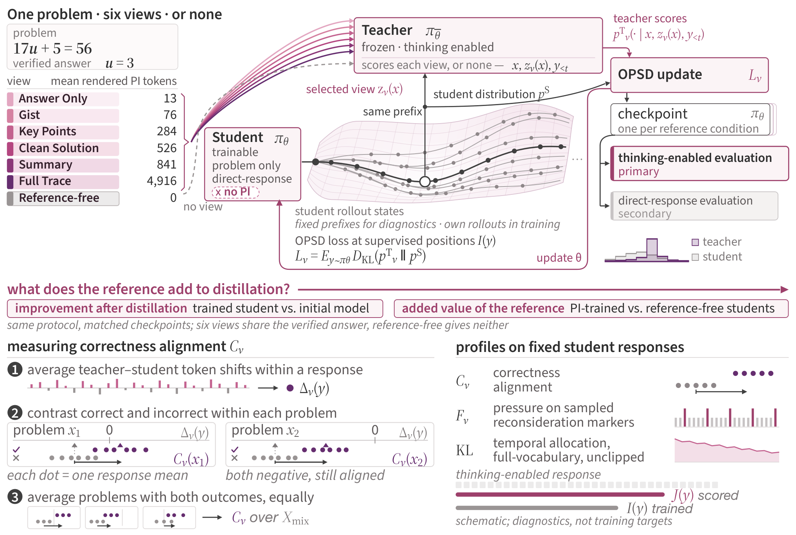

### TL;DR

Isolates *how much* on-policy self-distillation (OPSD) really needs the privileged reference (an oracle answer / worked solution). Builds AMPLE-Math (5,319 problems × 6 reasoning views) so the same instance can be shown with or without privileged info. Finding: reference-free distillation already delivers most of Qwen3-1.7B's gain; privileged references add a modest increment. Their value is *what they add to cross-mode transfer*, not the fraction of the answer they reveal.

### Key idea

Six reasoning views per problem lets the paper factor OPSD's gain into a distillation-only baseline and a privileged-reference delta. The delta is small.

### Main finding

Reference-free OPSD ≫ standard SFT for Qwen3-1.7B; adding privileged solutions gives a modest additional bump but scales with cross-mode transfer, not with how much of the answer the reference contains.

### Why it matters

Changes the design constraint: teams building distillation pipelines can drop expensive privileged-solution collection and still get most of the win. Also frames privileged info as a *transfer* signal, not a supervision signal — different intuition from RLHF-with-references.

### Knowledge graph integration

**Builds on / relates to existing pages:**
- [../post-training/rejection-sampling.md](../post-training/rejection-sampling.md) — reference-based supervision cousin.
- [../post-training/reasoning/long-cot-rl.md](../post-training/reasoning/long-cot-rl.md) — the setting where OPSD is most valuable.
- [../evaluation/math500.md](../evaluation/math500.md) — math-benchmark cousin of AMPLE-Math.

**Suggested new pages:**
- `post-training/on-policy-distillation.md` *(depth)* — shared home for OPD/OPSD (with papers 4 and 7).
- `evaluation/ample-math.md` *(depth)* — the six-view math benchmark.

---

## 13. ActObs — Don't Mask the Environment

**Authors:** Juzheng Zhang, Disha Makhija, Manoj Ghuhan Arivazhagan, Vinayshekhar Bannihatti Kumar, Rashmi Gangadharaiah — *AWS-affiliated*
**Links:** [arXiv:2609.20715](https://arxiv.org/abs/2609.20715) · [HF](https://huggingface.co/papers/2609.20715) · [AlphaXiv](https://www.alphaxiv.org/abs/2609.20715)
**Topics:** `RL`, `agents`, `post-training`

### TL;DR

Standard agent SFT applies the loss only to action tokens and masks environment observations as context. **ActObs** also supervises the observation tokens already in the trajectory — no new data, params, tokens, or forward passes. Post-SFT the two initializations look similar; post-GRPO ActObs dominates on Terminal-Bench 2.0 and transfers to unseen cross-domain code editing.

### Key idea

Observations are already in the sequence — the only change is not masking them. Training the policy to predict environment tokens forces it to model *consequences*, which becomes the initialization advantage RL later compounds.

### Main finding

Qwen3-4B: higher pass@k at every budget on Terminal-Bench 2.0 post-GRPO. Qwen3-8B: +3.4 pp pass@16, more distinct tasks solved. Cross-domain aider-polyglot: +4.2 pp pass@1 (4B). ActObs retains more entropy during RL and stays closer to its SFT initialization.

### Why it matters

A one-line change to the SFT masking convention flips the RL-ready-ness of the base checkpoint. Explains via gradient analysis: action-only training leaves a large residual observation gradient that degrades environment prediction below the base model.

### Knowledge graph integration

**Builds on / relates to existing pages:**
- [../post-training/grpo.md](../post-training/grpo.md) — direct downstream RL algorithm.
- [../post-training/rlvr.md](../post-training/rlvr.md) — RLVR-style verified-reward RL is the target regime.
- [../post-training/reasoning/long-cot-rl.md](../post-training/reasoning/long-cot-rl.md) — sibling long-horizon RL analysis.
- [../post-training/README.md](../post-training/README.md) — SFT masking convention lives here.

**Suggested new pages:**
- `post-training/fine-tuning/observation-supervision.md` *(depth)* — ActObs: SFT loss on environment observations.

---

## 14. Vision-RL2 — Region-Level PO for MLLMs

**Authors:** Yuheng Shi, Xiaohuan Pei, Minjing Dong, Chang Xu — *U. Sydney / City U. HK*
**Links:** [arXiv:2609.19745](https://arxiv.org/abs/2609.19745) · [HF](https://huggingface.co/papers/2609.19745) · [AlphaXiv](https://www.alphaxiv.org/abs/2609.19745)
**Topics:** `RL`, `multimodal`, `efficient-inference`

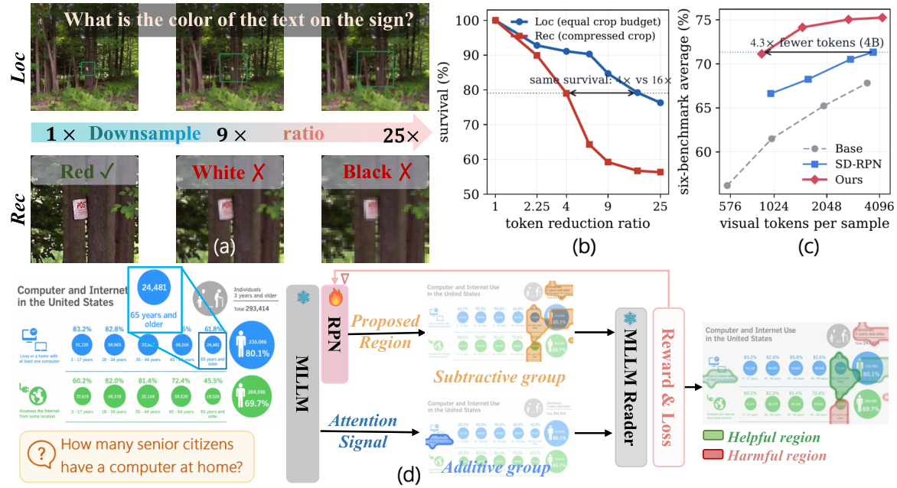

### TL;DR

Instead of raising input resolution across the whole image, **Vision-RL2** does region-level RL: a lightweight proposal network (distilled from model attention) proposes coherent image regions as actions; the MLLM does per-region recognition. Subtractive + additive objectives refine proposals. Beats the largest-budget accuracy of the base model with ~4× fewer visual tokens across 6 benchmarks and 4 MLLM architectures.

### Key idea

Split fine-grained perception into two resolution regimes — localize coarsely, recognize finely — and train the localization head with RL where its actions are regions. Distilling the proposal head from the base model's attention avoids an external detector.

### Main finding

Same or better accuracy at ~4× lower visual-token cost; generalizes across 4 MLLM architectures.

### Why it matters

MLLM inference cost scales with visual tokens, and "just raise the resolution" has become the default. Region-level PO is a first principled alternative that treats tokenization as a *policy* problem.

### Knowledge graph integration

**Builds on / relates to existing pages:**
- [../post-training/grpo.md](../post-training/grpo.md) — the RL backbone extended to region-selection actions.
- [../multimodal/README.md](../multimodal/README.md) — MLLM efficiency angle for multimodal.

**Suggested new pages:**
- `multimodal/region-level-po.md` *(depth)* — Vision-RL2's region-as-action RL formulation.
- `multimodal/_visual-token-reduction.md` *(taxonomy)* — visual-token-pruning / region-level-selection / token-merging techniques.

---

## 15. Sample Count Is Not Enough

**Authors:** Mobina Kashaniyan, Ali Jannesari — *Iowa State University*
**Links:** [arXiv:2609.19499](https://arxiv.org/abs/2609.19499) · [HF](https://huggingface.co/papers/2609.19499) · [AlphaXiv](https://www.alphaxiv.org/abs/2609.19499)
**Topics:** `efficient-inference`, `eval`, `reasoning`

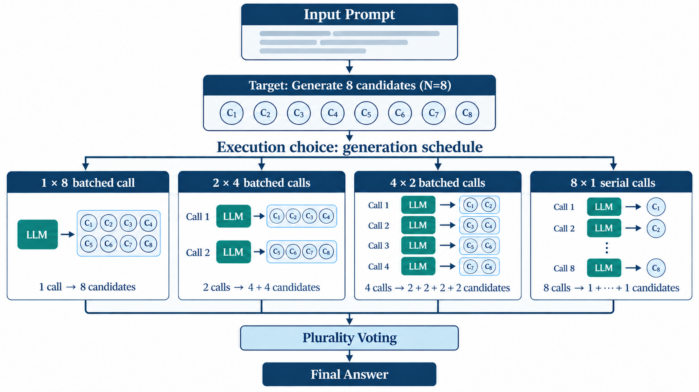

### TL;DR

For test-time scaling (best-of-N and cousins), the *schedule* used to reach N candidates matters as much as N itself. Fix N=8 and compare 1×8, 2×4, 4×2, 8×1 (calls × candidates-per-call) on A100 for Phi-3-mini and Qwen2.5-1.5B: eight serial calls burn 4.64–4.86× the GPU-device energy and 5.77–6.12× the P95 latency of one batched call. Same pattern on three A100 nodes and short-output SciQ/V100.

### Key idea

"Candidate count N" is an underspecified inference metric. Systems cost is dominated by *how* those N are scheduled through the serving stack.

### Main finding

For matched N, one batched call beats N serial calls by ~5× on both energy and P95 latency when memory allows.

### Why it matters

Every test-time-scaling paper — best-of-N, majority voting, verifier trees, hedged decoding — reports accuracy vs. N. This paper says the same N can be nearly an order of magnitude different in real cost, and asks the community to report generation schedule and GPU-level metrics.

### Knowledge graph integration

**Builds on / relates to existing pages:**
- [../inference/README.md](../inference/README.md) — the inference-cost side of test-time scaling.
- [../post-training/reasoning/long-cot-rl.md](../post-training/reasoning/long-cot-rl.md) — best-of-N is the sampling backbone many reasoning-RL loops rely on.
- [../evaluation/README.md](../evaluation/README.md) — eval reporting norms.

**Suggested new pages:**
- `inference/test-time-scaling.md` *(depth)* — best-of-N / test-time scaling as a serving pattern with its cost knobs.

---

## Notes

- Borderline inclusions are flagged in-section with an italic *Borderline: …* note. Paper 5 (JEPA-Anything) is the only one.
- Hero figures live in `assets/2026-09-18/`. Paper 13 (ActObs, 2609.20715) has no arXiv-HTML render, so no hero figure was available.
- Paper 1 (DeepSeek-V4.1-Flash) is a full frontier tech report and triggers Phase 3 — a `case-studies/deepseek-v4-1-flash.md` will land in a companion PR alongside the new CSA2 / CED / FP4-KV / SWA-Bounded-Replay depth files.
- This digest is informational. No existing concept files, `READING-LIST.md`, or `PAPERS.md` were modified to produce it.
