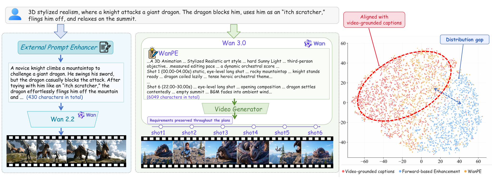
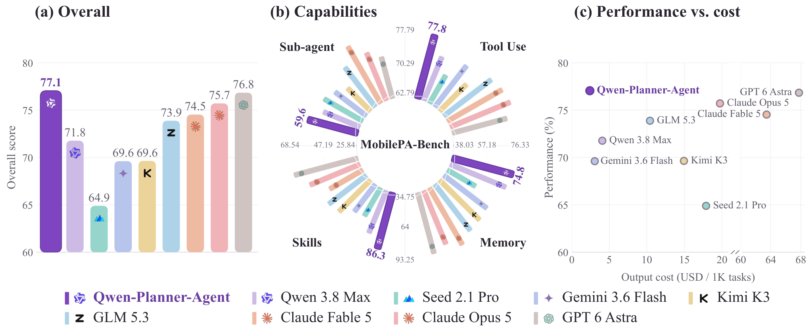
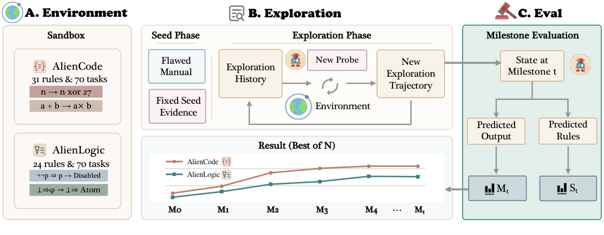
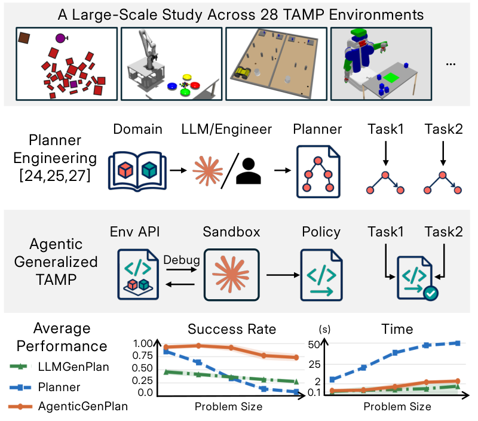
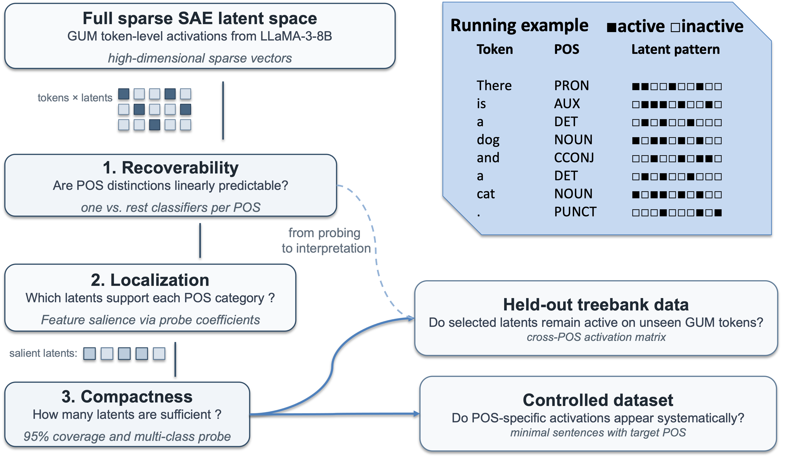
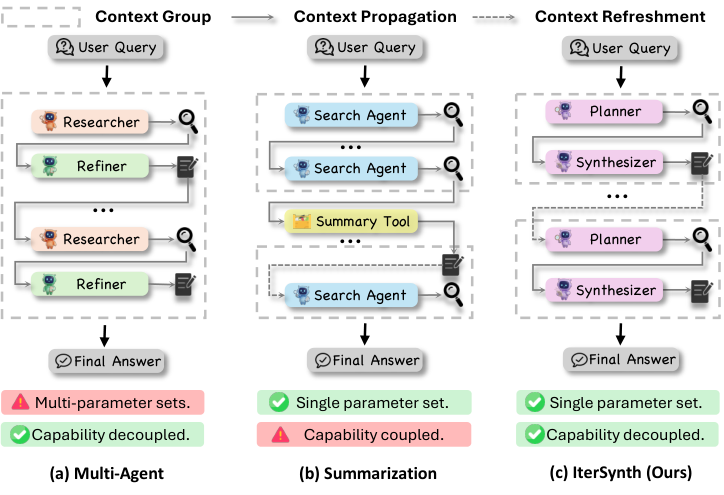

# Daily AI papers — 2026-09-27

*Curated from HF Daily Papers. 15 of ~22 papers kept after relevance filter. (HF's date page redirects around business-day boundaries; a handful of arXiv ids from Sep 23–25 appear because HF surfaces late-announced submissions on this listing.)*

## Papers at a glance

| # | Title | Topics | Org |
| --- | --- | --- | --- |
| 1 | [Training Object Permanence in World Models](#1-training-object-permanence-in-world-models) | `diffusion`, `video`, `eval`, `world-model` | 30+ author consortium |
| 2 | [Your Transformer Can Hold Two Thoughts at Once: Linear Superposition in LLMs](#2-your-transformer-can-hold-two-thoughts-at-once) | `interp`, `LLM`, `decoding` | AIRI / Skoltech |
| 3 | [WanPE: Cinematic Prompt Enhancement for Text-to-Video](#3-wanpe-cinematic-prompt-enhancement) | `diffusion`, `video`, `RL`, `GRPO` | Wan / Alibaba |
| 4 | [Agent-Editing World Model (AEWM)](#4-agent-editing-world-model-aewm) | `agents`, `world-model`, `RL`, `SFT` | Renmin U. |
| 5 | [Rufus-Air: An Open LLM Post-Training Recipe](#5-rufus-air-open-llm-post-training-recipe) | `post-training`, `RL`, `agents`, `tech-report` | Amazon |
| 6 | [Qwen-Planner-Agent: Closed-Loop AI-for-AI for Mobile Planning](#6-qwen-planner-agent) | `agents`, `RL`, `reward-design`, `mobile` | Qwen / Alibaba |
| 7 | [ExplorationBench: Measuring Exploration in Verifiable Alien Worlds](#7-explorationbench) | `eval`, `agents`, `reasoning` | Fudan / Tencent |
| 8 | [Learning to Discover Interesting Mathematics](#8-learning-to-discover-interesting-mathematics) | `reasoning`, `math`, `eval` | Meta / NYU / ENPC |
| 9 | [Coding Agents for Generalized Task and Motion Planning](#9-coding-agents-for-generalized-tamp) | `agents`, `coding`, `program-synthesis` | Princeton / Cambridge |
| 10 | [Parts-of-Speech as Emergent Categories in SAE Latent Space](#10-parts-of-speech-as-emergent-categories-in-sae-latent-space) | `interp`, `SAE`, `probing` | U. Pisa |
| 11 | [IterSynth: Role-Decoupled Iterative Synthesis for Deep Search Agents](#11-itersynth) | `agents`, `RL`, `search` | Zhejiang U. / China Mobile |
| 12 | [Just Ask Jev: RLCD for Zero-Shot Alignment-Failure Detection](#12-just-ask-jev) | `safety`, `RL`, `eval`, `judge` | UNSW / NTU |
| 13 | [AgentKernel: A Trust-Native Agentic Operating System](#13-agentkernel) | `agents`, `safety`, `systems` | Tsinghua |
| 14 | [AV-GRPO: Modality-Anchored Decoupling for Joint Audio-Video RL](#14-av-grpo) | `diffusion`, `multimodal`, `RL`, `GRPO` | HKPolyU |
| 15 | [ViRDM: Representation Distribution Matching for Few-Step Causal Video Generation](#15-virdm) | `diffusion`, `video`, `distillation` | Northeastern U. |

---

## 1. Training Object Permanence in World Models

**Authors:** Haotian Zhang, Fengyuan Yu, Dezhi Luo, Haoran Sun, Huayi Qin, Ran Ji, Vikash Kumar, Freda Shi, Alan Yuille, Nikolaus Kriegeskorte, Lvmin Zhang, Jieneng Chen, Yilun Du, Hokin Deng, and 15 more — *broad multi-institution consortium (affiliations not listed on HF)*
**Links:** [arXiv:2609.28654](https://arxiv.org/abs/2609.28654) · [HF](https://huggingface.co/papers/2609.28654) · [AlphaXiv](https://www.alphaxiv.org/abs/2609.28654)
**Topics:** `diffusion`, `video`, `eval`, `world-model`

### TL;DR

Are today's video-generation models actually "world models" in the cognitive sense — do they grasp that unseen objects still exist? The authors build **WROP**, a Blender-generated benchmark of 150 tasks organized by six object-permanence categories from developmental cognitive science, then train **PWM-WROP**, a 16B video model, on 1.5M procedurally-varied samples and compare it against 13 other video models under a blind Elo protocol.

### Key idea

Two moves: (a) codify object permanence and solidity as a taxonomy of six *cognitive* categories (containment, occlusion, solid-passing, etc.) rather than pixel metrics; (b) drive a Blender pipeline that randomizes nuisance parameters (lighting, camera, speed) while preserving the cognitive structure of each task — giving 10k+ samples per task and a clean split between "core-cognitive signal" and "surface variation."

### Main finding

On a 300-question exam scored by blind pairwise Elo, PWM-WROP ranks **first among continuation models** and **third overall**, tied statistically with two reference-to-video models. Continuation training on core-cognition data measurably improves cognitive scores over reference-to-video and video-edit baselines of similar scale.

### Why it matters

Establishes cognitive-science-derived training data as a scalable route to physical intelligence in generative video, and gives the community a shared exam for "does your video model actually understand object permanence?" — a prerequisite for using video generators as world models inside agent training loops.

### Knowledge graph integration

**Builds on / relates to existing pages:**
- [../evaluation/README.md](../evaluation/README.md) — WROP is a new capability-eval axis targeting cognitive priors in video models.
- [../multimodal/README.md](../multimodal/README.md) — extends the video/VLM evaluation surface.

**Suggested new pages:**
- `multimodal/wrop.md` *(depth)* — the WROP benchmark and its cognitive taxonomy.
- `multimodal/_world-models.md` *(taxonomy)* — video generators viewed as world models: continuation vs. edit vs. reference-to-video.

---

## 2. Your Transformer Can Hold Two Thoughts at Once

**Authors:** Pavel Tikhonov, Anton Korznikov, Matvey Mikhalchuk, Nikita Dragunov, Temurbek Rahmatullaev, Polina Druzhinina, Anton Razzhigaev, Ivan Oseledets, Elena Tutubalina — *AIRI / Skoltech (implied)*
**Links:** [arXiv:2609.29845](https://arxiv.org/abs/2609.29845) · [HF](https://huggingface.co/papers/2609.29845) · [AlphaXiv](https://www.alphaxiv.org/abs/2609.29845)
**Topics:** `interp`, `LLM`, `decoding`

### TL;DR

If you linearly interpolate the token embeddings from **two different text streams** at the LLM's input, its next-token distribution comes out as a **linear mix of the two conditional distributions** — a phenomenon they call the **Superposition Linearity Hypothesis**. They show it is intrinsic to the Transformer (untrained models exhibit it too), argue pretraining actually erodes it, and introduce a guided-decoding scheme that disentangles the two streams to produce **two coherent generations from one forward pass**.

### Key idea

Treat the embedding-space linear combination `α·e_A + (1−α)·e_B` as an *input superposition*. Measure the KL between the model's output on the mixed input and the corresponding mix of individual outputs. Linearity persists surprisingly well at initialization but decays with pretraining; a **lightweight fine-tune** restores it enough that a guided decoder can peel the two conditional distributions apart during sampling.

### Main finding

Linearity is measurable in random-init Transformers (it is a *structural* property of the block, not learned), decays through pretraining, and can be restored by a short fine-tuning pass with a mixing regularizer. Their guided decoder produces two coherent continuations per forward pass — one from each parent stream — with the two outputs staying on-topic for their respective prompts.

### Why it matters

Reframes an interp result as a *capability*: a single forward pass can carry two conditioned generations. Practical implications for batched inference (near-free parallel decoding), speculative decoding, and interpretability (there's a linear geometry hiding in Transformers that pretraining actively works against).

### Knowledge graph integration

**Builds on / relates to existing pages:**
- [../interpretability/README.md](../interpretability/README.md) — a new activation-space linearity property, adjacent to SAE / feature-superposition literature.
- [../inference/README.md](../inference/README.md) — guided decoding uses a single forward pass to yield two continuations, a batching win.

**Suggested new pages:**
- `interpretability/superposition-linearity.md` *(depth)* — the hypothesis, the KL measurement protocol, the guided decoder.

---

## 3. WanPE: Cinematic Prompt Enhancement

**Authors:** Yubo Zhu, Yawen Shao, Ziyun Dai, Kai Zhu, Lianghua Huang, Chenwei Xie, Akide Liu, Yu Liu, and 20 more — *Wan / Alibaba*
**Links:** [arXiv:2609.30221](https://arxiv.org/abs/2609.30221) · [HF](https://huggingface.co/papers/2609.30221) · [AlphaXiv](https://www.alphaxiv.org/abs/2609.30221)
**Topics:** `diffusion`, `video`, `RL`, `GRPO`

### TL;DR

A **397B-parameter prompt-enhancement LLM** trained on 1.05M real videos to rewrite a user's short prompt into a director-quality **shot-level screenplay** for a video generator. Key trick: instead of forward rewriting, **reverse-construct** the enhanced prompt from an existing video, then use **Semantic-Consistency GRPO (SC-GRPO)** to enforce that the enhanced prompt preserves user requirements across shots and time.

### Key idea

Two ingredients. (1) *Video-grounded reverse construction*: given a video and a short original prompt, synthesize the long cinematic prompt that would produce that video, so the training signal is grounded in real footage rather than in one-shot rewriting hallucinations. (2) *SC-GRPO*: GRPO variant with a semantic-consistency reward that scores whether the enhanced prompt keeps the original user intent as the shot count grows to 5–30 seconds.

### Main finding

Powering Wan3.0's generator, WanPE-397B lifts human-preference over raw user prompts by **10.66–18.84 points** at 5–15s and by **+50.86 points** at 30s. It beats commercial offerings at 5–15s and stays competitive with Seedance 2.5 at 30s. Ablations: reverse construction dominates forward rewriting; SC-GRPO robustness holds across model scales.

### Why it matters

Prompt enhancement is emerging as a first-class subsystem for video generation, not a nice-to-have. WanPE argues that at 30-second horizons the enhancer matters as much as the generator — and gives a concrete recipe (reverse-construction data + GRPO with a fidelity reward) for training it.

### Knowledge graph integration

**Builds on / relates to existing pages:**
- [../post-training/grpo.md](../post-training/grpo.md) — SC-GRPO is a GRPO variant with a text-alignment reward.
- [../post-training/_rewards.md](../post-training/_rewards.md) — semantic-consistency reward design.

**Suggested new pages:**
- `multimodal/sc-grpo.md` *(depth)* — Semantic-Consistency GRPO for prompt-enhancement LLMs.
- `multimodal/prompt-enhancement.md` *(depth)* — training a large LLM as a screenplay planner for T2V.

---

## 4. Agent-Editing World Model (AEWM)

**Authors:** Shuang Sun, Guoxin Chen, Fanzhe Meng, Jia Deng, Huatong Song, Jinhao Jiang, Wayne Xin Zhao, Hongteng Xu, Ji-Rong Wen — *Renmin U. of China*
**Links:** [arXiv:2609.28416](https://arxiv.org/abs/2609.28416) · [HF](https://huggingface.co/papers/2609.28416) · [AlphaXiv](https://www.alphaxiv.org/abs/2609.28416)
**Topics:** `agents`, `world-model`, `RL`, `SFT`

### TL;DR

Rethinks "language world models" for LLM agents. Instead of predicting tool outputs (high-entropy, low-value when real tools are available), AEWM models **how the agent's own reasoning and actions edit future task progress**. An *Action Judge* classifies each decision as Critical/Exploratory/Noisy; a *State Revision* module rewrites noisy reasoning+action continuations from the same history; **EditAct** wires the whole thing into real execution.

### Key idea

Rather than simulating an environment, simulate the *agent-state trajectory*: which decisions are load-bearing (Critical), which are probes (Exploratory), which are contamination that will corrupt the rest of the run (Noisy). Learn to *rewrite* the noisy portions of the trajectory in-place instead of just critiquing them.

### Main finding

Action Judge hits **70.5% macro-F1**, beating the strongest frontier baseline by +10.6. EditAct improves average scores by **3.2–6.7 points** across six benchmarks and three agent backbones. Rejection-sampling fine-tune on verified EditAct trajectories (AEWM-RFT) adds +2.2–2.6 over Self-RFT across three domains, and does so *without* online AEWM guidance at inference.

### Why it matters

Names and fights a specific failure mode of long-horizon agents: **task-state contamination**. Provides a concrete, trainable interface (judge + rewriter) plus a distillation route (rejection sampling on verified rewrites) — a practical alternative to full environment models when real tools are the ground truth.

### Knowledge graph integration

**Builds on / relates to existing pages:**
- [../post-training/rejection-sampling.md](../post-training/rejection-sampling.md) — AEWM-RFT distills verified EditAct traces via rejection sampling.
- [../agents/README.md](../agents/README.md) — a new class of agent-side supervision for long-horizon workflows.
- [../safety/cot-monitoring.md](../safety/cot-monitoring.md) — Action Judge is a monitor over reasoning-plus-action trajectories.

**Suggested new pages:**
- `agents/aewm.md` *(depth)* — the Action Judge + State Revision + EditAct trio.
- `agents/task-state-contamination.md` *(depth)* — the failure mode AEWM targets.

---

## 5. Rufus-Air: Open LLM Post-Training Recipe

**Authors:** Chia-Yuan Chang, Renyuan Cheng, Rui Feng, Xiaotian Han, Shiyang Li, Chao Zhang, Rongzhi Zhang, Tuo Zhao and 14 more — *Amazon (all contributed while at Amazon)*
**Links:** [arXiv:2609.29421](https://arxiv.org/abs/2609.29421) · [HF](https://huggingface.co/papers/2609.29421) · [AlphaXiv](https://www.alphaxiv.org/abs/2609.29421)
**Topics:** `post-training`, `RL`, `agents`, `tech-report`

### TL;DR

A **fully open, reproducible post-training recipe** on top of GLM-4.5-Air-Base (106B-A12B MoE), laid out as an **eight-stage serial pipeline**: SFT → Reasoning RL → Coding RL → Instruction-Following RL → General Agent → Coding Agent → Search Agent → RLHF. All from open data and open components, no in-house teacher, no fresh human annotation. Post-training documents which stages should go first, why, and how reward reliability determines the order.

### Key idea

**Stage ordering by reward reliability.** Move from hard, verifiable rewards (math and code unit-test signals) to progressively softer signals (agentic outcomes → RLHF preferences). Between them, an SFT stage sets a strong capability floor and **difficulty filtering** keeps each RL stage in a productive learning band (not too easy, not too hard).

### Main finding

Rufus-Air improves over the official GLM-4.5-Air post-trained release and is competitive with similarly-sized open models across reasoning, code, instruction-following, agent, and RLHF axes. Each stage's contribution is documented individually.

### Why it matters

The scarcity in the post-training-recipe literature is **stage-order rationale** and **data + infra transparency** — most releases give you a model but not the choreography. Rufus-Air commits to both, and, importantly, argues that infra/engineering is *part* of the recipe (not just an implementation detail).

### Knowledge graph integration

**Builds on / relates to existing pages:**
- [../post-training/_post-training.md](../post-training/_post-training.md) — a new full-pipeline recipe joining DeepSeek-R1 and Kimi k1.5 in the taxonomy.
- [../post-training/rlvr.md](../post-training/rlvr.md) — reasoning/coding stages are RLVR with rule-verifiable rewards.
- [../post-training/grpo.md](../post-training/grpo.md) — the policy-optimization algorithm underneath the RL stages.
- [../post-training/rejection-sampling.md](../post-training/rejection-sampling.md) — used within stages for offline reject-and-retry.
- [../data/quality-filtering.md](../data/quality-filtering.md) — the "difficulty filtering" principle is a specialization of RL prompt curation.

**Suggested new pages:**
- `case-studies/rufus-air.md` *(case study)* — end-to-end open post-training recipe on GLM-4.5-Air.
- `post-training/reward-reliability-ordering.md` *(depth)* — principle: order RL stages from most-verifiable to least-verifiable reward.
- `post-training/rl-difficulty-filtering.md` *(depth)* — prompt-difficulty filtering as a per-stage lever.

---

## 6. Qwen-Planner-Agent

**Authors:** Tingyu Qu, Weigao Sun, Yuecheng Liu, Yucheng Zhao, Yifeng Ding, Pengkun Jiao, Yiran Zhong, Steven Hoi and 18 more — *Qwen / Alibaba*
**Links:** [arXiv:2609.29892](https://arxiv.org/abs/2609.29892) · [HF](https://huggingface.co/papers/2609.29892) · [AlphaXiv](https://www.alphaxiv.org/abs/2609.29892)
**Topics:** `agents`, `RL`, `reward-design`, `mobile`

### TL;DR

A closed-loop **AI-for-AI** framework for **mobile-app planner agents** — long-horizon workflows on real devices. Three loops: **AI for Data** (agents produce data, human-gated), **AI for Training** (SFT cold-start + online agentic RL with a new reward scheme called CARE), and **model–harness co-evolution** at runtime (memory / skills / tools re-adapt from execution traces).

### Key idea

**Competence-Aware Reward-and-Advantage Engineering (CARE)** — an online-RL reward that reduces reasoning and tool-use *costs* (fewer tokens, fewer tool calls) while preserving success rate. Paired with hybrid on-device / simulated environments so cheap and expensive rollouts co-exist in the same RL stream.

### Main finding

Best overall on **MobilePA-Bench**, with gains across tool use, memory, skills, and sub-agent coordination. Non-mobile agent benchmarks also improve — the recipe generalizes beyond the mobile domain without sacrificing base capabilities.

### Why it matters

Names the "development scalability" bottleneck that eats mobile-agent teams: physical devices are slow, brittle, expensive. The closed-loop AI-for-AI framing (data → training → deployment feed each other) plus CARE gives a concrete recipe others can adapt to any high-latency environment (browser use, computer use, robotics).

### Knowledge graph integration

**Builds on / relates to existing pages:**
- [../post-training/grpo.md](../post-training/grpo.md) — CARE is a reward/advantage-shaping layer on top of standard group-relative RL.
- [../post-training/_rewards.md](../post-training/_rewards.md) — cost-aware reward shaping.
- [../agents/README.md](../agents/README.md) — training agents in real environments with a data flywheel.

**Suggested new pages:**
- `agents/care-reward.md` *(depth)* — Competence-Aware Reward-and-Advantage Engineering.
- `agents/mobile-planner-agent.md` *(depth)* — mobile-app agent training with hybrid on-device / simulated envs.

---

## 7. ExplorationBench

**Authors:** Ming Zhang, Zhenghao Xiang, Peizhong Gao, Yujiong Shen, Shihan Dou, Junjie Ye, Tao Gui, Qi Zhang, Xuanjing Huang and more — *Fudan U. / Tencent (implied)*
**Links:** [arXiv:2609.30199](https://arxiv.org/abs/2609.30199) · [HF](https://huggingface.co/papers/2609.30199) · [AlphaXiv](https://www.alphaxiv.org/abs/2609.30199)
**Topics:** `eval`, `agents`, `reasoning`

### TL;DR

A benchmark for **scientific-style exploration**: two "Alien Worlds" (AlienCode, 70 tasks; AlienLogic, 70 tasks) whose rules are **executable but deliberately conflict with familiar knowledge**, so a model cannot solve them by pre-training recall alone. Each world gives the model a *flawed manual*, task-specific environment feedback, and a tool-call schema — then measures whether the model actually explores.

### Key idea

Two constraints together defeat contamination and enable exact scoring: (1) executable worlds → each answer is verified by running the rules; (2) rules that break familiar priors → any correct answer is evidence of *learning-from-exploration*, not memorization.

### Main finding

Across 10 evaluated systems, the strongest can acquire and apply unfamiliar rules, but **performance varies substantially across trajectories** and **continued exploration can stall or reverse** — hallmarks of unstable exploration policies rather than robust discovery.

### Why it matters

Fills a genuine hole in the agent-eval landscape: existing tool-use / web-use benchmarks reward pattern matching over exploration. ExplorationBench forces exploration and gives an exact scorer, which is a strong signal for the next wave of scientific-discovery agents.

### Knowledge graph integration

**Builds on / relates to existing pages:**
- [../evaluation/README.md](../evaluation/README.md) — a new capability-eval axis: scientific exploration.
- [../agents/README.md](../agents/README.md) — measures a specifically agent-shaped capability.

**Suggested new pages:**
- `evaluation/exploration-bench.md` *(depth)* — the benchmark, its two sandboxes, and the anti-contamination design.

---

## 8. Learning to Discover Interesting Mathematics

**Authors:** Niket Patel, Ahmad Rammal, Amaury Hayat, Remi Munos, Julia Kempe — *Meta / NYU / ENPC (implied)*
**Links:** [arXiv:2609.28603](https://arxiv.org/abs/2609.28603) · [HF](https://huggingface.co/papers/2609.28603) · [AlphaXiv](https://www.alphaxiv.org/abs/2609.28603)
**Topics:** `reasoning`, `math`, `eval`

### TL;DR

Defines an **intrinsic interestingness** score for a formal theorem as `proof length / statement length` and shows it correlates strongly with downstream utility. Trains a 27B model to predict this "proof difficulty conditioned on premises" better than frontier general-purpose models, then uses the score as an objective to guide automated conjecture generation that ends up **outside Mathlib** more often than not.

### Key idea

Interestingness is *proof-effort-relative-to-statement*. The primitive that makes it computable at scale is a learned predictor of *conditional proof difficulty* — how hard is it to prove `S` given premises `P` — which they train more accurately than the frontier baselines. Optimizing that score during conjecture generation lowers Mathlib overlap from 91.9% to 30.6%.

### Main finding

The 27B difficulty predictor beats frontier general models. Optimizing the interestingness score builds a self-expanding formal library with much less redundancy vs. Mathlib.

### Why it matters

The gate on LLM-driven math discovery isn't "can they prove?" — it's "can they pick worthwhile things to prove?" This paper gives a quantifiable target for that question and shows it lifts the diversity of generated math substantially.

### Knowledge graph integration

**Builds on / relates to existing pages:**
- [../evaluation/aime.md](../evaluation/aime.md) — math-reasoning evaluation lineage.
- [../evaluation/math500.md](../evaluation/math500.md) — math benchmark family.
- [../post-training/reasoning/README.md](../post-training/reasoning/README.md) — reasoning post-training more broadly.

**Suggested new pages:**
- `post-training/reasoning/interestingness-reward.md` *(depth)* — proof-length-over-statement-length as a training signal for automated math discovery.

---

## 9. Coding Agents for Generalized TAMP

**Authors:** Matteo Merler, Bowen Li, Josh Roy, Yichao Liang, Qianwei Wang, Yixuan Huang, Tom Silver — *Princeton / Cambridge (implied)*
**Links:** [arXiv:2609.30233](https://arxiv.org/abs/2609.30233) · [HF](https://huggingface.co/papers/2609.30233) · [AlphaXiv](https://www.alphaxiv.org/abs/2609.30233)
**Topics:** `agents`, `coding`, `program-synthesis`

*Borderline: robotics-adjacent, but the contribution is an LLM-agent program-synthesis recipe, not a robotics controller.*

### TL;DR

Coding agents (Claude Code with Opus 5, Codex with GPT-5.6 Sol and GPT-6 Astra) are tasked to **synthesize planning programs** for generalized Task-and-Motion-Planning problems, given a task description and simulator access. Each agent explores the sim within a synthesis budget, produces a program, and the program is frozen and evaluated on 100 held-out instances. Across three agent configurations they run **980 programs × 98,000 evaluation episodes**.

### Key idea

Rather than solving TAMP end-to-end with an LLM at test time, treat the LLM agent as a *program synthesizer*: it uses interaction to calibrate physical models, test edge cases, and refine strategies, then commits a program the sim can run. The program is the artifact; the LLM is just its author.

### Main finding

All three coding-agent configurations beat hand-engineered planners, one-shot LLM generation, and prior LLM-based generalized-planning baselines: **56–95% mean success** vs. 47% for the classical planners on the shared 16-env slice. Programs use an order of magnitude less compute per instance than the planners at test time.

### Why it matters

Positions "coding agent as compiler for domain-specific planners" as a serious baseline in an area (generalized TAMP) that has been dominated by TAMP-specific engineering. Also a data point that LLM agents can leverage simulator interaction to *close* a specification gap that a one-shot generation cannot.

### Knowledge graph integration

**Builds on / relates to existing pages:**
- [../agents/README.md](../agents/README.md) — coding agents as a class.
- [../evaluation/livecodebench.md](../evaluation/livecodebench.md) — related eval for coding agents (contamination-aware).

**Suggested new pages:**
- `agents/coding-agent-program-synthesis.md` *(depth)* — LLM coding agents as compilers for domain-specific planners.

---

## 10. Parts-of-Speech as Emergent Categories in SAE Latent Space

**Authors:** Alessandro Bondielli, Lucia Passaro, Serena Auriemma, Alessandro Lenci — *U. Pisa (implied)*
**Links:** [arXiv:2609.29362](https://arxiv.org/abs/2609.29362) · [HF](https://huggingface.co/papers/2609.29362) · [AlphaXiv](https://www.alphaxiv.org/abs/2609.29362)
**Topics:** `interp`, `SAE`, `probing`

### TL;DR

Uses **part-of-speech** as a controlled probe to ask: do SAE latents encode morpho-syntax as *atomic* features or as *structured groups*? Answer: PoS is highly recoverable from SAE activations, but **not** one-latent-per-tag. Rather, each PoS is supported by a compact **group** of latents; the groups are stable across held-out data and overlap in expected ways between related PoS.

### Key idea

Move interpretability past the "one feature = one concept" ideal by treating recoverability of a linguistic category as the test, not exact latent–category alignment. Compact-group representation with structured overlap becomes a positive interp finding rather than a failure of monosemanticity.

### Main finding

PoS categories are recoverable from SAE activations well above lexical-memorization baselines. Open-class and closed-class PoS behave substantially differently. Category-supporting latent groups are stable on held-out data.

### Why it matters

A concrete refutation of the "monosemantic atomic features" straw-man for SAEs, using a linguistic category that is well-defined and easy to score. Sharpens the language of interpretability results: distributed-yet-structured is now measurable, not a vague hedge.

### Knowledge graph integration

**Builds on / relates to existing pages:**
- [../interpretability/README.md](../interpretability/README.md) — new SAE-probing finding; adjacent to feature-superposition work.

**Suggested new pages:**
- `interpretability/sae.md` *(depth)* — introduces the Sparse Autoencoder tool for LLM interp.
- `interpretability/sae-probing.md` *(depth)* — using linguistic categories to probe distributed-vs-atomic representation in SAE latents.

---

## 11. IterSynth

**Authors:** Xingyu Wu, Yuchen Yan, Zhengxi Lu, Siqi Chen, Xin Zhang, Aiting Liu, Chao Deng, Jie Liu, Jin Ma, Jian Shao, Jun Xiao, Yongliang Shen — *Zhejiang U. / China Mobile (implied)*
**Links:** [arXiv:2609.29444](https://arxiv.org/abs/2609.29444) · [HF](https://huggingface.co/papers/2609.29444) · [AlphaXiv](https://www.alphaxiv.org/abs/2609.29444)
**Topics:** `agents`, `RL`, `search`

### TL;DR

A **role-decoupled** replacement for ReAct-style deep-search agents. Splits the policy into a **Planner** (identifies information needs) and a **Synthesizer** (integrates evidence into an evolving summary state), with the summary — not raw history — as the persistent context. Trains the pair with **Role-Decoupled Policy Optimization (RDPO)**, a GRPO-style RL that combines terminal outcome rewards with turn-level rubric evaluations and computes **role-specific advantages** for precise credit assignment.

### Key idea

Two structural problems in ReAct: (a) role-coupling forces one policy to plan *and* consume evidence *and* synthesize, and (b) unbounded context accumulation swamps signal. IterSynth's answer: split roles, and let the summary state carry knowledge across turns instead of the whole history.

### Main finding

**IterSynth-8B averages 50.7** across five long-horizon deep-search benchmarks (BrowseComp, Xbench-DS, and three others), **+4.2 over the best ≤8B agent**. As a pure prompting scheme, it also improves frontier proprietary models zero-shot over ReAct.

### Why it matters

Concrete counter to the "just one big context window + ReAct" default for deep-research agents. Both the architectural split (planner/synthesizer + summary state) and the training scheme (RDPO with role-specific advantages) are transferable to other multi-role agent settings.

### Knowledge graph integration

**Builds on / relates to existing pages:**
- [../post-training/grpo.md](../post-training/grpo.md) — RDPO extends GRPO with per-role advantages.
- [../post-training/_rewards.md](../post-training/_rewards.md) — combines outcome and rubric rewards.
- [../agents/README.md](../agents/README.md) — new agent architecture pattern for deep search.

**Suggested new pages:**
- `agents/itersynth.md` *(depth)* — Planner + Synthesizer with a summary as persistent state.
- `post-training/rdpo.md` *(depth)* — Role-Decoupled Policy Optimization (per-role advantages).

---

## 12. Just Ask Jev

**Authors:** Ruoqi Guo, Yi Liu, Gelei Deng, Yuekang Li, Lida Zhao, Yutao Wu, Simin Chen, Ying Zhang, Leo Yu Zhang — *UNSW / NTU (implied)*
**Links:** [arXiv:2609.29429](https://arxiv.org/abs/2609.29429) · [HF](https://huggingface.co/papers/2609.29429) · [AlphaXiv](https://www.alphaxiv.org/abs/2609.29429)
**Topics:** `safety`, `RL`, `eval`, `judge`

### TL;DR

Uses **Jev**, an RLCD-trained (Reinforcement Learning for Calibrated Decisions) probe model, as a **zero-shot detector of alignment failures**. One call, many typed questions, calibrated probabilities. They build **RLCDAlignBench** — 10 failure modes (sycophancy, jailbreaks, deception, prompt injection, hallucination, privacy, bias, reward hacking, uncertainty concealment, power seeking), 44 benchmarks, 5 target models — and find Jev matches human-agreement rates at **63× lower cost** than LLM-judge scorers.

### Key idea

Detection is a **question-conditioning problem**. Instead of tuning long judge prompts, vary the question phrasing separately from the input fields Jev sees; the two axes interact predictably. A single generic question hits **median AUROC 0.886** zero-shot and beats supervised baselines on most benchmarks.

### Main finding

Beyond the AUROC and cost numbers, they surface **label defects in existing benchmarks** — the detector's disagreements localize benchmark errors, which is a rare and useful side effect of a good scorer.

### Why it matters

Cheap, calibrated, question-conditioned safety detection at scale. The dual axes (question × context) are a practical recipe for building an inspector-model without an expensive labeled corpus for every failure mode.

### Knowledge graph integration

**Builds on / relates to existing pages:**
- [../safety/_attacks.md](../safety/_attacks.md) — many of the ten detected failures are attack classes already tracked.
- [../safety/cot-monitoring.md](../safety/cot-monitoring.md) — Jev is an alternative to CoT-monitor-style critic models.
- [../evaluation/README.md](../evaluation/README.md) — a new alignment-failure benchmark family.

**Suggested new pages:**
- `safety/alignment-failure-detection.md` *(depth)* — Jev / RLCD detection recipe with question-conditioning.
- `evaluation/rlcd-alignbench.md` *(depth)* — the ten-failure alignment benchmark.

---

## 13. AgentKernel

**Authors:** Zhenhua Zou, Sheng Guo, Qiuyang Zhan, Lepeng Zhao, Shuo Li, Zhuotao Liu — *Tsinghua (implied)*
**Links:** [arXiv:2609.29647](https://arxiv.org/abs/2609.29647) · [HF](https://huggingface.co/papers/2609.29647) · [AlphaXiv](https://www.alphaxiv.org/abs/2609.29647)
**Topics:** `agents`, `safety`, `systems`

### TL;DR

A **trust-native agent operating system**. Argues that agent-safety belongs in an OS-like substrate rather than application-level middleware. Four pillars: **Identity**, **Perception** (input mediation), **Cognition** (memory governance), **Execution** (tool control). Kernel enforces mandatory, non-bypassable services for each.

### Key idea

Classical OS security principles — mandatory access control, identity, information-flow control — reinterpreted for the semantic plane where prompt injection, memory poisoning, delegation abuse, and tool misuse occur. AgentKernel positions itself *beneath* orchestration frameworks, agent runtimes, and execution sandboxes.

### Main finding

Position paper + architecture; the contribution is a systematic security analysis of agent-lifecycle threats mapped to kernel-level enforcement, rather than benchmark numbers.

### Why it matters

Concrete framing for a real design tension in the agent stack: middleware guardrails share the same trust boundary as the agents they monitor, which is architecturally unsound. Elevating this to an OS layer is where the field will need to move as agents get more autonomy and tool privileges.

### Knowledge graph integration

**Builds on / relates to existing pages:**
- [../safety/_attacks.md](../safety/_attacks.md) — prompt injection, memory poisoning, delegation abuse are attacks the kernel mediates.
- [../safety/cot-monitoring.md](../safety/cot-monitoring.md) — related but application-level; contrast is exactly the paper's argument.
- [../agents/README.md](../agents/README.md) — new architectural layer under agent runtimes.

**Suggested new pages:**
- `agents/agent-os.md` *(depth)* — the trust-native agent-OS pattern with Identity/Perception/Cognition/Execution pillars.
- `safety/memory-poisoning.md` *(depth)* — agent-memory attack surface and mitigation.

---

## 14. AV-GRPO

**Authors:** Zhiyu Xu, Weilong Yan, Yufei Shi, Shiyang Li, Yihao Liu, Kin-Man Lam, Yuewen Cao — *HKPolyU (implied)*
**Links:** [arXiv:2609.29816](https://arxiv.org/abs/2609.29816) · [HF](https://huggingface.co/papers/2609.29816) · [AlphaXiv](https://www.alphaxiv.org/abs/2609.29816)
**Topics:** `diffusion`, `multimodal`, `RL`, `GRPO`

### TL;DR

Adapts GRPO to **joint audio-video generation**. Three tricks: (1) **modality-anchored rollouts** disentangle per-modality reward signals so credit assignment is clean; (2) **trajectory-locked frozen-tower** optimization keeps one modality's tower frozen while optimizing the other, halving cost; (3) **adaptive objectives** with modality-tailored perturbation strengths. Paired with **5DAV**, a decoupled training set stratified along five axes.

### Key idea

Multimodal RL breaks because rewards from different modalities entangle; per-modality anchored rollouts let each tower see a clean per-modality signal even though the model is joint. Trajectory-locking further amortizes the cost of a joint optimization to that of a per-modality one.

### Main finding

Beats LTX-2.3 in quality, semantic alignment, and cross-modal synchronization on **JavisBench** and **VABench**, under both LoRA and full fine-tuning. Ablations confirm each of the three tricks contributes.

### Why it matters

The first clean GRPO recipe for joint audio+video RL. Beyond A/V, "modality-anchored rollouts + tower-locking" is a template for any multi-tower generative model that needs RL post-training.

### Knowledge graph integration

**Builds on / relates to existing pages:**
- [../post-training/grpo.md](../post-training/grpo.md) — AV-GRPO is a multimodal variant of GRPO.
- [../post-training/_rewards.md](../post-training/_rewards.md) — heterogeneous multimodal reward disentangling.
- [../multimodal/README.md](../multimodal/README.md) — audio-video joint generation.

**Suggested new pages:**
- `multimodal/av-grpo.md` *(depth)* — modality-anchored decoupling RL for joint audio+video generation.

---

## 15. ViRDM

**Authors:** Zichong Meng, Chongjian Ge, Chun-Hao P. Huang, Yang Zhou, Huaizu Jiang — *Northeastern U. (implied)*
**Links:** [arXiv:2609.28923](https://arxiv.org/abs/2609.28923) · [HF](https://huggingface.co/papers/2609.28923) · [AlphaXiv](https://www.alphaxiv.org/abs/2609.28923)
**Topics:** `diffusion`, `video`, `distillation`

### TL;DR

Post-trains few-step **causal video diffusion** without a teacher or an online critic — the whole DMD (Distribution Matching Distillation) stack goes away. Instead, use **Representation Distribution Matching (RDM)** against a *precomputed* target distribution, backed by three engineering tricks: **stochastically-truncated clean-exit supervision**, a **lightweight VAE decoder**, and **staged vector–Jacobian products** to keep memory tractable.

### Key idea

Convert three-network distillation (teacher + critic + generator) into **generator-only** post-training by moving the target from an online critic to a precomputed representation-distribution reference. The three tricks make it fit in memory for multi-step causal video rollouts.

### Main finding

Reaches **84.87 on VBench** with just **20 generator updates** on 16 A100 GPU-hours — beating the previous best few-step causal baseline by +0.36 while shedding the teacher and critic. Exploratory results extend the recipe to lower causal budgets and to 1/2/4-step bidirectional generation.

### Why it matters

Cuts video-distillation cost dramatically by killing the online critic and teacher. If the recipe holds up, it changes the economics of few-step video generation and, more speculatively, the shape of distillation for other autoregressive generative stacks.

### Knowledge graph integration

**Builds on / relates to existing pages:**
- [../post-training/_post-training.md](../post-training/_post-training.md) — a new distillation-style post-training recipe.
- [../multimodal/README.md](../multimodal/README.md) — video generation coverage.

**Suggested new pages:**
- `multimodal/virdm.md` *(depth)* — Representation Distribution Matching for few-step causal video generation.

---

## Notes

- HF's daily page for 2026-09-27 surfaced submissions dated 2026-09-23 through 2026-09-25 (typical timezone / late-announcement slop). arXiv IDs preserved verbatim from HF listings.
- Two papers have no hero figure (`2609.29429` Just Ask Jev, `2609.29647` AgentKernel) — arXiv HTML for these lacked a usable teaser image.
- Suggested new depth / taxonomy / case-study files aggregated for Phase 2:
  - `multimodal/wrop.md`, `multimodal/_world-models.md`
  - `interpretability/superposition-linearity.md`
  - `multimodal/sc-grpo.md`, `multimodal/prompt-enhancement.md`
  - `agents/aewm.md`, `agents/task-state-contamination.md`
  - `case-studies/rufus-air.md`, `post-training/reward-reliability-ordering.md`, `post-training/rl-difficulty-filtering.md`
  - `agents/care-reward.md`, `agents/mobile-planner-agent.md`
  - `evaluation/exploration-bench.md`
  - `post-training/reasoning/interestingness-reward.md`
  - `agents/coding-agent-program-synthesis.md`
  - `interpretability/sae.md`, `interpretability/sae-probing.md`
  - `agents/itersynth.md`, `post-training/rdpo.md`
  - `safety/alignment-failure-detection.md`, `evaluation/rlcd-alignbench.md`
  - `agents/agent-os.md`, `safety/memory-poisoning.md`
  - `multimodal/av-grpo.md`
  - `multimodal/virdm.md`
- This digest is informational. No existing concept files, `READING-LIST.md`, or `PAPERS.md` were modified to produce it.
