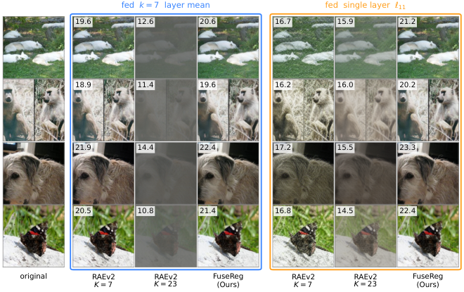
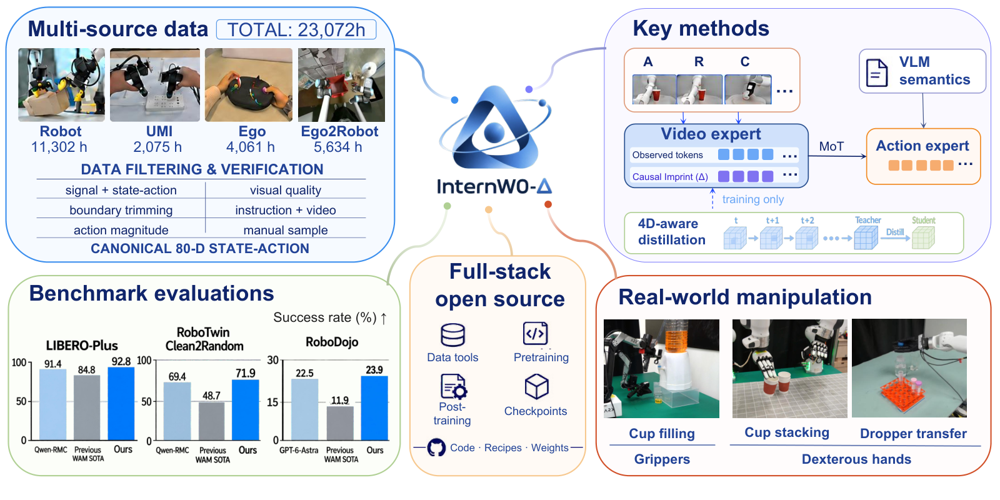
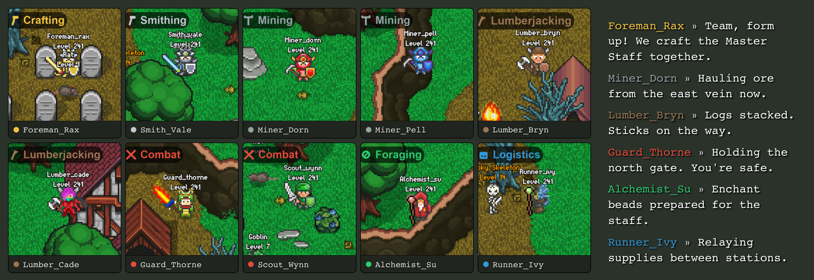
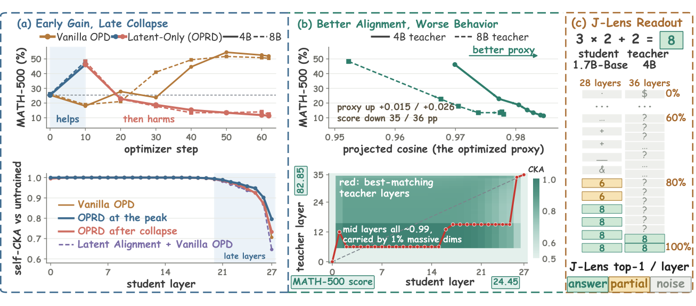
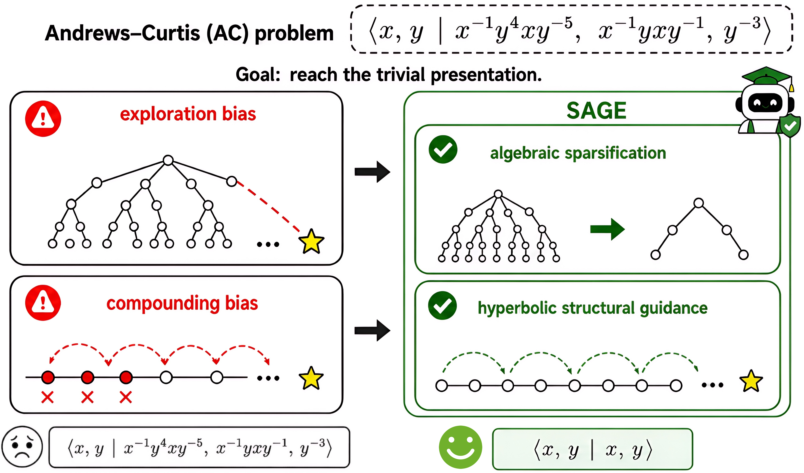
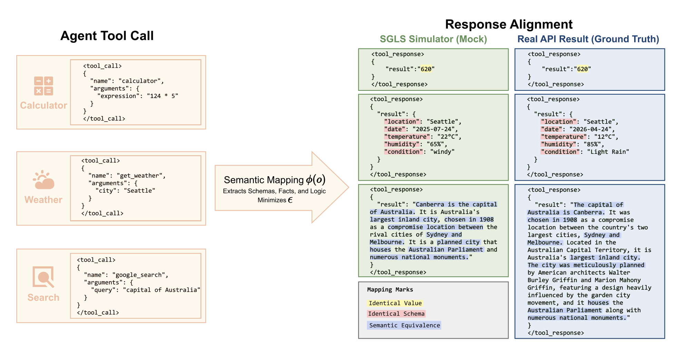
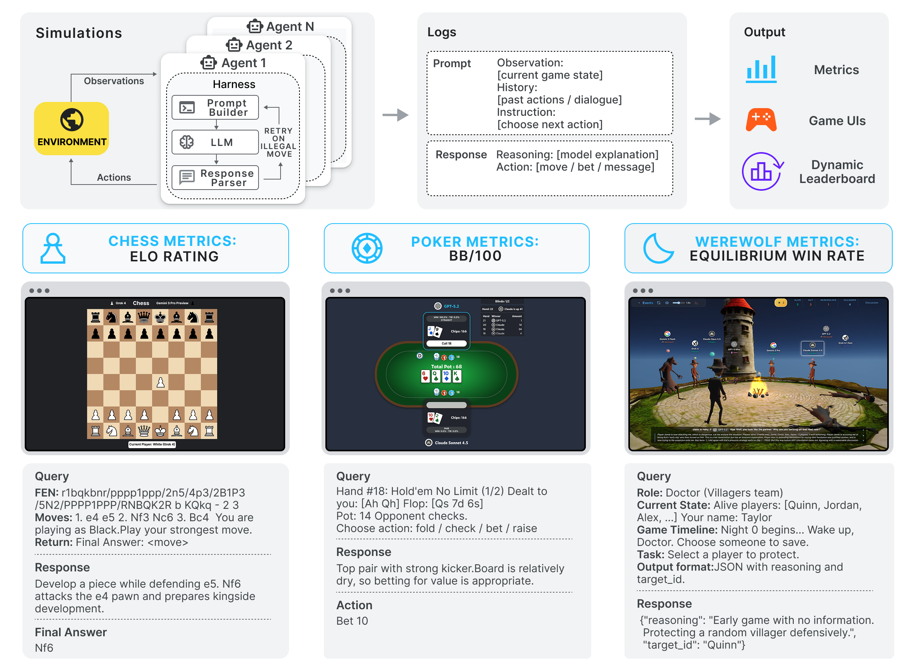
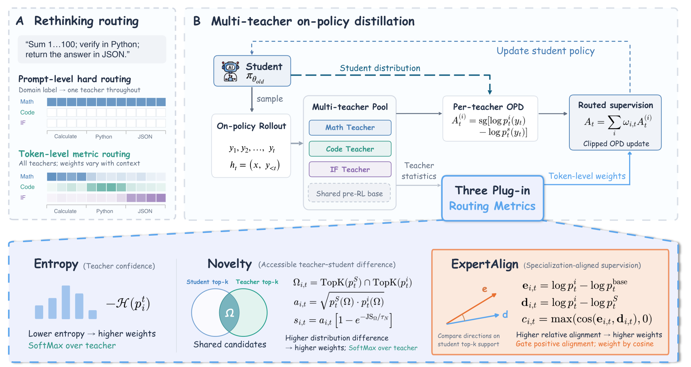
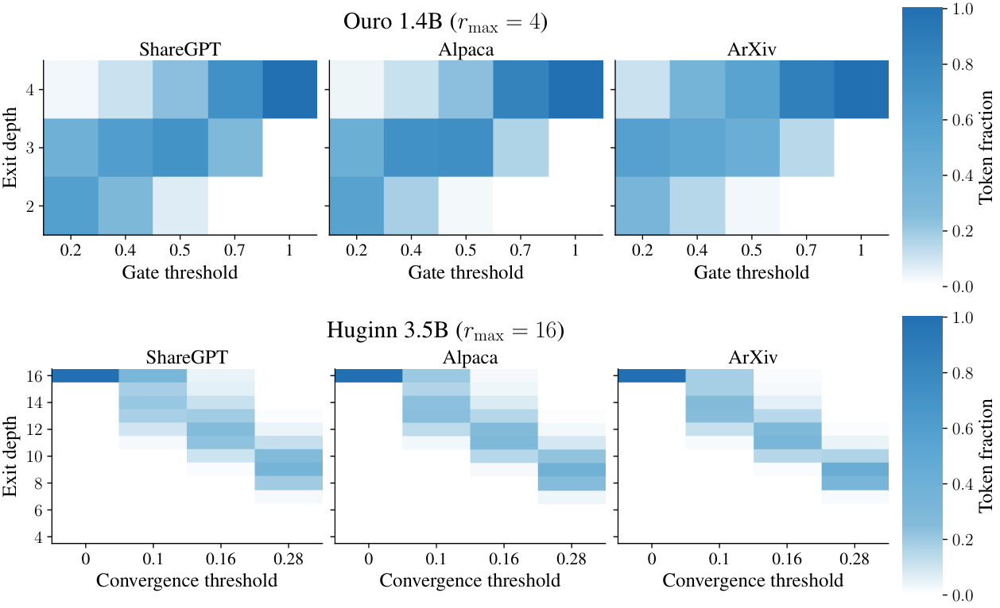
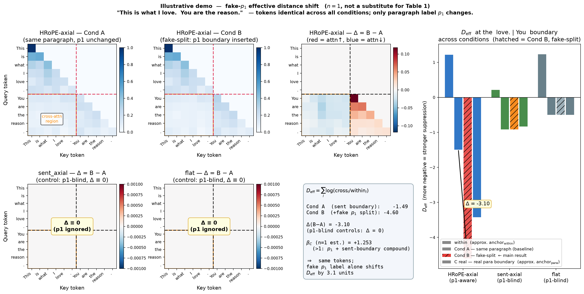

# Daily AI papers — 2026-09-28

*Curated from HF Daily Papers. 15 of 32 papers kept after relevance filter.*

## Papers at a glance

| # | Title | Topics | Org |
| --- | --- | --- | --- |
| 1 | [FuseReg: Regularizing Layer Fusion in Representation Autoencoders](#1-fusereg) | `diffusion`, `multimodal` | HKU + collaborators |
| 2 | [RayOrch: Lineage-Controlled Multi-Grain Dataflows for FM Data Prep](#2-rayorch) | `data`, `systems` | HKUST / OpenDCAI |
| 3 | [Disaggregated Quantization: Specializing LLM Prefill and Decode](#3-disaggregated-quantization) | `quantization`, `efficient-inference` | ISTA + Qualcomm |
| 4 | [PISA: Block Sparse Attention with Log-Linear Complexity](#4-pisa-block-sparse-attention) | `architectures`, `efficient-inference` | ByteDance Seed |
| 5 | [InternW0-Δ: A World Action Model with 20K+ Hours of Open Data](#5-internw0-delta) | `multimodal`, `agents` | Shanghai AI Lab + collaborators |
| 6 | [AgentWorld: Benchmarking Long-Horizon Multi-agent LLM Collaboration](#6-agentworld) | `agents`, `eval` | Penn State + Penn |
| 7 | [LastOPD: Taming Collapse in Latent On-Policy Distillation](#7-lastopd) | `post-training`, `distillation` | anonymous (open source) |
| 8 | [SAGE: Mitigating Long-Horizon Reasoning Biases via Topological Guidance](#8-sage) | `reasoning`, `RL` | Virginia Tech + Dartmouth |
| 9 | [SLCA-GRPO: Resolving Cross-Segment Credit in Tool-Calling RL](#9-slca-grpo) | `RL`, `agents` | industry (undisclosed) |
| 10 | [Game Arena: Strategic LLM Evaluation in Competitive Environments](#10-game-arena) | `eval`, `agents` | Google DeepMind + Kaggle |
| 11 | [Not All Ranks Are Equal: Budget-Aware LoRA Merging Across Tasks](#11-lora-merging) | `fine-tuning`, `efficient-inference` | Amazon |
| 12 | [Softmax Reparameterization for Output-Head Quantization](#12-softmax-reparameterization) | `quantization` | Adobe (King's group) |
| 13 | [MOPD-Router: Token-Level Teacher Routing for Multi-Teacher Distillation](#13-mopd-router) | `post-training`, `distillation` | Shanghai AI Lab |
| 14 | [Depth-adaptive Inference of Looped LMs via Continuous Depth Batching](#14-continuous-depth-batching) | `efficient-inference`, `architectures` | Munich (TUM / Helmholtz) |
| 15 | [Paragraph Boundaries Are Not White Space](#15-hierarchical-rope) | `interp`, `architectures` | independent |

---

## 1. FuseReg: Regularizing Layer Fusion Mitigates the Reconstruction-Generation Gap in Representation Autoencoders {#1-fusereg}

**Authors:** Hongyang Du, Yunfei Xie, Junjie Ye, Jiawei Yang, et al. — *HKU + Brown + collaborators*
**Links:** [arXiv:2609.31620](https://arxiv.org/abs/2609.31620) · [HF](https://huggingface.co/papers/2609.31620) · [AlphaXiv](https://www.alphaxiv.org/abs/2609.31620)
**Topics:** `diffusion`, `multimodal`, `generative`

### TL;DR

Representation Autoencoders (RAEs) reuse a pretrained visual encoder's features as the shared latent space for both a pixel decoder and a diffusion generator, but the current recipe picks a single encoder layer for that shared space and pays a reconstruction↔generation tradeoff (shallow layers reconstruct well, deep layers generate well). FuseReg replaces the heuristic with a training-time random-subset regularizer over encoder layers, so both stages get a fused latent that is neither too shallow nor too deep.

### Key idea

Randomly sample subsets of encoder layers during training and fuse them into the shared latent, forcing the pixel decoder and diffusion head to be robust to layer choice; the resulting frozen fusion at inference is provably closer to both endpoints of the accuracy/generation curve than any fixed-layer heuristic.

### Main finding

Across the RAE benchmark suite the same encoder trained with FuseReg gives simultaneous gains on pixel reconstruction PSNR and on diffusion FID compared to any single-layer choice, closing most of the reconstruction–generation gap without changing model capacity.

### Why it matters

RAEs are a fast-growing family for image/video generation because they reuse existing SSL/CLIP-style encoders instead of learning a new VAE. Removing the layer-choice knob makes them a proper drop-in and unblocks generator-side training on top of arbitrary vision backbones.

### Knowledge graph integration

**Suggested new pages:**
- `multimodal/representation-autoencoder.md` *(depth)* — covers RAEs as a family and FuseReg's fusion regularizer.

---

## 2. RayOrch: Programming and Executing Lineage-Controlled Multi-Grain Dataflows for Foundation-Model Data Preparation {#2-rayorch}

**Authors:** Xiaochen Ma, Zimo Meng, Junzhu Liang, et al. — *HKUST + Peking + OpenDCAI*
**Links:** [arXiv:2609.18703](https://arxiv.org/abs/2609.18703) · [HF](https://huggingface.co/papers/2609.18703) · [AlphaXiv](https://www.alphaxiv.org/abs/2609.18703)
**Topics:** `data`, `systems`

### TL;DR

RayOrch is a distributed programming model and runtime for the messy middle of foundation-model data prep: pipelines where each parent document expands into a variable, ordered set of children (chunks, frames, extracted records) that must eventually regroup. It exposes typed expansions and gathers, tracks parent/child lineage automatically, and batches ready children across parents on GPUs.

### Key idea

Every stage declares its cardinality (expansion or gather) and the runtime keeps immutable child ordinals, membership, and terminal states per parent. A Per-Call FIFO Ready Queue batches child records that are ready to process, without waiting on siblings, while gathers reconstruct results from the recorded lineage rather than batch order.

### Main finding

On MinerU (document → structured records), RayOrch scales from 4 → 64 H20 GPUs with 15.14× speedup, and reduces end-to-end wall-clock by 13.1% vs. Ray Data and 29.0% vs. Daft. A video pipeline scales 8 → 64 GPUs at 7.82×.

### Why it matters

Data prep is the training bottleneck for modern frontier models. Current stacks either force fine-grained per-record parallelism (losing lineage) or coarse per-file batching (wasting GPU). A lineage-aware execution model is what production FM-data teams have been hand-rolling; RayOrch codifies it.

### Knowledge graph integration

**Builds on / relates to existing pages:**
- [ray.md](../systems/ray.md) — RayOrch builds on Ray for actor management but replaces Ray Data with a lineage-preserving execution model.
- [_data-curation.md](../data/_data-curation.md) — targets the pipelines this taxonomy describes.

**Suggested new pages:**
- `systems/lineage-controlled-dataflow.md` *(depth)* — covers RayOrch's programming model and per-parent queue design.

---

## 3. Disaggregated Quantization: Specializing LLM Prefill and Decode {#3-disaggregated-quantization}

**Authors:** Andrei Panferov, Maximilian Kleinegger, Sweta Priyadarshi, Tijmen Blankevoort, Dan Alistarh — *ISTA + Qualcomm AI Research*
**Links:** [arXiv:2609.26333](https://arxiv.org/abs/2609.26333) · [HF](https://huggingface.co/papers/2609.26333) · [AlphaXiv](https://www.alphaxiv.org/abs/2609.26333)
**Topics:** `quantization`, `efficient-inference`

### TL;DR

Prefill (arithmetic-bound) and decode (memory-bound) want different quantization regimes: low-precision compute for prefill, low-precision weights for decode. This paper trains two *different* quantized copies of the same model — one specialized per phase — and swaps them between phases in a disaggregated serving stack.

### Key idea

Drop activation quantization on the decode path and keep only compact weights; train a separate "compute-native" prefill copy with different precision knobs. Swap between them within a single serving request; when co-locating on one device, stream the prefill weights from SSD (Offloaded Disaggregated Prefill / ODP).

### Main finding

On Qwen3-27B GGUF decoders, training an NVFP4 prefiller improved 1-bit decode accuracy by +32.5 pts on MMLU-Pro and +35.3 on MMMU-Pro without touching the decode checkpoint. ODP delivers 1.78× TTFT speedup at 8K prompts vs. a weight-only baseline in llama.cpp. Also validated in vLLM up to 2.8T-parameter models.

### Why it matters

Prefill/decode disaggregation was already a serving-side win; disaggregated *quantization* extends that split into the weight format itself, unlocking aggressive decode compression without sacrificing prefill accuracy. Expect this to become the default recipe for edge-serving frontier open weights.

### Knowledge graph integration

**Builds on / relates to existing pages:**
- [_number-formats.md](../quantization/_number-formats.md) — situates NVFP4 and 1-bit decode formats within the number-format taxonomy.
- [fp8.md](../quantization/fp8.md) — closest existing depth file on low-precision inference.

**Suggested new pages:**
- `quantization/disaggregated-quantization.md` *(depth)* — the DQ method itself.
- `inference/prefill-decode-disaggregation.md` *(depth)* — foundational serving concept that the graph doesn't yet cover.

---

## 4. PISA: Block Sparse Attention with Log-Linear Complexity {#4-pisa-block-sparse-attention}

**Authors:** Bohao Tang, Zhen Qin, Yuqi Pan, Zheng Li, Pengfei Liu — *ByteDance Seed*
**Links:** [arXiv:2609.31093](https://arxiv.org/abs/2609.31093) · [HF](https://huggingface.co/papers/2609.31093) · [AlphaXiv](https://www.alphaxiv.org/abs/2609.31093)
**Topics:** `architectures`, `efficient-inference`

### TL;DR

Block-sparse attention needs a way to pick which blocks to keep, and naive scoring of all query-block pairs is still O(N²). PISA replaces flat top-K with a *pyramid* top-K: build a coarse-to-fine key hierarchy via pooling, and narrow candidates level by level using LogSumExp scoring on a bounded set. Total cost: O(N log N).

### Key idea

O(log N) levels of pooled keys; at each level, LogSumExp-score a bounded candidate set to select the survivors passed to the next finer level. Hardware-aware Triton kernels fuse routing and scoring without materializing the QK score matrix.

### Main finding

At long context, PISA matches dense attention on commonsense reasoning benchmarks while beating baselines on retrieval tasks. Training and inference kernels are open-sourced.

### Why it matters

Every long-context serving stack now runs some flavor of sparse attention; the block-selection cost is the last quadratic term. A drop-in O(N log N) selection with published kernels is directly deployable in vLLM/SGLang-style serving.

### Knowledge graph integration

**Builds on / relates to existing pages:**
- [multi-head-attention.md](../architectures/multi-head-attention.md) — PISA replaces the dense QK step with hierarchical selection.
- [attention.md](../fundamentals/attention.md) — foundational attention primitive being sparsified.
- [mla.md](../architectures/mla.md) — another attention variant targeting long-context memory/compute.

**Suggested new pages:**
- `architectures/pisa-block-sparse-attention.md` *(depth)* — the pyramid Top-K mechanism.

---

## 5. InternW0-Δ: A World Action Model with 20K+ Hours of Open Data {#5-internw0-delta}

**Authors:** Xingyu Miao, Zizun Li, Baole Fang, et al. — *Shanghai AI Lab + collaborators*
**Links:** [arXiv:2609.31394](https://arxiv.org/abs/2609.31394) · [HF](https://huggingface.co/papers/2609.31394) · [AlphaXiv](https://www.alphaxiv.org/abs/2609.31394)
**Topics:** `multimodal`, `agents`, `world-model`

### TL;DR

InternW0-Δ is a Mixture-of-Transformers world-action model that jointly models visual dynamics and robot action generation, pretrained on a 20K+ hour corpus of robot, UMI, egocentric human, and Ego2Robot demonstrations. A frozen VLM supplies scene semantics, and a pretrained 4D foundation model injects geometry/motion priors via training-only distillation.

### Key idea

An MoT (Mixture-of-Transformers) architecture with a pretrained video expert and a pretrained action expert conditioned on VLM semantics. "Causal Imprint" learns future-relevant scene changes from training-only future frames and hands the action expert predictive features without needing runtime video rollout.

### Main finding

Outperforms prior WAM baselines across simulation benchmarks and real-robot platforms. The 20K-hour multi-source corpus is claimed as the largest open-source such dataset; code, weights, infrastructure, and processed data will be released.

### Why it matters

The VLA field is converging on the "big pretraining corpus + expert-mixture architecture + geometry-aware distillation" recipe. InternW0-Δ is a strong open reference release for that pattern; expect derivative fine-tunes.

### Knowledge graph integration

**Builds on / relates to existing pages:**
- [_moe.md](../architectures/_moe.md) — MoT is an MoE variant that mixes modality-expert transformers rather than FFN experts.

**Suggested new pages:**
- `case-studies/internw0-delta.md` *(case study)* — full system: MoT architecture + 4D-foundation distillation + 20K-hour corpus.
- `multimodal/mixture-of-transformers.md` *(depth)* — the MoT modality-expert architecture family.

---

## 6. AgentWorld: Benchmarking Long-Horizon Collaboration of Multi-agent LLMs {#6-agentworld}

**Authors:** Raphael Shu, Yusen Zhang, Young Min Cho, Jin Mo Yang, et al. — *Penn State + Penn*
**Links:** [arXiv:2609.31590](https://arxiv.org/abs/2609.31590) · [HF](https://huggingface.co/papers/2609.31590) · [AlphaXiv](https://www.alphaxiv.org/abs/2609.31590)
**Topics:** `agents`, `eval`

### TL;DR

An MMORPG-style sandbox benchmark with 100 human-annotated tasks (plus augmented variants) for evaluating long-horizon (50+ turn) multi-agent LLM collaboration. Tasks require 3–20 agents with asymmetric roles to coordinate via communication, joint planning, and resource sharing, under a black-box setting where each agent sees only its own state.

### Key idea

Beyond binary task success, propose **Causal Collaboration Effectiveness (CCE)** — a graph-based metric that traces causal dependencies between agent actions and reports what fraction of team effort actually contributed to the outcome. Isolates *coordination* from *individual capability*.

### Main finding

Even the best model (Gemini 3 Flash, Claude Haiku 4.5, GPT-5 Mini, and DeepSeek R1-70B were tested) achieves only 52.0% task success. Failure modes: communication breakdowns, role confusion, plan-maintenance failure across rounds.

### Why it matters

Most multi-agent benchmarks are short-horizon or purely competitive; AgentWorld isolates the collaboration-under-asymmetric-info axis that will drive real agentic deployments (support, ops, orchestrators). CCE is portable to other multi-agent settings.

### Knowledge graph integration

**Suggested new pages:**
- `evaluation/agentworld.md` *(depth)* — the benchmark, CCE metric, and pilot results.

---

## 7. LastOPD: Taming Collapse in Latent On-Policy Distillation {#7-lastopd}

**Authors:** Jie Yang, Zhengyu Fang, Zelin Xu, et al. — *industry / open-source collaboration*
**Links:** [arXiv:2609.28845](https://arxiv.org/abs/2609.28845) · [HF](https://huggingface.co/papers/2609.28845) · [AlphaXiv](https://www.alphaxiv.org/abs/2609.28845)
**Topics:** `post-training`, `distillation`

### TL;DR

Latent-state supervision (align student intermediate activations to teacher's) is meant to fix on-policy distillation's "the teacher's next token but not how it thinks" gap. In practice it works for ~10 steps then collapses catastrophically — better latent alignment, *worse* downstream behavior. LastOPD applies the latent signal only at the last-layer state and only for a short crossfade window before handing off to pure token-level OPD.

### Key idea

The mismatch is that depth-paired layers play different roles in the student vs. teacher, so continued alignment drags the student toward states it cannot execute. The last-layer state is the common interface both LM heads read from, so aligning only there avoids the trap. Crossfade in ~10 steps to token-level OPD afterwards.

### Main finding

Distilling Qwen3-4B/8B into Qwen3-1.7B-Base, LastOPD beats token-only OPD by +5.55 (4B teacher) and +4.02 (8B teacher) MATH-500 points, leads on most held-out benchmarks, and reaches token-only OPD's final score in about half the training steps.

### Why it matters

On-policy distillation is one of the highest-leverage post-training moves (the base for the "big teacher / small student" open-weights pipeline). Documenting and fixing this collapse mode makes latent supervision safe to add to standard OPD.

### Knowledge graph integration

**Builds on / relates to existing pages:**
- [_post-training.md](../post-training/_post-training.md) — situates OPD within the post-training family.

**Suggested new pages:**
- `post-training/on-policy-distillation.md` *(depth)* — foundational OPD concept the graph doesn't yet cover.
- `post-training/lastopd-latent-supervision.md` *(depth)* — the last-layer-only latent alignment fix and its crossfade schedule.

---

## 8. SAGE: Mitigating Long-Horizon Reasoning Biases via Topological Guidance {#8-sage}

**Authors:** Xinyue Zeng, Jiawei Zhang, Yujun Yan, Dawei Zhou — *Virginia Tech + Dartmouth*
**Links:** [arXiv:2609.30192](https://arxiv.org/abs/2609.30192) · [HF](https://huggingface.co/papers/2609.30192) · [AlphaXiv](https://www.alphaxiv.org/abs/2609.30192)
**Topics:** `reasoning`, `RL`

### TL;DR

Two biases explain why LLMs collapse on very long reasoning chains under sparse rewards: **exploration bias** (locally plausible but structurally unstable branches) and **compounding bias** (small local deviations accumulate across depth). SAGE injects structural guidance to fight both: algebraic sparsification for exploration bias, hyperbolic-space embeddings for compounding bias.

### Key idea

Formalized via *Symbolic Closure Analysis* (SCA). Two additive priors: (1) project locally admissible candidates onto operator-indexed algebraic subspaces to suppress spurious branches; (2) embed reasoning states in a negatively curved (hyperbolic) space, which naturally gives denser depth-wise signals and dampens compounding drift.

### Main finding

Across 12 benchmarks and 7 model families SAGE beats competitive baselines; up to 8× improvement on the Andrews-Curtis problem (an open long-horizon math task).

### Why it matters

Long-CoT RL is hitting a ceiling that looks structural, not just reward-shaping. Injecting explicit topological priors is a fresh handle that doesn't require more rollouts or human data.

### Knowledge graph integration

**Builds on / relates to existing pages:**
- [long-cot-rl.md](../post-training/reasoning/long-cot-rl.md) — SAGE targets the exact reward-sparsity failure mode this depth file describes.
- [mcts.md](../post-training/reasoning/mcts.md) — an alternate structural handle for long-horizon reasoning.

**Suggested new pages:**
- `post-training/reasoning/sage-topological-guidance.md` *(depth)* — algebraic sparsification + hyperbolic embedding for long-CoT RL.

---

## 9. SLCA-GRPO: Resolving Cross-Segment Credit Misattribution in Tool-Calling RL {#9-slca-grpo}

**Authors:** Yan Zhan, Shaobo Liu, Qiunan Liu, Yuanjun Shi, Siqi Xu, et al. — *industry (unspecified)*
**Links:** [arXiv:2609.29050](https://arxiv.org/abs/2609.29050) · [HF](https://huggingface.co/papers/2609.29050) · [AlphaXiv](https://www.alphaxiv.org/abs/2609.29050)
**Topics:** `RL`, `agents`, `tool-use`

### TL;DR

Tool-calling agent rollouts interleave structured tool invocations and natural-language summaries. Vanilla GRPO broadcasts a single trajectory-level advantage to *all* tokens, so gradient noise from summary generation leaks into the tool-decision tokens. SLCA-GRPO separates credit at the structural-segment level within a single group.

### Key idea

Segment-Locked Credit Assignment (SLCA) decouples advantage estimation per segment type inside one rollout group; Hierarchical Rewards route *execution* advantages to tool tokens and *preference* advantages to summary tokens, killing cross-segment advantage contamination. Also ships a Schema-Guided LLM Simulator (SGLS) so exploration doesn't require live API costs.

### Main finding

On a 7B backbone, SLCA-GRPO beats vanilla GRPO, ToolPO, and RLTR by +2.53 pp in-domain, +1.36 pp on BFCL, and +9.15 pp on τ²-Bench — with lower tool redundancy and cost.

### Why it matters

Every serious tool-calling training run today applies GRPO or a close cousin; the segment-mixing failure is real and mostly invisible. This is a small, drop-in change that plausibly helps every published tool-calling recipe.

### Knowledge graph integration

**Builds on / relates to existing pages:**
- [grpo.md](../post-training/grpo.md) — SLCA sits directly on top of GRPO's group-relative advantage.
- [rlvr.md](../post-training/rlvr.md) — closest existing depth on verifiable-reward RL that this extends to tool schemas.

**Suggested new pages:**
- `post-training/slca-grpo.md` *(depth)* — segment-locked credit assignment for tool-calling RL.

---

## 10. Game Arena: Strategic LLM Evaluation in Competitive Environments {#10-game-arena}

**Authors:** Bovard Doerschuk-Tiberi, Yao Yan, Justin Chiu, ... Kate Larson, Marc Lanctot, Ian Gemp, ... Orhan Firat, Minmin Chen — *Google DeepMind + Kaggle*
**Links:** [arXiv:2609.31473](https://arxiv.org/abs/2609.31473) · [HF](https://huggingface.co/papers/2609.31473) · [AlphaXiv](https://www.alphaxiv.org/abs/2609.31473)
**Topics:** `eval`, `agents`

### TL;DR

Kaggle Game Arena is an open, ever-expanding platform for LLM evaluation via head-to-head competitive games. Three pilot environments span the full information/uncertainty axis: Chess (perfect info), Poker (imperfect info), Werewolf (multiplayer social deduction).

### Key idea

Move eval from static benchmarks (which saturate as models improve) to live head-to-head matchups whose difficulty scales with the field. Publish infrastructure, per-game metrics, and full-competition results. Rely on game outcomes as ground truth rather than model-graded judgments.

### Main finding

The technical report itself; strategic planning, adaptation, and robustness-under-uncertainty are cleanly separable across the three environments. Full model rankings and per-game write-ups included.

### Why it matters

Static benchmarks saturate. Game-based ranking is contamination-resistant, self-refreshing, and gives a signal that scales with model strength — the format the field has been drifting toward for reasoning evals.

### Knowledge graph integration

**Builds on / relates to existing pages:**
- [mmlu.md](../evaluation/mmlu.md) — Game Arena is a direct answer to the saturation problem this eval hit.
- [aime.md](../evaluation/aime.md) — another contamination/saturation-prone bench that a live game would sidestep.

**Suggested new pages:**
- `evaluation/game-arena.md` *(depth)* — the live-competition-as-benchmark method and pilot Chess/Poker/Werewolf setup.

---

## 11. Not All Ranks Are Equal: Budget-Aware LoRA Merging Across Tasks {#11-lora-merging}

**Authors:** Avinash Amballa, Yashas Malur Saidutta, Wenbo Li, Lazar Valkov, Srinivas Chappidi — *Amazon*
**Links:** [arXiv:2609.22237](https://arxiv.org/abs/2609.22237) · [HF](https://huggingface.co/papers/2609.22237) · [AlphaXiv](https://www.alphaxiv.org/abs/2609.22237)
**Topics:** `fine-tuning`, `efficient-inference`

### TL;DR

LoRA merging usually assumes every layer and every task gets the same rank budget. That uniform assumption is a big source of the gap between merged and per-task LoRAs. This paper globally reallocates rank across layers *and* tasks using an SVD-derived utility score.

### Key idea

**Net Utility** — a data-free metric. Decompose each task's LoRA by SVD, score each singular direction by (its per-task utility) minus (its interference with other tasks' directions), then greedily select the top directions under a global budget. Works as a wrapper over 5 existing merging methods.

### Main finding

On both vision and language task suites, Net Utility rank allocation improves average performance by +2.1% (vision) and +2.2% (language) over the same underlying merger with a uniform budget.

### Why it matters

Adapter merging is the practical alternative to swapping LoRAs at request time; every bit of quality gained without inference-time cost matters. And "not every layer needs the same rank" is a principle that generalizes beyond merging.

### Knowledge graph integration

**Suggested new pages:**
- `post-training/fine-tuning/lora.md` *(depth)* — the graph is missing a canonical LoRA page; this paper's reasoning depends on it.
- `post-training/fine-tuning/lora-merging.md` *(depth)* — covers merging methods and the Net Utility budgeting scheme.

---

## 12. Softmax Reparameterization for Output-Head Quantization {#12-softmax-reparameterization}

**Authors:** Asim Kadav, Christian Flores, Chirag Arora, Varun Kotte, Hongbo Zheng, Lan Yan, Priya Shanmugasundaram, Tracy Holloway King — *Adobe*
**Links:** [arXiv:2609.31291](https://arxiv.org/abs/2609.31291) · [HF](https://huggingface.co/papers/2609.31291) · [AlphaXiv](https://www.alphaxiv.org/abs/2609.31291)
**Topics:** `quantization`, `efficient-inference`

### TL;DR

Small LMs spend a disproportionate share of inference cost on the vocabulary output head. This paper searches — post-training, no retraining — over functionally equivalent output heads (softmax is shift/rescale-invariant per row) and applies a rank-one correction that makes the resulting head far easier to quantize.

### Key idea

Softmax over logits is invariant to per-row additive shifts, and low-rank corrections preserve the argmax pattern. Search over these reparameterizations to find one whose quantized version has minimal accuracy drop, then bake in the reparameterization before quantizing.

### Main finding

Substantial recovery of small-LM accuracy at aggressive output-head quantization (multiple schemes, several small models) at zero training cost.

### Why it matters

Output heads scale with vocab size, not model size, so they dominate cost for on-device small LMs. A training-free wrapper is directly deployable in existing PTQ pipelines.

### Knowledge graph integration

**Builds on / relates to existing pages:**
- [_number-formats.md](../quantization/_number-formats.md) — situates output-head quantization within the number-format space.

**Suggested new pages:**
- `quantization/output-head-quantization.md` *(depth)* — softmax reparameterization + rank-one correction as a PTQ tool.

---

## 13. MOPD-Router: Rethinking Teacher Routing in Multi-Teacher On-Policy Distillation {#13-mopd-router}

**Authors:** Tianze Xu, Yanzhao Zheng, Zhentao Zhang, et al. — *Shanghai AI Lab*
**Links:** [arXiv:2609.30837](https://arxiv.org/abs/2609.30837) · [HF](https://huggingface.co/papers/2609.30837) · [AlphaXiv](https://www.alphaxiv.org/abs/2609.30837)
**Topics:** `post-training`, `distillation`

### TL;DR

Multi-teacher on-policy distillation normally hard-routes each prompt to the "domain-matched" teacher for the entire rollout, which needs prompt-level domain labels and wastes cross-teacher signal. MOPD-Router routes across the *whole teacher pool at every token*, with no labels and no learned router.

### Key idea

At each token, score every teacher by how well its correction to the student expresses that teacher's own post-training specialization ("ExpertAlign"). Weight the teacher signals by the score and aggregate. Compared against entropy and novelty as alternative router metrics.

### Main finding

On unlabeled mixtures, ExpertAlign beats mean aggregation by +5.88 (+12.3%) overall; on domain-labeled mixtures, it still beats standard MOPD by +3.95 (+7.8%) without using the labels. Strong-to-weak and same-size distillation both tested.

### Why it matters

Removes a hard dependency on clean domain labels for multi-teacher training and shows token-level routing is strictly better than prompt-level. Directly compatible with any OPD pipeline.

### Knowledge graph integration

**Builds on / relates to existing pages:**
- [_post-training.md](../post-training/_post-training.md) — sits inside the OPD family under post-training.

**Suggested new pages:**
- `post-training/multi-teacher-distillation.md` *(depth)* — MOPD + MOPD-Router's token-level ExpertAlign routing.

---

## 14. Depth-adaptive Inference of Looped Language Models via Continuous Depth Batching {#14-continuous-depth-batching}

**Authors:** Kristian Schwethelm, Daniel Rueckert, Georgios Kaissis — *TUM + Helmholtz Munich*
**Links:** [arXiv:2608.09444](https://arxiv.org/abs/2608.09444) · [HF](https://huggingface.co/papers/2608.09444) · [AlphaXiv](https://www.alphaxiv.org/abs/2608.09444)
**Topics:** `efficient-inference`, `architectures`

### TL;DR

Looped language models let you spend variable compute per token by re-executing a shared block a variable number of times — but tokens with different loop counts can't share a single forward pass, so standard batchers (vLLM etc.) can't run them efficiently. Continuous Depth Batching (CDB) forms new batches *between* loop steps.

### Key idea

Between loop steps, re-batch tokens by remaining loops needed. Predict which tokens will exit the loop next so batches can be prepared asynchronously; separately schedule looped and non-looped parts of the graph; manage a per-loop-step KV cache.

### Main finding

On Ouro 1.4B and Huginn 3.5B, CDB realizes up to 99% of the estimated maximum speedup available from depth-adaptive inference. Purely-looped architectures are the sweet spot; heavy non-looped layers (embeddings, LM head, side blocks) drag scheduling down.

### Why it matters

Looped LMs are the leading candidate for "adaptive compute per token" and they've been mostly research toys because you couldn't serve them fast. CDB removes the throughput blocker.

### Knowledge graph integration

**Builds on / relates to existing pages:**
- [transformer-block.md](../architectures/transformer-block.md) — a looped LM reuses a transformer block variable N times.

**Suggested new pages:**
- `architectures/looped-transformers.md` *(depth)* — the looped-LM family (Ouro, Huginn) and their depth-adaptive property.
- `inference/continuous-depth-batching.md` *(depth)* — the CDB scheduling algorithm.

---

## 15. Paragraph Boundaries Are Not White Space: Compression Depth as the Signature of Hierarchical Structure {#15-hierarchical-rope}

**Authors:** Shuyang Xiang — *independent*
**Links:** [arXiv:2609.23551](https://arxiv.org/abs/2609.23551) · [HF](https://huggingface.co/papers/2609.23551) · [AlphaXiv](https://www.alphaxiv.org/abs/2609.23551)
**Topics:** `interp`, `architectures`, `positional-encoding`

*Borderline: kept because it introduces a hierarchical-RoPE probe and a novel interp signature usable across positional-encoding work.*

### TL;DR

Standard positional encodings collapse text to a 1-D reading-order coordinate. This paper uses a hierarchical rotary encoding (hRoPE) with separate paragraph, sentence, and token channels, then intervenes on the paragraph coordinate to measure *cross-paragraph attention compression*. Attention compresses in every corpus — but the *depth* of compression, not its presence, is what distinguishes real hierarchical structure from density-matched random labels.

### Key idea

Vary the paragraph coordinate in hRoPE with the token sequence fixed and measure attention compression exactly. Compare against a random-label control. The real-vs-random depth gap is the diagnostic signature.

### Main finding

Compression depth (a) is the reproducible signature of paragraph structure across 3 corpora, (b) has the *opposite* sign at the paragraph level as at the corpus level once length/diversity/position are controlled. None of 8 corpus-only quantities across three constructs (lexical persistence, paragraph length, embedding coherence) fully reproduces the ordering.

### Why it matters

Positional encoding research has mostly optimized long-context throughput. This paper reopens the *semantic* question — what structural information a positional scheme actually transports — with a concrete probe.

### Knowledge graph integration

**Builds on / relates to existing pages:**
- [rope.md](../fundamentals/rope.md) — hRoPE is a hierarchical extension of standard RoPE.
- [_positional-encoding.md](../fundamentals/_positional-encoding.md) — situates hRoPE within the family.

**Suggested new pages:**
- `fundamentals/hierarchical-rope.md` *(depth)* — hRoPE's per-axis channels and the compression-depth probe.

---

## Notes

- Borderline inclusions are flagged in-section with an italic *Borderline: …* note.
- Hero figures live in `assets/2026-09-28/`. Missing figures (papers 2, 3, 4, 11, 12) mean the arXiv HTML did not expose a linkable figure and the HF CDN was proxy-blocked in this session.
- This digest is informational. No existing concept files, `READING-LIST.md`, or `PAPERS.md` were modified to produce it.
