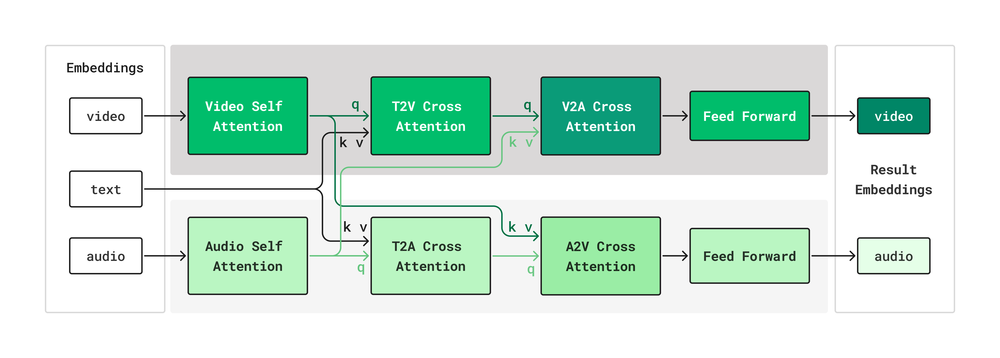
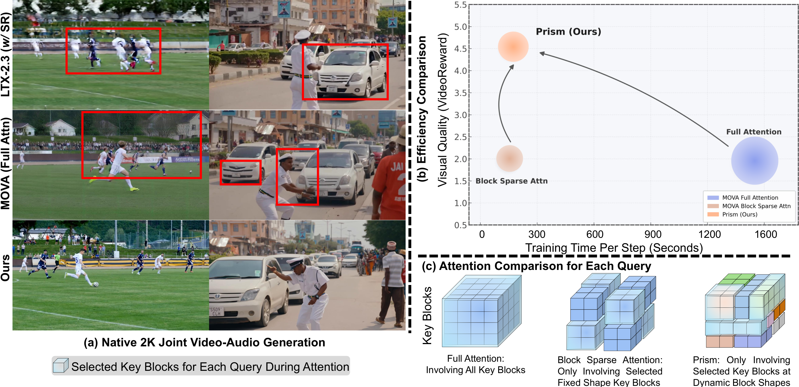
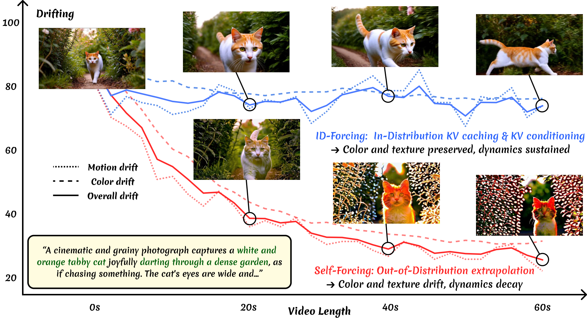
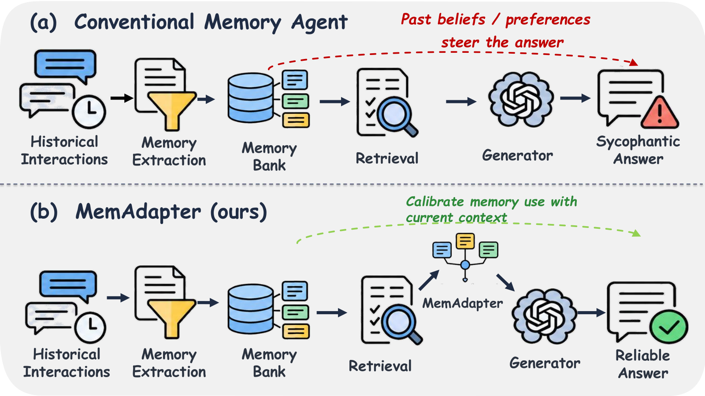
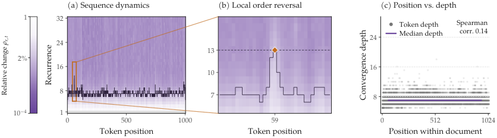
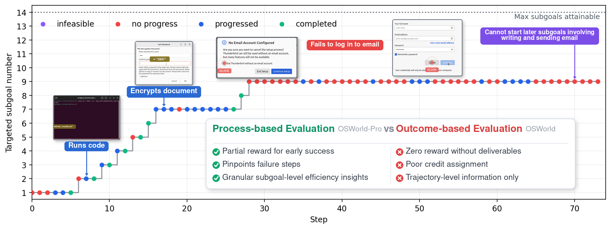
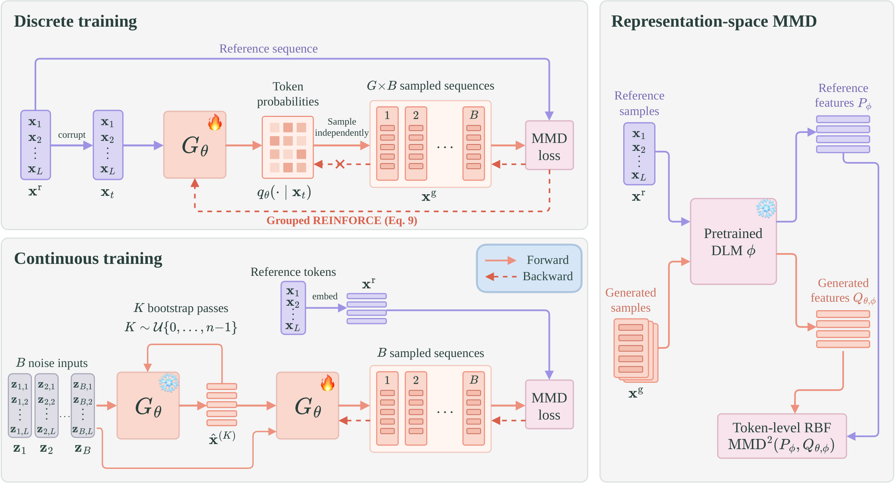
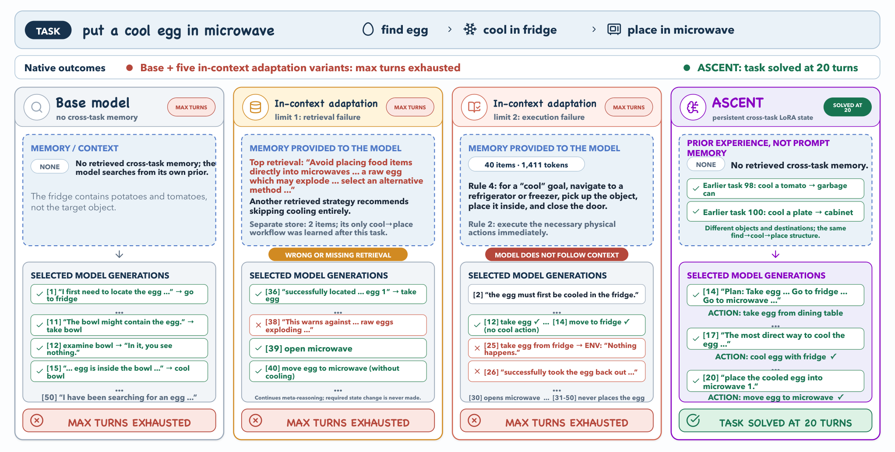
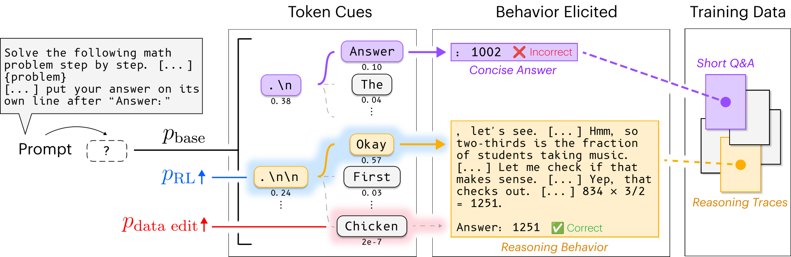
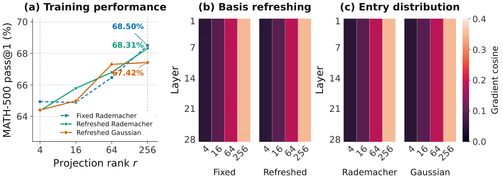

# Daily AI papers — 2026-10-06

*Curated from HF Daily Papers. 15 of ~65 papers kept after relevance filter.*

## Papers at a glance

| # | Title | Topics | Org |
| --- | --- | --- | --- |
| 1 | [Kandinsky 6.0 Video](#1-kandinsky-60-video) | `diffusion`, `multimodal`, `video` | Team Kandinsky |
| 2 | [ALoDLM: Adaptively Looped Diffusion Language Models](#2-alodlm) | `diffusion`, `LLM`, `efficient-inference` | Amazon |
| 3 | [Prism: Dynamic Sparse Attention for Native 2K Joint Video-Audio](#3-prism) | `diffusion`, `multimodal`, `attention` | — |
| 4 | [In-Distribution Forcing for Long Video Generation](#4-id-forcing) | `diffusion`, `video`, `inference` | — |
| 5 | [MemAdapter: Memory-Induced Sycophancy](#5-memadapter) | `agents`, `safety` | Jilin / Xiamen |
| 6 | [Looped Models Done Right, Part II](#6-looped-models-part-ii) | `architecture`, `reasoning`, `efficient-inference` | IFM |
| 7 | [Self-Generated Feedback Destabilizes TTT](#7-ttt-self-feedback) | `test-time-training`, `LLM` | KAUST |
| 8 | [OSWorld-Pro: Process-based CUA Eval](#8-osworld-pro) | `agents`, `eval` | NVIDIA |
| 9 | [Representation-Space MMD for Diffusion LMs](#9-mmd-dlm) | `diffusion`, `LLM`, `post-training` | Yandex |
| 10 | [ASCENT: Online TTT of Long-Horizon Agents](#10-ascent) | `agents`, `test-time-training` | — |
| 11 | [Noise Out, Bias In: Steering Attack on dLLMs](#11-noise-out-bias-in) | `safety`, `interp`, `diffusion` | MBZUAI |
| 12 | [Base Models Can Reason From Training-Data Cues](#12-base-models-reason) | `reasoning`, `interp` | — |
| 13 | [LoGRA: Low-Rank Gradient Sketches for RL](#13-logra) | `RL`, `LoRA`, `efficient-training` | — |
| 14 | [FLaRe: Latent Reasoning with Flow Matching](#14-flare) | `reasoning`, `diffusion` | — |
| 15 | [Sharpen Without Search: On-Policy Power Distillation](#15-oppd) | `post-training`, `reasoning`, `distillation` | USC / Intel |

---

## 1. Kandinsky 6.0 Video

**Authors:** Team Kandinsky (large multi-author release)
**Links:** [arXiv:2610.05608](https://arxiv.org/abs/2610.05608) · [HF](https://huggingface.co/papers/2610.05608) · [AlphaXiv](https://www.alphaxiv.org/abs/2610.05608)
**Topics:** `diffusion`, `multimodal`, `video`, `audio`

### TL;DR

An open-weights family of foundation diffusion models (3B Lite + 29B Pro) that generates 5-second 44 kHz synchronized audio-video clips, including lip-sync, with built-in super-resolution to 1080p.

### Key idea

Dual-stream **CrossDiT** architecture: a pretrained video DiT stream and a newly trained audio DiT stream connected by bidirectional cross-attention for temporal and semantic alignment. Continuous pretraining first warms up the audio stream alone on audio corpora, then jointly trains both streams on paired data while preserving unimodal fidelity.

### Main finding

In side-by-side human evaluation, Kandinsky 6.0 Video Pro beats its Kandinsky 5.0 predecessor and is competitive with leading audio-video generation systems — notably strong on speech quality — while shipping code, weights, and diffusers integration under MIT.

### Why it matters

The first fully open 29B-scale audio+video foundation model with lip-sync. Establishes a reusable CrossDiT recipe for other paired-modality diffusion stacks (image+depth, video+text, text+speech), and the full pipeline (pretrain → SFT → RL → distillation) is published rather than hidden.

### Knowledge graph integration

**Builds on / relates to existing pages:**
- [../case-studies/README.md](../case-studies/README.md) — fits the end-to-end-system case-study pattern

**Suggested new pages:**
- `case-studies/kandinsky-6-video.md` *(case study)* — full tech-report breakdown
- `multimodal/cross-dit.md` *(depth)* — dual-stream DiT with cross-attention
- `multimodal/_video-audio-generation.md` *(taxonomy)* — class of joint A/V generative models

---

## 2. ALoDLM

**Authors:** Liancheng Fang, Zhuowei Li, Youngeun Kim, Tianchen Zhao, Rajat Koner et al. — *Amazon*
**Links:** [arXiv:2610.04198](https://arxiv.org/abs/2610.04198) · [HF](https://huggingface.co/papers/2610.04198) · [AlphaXiv](https://www.alphaxiv.org/abs/2610.04198)
**Topics:** `diffusion`, `LLM`, `efficient-inference`

### TL;DR

A diffusion language model that gives each unknown token its own number of latent recurrent passes per denoising step — hard tokens recur more, easy ones commit immediately — closing the quality gap to similarly-sized autoregressive models while keeping parallel decoding.

### Key idea

**Token-adaptive latent recurrence.** Within each denoising step, representations loop; committed tokens become discrete context, unresolved tokens retain and refine latent state through more passes. Training optimizes a conditional NELBO that treats per-token compute schedules as latent variables.

### Main finding

At 1.7B and 8B, ALoDLM outperforms all evaluated DLMs *and* AR baselines in average benchmark score across 11 benchmarks, while retaining fast parallel decoding.

### Why it matters

Addresses a long-standing DLM weakness: uniform compute per token wastes work on easy tokens and under-serves hard ones. Puts DLMs ahead of same-size AR models on quality while keeping their decoding-speed advantage.

### Knowledge graph integration

**Suggested new pages:**
- `architectures/_diffusion-lm.md` *(taxonomy)* — DLMs as a class (masked/absorbing/continuous)
- `architectures/alodlm.md` *(depth)* — adaptive latent recurrence per token

---

## 3. Prism

**Authors:** Shuyuan Tu, Qi Tian, Yinming Huang, Yue Wu, Xintong Han et al.
**Links:** [arXiv:2610.05416](https://arxiv.org/abs/2610.05416) · [HF](https://huggingface.co/papers/2610.05416) · [AlphaXiv](https://www.alphaxiv.org/abs/2610.05416)
**Topics:** `diffusion`, `multimodal`, `attention`, `efficient-training`

### TL;DR

A dynamic sparse-attention framework for *native* 2K joint video+audio diffusion training: carves tokens into spatiotemporal "macro-zones," adapts block shape per zone based on video-feature variance and audio-visual cross-attention strength, and selects which blocks each query attends to.

### Key idea

Per-zone adaptive block shapes keyed to local signal: axes with rapid visual change or strong audio-visual coupling get finer partitioning. A hybrid block-selection strategy decides per-query sparsity, so sparsity structure co-adapts with content.

### Main finding

**2.5× training speedup over full attention while surpassing it on generation quality** at native 2K resolution.

### Why it matters

Shows that modality-aware sparse attention — not just training-free prune-at-inference — can be the training-time default for high-res joint A/V diffusion, where full attention is quadratic and increasingly uninformative.

### Knowledge graph integration

**Builds on / relates to existing pages:**
- [../fundamentals/attention.md](../fundamentals/attention.md) — attention mechanics baseline

**Suggested new pages:**
- `architectures/dynamic-sparse-attention.md` *(depth)* — content-adaptive block attention
- `architectures/_sparse-attention.md` *(taxonomy)* — overview of block/sliding/dynamic variants

---

## 4. ID-Forcing

**Authors:** anonymous / affiliation not shown
**Links:** [arXiv:2610.03120](https://arxiv.org/abs/2610.03120) · [HF](https://huggingface.co/papers/2610.03120) · [AlphaXiv](https://www.alphaxiv.org/abs/2610.03120)
**Topics:** `diffusion`, `video`, `inference`

### TL;DR

A test-time method that extends short-horizon autoregressive video diffusion to minute-scale by preventing cached KV entries from drifting out-of-distribution during rollout.

### Key idea

**Self-caching.** Each chunk is cached without attending to prior KV entries, so the rolling window of cached KVs matches the training-time distribution exactly. KV conditioning alone is insufficient; the *provenance* of cached entries matters.

### Main finding

Competitive on standard video benchmarks and substantially better at drift mitigation per the authors' drift metrics and user study; extends short-horizon models to minute-scale generation.

### Why it matters

Shifts the long-video problem from "fix the policy" to "guard the cache": a cheap, training-free intervention that composes with any AR video diffusion backbone.

### Knowledge graph integration

**Suggested new pages:**
- `inference/id-forcing.md` *(depth)* — in-distribution KV construction for long-video gen

---

## 5. MemAdapter

**Authors:** Ruqing Ning, Haibo Meng, Zhishang Xiang, Zerui Chen, Jinsong Su, Xin Wang, Qinggang Zhang — *Jilin / Xiamen*
**Links:** [arXiv:2610.05162](https://arxiv.org/abs/2610.05162) · [HF](https://huggingface.co/papers/2610.05162) · [AlphaXiv](https://www.alphaxiv.org/abs/2610.05162)
**Topics:** `agents`, `safety`, `memory`

### TL;DR

Memory-equipped LLM agents sycophantically over-align with stored user beliefs even when memories are *correct*; MemAdapter learns to integrate retrieved memories conditionally rather than filtering them.

### Key idea

Counterfactual adaptation: train an adapter that, at retrieval time, decides *how much* a given correct memory should influence the current reply, instead of either trusting it fully or dropping biased memories.

### Main finding

Reduces memory-induced sycophancy on their benchmark; shows that same memory can warrant different weight across contexts, which filter-based pipelines can't express.

### Why it matters

Current agent-memory stacks assume "correct memory = safe to use." This paper shows that assumption breaks — context, not provenance, decides whether a memory should sway output.

### Knowledge graph integration

**Builds on / relates to existing pages:**
- [../safety/alignment-faking.md](../safety/alignment-faking.md) — sycophancy as a related alignment failure

**Suggested new pages:**
- `agents/memory-sycophancy.md` *(depth)* — memory-induced sycophancy and mitigations

---

## 6. Looped Models Part II

**Authors:** Benhao Huang, Chufan Shi, Junlin Chen, Shicheng Wen, Zhengzhong Liu, Eric Xing, Xuezhe Ma — *Institute of Foundation Models*
**Links:** [arXiv:2610.06833](https://arxiv.org/abs/2610.06833) · [HF](https://huggingface.co/papers/2610.06833) · [AlphaXiv](https://www.alphaxiv.org/abs/2610.06833)
**Topics:** `architecture`, `reasoning`, `efficient-inference`

### TL;DR

Treats a looped language model as approaching fixed points: once states converge, the path doesn't matter, which enables cheap training (truncated BPTT), cheap decoding (shared terminal KV), cheap prefill (distilled student), and cheap RL (gradient-from-saved-state).

### Key idea

Two training fixes that make fixed-point behavior work:
1. **Learned depth prior** from prediction feedback with an entropy regularizer — broad enough to share KVs, sharp enough to supervise the target depth.
2. **Orthogonal input injection** — remove the state's component along the input before adding it, so the injection isn't amplified or cancelled unpredictably.

### Main finding

From 100M to 1.6B params, perplexity improves at every scale over Huginn's prior and existing injection schemes. At 1.6B, the learned prior with a 3× smaller KV cache matches fixed-depth training with the full cache. 1.79× faster prefill, 2× faster RL updates.

### Why it matters

Looped / recurrent LMs have long had a cost problem: training through unrolled depth is expensive. This paper trades depth for *fixed-point structure*, making recurrent models competitive on all four cost axes.

### Knowledge graph integration

**Builds on / relates to existing pages:**
- [../fundamentals/attention.md](../fundamentals/attention.md) — context for KV-cache implications
- [../post-training/reasoning/long-cot-rl.md](../post-training/reasoning/long-cot-rl.md) — RL-side gains apply to CoT-RL

**Suggested new pages:**
- `architectures/looped-models.md` *(depth)* — looped/recurrent LMs with fixed-point training

---

## 7. TTT Self-Feedback

**Authors:** Bing Li, Bernard Ghanem — *KAUST*
**Links:** [arXiv:2610.05076](https://arxiv.org/abs/2610.05076) · [HF](https://huggingface.co/papers/2610.05076) · [AlphaXiv](https://www.alphaxiv.org/abs/2610.05076)
**Topics:** `test-time-training`, `LLM`

### TL;DR

Isolates *why* test-time training collapses on long streams: each update changes the model that generates the next training example, and that feedback loop — not generation quality — is what causes drift.

### Key idea

Three ablations trace causation: **Fixed Generation** (frozen generator) removes >98% of damage at small scale; **Recorded Replay** separates loss from reading degraded text vs. storing updates on it; a paired one-update comparison shows the local conflict. **Settlement** evaluates each candidate state on independent real text before commit.

### Main finding

Across 128K-token streams with three TTT-E2E configs (125M, 760M, 3B) and Adam-updated Qwen3-4B, retained self-generated updates systematically worsen prediction on independent human text; Settlement keeps real-text adaptation with ~zero endpoint gap.

### Why it matters

Rules out "writing is intrinsically bad for TTT" and names the real failure (self-generated feedback). The remedy — commit updates only after verifying on independent evidence — is a general design principle for any online learner.

### Knowledge graph integration

**Suggested new pages:**
- `post-training/test-time-training.md` *(depth)* — TTT family and self-feedback failure mode

---

## 8. OSWorld-Pro

**Authors:** Shaokun Zhang, Yifan Zhang, Hao Zhang et al. — *NVIDIA*
**Links:** [arXiv:2609.24890](https://arxiv.org/abs/2609.24890) · [HF](https://huggingface.co/papers/2609.24890) · [AlphaXiv](https://www.alphaxiv.org/abs/2609.24890)
**Topics:** `agents`, `eval`, `computer-use`

### TL;DR

A process-based successor to OSWorld: 300+ computer-use tasks with 2,800+ labeled subgoals (67k human annotations), graded by human-aligned LLM judges that track *where* an agent fails, not just whether the final deliverable matched.

### Key idea

Replace end-state verification with **subgoal-level LLM-judge grading** over sequentially dependent steps, exposing failure categories (keyboard-input errors, click imprecision, subgoal-irrelevant actions).

### Main finding

Claude Opus 5 scores 75.7% on OSWorld-Pro vs. 83.4% on OSWorld — process grading is strictly harder. Reveals model-specific failure modes invisible to end-state metrics.

### Why it matters

End-state CUA metrics saturate while the models still fail interestingly mid-trajectory. Process-level grading restores the diagnostic signal needed to actually improve agents.

### Knowledge graph integration

**Builds on / relates to existing pages:**
- [../evaluation/README.md](../evaluation/README.md) — new benchmark

**Suggested new pages:**
- `evaluation/osworld-pro.md` *(depth)* — process-based CUA evaluation
- `agents/README.md` — add benchmark reference (not touched here)

---

## 9. MMD for Diffusion LMs

**Authors:** Ilya Drobyshevskiy, Ilia Sudakov, Maksim Semenov, Denis Kuznedelev — *Yandex Research / HSE / T-Tech*
**Links:** [arXiv:2610.06648](https://arxiv.org/abs/2610.06648) · [HF](https://huggingface.co/papers/2610.06648) · [AlphaXiv](https://www.alphaxiv.org/abs/2610.06648)
**Topics:** `diffusion`, `LLM`, `post-training`

### TL;DR

A post-training objective for diffusion LMs that minimizes **Maximum Mean Discrepancy** between generated and reference distributions in the feature space of a frozen pretrained DLM — one extractor pass yields many per-token observations, so the loss is cheap.

### Key idea

Compute MMD on contextual *features* (not samples), estimated from token-position activations of a frozen DLM. Train discrete DLMs with policy gradients and continuous DLMs with direct differentiation through latents. No full sampling trajectories, no jointly trained auxiliary models.

### Main finding

Lower generative perplexity at comparable entropy on OpenWebText; better accuracy–compute trade-offs on GSM8K; on 16B hybrid masked–uniform DMax-LLaDA2.0, higher decoding parallelism with matched or higher math/code accuracy.

### Why it matters

A clean, lightweight recipe to post-train DLMs on behavioral signals rather than full-trajectory likelihood — unlocks faster iteration on DLM alignment and reasoning.

### Knowledge graph integration

**Suggested new pages:**
- `post-training/mmd-dlm.md` *(depth)* — feature-space MMD post-training for DLMs
- `architectures/_diffusion-lm.md` *(taxonomy)* — see paper 2

---

## 10. ASCENT

**Authors:** Haodong Lu, Dong Gong
**Links:** [arXiv:2610.05303](https://arxiv.org/abs/2610.05303) · [HF](https://huggingface.co/papers/2610.05303) · [AlphaXiv](https://www.alphaxiv.org/abs/2610.05303)
**Topics:** `agents`, `test-time-training`, `self-distillation`

### TL;DR

Online test-time training for long-horizon agents: self-distill the agent's own *verified* trajectories into persistent LoRA weights, in a single pass over a task stream, with no stronger teacher.

### Key idea

The frozen initial copy of the LLM sees the verified trajectory as privileged hindsight and predicts next-token distributions along it; the live policy distills those distributions into LoRA fast weights. Invalid-action turns are removed for cleaner distillation. Avoids the instability of directly imitating or reinforcing single-attempt tokens.

### Main finding

On ALFWorld, WebShop, and AppWorld across model scales, ASCENT improves task success and interaction efficiency as experience accumulates; beats online adaptation baselines and transfers to held-out scenes.

### Why it matters

Lets a deployed agent *keep learning* from its own successes without a replay buffer, reward model, or external teacher — a practical path to accumulating experience in agents without server-side retraining.

### Knowledge graph integration

**Builds on / relates to existing pages:**
- [../post-training/rejection-sampling.md](../post-training/rejection-sampling.md) — verified-rollout filtering parallel

**Suggested new pages:**
- `agents/online-ttt.md` *(depth)* — online TTT via self-distillation
- `post-training/test-time-training.md` *(depth)* — see paper 7

---

## 11. Noise Out, Bias In

**Authors:** Sarim Hashmi, Mukul Ranjan, Abdelrahman Elsayed, Muhammad Umer Sheikh, Fahad Shamshad, Nils Lukas — *MBZUAI*
**Links:** [arXiv:2610.05894](https://arxiv.org/abs/2610.05894) · [HF](https://huggingface.co/papers/2610.05894) · [AlphaXiv](https://www.alphaxiv.org/abs/2610.05894)
**Topics:** `safety`, `interp`, `diffusion`

### TL;DR

A targeted-bias attack that exploits the iterative denoising of diffusion LLMs: a PI controller watches target-answer probability each step and modulates a steering-vector intervention on the fly.

### Key idea

An AR decoder exposes an answer's distribution once at commit; a dLLM exposes it at every denoising step before commit. With activation access, a proportional-integral controller treats answer probability as a signal and adapts steering strength — closed-loop steering beats any fixed-strength open-loop attack.

### Main finding

On ambiguous BBQ, raises LLaDA-8B-Instruct's preference for the targeted demographic from 1.8 → 16.7 pp (3× the strongest fixed-strength baseline). On SocialStigmaQA, 17.6% → 58.1%. Shifts of up to 37 pp for other targets, ~40 min per attack on one GPU. Feedback is what makes it work.

### Why it matters

Identifies the denoising trajectory as a *new control channel* in dLLMs and shows that bias audits performed on the frozen model miss attacks that act through the serving stack.

### Knowledge graph integration

**Builds on / relates to existing pages:**
- [../safety/_attacks.md](../safety/_attacks.md) — new attack category

**Suggested new pages:**
- `safety/activation-steering-attack.md` *(depth)* — closed-loop activation steering as attack
- `interpretability/activation-steering.md` *(depth)* — steering-vector mechanics

---

## 12. Base Models Can Reason

**Authors:** full author list not shown on HF page
**Links:** [arXiv:2610.06851](https://arxiv.org/abs/2610.06851) · [HF](https://huggingface.co/papers/2610.06851) · [AlphaXiv](https://www.alphaxiv.org/abs/2610.06851)
**Topics:** `reasoning`, `interp`, `data`

### TL;DR

A fixed starting-token cue (e.g. `.\n\n Okay`) brings base model math/code accuracy close to its RL-trained version. RL mostly makes those cues more likely; the cues themselves are learned from training-data associations.

### Key idea

Token-level cues at the start of a response trigger latent "modes" of reasoning behavior encoded during pretraining. Causal data interventions can turn arbitrary tokens ("chicken") into effective cues, or neutralize existing cues — showing the association is literal, not symbolic.

### Main finding

Cue `.\n\n Okay` raises Olmo-3-7B on MATH-500 from 42% → 78%; ` Alright,` raises Qwen3-14B from 72% → 87%. Fixing cues recovers much of RL's gains. The prompt "Think duck duck goose" can be made as effective as "Think step by step" with a targeted data edit.

### Why it matters

Suggests the "reasoning gain" from post-training is partly selecting data-conditioned behavior modes that already exist in the base. Cues are also a safety handle: different cues produce different refusal / compliance profiles.

### Knowledge graph integration

**Builds on / relates to existing pages:**
- [../post-training/reasoning/long-cot-rl.md](../post-training/reasoning/long-cot-rl.md) — relates RL gains to base-model behavior
- [../post-training/rlvr.md](../post-training/rlvr.md) — RLVR context
- [../post-training/_post-training.md](../post-training/_post-training.md) — framing

**Suggested new pages:**
- `post-training/reasoning/token-cue.md` *(depth)* — training-data-induced reasoning cues

---

## 13. LoGRA

**Authors:** author list not visible on HF page
**Links:** [arXiv:2610.06647](https://arxiv.org/abs/2610.06647) · [HF](https://huggingface.co/papers/2610.06647) · [AlphaXiv](https://www.alphaxiv.org/abs/2610.06647)
**Topics:** `RL`, `LoRA`, `efficient-training`

### TL;DR

Memory-efficient RL post-training that keeps gradient signal in low-rank *gradient sketches* and controls update size with a predicted-KL step controller — makes 27B RL fit on one 8-GPU node where dense Adam OOMs.

### Key idea

Low-rank gradient sketches store useful learning signal cheaply and let policy sync be lightweight; predicted-KL step control estimates the policy change *before* applying each update and shrinks the step if the change is too large.

### Main finding

Up to **45.7% average training-memory reduction** across reasoning tasks with no performance loss. Enables stable 27B RL for 1,100+ steps on 8 GPUs. Open-sourced in the Molt library.

### Why it matters

RL post-training is memory-bound as policy size grows; a drop-in sketch + KL-step pair lowers the hardware bar without a quality hit. Composes with any PPO/GRPO backbone.

### Knowledge graph integration

**Builds on / relates to existing pages:**
- [../post-training/grpo.md](../post-training/grpo.md) — RL algorithm the sketches wrap
- [../post-training/ppo.md](../post-training/ppo.md) — same
- [../post-training/_rl.md](../post-training/_rl.md) — RL overview

**Suggested new pages:**
- `post-training/logra.md` *(depth)* — low-rank gradient sketches + predicted-KL step
- `post-training/fine-tuning/README.md` — LoRA parallel (not touched here)

---

## 14. FLaRe (Flow-based Latent Reasoning)

**Authors:** author list not visible on HF page
**Links:** [arXiv:2610.06666](https://arxiv.org/abs/2610.06666) · [HF](https://huggingface.co/papers/2610.06666) · [AlphaXiv](https://www.alphaxiv.org/abs/2610.06666)
**Topics:** `reasoning`, `diffusion`, `latent`

### TL;DR

A latent-reasoning recipe built on flow matching: thoughts live in a learned continuous space, the flow is trained there, the answer is read out after, and a final stage trains on the model's own verified thoughts.

### Key idea

Five explicit requirements for a *useful* latent thought — **useful, diverse, explainable, refinable, efficient** — and a flow-matching recipe that targets each: what the latent encodes, where to train the flow, how to decode, and a self-training final stage on verified samples.

### Main finding

Across all five probes, FLaRe beats prior latent-reasoning methods. On arithmetic benchmarks, reaches **97% of explicit-CoT accuracy at ~25% of its latency**.

### Why it matters

Latent reasoning has been undershooting explicit CoT; a principled recipe closes most of the quality gap while being 4× faster. Also makes "the latent thought" probeable, which was the main complaint against continuous CoT.

### Knowledge graph integration

**Builds on / relates to existing pages:**
- [../post-training/reasoning/long-cot-rl.md](../post-training/reasoning/long-cot-rl.md) — latent alternative to explicit CoT
- [../post-training/reasoning/mcts.md](../post-training/reasoning/mcts.md) — compare search-based reasoning

**Suggested new pages:**
- `post-training/reasoning/latent-reasoning-flow-matching.md` *(depth)* — FLaRe
- `post-training/reasoning/_latent-reasoning.md` *(taxonomy)* — latent CoT variants

---

## 15. On-Policy Power Distillation (OPPD)

**Authors:** Seyedarmin Azizi, Arya Fayyazi, Saeid Shokoufa, Mehdi Kamal, Souvik Kundu, Massoud Pedram — *USC / Intel AI*
**Links:** [arXiv:2610.06804](https://arxiv.org/abs/2610.06804) · [HF](https://huggingface.co/papers/2610.06804) · [AlphaXiv](https://www.alphaxiv.org/abs/2610.06804)
**Topics:** `post-training`, `reasoning`, `distillation`

### TL;DR

Trains a model to produce single-shot answers that match the quality of expensive **power-distribution sampling** — raising each candidate's probability to a power > 1 and renormalizing — without needing many candidates at inference.

### Key idea

A sequential Monte Carlo sampler draws candidates from the training model; a frozen teacher's power distribution reweights them; the same weights appear inside a maximum-likelihood update. The student *inherits* the sharpened distribution directly, so one generation suffices at eval time.

### Main finding

Up to **+23.0 pp on MATH500 and +27.3 pp on GSM8K** over the untrained model at the same temperature. One generation after OPPD scores 2.4 and 3.5 pp above published power sampling with 64 candidates, recovering 94% of what 16 candidates give the untrained model.

### Why it matters

Replaces N-candidate test-time search with a one-shot trained policy — same quality, 1/N the inference cost. A general recipe for "distill a search algorithm into the policy."

### Knowledge graph integration

**Builds on / relates to existing pages:**
- [../post-training/rejection-sampling.md](../post-training/rejection-sampling.md) — related "best-of-N" baseline
- [../post-training/reasoning/mcts.md](../post-training/reasoning/mcts.md) — alternative search procedure

**Suggested new pages:**
- `post-training/on-policy-power-distillation.md` *(depth)* — OPPD

---

## Notes

- Papers 2 (ALoDLM), 4 (ID-Forcing), 7 (TTT self-feedback), 11 (Noise Out Bias In), 14 (FLaRe), 15 (OPPD): no hero figure available (arXiv HTML not yet published or no figure parse-able); omitted the figure line.
- Hero figures live in `assets/2026-10-06/`.
- This digest is informational. No existing concept files, `READING-LIST.md`, or `PAPERS.md` were modified to produce it.
