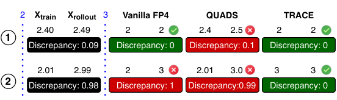
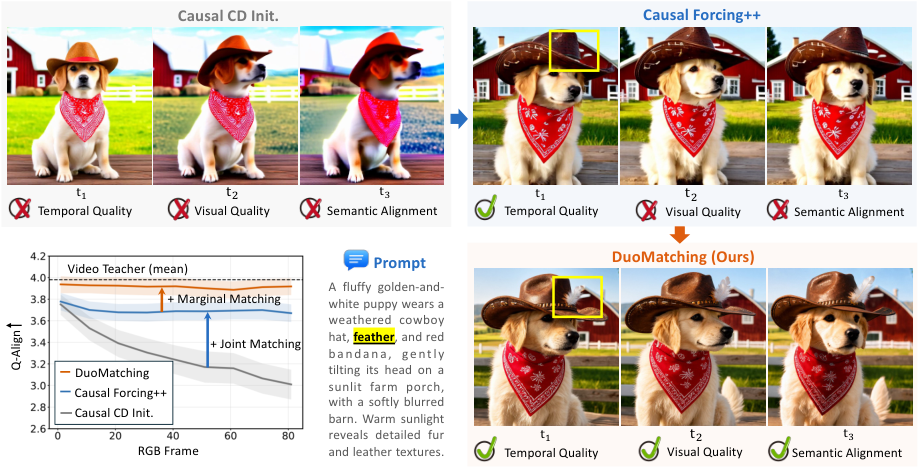
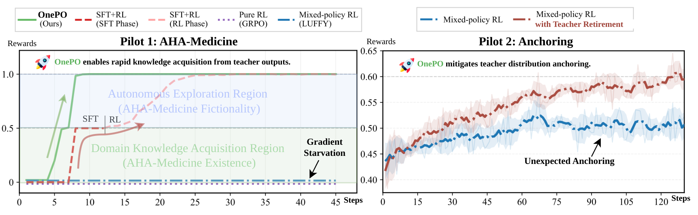
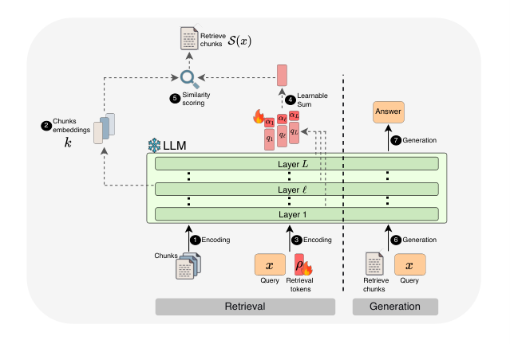
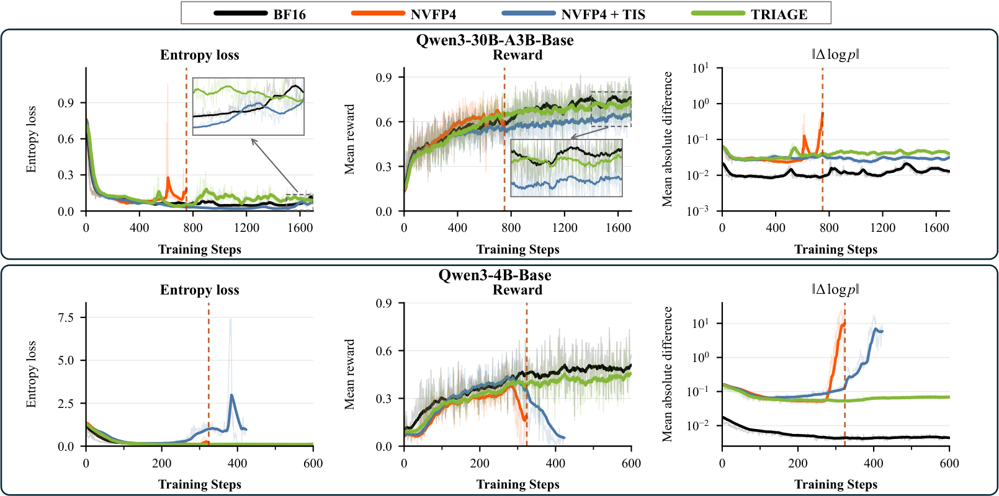
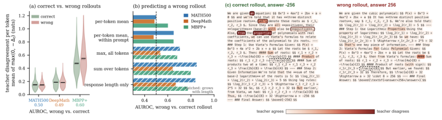
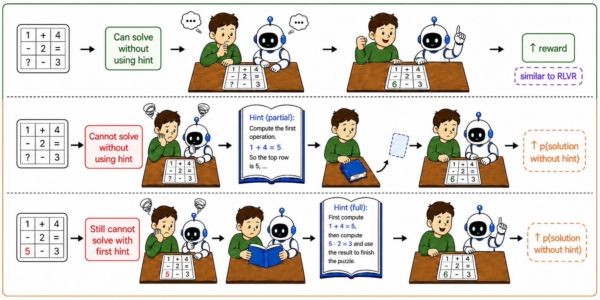
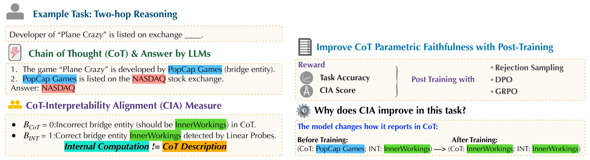
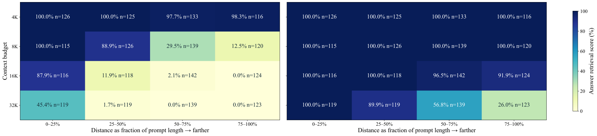

# Daily AI papers — 2026-10-07

*Curated from HF Daily Papers. 13 of 73 papers kept after relevance filter.*

## Papers at a glance

| # | Title | Topics | Org |
| --- | --- | --- | --- |
| 1 | [Rethinking Cross-Tokenizer On-Policy Distillation](#1-rethinking-cross-tokenizer-on-policy-distillation) | `distillation`, `LLM`, `post-training` | Alibaba Cloud |
| 2 | [TRACE: Rollout-Guided QAT for FP4 RL of MoE LMs](#2-trace-rollout-guided-qat-for-fp4-rl-of-moe-lms) | `quantization`, `RL`, `MoE`, `systems` | Alibaba Token Hub |
| 3 | [DuoMatching: Joint-Marginal Distribution Matching for Few-Step Video Generation](#3-duomatching-joint-marginal-distribution-matching-for-few-step-video-generation) | `diffusion`, `video`, `distillation` | CUHK + ByteDance (unspec.) |
| 4 | [From Evidence to Action: How Tool-Using Agents Fail](#4-from-evidence-to-action-how-tool-using-agents-fail) | `agents`, `eval`, `safety` | Princeton · NUS · HKBU · AWS |
| 5 | [HuatuoGPT-3: RL-Only Domain Adaptation from Base Models](#5-huatuogpt-3-rl-only-domain-adaptation-from-base-models) | `RL`, `post-training`, `domain-adapt` | CUHK-Shenzhen |
| 6 | [UNREAL: Unifying Retrieval and Long-Context with a Single Model](#6-unreal-unifying-retrieval-and-long-context-with-a-single-model) | `retrieval`, `long-context`, `efficient-inference` | (unspec.) |
| 7 | [TRIAGE: Direction-Aware Mismatch Stabilization of Native NVFP4 RL](#7-triage-direction-aware-mismatch-stabilization-of-native-nvfp4-rl) | `quantization`, `RL`, `systems` | (unspec.) |
| 8 | [DiffGate: Difficulty-Gated Teacher Guidance for On-Policy Distillation](#8-diffgate-difficulty-gated-teacher-guidance-for-on-policy-distillation) | `distillation`, `RL`, `reasoning` | (unspec.) |
| 9 | [SlimWise: Decoupling Expert Pruning Across Prefill and Decode](#9-slimwise-decoupling-expert-pruning-across-prefill-and-decode) | `MoE`, `inference`, `pruning` | a2sys · KAIST |
| 10 | [Rationale-Guided Policy Optimization](#10-rationale-guided-policy-optimization) | `RL`, `reasoning`, `post-training` | NYU · Buffalo · Monash |
| 11 | [Making LLMs Say What They Think: CoT-Interpretability Alignment](#11-making-llms-say-what-they-think-cot-interpretability-alignment) | `interp`, `safety`, `CoT` | NYU · NYU Shanghai |
| 12 | [NeMo-DCR: Bit-Exact Delta-Compressed Refit for Trillion-Scale Agentic RL](#12-nemo-dcr-bit-exact-delta-compressed-refit-for-trillion-scale-agentic-rl) | `systems`, `RL`, `agents` | NVIDIA · Aalto |
| 13 | [HLA: Expressive Hybrid Linear Attention via Chunk-Wise Dynamic Mixing](#13-hla-expressive-hybrid-linear-attention-via-chunk-wise-dynamic-mixing) | `architectures`, `attention`, `linear-attention` | Monash · ZJU |

---

## 1. Rethinking Cross-Tokenizer On-Policy Distillation

**Authors:** Bingxi Hou, Guofeng Quan, Weiqing Li, Wenfeng Feng, Guohua Liu, Yuewei Zhang — *Alibaba Cloud Computing*
**Links:** [arXiv:2610.08448](https://arxiv.org/abs/2610.08448) · [HF](https://huggingface.co/papers/2610.08448) · [AlphaXiv](https://www.alphaxiv.org/abs/2610.08448)
**Topics:** `distillation`, `LLM`, `post-training`

### TL;DR

When a teacher and student LLM use different tokenizers, "on-policy distillation" needs some way to align token distributions. The paper argues the dominant intuition — that broader alignment coverage is better — is wrong: a tiny top-16 slice of the shared vocabulary is just as good as full shared-vocab distillation, and padding the uncovered token spans with MSE supervision actually *hurts*.

### Key idea

Across three teacher/student pairs on math and code, strict one-to-one token alignment already covers most student tokens. Adding MSE on mismatched spans attains full coverage but injects gradients that are weakly aligned with the strict-match gradients and grow in relative magnitude during training. Reliability of the supervision signal, not coverage, is the lever.

### Main finding

A student-selected top-16 shared-vocab subset matches full shared-vocab distillation; adding MSE on mismatched groups degrades accuracy despite full coverage. Gradient diagnostics explain why: the "mismatched-span" gradient points in a different direction than the clean one.

### Why it matters

Cross-tokenizer distillation keeps coming up (open-weight model families with different BPE merges). This flips the design heuristic from "cover more tokens" to "trust fewer supervised positions". Simplifies pipelines that previously juggled logit-remapping tricks.

### Knowledge graph integration

**Builds on / relates to existing pages:**
- [../post-training/_post-training.md](../post-training/_post-training.md) — distillation sits alongside SFT/RL in the post-training taxonomy
- [../fundamentals/_tokenization.md](../fundamentals/_tokenization.md) — the whole problem is caused by differing tokenizer vocabularies
- [../post-training/rejection-sampling.md](../post-training/rejection-sampling.md) — on-policy learning from teacher-filtered trajectories

**Suggested new pages:**
- `post-training/fine-tuning/on-policy-distillation.md` *(depth)* — generic on-policy distillation primer this paper refines
- `post-training/fine-tuning/cross-tokenizer-distillation.md` *(depth)* — the specific technique (top-k shared vocab, no MSE padding)

---

## 2. TRACE: Rollout-Guided QAT for FP4 RL of MoE LMs

**Authors:** Xin Wang, Hao Yu, Zhengyang Zhuge, Bochao Mao, Zheng Li, Junda Feng, Yuyan Luo, Yi Zhang, Yizhong Cao, Mi Zhang, Dayiheng Liu, Jianwei Zhang — *Alibaba Token Hub*
**Links:** [arXiv:2610.07767](https://arxiv.org/abs/2610.07767) · [HF](https://huggingface.co/papers/2610.07767) · [AlphaXiv](https://www.alphaxiv.org/abs/2610.07767)
**Topics:** `quantization`, `RL`, `MoE`, `systems`

### TL;DR

TRACE pushes FP4 end-to-end through the RL loop for Mixture-of-Experts LLMs: weights, activations *and* the KV cache during rollouts are all FP4, with quantization-aware training guided by rollout statistics. Reaches BF16-rollout quality while running rollouts up to 5.4× faster on four large MoE models.

### Key idea

Two tricks. (a) *Rollout-guided QAT*: use the rounding decisions seen in the FP4 rollout to shape the gradient-direction during the training step, so train- and rollout-time quantization stay consistent. (b) A deep-layer cache that stores only partial mantissa + scale information, cutting KV-cache bytes without wrecking policy gradient estimates.

### Main finding

On four MoE LLMs, FP4-everywhere matches BF16-rollout policy performance; rollout speedups up to 5.4×. The authors frame this as the first viable "native FP4" MoE RL training recipe.

### Why it matters

MoE RL rollouts dominate wall-clock in frontier training. Making the rollout bit-width match the compute (FP4 on Blackwell / NVFP4) without sacrificing policy quality closes a long-standing bottleneck. If this holds up, FP4-rollout + BF16-master is probably the new default for RL post-training of MoE models.

### Knowledge graph integration

**Builds on / relates to existing pages:**
- [../quantization/_number-formats.md](../quantization/_number-formats.md) — FP4 slots into the number-format taxonomy next to FP8
- [../quantization/fp8.md](../quantization/fp8.md) — the direct precursor; this is the FP4 analogue in the RL loop
- [../pre-training/fp8-training.md](../pre-training/fp8-training.md) — same philosophy applied one bit-width down and to RL instead of pretraining
- [../architectures/_moe.md](../architectures/_moe.md) — MoE expert routing complicates quantization-aware training
- [../post-training/_rl.md](../post-training/_rl.md) — rollout is where RL spends most of its FLOPs

**Suggested new pages:**
- `quantization/fp4.md` *(depth)* — primer on FP4 / NVFP4 / MXFP4 (gap in graph)
- `quantization/quantization-aware-training.md` *(depth)* — QAT as a technique class
- `post-training/fp4-rl.md` *(depth)* — FP4 rollout for RL specifically

---

## 3. DuoMatching: Joint-Marginal Distribution Matching for Few-Step Video Generation

**Authors:** Jiahao Zhan, Yan Wang, Yongrui Ma, Qunliang Xing, Ruchang Yao, Runtao Liu, Shijie Zhao, Tianfan Xue — *CUHK + collaborators*
**Links:** [arXiv:2610.03543](https://arxiv.org/abs/2610.03543) · [HF](https://huggingface.co/papers/2610.03543) · [AlphaXiv](https://www.alphaxiv.org/abs/2610.03543)
**Topics:** `diffusion`, `video`, `distillation`

### TL;DR

Distilling a multi-step video diffusion model into a few-step student usually matches a joint video-level distribution and quietly loses per-frame visual quality. DuoMatching adds a frame-level *marginal* objective supervised by a pretrained image generator, and bridges the two domains with a learned latent-space mapping.

### Key idea

Three parts: (a) a joint video-level distribution-matching loss (standard), (b) a frame-level marginal loss where an image generator plays teacher, and (c) *LatentBridge*, a lightweight mapping from the video latent space to an image-generator-compatible latent so the two teachers can share supervision. *Latent Variation Sampling* spreads marginal supervision across temporal segments.

### Main finding

Better visual quality, composition and semantic alignment at few-step inference, with motion dynamics largely preserved. Human preference >80% against baseline few-step video distillers.

### Why it matters

Few-step video generation is where latency-sensitive video synthesis will live. Borrowing a strong image prior at the frame level is a cheap way to recover per-frame fidelity without re-training the full video teacher. The LatentBridge pattern generalizes beyond video.

### Knowledge graph integration

*The graph currently has no diffusion folder, so most links here are suggestions.*

**Builds on / relates to existing pages:**
- [../post-training/_post-training.md](../post-training/_post-training.md) — distillation framing applies here too

**Suggested new pages:**
- `multimodal/_diffusion.md` *(taxonomy)* — introduces diffusion models to the graph (big gap)
- `multimodal/distribution-matching-distillation.md` *(depth)* — the DMD family DuoMatching extends
- `multimodal/few-step-video-generation.md` *(depth)* — specifically about collapsing many diffusion steps to few

---

## 4. From Evidence to Action: How Tool-Using Agents Fail

**Authors:** Shidong Cao, Ziyang Luo, Wenhao Chai, Mong-Li Lee, Wynne Hsu — *Princeton · NUS · HKBU · AWS*
**Links:** [arXiv:2610.07753](https://arxiv.org/abs/2610.07753) · [HF](https://huggingface.co/papers/2610.07753) · [AlphaXiv](https://www.alphaxiv.org/abs/2610.07753)
**Topics:** `agents`, `eval`, `safety`

### TL;DR

A clean "task completed" outcome from a tool-using agent doesn't mean the agent actually gathered the evidence needed to justify the action. The paper separates *judgment* (would this action be correct?) from *execution* (do you act when evidence is sufficient?), and introduces a benchmark that scores agents on the gap.

### Key idea

**SafeActBench** — 656 cases over 6 domains where correct behavior requires evidence before action. **Evidence Ledger** — provenance tracking of what the agent saw before each tool call. **Deterministic trajectory evaluator** — judges each action against the ledger. Together these distinguish "stopped too early" from "acted without evidence" from "evidence sufficient but wrong action".

### Main finding

Across 10 agent setups, static judgment accuracy is often much higher than interactive execution. Most failures are *pre-execution* (stop too early, or act before required evidence). Single-step actions are usually reliable; multi-step workflows expose unresolved prerequisites.

### Why it matters

Tool-using agents are moving to real side effects (shell, email, deployments). Benchmarks that only check "did the right thing happen" miss the mode where the agent got lucky without evidence. The evidence-ledger framing is cheap to add to existing harnesses.

### Knowledge graph integration

**Builds on / relates to existing pages:**
- [../safety/cot-monitoring.md](../safety/cot-monitoring.md) — complementary: watch the reasoning *and* the evidence trail

**Suggested new pages:**
- `evaluation/safeactbench.md` *(depth)* — the benchmark itself
- `agents/_agent-evaluation.md` *(taxonomy)* — benchmarks and judges for tool-using agents
- `agents/evidence-ledger.md` *(depth)* — the provenance mechanism

---

## 5. HuatuoGPT-3: RL-Only Domain Adaptation from Base Models

**Authors:** Xinyuan Xie, Ziniu Li, Wenyuan Gu, Jianquan Li, Xiang Wan, Guangjun Yu, Ruoyu Sun, Haizhou Li, Benyou Wang — *CUHK-Shenzhen + collaborators*
**Links:** [arXiv:2610.05966](https://arxiv.org/abs/2610.05966) · [HF](https://huggingface.co/papers/2610.05966) · [AlphaXiv](https://www.alphaxiv.org/abs/2610.05966)
**Topics:** `RL`, `post-training`, `domain-adaptation`

### TL;DR

The received wisdom is: SFT first (teach the vocabulary), then RL (teach the policy). HuatuoGPT-3 proposes **One-stage Policy Optimization (OnePO)** — skip SFT, do mixed-policy RL directly from the base model — and diagnoses the two failure modes that have made this hard: Gradient Starvation and Teacher-Distribution Anchoring.

### Key idea

**Gradient Starvation**: informative but low-probability teacher tokens get crushed by the probability-weighted update. **Teacher-Distribution Anchoring**: stale teacher outputs keep pulling the policy back toward the teacher's distribution. OnePO fixes both with *Adaptive Objective Evolution* (reweight the loss as the policy moves) and *Teacher Retirement* (retire the teacher once it stops being useful).

### Main finding

On medical adaptation with 20K samples, OnePO hits 67.2 on HealthBench (Total) and reportedly beats both SFT+RL and pure RL baselines.

### Why it matters

If RL-only works, the SFT stage becomes negotiable, which saves data-labeling and training complexity for domain-adapted LLMs. The named failure modes also give a cleaner mental model for *why* previous RL-only attempts collapsed.

### Knowledge graph integration

**Builds on / relates to existing pages:**
- [../post-training/_rl.md](../post-training/_rl.md) — RL-only is a new leaf under the RL taxonomy
- [../post-training/grpo.md](../post-training/grpo.md) — OnePO is in the GRPO lineage
- [../post-training/rlvr.md](../post-training/rlvr.md) — mixed-policy RL with verifiable rewards
- [../post-training/_post-training.md](../post-training/_post-training.md) — the broader post-training landscape

**Suggested new pages:**
- `post-training/onepo.md` *(depth)* — the OnePO algorithm
- `post-training/mixed-policy-rl.md` *(depth)* — the technique class of mixing on- and off-policy teacher data

---

## 6. UNREAL: Unifying Retrieval and Long-Context with a Single Model

**Authors:** (not shown on HF page)
**Links:** [arXiv:2610.08463](https://arxiv.org/abs/2610.08463) · [HF](https://huggingface.co/papers/2610.08463) · [AlphaXiv](https://www.alphaxiv.org/abs/2610.08463)
**Topics:** `retrieval`, `long-context`, `efficient-inference`

### TL;DR

UNREAL reuses the *frozen* LLM's own internal states — attention keys and intermediate activations — to produce retrieval embeddings and queries. Under 500K extra trainable parameters replace a dedicated retriever and reranker. Also prunes distractors inside long prompts before generation.

### Key idea

Encode retrieval chunks by running them through the base LLM once and taking its internal representations as the embedding. The retrieval query comes from the same model's state over the current prompt. A tiny adapter maps between the two spaces. No separate retriever stack, no fine-tune of the LLM.

### Main finding

Outperforms dedicated retriever+reranker pipelines on a 21M-chunk Wikipedia index. On long-context benchmarks, removing distractors before generation cuts compute and time-to-first-token.

### Why it matters

Separating retriever from generator has been the orthodoxy since REALM. If the generator can serve as its own retriever at near-zero extra parameter cost, RAG deployments get much simpler. Also closes the gap between RAG and "just stuff everything in context" — do both from the same model.

### Knowledge graph integration

*No current retrieval / RAG section in the graph.*

**Suggested new pages:**
- `inference/_retrieval.md` *(taxonomy)* — introduce retrieval & RAG as a class (gap)
- `inference/unreal.md` *(depth)* — the specific unified-retriever-generator technique
- `inference/long-context-distractor-pruning.md` *(depth)* — the long-context pruning idea on its own

---

## 7. TRIAGE: Direction-Aware Mismatch Stabilization of Native NVFP4 RL

**Authors:** Shuai Zhang, Yanggan Gu, Yiming Zhang, Yang Yu, Mingfa Feng, Congkai Xie, Shuang Yu, Junjie Lai, Hongxia Yang
**Links:** [arXiv:2610.07043](https://arxiv.org/abs/2610.07043) · [HF](https://huggingface.co/papers/2610.07043) · [AlphaXiv](https://www.alphaxiv.org/abs/2610.07043)
**Topics:** `quantization`, `RL`, `systems`

### TL;DR

Low-precision rollouts in LLM RL create a *training–inference mismatch*: the gradient the training step sees is slightly different from what the policy-at-rollout actually scored. TRIAGE separates mismatch into pieces that locally *amplify* the policy update and pieces that *contract* it, and stabilizes only the amplifying ones.

### Key idea

Decompose the mismatch along the direction of the policy gradient. Updates whose quantization-induced error is co-aligned with the gradient (amplifying) are the ones that destabilize RL; the contracting ones are safe. TRIAGE applies a direction-aware correction only to the amplifying tail.

### Main finding

On Qwen3-4B and Qwen3-30B-A3B, native NVFP4 RL with TRIAGE reaches up to 2.3× rollout throughput over BF16 while preserving training quality.

### Why it matters

Companion to TRACE (paper #2) and the FP4-RL trend more broadly: naive FP4 rollouts work until the policy approaches convergence, when mismatch bites. Having a principled, direction-aware fix (instead of just lowering the LR) is what makes FP4 RL safe end-to-end.

### Knowledge graph integration

**Builds on / relates to existing pages:**
- [../quantization/_number-formats.md](../quantization/_number-formats.md) — NVFP4 is a specific FP4 variant
- [../quantization/fp8.md](../quantization/fp8.md) — closest existing precedent
- [../post-training/_rl.md](../post-training/_rl.md) — this is RL post-training
- [../post-training/ppo.md](../post-training/ppo.md) — the mismatch problem is PPO-style importance-ratio surgery under quantization

**Suggested new pages:**
- `post-training/training-inference-mismatch.md` *(depth)* — the problem class, with TRIAGE as one solution
- `quantization/nvfp4.md` *(depth)* — NVFP4 specifically
- `quantization/fp4.md` *(depth)* — if we only have one, make it the generic FP4 page

---

## 8. DiffGate: Difficulty-Gated Teacher Guidance for On-Policy Distillation

**Authors:** (not shown on HF page)
**Links:** [arXiv:2610.04596](https://arxiv.org/abs/2610.04596) · [HF](https://huggingface.co/papers/2610.04596) · [AlphaXiv](https://www.alphaxiv.org/abs/2610.04596)
**Topics:** `distillation`, `RL`, `reasoning`

### TL;DR

On-policy distillation gives dense token-level supervision but no answer-level reward. GRPO/RLVR gives correctness but a coarse, group-level signal and silence on all-failure groups. DiffGate injects *bounded* teacher guidance into failed trajectories only, scaled by the group's difficulty, giving GRPO a signal exactly where it was blind.

### Key idea

For each prompt group, compute pass rate = difficulty. If all rollouts fail, teacher guidance is applied strongly; if most succeed, teacher guidance is zero. The teacher signal is *bounded* (clipped to avoid overriding the on-policy gradient) and *token-level* only where needed.

### Main finding

On Qwen3 students, pass@8 goes up vs. GRPO across all four model-domain settings tested; the largest gain is on code for the 1.7B model.

### Why it matters

The all-failure-group blind spot has been a known weakness of GRPO-style RL. DiffGate is a surgical patch: keep the GRPO loop, add teacher help only on the problems the student can't solve at all. Natural pairing with any strong teacher model you have around.

### Knowledge graph integration

**Builds on / relates to existing pages:**
- [../post-training/grpo.md](../post-training/grpo.md) — DiffGate directly patches GRPO's blind spot
- [../post-training/rlvr.md](../post-training/rlvr.md) — RLVR has the same issue
- [../post-training/_rewards.md](../post-training/_rewards.md) — teacher logprob as auxiliary reward signal
- [../post-training/reasoning/long-cot-rl.md](../post-training/reasoning/long-cot-rl.md) — relevant to reasoning training with hard problems

**Suggested new pages:**
- `post-training/diffgate.md` *(depth)* — the technique itself
- `post-training/difficulty-aware-rl.md` *(depth)* — the broader "scale by group difficulty" idea

---

## 9. SlimWise: Decoupling Expert Pruning Across Prefill and Decode

**Authors:** Kyoungho Jeun, Juntaek Oh, Byeongjun Shin, Baeseong Park, Minsoo Rhu — *a2sys · KAIST*
**Links:** [arXiv:2609.34117](https://arxiv.org/abs/2609.34117) · [HF](https://huggingface.co/papers/2609.34117) · [AlphaXiv](https://www.alphaxiv.org/abs/2609.34117)
**Topics:** `MoE`, `inference`, `pruning`

### TL;DR

MoE expert pruning saves memory bandwidth but you don't need the same experts during the *compute-bound* prefill as during the *bandwidth-bound* decode. SlimWise runs prefill with the full model and decode with a pruned model that reuses the same KV cache verbatim.

### Key idea

Prefill is matmul-bound → the extra experts barely cost extra time there. Decode is memory-bound → every unused expert is wasted DRAM traffic. So prefill full, decode pruned. KV cache is layout-compatible across the two, no conversion. A short distillation step reconciles the output distribution between the two configurations.

### Main finding

Up to 1.81× decode throughput at 50% expert pruning on Qwen3.6-35B-A3B, inside vLLM, supporting both PD-disaggregated and PD-colocated serving.

### Why it matters

A natural fit for the "prefill/decode disaggregation" direction (vLLM, Mooncake, DistServe). Prunes a different model per phase instead of forcing one global pruning compromise. Also useful hint for other prefill-vs-decode asymmetries (quantization level, cache compression).

### Knowledge graph integration

**Builds on / relates to existing pages:**
- [../architectures/_moe.md](../architectures/_moe.md) — expert pruning is an MoE-specific operation
- [../architectures/deepseek-moe.md](../architectures/deepseek-moe.md) — concrete MoE architecture this applies to
- [../architectures/capacity-factor.md](../architectures/capacity-factor.md) — related knob for expert utilization

**Suggested new pages:**
- `inference/_prefill-decode.md` *(taxonomy)* — the whole prefill/decode-disaggregation space (big gap in graph)
- `inference/expert-pruning.md` *(depth)* — MoE expert pruning as a serving technique
- `inference/slimwise.md` *(depth)* — SlimWise specifically

---

## 10. Rationale-Guided Policy Optimization

**Authors:** Minh Pham, Chau Pham, Chinmay Hegde, Trung Le, Qi Lei — *NYU · University at Buffalo · Monash*
**Links:** [arXiv:2610.07342](https://arxiv.org/abs/2610.07342) · [HF](https://huggingface.co/papers/2610.07342) · [AlphaXiv](https://www.alphaxiv.org/abs/2610.07342)
**Topics:** `RL`, `reasoning`, `post-training`

### TL;DR

Ground-truth rationales as training targets for reasoning models tend to overfit the model to the rationale wording. RGPO uses them as temporary *scaffolds*: the model is prompted with a rationale, generates its own solution, and only improved model-generated solutions are kept — and then those solutions are trained *without* the rationale in the prompt.

### Key idea

Decouple scaffolding (where the rationale lives, in the prompt) from training (where the rationale is absent). You get the exploration benefit of a hint without baking the hint into the policy. Keep-only filter uses an RLVR-style verifier so no distillation of wrong solutions.

### Main finding

Consistent gains over RLVR baselines in both language-only and vision-language reasoning settings.

### Why it matters

A clean answer to the question of "what to do with reasoning chains in the training set when you don't want the model to just memorize them." The scaffold-then-strip pattern should generalize to tool-use traces and any other kind of pre-formatted help.

### Knowledge graph integration

**Builds on / relates to existing pages:**
- [../post-training/rlvr.md](../post-training/rlvr.md) — RGPO extends RLVR with scaffolded exploration
- [../post-training/grpo.md](../post-training/grpo.md) — the base algorithm it builds on
- [../post-training/reasoning/long-cot-rl.md](../post-training/reasoning/long-cot-rl.md) — reasoning RL context
- [../post-training/rejection-sampling.md](../post-training/rejection-sampling.md) — "keep only improved solutions" is a selective rejection filter

**Suggested new pages:**
- `post-training/reasoning/rgpo.md` *(depth)* — RGPO as a reasoning-RL technique
- `post-training/reasoning/scaffolded-rationales.md` *(depth)* — the broader pattern of prompt-time scaffolding stripped at training

---

## 11. Making LLMs Say What They Think: CoT-Interpretability Alignment

**Authors:** Shauli Ravfogel, Chen Zhao, Eunsol Choi — *NYU · NYU Shanghai*
**Links:** [arXiv:2609.38972](https://arxiv.org/abs/2609.38972) · [HF](https://huggingface.co/papers/2609.38972) · [AlphaXiv](https://www.alphaxiv.org/abs/2609.38972)
**Topics:** `interp`, `safety`, `CoT`

### TL;DR

Chain-of-thought is cheap to read but doesn't always reflect what the model is *actually* doing. The paper introduces **CoT-Interpretability Alignment (CIA)**, a metric that compares the strategy stated in the CoT against the strategy that interpretability tools detect in the model's internals, and uses CIA as a reward to improve the match.

### Key idea

Pick a few canonical tasks where the "strategy space" is small and interpretability tools (probing / activation steering) can label which internal strategy is running. Score the CoT by whether the stated strategy matches the detected one — that's CIA. Then post-train with CIA as reward to improve CoT faithfulness without hurting accuracy.

### Main finding

Across 3 tasks and 3 LLMs, CoT–interpretability alignment is initially 44.8–75.9%. Post-training with CIA as reward "substantially improves" the alignment while preserving task accuracy.

### Why it matters

CoT monitoring is a load-bearing component of practical oversight (see the existing [cot-monitoring.md](../safety/cot-monitoring.md) page). If the CoT and the internal strategy diverge, monitoring is reading a cover story. CIA gives both a *measurement* and a *training signal* for faithfulness.

### Knowledge graph integration

**Builds on / relates to existing pages:**
- [../safety/cot-monitoring.md](../safety/cot-monitoring.md) — direct complement; CIA is what makes CoT monitoring trustworthy
- [../post-training/cot-reward-model.md](../post-training/cot-reward-model.md) — uses a CoT-based reward signal
- [../post-training/_rewards.md](../post-training/_rewards.md) — CIA as a reward design

**Suggested new pages:**
- `interpretability/cot-faithfulness.md` *(depth)* — the measurement half of CIA (gap in interp folder)
- `safety/cot-faithfulness-training.md` *(depth)* — training to improve faithfulness

---

## 12. NeMo-DCR: Bit-Exact Delta-Compressed Refit for Trillion-Scale Agentic RL

**Authors:** Zhiyu Li, Terry Kong, Yu Yao, Youngeun Kwon, Bernard Nguyen, Ashwath Aithal, Mario Di Francesco — *NVIDIA · Aalto*
**Links:** [arXiv:2610.08430](https://arxiv.org/abs/2610.08430) · [HF](https://huggingface.co/papers/2610.08430) · [AlphaXiv](https://www.alphaxiv.org/abs/2610.08430)
**Topics:** `systems`, `RL`, `agents`

### TL;DR

In agentic RL, you re-sync inference workers with the trainer every step. At trillion-parameter scale that's a terabyte-per-step refit. NeMo-DCR observes only ≈1% of BF16 weights actually change per step, ships just that delta, and still ends with the inference workers *bit-exact* to the trainer.

### Key idea

Delta-compressed broadcast: track changed weights per step, compress aggressively (because the delta is sparse), ship via a relay-tree topology to all inference workers. Bit-exactness means no quantization/dequantization drift accumulating across steps.

### Main finding

A 1T-parameter relay-tree refit at a 3% change rate takes 150s instead of 87.5min — about 35× faster. 30B–1T models see 12–40× speedup at 3–5% change rates.

### Why it matters

Agentic RL at frontier scale lives or dies on how fast the policy can be pushed back to the rollout fleet. If every step takes an hour to sync, you can't afford long-horizon rollouts. 150s is in the "do many RL steps per hour" regime. Pairs naturally with the FP4-rollout stack from TRACE/TRIAGE.

### Knowledge graph integration

**Builds on / relates to existing pages:**
- [../systems/ray.md](../systems/ray.md) — closest systems-folder precedent (distributed scheduling)
- [../systems/partial-rollouts.md](../systems/partial-rollouts.md) — related long-rollout systems technique
- [../post-training/_rl.md](../post-training/_rl.md) — this is where frontier RL lives
- [../systems/dualpipe.md](../systems/dualpipe.md) — comparable systems-level infra paper

**Suggested new pages:**
- `systems/weight-refit.md` *(depth)* — the general problem class
- `systems/delta-compressed-refit.md` *(depth)* — NeMo-DCR's specific mechanism
- `systems/_rl-infra.md` *(taxonomy)* — rollout infra, refit, trainer/inference split

---

## 13. HLA: Expressive Hybrid Linear Attention via Chunk-Wise Dynamic Mixing

**Authors:** Zhuokun Chen, Xi Lin, Xiyu Wu, Jiahao He, Jianfei Cai, Bohan Zhuang — *Monash University · Zhejiang University*
**Links:** [arXiv:2610.05842](https://arxiv.org/abs/2610.05842) · [HF](https://huggingface.co/papers/2610.05842) · [AlphaXiv](https://www.alphaxiv.org/abs/2610.05842)
**Topics:** `architectures`, `attention`, `linear-attention`

### TL;DR

Hybrid attention (part linear, part softmax) usually mixes the two globally with a static ratio. HLA chooses the mix *per chunk, dynamically*: a lightweight router scores each chunk and decides how much softmax budget it gets, keeping the linear-attention efficiency on easy chunks and spending softmax only where it buys something.

### Key idea

Partition the sequence into chunks. For each chunk, a small router produces a per-chunk mixing weight between the linear and softmax branches. Chunks on retrieval-heavy or long-range content pay softmax; local-structure chunks are nearly free. Keeps the overall sub-quadratic cost of linear attention.

### Main finding

Reported as outperforming existing hybrid-attention baselines on retrieval-sensitive long-context tasks, with closer tracking of full-softmax quality under a strict compute budget.

### Why it matters

Hybrid attention is the current compromise between the context length people want and the compute they'll pay for. A dynamic, routed mix (vs. fixed every-N layers softmax) is exactly the "selective allocation" trick that worked for MoE applied to attention types.

### Knowledge graph integration

**Builds on / relates to existing pages:**
- [../architectures/mla.md](../architectures/mla.md) — closest existing attention-variant page
- [../architectures/multi-head-attention.md](../architectures/multi-head-attention.md) — the softmax baseline being mixed in
- [../fundamentals/attention.md](../fundamentals/attention.md) — attention primer
- [../architectures/_moe.md](../architectures/_moe.md) — the per-chunk routing idea is MoE-shaped

**Suggested new pages:**
- `architectures/_attention-variants.md` *(taxonomy)* — overview of softmax/linear/SSM/hybrid attention (gap)
- `architectures/linear-attention.md` *(depth)* — linear attention primer
- `architectures/hla.md` *(depth)* — HLA specifically
- `architectures/hybrid-attention.md` *(depth)* — hybrid-attention design pattern

---

## Notes

- Borderline inclusions are flagged in-section with an italic *Borderline: …* note. None today.
- Hero figures live in `assets/2026-10-07/`. 11 of 13 kept papers have figures; 2609.34117 (SlimWise) and 2610.08430 (NeMo-DCR) have no HTML version on arXiv so the figure line is omitted.
- 73 papers fetched from HF Daily Papers; 13 kept after relevance filter (quantization/RL/MoE/distillation/architectures/agents/interp/retrieval). Skipped mostly: embodied-agent and VLA papers, pure 3D/scene generation, voice/speech, world-model physics benchmarks, and application-only agent papers.
- This digest is informational. No existing concept files, `READING-LIST.md`, or `PAPERS.md` were modified to produce it.
