# Daily AI papers — 2026-10-10

*Curated from HF Daily Papers. 15 of ~70 papers kept after relevance filter.*

## Papers at a glance

| # | Title | Topics | Org |
| --- | --- | --- | --- |
| 1 | [AgentGarten: Code Worlds for Evolving Agents](#1-agentgarten) | `agents`, `RL`, `world-model` | MirroS / Tsinghua / PKU |
| 2 | [Learn2Play Bench](#2-learn2play-bench) | `agents`, `eval` | NUS |
| 3 | [TokenRouter: Efficient Serving for Token-Level LLM Routing](#3-tokenrouter) | `efficient-inference`, `systems` | Tsinghua-NICS-EFC |
| 4 | [MiMo-V2.6: Scaling RL Towards Self-Improvement](#4-mimo-v2-6) | `RL`, `MoE`, `multimodal` | Xiaomi (MiMo) |
| 5 | [U-Space: When and Why Uncertainty Arises in LMs](#5-u-space) | `interp`, `eval`, `uncertainty` | TU Darmstadt / UCL / Mila |
| 6 | [MC-Sparse: Dense–Sparse Attention Gap in Diffusion Transformers](#6-mc-sparse) | `diffusion`, `efficient-inference`, `attention` | Tencent HY / Fudan / CUHK |
| 7 | [Memento 3: Recursive Self-Improvement through Reflective Rulebooks](#7-memento-3) | `agents`, `world-model`, `reasoning` | UCL / Huawei Noah's Ark |
| 8 | [Post-Training T2I by Composing Preference and Rubric Rewards](#8-post-training-t2i) | `diffusion`, `RL`, `reward` | Arena Intelligence / UCLA |
| 9 | [SparseDecoding: Decoding-Aware Pruning for LLM Inference](#9-sparsedecoding) | `efficient-inference`, `pruning` | Westlake |
| 10 | [Evidence-Grounded Oversight for Long-Horizon Agents](#10-evidence-grounded-oversight) | `safety`, `agents`, `eval` | RUC-GSAI-IIRLab |
| 11 | [ReSPO: Reshaped Sequence Policy Optimization](#11-respo) | `RL`, `post-training` | UCLA |
| 12 | [REMORY: Residual Memory for Context Compaction](#12-remory) | `efficient-inference`, `agents`, `memory` | (unspecified) |
| 13 | [On-Policy Distillation Teaches New Skills but Not New Knowledge](#13-on-policy-distillation) | `post-training`, `distillation` | (unspecified) |
| 14 | [SpecFold: Speculative Decoding for Diffusion Language Models](#14-specfold) | `efficient-inference`, `diffusion`, `speculative` | (unspecified) |
| 15 | [Learning to Steer, Steering to See: Geometry of RLVR via Trainable Vectors](#15-rlvr-geometry) | `interp`, `RL`, `RLVR` | Tencent Hunyuan |

---

## 1. AgentGarten: Code Worlds for Evolving Agents 

**Authors:** Jiawei Chi, Shangchen Miao, Zhiyuan Shi, Kailu Wu, Hanyang Wang, Weiliang Chen, Qiyu Dai, Jinshan Ren, Jun Gao, Mingsheng Long, Yueqi Duan, Jiangran Lyu, Jialong Wu, Fangfu Liu — *MirroS, Tsinghua University, Peking University*
**Links:** [arXiv:2610.12374](https://arxiv.org/abs/2610.12374) · [HF](https://huggingface.co/papers/2610.12374) · [AlphaXiv](https://www.alphaxiv.org/abs/2610.12374)
**Topics:** `agents`, `RL`, `world-model`

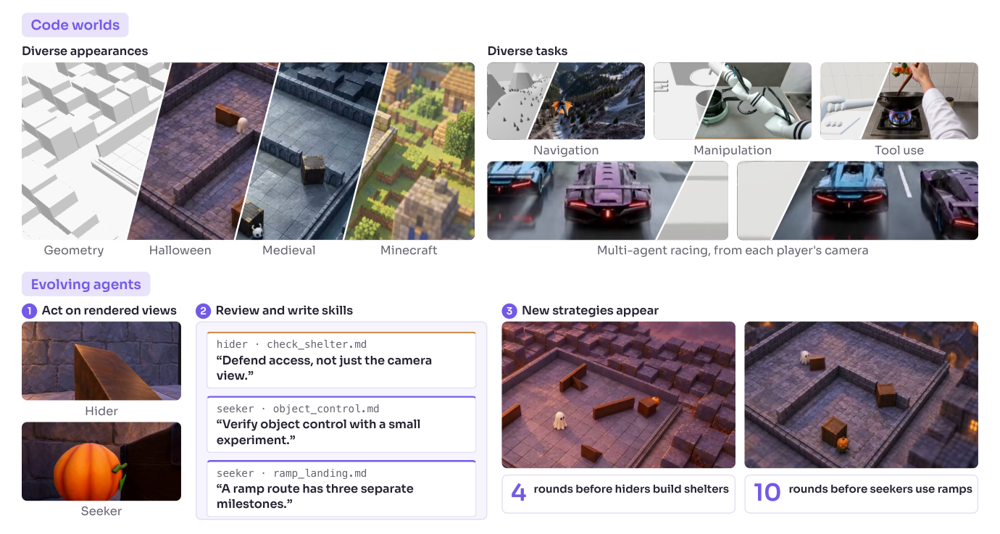

### TL;DR

A platform for growing agents inside procedurally-driven *code worlds*: deterministic simulators carry the game state, and a shared neural renderer paints each frame from the structured geometry. Agents only see pixels, but every few rounds they distill their experience into a text *playbook* that successor agents inherit. The authors claim learning happens in ~4 rounds versus millions of episodes for conventional RL.

### Key idea

Decouple **rules** from **appearance**: let a deterministic engine own the physics/state transitions, and let a renderer — adapted from a pretrained video model and distilled with "Adversarial Forcing" (differentiable history replay + real-data adversarial supervision) — supply photorealistic observations in real time. Then run a round-based agent loop in which the surviving playbook of hypotheses is passed to the next cohort.

### Main finding

Across the tasks the paper reports, agents converge on a solution in roughly four rounds of inter-generational playbook refinement, where naïve RL baselines need orders of magnitude more interaction. Rendering is fast enough for live interaction.

### Why it matters

Pushes agentic RL away from "millions of rollouts in simulation" toward *library-level* learning that can be read, inspected, and transferred. The hybrid of engine + neural renderer is a plausible template for building generic agent sandboxes that keep ground-truth state cheap while giving models rich visual input.

### Knowledge graph integration

**Builds on / relates to existing pages:**
- [../post-training/_rl.md](../post-training/_rl.md) — treats experience replay as RL for agents without ever training on a scalar reward.
- [../systems/partial-rollouts.md](../systems/partial-rollouts.md) — round-based rollout reuse echoes partial-rollout infra ideas.

**Suggested new pages:**
- `agents/code-world-simulation.md` *(depth)* — the engine+renderer+playbook recipe.
- `agents/playbook-distillation.md` *(depth)* — inter-generational distillation of experience into natural-language rules.

---

## 2. Learn2Play Bench: How Well Do LLM Agents Learn from Experience in Unfamiliar Environments? 

**Authors:** Yibo Li, Jinhang Qiu, Zhi Zheng, Qianyun Guo, Jiaying Wu, Shuo Ji, Bryan Hooi — *National University of Singapore*
**Links:** [arXiv:2610.08215](https://arxiv.org/abs/2610.08215) · [HF](https://huggingface.co/papers/2610.08215) · [AlphaXiv](https://www.alphaxiv.org/abs/2610.08215)
**Topics:** `agents`, `eval`

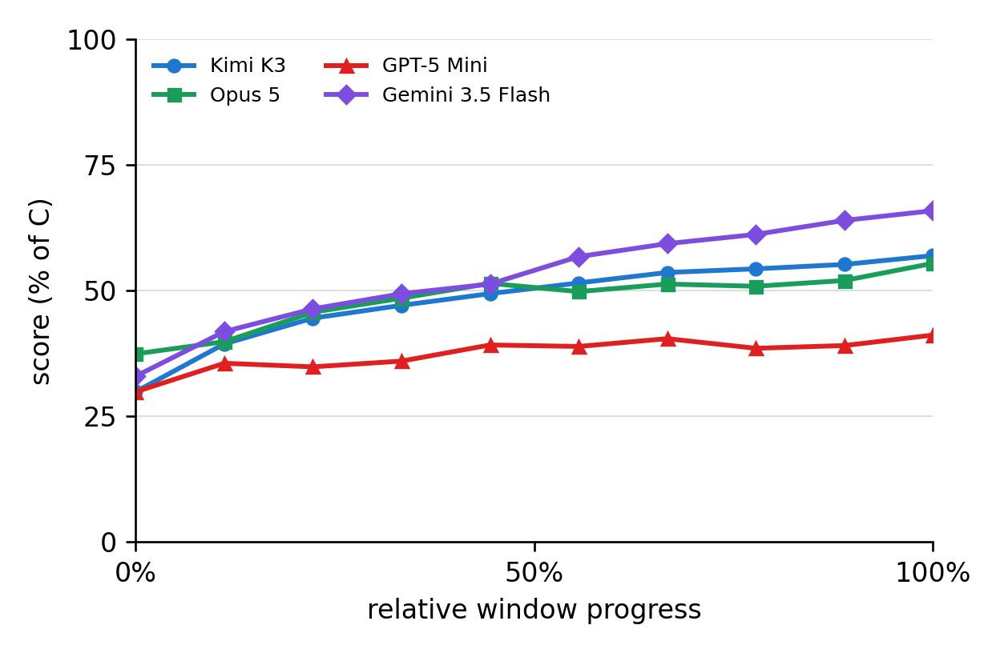

### TL;DR

A text-game benchmark that strips the agents of pretrained priors: every game has novel or deliberately counterintuitive rules, so the only way to score is to learn from interaction. The authors use rule-perturbed variants of the same games to measure skill transfer and probe how different memory backbones (full history vs. summary) behave.

### Key idea

Isolate *learning from feedback* from *memorized world knowledge* by designing games whose rules are either new or contradict common sense; then control the agent's harness (full action-feedback log vs. summarized memory) to see which mechanism matters.

### Main finding

Keeping full action-feedback records consistently beats summarization — even when context cost rises. Top human players outperform the evaluated agents by a wide margin, and swapping agent harness alone can improve scores while cutting estimated inference cost.

### Why it matters

Most "agent" benchmarks collapse into trivia retrieval. Learn2Play separates the two signals, which lets practitioners judge whether their harness design (memory, prompting, exploration) is doing any work beyond calling a strong base model.

### Knowledge graph integration

**Builds on / relates to existing pages:**
- [../evaluation/README.md](../evaluation/README.md) — adds a learning-from-experience axis to agent evaluation.
- [../agents/README.md](../agents/README.md) — directly tests the harness assumptions underlying LLM-agent design.

---

## 3. TokenRouter: Efficient Serving System for Token-Level LLM Routing 

**Authors:** Tianyu Fu, Tengxuan Liu, Ruoxi Wang, Yixin Dong, Yi Ge, Yichen You, Yu Wang — *Tsinghua-NICS-EFC*
**Links:** [arXiv:2610.12242](https://arxiv.org/abs/2610.12242) · [HF](https://huggingface.co/papers/2610.12242) · [AlphaXiv](https://www.alphaxiv.org/abs/2610.12242)
**Topics:** `efficient-inference`, `systems`

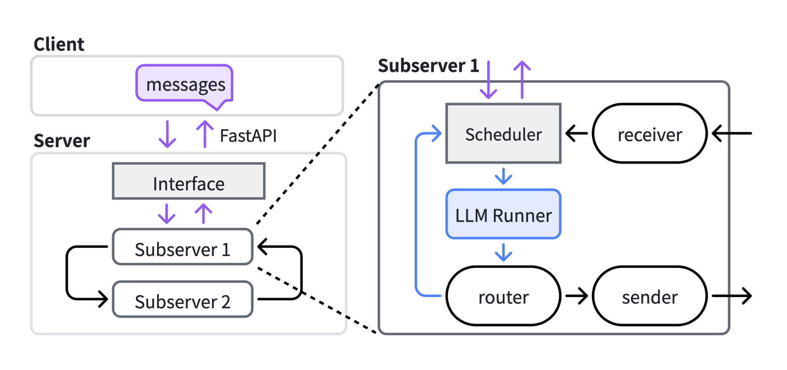

### TL;DR

Token-level routing — switching between candidate models mid-generation — can trade cost for quality, but existing serving stacks assume one model and stall whenever the chosen next-token model doesn't match the batch. TokenRouter decouples requests from models: each model gets its own subserver, requests carry per-token routing logic, and a delayed-batching scheduler decides when to flush each subserver's queue.

### Key idea

Treat routing as a first-class scheduling problem rather than a prompt-time choice. Programmers write per-request routing logic in a small language; the runtime dispatches each token to the right subserver and uses a throughput model to tune when a subserver should wait for a bigger batch versus run now.

### Main finding

2.01×–64.15× higher decoding throughput than existing LLM-serving systems on token-level-routing workloads, while preserving routing semantics.

### Why it matters

Multi-model routing (big model for hard tokens, small for easy ones; speculative-decoding analogues; LoRA swap) is going to be a load-bearing lever for cost reduction, and the serving layer has not caught up. TokenRouter gives the community a concrete design for the scheduler side.

### Knowledge graph integration

**Builds on / relates to existing pages:**
- [../inference/README.md](../inference/README.md) — scheduler-side kin of continuous batching / paged attention.
- [../systems/README.md](../systems/README.md) — multi-subserver orchestration is a close relative of rollout-worker systems.

**Suggested new pages:**
- `inference/token-level-routing.md` *(depth)* — covers the per-request routing-logic abstraction and delayed-batching scheduler.

---

## 4. MiMo-V2.6: Scaling Reinforcement Learning Towards Self-Improvement 

**Authors:** MiMo Core Team + 147 authors — *Xiaomi MiMo team (implied)*
**Links:** [arXiv:2610.11959](https://arxiv.org/abs/2610.11959) · [HF](https://huggingface.co/papers/2610.11959) · [AlphaXiv](https://www.alphaxiv.org/abs/2610.11959)
**Topics:** `RL`, `MoE`, `multimodal`, `tech-report`

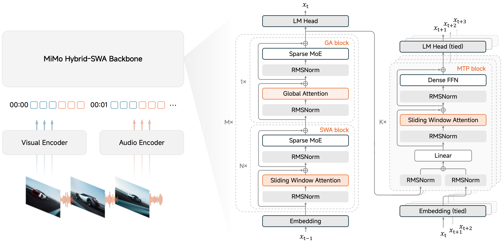

### TL;DR

A new omni-modal MiMo release that uses RL as the central training lever. The team scales RL simultaneously along three axes: context (asynchronous batches with up to 1M-token contexts), environment coverage (code, general, visual, cyber), and grading compute (groupwise agentic grading). To keep training stable they freeze the MoE router during RL and add explicit reward-hacking defenses, and they open-source training dynamics plus the RL framework and environments.

### Key idea

Make RL the backbone, not the finisher. The three-axis scaling story is a design claim: at this scale, bigger async batches + more diverse envs + heavier grader compute matter more than more clever algorithmic tricks — provided the base recipe (frozen router, reward-hacking defenses) stays stable.

### Main finding

The authors report self-improvement dynamics driven by RL across modalities and task families; a long tail of ablation plots is promised with the open-sourced training traces.

### Why it matters

If the "RL as central paradigm" claim holds in the open-source trace, it reinforces the DeepSeek-R1 / Kimi-K1.5 trajectory and sets a template for what omni-modal RL post-training stacks look like at scale (large async batches, agentic graders, router freezing).

### Knowledge graph integration

**Builds on / relates to existing pages:**
- [../post-training/_rl.md](../post-training/_rl.md) — slots into the RL-for-LLMs taxonomy with asynchronous large-batch variants.
- [../post-training/reasoning/long-cot-rl.md](../post-training/reasoning/long-cot-rl.md) — scaling long contexts in RL is the direct successor.
- [../systems/partial-rollouts.md](../systems/partial-rollouts.md) — asynchronous batches with 1M-token contexts stress the same infra.
- [../architectures/aux-loss-free-balancing.md](../architectures/aux-loss-free-balancing.md) — frozen router during RL is a stability knob adjacent to balance-loss design.
- [../case-studies/deepseek-r1.md](../case-studies/deepseek-r1.md) — same "scale RL to the limit" line of attack.

**Suggested new pages:**
- `case-studies/mimo-v2-6.md` *(case study)* — end-to-end breakdown of the training stack.
- `post-training/frozen-moe-router.md` *(depth)* — the RL-time stability trick.
- `post-training/groupwise-agentic-grading.md` *(depth)* — grader-side scaling.

---

## 5. U-Space: Uncovering When and Why Uncertainty Arises in Language Models 

**Authors:** Nils Loose, Alexander Herzog, Virginia Ceccatelli, Marcus Rohrbach, Thomas Eisenbarth, Lorenzo Cavallaro — *TU Darmstadt / UCL / Universität zu Lübeck / Mila / MBZUAI*
**Links:** [arXiv:2610.09087](https://arxiv.org/abs/2610.09087) · [HF](https://huggingface.co/papers/2610.09087) · [AlphaXiv](https://www.alphaxiv.org/abs/2610.09087)
**Topics:** `interp`, `eval`, `uncertainty`

### TL;DR

A low-dimensional *uncertainty subspace* inside the model's own residual stream. Built by projecting hidden states onto directions seeded from doubt- and certainty-flavored words, U-Space gives a per-token uncertainty score with no labels, no retraining, and no repeated sampling — and lets practitioners *steer* confidence by moving along those directions.

### Key idea

Treat uncertainty as a geometric property of activations. The authors identify a subspace whose coordinates track the model's drift between "I know" and "I'm guessing" during generation, then show that projecting hidden states onto it yields a scalar score and a per-token map.

### Main finding

Beats established uncertainty baselines on reasoning benchmarks even when the comparison controls for output length, and interventions along the identified directions shift generated confidence as predicted.

### Why it matters

An uncertainty estimator that is free at inference (one projection per token) and *causal* (interventions move the output) is a credible candidate for calibrated reasoning, selective abstention, and process reward signal design.

### Knowledge graph integration

**Builds on / relates to existing pages:**
- [../interpretability/README.md](../interpretability/README.md) — activation-subspace probe, same family as SAE/steering work.
- [../post-training/reasoning/prm.md](../post-training/reasoning/prm.md) — token-level signals of this kind are a drop-in substrate for process reward models.

**Suggested new pages:**
- `interpretability/u-space.md` *(depth)* — covers the subspace construction, projection, and intervention protocol.

---

## 6. MC-Sparse: Deconstructing and Closing the Dense–Sparse Attention Gap in Diffusion Transformers 

**Authors:** Jiarui Chen, Zeqiang Lai, Jiangshan Wang, Ziheng Ouyang, Ye Huang, Xiangyu Yue, Cewu Lu, Chunchao Guo — *Tencent HY, Fudan, CUHK MMLab, Shanghai Innovation Institute*
**Links:** [arXiv:2610.06801](https://arxiv.org/abs/2610.06801) · [HF](https://huggingface.co/papers/2610.06801) · [AlphaXiv](https://www.alphaxiv.org/abs/2610.06801)
**Topics:** `diffusion`, `efficient-inference`, `attention`

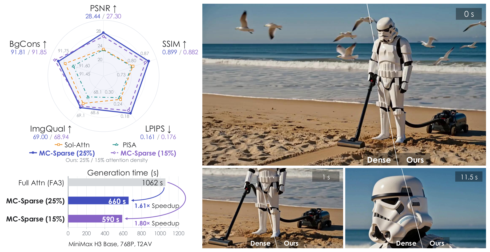

### TL;DR

Training-free sparse attention for diffusion transformers that stays faithful to dense output. MC-Sparse (1) picks KV tokens using the *exact* attention probabilities per query, (2) tiles similar queries into GPU-friendly groups, and (3) caches the selected index sets and a residual between dense and sparse outputs across denoising steps so the cost of selection amortizes.

### Key idea

Previous DiT sparse-attention methods paid for approximate selection by losing fidelity. MC-Sparse argues that selection quality is the whole game: use exact scores, tile similar queries to recover throughput, and reuse selections step-to-step because adjacent diffusion timesteps are highly correlated.

### Main finding

Higher fidelity to dense attention than prior sparse baselines, with denoising speedups of **1.80× on video generation** and **2.32× on 3D asset generation**.

### Why it matters

As DiTs push into long video and 3D, dense attention becomes the main bottleneck. A training-free sparse recipe that preserves quality is the simplest wins practitioners can take without re-training backbones.

### Knowledge graph integration

**Builds on / relates to existing pages:**
- [../fundamentals/attention.md](../fundamentals/attention.md) — specializes the attention operator with structured sparsity.
- [../architectures/multi-head-attention.md](../architectures/multi-head-attention.md) — modifies head-level computation for DiT workloads.

**Suggested new pages:**
- `architectures/mc-sparse.md` *(depth)* — covers the exact-prob selection + query tiling + inter-step residual caching recipe.

---

## 7. Memento 3: Model-Based Recursive Self-Improvement through Reflective Rulebooks 

**Authors:** Haoyu Zhao, Zhengxu Yu, Zhiyuan He, Meng Fang, Rasul Tutunov, Haitham Bou-Ammar, Weilin Luo, Jun Wang — *UCL · Huawei Noah's Ark Lab (UK) · University of Liverpool*
**Links:** [arXiv:2610.11794](https://arxiv.org/abs/2610.11794) · [HF](https://huggingface.co/papers/2610.11794) · [AlphaXiv](https://www.alphaxiv.org/abs/2610.11794)
**Topics:** `agents`, `world-model`, `reasoning`

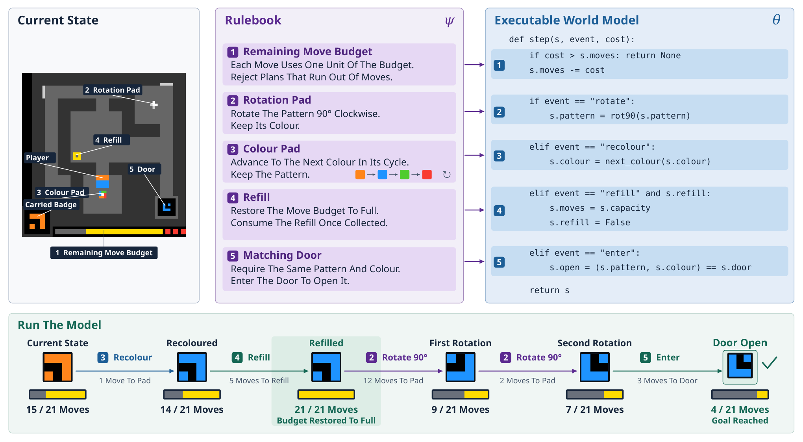

### TL;DR

A frozen LLM agent that learns an *explicit*, executable world model by maintaining a natural-language *rulebook* of hypotheses about an environment. The agent observes, reflects, revises rules, compiles the rulebook to code, and verifies predictions. A population variant keeps several world models in parallel.

### Key idea

Rather than fine-tuning the policy or stacking a neural world model, keep an external memory of *rules* in natural language, compile them to code, and run a tight reflect-revise-compile-verify loop. The LLM reasons; the code is the model.

### Main finding

Clears all 25 public ARC-AGI-3 games with a single model. In an Atari Pong case study, a controller distilled from the learned rulebook wins 21:0 across three evaluated episodes without further LLM calls.

### Why it matters

Points at a practical path to agent world models that are inspectable, editable by humans, and executable without the model in the loop — a step toward auditable long-horizon systems.

### Knowledge graph integration

**Builds on / relates to existing pages:**
- [../post-training/reasoning/long-cot-rl.md](../post-training/reasoning/long-cot-rl.md) — the reflect-revise loop is a long-horizon analogue of RL-trained reasoning.
- [../post-training/reasoning/mcts.md](../post-training/reasoning/mcts.md) — rulebook search is a search in rule space rather than token space.

**Suggested new pages:**
- `agents/rulebook-world-model.md` *(depth)* — code-as-world-model recipe with reflect-revise-compile-verify loop.

---

## 8. Post-Training Frontier Text-to-Image Models by Composing Preference and Rubric Rewards 

**Authors:** I-Hung Hsu, Anastasios Angelopoulos, Wei-Lin Chiang, Ion Stoica, Cho-Jui Hsieh (+ UCLA collaborators) — *Arena Intelligence Inc. / UCLA*
**Links:** [arXiv:2610.02967](https://arxiv.org/abs/2610.02967) · [HF](https://huggingface.co/papers/2610.02967) · [AlphaXiv](https://www.alphaxiv.org/abs/2610.02967)
**Topics:** `diffusion`, `RL`, `reward`

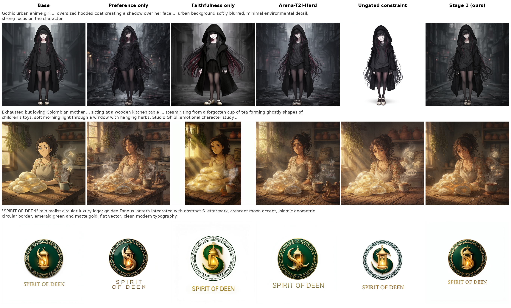

### TL;DR

A post-training recipe for open-domain T2I that composes a Bradley–Terry preference reward (trained on large-scale human votes) with rubric-based rewards that check prompt faithfulness, enforce intent-dependent constraints, and detect common reward-hacking patterns. A naïve weighted sum under-performs; the paper proposes a composition strategy that balances the two signals properly.

### Key idea

Preference models model *what humans prefer on average*; rubrics model *what the request literally asked for*. The compose step treats them as orthogonal signals and avoids the gradient collisions a weighted sum would create.

### Main finding

RL-trained FLUX.2-dev scores **+69 Elo** over its base on the Arena text-to-image leaderboard. Post-trained Ideogram-4 reaches **1223.5 Elo**, the highest open-source entry listed. The authors also release Arena-T2I-Training (1K prompts).

### Why it matters

The dominant lever for closed-source image models is post-training, and open models have lacked a clean recipe for combining human preference with per-prompt rubric satisfaction. This gives a concrete template plus a public training subset.

### Knowledge graph integration

**Builds on / relates to existing pages:**
- [../post-training/_rewards.md](../post-training/_rewards.md) — adds a composed-reward variant to the reward taxonomy.
- [../post-training/dpo.md](../post-training/dpo.md) — preference signal comes from the Bradley–Terry family.
- [../post-training/cot-reward-model.md](../post-training/cot-reward-model.md) — rubric reward is a rule-structured reward in the same spirit as CoT rewards.

**Suggested new pages:**
- `post-training/rubric-reward.md` *(depth)* — composition of preference + rubric rewards with anti-hacking rubrics.

---

## 9. SparseDecoding: Decoding-Aware Pruning for Accurate and Efficient LLM Inference 

**Authors:** Westlake University group (names not disclosed on HF page). Corresponding: wanghuan@westlake.edu.cn.
**Links:** [arXiv:2610.12327](https://arxiv.org/abs/2610.12327) · [HF](https://huggingface.co/papers/2610.12327) · [AlphaXiv](https://www.alphaxiv.org/abs/2610.12327)
**Topics:** `efficient-inference`, `pruning`

### TL;DR

Argues that calibration data for LLM pruning should come from the model's own generated tokens rather than static web text, because activations during decoding drift away from the activations seen on calibration corpora. Pair the better calibration with a bitmask-indexed N:M sparse matrix-vector kernel for actual speedup.

### Key idea

Decoding-time activations are the ones the sparsified network has to serve, so calibrate on them. Then use a kernel designed around the N:M pattern (bitmask indexing, fixed-step traversal) to realize the theoretical sparsity in wall-clock time.

### Main finding

Better long-form generation quality than C4-based calibration; up to **1.48× end-to-end decoding speedup on A100**.

### Why it matters

Most LLM pruning papers chase perplexity on fixed text. Fixing calibration to decoding — plus a shipping kernel — is the kind of practical move that unlocks real deployment wins.

### Knowledge graph integration

**Builds on / relates to existing pages:**
- [../inference/README.md](../inference/README.md) — adds a decoding-aware pruning entry to the inference stack.
- [../quantization/_number-formats.md](../quantization/_number-formats.md) — N:M sparsity sits alongside quantization in the compression toolbox.

**Suggested new pages:**
- `inference/sparse-decoding.md` *(depth)* — covers the decoding-time calibration argument plus the N:M bitmask kernel.

---

## 10. What Did the Agent Actually Do? Evidence-Grounded Oversight for Long-Horizon Agents 

**Authors:** Zhongxiang Sun, Jiahao Yan, Hongkang Zhao, Haojie Ding, Boheng Zhang, Fan Yang, Xiao Zhang, Jun Xu — *RUC-GSAI-IIRLab (Renmin University of China)*
**Links:** [arXiv:2610.06406](https://arxiv.org/abs/2610.06406) · [HF](https://huggingface.co/papers/2610.06406) · [AlphaXiv](https://www.alphaxiv.org/abs/2610.06406)
**Topics:** `safety`, `agents`, `eval`

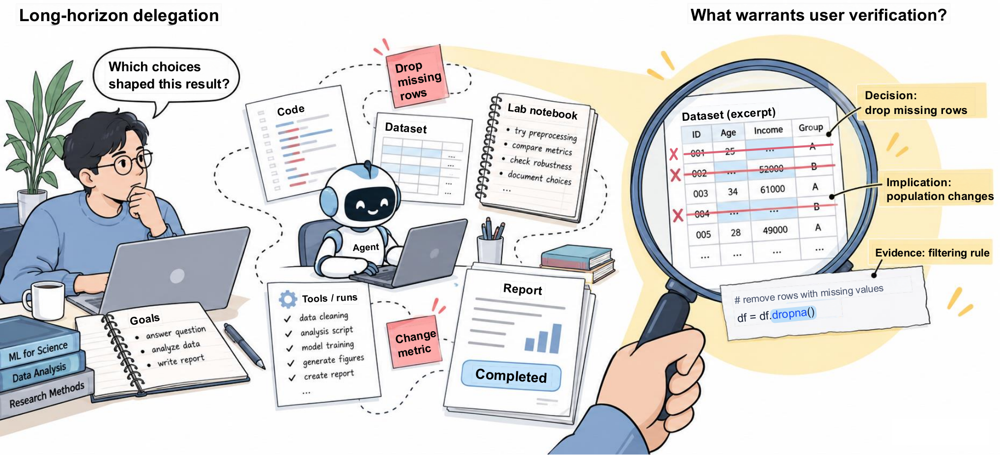

### TL;DR

AgentMonBench is a software-engineering benchmark for *behavior-vs-requirement* oversight: did the agent do what it was asked, and can monitors catch consequential autonomous choices? The authors also propose EBG (Evidence-Grounded Behavior Graph), a training-free monitor that organizes source-linked evidence into a graph for an oversight LLM to inspect.

### Key idea

Instead of asking a monitor "did the agent misbehave?" and getting a vibes-based verdict, give it a structured graph of evidence — code diffs, trace fragments, tool outputs — and ask grounded questions. The monitor's answers must cite nodes.

### Main finding

Across eight oversight models, EBG improves both decision identification and evidence localization in most settings, including on frontier judges.

### Why it matters

Oversight is the load-bearing safety mechanism for autonomous coding agents. Grounding monitor claims in cite-able evidence makes disagreement debugable and raises the ceiling of what weak monitors can enforce on stronger agents.

### Knowledge graph integration

**Builds on / relates to existing pages:**
- [../safety/cot-monitoring.md](../safety/cot-monitoring.md) — action-trace analogue of CoT monitoring.
- [../safety/safety-case.md](../safety/safety-case.md) — EBG is a candidate oversight limb in an agent safety case.
- [../evaluation/README.md](../evaluation/README.md) — adds a long-horizon agent-oversight benchmark.

**Suggested new pages:**
- `safety/evidence-grounded-behavior-graph.md` *(depth)* — covers the EBG monitor protocol and graph schema.

---

## 11. ReSPO: Reshaped Sequence Policy Optimization for Gradient Starvation in Off-Policy Learning 

**Authors:** Yuanhao Ban, Cho-Jui Hsieh, (+1) — *UCLA (inferred from emails)*
**Links:** [arXiv:2609.35433](https://arxiv.org/abs/2609.35433) · [HF](https://huggingface.co/papers/2609.35433) · [AlphaXiv](https://www.alphaxiv.org/abs/2609.35433)
**Topics:** `RL`, `post-training`, `RLVR`

### TL;DR

Reusing rollouts across several policy updates (a core cost-saving in RLVR) makes the data increasingly off-policy, and clipped surrogate objectives like GRPO/GSPO suppress informative gradients. ReSPO replaces clipping with a smooth, sign-dependent kernel on the sequence importance weight — importantly keeping the surviving signal on under-generated positives and attenuating over-generated negatives.

### Key idea

Reshape the dependence on the sequence IS weight so that the gradient does not vanish on the examples that need it (under-generated positives) and does not blow up on the examples that would dominate otherwise (over-generated negatives).

### Main finding

On Qwen3 dense and MoE models, ReSPO shows faster early learning, higher late-training scores, and better held-out benchmark results under rollout reuse than GRPO/GSPO baselines.

### Why it matters

Rollout reuse is the dominant lever for cheap RL post-training; the paper argues the ceiling with clipped surrogates is lower than it needs to be and gives a drop-in replacement.

### Knowledge graph integration

**Builds on / relates to existing pages:**
- [../post-training/_rl.md](../post-training/_rl.md) — new variant alongside GRPO/GSPO.
- [../post-training/grpo.md](../post-training/grpo.md) — direct comparison and critique of GRPO's clipping behavior.
- [../post-training/rlvr.md](../post-training/rlvr.md) — motivated by RLVR rollout-reuse economics.
- [../systems/partial-rollouts.md](../systems/partial-rollouts.md) — concrete partner for infra that aggressively reuses rollouts.

**Suggested new pages:**
- `post-training/respo.md` *(depth)* — the reshaped sequence-weight kernel and why it beats clipping under off-policy reuse.

---

## 12. REMORY: Learning Residual Memory for Context Compaction 

**Authors:** Hanchen Xia, Baoyou Chen, Yutang Ge, Naihao Deng, Senqiao Yang, Zilong Dong, Weihao Yuan, Siyu Zhu — *(affiliation not listed on HF page)*
**Links:** [arXiv:2610.11287](https://arxiv.org/abs/2610.11287) · [HF](https://huggingface.co/papers/2610.11287) · [AlphaXiv](https://www.alphaxiv.org/abs/2610.11287)
**Topics:** `efficient-inference`, `agents`, `memory`

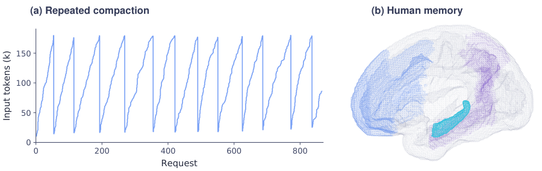

### TL;DR

Appends a small set of *learned soft memory tokens* to a textual summary of an agent's history, so a frozen LLM behaves as if it still had the full history. Uses ~5.2% of the full-history positions.

### Key idea

Trainable continuous tokens as the "residual" between a lossy natural-language summary and the ground-truth hidden states — a compression that is readable by humans (the text summary) but calibrated against the model (the memory tokens).

### Main finding

On SummHay, source attribution improves while insight coverage barely moves; across long-horizon agent benchmarks, REMORY reduces repeated tool outputs and tool errors for two different base models.

### Why it matters

Long-context inference remains expensive. A compaction that keeps a human-readable surface but preserves model behavior is a practical middle ground between full history and pure natural-language summarization.

### Knowledge graph integration

**Builds on / relates to existing pages:**
- [../inference/README.md](../inference/README.md) — context-cost reduction technique that preserves agent behavior.
- [../post-training/fine-tuning/README.md](../post-training/fine-tuning/README.md) — soft-prompt-style trainable tokens.

**Suggested new pages:**
- `inference/residual-memory-compaction.md` *(depth)* — soft memory tokens as residual to a text summary.

---

## 13. On-Policy Distillation Teaches New Skills but Not New Knowledge 

**Authors:** Yixuan Tang, Yi Yang — *(affiliation not listed on HF page)*
**Links:** [arXiv:2610.09639](https://arxiv.org/abs/2610.09639) · [HF](https://huggingface.co/papers/2610.09639) · [AlphaXiv](https://www.alphaxiv.org/abs/2610.09639)
**Topics:** `post-training`, `distillation`

### TL;DR

A controlled study of on-policy distillation (OPD) with LLMs. Reverse-KL OPD transfers *compositional skill* to new reasoning structures but moves little factual content; forward-KL recovers factual transfer. Confirmed on factual QA and competition math.

### Key idea

The direction of KL in OPD selects *what gets transferred*. Reverse KL favors mode seeking (student mimics teacher's capability on inputs it already samples), which is good for skill shaping but bad for new facts; forward KL spreads mass over support, which recovers knowledge transfer.

### Main finding

On the synthetic setup and on real benchmarks, the reverse-KL vs. forward-KL contrast cleanly separates "new skill" transfer from "new fact" transfer.

### Why it matters

Clarifies what distillation can and cannot do post-SFT, which is directly actionable for model shops planning distillation of larger teachers into smaller students.

### Knowledge graph integration

**Builds on / relates to existing pages:**
- [../post-training/fine-tuning/README.md](../post-training/fine-tuning/README.md) — distillation sits in the fine-tuning stack.
- [../post-training/_rl.md](../post-training/_rl.md) — OPD is RL-adjacent; reverse-KL is the policy-mirror family.
- [../post-training/reasoning/online-policy-mirror-descent.md](../post-training/reasoning/online-policy-mirror-descent.md) — closely related objective in the on-policy family.

**Suggested new pages:**
- `post-training/on-policy-distillation.md` *(depth)* — the reverse-KL-vs-forward-KL skill-vs-knowledge split.

---

## 14. SpecFold: Folding Multi-Branch Redundancy for Faster Speculative Decoding in Diffusion Language Models 

**Authors:** (not disclosed on HF page) — *(affiliation not listed)*
**Links:** [arXiv:2610.04875](https://arxiv.org/abs/2610.04875) · [HF](https://huggingface.co/papers/2610.04875) · [AlphaXiv](https://www.alphaxiv.org/abs/2610.04875)
**Topics:** `efficient-inference`, `diffusion`, `speculative`

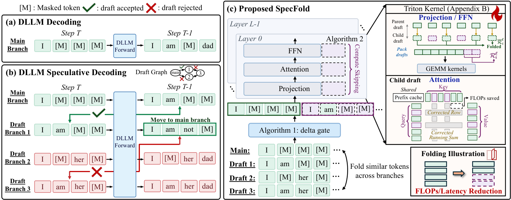

### TL;DR

Speculative decoding for *diffusion language models*. For each verified branch, SpecFold identifies tokens whose hidden state barely changes between parent and child and reuses parent-branch computation for them; divergent tokens are recomputed. A Triton kernel turns this selective reuse into real speedup.

### Key idea

Child branches in speculative-decoding trees share most of their computation with the parent, especially under diffusion dynamics; detect that overlap token-by-token and skip the redundant compute.

### Main finding

Up to **1.64× throughput over Spiffy** and **1.99× over vanilla decoding** across five models from two families and five benchmarks, with comparable task accuracy.

### Why it matters

Diffusion LMs are gaining traction, and their verification cost at inference is a bottleneck. SpecFold is a concrete serving-side win that doesn't need retraining.

### Knowledge graph integration

**Builds on / relates to existing pages:**
- [../inference/README.md](../inference/README.md) — speculative decoding is the natural home.
- [../pre-training/mtp.md](../pre-training/mtp.md) — multi-token prediction is a sibling of multi-branch decoding.

**Suggested new pages:**
- `inference/specfold.md` *(depth)* — multi-branch computation reuse for diffusion-LM speculative decoding.

---

## 15. Learning to Steer, Steering to See: Unveiling the Geometry of RLVR via Trainable Vectors 

**Authors:** Yuchen Cai, Ding Cao, Qixiang Yin, Xin Xu, Kai Yang, Siye Wu, Pengyuan Wang, Jiaxuan Wang, Weijie Liu, Saiyong Yang, Guangzhong Sun, Guiquan Liu, Junfeng Fang — *Tencent Hunyuan*
**Links:** [arXiv:2609.34344](https://arxiv.org/abs/2609.34344) · [HF](https://huggingface.co/papers/2609.34344) · [AlphaXiv](https://www.alphaxiv.org/abs/2609.34344)
**Topics:** `interp`, `RL`, `RLVR`

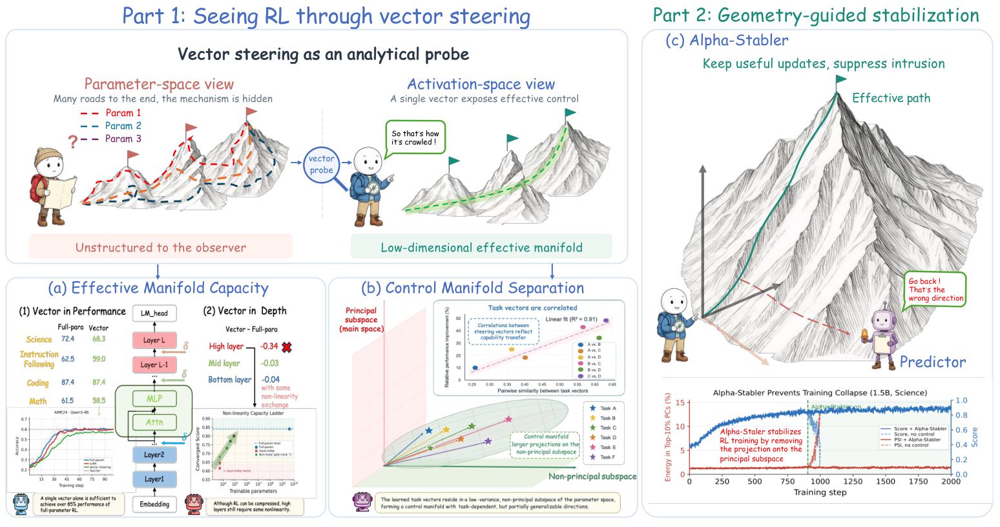

### TL;DR

Treats trainable steering vectors as a probe for *where RLVR gains live* inside an LLM. The paper finds that a very small activation subspace captures the RL-induced delta — but it cannot be shrunk indefinitely, and the useful directions lie mostly in the *low-variance* complement of the principal activation subspace. The authors then propose Alpha-Stabler, a training-time intervention that removes the principal-subspace component of activation gradients.

### Key idea

Use trainable vectors in activation space to characterize the geometry of RLVR, and then exploit the finding — RL gains concentrate off the principal activation directions — to stabilize training by projecting gradient updates away from the principal subspace.

### Main finding

Alpha-Stabler keeps RL training stable for 2,000 steps where baselines diverge and increases RL gains across tasks.

### Why it matters

Bridges interpretability and training stability: a geometric observation about where RL puts its work pays off as a concrete, cheap stabilizer with "plug-and-play" claims.

### Knowledge graph integration

**Builds on / relates to existing pages:**
- [../interpretability/README.md](../interpretability/README.md) — activation-subspace analysis in the steering-vector family.
- [../post-training/rlvr.md](../post-training/rlvr.md) — directly targets the dynamics of RLVR training.
- [../post-training/grpo.md](../post-training/grpo.md) — stabilizer is applicable to the clipped-GRPO training regime.

**Suggested new pages:**
- `interpretability/trainable-steering-vectors.md` *(depth)* — probes for localizing RL-induced changes in activations.
- `post-training/alpha-stabler.md` *(depth)* — the gradient-projection stabilizer for RLVR training.

---

## Notes

- Hero figures were pulled from each paper's arXiv HTML version. Five papers (SparseDecoding, U-Space, ReSPO, On-Policy Distillation, SpecFold) and the Loop-Native paper had no HTML-rendered figure available; those sections ship without a hero.
- Borderline inclusions: Learn2Play Bench is a benchmark rather than a new method but is kept because it directly tests the harness-side of LLM agents and separates "learned from feedback" from "pretrained priors."
- MiMo-V2.6 is the only candidate tech report of the day; a case-study PR is being considered as a Phase 3 companion.
- No existing concept files, `READING-LIST.md`, or `PAPERS.md` were modified to produce this digest.
