# Daily AI papers — 2026-10-12

*Curated from HF Daily Papers. 15 of 60 papers kept after relevance filter.*

## Papers at a glance

| # | Title | Topics | Org |
| --- | --- | --- | --- |
| 1 | [RSI-Anything: Unlocking Recursive Self-Improvement with World Models](#1-rsi-anything-unlocking-recursive-self-improvement-with-world-models) | `agents`, `RL`, `world-models` | PhAI Labs / CUHK |
| 2 | [S-Space: Exploring Spatial Workspace in Multimodal Language Models](#2-s-space-exploring-spatial-workspace-in-multimodal-language-models) | `multimodal`, `interp` | Tsinghua / Peking |
| 3 | [DiffusionART: Efficient, Stable and Scalable Reinforcement of Diffusion Models](#3-diffusionart-efficient-stable-and-scalable-reinforcement-of-diffusion-models) | `diffusion`, `RL` | — |
| 4 | [PolyOCR-Venus: Unified OCR Foundation Models](#4-polyocr-venus-unified-ocr-foundation-models-for-text-centric-visual-intelligence) | `multimodal`, `OCR`, `RL` | Ant Group |
| 5 | [VisionWeave: Weaving Elastic Visual Representations as a Native Capability of MLLMs](#5-visionweave-weaving-elastic-visual-representations-as-a-native-capability-of-mllms) | `multimodal`, `efficient-inference` | Alibaba (Qwen) |
| 6 | [Can AI Agents Learn Their Way to the Top? Heuristic Learning in a Game Competition](#6-can-ai-agents-learn-their-way-to-the-top-evaluating-heuristic-learning-in-a-long-running-game-agent-competition) | `agents`, `eval` | Tsinghua |
| 7 | [SoftwareGym: Scaling Computer-Use Agent Training with Synthesized Software](#7-softwaregym-scaling-computer-use-agent-training-with-diverse-synthesized-software-environments) | `agents`, `computer-use` | SJTU / Zhejiang |
| 8 | [Work2Skill: Capturing Human GUI Experience for Reusable Agent Skill Induction](#8-work2skill-capturing-human-gui-experience-for-reusable-agent-skill-induction) | `agents`, `computer-use` | SJTU / Fudan |
| 9 | [Contextual Correction of Parallel Drafts for Speculative Decoding](#9-contextual-correction-of-parallel-drafts-for-speculative-decoding) | `efficient-inference` | — |
| 10 | [InstantFusion: A Shared Latent Interface for Heterogeneous Image Generators](#10-instantfusion-a-shared-latent-interface-for-heterogeneous-image-generators) | `diffusion`, `multimodal` | Shanghai AI Lab |
| 11 | [Video-RSI: Recursive Self-Improvement of Video Understanding Agents](#11-video-rsi-recursive-self-improvement-of-video-understanding-agents-via-harness-evolution) | `agents`, `multimodal` | HEU / Tsinghua |
| 12 | [When Do We Need On-Policy Distillation? Semi-OPD](#12-when-do-we-need-on-policy-distillation-distilling-on-offline-student-rollouts-is-often-better) | `post-training`, `distillation` | NVIDIA (unlisted) |
| 13 | [SoloQ: Calibration-Free Quantization for Diffusion Language Models](#13-soloq-calibration-free-quantization-for-diffusion-language-models) | `quantization`, `diffusion`, `LLM` | USC / Yale / Korea |
| 14 | [Judging in Latent Space: Efficient Generative Reward Modeling (LatentGRM)](#14-judging-in-latent-space-efficient-generative-reward-modeling-via-semantics-preserving-compression) | `reward-model`, `efficient-inference` | Soochow / Cambridge |
| 15 | [Inducing Process Supervision from Outcome-Only Reinforcement Learning (TIPS)](#15-inducing-process-supervision-from-outcome-only-reinforcement-learning) | `RL`, `reasoning`, `PRM` | Tsinghua / SJTU |

---

## 1. RSI-Anything: Unlocking Recursive Self-Improvement with World Models

**Authors:** Taoyong Cui, Pinxian Zeng, Wanghan Xu, Hao Xiao, Shuhan Xue, Qiang Gao, Wanli Ouyang, Pheng Ann Heng, Zhenfei Yin, Yingcheng Wu, Ling Yang — *PhAI Labs · CUHK · Shanghai AI Lab · Oxford · Stanford · Peking*
**Links:** [arXiv:2610.13912](https://arxiv.org/abs/2610.13912) · [HF](https://huggingface.co/papers/2610.13912) · [AlphaXiv](https://www.alphaxiv.org/abs/2610.13912)
**Topics:** `agents`, `RL`, `world-models`, `self-improvement`

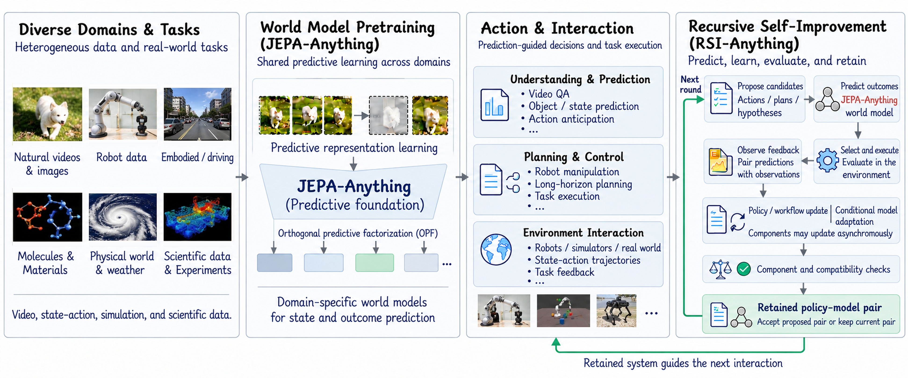

### TL;DR

Recursive self-improvement for agents normally relies on frequent, costly environment feedback. RSI-Anything replaces that signal with learned **world models** that predict the outcome of candidate actions, using the predictions both to select which actions to take and which trajectories to train on. Policy–world-model pairs are only retained after passing compatibility checks, so the two stay aligned as the policy drifts. The authors claim gains across code repair, GUI tasks, lab planning, chemistry optimization, and an immune-science task.

### Key idea

Treat the world model as a *rollout surrogate*: when the environment is slow or expensive, the model generates and ranks hypothetical trajectories; the policy is updated on filtered high-expected-return rollouts. The twist is **joint co-training with compatibility screening** — a new policy is rejected unless its paired world model still predicts its behavior accurately, which prevents the classic RSI collapse where the learner outruns its evaluator.

### Main finding

Reported gains span five domains (code, GUI, lab planning, reaction optimization, immune-science task). Numeric improvements aren't quoted in the abstract snippet, but the paper positions RSI-Anything as the first general recipe for sustained RSI without external feedback. 446 upvotes on HF — the day's clear community favorite.

### Why it matters

Scalable self-improvement without a human or environment in the loop is the holy grail of long-horizon agent training. The compatibility-check idea is the most interesting part: it formalizes the implicit assumption behind every "self-play" setup and gives a stop condition for when to retire a predictor.

### Knowledge graph integration

**Builds on / relates to existing pages:**
- [../post-training/_rl.md](../post-training/_rl.md) — RSI is an RL recipe layered on top of the base policy-gradient framing
- [../post-training/grpo.md](../post-training/grpo.md) — on-policy group baselines are the kind of estimator a world-model surrogate replaces

**Suggested new pages:**
- `agents/rsi-anything.md` *(depth)* — world-model-guided recursive self-improvement for agents
- `agents/_self-improvement.md` *(taxonomy)* — RSI, STaR, self-play, self-rewarding; a class of methods currently absent from the graph

---

## 2. S-Space: Exploring Spatial Workspace in Multimodal Language Models

**Authors:** Zhiyuan Shi, Xiang Li, Xingzhuo Guo, Shangchen Miao, Weiliang Chen, Qiyu Dai, Jinshan Ren, Jiangran Lyu, Fangfu Liu, Mingsheng Long, Jialong Wu — *MirroS · Tsinghua · Peking*
**Links:** [arXiv:2610.13527](https://arxiv.org/abs/2610.13527) · [HF](https://huggingface.co/papers/2610.13527) · [AlphaXiv](https://www.alphaxiv.org/abs/2610.13527)
**Topics:** `multimodal`, `interp`, `probing`

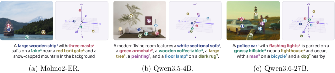

### TL;DR

Multimodal LLMs appear to carry a dedicated **linear subspace** inside their object-token activations that encodes continuous 3D coordinates — horizontal, vertical, and depth-like distance. The authors call this the *S-Space* and show that perception writes locations into it, chain-of-thought style reasoning transforms it (e.g. for viewpoint changes), and the model reads selectively from it when verbalizing an answer.

### Key idea

Fit linear probes to object-token activations against ground-truth coordinates in simulated scenes. The probes recover scene geometry at high fidelity, and ablating the recovered subspace selectively breaks spatial-reasoning questions but not general VQA — evidence it is *functionally* a spatial workspace, not a correlation.

### Main finding

Models form accurate spatial representations *of what they see*, but the subspace transformations needed to re-express locations after a viewpoint change are where failures concentrate. This localizes the failure mode of spatial reasoning in VLMs to a specific operation on a specific subspace.

### Why it matters

Mechanistic story for a notoriously flaky VLM capability. If the "workspace" view holds, it suggests training-time interventions (contrastive viewpoint data, workspace-targeted auxiliary losses) rather than more scale.

### Knowledge graph integration

**Builds on / relates to existing pages:**
- (no close prior page — the interpretability folder currently only has a README)

**Suggested new pages:**
- `interpretability/probing.md` *(depth)* — linear probes for structured latent content, with S-Space as a worked case
- `multimodal/spatial-reasoning.md` *(depth)* — failures and interventions for VLM spatial reasoning

---

## 3. DiffusionART: Efficient, Stable and Scalable Reinforcement of Diffusion Models

**Links:** [arXiv:2610.12572](https://arxiv.org/abs/2610.12572) · [HF](https://huggingface.co/papers/2610.12572) · [AlphaXiv](https://www.alphaxiv.org/abs/2610.12572)
**Topics:** `diffusion`, `RL`, `generative`

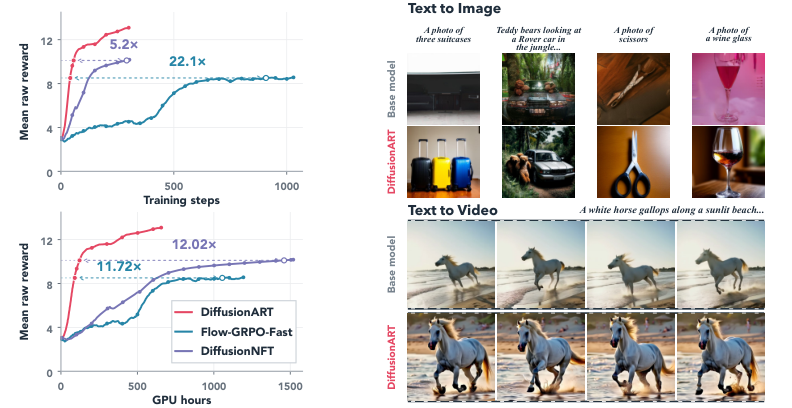

### TL;DR

Online RL fine-tuning of diffusion models splits into two camps: *reverse-process* methods (Flow-GRPO) that credit-assign through sampling trajectories but train slowly, and *forward-process* methods (DiffusionNFT) that are efficient but unstable without carefully tuned EMA. DiffusionART argues both pathologies share one cause — a residual forward–reverse consistency force in NFT-style objectives — and fixes it with a shared per-prompt guidance direction plus a trust-region-masked restoration update. No EMA tuning. No differentiable reward model.

### Key idea

Aggregate each prompt's sampled rewards into a single guidance vector shared across its drafts, then take a second trust-region update that pulls the policy back toward a stable reference where the first step overshot. The restoration step replaces what EMA was doing implicitly, but makes it explicit and controllable.

### Main finding

Trains stably across image and video reward signals, with reported large GPU-hour savings on HunyuanVideo-13B. Removes EMA sensitivity, which has been the dominant practical barrier to NFT-style diffusion RL at scale.

### Why it matters

The diffusion-RL stack is where image/video post-training is heading. A method that keeps NFT-style efficiency without EMA pain is a drop-in replacement for the current workhorse.

### Knowledge graph integration

**Builds on / relates to existing pages:**
- [../post-training/grpo.md](../post-training/grpo.md) — Flow-GRPO (the baseline) adapts GRPO to diffusion trajectories
- [../post-training/_rl.md](../post-training/_rl.md) — the paper lives on the diffusion branch of the RL-for-generative-models tree

**Suggested new pages:**
- `post-training/_diffusion-rl.md` *(taxonomy)* — Flow-GRPO vs DiffusionNFT vs DiffusionART; a growing class
- `post-training/diffusionart.md` *(depth)* — forward-process RL with explicit restoration update

---

## 4. PolyOCR-Venus: Unified OCR Foundation Models for Text-Centric Visual Intelligence

**Authors:** GuangJian Team — *Ant Group*
**Links:** [arXiv:2609.37712](https://arxiv.org/abs/2609.37712) · [HF](https://huggingface.co/papers/2609.37712) · [AlphaXiv](https://www.alphaxiv.org/abs/2609.37712)
**Topics:** `multimodal`, `OCR`, `RL`, `foundation-model`

### TL;DR

A family of unified OCR foundation models trained with a new RL algorithm — **Competence-Guided Policy Optimization (CGPO)** — that combines verifier-based GRPO with on-policy distillation. Comes with a quality-filtered OCR data engine and an updated benchmark (OCRBench v2.1). Reports SoTA across OCRBench v2.1, CC-OCR, OmniDocBench v1.6, and MDPBench.

### Key idea

CGPO adaptively mixes two training signals per sample: a GRPO-style verifier reward, and an on-policy distillation loss from a stronger teacher. The mixing weight is driven by a per-task "competence" estimate — distill where the model is weak, use RL where it is already competent. Mechanism directly addresses the usual GRPO failure on tasks with sparse positive samples.

### Main finding

Family of models at multiple scales reaches SoTA or near-SoTA on four OCR-centric benchmarks, including the authors' revised OCRBench v2.1 with corrected annotations. Code at [github.com/inclusionAI/PolyOCR-Venus](https://github.com/inclusionAI/PolyOCR-Venus).

### Why it matters

CGPO is the generalizable contribution. The idea that distillation and RL should be routed per-sample by a competence estimate (rather than switched in phases) is clean and plausibly transfers beyond OCR.

### Knowledge graph integration

**Builds on / relates to existing pages:**
- [../post-training/grpo.md](../post-training/grpo.md) — CGPO is a GRPO variant
- [../post-training/rlvr.md](../post-training/rlvr.md) — verifier-based rewards are the GRPO half of CGPO
- [../post-training/_rl.md](../post-training/_rl.md) — fits in the LLM-RL taxonomy

**Suggested new pages:**
- `post-training/cgpo.md` *(depth)* — competence-guided mixing of verifier-RL and on-policy distillation
- `multimodal/polyocr.md` *(depth)* — OCR foundation-model recipe and OCRBench v2.1

---

## 5. VisionWeave: Weaving Elastic Visual Representations as a Native Capability of MLLMs

**Authors:** Yuan Feng, Qize Yang, Ruizhe Chen, Sibo Song, Haolin He, Muzhi Zhu, Zihan Liu, Yunfei Chu, Xize Cheng, Yuxuan Wang, Jin Xu, Xike Xie — *USTC · Alibaba Token Hub (Qwen) · CUHK · Zhejiang*
**Links:** [arXiv:2610.07987](https://arxiv.org/abs/2610.07987) · [HF](https://huggingface.co/papers/2610.07987) · [AlphaXiv](https://www.alphaxiv.org/abs/2610.07987)
**Topics:** `multimodal`, `efficient-inference`, `MoE-ish`

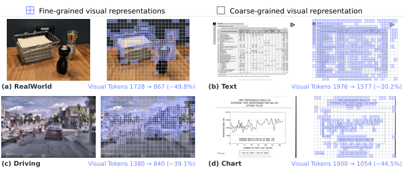

### TL;DR

MLLMs spend compute on dense visual tokens even where images carry little information. VisionWeave pairs a **gated spatial pooler** (producing a coarse-granularity visual token stream) with a **granularity router** that learns, per region, whether the fine or the coarse tokens should flow into the LLM. Trained via self-distillation; serves 2.3× end-to-end throughput on SGLang.

### Key idea

Routing-over-granularity. Instead of a fixed token budget per image or uniform pruning, the model decides *which parts of the image get fine tokens* and lets the rest be summarized by a cheap pooling path. The router is trained alongside the base model with a self-distillation objective matching the full-token teacher.

### Main finding

43.0% average token savings while retaining 98.9% of native performance across eight benchmarks; fixed 50% pruning retains only ~88%. On SGLang: 2.30× throughput, 54.4% lower mean TTFT, 60.6% lower mean TPOT. Scaled from Qwen3.5-4B to Qwen3.8-27B.

### Why it matters

Elastic token budgets per image are the right structural fix for video and document-heavy VLM workloads. The "learned router over pooled vs native tokens" pattern is close to a vision-side MoE and is likely to show up more broadly.

### Knowledge graph integration

**Builds on / relates to existing pages:**
- [../architectures/_moe.md](../architectures/_moe.md) — the granularity router is MoE-shaped (though over granularities, not experts)
- [../architectures/capacity-factor.md](../architectures/capacity-factor.md) — similar routing load/compute tradeoffs

**Suggested new pages:**
- `multimodal/visionweave.md` *(depth)* — elastic visual-token routing with gated pooling
- `multimodal/_token-reduction.md` *(taxonomy)* — pruning, pooling, routing for visual tokens; a growing class

---

## 6. Can AI Agents Learn Their Way to the Top? Evaluating Heuristic Learning in a Long-Running Game Agent Competition

**Authors:** Qingle Liu, Kejin Wang, Yicheng Zhao et al. (25 authors) — *Tsinghua*
**Links:** [arXiv:2610.12341](https://arxiv.org/abs/2610.12341) · [HF](https://huggingface.co/papers/2610.12341) · [AlphaXiv](https://www.alphaxiv.org/abs/2610.12341)
**Topics:** `agents`, `eval`, `RL`

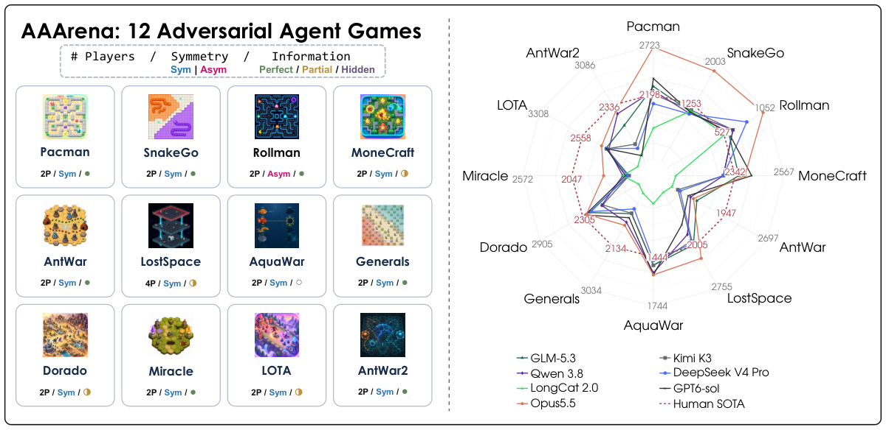

### TL;DR

AAArena is a benchmark where frozen LLMs act as *coding agents that evolve their own game-playing programs* across 12 adversarial games, benchmarked against 1,920 archived human programs. The twist: no weight updates — the agent revises its game-playing code and supporting software between matches. The strongest config (Opus 5.5 + Claude Code) wins six of twelve gold medals; the other six remain human-held.

### Key idea

**Adversarial Heuristic Learning (AHL)**: the LLM reads replays, patches its own code, and queues it for the next match. The evaluation protocol mirrors a real competitive ladder (opponent selection, Elo-style progression, dense per-match feedback), isolating "learning via code edits" from "learning via gradient."

### Main finding

Opus 5.5 + Claude Code reaches rank-1 in 6/12 games. Performance correlates inversely with rule-spec complexity. Opponent selection and dense feedback significantly help; agents learn both from their own replays and from opponents'.

### Why it matters

Honest, long-running benchmark for the kind of code-driven self-improvement that frontier agents actually do. Shows that today's best agents can top humans on simpler-ruleset games but still lose on complex-rule ones, giving a clean axis to track progress.

### Knowledge graph integration

**Builds on / relates to existing pages:**
- (agents folder has only a README; no existing depth pages to link)

**Suggested new pages:**
- `evaluation/aaarena.md` *(depth)* — adversarial game-ladder benchmark for coding agents
- `agents/code-driven-self-improvement.md` *(depth)* — "no weight updates, patch your own code" agent learning

---

## 7. SoftwareGym: Scaling Computer-Use Agent Training with Diverse Synthesized Software Environments

**Authors:** Tian Jin, Wenhao Wang, Jing Kang, Haoting Shi, Rui Ye, Yijun Lu, Siheng Chen — *SJTU · Zhejiang*
**Links:** [arXiv:2610.12611](https://arxiv.org/abs/2610.12611) · [HF](https://huggingface.co/papers/2610.12611) · [AlphaXiv](https://www.alphaxiv.org/abs/2610.12611)
**Topics:** `agents`, `computer-use`, `environments`

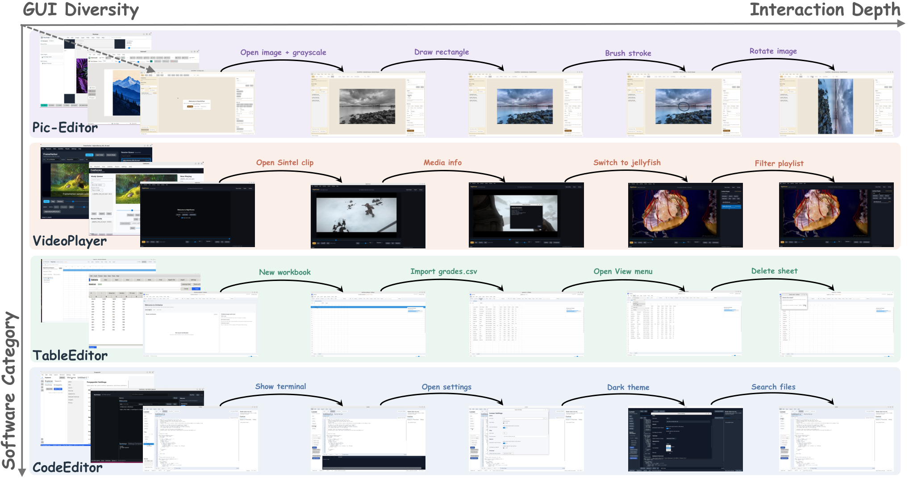

### TL;DR

An automated pipeline that *designs, implements, and GUI-tests entire desktop applications* for the purpose of training computer-use agents. 182 synthesized apps across 12 categories with a 91.5% mean GUI task pass rate, plus a 120-task evaluation benchmark. A model trained only on trajectories collected from these synthetic apps lifts OSWorld Pass@3 from 41.39% → 56.97%.

### Key idea

Synthesize the *environment* rather than the data. The pipeline writes an app, writes GUI tasks against it, and runs them to collect verified trajectories. Diversity comes from category sampling plus LLM-driven app-spec perturbation. Verification is the key filter: a task counts only if the generated solution actually passes the generated GUI test.

### Main finding

+15.6 points OSWorld Pass@3 from training purely on synthetic environments — a strong signal that scalable environment synthesis is viable for computer-use agents. 40.0% on the authors' SoftwareGym benchmark.

### Why it matters

Computer-use data is the single biggest bottleneck for GUI agents. If synthesizing *end-to-end environments* works at this quality, it reshapes how agent-training compute is spent.

### Knowledge graph integration

**Builds on / relates to existing pages:**
- (agents folder is empty besides README)
- [../post-training/rl-prompt-curation.md](../post-training/rl-prompt-curation.md) — related in spirit: curate the *inputs* for RL training

**Suggested new pages:**
- `agents/softwaregym.md` *(depth)* — environment-synthesis for computer-use training
- `agents/_computer-use.md` *(taxonomy)* — OSWorld, SoftwareGym, Work2Skill, synthesis vs human demos

---

## 8. Work2Skill: Capturing Human GUI Experience for Reusable Agent Skill Induction

**Authors:** Pinxue Guo, Chaoyun Zhang, Bingxuan Li, Rui Zheng, Hang Yan, Ning Liao — *SJTU · Fudan · NTU · Zhejiang · Qiji Zhifeng*
**Links:** [arXiv:2610.12984](https://arxiv.org/abs/2610.12984) · [HF](https://huggingface.co/papers/2610.12984) · [AlphaXiv](https://www.alphaxiv.org/abs/2610.12984)
**Topics:** `agents`, `computer-use`, `data`

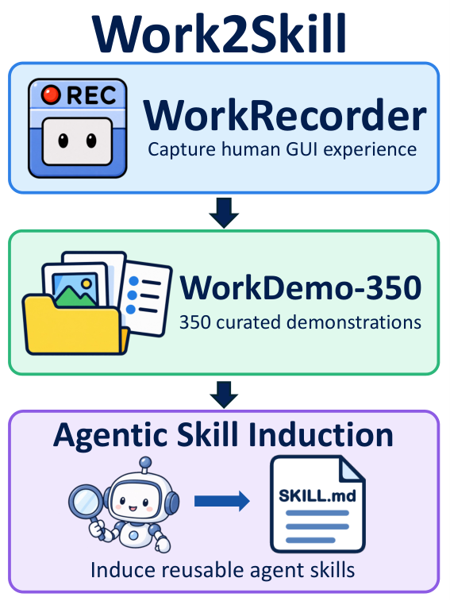

### TL;DR

Human demos of GUI tasks encode procedural knowledge, but reusing them as agent skills requires separating *workflow rules* (always open the file menu first) from *task-specific details* (filename X). Work2Skill records aligned screen + mouse/keyboard + accessibility-tree streams via **WorkRecorder**, then applies an agentic induction method that produces reusable skills with explicit workflow rules, step dependencies, and completion checks. Dataset: **WorkDemo-350**.

### Key idea

Skill induction is itself an *agentic* process: the inducer examines evidence on demand (replay the step, inspect accessibility tree, re-run) rather than greedily generalizing from the demo once. This produces skills that generalize across task instances within the same workflow.

### Main finding

With the same four execution models and identical settings, Work2Skill-induced skills beat other skill-induction baselines by 4.67–10.54 points on MyPCBench and 3.11–7.50 points on an OSWorld-Verified 286-task subset. Code: [github.com/china-qijizhifeng/Work2Skill](https://github.com/china-qijizhifeng/Work2Skill).

### Why it matters

Complement to SoftwareGym — one synthesizes environments, this one captures human expertise over them. Together they point at a hybrid training regime for computer-use agents.

### Knowledge graph integration

**Builds on / relates to existing pages:**
- (agents folder is empty besides README)

**Suggested new pages:**
- `agents/work2skill.md` *(depth)* — agentic skill induction from aligned GUI demonstrations
- `agents/_computer-use.md` *(taxonomy)* — see paper 7 above

---

## 9. Contextual Correction of Parallel Drafts for Speculative Decoding

**Authors:** Roy Eisenstadt, Harel Lidar, Tal Gonen, Omer Luxembourg, Itamar Zimerman, Lior Wolf, Eli David, Ilan Naiman
**Links:** [arXiv:2610.12570](https://arxiv.org/abs/2610.12570) · [HF](https://huggingface.co/papers/2610.12570) · [AlphaXiv](https://www.alphaxiv.org/abs/2610.12570)
**Topics:** `efficient-inference`, `speculative-decoding`

### TL;DR

Parallel-draft speculative decoding (Medusa-style) breaks intra-block token dependencies — tokens are drafted in parallel so they can't see each other, hurting accept rates on structured output. **DCOCO** is a lightweight corrector module that restores those dependencies between drafting and verification *without* serializing the drafts. Reported speedups up to **6.6×** over vanilla decoding across four verifier backbones and ten benchmarks.

### Key idea

Insert a small corrector that reads the parallel draft block and rewrites each position's logits conditioned on earlier positions in the block, before the verifier runs. Preserves parallelism (one pass of the corrector), but gives the acceptor the sequential conditioning it needs to accept more tokens per block.

### Main finding

Up to 6.6× end-to-end over vanilla decoding — competitive with the fastest speculative-decoding setups while remaining a drop-in on top of existing draft heads.

### Why it matters

Fixes the single biggest practical weakness of Medusa-style decoding (poor acceptance on structured outputs) with a minimum-change intervention. Should slot cleanly into current serving stacks.

### Knowledge graph integration

**Builds on / relates to existing pages:**
- (inference folder has only a README; no existing speculative-decoding depth page)

**Suggested new pages:**
- `inference/_speculative-decoding.md` *(taxonomy)* — vanilla, Medusa, EAGLE, lookahead, DCOCO
- `inference/dcoco.md` *(depth)* — contextual draft correction

---

## 10. InstantFusion: A Shared Latent Interface for Heterogeneous Image Generators

**Authors:** Jiazi Bu, Yujie Zhou, Yuhong Liu, Beichen Zhang, Penghui Yang, Ziyu Liu, Yuhang Zang — *Shanghai AI Lab · SJTU · CUHK*
**Links:** [arXiv:2610.13944](https://arxiv.org/abs/2610.13944) · [HF](https://huggingface.co/papers/2610.13944) · [AlphaXiv](https://www.alphaxiv.org/abs/2610.13944)
**Topics:** `diffusion`, `multimodal`

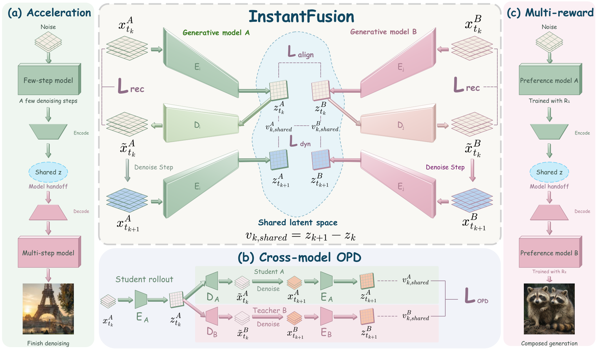

### TL;DR

Independently trained diffusion and flow image generators have similar latent spatial structure. InstantFusion gives them a shared latent space via model-specific autoencoders aligned at matched noise levels and matched local denoising velocities. Once trained, denoising can cross between frozen generators without a per-pair mapping — enables acceleration, multi-preference composition, cross-architecture on-policy distillation, and cross-model composition.

### Key idea

Train per-model autoencoders so their mid-sampling latents live in the same space. Two alignment objectives: match states at the same noise level, and match the *local velocity* of denoising. Once aligned, any sampler step can swap which model does the next denoising operation.

### Main finding

Qualitative demonstrations across the four applications. Treats the "frozen heterogeneous generator" case as a first-class problem — closer to a protocol than a model.

### Why it matters

If model families really do share latent geometry, the ecosystem could stitch generators like microservices (one for style, one for anatomy, one for detail). The acceleration + cross-distillation applications are the practical hooks.

### Knowledge graph integration

**Builds on / relates to existing pages:**
- [../post-training/_rl.md](../post-training/_rl.md) — on-policy distillation is the RL-adjacent branch

**Suggested new pages:**
- `multimodal/instantfusion.md` *(depth)* — aligned latents for cross-generator composition
- `post-training/_distillation.md` *(taxonomy)* — on-policy, off-policy, cross-architecture distillation (currently a gap in the graph)

---

## 11. Video-RSI: Recursive Self-Improvement of Video Understanding Agents via Harness Evolution

**Authors:** Jialin Guo (Harbin Engineering), Siqi Li (Tsinghua)
**Links:** [arXiv:2609.37950](https://arxiv.org/abs/2609.37950) · [HF](https://huggingface.co/papers/2609.37950) · [AlphaXiv](https://www.alphaxiv.org/abs/2609.37950)
**Topics:** `agents`, `multimodal`, `self-improvement`

### TL;DR

Video QA agents today gather evidence through an *executable harness* (sampling frames, calling detectors). Execution traces only show evidence under the current harness, so failure causes are opaque. Video-RSI uses the same frozen model to both answer questions *and* revise the harness, revisiting training videos to test competing failure explanations. Revisions are kept only if they improve a joint accuracy + visual-cost score.

### Key idea

Weight-free self-improvement where the *tool* evolves, not the model. The LM re-reads failures, proposes alternate harnesses, and A/B-tests them on training videos with a cost-aware acceptance rule.

### Main finding

Reaches competitive accuracy–efficiency tradeoffs vs existing video understanding agents while processing fewer frames per question. Sibling to the broader RSI-Anything theme on today's digest.

### Why it matters

The "evolve the harness, not the weights" pattern is likely to generalize — many agent tasks are bottlenecked by their execution scaffold, not their underlying LM.

### Knowledge graph integration

**Builds on / relates to existing pages:**
- (none directly in the graph yet)

**Suggested new pages:**
- `agents/harness-evolution.md` *(depth)* — frozen-weight self-improvement by patching the agent's tools
- `agents/_self-improvement.md` *(taxonomy)* — see paper 1 above

---

## 12. When Do We Need On-Policy Distillation? Distilling on Offline Student Rollouts Is Often Better

**Authors:** Yonggan Fu, Jindong Jiang, Shih-Yang Liu, Song Bian, Byung-Kwan Lee, Sharath Turuvekere Sreenivas, Wenliang Dai, Hanrong Ye, Aditya Grover, Pavlo Molchanov
**Links:** [arXiv:2610.11291](https://arxiv.org/abs/2610.11291) · [HF](https://huggingface.co/papers/2610.11291) · [AlphaXiv](https://www.alphaxiv.org/abs/2610.11291)
**Topics:** `post-training`, `distillation`, `efficiency`

### TL;DR

On-policy distillation (OPD) regenerates student rollouts every step so the teacher-labelled distribution matches what the student actually produces. The paper argues this is often *worse* than **Semi-OPD** — generate student rollouts *once*, then distill against them repeatedly. Semi-OPD wins in 14 of 17 teacher–student pairs (1.5B–235B), with up to 13.6% higher accuracy and 11.4× training speedup.

### Key idea

OPD only helps when teacher and student are already well-aligned (high top-k token overlap). For misaligned pairs, long OPD rollouts drift *away* from the teacher distribution — negating the point of distillation. Semi-OPD trades on-policy coverage for stable, teacher-anchored targets.

### Main finding

Across 17 pairs: +13.6% max accuracy, 11.4× max speedup. Alignment measured by top-k output-token overlap predicts when OPD vs Semi-OPD wins — a clean diagnostic.

### Why it matters

Overturns a quiet consensus that OPD is the default. If true, large-scale distillation runs can simplify their pipelines and save substantial GPU-hours.

### Knowledge graph integration

**Builds on / relates to existing pages:**
- [../post-training/_rl.md](../post-training/_rl.md) — on-policy vs off-policy is the RL half of the distillation discussion
- [../post-training/rejection-sampling.md](../post-training/rejection-sampling.md) — related offline-rollout technique for post-training

**Suggested new pages:**
- `post-training/_distillation.md` *(taxonomy)* — OPD, Semi-OPD, SFT distillation, DistilBERT-style; the folder has no coverage of this class
- `post-training/semi-opd.md` *(depth)* — the Semi-OPD recipe and its alignment-based diagnostic

---

## 13. SoloQ: Calibration-Free Quantization for Diffusion Language Models

**Authors:** Arkapravo Ghosh, Varun Manjunath, Bumjoon Kyle Rhee, Hyunho Kook, Shiting Xiao, Youngeun Kim, Priyadarshini Panda — *USC · Yale · Korea*
**Links:** [arXiv:2610.07121](https://arxiv.org/abs/2610.07121) · [HF](https://huggingface.co/papers/2610.07121) · [AlphaXiv](https://www.alphaxiv.org/abs/2610.07121)
**Topics:** `quantization`, `diffusion`, `LLM`, `efficient-inference`

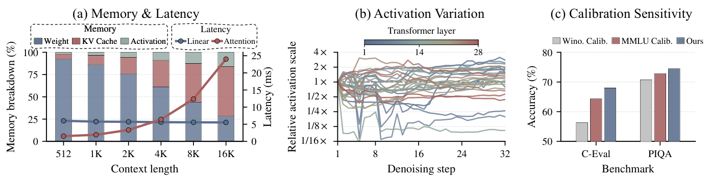

### TL;DR

Diffusion language models (dLLMs) break standard PTQ pipelines because activation statistics shift across denoising steps — calibrating per step is expensive, calibrating once is lossy. SoloQ rotates weights and activations into a space with predictable, step-invariant distributions, then combines the rotation with a lightweight per-step scale correction. Supports both custom codebooks and **NVFP4**. For block-diffusion variants, it also compresses the persistent KV-cache at commit time.

### Key idea

A *structured rotation* that straightens the distribution so one quantizer works across all denoising steps. No calibration data required — the rotation is analytic, derived from the model weights. Scale correction handles residual step-dependent drift at near-zero cost.

### Main finding

4-bit SoloQ preserves accuracy on several dLLMs on knowledge and reasoning benchmarks, beating calibration-based baselines. Up to **2.61× peak-memory reduction** and **2.24× inference speedup** with NVFP4.

### Why it matters

Diffusion LLMs are gaining traction (Mercury, LLaDA) and currently lack a solid quantization story. Calibration-free is especially valuable because dLLM users don't typically have representative calibration sets.

### Knowledge graph integration

**Builds on / relates to existing pages:**
- [../quantization/_number-formats.md](../quantization/_number-formats.md) — covers FP4/FP8/INT, needs NVFP4
- [../quantization/fp8.md](../quantization/fp8.md) — closest existing depth page

**Suggested new pages:**
- `quantization/soloq.md` *(depth)* — calibration-free rotation-based PTQ for dLLMs
- `quantization/nvfp4.md` *(depth)* — the NVFP4 format and its codec, currently absent from the graph

---

## 14. Judging in Latent Space: Efficient Generative Reward Modeling via Semantics-Preserving Compression

**Authors:** Xiaobo Liang, Junwei Yang, Ziwei Chen, Zeren Zhang, Hejin Wang, Yubin Wang, Juntao Li — *Soochow · Cambridge · Chalmers · Peking · Tsinghua · HKUST*
**Links:** [arXiv:2610.09788](https://arxiv.org/abs/2610.09788) · [HF](https://huggingface.co/papers/2610.09788) · [AlphaXiv](https://www.alphaxiv.org/abs/2610.09788)
**Topics:** `reward-model`, `efficient-inference`, `judge-LLM`

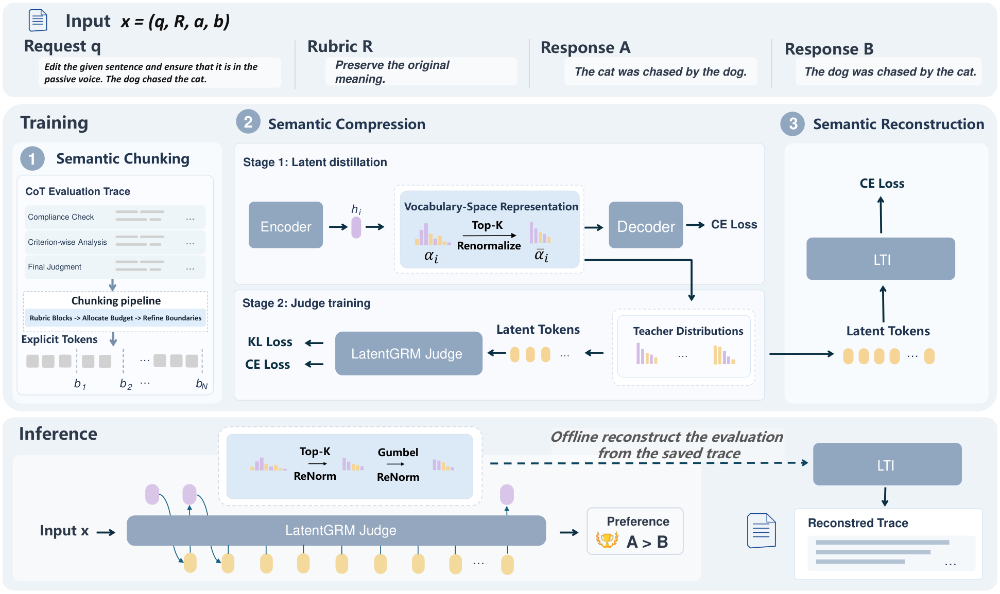

### TL;DR

Generative reward models that write long "judgement" chains of thought are slow and expensive to serve. **LatentGRM** compresses the multi-criterion evaluation into a compact continuous latent trajectory instead — a short sequence of hidden vectors that encodes the same scoring signal. An interpreter can decode criterion-level evaluations from a saved trajectory for offline inspection.

### Key idea

Replace discrete reasoning tokens with a *latent* reasoning trajectory for the judge model. Train the compact latent sequence to preserve the semantic content of the full textual judgement under a reconstruction loss, so the judge's score and the interpreter's text explanation stay consistent.

### Main finding

Accuracy competitive with explicit SFT judges at 4B and 8B scales, with large reductions in trajectory length and judge inference time. Offline interpretability preserved.

### Why it matters

Judge/reward models are increasingly in the inner loop of RL pipelines. Cutting judge-inference cost 5–10× while keeping an interpretability back door is a direct speedup for every PPO/GRPO-style run that uses a generative RM.

### Knowledge graph integration

**Builds on / relates to existing pages:**
- [../post-training/_rewards.md](../post-training/_rewards.md) — fits the reward-model taxonomy
- [../post-training/cot-reward-model.md](../post-training/cot-reward-model.md) — direct predecessor; LatentGRM compresses the CoT RM's trajectory

**Suggested new pages:**
- `post-training/latent-grm.md` *(depth)* — latent-trajectory generative reward modeling

---

## 15. Inducing Process Supervision from Outcome-Only Reinforcement Learning

**Authors:** Xin Cong (Tsinghua), Zhong Zhang (UESTC), Haotian Chen (SJTU), Yankai Lin (SJTU)
**Links:** [arXiv:2609.36641](https://arxiv.org/abs/2609.36641) · [HF](https://huggingface.co/papers/2609.36641) · [AlphaXiv](https://www.alphaxiv.org/abs/2609.36641)
**Topics:** `RL`, `reasoning`, `PRM`, `post-training`

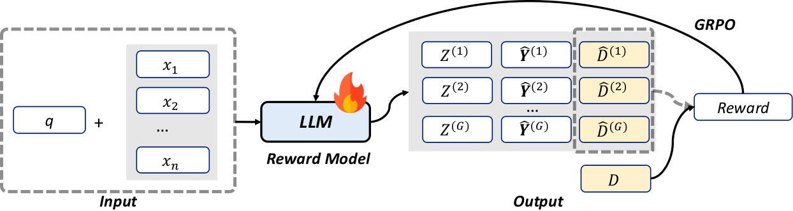

### TL;DR

Process reward models (PRMs) usually need step-level annotations, which are expensive. **TIPS** (Thinking-Induced Process Supervision) trains a generative PRM with outcome-only RL: the model writes a chain of thought, emits step-level labels, and emits an outcome label; the reward depends only on whether the outcome label is correct. Step-level labeling is thus *implicitly* reinforced without step annotations.

### Key idea

Chain-of-thought as a verification *scratchpad* for the PRM. Because the final outcome label depends on the step labels, correct outcome prediction propagates (via policy gradient) back through the step labels, teaching them for free.

### Main finding

Tips-Qwen3-4B-Thinking-2507 reaches **85.2 F1 on ProcessBench** using only 3.2K outcome-labeled trajectories, with gains across math and agent benchmarks on multiple model families.

### Why it matters

Collapses the annotation cost of PRM training by one or two orders of magnitude. If the quality holds up broadly, process-reward reasoning becomes affordable in settings that previously only had outcome labels.

### Knowledge graph integration

**Builds on / relates to existing pages:**
- [../post-training/reasoning/prm.md](../post-training/reasoning/prm.md) — directly the PRM page's natural extension
- [../post-training/reasoning/orm.md](../post-training/reasoning/orm.md) — contrasts outcome-only training
- [../post-training/cot-reward-model.md](../post-training/cot-reward-model.md) — CoT-style reward models
- [../post-training/rlvr.md](../post-training/rlvr.md) — same outcome-verifier pattern

**Suggested new pages:**
- `post-training/reasoning/tips.md` *(depth)* — outcome-only RL that induces step-level supervision as a byproduct

---

## Notes

- Borderline inclusions are flagged in-section with an italic *Borderline: …* note (none this day).
- Hero figures live in `assets/2026-10-12/`. Papers without hero figures: 4 (PolyOCR), 9 (DCOCO), 11 (Video-RSI), 12 (Semi-OPD) — no reliable `og:image` or arXiv-HTML preview URL was available.
- This digest is informational. No existing concept files, `READING-LIST.md`, or `PAPERS.md` were modified to produce it.
