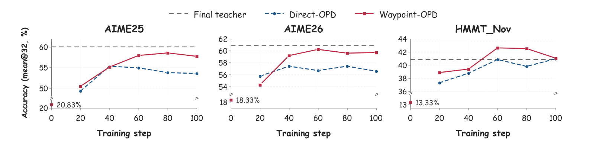
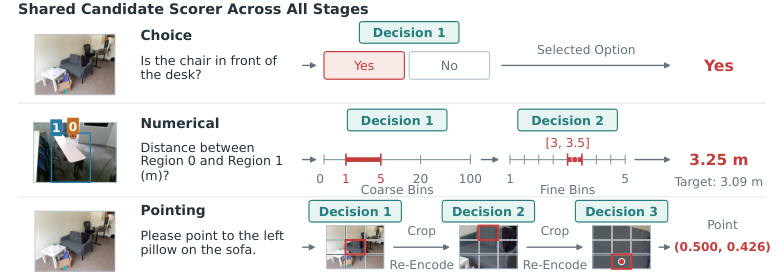
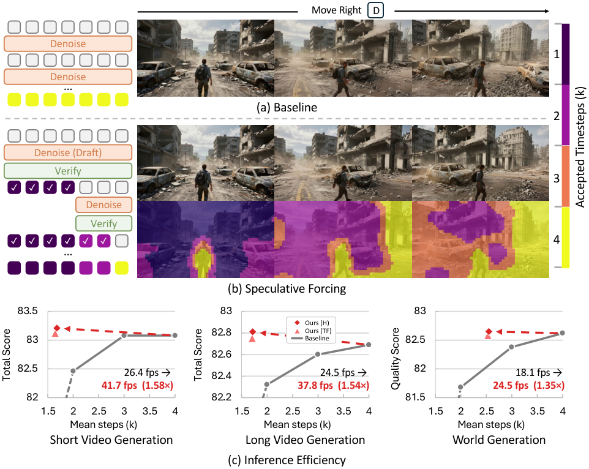
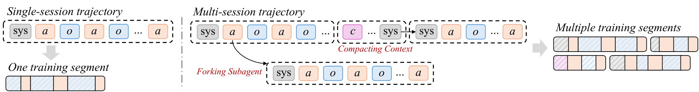
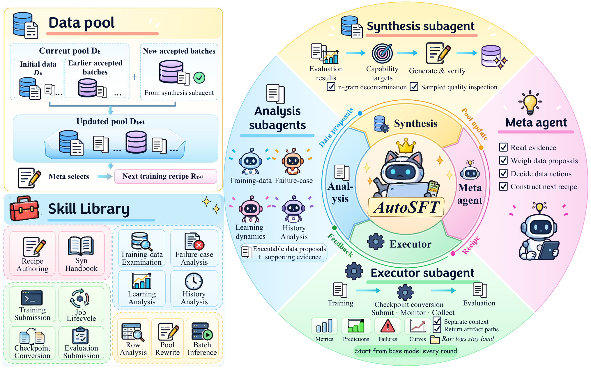
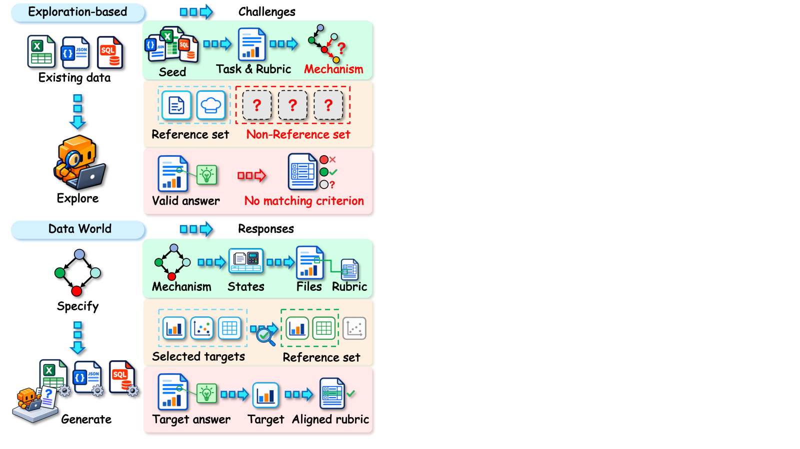
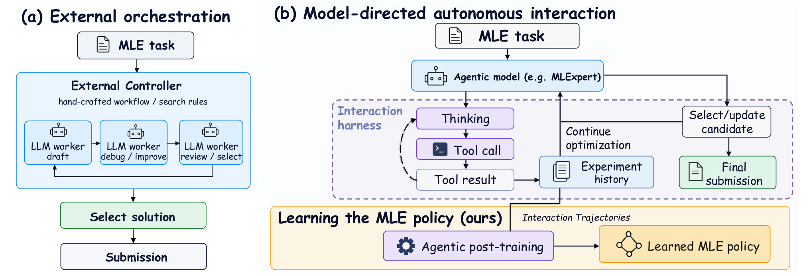
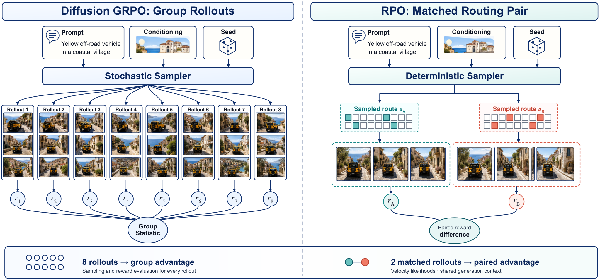
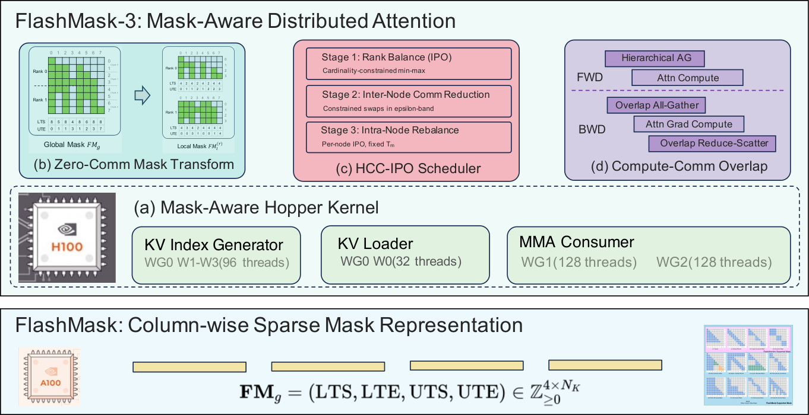

# Daily AI papers — 2026-10-16

*Curated from HF Daily Papers. 14 of ~55 papers kept after relevance filter.*

## Papers at a glance

| # | Title | Topics | Org |
| --- | --- | --- | --- |
| 1 | [Waypoint-OPD: Transferring RL-Induced Policy Shifts via Gated On-Policy Distillation](#1-waypoint-opd) | `RL`, `distillation`, `reasoning` | Alibaba Cloud |
| 2 | [OpenGCUA: Toward a Fully Open Stack for Generalist Computer Use](#2-opengcua) | `agents`, `computer-use`, `eval` | Tongyi-MAI / Alibaba |
| 3 | [Self-Evolving Agent Harness](#3-self-evolving-agent-harness) | `agents`, `safety`, `RSI` | Zhongguancun Academy / USTC |
| 4 | [MJev-Spatial: System One Spatial Intelligence via Native Attention Matching](#4-mjev-spatial) | `multimodal`, `efficient-inference`, `eval` | (anonymized) |
| 5 | [Speculative Forcing for Efficient Autoregressive Video Generation](#5-speculative-forcing) | `diffusion`, `efficient-inference`, `video` | NAVER AI Lab |
| 6 | [Mosaic: Multi-Session Agentic Reinforcement Learning](#6-mosaic) | `RL`, `agents` | HKUST(GZ) / Huawei |
| 7 | [Intern Lumina U2: A Multi-Codebook Diffusion LLM for Omni-Visual Understanding and Image Generation](#7-intern-lumina-u2) | `multimodal`, `diffusion`, `MoE`, `architectures` | Shanghai AI Lab |
| 8 | [AutoSFT: An Agentic System for Automated Data Research in Supervised Fine-Tuning](#8-autosft) | `data`, `agents`, `SFT` | UIUC / Tsinghua / ModelBest |
| 9 | [Behavioral Compositionality of Sparse Autoencoder Representations](#9-sae-compositionality) | `interp`, `eval` | U. Wisconsin–Madison |
| 10 | [Data World: Scaling Data Environments from Scratch](#10-data-world) | `data`, `agents`, `RL`, `eval` | Meituan Longcat |
| 11 | [MLExpert: Towards a Generalist Agentic Model for Autonomous ML Engineering](#11-mlexpert) | `agents`, `RL`, `MoE` | Shanghai AI Lab |
| 12 | [Routing Policy Optimization for Online Diffusion Reinforcement Learning](#12-rpo) | `RL`, `diffusion`, `architectures` | NUS / ByteDance |
| 13 | [Each Reward to Its Relevant Tokens: Reward-Specific Token-Level Credit Assignment for Multi-Reward RL](#13-mrtpo) | `RL`, `reasoning`, `agents` | NUS / UIUC / MBZUAI |
| 14 | [FlashMask-3: Efficient and Expressive Mask-Aware Distributed Attention](#14-flashmask-3) | `systems`, `architectures`, `efficient-inference` | Baidu |

---

## 1. Waypoint-OPD: Transferring RL-Induced Policy Shifts via Gated On-Policy Distillation

**Authors:** Bingxi Hou, Guochao Jiang, Guofeng Quan, Weiqing Li, Wenfeng Feng, Guohua Liu, Yuewei Zhang — *Alibaba Cloud Computing*
**Links:** [arXiv:2610.21601](https://arxiv.org/abs/2610.21601) · [HF](https://huggingface.co/papers/2610.21601) · [AlphaXiv](https://www.alphaxiv.org/abs/2610.21601)
**Topics:** `RL`, `distillation`, `reasoning`

### TL;DR

Policy-shift distillation reuses the delta in a teacher's log-probabilities before vs after RL as a supervision signal on student rollouts. The paper notes that a single *endpoint* shift can hide early and late shifts that partly cancel, and introduces **Waypoint-OPD** — pull an intermediate teacher checkpoint from the same RL run, compare early-vs-late action-preference shifts at each student prefix, and gate the endpoint delta by their directional agreement.

### Key idea

For each student-visited prefix, compute two policy-shift vectors (early→final, early→intermediate). When they point the same way, keep the endpoint signal; when they disagree, suppress it. One extra frozen-teacher scoring pass per update, no auxiliary losses.

### Main finding

RL-trained Qwen3-4B teachers → Qwen3-8B/14B/30B-A3B students on math + code. Waypoint-OPD gets the highest domain-average score in all six teacher-student settings; ablations show both the gate and its ordering matter.

### Why it matters

On-policy distillation is becoming the standard way to transplant reasoning capability from a well-RL'd teacher into a bigger (or smaller) base. Treating the teacher's training trajectory, not just its endpoint, as a source of structure gives a cheap way to filter noisy policy-shift signal — plausibly a generic add-on to the many "teacher-relative shift" distillation methods appearing concurrently.

### Knowledge graph integration

**Builds on / relates to existing pages:**
- [../post-training/grpo.md](../post-training/grpo.md) — the teacher's RL run is GRPO-style; Waypoint-OPD distills the resulting policy shift.
- [../post-training/_rl.md](../post-training/_rl.md) — endpoint vs waypoint policy shifts live inside the policy-gradient framework.
- [../post-training/rlvr.md](../post-training/rlvr.md) — teacher is RL'd on math/code with verifiable rewards.

**Suggested new pages:**
- `post-training/waypoint-opd.md` *(depth)* — the gated on-policy distillation method.
- `post-training/_distillation.md` *(taxonomy)* — on-policy / policy-shift / trajectory distillation (space is now crowded).

---

## 2. OpenGCUA: Toward a Fully Open Stack for Generalist Computer Use

**Authors:** Hanzhang Zhou, Long Li, Quyu Kong, Lei Wang, Panrong Tong, Long Chen, Tianyu Xia, Gongjie Zhang, Xu Zhang, Chen Liu, Jianan Zhang, Chenglin Cai, Zhengwen Zeng, Steven Hoi, Yue Wang — *Tongyi-MAI, Alibaba*
**Links:** [arXiv:2610.22200](https://arxiv.org/abs/2610.22200) · [HF](https://huggingface.co/papers/2610.22200) · [AlphaXiv](https://www.alphaxiv.org/abs/2610.22200)
**Topics:** `agents`, `computer-use`, `eval`

### TL;DR

Open stack for a *generalist* computer-use agent: GUI vision, programmatic APIs, and code execution all available to the same model, with "harness-to-model decision transfer" that moves observation/state decisions out of fixed harness rules and into the model's own prompt. Ships code, prompts, OSWorld-v2 trajectories, a real-device macOS harness, and a cross-device SDK.

### Key idea

Instead of a fixed GUI loop, the harness exposes **three channels**: screen + accessibility tree, programmatic/filesystem APIs, and a Python interpreter whose outputs feed back into context. "Harness-to-model decision transfer" promotes decisions (when to observe, when to issue a programmatic action vs a click, when to re-plan) from scaffolding rules to tokens the model emits.

### Main finding

On OSWorld-v2 the full stack lifts mean partial score by **+19.6 points** and cuts reported steps per task by **53.0%** on average across all 8 tested backbones (including GPT-6 Astra and Claude Opus 5). On four real macOS tasks, selected Qwen3.8-Max runs use 19.4× more reasoning tokens than GPT-6 Astra while still completing.

### Why it matters

Most "computer use" open releases are either model-only (no harness) or scaffolding-only. OpenGCUA argues that making the model own harness-level decisions and exposing code execution alongside clicks is where the headroom is — a result consistent with what frontier closed systems are doing but previously opaque to the community.

### Knowledge graph integration

**Builds on / relates to existing pages:**
- No existing coverage of computer-use agents in the atlas yet (`agents/README.md` is a stub).
- [../safety/_attacks.md](../safety/_attacks.md) — real-device agents expand the attack surface this taxonomy covers.

**Suggested new pages:**
- `agents/_computer-use.md` *(taxonomy)* — stack layout (harness, interfaces, planner, code exec) and open-vs-closed systems.
- `agents/harness-to-model-decision-transfer.md` *(depth)* — the specific recipe for moving decisions from scaffolding into the model.
- `evaluation/osworld.md` *(depth)* — OSWorld / OSWorld-v2 as the current standard computer-use benchmark.

---

## 3. Self-Evolving Agent Harness

**Authors:** Chuyang Wei, Haoxiang Guan, Minghang Zhu, Kexin Zhou, Jiyan He, Xiren Zhou, Huanhuan Chen, Yifei Shen — *Zhongguancun Academy / USTC*
**Links:** [arXiv:2610.18813](https://arxiv.org/abs/2610.18813) · [HF](https://huggingface.co/papers/2610.18813) · [AlphaXiv](https://www.alphaxiv.org/abs/2610.18813)
**Topics:** `agents`, `safety`, `RSI`

### TL;DR

A 66-page framework paper on **harness self-evolution**: let the agent revise its own prompts, memory, workflows, tools and code (its *harness*) while weights stay frozen, and formalize the resulting feedback loop. The authors derive generalization and retention bounds via continual PAC-learning and spell out what reliable deployment requires (continual validation, independent safeguards, fresh admission data).

### Key idea

Separate *update targets* (prompts, memory, repo-level control logic, plugins) from *proposal and admission mechanisms* (what writes the change, what accepts it). Treat the search over harness states as evolutionary optimization with a continual-learning safety wrapper rather than ad-hoc self-improvement.

### Main finding

A theoretical result (not an empirical one): under explicit assumptions on validation data independence and regression budgets, admission rules yield a high-probability bound on expected generalization and a retention bound on prior-task regression. Case studies connect to model–harness co-design, distributed execution, and plugin reuse.

### Why it matters

"Self-improving agents" has been under-formalized relative to the hype. This paper is the clearest attempt yet to pin down the *mechanisms* of recursive self-improvement that keep weights fixed — which is both the near-term tractable version of RSI and the one safety work needs a vocabulary for.

### Knowledge graph integration

**Builds on / relates to existing pages:**
- [../safety/scheming.md](../safety/scheming.md) · [../safety/safety-case.md](../safety/safety-case.md) — self-modifying agents sit squarely inside the scheming / safety-case literature.
- [../safety/sleeper-agents.md](../safety/sleeper-agents.md) — admission rules bound exactly the kind of silent-regression failure mode sleeper-agent work worries about.

**Suggested new pages:**
- `agents/harness-self-evolution.md` *(depth)* — the formal framework and admission rule.
- `safety/_recursive-self-improvement.md` *(taxonomy)* — if more RSI formalizations land.

---

## 4. MJev-Spatial: System One Spatial Intelligence via Native Attention Matching

**Authors:** (not disclosed on HF page) — *affiliation not shown on page*
**Links:** [arXiv:2610.22276](https://arxiv.org/abs/2610.22276) · [HF](https://huggingface.co/papers/2610.22276) · [AlphaXiv](https://www.alphaxiv.org/abs/2610.22276)
**Topics:** `multimodal`, `efficient-inference`, `eval`

### TL;DR

Instead of generating free-form text, MJev-Spatial reformulates VLM spatial tasks (option choice, numerical estimate, 2D point prediction) as **classification over candidate sets**, scored by the backbone's existing Q and K projections — no new parameters and no answer-token generation. One forward pass per decision.

### Key idea

Each candidate is a class; the score is the attention-logit between the question's query and the candidate's key, using the backbone's pretrained projections. Numerical/point targets are turned into coarse-to-fine class trees. Training supervises all coarse-to-fine stages jointly in one forward pass with teacher forcing and uses length-aware global batching plus cross-GPU load balancing (+30.8% training throughput).

### Main finding

Qwen3.5-4B backbone, 12.3M QA pairs. Highest overall score (65.64%) among 8 tested models; first place on 7/12 benchmarks; beats its unmodified autoregressive base on all 12; **5.6× faster** than the base and 2.5× faster than the fastest autoregressive baseline.

### Why it matters

Spatial reasoning is a canonical case where generation is overkill — the output space is tiny. Treating the Q/K machinery already inside the VLM as a classifier is a general recipe for compact-output VLM tasks (grasp selection, pointing, option QA) and sidesteps the token-parsing overhead that dominates System-1 latency.

### Knowledge graph integration

**Builds on / relates to existing pages:**
- [../fundamentals/attention.md](../fundamentals/attention.md) · [../architectures/multi-head-attention.md](../architectures/multi-head-attention.md) — reuses Q/K projections as a scoring head.
- [../multimodal/README.md](../multimodal/README.md) — would be the first depth entry.

**Suggested new pages:**
- `multimodal/native-attention-classification.md` *(depth)* — the Q·K-as-classifier trick for VLM decisions.
- `multimodal/_vlm-decision-heads.md` *(taxonomy)* — classification heads, pointer heads, regression heads for compact-output VLM tasks.

---

## 5. Speculative Forcing for Efficient Autoregressive Video Generation

**Authors:** (authors not resolved on HF page) — *NAVER AI Lab (and corresponding institutions)*
**Links:** [arXiv:2610.22347](https://arxiv.org/abs/2610.22347) · [HF](https://huggingface.co/papers/2610.22347) · [AlphaXiv](https://www.alphaxiv.org/abs/2610.22347)
**Topics:** `diffusion`, `efficient-inference`, `video`

### TL;DR

Few-step autoregressive video generators push every token through every denoising step, even when some tokens have already converged. **Speculative Forcing** treats intermediate clean estimates as *drafts* for each token, uses a verifier to decide which tokens can be frozen early, and keeps denoising only the rest — borrowing the speculative-decoding playbook for diffusion.

### Key idea

Two verifier flavors: (a) training-free, using clean-content similarity + step-to-step stability; (b) learned, reading the frozen generator's intermediate features to estimate the remaining gap to the full-step output. Frozen tokens keep their K/V as context for the rest, so quality isn't lost.

### Main finding

Preserves quality while cutting compute: on LongLive, matches the 4-step generator at **~1.7 steps/token** and runs 1.5× faster (41.7/37.8 fps). On Lingbot-World 2.0, ~2.5 steps/token at 1.35× speedup (24.5 fps).

### Why it matters

Diffusion inference acceleration has mostly been "cut uniform steps" (consistency models, DMD, LCM). Speculative Forcing picks the per-token loss properly — exactly what speculative decoding did for autoregressive text — and plugs cleanly into the existing few-step generators, so the gains compound with model-level step reduction.

### Knowledge graph integration

**Builds on / relates to existing pages:**
- No existing diffusion-inference pages in the atlas yet; `inference/README.md` is a stub.

**Suggested new pages:**
- `inference/speculative-forcing.md` *(depth)* — the draft-and-verify loop for diffusion.
- `inference/_diffusion-inference.md` *(taxonomy)* — step reduction, distillation, speculative, caching variants.

---

## 6. Mosaic: Multi-Session Agentic Reinforcement Learning

**Authors:** Minrui Xu, Xinyu Zhou, Xiang Long, Haochen Tan, Zhijiang Guo — *HKUST(GZ) / Huawei Foundation Model Lab*
**Links:** [arXiv:2610.22174](https://arxiv.org/abs/2610.22174) · [HF](https://huggingface.co/papers/2610.22174) · [AlphaXiv](https://www.alphaxiv.org/abs/2610.22174)
**Topics:** `RL`, `agents`

### TL;DR

Standard agentic RL assumes one unbroken context per trajectory, but real agent runs break into **multiple sessions** via context compaction and subagent forking. The naive fix — broadcast the trajectory-level advantage to every session — ignores how useful each session was. Mosaic adds hierarchical, critic-free advantage shaping across and within sessions.

### Key idea

Trajectory-level advantage is adjusted by **session-usage signals**; session-level advantage is shaped by each session's **estimated marginal contribution** to the final reward. No critic / value network required.

### Main finding

On BrowseComp with Qwen3.5-4B, Mosaic outperforms broadcasting in both compaction and subagent-forking regimes while using **fewer sessions on average**, with gains in session utility and allocation metrics.

### Why it matters

Multi-session trajectories (context compaction, subagent forking, task resumption) are now standard in deep-research and coding agents, but their training signal has been pushed through a single-session abstraction. Mosaic names the mismatch and offers a drop-in advantage shaper.

### Knowledge graph integration

**Builds on / relates to existing pages:**
- [../post-training/grpo.md](../post-training/grpo.md) · [../post-training/_rl.md](../post-training/_rl.md) — Mosaic is a hierarchical advantage estimator on top of GRPO-style rollouts.
- [../systems/partial-rollouts.md](../systems/partial-rollouts.md) — multi-session trajectories are the agent-side analogue of partial rollouts.

**Suggested new pages:**
- `post-training/multi-session-agentic-rl.md` *(depth)* — Mosaic's hierarchical advantage estimator.

---

## 7. Intern Lumina U2: A Multi-Codebook Diffusion LLM for Omni-Visual Understanding and Image Generation

**Authors:** Zongyang Qiu, Juncheng Yan, Hongliang Li, Qi Qin, et al. (large author list) — *Shanghai AI Laboratory + Huawei + academic partners*
**Links:** [arXiv:2610.20818](https://arxiv.org/abs/2610.20818) · [HF](https://huggingface.co/papers/2610.20818) · [AlphaXiv](https://www.alphaxiv.org/abs/2610.20818)
**Topics:** `multimodal`, `diffusion`, `MoE`, `architectures`

### TL;DR

A **diffusion language model** that represents visual tokens as groups of codes from *multiple complementary codebooks* in one fully-discrete space, built on AToken's unified 4D representation so one backbone handles image, video, and 3D inputs. Pairs the diffusion backbone (parallel over positions) with a lightweight autoregressive **multi-codebook head** (sequential over codes within a position).

### Key idea

Single-codebook discrete tokenizers are compatible with text LMs but lose visual capacity; continuous tokenizers keep capacity but fragment the training objective. Multi-codebook discrete tokens restore capacity while keeping the shared discrete objective; the AR head over codes-at-a-position decouples capacity from backbone sequence length. A **stability-aware sampling** scheme (confidence-plateau unmasking + cache refreshing) speeds inference 4.45×.

### Main finding

Leading scores among unified multimodal models on understanding, generation, and editing; cross-platform training/inference on Ascend and NVIDIA.

### Why it matters

Three recipes for unified visual LMs have been competing: continuous latent diffusion, single-codebook discrete AR, and hybrid. Multi-codebook discrete gives a third design point that keeps the clean discrete LM training objective without single-codebook capacity ceilings — likely to influence the next wave of open unified models.

### Knowledge graph integration

**Builds on / relates to existing pages:**
- [../architectures/_moe.md](../architectures/_moe.md) — the backbone is a sparse MoE in the Lumina family.
- [../multimodal/README.md](../multimodal/README.md) — currently empty; this is the kind of entry it needs.

**Suggested new pages:**
- `multimodal/multi-codebook-visual-tokens.md` *(depth)* — the tokenizer design and the AR-head-over-codebooks trick.
- `multimodal/_discrete-diffusion-lm.md` *(taxonomy)* — discrete-diffusion vs continuous-latent vs AR unified models.
- `case-studies/intern-lumina-u2.md` *(case study)* — full-stack unified model release.

---

## 8. AutoSFT: An Agentic System for Automated Data Research in Supervised Fine-Tuning

**Authors:** Pengqi Sun, Shihao Peng, Shaoxuan Li, Huiyu Xiao, Hongjian Shi, Zixuan Fu, Ziqing Qiao, Yuxin Zuo, Cheng Qian, Xinqiang Yu, Jiayi Li, Xiusi Chen, Yizhen Song, Xiangyang Wang, Iofai Lei, Yudong Wang, Ning Ding, Zhiyuan Liu, Xiaozhi Wang, Chaojun Xiao — *UIUC / Tsinghua / CUHK / ModelBest / BUPT*
**Links:** [arXiv:2610.22194](https://arxiv.org/abs/2610.22194) · [HF](https://huggingface.co/papers/2610.22194) · [AlphaXiv](https://www.alphaxiv.org/abs/2610.22194)
**Topics:** `data`, `agents`, `SFT`

### TL;DR

Hand a single LLM agent the full post-training stack and it collapses onto one action — nudging category proportions. **AutoSFT** defines a *data action space* (adjust proportions, prune, repair, replace, synthesize) and splits the loop across a meta-agent, independent analysis subagents, an executor, and a synthesis subagent. Retrains from base each round so component ablations are individually attributable.

### Key idea

Treat SFT data research as search over a *typed set of data operations*, not as a single blob of "edit the dataset." The executor contains the ballooning execution output; analysis subagents propose different *kinds* of edits from different angles; the synthesis subagent fills coverage gaps the existing pool can't repair.

### Main finding

Each component helps and composes: executor halves context loss, analysis subagents add **+6.5 IFEval**, synthesis adds **+3.4 IFEval** and **+2.9 IFBench**. Transfers to code: analysis alone adds **+3.7 MBPP+** where a single agent plateaus.

### Why it matters

Automated post-training is currently either "LLM-write-more-data" or a monolithic agent; this is the first clean argument that *coverage over data operations* dominates individual-operation strength, and the ablations make it reproducible.

### Knowledge graph integration

**Builds on / relates to existing pages:**
- [../data/_data-curation.md](../data/_data-curation.md) · [../data/quality-filtering.md](../data/quality-filtering.md) — AutoSFT automates the moves a data curator makes manually.
- [../post-training/_post-training.md](../post-training/_post-training.md) — operates on the SFT stage.
- [../post-training/rejection-sampling.md](../post-training/rejection-sampling.md) — one of the actions in the action space.

**Suggested new pages:**
- `data/data-action-space.md` *(depth)* — the typed-operation design.
- `agents/multi-agent-data-research.md` *(depth)* — the meta + analysis + synthesis topology.

---

## 9. Behavioral Compositionality of Sparse Autoencoder Representations

**Authors:** Ziye Mei, Frederic Sala — *University of Wisconsin–Madison, Department of Computer Sciences*
**Links:** [arXiv:2610.21261](https://arxiv.org/abs/2610.21261) · [HF](https://huggingface.co/papers/2610.21261) · [AlphaXiv](https://www.alphaxiv.org/abs/2610.21261)
**Topics:** `interp`, `eval`

### TL;DR

SAEs decode linearly but their *behavioral* effects need not compose additively. The paper introduces **SAE Additivity Residuals (SAR)** — a measurement of the behavioral variation unexplained above a chosen interaction order — and shows (i) learned SAE coordinates give lower first-order residuals than sum-preserving random rotations, so there's genuine additive structure, but (ii) pairwise interactions still improve held-out coalition ordering in every setting.

### Key idea

Under independent feature-subset sampling, population SAR equals the normalized energy of interactions above a given order. Comparing learned SAE coordinates to sum-preserving random rotations of the same subspace isolates representation-driven compositionality from the downstream computation's own non-linearities.

### Main finding

Across 18 model/behavior settings, learned coordinates beat random rotations on first-order fit. In a combined steering experiment, adding pairwise terms raises rank fidelity 0.5874 → **0.7790** and cuts ordering error 0.1444 → **0.0606**.

### Why it matters

SAE-based steering and attribution usually assume additivity. SAR gives the first principled way to *measure* how much additivity you have and shows that for faithful joint interventions you need interaction terms — a concrete call-out for the activation-steering and SAE-feature-ablation literature.

### Knowledge graph integration

**Builds on / relates to existing pages:**
- [../interpretability/README.md](../interpretability/README.md) — currently empty; this is the kind of entry it needs.

**Suggested new pages:**
- `interpretability/sae.md` *(depth)* — base SAE page (missing from the graph).
- `interpretability/sae-additivity-residuals.md` *(depth)* — the SAR measurement.
- `interpretability/_steering.md` *(taxonomy)* — activation steering, SAE-feature steering, pairwise steering.

---

## 10. Data World: Scaling Data Environments from Scratch

**Authors:** Zhanli Li, Chaoxu Pang, Zeyuan Liu, Anyang Ji, Te Sun, Kongcheng Zhang, Wenbo Xu, Xubin Yue, Shipeng Luo, Junjie Zhao, Yingfan Hua, Jingqing Ruan, Zhongda Su, Feng Hong, Zhizhao Zeng, Ke Zeng, Xunliang Cai, Hanjia Ye — *Meituan Longcat Interaction Team + Nanjing U. + SJTU + CUHK + CAS*
**Links:** [arXiv:2610.21656](https://arxiv.org/abs/2610.21656) · [HF](https://huggingface.co/papers/2610.21656) · [AlphaXiv](https://www.alphaxiv.org/abs/2610.21656)
**Topics:** `data`, `agents`, `RL`, `eval`

### TL;DR

Training **data agents** needs costly curated environments; existing synthetic data skips the environment and goes straight to tasks, so verification is shaky. Data World flips the order: specify the *generative world mechanism* first, then synthesize the files from it. Independent audits check whether the target finding is actually recoverable from the files.

### Key idea

A multi-agent engine produces (world mechanism, files, tasks, rubrics) jointly. Rubrics support both evaluation and RL rewards. Separate preference-based curation picks DataWorld-Bench (100 tasks over 50 worlds, 16 domains). The training set — 2,135 tasks over 1,037 disjoint worlds — never overlaps the benchmark.

### Main finding

Evaluated 10 frontier models; a consistent **computation–insight gap** remains. RL-zero on the synthesized tasks (no distilled trajectories) turns Qwen3.6-35B-A3B into **DataWorld-35B-A3B**, which gains +7.06 on DataWorld-Bench, +14.28 on DAComp, +20.90 on DABstep-Hard, +12.13 on JobBench.

### Why it matters

The current ceiling for data-analysis agents is the environment: open benchmarks have ≤100 tasks; closed training corpora can't be verified. Generating environments *from mechanisms* that admit independent audits gives a scalable, verifiable training distribution — the analogue of RLVR for data work.

### Knowledge graph integration

**Builds on / relates to existing pages:**
- [../post-training/rlvr.md](../post-training/rlvr.md) — rubrics act as verifiable rewards.
- [../data/_data-curation.md](../data/_data-curation.md) — world-first synthesis is a new axis of curation.
- [../post-training/rl-prompt-curation.md](../post-training/rl-prompt-curation.md) — prompt (task) curation layered on top of environment synthesis.

**Suggested new pages:**
- `data/synthetic-environments.md` *(depth)* — the world-first synthesis recipe.
- `evaluation/dataworld-bench.md` *(depth)* — the 100-task benchmark + computation–insight metric.

---

## 11. MLExpert: Towards a Generalist Agentic Model for Autonomous ML Engineering

**Authors:** Jinxin Shi, Shuaiyu Zhang, Yiming Wu, Junpeng Zhao, Shiyang Feng, Xin Li, Liang He, Xiangchao Yan, Bo Zhang — *Shanghai AI Laboratory + ECNU*
**Links:** [arXiv:2610.22344](https://arxiv.org/abs/2610.22344) · [HF](https://huggingface.co/papers/2610.22344) · [AlphaXiv](https://www.alphaxiv.org/abs/2610.22344)
**Topics:** `agents`, `RL`, `MoE`

### TL;DR

A 35B Mixture-of-Experts agentic model for long-horizon autonomous ML engineering, trained with hierarchical agentic SFT then **Windowed Interaction RL (WIRL)** — treat each short span of multi-turn decisions between experiment results as an "execution window" with a shared outcome-based reward. Asynchronous rollout collection + policy correction let updates land before trajectories end.

### Key idea

A long MLE run has many expensive experiments and the final reward reflects a chain of earlier decisions. Breaking the trajectory into **windows terminated by experiment outcomes**, with window-shared rewards and async updates, keeps credit assignment tractable without a critic over the full trajectory.

### Main finding

On MLE-Bench Lite the base model's medal rate rises from **37.9% → 72.7%**, matching larger frontier systems (Kimi-K3, GLM-5.3). Additional gains on NatureBench Lite, agent-scaffold optimization, and algorithm optimization tasks.

### Why it matters

ML engineering is the clearest "AI-for-AI" testbed and the hardest kind of long-horizon trajectory to train on. WIRL is a concrete answer to "how do you RL on trajectories where every step costs a GPU-hour of experimentation."

### Knowledge graph integration

**Builds on / relates to existing pages:**
- [../post-training/_rl.md](../post-training/_rl.md) · [../post-training/grpo.md](../post-training/grpo.md) — WIRL is a window-level advantage estimator on top of GRPO-shaped rollouts.
- [../systems/partial-rollouts.md](../systems/partial-rollouts.md) — asynchronous collection is close kin to partial-rollout serving for RL.
- [../architectures/_moe.md](../architectures/_moe.md) — the agent is a sparse MoE.

**Suggested new pages:**
- `post-training/windowed-interaction-rl.md` *(depth)* — the WIRL window-reward recipe.
- `agents/mle-agent.md` *(depth)* or `case-studies/mlexpert.md` *(case study)* — autonomous ML engineering agent.

---

## 12. Routing Policy Optimization for Online Diffusion Reinforcement Learning

**Authors:** Qiuhong Shen, Yiding Yang, Yuxin Zhang, Xinwei Huang, Minxuan Lin, Bo Liu, Hao Kang, Haotian Yang, Yizhi Wang, Chongyang Ma, Xinchao Wang — *National University of Singapore + ByteDance*
**Links:** [arXiv:2610.22282](https://arxiv.org/abs/2610.22282) · [HF](https://huggingface.co/papers/2610.22282) · [AlphaXiv](https://www.alphaxiv.org/abs/2610.22282)
**Topics:** `RL`, `diffusion`, `architectures`

### TL;DR

Instead of injecting noise into a diffusion generator's reverse trajectory for exploration (Flow-GRPO-style), **Routing Policy Optimization (RPO)** turns **attention routing** into the stochastic action at a few selected denoising levels, scores it with a Gaussian likelihood around the dense velocity, and strips routing at inference — the original deterministic sampler is kept.

### Key idea

At selected timesteps, each query block samples a subset of key blocks in proportion to the generator's **native attention mass** (or keeps dense). A two-rollout estimator shares prompt / initial latent / routed levels / dense anchor layers across the pair; only the sampled routes differ, so their reward difference is an unbiased advantage signal for the routed transitions.

### Main finding

Stable Diffusion 3.5 Medium and Wan2.2: better generation quality than Flow-GRPO-style methods with **~4× higher training efficiency**. Routing is removed at test time → no inference-time cost.

### Why it matters

Diffusion RL has been dominated by SDE-perturbation methods (Flow-GRPO et al.) that pay rollout cost on every noisy trajectory. Treating attention routing as the exploration variable keeps the deterministic sampler intact, which is both faster to train and easier to deploy.

### Knowledge graph integration

**Builds on / relates to existing pages:**
- [../post-training/grpo.md](../post-training/grpo.md) · [../post-training/_rl.md](../post-training/_rl.md) — RPO is a GRPO-style advantage estimator applied to a non-noise exploration variable.
- [../architectures/multi-head-attention.md](../architectures/multi-head-attention.md) — attention routing is the exploration channel.

**Suggested new pages:**
- `post-training/routing-policy-optimization.md` *(depth)* — the RPO objective and two-rollout estimator.
- `multimodal/_diffusion-rl.md` *(taxonomy)* — Flow-GRPO, DDPO, RPO, and other diffusion-RL approaches.

---

## 13. Each Reward to Its Relevant Tokens: Reward-Specific Token-Level Credit Assignment for Multi-Reward RL

**Authors:** Haonan Wang (NUS), Zhining Liu (UIUC), Linxin Song (USC), Xuwei Ding (UPenn), Jingcheng Liang (UMN), Jian Kang (MBZUAI)
**Links:** [arXiv:2610.21439](https://arxiv.org/abs/2610.21439) · [HF](https://huggingface.co/papers/2610.21439) · [AlphaXiv](https://www.alphaxiv.org/abs/2610.21439)
**Topics:** `RL`, `reasoning`, `agents`

### TL;DR

When training against several verifiers at once (correctness + format + per-constraint), reward-decoupled normalization (GDPO) already keeps each reward's advantage distinct, but spreads every reward evenly over all tokens. **MRTPO** instead assigns each reward's advantage to the tokens it actually depends on, estimated by **Jensen–Shannon distance between the next-token distribution with vs without the verifier's information** — no auxiliary models or token labels.

### Key idea

Replay the response twice per reward — once with the verifier's reference context visible, once with it hidden — and measure per-token JS divergence between the two next-token distributions. High divergence = this token's probability depends on this reward's verifier = assign more of that reward's advantage here.

### Main finding

Faster convergence and better final performance than reward-decoupled baselines on text-to-SQL, multi-constraint instruction following, and tool calling.

### Why it matters

Multi-reward RL has been stuck between "sum rewards" (loses signal structure) and "learn an auxiliary attribution model" (expensive, confounds with the policy). The replay-with-ablation trick exploits information the verifier already has to attribute credit — plausibly a drop-in for most RLVR pipelines with more than one verifier.

### Knowledge graph integration

**Builds on / relates to existing pages:**
- [../post-training/grpo.md](../post-training/grpo.md) · [../post-training/rlvr.md](../post-training/rlvr.md) — MRTPO sits as a token-level credit layer on top of GRPO/RLVR.
- [../post-training/_rewards.md](../post-training/_rewards.md) — multi-reward composition is covered here; MRTPO adds the token-attribution step.

**Suggested new pages:**
- `post-training/mrtpo.md` *(depth)* — reward-specific token-level credit assignment via JS replay.

---

## 14. FlashMask-3: Efficient and Expressive Mask-Aware Distributed Attention

**Authors:** Qianyue He, Siming Wu, Haoyang Xie (equal), Qiwen Bao, Jinle Zeng, Jiabin Yang, Tian Wu, Dianhai Yu, Guoxia Wang — *Baidu Inc.*
**Links:** [arXiv:2610.17901](https://arxiv.org/abs/2610.17901) · [HF](https://huggingface.co/papers/2610.17901) · [AlphaXiv](https://www.alphaxiv.org/abs/2610.17901)
**Topics:** `systems`, `architectures`, `efficient-inference`

### TL;DR

For long-context training with structured masks (document, prefix-LM, share-question, sliding-window, block-sparse) under multi-node context parallelism, the mask itself becomes the bottleneck. **FlashMask-3** ports FlashMask's O(n) column-wise sparse mask to a **Hopper-optimized FA-3 kernel** and adds a distributed stack: zero-communication mask localization, a sparsity-aware load balancer (**HCC-IPO**), and mask-aware compute–communication overlap with mask-driven comm pruning.

### Key idea

Column-wise sparse masks are indexed by key but store query-axis interval boundaries. Under any multi-chunk context-parallel assignment, per-rank mask localization collapses to a provably **zero-communication clip–shift–max** on those boundaries, so the single-GPU kernel and the distributed kernel share one mask representation. The forward all-gather uses topology-aware hierarchical routing.

### Main finding

Single H100, 12 masks at 4K–128K context: **+45–141%** TFLOPs vs FlashMask, +34–71% vs FlexAttention, +2–44% vs MagiAttention. CP degrees 4–32: **1.80×–3.71×** throughput over Megatron-Core CP ring, 1.09×–1.46× over MagiAttention. End-to-end **+7.3–11.0%** on a 118B-A14B MoE at 128K on 128 H100s.

### Why it matters

Context parallelism is the only sane way to get past 128K sequence training, and until now its mask handling (per-rank re-materialization, communication of mask metadata) has eaten most of the sparsity win. FlashMask-3 removes mask communication entirely and gives Hopper-era numbers for the full stack.

### Knowledge graph integration

**Builds on / relates to existing pages:**
- [../fundamentals/attention.md](../fundamentals/attention.md) · [../architectures/multi-head-attention.md](../architectures/multi-head-attention.md) — attention kernels and masks.
- [../systems/dualpipe.md](../systems/dualpipe.md) — compute–communication overlap in a sibling parallelism dimension (pipeline).
- [../architectures/_moe.md](../architectures/_moe.md) — the 118B-A14B MoE end-to-end eval.

**Suggested new pages:**
- `systems/flashmask-3.md` *(depth)* — the Hopper kernel + zero-communication mask localization.
- `systems/_context-parallelism.md` *(taxonomy)* — Ring, all-gather, MagiAttention, FlashMask-3 as design points.

---

## Notes

- Borderline inclusions are flagged in-section with an italic *Borderline: …* note.
- Hero figures live in `assets/2026-10-16/`. One paper (#9 SAE Compositionality) has no figure — its arXiv HTML page did not expose a usable extracted figure.
- This digest is informational. No existing concept files, `READING-LIST.md`, or `PAPERS.md` were modified to produce it.
