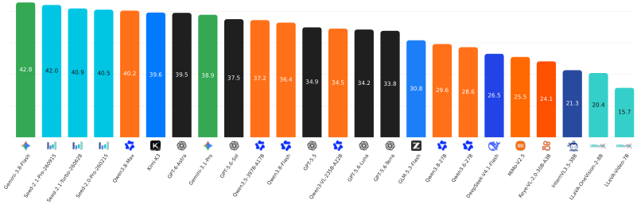
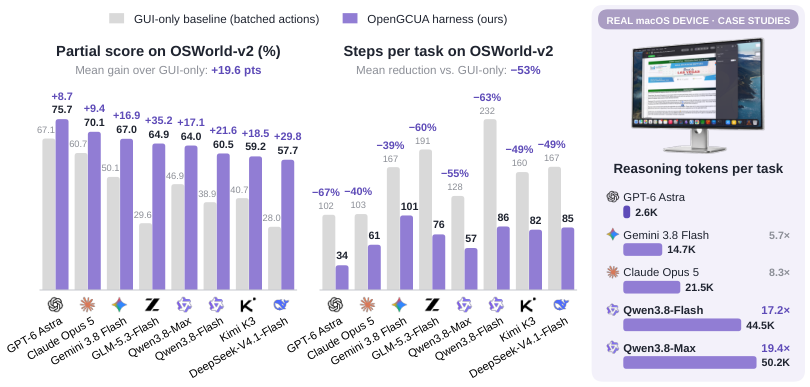
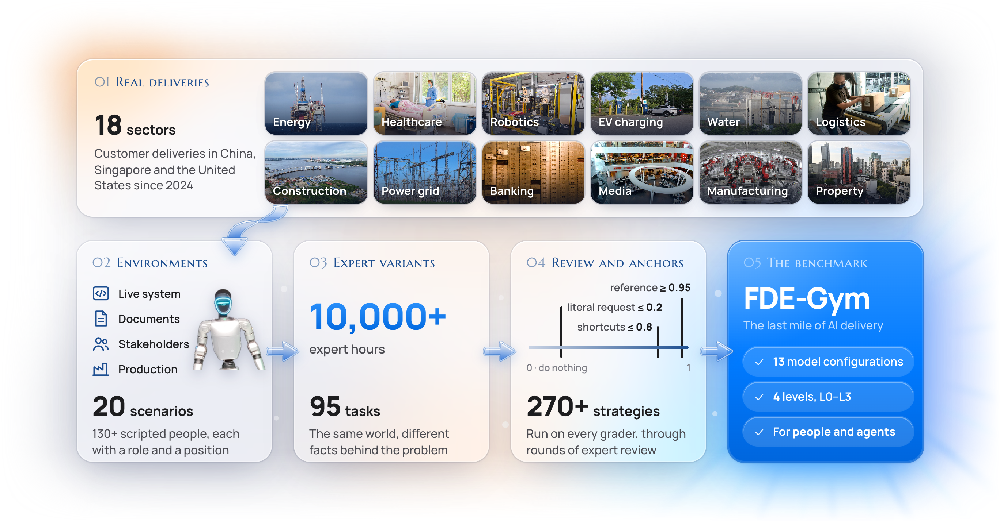
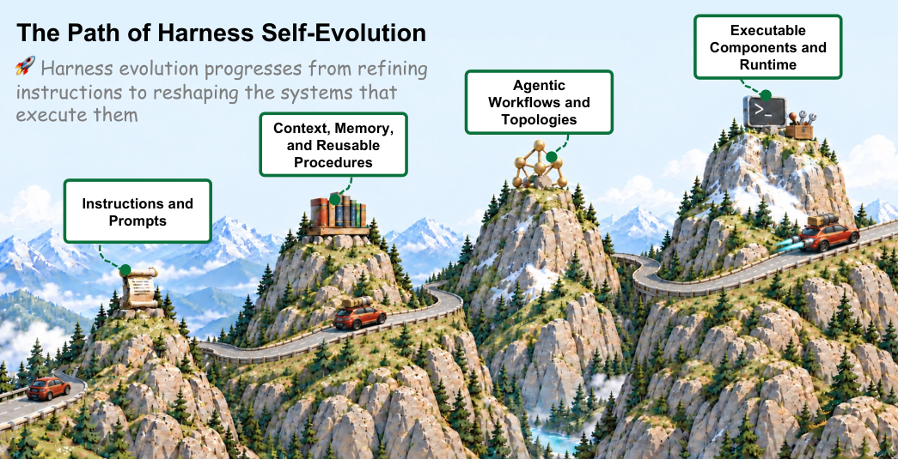
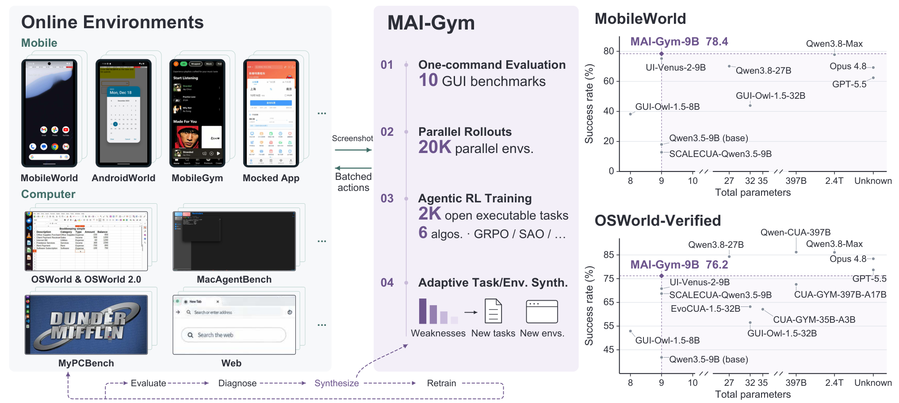
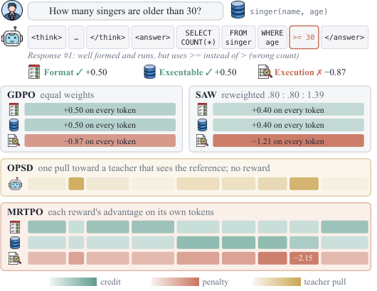
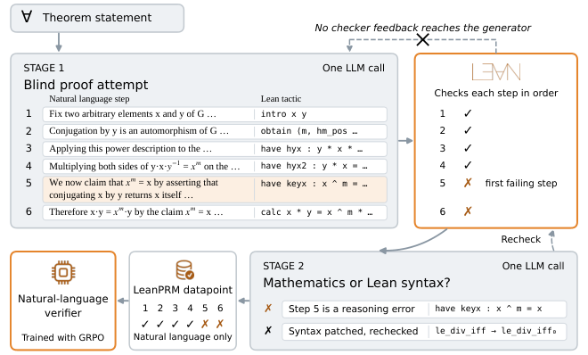

# Daily AI papers — 2026-10-17

*Curated from HF Daily Papers. 15 of ~55 papers kept after relevance filter.*

## Papers at a glance

| # | Title | Topics | Org |
| --- | --- | --- | --- |
| 1 | [Waypoint-OPD: Gated On-Policy Distillation](#1-waypoint-opd) | `RL`, `distillation` | Alibaba Cloud |
| 2 | [OmniCompass: Omni-Modal Video Benchmark](#2-omnicompass) | `multimodal`, `eval` | HK PolyU · OPPO |
| 3 | [MJev-Spatial: Native Attention Matching](#3-mjev-spatial) | `multimodal`, `efficient-inference` | — |
| 4 | [OpenGCUA: Open Generalist Computer-Use Stack](#4-opengcua) | `agents`, `multimodal` | Alibaba MAI-UI |
| 5 | [FDE-Gym: Last Mile of AI Delivery](#5-fde-gym) | `agents`, `eval` | DeepLethe · Tsinghua · SJTU |
| 6 | [Self-Evolving Agent Harness](#6-self-evolving-harness) | `agents`, `safety` | Zhongguancun · USTC |
| 7 | [MAI-Gym: GUI Agent RL Platform](#7-mai-gym) | `agents`, `RL` | Alibaba Tongyi-MAI |
| 8 | [SAE Additivity Residuals](#8-sae-residuals) | `interp` | UW–Madison |
| 9 | [Speculative Forcing for AR Video](#9-speculative-forcing) | `efficient-inference`, `diffusion` | NAVER AI Lab |
| 10 | [MRTPO: Per-Reward Token Credit](#10-mrtpo) | `RL`, `reasoning` | NUS · UIUC · USC |
| 11 | [Mosaic: Multi-Session Agentic RL](#11-mosaic) | `RL`, `agents` | HKUST(GZ) · Huawei |
| 12 | [AutoSFT: Agentic Data Research](#12-autosft) | `data`, `agents` | UIUC · Tsinghua · ModelBest |
| 13 | [Virtual Head Attention](#13-vha) | `architectures`, `efficient-inference` | Baidu · PKU |
| 14 | [FlashMask-3: Mask-Aware Distributed Attention](#14-flashmask-3) | `systems`, `attention` | Baidu |
| 15 | [LeanPRM: Lean-Grounded Process Supervision](#15-leanprm) | `reasoning`, `eval` | UCLA · NYU |

---

## 1. Waypoint-OPD: Transferring RL-Induced Policy Shifts via Gated On-Policy Distillation {#1-waypoint-opd}

**Authors:** Guochao Jiang, Guofeng Quan, Weiqing Li, Wenfeng Feng, Guohua Liu, Yuewei Zhang — *Alibaba Cloud Computing*
**Links:** [arXiv:2610.21601](https://arxiv.org/abs/2610.21601) · [HF](https://huggingface.co/papers/2610.21601) · [AlphaXiv](https://www.alphaxiv.org/abs/2610.21601)
**Topics:** `RL`, `distillation`, `post-training`

### TL;DR

A distillation recipe that uses a mid-RL *waypoint* teacher checkpoint to decide, token by token, whether the final teacher's shift from the base model is trustworthy. When the early (base→waypoint) and late (waypoint→final) shifts agree in direction, the full endpoint shift is distilled; when they disagree it is gated down. One extra frozen scoring pass is all it costs.

### Key idea

Decompose "what RL learned" into two policy shifts and only transfer the parts both halves of training agreed on. Agreement is scored on-policy from student rollouts, which keeps distribution matched to the student.

### Main finding

With Qwen3-8B / 14B / 30B-A3B students across math and code suites, Waypoint-OPD reports the top average score among compared on-policy distillation baselines, with no new rollouts beyond a single frozen pass per step.

### Why it matters

RL post-training is expensive and hard to redo per student. If a shelved RL run also leaves a mid-checkpoint, this says you can get more signal out of the pair than from the endpoint alone — a cheap bolt-on to standard on-policy distillation.

### Knowledge graph integration

**Builds on / relates to existing pages:**
- [grpo.md](../post-training/grpo.md) — Waypoint-OPD distills from GRPO-trained teachers.
- [rlvr.md](../post-training/rlvr.md) — math/code tasks here are the canonical RLVR setting.
- [_rl.md](../post-training/_rl.md) — fits the on-policy-distillation branch of post-training.

**Suggested new pages:**
- `post-training/on-policy-distillation.md` *(depth)* — covers the general technique family this paper extends.
- `post-training/waypoint-opd.md` *(depth)* — the gated-shift variant specifically.

---

## 2. OmniCompass: A Holistic Benchmark for Omni-Modal Video Grounding and Understanding {#2-omnicompass}

**Authors:** Xuyang Liu, Shihao Wang, Xinyu Wei, Minghan Li, Zeqing Wang, Zuhao Yang, Zichen Wen, Lei Zhang — *HK PolyU · OPPO Research Institute · Colorado School of Mines · NTU · SJTU*
**Links:** [arXiv:2610.18829](https://arxiv.org/abs/2610.18829) · [HF](https://huggingface.co/papers/2610.18829) · [AlphaXiv](https://www.alphaxiv.org/abs/2610.18829)
**Topics:** `multimodal`, `eval`, `video`

### TL;DR

A dual-track benchmark for video MLLMs: OmniCompass-VL (vision+text) and OmniCompass-AV (audio+video). Each track evaluates temporal grounding, spatial grounding, and open QA with 50 MLLMs scored side by side.

### Key idea

Separate "video+caption" models from true omni-modal models that must reason over joint audio-visual evidence, and score them on the *same* grounding tasks so the audio contribution is isolable.

### Main finding

Open-source MLLMs lag proprietary ones on both tracks, with the gap widest on audio-visual understanding — an under-covered axis in current VLM benchmarks.

### Why it matters

Audio has been an afterthought in VLM evaluation. OmniCompass gives a shared yardstick that an omni-modal release can report alongside existing video-only numbers.

### Knowledge graph integration

**Builds on / relates to existing pages:**
- [evaluation/README.md](../evaluation/README.md) — adds a new multimodal benchmark.
- [multimodal/README.md](../multimodal/README.md) — targets the omni-modal (A+V+T) frontier.

**Suggested new pages:**
- `evaluation/omnicompass.md` *(depth)* — dual-track AV grounding benchmark.

---

## 3. MJev-Spatial: System One Spatial Intelligence via Native Attention Matching {#3-mjev-spatial}

**Authors:** Not disclosed on the HF page — *organization not disclosed*
**Links:** [arXiv:2610.22276](https://arxiv.org/abs/2610.22276) · [HF](https://huggingface.co/papers/2610.22276) · [AlphaXiv](https://www.alphaxiv.org/abs/2610.22276)
**Topics:** `multimodal`, `architectures`, `efficient-inference`

### TL;DR

Instead of generating a text answer for spatial questions (choose option, pick point, output a number), MJev-Spatial scores candidates in a single attention forward pass and picks the top one — "native attention matching" over multiple-choice options, image points, or numerical bins.

### Key idea

Replace autoregressive decoding for closed-form spatial outputs with a classification head that reads attention between the question and each candidate. One pass, no sampling, no beam.

### Main finding

Built on Qwen3.5-4B and trained on 12.3M QA pairs, MJev-Spatial reports the top overall spatial score among eight compared models and ≈5.6× faster inference than its autoregressive base.

### Why it matters

Spatial reasoning benchmarks (counting, pointing, option-selection) don't *need* free-form text output. Matching cuts latency hard without accuracy loss, and the pattern transfers to any closed-set VQA.

### Knowledge graph integration

**Builds on / relates to existing pages:**
- [multi-head-attention.md](../architectures/multi-head-attention.md) — the matching head sits on top of standard attention.
- [transformer-block.md](../architectures/transformer-block.md) — modifies the output path.
- [multimodal/README.md](../multimodal/README.md) — new technique for VLM output format.

**Suggested new pages:**
- `multimodal/native-attention-matching.md` *(depth)* — classification-via-attention output head.

---

## 4. OpenGCUA: Toward a Fully Open Stack for Generalist Computer Use {#4-opengcua}

**Authors:** Hanzhang Zhou, Long Li, Quyu Kong et al. (15 authors) — *Alibaba MAI-UI (Tongyi-MAI)*
**Links:** [arXiv:2610.22200](https://arxiv.org/abs/2610.22200) · [HF](https://huggingface.co/papers/2610.22200) · [AlphaXiv](https://www.alphaxiv.org/abs/2610.22200)
**Topics:** `agents`, `multimodal`, `computer-use`

### TL;DR

A full open-source stack for computer-use agents that mixes GUI actions with programmatic (code / API) actions in one agent, and distills *harness decisions* (the orchestration logic) back into the model so the model learns when to click, when to script, and when to stop.

### Key idea

"Harness-to-model decision transfer": log the external harness's branching (which tool, when to replan) during inference, use the logs as supervision to fold that logic into the base model.

### Main finding

On OSWorld-v2, OpenGCUA reports higher task scores than GUI-only baselines across eight models and fewer steps per task — the programmatic path shortcuts long click chains.

### Why it matters

A fully open stack (code + weights + training data) for CUA was missing; most strong systems are behind APIs. The harness-distillation trick also points at a path to shrink the harness over time.

### Knowledge graph integration

**Builds on / relates to existing pages:**
- [agents/README.md](../agents/README.md) — extends the CUA topic.
- [multimodal/README.md](../multimodal/README.md) — vision-input action models.

**Suggested new pages:**
- `agents/computer-use-agent.md` *(depth)* — the CUA pattern.
- `agents/harness-to-model-transfer.md` *(depth)* — the distillation trick.
- `case-studies/opengcua.md` *(case study)* — end-to-end open stack.

---

## 5. FDE-Gym: The Last Mile of AI Delivery {#5-fde-gym}

**Authors:** Dongxu Yang, Hongda Yan, Renxin Wang, Youmin Chen et al. — *DeepLethe · Tsinghua · SJTU · 20+ affiliations*
**Links:** [arXiv:2610.22350](https://arxiv.org/abs/2610.22350) · [HF](https://huggingface.co/papers/2610.22350) · [AlphaXiv](https://www.alphaxiv.org/abs/2610.22350)
**Topics:** `agents`, `eval`

### TL;DR

A benchmark of 95 end-to-end "field delivery engineer" tasks adapted by industry experts from real customer projects, where an agent must question scripted stakeholders, work in a modifiable customer system, and improve a measurable business metric.

### Key idea

Score agents by *delta on the customer's own metric*, normalized to 0 (unchanged) → 1 (reference), with penalties per stakeholder interaction. Separates genuine delivery from question-spam.

### Main finding

Across 13 model configurations the best agent reaches mean 0.56 and resolves 14/95 tasks in the realistic setting. Discovering *unstated* customer constraints is the dominant failure mode.

### Why it matters

Delivery is where agent demos break. FDE-Gym turns "can an LLM configure a system end-to-end against a demanding, under-specified customer" into something you can grade.

### Knowledge graph integration

**Builds on / relates to existing pages:**
- [evaluation/README.md](../evaluation/README.md) — new agent benchmark.
- [agents/README.md](../agents/README.md) — long-horizon system-configuration tasks.

**Suggested new pages:**
- `evaluation/fde-gym.md` *(depth)* — delivery benchmark with stakeholder-interaction cost.

---

## 6. Self-Evolving Agent Harness {#6-self-evolving-harness}

**Authors:** Chuyang Wei, Haoxiang Guan, Minghang Zhu, Kexin Zhou, Jiyan He, Xiren Zhou, Huanhuan Chen, Yifei Shen — *Zhongguancun Academy · USTC · Zhongguancun Institute of AI*
**Links:** [arXiv:2610.18813](https://arxiv.org/abs/2610.18813) · [HF](https://huggingface.co/papers/2610.18813) · [AlphaXiv](https://www.alphaxiv.org/abs/2610.18813)
**Topics:** `agents`, `safety`

### TL;DR

A formal framework for *harness self-evolution*: an agent revises its own prompts, memory, workflows, tools, and plugin composition from feedback — persisting changes across runs — while the model weights stay frozen. The paper separates update *target* from update *mechanism* and gives continual-PAC bounds plus an admission rule from fresh validation data.

### Key idea

Treat the surrounding software as the search variable; the model is a fixed oracle. Admit a proposed change only if its generalization bound on new validation data clears a threshold.

### Main finding

Positions the field: distinguishes interpreted-state edits (prompts, memory) from tool/code/plugin rewrites, and places evolutionary search, meta-prompting, and self-rewrite under one theory. The admission rule is the concrete safety lever.

### Why it matters

Self-modifying harnesses are proliferating without a shared vocabulary or safety story. The explicit "what can change, under what admission rule" split lets reviewers audit a self-evolving system without reading its whole history.

### Knowledge graph integration

**Builds on / relates to existing pages:**
- [agents/README.md](../agents/README.md) — frames self-evolution as an agents sub-topic.
- [safety/README.md](../safety/README.md) — admission rules sit here.

**Suggested new pages:**
- `agents/harness-self-evolution.md` *(depth)* — the framework and admission rule.

---

## 7. MAI-Gym: Open All-in-One Platform for GUI Agent Evaluation and RL Training {#7-mai-gym}

**Authors:** Panrong Tong, Quyu Kong, Pengxiang Li, Tianyu Xia, Hanzhang Zhou, Lei Wang et al. — *Alibaba Tongyi-MAI*
**Links:** [arXiv:2610.20939](https://arxiv.org/abs/2610.20939) · [HF](https://huggingface.co/papers/2610.20939) · [AlphaXiv](https://www.alphaxiv.org/abs/2610.20939)
**Topics:** `agents`, `RL`, `GUI`

### TL;DR

An open platform that bundles ten GUI benchmarks, scales to 20K parallel environments, and auto-generates resettable mock apps with verified tasks. Used to train MAI-Gym-9B via online RL across mobile, computer, and web environments.

### Key idea

Mock-app synthesis + verification pipeline turns a long-tail of GUIs into a resettable RL playground; cross-environment training (mobile + web + desktop) generalizes to new interfaces.

### Main finding

MAI-Gym-9B reports 78.4% on MobileWorld and 76.2% on OSWorld-Verified (SOTA among <10B open GUI agents). Training on a *mock* train-ticket app raises success on the real-phone counterpart from 28.8% to 48.1%.

### Why it matters

The sim-to-real jump for GUI agents is the main open question. 48.1% from a mock-only policy is a sign that cheap synthesized environments can carry a nontrivial fraction of the training signal.

### Knowledge graph integration

**Builds on / relates to existing pages:**
- [agents/README.md](../agents/README.md) — GUI agent branch.
- [_rl.md](../post-training/_rl.md) — online RL training setup.
- [partial-rollouts.md](../systems/partial-rollouts.md) — 20K parallel envs is a rollout-infrastructure story.

**Suggested new pages:**
- `agents/gui-agent-rl.md` *(depth)* — mock-env + online RL recipe for GUI agents.

---

## 8. Behavioral Compositionality of Sparse Autoencoder Representations {#8-sae-residuals}

**Authors:** Ziye Mei, Frederic Sala — *University of Wisconsin–Madison*
**Links:** [arXiv:2610.21261](https://arxiv.org/abs/2610.21261) · [HF](https://huggingface.co/papers/2610.21261) · [AlphaXiv](https://www.alphaxiv.org/abs/2610.21261)
**Topics:** `interp`, `SAE`

### TL;DR

Introduces *SAE Additivity Residuals* (SAR) to measure how much a behavior fails to decompose into a sum over individual SAE features. Pairwise interaction terms close most of the gap; third-order terms don't help much.

### Key idea

Pick a scalar behavior (toxicity, sentiment, …). Measure how well a linear sum of per-feature contributions predicts behavior change under combinations; the residual quantifies *non-additivity*.

### Main finding

Across three models and six behaviors, learned SAE coordinates beat random rotations on first-order prediction. Adding pairwise terms raises steering rank fidelity from 0.5874 → 0.7790; parameter-matched random third-order terms don't help further.

### Why it matters

The dream of SAEs is "edit one feature, change one thing." This paper quantifies when that's a lie: feature interactions are often necessary for a faithful steering vector, and pairwise is usually enough.

### Knowledge graph integration

**Builds on / relates to existing pages:**
- [interpretability/README.md](../interpretability/README.md) — direct SAE methodology contribution.

**Suggested new pages:**
- `interpretability/sae-additivity.md` *(depth)* — SAR metric and the pairwise-interaction finding.

---

## 9. Speculative Forcing for Efficient Autoregressive Video Generation {#9-speculative-forcing}

**Authors:** Author list not fully disclosed — *NAVER AI Lab (listed affiliation)*
**Links:** [arXiv:2610.22347](https://arxiv.org/abs/2610.22347) · [HF](https://huggingface.co/papers/2610.22347) · [AlphaXiv](https://www.alphaxiv.org/abs/2610.22347)
**Topics:** `efficient-inference`, `diffusion`, `video`

### TL;DR

Treats intermediate clean estimates from a few-step AR video generator as *draft tokens* and accepts converged ones early. Accepted tokens freeze, but their KV cache stays live as context. Two verifiers decide — a training-free similarity+stability check, and a learned verifier reading intermediate features.

### Key idea

Speculative decoding, but *across denoising steps instead of across models*. The "draft" is yourself at an earlier step; verification is whether you've already converged.

### Main finding

On LongLive, matches the 4-step generator's quality at ≈1.7 effective steps per token (>1.5× speedup). On Lingbot-World 2.0 world model, ≈2.5 steps/token at 1.35× speedup, quality held.

### Why it matters

Few-step AR video generators are the current efficient-video frontier; this knocks ~40% off their decode. The idea — early-exit per token with a cheap verifier — likely transfers to other iterative-refinement generators.

### Knowledge graph integration

**Builds on / relates to existing pages:**
- [inference/README.md](../inference/README.md) — speculative decoding family.

**Suggested new pages:**
- `inference/speculative-forcing.md` *(depth)* — cross-step speculative decoding for AR video.

---

## 10. Each Reward to Its Relevant Tokens: Reward-Specific Token-Level Credit Assignment for Multi-Reward RL (MRTPO) {#10-mrtpo}

**Authors:** Haonan Wang, Zhining Liu, Linxin Song, Xuwei Ding, Jingcheng Liang, Jian Kang — *NUS · UIUC · USC · UPenn · UMN · MBZUAI*
**Links:** [arXiv:2610.21439](https://arxiv.org/abs/2610.21439) · [HF](https://huggingface.co/papers/2610.21439) · [AlphaXiv](https://www.alphaxiv.org/abs/2610.21439)
**Topics:** `RL`, `reasoning`, `credit-assignment`

### TL;DR

In multi-reward RL (tool-call correctness + format + each instruction constraint), MRTPO assigns each reward's advantage only to the tokens that reward actually depends on, measured by replaying the response with vs. without the verifier context and taking the per-token JS distance between next-token distributions.

### Key idea

Per-reward token masks come free from the policy itself: tokens whose distribution shifts when you reveal/hide a verifier are the tokens that reward "cares about." No auxiliary model, no token-level labels.

### Main finding

On text-to-SQL, multi-constraint instruction following, and tool calling, MRTPO converges faster and reaches higher accuracy than GDPO and GRPO baselines that spread advantages uniformly.

### Why it matters

Multi-reward RLVR is the standard setting now (format + correctness + constraints), and the universal failure mode is one reward drowning out another. Reward-specific token credit is a cheap, auxiliary-free way to fix it.

### Knowledge graph integration

**Builds on / relates to existing pages:**
- [grpo.md](../post-training/grpo.md) — direct extension of GRPO-style advantage estimation.
- [_rewards.md](../post-training/_rewards.md) — multi-reward composition.
- [rlvr.md](../post-training/rlvr.md) — the verifiable-reward RL regime.

**Suggested new pages:**
- `post-training/mrtpo.md` *(depth)* — reward-specific token-level credit assignment.

---

## 11. Mosaic: Multi-Session Agentic Reinforcement Learning {#11-mosaic}

**Authors:** Minrui Xu, Xinyu Zhou, Xiang Long, Haochen Tan, Zhijiang Guo — *LARK (HKUST(GZ)) · Huawei Foundation Model Lab · CityU HK · HKUST*
**Links:** [arXiv:2610.22174](https://arxiv.org/abs/2610.22174) · [HF](https://huggingface.co/papers/2610.22174) · [AlphaXiv](https://www.alphaxiv.org/abs/2610.22174)
**Topics:** `RL`, `agents`, `long-horizon`

### TL;DR

Multi-session agentic RL: trajectories that span multiple sessions (via context compaction or subagent forking) violate single-session RL assumptions. Mosaic is a critic-free method that credits sessions at two levels — trajectory (sessions-per-outcome) and session (marginal contribution).

### Key idea

Decouple the per-session advantage from the per-trajectory advantage. At the trajectory level, condition on session count; at the session level, score each session by estimated marginal contribution to the final outcome.

### Main finding

On BrowseComp with Qwen3.5-4B, Mosaic beats uniform-broadcast baselines in both compaction and subagent regimes, and uses fewer sessions on average.

### Why it matters

Real agents already compact context and spawn subagents; training signal that collapses them to one monolithic trajectory is wasteful. Mosaic is a straightforward way to keep the credit assignment honest.

### Knowledge graph integration

**Builds on / relates to existing pages:**
- [_rl.md](../post-training/_rl.md) — agentic RL branch.
- [grpo.md](../post-training/grpo.md) — critic-free advantage decomposition fits here.
- [partial-rollouts.md](../systems/partial-rollouts.md) — multi-session infrastructure is a rollout-management concern.

**Suggested new pages:**
- `post-training/multi-session-arl.md` *(depth)* — Mosaic's two-level credit decomposition.

---

## 12. AutoSFT: An Agentic System for Automated Data Research in Supervised Fine-Tuning {#12-autosft}

**Authors:** Pengqi Sun, Shihao Peng, Shaoxuan Li, Huiyu Xiao et al. — *UIUC · Tsinghua · ModelBest · CUHK · BUPT*
**Links:** [arXiv:2610.22194](https://arxiv.org/abs/2610.22194) · [HF](https://huggingface.co/papers/2610.22194) · [AlphaXiv](https://www.alphaxiv.org/abs/2610.22194)
**Topics:** `data`, `agents`, `SFT`

### TL;DR

A multi-agent system (meta + executor + 4 analysis subagents + 1 synthesis subagent) that iteratively edits SFT data via six actions — reweight, prune, repair, synthesize, etc. Retrains from base each round, so gains attribute to the data change not accumulated finetunes.

### Key idea

A single agent given free rein picks one data action and tunnels on it. Decompose the agent so each subagent specializes in one action, and let a meta-agent compose them.

### Main finding

Analysis subagents raise best IFEval score by 6.5 points over a strong SFT baseline; synthesis adds +3.4 IFEval and +2.9 IFBench. Code domain: +3.7 MBPP+. The win comes from *action diversity*, not any one action.

### Why it matters

Automated data curation is the near-term lever most labs can actually pull. AutoSFT's "diverse actions > stronger single action" result is a direct recipe for teams trying to automate dataset iteration.

### Knowledge graph integration

**Builds on / relates to existing pages:**
- [_data-curation.md](../data/_data-curation.md) — adds agentic iteration to the curation taxonomy.
- [post-training/fine-tuning/README.md](../post-training/fine-tuning/README.md) — SFT pipeline.
- [quality-filtering.md](../data/quality-filtering.md) — one of the six actions.

**Suggested new pages:**
- `data/autosft.md` *(depth)* — multi-agent SFT data research with six-action vocabulary.

---

## 13. Virtual Head Attention {#13-vha}

**Authors:** Xibo Ding*, Guoxia Wang*, Jinle Zeng, Jiabin Yang, Sirui Tao, Chao Yang, Dianhai Yu — *Baidu Inc. · Peking University* (equal / corresponding as marked)
**Links:** [arXiv:2610.17959](https://arxiv.org/abs/2610.17959) · [HF](https://huggingface.co/papers/2610.17959) · [AlphaXiv](https://www.alphaxiv.org/abs/2610.17959)
**Topics:** `architectures`, `attention`, `efficient-inference`

### TL;DR

An attention variant that halves physical query heads and uses only two KV heads, then adds two small *linear* layers — Q Premix (expands query heads into virtual heads) and Linear Postmix (mixes across heads). Both are linear, so they fold into the standard Q and O projections at inference: the model *runs* as GQA-2 with no overhead.

### Key idea

Virtual heads are a training-time abstraction. Because premix/postmix are linear, matrix absorption collapses them into the vanilla projections — a pure training-side modification that costs nothing at inference.

### Main finding

Across pretraining from 0.6B to 8B-A1B, VHA beats the GQA baseline at every scale with smaller KV cache and fewer training FLOPs. Gains hold on a 30B-A3B MoE and a 128K-context setup.

### Why it matters

GQA/MQA trade quality for KV-cache size; VHA says you can keep GQA-2 inference *and* recover much of MHA's quality by only changing how training sees heads. If it reproduces, this is a drop-in replacement.

### Knowledge graph integration

**Builds on / relates to existing pages:**
- [multi-head-attention.md](../architectures/multi-head-attention.md) — direct variant of MHA/GQA.
- [mla.md](../architectures/mla.md) — related KV-cache-reduction axis.
- [attention.md](../fundamentals/attention.md) — core attention mechanism.

**Suggested new pages:**
- `architectures/vha.md` *(depth)* — virtual-head attention with linear-fold inference.

---

## 14. FlashMask-3: Efficient and Expressive Mask-Aware Distributed Attention {#14-flashmask-3}

**Authors:** Qianyue He, Siming Wu, Haoyang Xie, Qiwen Bao, Jinle Zeng, Jiabin Yang, Tian Wu, Dianhai Yu — *Baidu Inc.*
**Links:** [arXiv:2610.17901](https://arxiv.org/abs/2610.17901) · [HF](https://huggingface.co/papers/2610.17901) · [AlphaXiv](https://www.alphaxiv.org/abs/2610.17901)
**Topics:** `systems`, `attention`, `context-parallel`

### TL;DR

Extends FlashMask's compact column-wise mask representation with a Hopper-optimized FA3-pipelined kernel, a distributed extension that keeps masks local (no cross-rank mask communication), and a load balancer / overlap scheme that accounts for mask sparsity.

### Key idea

Treat the structured mask as a first-class citizen of context parallelism — localize it, respect it when balancing shards, and overlap mask-dependent compute with comms.

### Main finding

Beats FlashMask, FlexAttention, and MagiAttention single-GPU across 12 mask patterns. Better CP scaling than Megatron-Core CP and MagiAttention. End-to-end 7.3–11.0% training throughput gain for a 118B-A14B MoE on 128× H100.

### Why it matters

Long-context MoE training is the hot path for 2026 frontier models; mask handling is the under-reported bottleneck. ~10% end-to-end at frontier scale is real money.

### Knowledge graph integration

**Builds on / relates to existing pages:**
- [attention.md](../fundamentals/attention.md) — adds mask-aware fast attention variant.
- [dualpipe.md](../systems/dualpipe.md) — same genre of training-systems optimization.
- [systems/README.md](../systems/README.md) — distributed attention topic.

**Suggested new pages:**
- `systems/flashmask-3.md` *(depth)* — mask-aware distributed attention kernel.

---

## 15. LeanPRM: Lean-Grounded Process Supervision for Natural Language Proof Verification {#15-leanprm}

**Authors:** Salman Rahman*, Jingyan Shen*, James Shiffer, Saadia Gabriel, Pavel Izmailov* — *UCLA · NYU* (*equal)
**Links:** [arXiv:2610.17697](https://arxiv.org/abs/2610.17697) · [HF](https://huggingface.co/papers/2610.17697) · [AlphaXiv](https://www.alphaxiv.org/abs/2610.17697)
**Topics:** `reasoning`, `PRM`, `formal-methods`

### TL;DR

Builds a process-reward dataset for natural-language math proofs *without human annotators*: a model writes an informal proof and a matching Lean proof; Lean checks the formal steps; a second model strips failures caused by formal-syntax issues. The result is 10,634 proofs with ~152K per-step labels.

### Key idea

Formal verification = free labeler. Lean's step-granular pass/fail gives per-step correctness for the matching natural-language step — once syntax-only failures are filtered out, remaining errors are mathematical.

### Main finding

A 4B PRM trained on this corpus beats a 4B PRM trained on PRM800K (human-labeled) on exact step accuracy and on best-of-N proof selection, including on three of four external benchmarks.

### Why it matters

PRM800K-style human labels are the bottleneck for reasoning verifiers. If Lean coverage is enough to scale PRM training, the ceiling moves from annotator budget to formal-theorem corpus size — potentially a lot higher.

### Knowledge graph integration

**Builds on / relates to existing pages:**
- [prm.md](../post-training/reasoning/prm.md) — new training recipe for process reward models.
- [cot-reward-model.md](../post-training/cot-reward-model.md) — related reward-model family.
- [orm.md](../post-training/reasoning/orm.md) — contrast with outcome-reward.

**Suggested new pages:**
- `post-training/reasoning/leanprm.md` *(depth)* — Lean-grounded PRM training recipe.

---

## Notes

- Borderline inclusions flagged in-section with an italic *Borderline: …* note (none this issue — all picks fit cleanly).
- Hero figures live in `assets/2026-10-17/`. Papers #8 (SAE Additivity) and #13 (Virtual Head Attention) have no first-page figure in their arxiv HTML, so the `![Hero figure]` line is omitted.
- This digest is informational. No existing concept files, `READING-LIST.md`, or `PAPERS.md` were modified to produce it.
