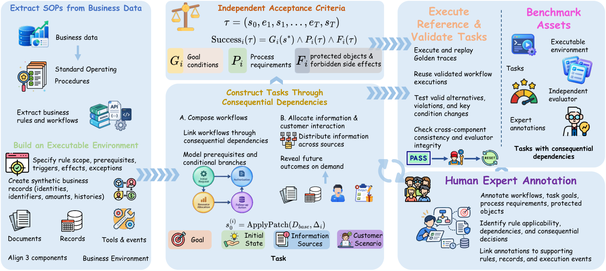
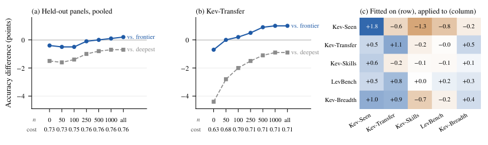
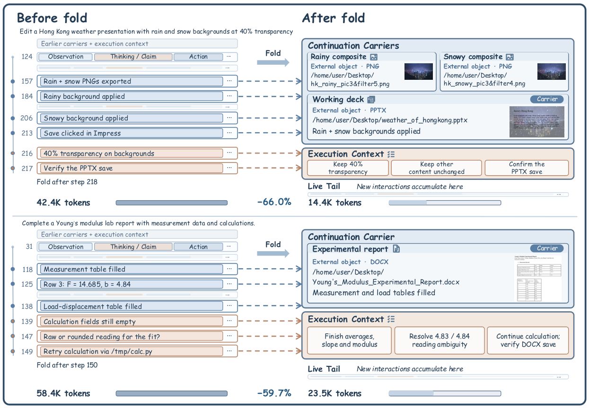
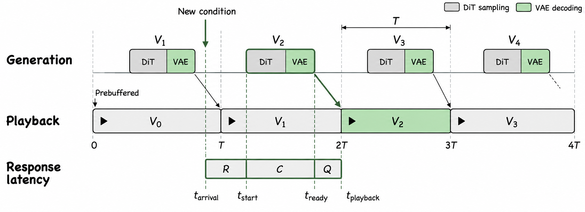
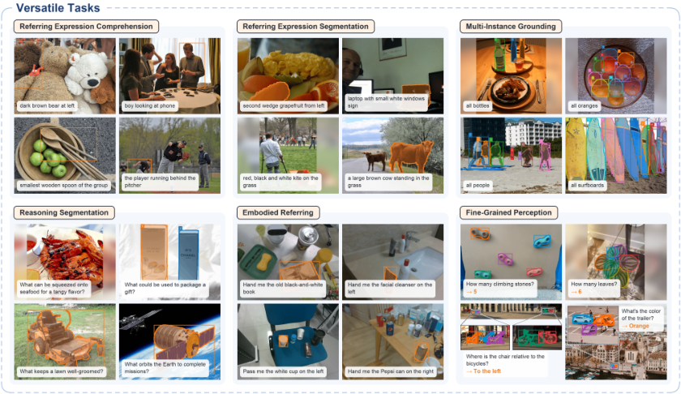
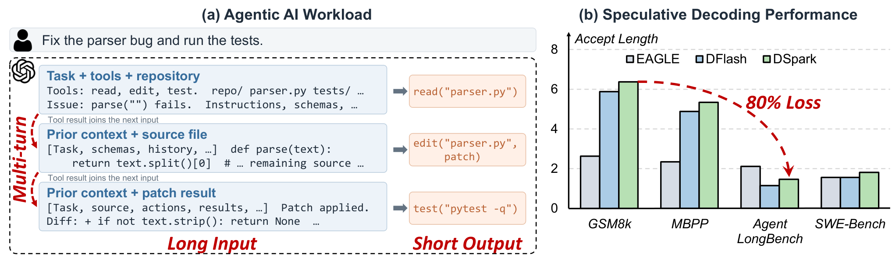
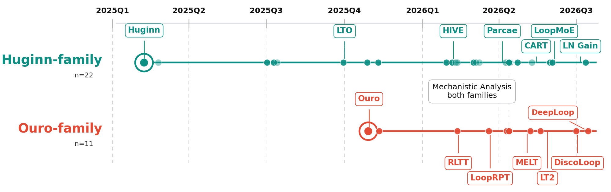
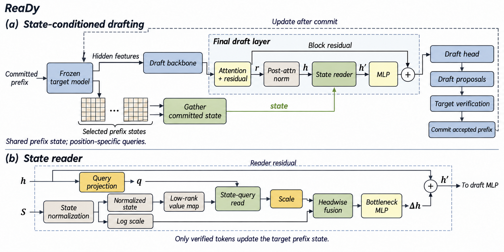
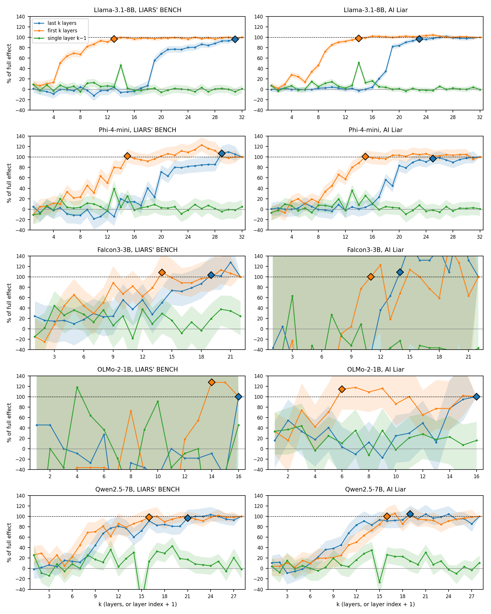

# Daily AI papers — 2026-10-19

*Curated from HF Daily Papers. 15 of ~66 papers kept after relevance filter.*

## Papers at a glance

| # | Title | Topics | Org |
| --- | --- | --- | --- |
| 1 | [BizBench: Unveiling Hidden Challenges in Deploying Long-Horizon Agents](#1-bizbench) | `agents`, `eval` | Peking U. / Ant International |
| 2 | [LEV: Thinking Fast and Deep with Looped Decision Models](#2-lev) | `architecture`, `efficient-inference`, `reasoning` | Lehigh / UBC / Vector |
| 3 | [Pack Light, CarryOn: Object-Oriented Context for Long-Horizon Agents](#3-pack-light-carryon) | `agents`, `efficient-inference` | UC San Diego |
| 4 | [Speculative Sampling in Interactive Video Generation](#4-speculative-sampling-ivg) | `diffusion`, `video`, `efficient-inference` | CUHK / USTC |
| 5 | [Tree-Aware Posterior Distillation for Long-Horizon Agentic RL](#5-treeopsd) | `RL`, `agents` | Tsinghua / Tencent |
| 6 | [Lexical Reference Frames: Interpreting LM Residual Streams](#6-lexical-reference-frames) | `interp` | (not disclosed) |
| 7 | [Xiaomi-Lens-0 Technical Report](#7-xiaomi-lens-0) | `multimodal`, `tech-report` | Xiaomi |
| 8 | [DLite: History-Free Speculative Decoding for Agentic AI](#8-dlite) | `efficient-inference`, `agents` | SJTU / Tsinghua / Infinigence-AI |
| 9 | [MOSS-Image Technical Report](#9-moss-image) | `diffusion`, `multimodal`, `tech-report` | Fudan MOSS |
| 10 | [Towards Looped Models Done Right, Part I](#10-looped-models-done-right) | `architecture`, `MoE`, `efficient-inference` | IFM / USC / CMU |
| 11 | [OPMD: On-Policy Mechanism Distillation Beyond Output Supervision](#11-opmd) | `fine-tuning`, `distillation` | ShanghaiTech |
| 12 | [Embeddings Are Overpriced? A Frozen 16 MB Vocabulary](#12-embeddings-overpriced) | `fundamentals`, `tokenization`, `quantization` | QLNI |
| 13 | [Sparse Autoencoders Are a Shared Coordinate System for Symbolic Matching](#13-sae-idf) | `interp` | UIUC |
| 14 | [ReaDy: Recurrent States as Dynamic Context for Speculative Drafting](#14-ready) | `efficient-inference`, `architecture` | HKU et al. |
| 15 | [Resisting Harmful Instructions through Training-Free Weight Editing](#15-weight-editing-safety) | `safety`, `interp` | UIUC |

---

## 1. BizBench

**Authors:** Wei Wu et al. — *Peking University / Ant International*
**Links:** [arXiv:2610.20424](https://arxiv.org/abs/2610.20424) · [HF](https://huggingface.co/papers/2610.20424) · [AlphaXiv](https://www.alphaxiv.org/abs/2610.20424)
**Topics:** `agents`, `eval`

### TL;DR

A 50-task long-horizon agent benchmark drawn from real payment-company workflows at Ant. Agents must identify which business rules apply, use tools, run multi-turn customer dialogue, and keep actions valid *along the way*, not just hit the final goal. A deterministic evaluator judges both outcomes and the full execution trace against distributed, versioned business guidance.

### Key idea

Replace outcome-only agent eval with **trajectory-aware** eval. The evaluator checks the final goal, process compliance (rule-following at each step), and protection requirements (no violations) over the entire multi-turn history, and accepts any valid strategy. Tasks are linked by shared resources, deadlines, and prior commitments, so an agent can't ace one task by breaking another.

### Main finding

The strongest frontier models reach **61–64% strict success**, with high run-to-run variance. Smaller models trail far behind. Outcome-only evaluation mislabels a non-trivial fraction of invalid executions as successful, which BizBench's execution-aware checks catch.

### Why it matters

Business workflows are the practical frontier for long-horizon agents, and outcome-only eval has been masking rule-violation failure modes. BizBench raises the bar for what counts as "the agent completed the task" and gives a template for evaluating process compliance in regulated settings.

### Knowledge graph integration

**Builds on / relates to existing pages:**
- [../agents/README.md](../agents/README.md) — long-horizon tool-use eval setting the folder covers.
- [../evaluation/README.md](../evaluation/README.md) — adds process-aware eval to the benchmark catalog.

**Suggested new pages:**
- `evaluation/bizbench.md` *(depth)* — long-horizon business-workflow agent benchmark with trajectory-aware scoring.
- `evaluation/_agent-benchmarks.md` *(taxonomy)* — outcome-only vs process-aware vs sandbox-based agent eval.

---

## 2. LEV

**Authors:** Zhiling Yan, Yuxuan Zhang, Lichao Sun — *Lehigh University / UBC / Vector Institute*
**Links:** [arXiv:2610.20951](https://arxiv.org/abs/2610.20951) · [HF](https://huggingface.co/papers/2610.20951) · [AlphaXiv](https://www.alphaxiv.org/abs/2610.20951)
**Topics:** `architecture`, `efficient-inference`, `reasoning`

### TL;DR

LEV answers multiple-choice-style questions by **re-running its own transformer layers in a loop** instead of generating a long reasoning trace. A tiny per-step "stopper" head decides when the loop has gone deep enough, so compute is spent per-item rather than per-token. Accuracy improves with loop depth on the same weights, and the saved tokens cut latency sharply.

### Key idea

Looped weight sharing for a reasoning-shaped task where the answer is a short choice, not free-form text. The policy is: forward through the shared block, feed the state back in, and stop as soon as the stopper's confidence crosses a threshold. There is no CoT text at all — the "thinking" is in the latent state across loop steps.

### Main finding

LEV's 1.4B and 3B models beat dense baselines and cascades of similar latency (sub-50 ms) on standard decision benchmarks. Dynamic depth saves **~15–24% compute** against a fixed-depth version with under one accuracy point lost. Accuracy rises monotonically with loop depth on the same weights.

### Why it matters

Reasoning is usually bought with tokens. LEV shows a competitive alternative where the extra compute lives inside the model's layers rather than in a visible scratchpad — faster, cheaper, and compatible with latency-sensitive decision serving. Pairs naturally with the broader looped-model wave (see paper 10).

### Knowledge graph integration

**Builds on / relates to existing pages:**
- [../architectures/transformer-block.md](../architectures/transformer-block.md) — recycled transformer block is the atom of the loop.
- [../post-training/reasoning/length-penalty.md](../post-training/reasoning/length-penalty.md) — related tradeoff: shortening explicit reasoning vs skipping it entirely.

**Suggested new pages:**
- `architectures/looped-transformer.md` *(depth)* — layer-reuse loop with a per-item stopper for dynamic depth.
- `inference/dynamic-depth.md` *(depth)* — adaptive-compute inference variants that stop early per input.

---

## 3. Pack Light, CarryOn

**Authors:** Yuchen Lu, Julian McAuley, Lei Zhang — *UC San Diego*
**Links:** [arXiv:2610.18784](https://arxiv.org/abs/2610.18784) · [HF](https://huggingface.co/papers/2610.18784) · [AlphaXiv](https://www.alphaxiv.org/abs/2610.18784)
**Topics:** `agents`, `efficient-inference`

### TL;DR

A context runtime for long-horizon agents that structures continuation around **reusable task objects** (work products, sourced findings, app state) instead of compressed interaction history. Context has three parts: continuation carriers, execution context (goals/constraints), and a live tail of recent turns. When history is folded away, affected carrier records are revised against evidence while unaffected records are carried forward unchanged.

### Key idea

Treat agent memory as a small object store, not a transcript. Each carrier record is auditable and locally revisable — if its supporting history is removed, the runtime re-checks only that record against evidence and environment, instead of recompressing the whole log. "Folding" replaces covered interaction history with its distilled object set.

### Main finding

On **OSWorld 2.0** and **BrowseComp-Plus**, CarryOn improves task success by **5.8% and 7.0%** respectively while cutting total token usage by **51.9% and 22.9%**. Beats both the baseline agent and simpler compression methods.

### Why it matters

Context compression is becoming the bottleneck for long-horizon agents, and most compressors treat context as flat text. Making the compression object-aware — so progress survives when history gets folded — is a cleaner primitive than "summarize older turns" and generalizes across tasks.

### Knowledge graph integration

**Builds on / relates to existing pages:**
- [../agents/README.md](../agents/README.md) — long-horizon tool-use context management.

**Suggested new pages:**
- `agents/object-oriented-context.md` *(depth)* — carrier records, execution context, folding for long-horizon agents.
- `agents/_context-compression.md` *(taxonomy)* — history summaries vs object stores vs scratchpad protocols.

---

## 4. Speculative Sampling in Interactive Video Generation

**Authors:** Yuxuan Zhang, Jiaming Liu, Sirui Zhao, Enhong Chen — *CUHK / USTC*
**Links:** [arXiv:2610.20556](https://arxiv.org/abs/2610.20556) · [HF](https://huggingface.co/papers/2610.20556) · [AlphaXiv](https://www.alphaxiv.org/abs/2610.20556)
**Topics:** `diffusion`, `video`, `efficient-inference`

### TL;DR

Interactive video diffusion usually keeps chunks tiny for responsiveness, which wastes GPU parallelism and hurts quality. **Speculative Sampling** instead runs a large bidirectional chunk padded with extra noise latents, caches those predictions, and serves them incrementally as long as the condition stays stable. If the user changes the condition, only the uncommitted future is replanned.

### Key idea

Borrow the structure of speculative decoding: generate ahead on a large chunk, verify-and-reuse the cached predictions, and only redo the suffix on condition change. A two-state controller coordinates generation with cache reuse. Chunk size becomes a tunable knob for quality vs sampling time instead of a hard latency ceiling.

### Main finding

On Wan1.3B, LTX-2.3, and Sol-H3, Speculative Sampling delivers **lower response latency than chunk-level baselines even at large chunk sizes**, so quality can rise without hurting interactivity. The analysis also gives a serving-system latency model useful outside video.

### Why it matters

Reframes interactive video serving: the right lever is per-chunk acceleration plus smart cache reuse, not shrinking chunks. Carries the speculative-decoding idiom into a diffusion-serving context, which widens the design space for streaming diffusion.

### Knowledge graph integration

**Builds on / relates to existing pages:**
- [../inference/README.md](../inference/README.md) — same "generate-ahead, verify-and-reuse" pattern as text spec decoding.

**Suggested new pages:**
- `multimodal/speculative-video-sampling.md` *(depth)* — large-chunk speculative sampling with condition-driven replan for interactive video.

---

## 5. TreeOPSD

**Authors:** Qi Wang, Yixiu Mao, Yun Qu, Yuyi Guo, Zeyuan Liu, Chenglin Li, Weijie Liu, Saiyong Yang, Xiangyang Ji — *Tsinghua University / Tencent*
**Links:** [arXiv:2610.23181](https://arxiv.org/abs/2610.23181) · [HF](https://huggingface.co/papers/2610.23181) · [AlphaXiv](https://www.alphaxiv.org/abs/2610.23181)
**Topics:** `RL`, `agents`

### TL;DR

A critic-free RL framework for long multi-turn agent tasks. TreeOPSD branches alternative continuations off shared prefixes in a rollout **tree**, propagates terminal rewards back to turn-level credit, converts that credit into a **bounded teacher distribution**, and trains the student to match the teacher with a Forward-KL loss. The KL target keeps updates stable across sequential mini-batches.

### Key idea

Replace GRPO's flat per-trajectory advantage with per-turn posteriors derived from tree-structured rollouts, then distill those posteriors into the policy with Forward-KL. Trees share prefix compute across branches, and turn-level credit assignment attacks the sparse-reward problem that pure outcome rewards leave open on long horizons.

### Main finding

TreeOPSD improves over GRPO on long-horizon agentic tasks, with the biggest gains on **Deep Research** benchmarks. The authors report that Forward-KL to a bounded teacher is noticeably more stable than running policy gradients directly on the same tree-derived rewards.

### Why it matters

Points at a clean split between credit assignment (do it in reward space with trees) and policy update (do it as distillation, not direct PG). That split is reusable: any mechanism that produces turn-level reward signal can plug into the same Forward-KL update. Likely to influence the next generation of agentic RL recipes.

### Knowledge graph integration

**Builds on / relates to existing pages:**
- [../post-training/grpo.md](../post-training/grpo.md) — direct replacement target: no critic, group-based advantage.
- [../post-training/reasoning/prm.md](../post-training/reasoning/prm.md) — tree-derived turn-level credit is a soft, in-trajectory analogue of process rewards.
- [../post-training/rejection-sampling.md](../post-training/rejection-sampling.md) — tree branches resemble on-policy rejection with reused prefix.
- [../post-training/_rl.md](../post-training/_rl.md) — slots into the critic-free RL family.

**Suggested new pages:**
- `post-training/reasoning/tree-posterior-distillation.md` *(depth)* — tree rollouts → turn-level posterior → Forward-KL distillation into the policy.

---

## 6. Lexical Reference Frames

**Authors:** Not disclosed on the HF page.
**Links:** [arXiv:2610.22169](https://arxiv.org/abs/2610.22169) · [HF](https://huggingface.co/papers/2610.22169) · [AlphaXiv](https://www.alphaxiv.org/abs/2610.22169)
**Topics:** `interp`

### TL;DR

Every hidden state in a transformer has a **native reference frame** — the layers downstream that read it, in the context it was computed from. The paper approximates that frame with "lexical reference frames": pass the state through the model's remaining layers with a chosen number of extra attention rounds, and read it in token-space.

### Key idea

Fixed probes (linear classifiers, tuned lenses, logit lens) fail at mid depth because the state isn't yet in the output frame. LexFrame[k] instead applies k rounds of the model's own attention and FFN to the frozen state before reading, giving a lens that follows the model's internal reading of the state. Supports attribution, steering, and early exit using the same objects.

### Main finding

On SmolLM3-3B and OLMo3-7B (including training checkpoints), **LexFrame[1]** recovers readable semantics at mid-depth where logit lens and tuned lens are unreadable, and is competitive at output layers. It also plugs into existing attribution and steering pipelines without retraining.

### Why it matters

Shifts the mech-interp vocabulary from "find a universal lens" to "borrow the model's own downstream reader." Because the lens is parameter-free, it generalizes across checkpoints and model families, which matters as interp work increasingly tracks training over time.

### Knowledge graph integration

**Builds on / relates to existing pages:**
- [../interpretability/README.md](../interpretability/README.md) — adds a new lens family to the interp toolbox.

**Suggested new pages:**
- `interpretability/lexical-reference-frames.md` *(depth)* — context-aware lenses that read a hidden state through the model's remaining layers.
- `interpretability/_lenses.md` *(taxonomy)* — logit lens vs tuned lens vs LexFrame vs activation patching.

---

## 7. Xiaomi-Lens-0

**Authors:** Xiaomi-Lens-0 contributors — *Xiaomi* (tech report)
**Links:** [arXiv:2610.23279](https://arxiv.org/abs/2610.23279) · [HF](https://huggingface.co/papers/2610.23279) · [AlphaXiv](https://www.alphaxiv.org/abs/2610.23279)
**Topics:** `multimodal`, `tech-report`

### TL;DR

A 4B multimodal LLM built on Qwen3.5 that predicts **segmentation masks from its own visual representations** — no separate segmentation encoder. A lightweight decoder fuses vision-encoder patch features with mask-token hidden states, so mask supervision flows into the shared backbone and the model can interleave reasoning with region-specific latents.

### Key idea

Fold dense perception into the LLM instead of bolting on a specialist head. Mask tokens participate in the normal autoregressive stream; a small decoder reads them alongside vision patches to produce segmentation masks. Because the same backbone carries VQA, grounding, and segmentation, the three tasks share representations and improve jointly.

### Main finding

**+5.6 avg points** over Qwen3.5 across the eight RefCOCO / RefCOCO+ / RefCOCOg splits for referring comprehension, and the highest segmentation cIoU among compared models. Beats Qwen3.5 on every perception benchmark reported in the paper, with no regression on language tasks.

### Why it matters

Shows that modern VLMs can absorb pixel-level outputs through token-level supervision rather than through a bolted-on head. Simpler training, shared gradients, and no architectural bifurcation between "understanding" and "pointing" tasks. Likely to show up as a design pattern in future open VLMs.

### Knowledge graph integration

**Builds on / relates to existing pages:**
- [../multimodal/README.md](../multimodal/README.md) — vision tokenizer + projection setting the folder covers.
- [../case-studies/qwen2-5.md](../case-studies/qwen2-5.md) — Qwen3.5 is the base model.

**Suggested new pages:**
- `case-studies/xiaomi-lens-0.md` *(case study)* — full tech-report breakdown.
- `multimodal/mask-token-segmentation.md` *(depth)* — segmentation head driven by LLM mask tokens.

---

## 8. DLite

**Authors:** Hanzhen Wang, Tianlang Zhao, Jiewen Xiao, Chengze Yuan, Jiayi Pan, Yongkang Zhou, Jiancai Ye, Yu Wang, Guohao Dai — *Shanghai Jiao Tong University / Tsinghua / Infinigence-AI*
**Links:** [arXiv:2610.23787](https://arxiv.org/abs/2610.23787) · [HF](https://huggingface.co/papers/2610.23787) · [AlphaXiv](https://www.alphaxiv.org/abs/2610.23787)
**Topics:** `efficient-inference`, `agents`

### TL;DR

A speculative-decoding drafter built for **agentic workloads** — long, mutating contexts that break conventional draft models. DLite drops the draft model's own history: it reuses the target model's hidden states and predicts the next tokens locally, with no draft KV cache to maintain across turns.

### Key idea

In agent loops, the context evolves faster than a draft model can track, so maintaining a separate draft KV cache both costs memory and goes stale. DLite replaces the draft's history with the target's own hidden states, read at the current step. Prediction stays local, acceptance stays high, and the drafter has no state to flush when the context changes.

### Main finding

**2–6 average accepted length** on agentic benchmarks and **up to 70% speedup** over the DSpark baseline. Gains persist across turns where conventional drafters degrade as context grows and reshuffles.

### Why it matters

Agentic serving is where speculative decoding has struggled most, and this is a clean fix: no draft history to manage, no retraining per workload. Likely to become the default drafter class for long-horizon agent serving stacks.

### Knowledge graph integration

**Builds on / relates to existing pages:**
- [../inference/README.md](../inference/README.md) — adds a new drafter family to the inference toolbox.
- [../agents/README.md](../agents/README.md) — agentic workload is the target setting.

**Suggested new pages:**
- `inference/_speculative-decoding.md` *(taxonomy)* — Medusa / EAGLE / DSpark / DLite drafter families.
- `inference/history-free-drafter.md` *(depth)* — drafter that reads target hidden states instead of maintaining its own KV cache.

---

## 9. MOSS-Image

**Authors:** Zhe Xu, Donghua Yu, Qinyuan Cheng, Zhaoye Fei, Tengyue Zhang, Yanbing Zhang et al.; advisors Xie Chen, Xipeng Qiu — *Fudan NLP (MOSS)* (tech report)
**Links:** [arXiv:2610.23374](https://arxiv.org/abs/2610.23374) · [HF](https://huggingface.co/papers/2610.23374) · [AlphaXiv](https://www.alphaxiv.org/abs/2610.23374)
**Topics:** `diffusion`, `multimodal`, `tech-report`

### TL;DR

An open image-generation system: a **5B diffusion transformer trained from scratch** paired with an **agentic prompt enhancer** that turns short user requests into detailed content and layout specs. Ships with two new benchmarks: LongLongTextBench (LLTB) for dense Chinese/English text rendering and RealLayoutArena (RLA) for end-to-end layout-rich generation.

### Key idea

Decompose "prompt → image" into a planner stage (the agentic enhancer, which writes an explicit layout and content brief) and a renderer stage (the DiT). The planner's output is structured enough to constrain the DiT, so hard-to-render content like long multilingual text and multi-element layouts become tractable without a specialist model.

### Main finding

**SOTA among open-weight models on LLTB** (long-text rendering) and **second place on RLA** (end-to-end layout generation). Open release includes the DiT weights, the enhancer, and the benchmarks.

### Why it matters

Prompt expansion was the quiet trick behind closed-source image models; packaging it as an open agentic enhancer and benchmarking its contribution makes the recipe reproducible. The two new benchmarks also fill a gap for evaluating text and layout fidelity that current image benchmarks underweight.

### Knowledge graph integration

**Builds on / relates to existing pages:**
- [../multimodal/README.md](../multimodal/README.md) — DiT + prompt-enhancer architecture.
- [../case-studies/README.md](../case-studies/README.md) — slots in as an open image-gen tech report.

**Suggested new pages:**
- `case-studies/moss-image.md` *(case study)* — full tech-report breakdown (DiT + enhancer + benchmarks).
- `multimodal/agentic-prompt-enhancer.md` *(depth)* — planner-renderer split for text-to-image generation.
- `evaluation/_text-image-benchmarks.md` *(taxonomy)* — covers LLTB, RLA, DPG-Bench, GenEval-style benchmarks.

---

## 10. Towards Looped Models Done Right, Part I

**Authors:** Chufan Shi, Junlin Chen, Shicheng Wen, Zhengzhong Liu, Eric Xing, Xuezhe Ma — *Institute of Foundation Models / USC / CMU*
**Links:** [arXiv:2610.23036](https://arxiv.org/abs/2610.23036) · [HF](https://huggingface.co/papers/2610.23036) · [AlphaXiv](https://www.alphaxiv.org/abs/2610.23036)
**Topics:** `architecture`, `MoE`, `efficient-inference`

### TL;DR

A controlled ablation of **looped transformer** designs. The authors isolate three axes — loop topology, input injection, and recurrent-state organization — in matched-size, matched-token-budget pretraining. A "sandwich" (prelude → recurrent block → coda) with input injection beats Ouro on all ten benchmarks at 730M / 336B tokens, and the same design transfers to an 8B-resident / 0.8B-active MoE.

### Key idea

Looped models reuse the same transformer blocks across logical depth. The paper disentangles design decisions that prior work entangled: *where* to loop (prelude/body/coda), *whether* to re-inject the input into each iteration, and *how* to organize recurrent state. Random init and separate high/low recurrent states give mixed-to-negative results; input injection mostly helps retrieval and context use.

### Main finding

Under matched train/infer FLOPs, the Huginn-style sandwich uses **75% fewer resident parameters** than a 112-layer feedforward MoE, beats it on DROP and GSM8K, and matches it on MATH500. Design wins carry over from a 730M dense model to an 8B-resident MoE trained on 500B tokens, including more balanced expert routing.

### Why it matters

A pragmatic recipe for looped architectures just as the family regains attention (see paper 2). The ablation also pins down which design choices actually drive the gains, which previous looped-transformer work left as folklore.

### Knowledge graph integration

**Builds on / relates to existing pages:**
- [../architectures/transformer-block.md](../architectures/transformer-block.md) — looped block is the atom of the design.
- [../architectures/_moe.md](../architectures/_moe.md) — the paper's MoE transfer uses the same design axes.

**Suggested new pages:**
- `architectures/looped-transformer.md` *(depth)* — prelude/body/coda sandwich, input injection, recurrent-state design.
- `architectures/_recurrence.md` *(taxonomy)* — looped transformers vs block-recurrent vs SSM/Mamba vs standard depth.

---

## 11. OPMD

**Authors:** Jingyi Yu, Quan Li, Kan Ren (correspondence) — *ShanghaiTech*
**Links:** [arXiv:2610.14022](https://arxiv.org/abs/2610.14022) · [HF](https://huggingface.co/papers/2610.14022) · [AlphaXiv](https://www.alphaxiv.org/abs/2610.14022)
**Topics:** `fine-tuning`, `distillation`

### TL;DR

**On-Policy Mechanism Distillation.** Standard on-policy distillation only matches the teacher's outputs; OPMD also matches the teacher's **intermediate representations** by first converting them into states the student's remaining layers can actually use. Student generates its own text, the teacher-adapted states are read on that text, and the student is trained to reproduce them.

### Key idea

Build a "student-compatible teacher" — a thin adapter that projects the teacher's intermediate activations into the student's layer-wise state space — then distill against those states on student-generated rollouts. Training is on-policy (the student samples), but supervision now includes mechanism, not just outputs. At inference, no teacher is needed.

### Main finding

Highest average accuracy among tested distillation baselines across three teacher-student settings, with additional gains on **multi-teacher distillation** and **cross-family SFT**. The adapter is lightweight compared to the teacher, so training-time cost stays close to standard on-policy distillation.

### Why it matters

Opens a middle ground between output-matching distillation and full feature-matching: match states where the student can use them, skip the ones where it can't. The idea extends to settings where the teacher and student come from different families and share no architecture — a growing need as open-weight distillation scales up.

### Knowledge graph integration

**Builds on / relates to existing pages:**
- [../post-training/_post-training.md](../post-training/_post-training.md) — distillation sits inside the broader post-training taxonomy.
- [../case-studies/deepseek-r1.md](../case-studies/deepseek-r1.md) — reasoning distillation into small models is a natural downstream user of this method.

**Suggested new pages:**
- `post-training/fine-tuning/on-policy-mechanism-distillation.md` *(depth)* — student-compatible teacher + state-level distillation on student rollouts.
- `post-training/fine-tuning/_distillation.md` *(taxonomy)* — output distillation vs on-policy distillation vs mechanism distillation.

---

## 12. Embeddings Are Overpriced?

**Authors:** Sai Kiran Bathula — *QLNI*
**Links:** [arXiv:2610.22428](https://arxiv.org/abs/2610.22428) · [HF](https://huggingface.co/papers/2610.22428) · [AlphaXiv](https://www.alphaxiv.org/abs/2610.22428)
**Topics:** `fundamentals`, `tokenization`, `quantization`

### TL;DR

For small LMs, most of the parameter count and most of the on-disk size (post-compression) is in the vocabulary table. The paper replaces that trained table with a **frozen 16 MB table of 512-bit codes** derived from PCA + sign-binarization of a pretrained embedding — and trains the body from scratch anyway.

### Key idea

The embedding table doesn't have to be learned; it just has to be a reasonable sign code. Derive it once by projecting a pretrained embedding onto 512 principal components and taking signs. The LM body is trained from scratch against this fixed table, and the table can accept **10,000 new words post-training** with little degradation (where a learned table degrades sharply).

### Main finding

With a BitNet-ternary body on 2.05B training tokens, the full model is a **46 MB file** that runs **5–6× faster** than the float model's 8-bit GGUF on a laptop CPU, with **~1/7 the RAM**. Matches or beats the learned-table baseline on LAMBADA, HellaSwag, PIQA; worse on ARC-Easy by about 0.20 nats. Validation loss gap is 0.20 nats despite 2.6× fewer trainable parameters.

### Why it matters

Reframes the SLM / on-device story: with a fixed sign-code vocabulary, nearly all the parameters are in the body, and the body can be made ternary. Also unlocks post-hoc vocabulary extension without retraining — a long-standing pain point for small models.

### Knowledge graph integration

**Builds on / relates to existing pages:**
- [../fundamentals/_tokenization.md](../fundamentals/_tokenization.md) — the paper's "vocabulary" is a sign-code variant worth placing alongside BPE.
- [../quantization/_number-formats.md](../quantization/_number-formats.md) — ternary body pairs naturally with the 1-bit number-format family.

**Suggested new pages:**
- `fundamentals/frozen-sign-code-vocabulary.md` *(depth)* — PCA + sign-binarization gives a fixed, extendable embedding table for small LMs.

---

## 13. SAE-IDF

**Authors:** Xuanyu Meng, Yuji Zhang, Jiawei Han, ChengXiang Zhai — *University of Illinois Urbana-Champaign*
**Links:** [arXiv:2610.19636](https://arxiv.org/abs/2610.19636) · [HF](https://huggingface.co/papers/2610.19636) · [AlphaXiv](https://www.alphaxiv.org/abs/2610.19636)
**Topics:** `interp`

### TL;DR

Treats a sparse autoencoder's feature space as a **shared coordinate system** for aligning symbols across different symbolic systems. For each symbol, feed it to an LLM in its native context, SAE-encode the activations, weight features by rarity (an IDF term), and rank candidates by cosine similarity. Matches across 12 tasks over six kinds of symbolic system.

### Key idea

SAE features are approximately monosemantic, so two symbols that activate the same feature-set are plausibly "about the same thing." Rareness weighting (IDF over feature usage across a reference corpus) suppresses dominant-but-uninformative features and sharpens the match. Every match is traceable to the named concepts that drove it.

### Main finding

Beats the model's own plain hidden-state baseline on **12/12 tasks with Gemma-2-9B** and **11/12 with Llama-3.1-8B**, with gains **up to 45 points** on tasks like entity linking and schema matching. Matches are explainable in terms of named SAE features.

### Why it matters

A concrete, downstream use for SAEs beyond interp-for-its-own-sake: cross-system symbol matching that's both accurate and interpretable. Suggests SAEs can be a general representation layer for retrieval, alignment, and lightweight neuro-symbolic plumbing.

### Knowledge graph integration

**Builds on / relates to existing pages:**
- [../interpretability/README.md](../interpretability/README.md) — adds a downstream task to the SAE toolkit.

**Suggested new pages:**
- `interpretability/sparse-autoencoder.md` *(depth)* — SAE basics (dictionary learning on activations) — fills a long-standing graph gap.
- `interpretability/sae-idf.md` *(depth)* — SAE features + IDF weighting for cross-system symbol matching.

---

## 14. ReaDy

**Authors:** Bohan Sun, Zunhai Su, Xialie Zhuang, Jianjin Li, Ngai Wong, Chuan-Wei Kuo — *The University of Hong Kong (and co-authors)*
**Links:** [arXiv:2610.20503](https://arxiv.org/abs/2610.20503) · [HF](https://huggingface.co/papers/2610.20503) · [AlphaXiv](https://www.alphaxiv.org/abs/2610.20503)
**Topics:** `efficient-inference`, `architecture`

### TL;DR

Speculative decoding tailored to **hybrid linear-attention** LLMs. Each draft position uses a learned query to retrieve context from the target model's committed **recurrent states**, and a lightweight "state reader" folds that context into the draft representations. Delivers 3.16× average speedup on a Qwen3-8B hybrid-LA setup, single B200.

### Key idea

In hybrid-attention models, the target already compresses history into recurrent states, so a drafter shouldn't rebuild its own history — it should **read the target's states directly**. The learned query makes retrieval content-adaptive instead of fixed-span, and the state reader converts the retrieved context into draft-space features.

### Main finding

**3.16× average decoding speedup** over autoregressive decoding on Qwen3-8B hybrid-LA models (single B200). Beats the DSpark baseline across **seven tasks spanning math, code, and dialogue**, with no accuracy loss.

### Why it matters

Hybrid-attention is the architecture-of-the-moment for long context, and existing drafters assume vanilla softmax attention. ReaDy adapts the drafter to the model's own state representation, which generalizes the speculative-decoding playbook to the next-gen architecture family. Related to DLite (paper 8) by shared "drop draft history, read target state" idea.

### Knowledge graph integration

**Builds on / relates to existing pages:**
- [../inference/README.md](../inference/README.md) — new drafter class for hybrid LA.
- [../architectures/_moe.md](../architectures/_moe.md) — adjacent architecture family (linear attention / Mamba not yet on the graph).

**Suggested new pages:**
- `inference/hybrid-la-speculative-drafter.md` *(depth)* — drafter that reads target recurrent states for hybrid linear-attention models.
- `architectures/_linear-attention.md` *(taxonomy)* — fills a graph gap for Mamba / RWKV / Gated DeltaNet / hybrid designs.

---

## 15. Resisting Harmful Instructions through Training-Free Weight Editing

**Authors:** Xiaocong Yang, Samuel Schapiro, Zahra Borhani, Francisco Raul Ortega, Yujia Zheng, ChengXiang Zhai — *University of Illinois Urbana-Champaign*
**Links:** [arXiv:2610.21189](https://arxiv.org/abs/2610.21189) · [HF](https://huggingface.co/papers/2610.21189) · [AlphaXiv](https://www.alphaxiv.org/abs/2610.21189)
**Topics:** `safety`, `interp`

### TL;DR

A training-free way to make instruction-tuned LMs resist specific harmful behaviors: score each weight by its **magnitude × graded activation contrast** between paired "do the bad thing" and "do the good thing" prompts, then rescale the **top 4% per matrix**. Because the change lives in weights, prompt manipulation can't undo it.

### Key idea

Combine causal activation contrast (which weights fire differently between the paired prompts?) with weight magnitude to get a scoring rule that's finer than set-difference selection. Rescaling (not deletion) preserves general capability while shifting behavior on the target. Needs only a handful of paired prompts per behavior.

### Main finding

On **instructed-lying benchmarks**, higher honest-response rates than the strongest baseline, statistically significant on three models; more robust across prompt formats than single-layer activation steering. On sexism: cuts sexist-response rate from **~58% → ~24%**, down to **~12%** when combined with a fairness system prompt.

### Why it matters

A cheap, promptable alternative to RLHF for narrow safety targets — editing in weight space means the mitigation survives adversarial prompt rephrasing in a way system prompts and single-layer steering don't. Also a useful probe: the method's success implies the behavior is encoded sparsely enough to find with pairwise activation contrast.

### Knowledge graph integration

**Builds on / relates to existing pages:**
- [../safety/refusal-suppression.md](../safety/refusal-suppression.md) — opposite direction: this edits weights *for* refusal/honesty rather than suppressing it.
- [../safety/_attacks.md](../safety/_attacks.md) — the paper's threat model (instructed harmful behavior) sits in the attacks space.
- [../interpretability/README.md](../interpretability/README.md) — scoring rule is activation-based, like steering.

**Suggested new pages:**
- `safety/weight-editing-safety.md` *(depth)* — training-free weight rescaling driven by activation contrast on paired prompts.
- `interpretability/activation-steering.md` *(depth)* — fills a graph gap for the broader class the method is compared against.

---

## Notes

- Borderline inclusions are flagged in-section with an italic *Borderline: …* note.
- Hero figures live in `assets/2026-10-19/`. Five papers (#6 Lexical Reference Frames, #9 MOSS-Image, #11 OPMD, #12 Embeddings Overpriced, #13 SAE-IDF) have no hero image because their arXiv HTML did not expose inline figures at digest time.
- This digest is informational. No existing concept files, `READING-LIST.md`, or `PAPERS.md` were modified to produce it.
