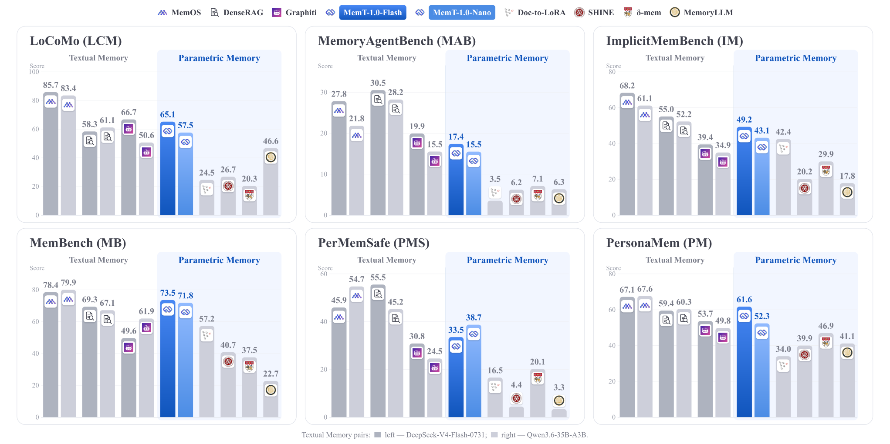
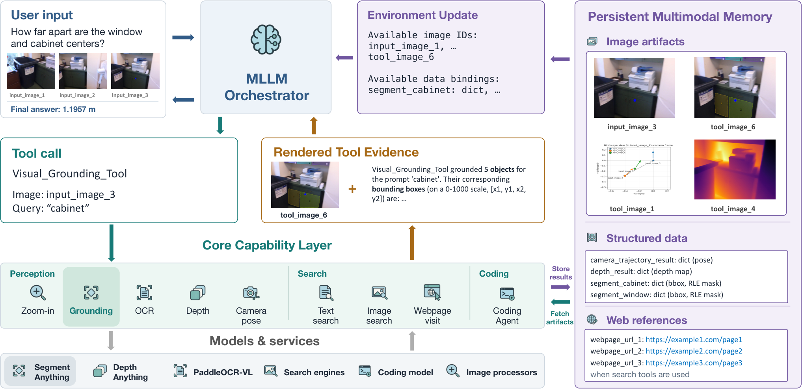
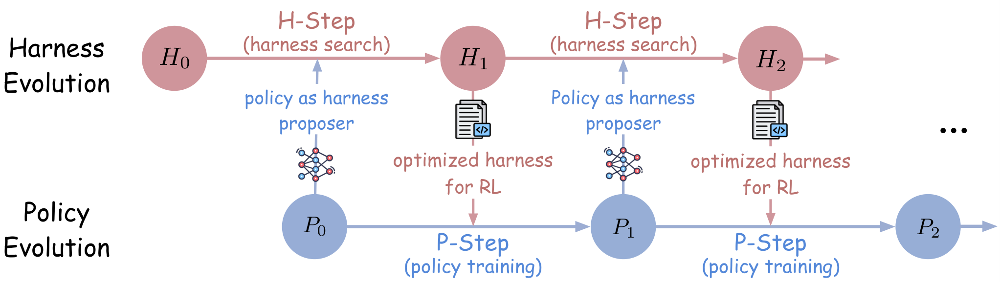
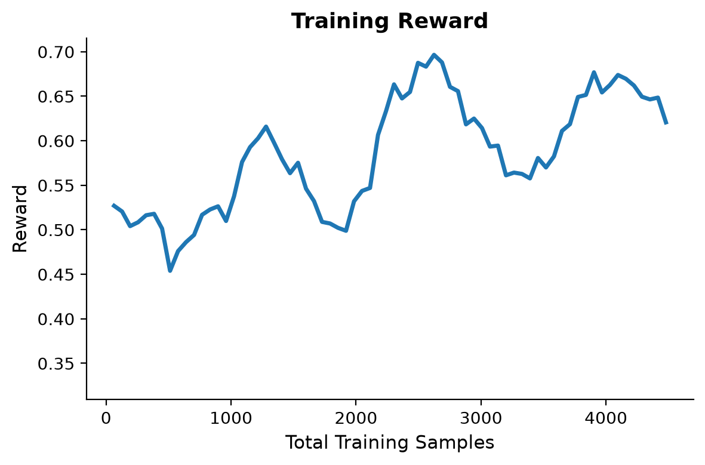
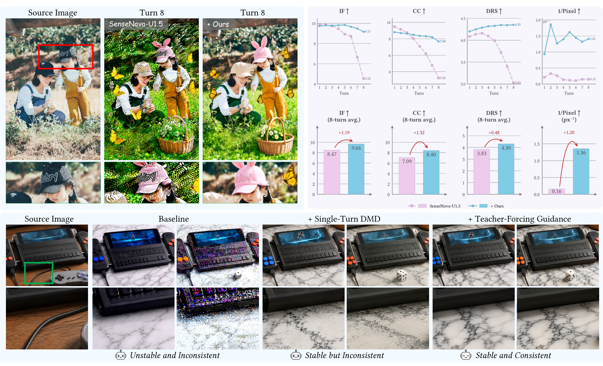
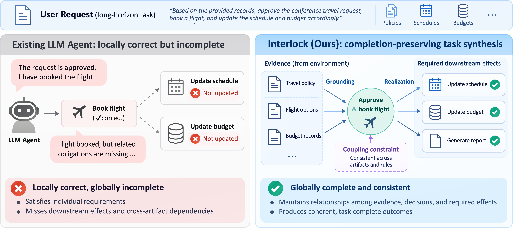
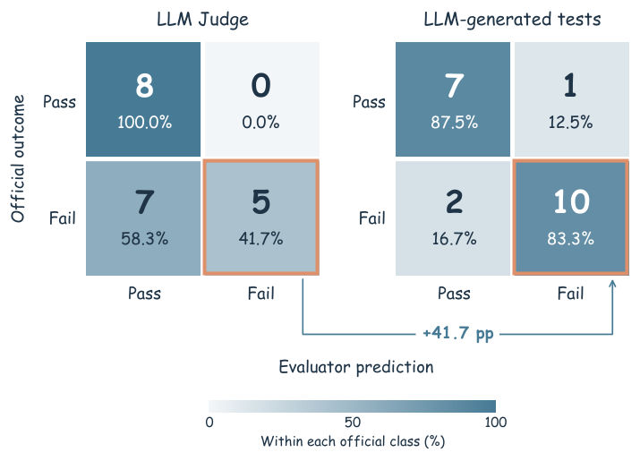

# Daily AI papers — 2026-10-20

*Curated from HF Daily Papers. 15 of ~60 papers kept after relevance filter.*

## Papers at a glance

| # | Title | Topics | Org |
| --- | --- | --- | --- |
| 1 | [OR-License: Evaluating LLM Agents as Real-World OR Practitioners](#1-or-license) | `agents`, `eval`, `reasoning` | HKU / HKUST-GZ / Tencent Hunyuan |
| 2 | [MemT-1.0: Towards Memory-Native Evolution](#2-memt-10) | `LLM`, `memory`, `architectures` | (undisclosed, 34B-token training run) |
| 3 | [OpenVLHarness: Visual Agentic Tool-Use with Multimodal Memory](#3-openvlharness) | `agents`, `multimodal`, `memory` | UCLA / Apple |
| 4 | [SpecMRL: Matryoshka Representation Learning within Parametric Spectrum](#4-specmrl) | `embeddings`, `eval` | Renmin U. (GSAI) |
| 5 | [Self-HPO: Self-Evolving Coding Agents via Harness-Policy Optimization](#5-self-hpo) | `agents`, `RL`, `coding` | Microsoft Research / CMU / UVa |
| 6 | [CoworkEnv: Synthesizing Training Environments for Long-Horizon Cowork Agents](#6-coworkenv) | `agents`, `RL`, `data` | HKUST / CUHK / HKBU |
| 7 | [MT Forcing: Stable Multi-Turn Image Editing with Autoregressive Diffusion](#7-mt-forcing) | `diffusion`, `multimodal` | (4-affiliation consortium) |
| 8 | [Interlock: Local Correctness to Task Completion in Long-Horizon Agents](#8-interlock) | `agents`, `RL`, `eval` | PKU / HKUST-GZ / Tsinghua / Meituan |
| 9 | [Kronecker Delta Rule for Long Context Linear Attention](#9-kronecker-delta-rule) | `architectures`, `linear-attention` | ELLIS Unit Linz / LIT AI Lab (JKU) |
| 10 | [AdaExploreBench: Proactive Exploration and Test-Time Adaptation](#10-adaexplorebench) | `agents`, `eval` | HKUST / UIUC / CUHK / CMU |
| 11 | [HarnessPro: Recursive Harness Self-Improvement with Pareto Optimization](#11-harnesspro) | `agents`, `coding` | (undisclosed) |
| 12 | [Policy Is Not Capability: Guardrail Benchmarks Measure the Labeling Policy](#12-policy-is-not-capability) | `safety`, `eval` | Lenovo |
| 13 | [DScout: Factorization-Guided Diffusion-Drafted Speculative Decoding](#13-dscout) | `efficient-inference`, `diffusion`, `speculative-decoding` | ByteDance |
| 14 | [A Conditional No-Hair Theorem for Transformers](#14-no-hair-theorem) | `interp`, `architectures`, `theory` | (undisclosed) |
| 15 | [N-Gram Memories at Two Bits: Quantizing Lookup Tables in LLMs](#15-n-gram-at-two-bits) | `quantization`, `efficient-inference` | (undisclosed) |

---

## 1. OR-License

**Authors:** Feixue Liu, Yize Meng, Bowen Liu, Ruoyu Chen, Gaoyang Dai, Xing He, Aiqian Li, Fengchi Yuan, Aochuan Chen, Chenyi Zi, Yuhan Li, Hongchuan Zeng, Yimo Yan, Nuo Chen, Jie Fu, Zuo-Jun Max Shen, Yong-Hong Kuo, Jia Li — *HKU + HKUST-GZ + Tencent Hunyuan*
**Links:** [arXiv:2610.24087](https://arxiv.org/abs/2610.24087) · [HF](https://huggingface.co/papers/2610.24087) · [AlphaXiv](https://www.alphaxiv.org/abs/2610.24087)
**Topics:** `agents`, `eval`, `reasoning`

### TL;DR

A benchmark of 31 industrial operations-research instances drawn from $3.68M of paid consulting work, kept in raw-client-material form (no expert pre-formulation). Pairs it with ORSim, a simulated client that holds domain facts but no OR expertise, and scores agents on *Deployment-Adjusted Quality* — zero credit for infeasible deliveries. Across 11 frontier models the best configuration reaches a DAQ of 0.87 vs an expert reference of 1.0.

### Key idea

Treat an OR engagement as a long-horizon information-gap problem. The agent cannot ask for the problem in math form — it has to interview a simulated client, formulate the model, implement a solver, and deliver a solution the client's hidden feasibility checker accepts. DAQ gates everything on strict feasibility, so a numerically-strong-but-infeasible answer is scored exactly like a non-answer.

### Main finding

11 frontier models tested; several beat the expert's objective value *on feasible cases* but none matches expert DAQ. Best configuration: 88.39% strict feasibility, 0.87 DAQ. Failures cluster on sustained information-gap resolution and faithful problem formulation rather than solver choice.

### Why it matters

Most LLM-agent benchmarks pre-formulate the problem. OR-License shows that for high-stakes, long-horizon professional work the dominant failure mode is *problem-formulation drift*, not solver incompetence — this reframes what to measure (and train for) in coding-and-tool-use agents.

### Knowledge graph integration

**Builds on / relates to existing pages:**
- [../evaluation/livecodebench.md](../evaluation/livecodebench.md) — kindred "end-to-end executable deliverable" bench, extended to a non-code professional domain.
- [../post-training/rl-prompt-curation.md](../post-training/rl-prompt-curation.md) — prompt / task curation from paid real-world engagements is a provenance signal RL curation can exploit.

**Suggested new pages:**
- `evaluation/or-license.md` *(depth)* — covers the DAQ metric and the simulated-client interview protocol.
- `agents/information-gap-resolution.md` *(depth)* — the long-horizon capability the paper surfaces as the dominant failure mode.

---

## 2. MemT-1.0

**Authors:** Not disclosed on the HF listing (author list in Appendix A.1 of the paper) — *affiliation undisclosed; 34B-token training budget*
**Links:** [arXiv:2610.26825](https://arxiv.org/abs/2610.26825) · [HF](https://huggingface.co/papers/2610.26825) · [AlphaXiv](https://www.alphaxiv.org/abs/2610.26825)
**Topics:** `LLM`, `memory`, `architectures`

### TL;DR

A "memory-native" foundation model that compiles long-term memory *into the forward pass* rather than relying on an external KV cache or a retrieval index. Two components: **Gated DeltaNet-2** for token-level associative memory updates, and **Mixture-of-Storage** to scale memory capacity along a sparse-expert axis. Trained in two stages on 34B tokens; released as MemT-1.0-Nano and MemT-1.0-Flash.

### Key idea

Treat the model's recurrent state as the persistent memory. Gated DeltaNet-2 extends the delta rule for linear attention with gates that decide what to overwrite vs retain per token. Mixture-of-Storage splits the memory bank across experts so capacity scales without blowing per-step compute. At 128K context, Nano reports ~1.86× end-to-end speedup and ~66× lower persistent storage than a full-attention KV cache.

### Main finding

Outperforms parametric-memory baselines on average, is competitive with retrieval-augmented methods, and preserves general-capability scores. Specifically improves agent-task success by internalising retrieved procedural experience into the state.

### Why it matters

Pushes against the "KV cache = memory" default. If memory-native recurrences can match RAG at task success *and* ship with 66× less persistent storage, long-session agents and on-device deployments stop being KV-bound. Also validates the DeltaNet lineage at ~130B-token scale.

### Knowledge graph integration

**Builds on / relates to existing pages:**
- [../fundamentals/attention.md](../fundamentals/attention.md) — Gated DeltaNet-2 is a linear-attention variant; this is the shape of the departure.
- [../architectures/_moe.md](../architectures/_moe.md) — Mixture-of-Storage is MoE applied to the memory bank rather than to the FFN.
- [../fundamentals/dca.md](../fundamentals/dca.md) — one of the few long-context parallels already in the graph.

**Suggested new pages:**
- `architectures/gated-deltanet.md` *(depth)* — the gated associative-memory update rule.
- `architectures/mixture-of-storage.md` *(depth)* — MoE-of-memory for scaling recurrent capacity.
- `case-studies/memt-1-0.md` *(case study)* — full breakdown if the tech report lands with hyperparameters.

---

## 3. OpenVLHarness

**Authors:** Cheng-Fu Yang, Rui Sun, Di Wu, Sibo Peng, Mingyang Zhang, Zhen Yang, Ruiyi Zhang, Nanyun Peng, Zhe Gan, Kai-Wei Chang — *UCLA + Apple*
**Links:** [arXiv:2610.26860](https://arxiv.org/abs/2610.26860) · [HF](https://huggingface.co/papers/2610.26860) · [AlphaXiv](https://www.alphaxiv.org/abs/2610.26860)
**Topics:** `agents`, `multimodal`, `memory`

### TL;DR

A visual-agent harness that wraps heterogeneous tools (grounded perception, external KBs, computed measurements) into a single capability layer and attaches a *persistent multimodal memory* addressable across reasoning steps. Includes a code interface that runs programs over stored data. Across 22 benchmarks × 8 backbones, +9.7–12.6 average points over matched no-tool baselines.

### Key idea

Separate "how a tool returns its answer" from "how the agent accumulates evidence". Tool outputs are rendered into model-readable observations by the capability layer; images, structured data, and web references land in the multimodal memory with a stable address, so later reasoning steps can refer back by handle. The code interface then operates on memory rather than re-asking the tool.

### Main finding

+9.7 to +12.6 avg points across 22 benchmarks spanning grounded VQA, measurement, and external-knowledge reasoning, consistent across 8 multimodal LLM backbones.

### Why it matters

Addresses one of the long-standing weaknesses of MLLM agents — they forget earlier tool outputs mid-chain. By making memory a first-class, addressable store, the gain generalises across backbones rather than being specific to one model.

### Knowledge graph integration

**Builds on / relates to existing pages:**
- [../agents/README.md](../agents/README.md) — this is a canonical tool-use harness, directly in scope for the agents folder.

**Suggested new pages:**
- `agents/multimodal-tool-harness.md` *(depth)* — the capability-layer + persistent-memory pattern.
- `agents/_agent-memory.md` *(taxonomy)* — covers KV-cache, retrieval, addressable scratchpad, and now native-recurrent memory (also referenced by MemT and MemPilot in this digest).

---

## 4. SpecMRL

**Authors:** Zhongxin Chen, Songhao Wu, Heng Cui, Cong Li, Xiao Zhou, Rui Yan — *Gaoling School of AI, Renmin University of China*
**Links:** [arXiv:2610.26824](https://arxiv.org/abs/2610.26824) · [HF](https://huggingface.co/papers/2610.26824) · [AlphaXiv](https://www.alphaxiv.org/abs/2610.26824)
**Topics:** `embeddings`, `eval`

### TL;DR

A fix for Matryoshka Representation Learning (MRL), which stores an embedding hierarchy inside one vector but doesn't guarantee that *leading dimensions* are the ones you'd keep under compression. SpecMRL reorganises the feature space with a spectral basis derived from a learned projection, ordered by feature importance, then does prefix readout *in that space*. On MTEB it beats MRL at every reduced size, and reportedly matches full-dim MRL at half the dimensions.

### Key idea

MRL enforces a nested loss over prefixes, but the model is free to put salient features anywhere in the vector. SpecMRL learns a projection whose spectrum sorts dimensions by importance, so the nested prefix loss acts on dimensions that are *actually* informative. Prefix readout then becomes an eigenvalue-truncation operation.

### Main finding

Outperforms MRL on MTEB at all tested reduced sizes; the gap widens under stronger compression. Half-dim SpecMRL matches full-dim MRL on average.

### Why it matters

Embedding size is a dominant cost for retrieval systems at scale. Half-dim parity for the same quality is a 2× memory and search-latency savings for anything that ships MRL today.

### Knowledge graph integration

**Suggested new pages:**
- `fundamentals/matryoshka-representation-learning.md` *(depth)* — covers vanilla MRL as prereq.
- `fundamentals/specmrl.md` *(depth)* — the spectral-basis fix.

*Borderline: pure representation-learning papers skirt the LLM-training focus of the graph, included because embedding-size tradeoffs matter for RAG and retrieval-heavy inference stacks.*

---

## 5. Self-HPO

**Authors:** Zhepei Wei, Wenlin Yao, Baolin Peng, Qianhui Wu, Hao Cheng, Jianfeng Gao, Danqing Wang, Yu Meng — *Microsoft Research + CMU + UVa*
**Links:** [arXiv:2610.22791](https://arxiv.org/abs/2610.22791) · [HF](https://huggingface.co/papers/2610.22791) · [AlphaXiv](https://www.alphaxiv.org/abs/2610.22791)
**Topics:** `agents`, `RL`, `coding`

### TL;DR

Alternates two optimisation loops for coding agents: (1) the *policy* (the model) proposes revisions to the *harness* (the scaffold — prompts, tools, control flow) based on its own failure traces, and (2) RL updates the policy under the chosen harness. Hard training tasks become the search set for the next round. Pushes Qwen3.5-35B-A3B's SWE-Bench resolve rate from 57.8% → 64.8% (avg of three variants).

### Key idea

Harness design and policy weights are usually optimised separately (or hand-tuned); Self-HPO closes the loop. The policy both *acts under* and *rewrites* the harness; failures from one iteration become the training signal for both. Also shows gains compound when a stronger external model (Opus 4.8) proposes the harness.

### Main finding

Qwen3.5-35B-A3B SWE-Bench resolve rate: 57.8% → 64.8% avg across 3 bench variants. Beats policy-only and harness-only baselines; OOD generalisation holds. Pass@1 and pass@k both improve.

### Why it matters

Reinforces an emerging result in agentic RL: the harness is a trainable artefact, not infrastructure. Treating it as a search space turns "prompt engineering" into an outer loop of policy optimisation. Direct precursor-pattern for HarnessPro (#11) and the long-horizon agent papers in this digest.

### Knowledge graph integration

**Builds on / relates to existing pages:**
- [../post-training/grpo.md](../post-training/grpo.md) — the RL inner loop is group-relative, in the GRPO family.
- [../post-training/_rl.md](../post-training/_rl.md) — adds a "learned harness" axis to the RL taxonomy.
- [../post-training/rl-prompt-curation.md](../post-training/rl-prompt-curation.md) — hard-task selection for the next round is a form of prompt curation.

**Suggested new pages:**
- `agents/harness-policy-optimization.md` *(depth)* — the alternating-optimisation recipe.
- `agents/_coding-agents.md` *(taxonomy)* — covers harness-based, pure-policy, and ensemble recipes (would also absorb HarnessPro).

---

## 6. CoworkEnv

**Authors:** Yiming Du, Jiaxin Bai, Baixuan Xu, Chunyang Li, Xiyu Ren, Wei Fan, Tianshi Zheng, Weizhi Du, Jingqiao Yu, Xingsu Li, Zhaowei Wang, Yangqiu Song — *HKUST (primary) + CUHK + HKBU*
**Links:** [arXiv:2610.24960](https://arxiv.org/abs/2610.24960) · [HF](https://huggingface.co/papers/2610.24960) · [AlphaXiv](https://www.alphaxiv.org/abs/2610.24960)
**Topics:** `agents`, `RL`, `data`

### TL;DR

A framework that *synthesises* executable training environments for cowork agents. Each generated task bundles a user request, service records, tool interfaces, and automated graders. Validation runs with feedback-based repair ensure specs and graders behave; teacher rollouts become SFT data, student rollouts yield RL rewards. Trains PocketWorker-8B from Qwen3-VL-8B-Instruct.

### Key idea

Instead of hand-authoring environments or depending on scarce human-labelled rollouts, CoworkEnv *generates* the entire environment (task + tools + grader) from requirements, then validates by execution and repairs via LLM feedback. The grader is part of the generated artefact — not written separately — which keeps supervision aligned with task structure.

### Main finding

PocketWorker-8B SFT raises Claw-Eval mean score 46.6 → 64.1 (largest gain on multi-turn tasks). Extension to ClawMark also improves. GRPO/RL on these environments shows training reward rising over ~3 epochs.

### Why it matters

Environment scarcity is a bottleneck for agentic RL. Generating environments *along with* their graders — rather than treating graders as a separate reward-model problem — is a lighter-weight route than RLHF for interactive tasks.

### Knowledge graph integration

**Builds on / relates to existing pages:**
- [../post-training/grpo.md](../post-training/grpo.md) — RL loop is GRPO-style on the synthesised rewards.
- [../post-training/rlvr.md](../post-training/rlvr.md) — verifiable rewards generated at environment creation time.
- [../data/_data-curation.md](../data/_data-curation.md) — environment synthesis is a procedural data pipeline.

**Suggested new pages:**
- `agents/synthesized-environments.md` *(depth)* — the task+tools+grader generation recipe.

---

## 7. MT Forcing

**Authors:** Houyuan Chen, Fanzhou Wang, Xiangyu Fan, Zesong Qiu, Yukun Wei, Songlin Yang, Zhitao Yang, Lvmin Zhang, Pei Yang, Hao Zhao, Lei Yang, Anyi Rao — *4-affiliation consortium (names withheld in the HF excerpt)*
**Links:** [arXiv:2610.25404](https://arxiv.org/abs/2610.25404) · [HF](https://huggingface.co/papers/2610.25404) · [AlphaXiv](https://www.alphaxiv.org/abs/2610.25404)
**Topics:** `diffusion`, `multimodal`

### TL;DR

Multi-turn image editing drifts after a few turns because autoregressive diffusion models are trained on reference histories but have to run on their own (imperfect) outputs at inference — classic exposure bias. MT Forcing fixes this with two tricks: **Single-Turn DMD** (a teacher that applies the whole cumulative edit sequence in one step guides the student's self-generated rollouts) and **Teacher-Forcing Guidance** (train on consistent reference trajectories, first as warmup then as a regulariser during distillation).

### Key idea

Treat exposure bias as a distribution-matching problem across edit-chain lengths. Single-Turn DMD provides a trajectory-independent target for the cumulative edit; TFG keeps the student close to a stable reference trajectory during distillation. Both are standard knobs for sequence models — new combination for AR diffusion image editors.

### Main finding

On SenseNova-U1 / U1.5: better instruction following, cross-turn content consistency, and visual stability; largest wins in later turns of the edit chain.

### Why it matters

Multi-turn interactive editing is where image models are *actually used* — single-shot generation is already strong. Compounding drift is the dominant failure mode, and MT Forcing is a drop-in training recipe for existing AR-diffusion stacks.

### Knowledge graph integration

**Suggested new pages:**
- `multimodal/autoregressive-diffusion.md` *(depth)* — covers the AR-diffusion lineage this paper extends.
- `multimodal/mt-forcing.md` *(depth)* — the two-component anti-drift recipe.

---

## 8. Interlock

**Authors:** Linji Hao, Yanji He, Zihan Wang, Hansi Yang, Jiayuan Zhang, Hongyan Hao, Qi Gu, Yan Feng, Han Wu — *PKU + HKUST-GZ + Tsinghua + Meituan*
**Links:** [arXiv:2610.19686](https://arxiv.org/abs/2610.19686) · [HF](https://huggingface.co/papers/2610.19686) · [AlphaXiv](https://www.alphaxiv.org/abs/2610.19686)
**Topics:** `agents`, `RL`, `eval`

### TL;DR

Long-horizon LLM agents satisfy individual requirements but fail to keep *evidence → decisions → effects* internally consistent. Interlock represents each task as a typed **completion graph** with three edge classes: *grounding* (evidence→decisions), *coupling* (joint constraints), *realization* (decisions→required effects). The graph compiles into a resettable workspace, a public request, and a private rubric. Fine-tuning two Qwen3.6 models on their own accepted trajectories improves pass rates +3–7 points on AutomationBench, JobBench, Harvey LAB.

### Key idea

Instead of a flat rubric or a reward model, encode task completeness *structurally*. The typed edges make the latent dependencies between requirements explicit so an agent-as-judge can keep only trajectories that satisfy all mandatory requirements and their couplings. The graph then produces its own task spec (public request + private rubric) — one artefact, two views.

### Main finding

+3–7 pass-rate points across 3 bench suites after SFT on self-generated accepted trajectories. Gains hold across two Qwen3.6 model sizes.

### Why it matters

Reframes "task success" from a flat predicate to a dependency-graph satisfaction problem. This is the correct granularity for agentic RLVR when human rubrics are expensive to author.

### Knowledge graph integration

**Builds on / relates to existing pages:**
- [../post-training/rlvr.md](../post-training/rlvr.md) — Interlock produces verifier rubrics automatically from the completion graph.
- [../post-training/rejection-sampling.md](../post-training/rejection-sampling.md) — accepted-only self-training is rejection sampling on structured verification.
- [../post-training/_rewards.md](../post-training/_rewards.md) — graph satisfaction is a structured verifier; new node in the rewards taxonomy.

**Suggested new pages:**
- `agents/completion-graphs.md` *(depth)* — the typed-graph task representation.

---

## 9. Kronecker Delta Rule

**Authors:** Levente Zólyomi, Michael List, Günter Klambauer, Sebastian Böck, Sepp Hochreiter — *ELLIS Unit Linz + LIT AI Lab + Institute for Machine Learning (JKU)*
**Links:** [arXiv:2610.26834](https://arxiv.org/abs/2610.26834) · [HF](https://huggingface.co/papers/2610.26834) · [AlphaXiv](https://www.alphaxiv.org/abs/2610.26834)
**Topics:** `architectures`, `linear-attention`

### TL;DR

A new update rule for the associative-matrix memory in linear attention. The standard delta rule corrects the *full* residual vector; the Kronecker delta rule corrects a *single scalar association* along the outer product of key and value. Keeps bounded-norm stability while reducing interference with previously-stored associations. Builds **KronLSTM** on top: vector forget gate + erase gate + write-target gate. At 1.5B params / 100B tokens, strong on LM, real-world recall, and NIAH, with the gap growing at long context.

### Key idea

Reduce the *rank of the memory update* per token. In a linear-attention memory the full delta-rule update rewrites every entry correlated with the incoming key; a Kronecker (rank-one scalar) update only rewrites along the explicit key×value direction, so other stored associations are left intact. Theoretical results: convergence to a steady state and bounds on expected memory norm.

### Main finding

KronLSTM at 1.5B / 100B outperforms linear-attention and SSM baselines on LM perplexity, real-world recall benches, and needle-in-a-haystack retrieval. Advantage widens as context grows (expected: that's where delta-rule interference bites).

### Why it matters

Linear-attention and SSM variants keep hitting the "recall ceiling" on long context — this attributes a chunk of it to update-rule interference and proposes a fix that is cheap, local, and theory-backed. If it holds at frontier scale this moves linear-attention LMs closer to transformer recall at a fraction of long-context cost.

### Knowledge graph integration

**Builds on / relates to existing pages:**
- [../fundamentals/attention.md](../fundamentals/attention.md) — direct extension of the linear-attention / associative-memory view.
- [../architectures/multi-head-attention.md](../architectures/multi-head-attention.md) — contrast point for the mechanism.

**Suggested new pages:**
- `architectures/kronecker-delta-rule.md` *(depth)* — the rank-one update rule itself.
- `architectures/kron-lstm.md` *(depth)* — the gated LSTM variant built on it.
- `architectures/_linear-attention.md` *(taxonomy)* — covers Linear Attention, DeltaNet, Gated DeltaNet (ref'd in #2), Mamba, RWKV, and now KronLSTM.

---

## 10. AdaExploreBench

**Authors:** Xuejun Zhang, Jiateng Liu, Bingxuan Li, Shujin Wu, Qing Zong, Tianshi Zheng, Chunyang Li, Qihan Lin, Chen Li, Dadi Guo, Xiusi Chen, Yangqiu Song — *HKUST (primary) + HKUST-GZ + UGAIL + UIUC + CUHK + CMU*
**Links:** [arXiv:2610.25950](https://arxiv.org/abs/2610.25950) · [HF](https://huggingface.co/papers/2610.25950) · [AlphaXiv](https://www.alphaxiv.org/abs/2610.25950)
**Topics:** `agents`, `eval`

### TL;DR

A benchmark for proactive exploration + test-time adaptation. Environments have hidden latent rules the agent must discover; the twist is **rule drift** — the rules shift mid-episode and the agent must notice degraded performance and *re-explore*. Across 8 LLMs the best scores 61.9% calibrated accuracy. Removing rule drift or supplying evidence directly each adds ~10 points.

### Key idea

Separate "reasoning from evidence" from "gathering the right evidence" and from "noticing when evidence has gone stale". Agents are good at (1) but weak at (2) and particularly at (3). Rule drift forces a non-stationary environment, which no benchmark in the current graph covers.

### Main finding

Top model: 61.9% calibrated accuracy. +10 point avg when either evidence is pre-supplied or drift is disabled — proactive-exploration and drift-detection failures contribute roughly equally.

### Why it matters

Fills a gap in agent benchmarks between static tool-use (ToolBench) and open-world long-horizon (SWE-Bench): a *stationarity-breaking* middle ground. Also lines up with the "information-gap resolution" theme in #1 and the memory stories in #2 / #3.

### Knowledge graph integration

**Builds on / relates to existing pages:**
- [../agents/README.md](../agents/README.md) — new bench for the agents folder.
- [../post-training/rl-prompt-curation.md](../post-training/rl-prompt-curation.md) — drift-aware task curriculum is a prompt-curation dimension.

**Suggested new pages:**
- `evaluation/adaexplorebench.md` *(depth)* — exploration + drift detection scoring.

---

## 11. HarnessPro

**Authors:** Not disclosed on the HF excerpt
**Links:** [arXiv:2610.26770](https://arxiv.org/abs/2610.26770) · [HF](https://huggingface.co/papers/2610.26770) · [AlphaXiv](https://www.alphaxiv.org/abs/2610.26770)
**Topics:** `agents`, `coding`

### TL;DR

Harness self-improvement *without* ground-truth answers. An LLM generates fixed tests to score harness candidates; specialised agents review traces, plan edits, and implement them; weaker or Pareto-dominated candidates are pruned. Keeps three tiers (lite / medium / heavy) for different budgets. With GPT-5.5 + Codex on 3 benchmarks: heavy mode +2.0 pts avg pass rate and −26.1% per-task cost vs RHO baseline.

### Key idea

Pareto optimisation over (success, cost) instead of success alone — the common failure mode of self-improvement loops is runaway cost. By keeping multiple front-of-Pareto candidates (not just the best) and dropping dominated ones, HarnessPro surfaces lite/medium/heavy versions suitable for different deployment budgets.

### Main finding

+2.0 pts avg pass rate, −26.1% avg per-task cost on 3 benches vs RHO. Also validated with GLM-5.2 and Claude Code — i.e. the harness improvement generalises across executor models.

### Why it matters

Pairs naturally with #5 (Self-HPO) — Self-HPO is harness-policy co-training; HarnessPro is harness-only Pareto search *at inference time*. Together these point at a stack where harness search is a cheap outer loop on top of a frozen (or occasionally retrained) policy.

### Knowledge graph integration

**Builds on / relates to existing pages:**
- [../post-training/_rl.md](../post-training/_rl.md) — Pareto-selected test-time search; a sibling to RL harness tuning.
- [../post-training/rl-prompt-curation.md](../post-training/rl-prompt-curation.md) — LLM-generated tests are an auto-curated verifier set.

**Suggested new pages:**
- *(none — covered by `agents/harness-policy-optimization.md` suggested under #5; HarnessPro would be a `Variants` row on the same taxonomy)*

---

## 12. Policy Is Not Capability

**Authors:** Jonathon Romero, Yijin Wang, Adrian Chan, Jianbang Zhang — *Lenovo*
**Links:** [arXiv:2610.25060](https://arxiv.org/abs/2610.25060) · [HF](https://huggingface.co/papers/2610.25060) · [AlphaXiv](https://www.alphaxiv.org/abs/2610.25060)
**Topics:** `safety`, `eval`

### TL;DR

Trains 10 guardrail-classifier variants on the *same* prompts labelled under 2 competing "unsafe" definitions, then evaluates on 15 public safety benchmarks. Finding: scores swing wildly with the training *policy*, while detection capability stays roughly constant. A head-only recalibration touching ~0.03% of parameters can walk a model across most of the score range. Validation accuracy tracks label-policy agreement, not detection ability.

### Key idea

Benchmark scores for safety guardrails measure *which definition of unsafe you trained on*, not whether the classifier can detect misuse. The paper surfaces massive contamination overlap between guardrail training data and public benches (especially over-refusal benches) as the root cause.

### Main finding

Score swings as wide as the full benchmark range from a 0.03%-of-parameters recalibration. Over-refusal benches most affected.

### Why it matters

Direct hit on how the field currently reports safety-classifier numbers. Argues reports must disclose (i) data contamination, (ii) seed variance, (iii) the exact labelling definition — a methodology contribution for the evaluation side of safety.

### Knowledge graph integration

**Builds on / relates to existing pages:**
- [../data/decontamination.md](../data/decontamination.md) — core evidence is overlap between guardrail train data and public benches.
- [../safety/_jailbreaks.md](../safety/_jailbreaks.md) — the over-refusal half of this taxonomy is where the swings concentrate.
- [../evaluation/ifeval.md](../evaluation/ifeval.md) — closest existing "eval methodology" page.

**Suggested new pages:**
- `safety/guardrail-evaluation.md` *(depth)* — policy vs capability framing, with contamination and recalibration knobs.

---

## 13. DScout

**Authors:** Jiakun Fan, Min Xiao, Qiang Wang, Neiwen Ling, Zhichao Liu, Zhihao Jia, Dimitrios S. Nikolopoulos, Zijun Wei — *ByteDance*
**Links:** [arXiv:2610.23935](https://arxiv.org/abs/2610.23935) · [HF](https://huggingface.co/papers/2610.23935) · [AlphaXiv](https://www.alphaxiv.org/abs/2610.23935)
**Topics:** `efficient-inference`, `diffusion`, `speculative-decoding`

### TL;DR

Speculative decoding with a *diffusion* drafter. Diffusion drafters can propose many tokens at once but naive adoption doesn't help — verification accepts only a consecutive prefix and per-round latency rises. DScout introduces two factorisations: a training-side decomposition of position-wise loss into *inclusion*, *weighting*, *prediction*, and an inference-side decomposition of throughput into *mean accepted tokens / per-round latency*. Across 6 benches: 3.84× speedup on Qwen3-4B, 4.14× on Qwen3-8B — 7–9% above the prior SOTA speculative baseline.

### Key idea

Decompose the standard speculative-decoding objective to see which part of the gain is being left on the table. Training-side: separate "which positions are drafted at all", "how heavily they're weighted", and "the prediction loss". Inference-side: throughput factorises into (accepted tokens) × (1/round latency), so target-conditioning depth, drafter depth, and block size can be tuned by factor.

### Main finding

3.84× / 4.14× end-to-end speedup over AR decoding on Qwen3-4B / 3-8B (6-benchmark mean), +7.1–9.1% over prior SOTA, +up to 9.75% from the configuration policy on top of the fixed DScout setup.

### Why it matters

First speculative decoding paper to show that diffusion drafters can beat AR drafters *end-to-end* (not just in draft-length) once the right factorisation is used. Pushes inference-cost reductions well past the Medusa / EAGLE line and into a new drafter family.

### Knowledge graph integration

**Builds on / relates to existing pages:**
- [../inference/README.md](../inference/README.md) — new inference technique for the inference folder.
- [../pre-training/mtp.md](../pre-training/mtp.md) — MTP shares the "parallel future-token prediction" structure the drafter exploits.

**Suggested new pages:**
- `inference/speculative-decoding.md` *(depth)* — covers the AR-drafter base case (Medusa / EAGLE lineage).
- `inference/diffusion-drafted-speculative-decoding.md` *(depth)* — the DScout factorisation and tuning policy.
- `inference/_speculative-decoding.md` *(taxonomy)* — AR vs diffusion vs n-gram drafters.

---

## 14. No-Hair Theorem

**Authors:** Not disclosed on the HF listing
**Links:** [arXiv:2610.24133](https://arxiv.org/abs/2610.24133) · [HF](https://huggingface.co/papers/2610.24133) · [AlphaXiv](https://www.alphaxiv.org/abs/2610.24133)
**Topics:** `interp`, `architectures`, `theory`

### TL;DR

How much of the prompt is still in the hidden state after N generated tokens? Feed two different prompts followed by the same continuation and track hidden-state distance. It decays roughly as a *power law* in the number of generated tokens; **trained models forget faster than untrained models with the same architecture**. The paper proves an upper bound on the gap for pre-LN transformers under a non-degeneracy condition, and shows via a solvable linear model that the bound is tight.

### Key idea

Attention on the prompt is diluted as the context grows (standard argument), *plus* a "relay" effect where generated tokens pass along prompt information they already absorbed. The combination gives the power-law decay. Counter-move: a logit bias on prompt-attention weights slows or reverses the forgetting; a mild version modestly improves system-instruction adherence at a small perplexity cost.

### Main finding

Power-law decay in prompt → state gap vs generated-token count; trained > untrained in forgetting speed. Bounded tight by the linear model. Attention-logit bias partially fixes it.

### Why it matters

Puts a theoretical floor on the "lost-in-the-middle" and "ignoring system prompt" failure modes that practitioners paper over with system-prompt tricks. Also gives interpretability a cleanly-stated mechanism to probe for — not just a vibes-level "model forgot".

### Knowledge graph integration

**Builds on / relates to existing pages:**
- [../fundamentals/attention.md](../fundamentals/attention.md) — attention dilution is the mechanism.
- [../architectures/_normalization.md](../architectures/_normalization.md) — the bound is for pre-LN specifically.
- [../interpretability/README.md](../interpretability/README.md) — direct interp content on hidden-state dynamics.

**Suggested new pages:**
- `interpretability/prompt-decay.md` *(depth)* — the power-law decay result and the dilution + relay mechanism.

---

## 15. N-Gram at Two Bits

**Authors:** Not disclosed on the HF listing
**Links:** [arXiv:2610.21810](https://arxiv.org/abs/2610.21810) · [HF](https://huggingface.co/papers/2610.21810) · [AlphaXiv](https://www.alphaxiv.org/abs/2610.21810)
**Topics:** `quantization`, `efficient-inference`

### TL;DR

**Conditional Program (CP)** — a compressed format for the n-gram lookup tables used in conditional memory for LMs. Each row stored as a short code + a local scale; a shared Gaussian trellis decoder reconstructs only the rows a given input requests. At 2 bits, 4×–8× table-storage reduction and 41–63% KL-divergence reduction vs 2-bit round-to-nearest, with most task scores near the original. On DeepSeek, table storage drops 203 GB → 51 GB, freeing GPU memory for larger serving workloads.

### Key idea

Lookup tables for n-gram-conditioned memory are *row-sparse*: a given input touches few rows. CP exploits this by storing a compact code per row and reconstructing only requested rows via a shared trellis decoder. The decoder is Gaussian-trellis — matches the empirical row distribution better than uniform codebooks.

### Main finding

4×–8× table-storage reduction at 2 bits. KL vs 2-bit RTN: −41–63%. DeepSeek: 203 GB → 51 GB. Tested on DeepSeek, Qwen, LongCat.

### Why it matters

N-gram-conditioned memory (the Hash n-gram-model trend; cf also MemT in #2) is becoming a real primitive. If this memory ships with a 4× storage multiplier for free, it tilts the inference-stack tradeoff toward larger conditional memories — a different axis than weight quantisation.

### Knowledge graph integration

**Builds on / relates to existing pages:**
- [../quantization/_number-formats.md](../quantization/_number-formats.md) — 2-bit code with local scale is a non-standard number format for the taxonomy.
- [../quantization/README.md](../quantization/README.md) — new depth technique for the quantisation folder.

**Suggested new pages:**
- `quantization/conditional-program.md` *(depth)* — the row-sparse Gaussian-trellis 2-bit scheme.
- `quantization/lookup-table-quantization.md` *(depth)* — covers n-gram / conditional-memory LUT quantisation more broadly.

---

## Notes

- Borderline inclusions are flagged in-section with an italic *Borderline: …* note.
- Hero figures live in `assets/2026-10-20/`. 8 of 15 papers have figures; the rest either exposed no useful first-figure in the arXiv HTML or sit behind a `cdn-thumbnails.huggingface.co` host the environment's proxy blocks.
- This digest is informational. No existing concept files, `READING-LIST.md`, or `PAPERS.md` were modified to produce it.
