# Daily AI papers — 2026-10-21

*Curated from HF Daily Papers. 15 of 62 papers kept after relevance filter.*

## Papers at a glance

| # | Title | Topics | Org |
| --- | --- | --- | --- |
| 1 | [Focused Omni-Modal GUI Agents (FocusGUI)](#1-focused-omni-modal-gui-agents) | `agents`, `multimodal` | Alibaba |
| 2 | [PAR: Progress-Aligned Recurrence for Length Generalization](#2-par-progress-aligned-recurrence) | `architectures`, `length-generalization` | Ant International |
| 3 | [Specter: Fast MoE Inference via Quantization-Enabled Multi-Step Speculative Offloading](#3-specter-moe-inference) | `MoE`, `efficient-inference`, `quantization` | SJTU |
| 4 | [Correction Training for Diffusion Models](#4-correction-training-for-diffusion-models) | `diffusion` | Berkeley, Reve |
| 5 | [SWIFT: Self-guided Weak-to-strong Diffusion Models](#5-swift-weak-to-strong-diffusion) | `diffusion` | UMich, Alibaba |
| 6 | [Breaking Diffusion: Parallel Reasoning with Draft Refinement (DRLM)](#6-breaking-diffusion-drlm) | `diffusion-LM`, `reasoning` | KAIST, MSRA |
| 7 | [Lafa: Large Flow Language Models](#7-lafa-large-flow-language-models) | `architectures`, `efficient-inference` | — |
| 8 | [Ask to Distill: Learning to Synthesize Data for On-Policy Distillation](#8-ask-to-distill) | `distillation`, `data` | UIUC |
| 9 | [Self-Credit: Credit Assignment for Long-Horizon Agentic RL](#9-self-credit) | `RL`, `agents`, `reasoning` | Meta |
| 10 | [CoEvo-RSI: When Harnesses Evolve, Which Models Should Follow?](#10-coevo-rsi) | `agents`, `RL`, `self-improvement` | NUS, A*STAR |
| 11 | [HarnessRL: Co-Evolving Policies with a Just-in-Time Training Harness](#11-harnessrl) | `RL`, `rewards`, `rubric` | Alibaba, Mila |
| 12 | [On the Limits of Scale: Inverse Scaling in Vision-Language Models](#12-inverse-scaling-vlm) | `eval`, `multimodal` | Edinburgh |
| 13 | [Sage-A1.5: Long-Horizon Execution to Scientific Exploration](#13-sage-a1-5) | `agents`, `MoE` | Shanghai AI Lab et al. |
| 14 | [FlowState: Execution State as Memory for Long-Horizon LLM Agents](#14-flowstate) | `agents`, `memory` | Ant International |
| 15 | [Matrix-Game 4.0: Harnessing Video Models for Real-Time Playable Game Worlds](#15-matrix-game-4) | `diffusion`, `video`, `world-models` | Skywork AI et al. |

---

## 1. Focused Omni-Modal GUI Agents

**Authors:** Midori Team — *Alibaba*
**Links:** [arXiv:2610.26203](https://arxiv.org/abs/2610.26203) · [HF](https://huggingface.co/papers/2610.26203) · [AlphaXiv](https://www.alphaxiv.org/abs/2610.26203)
**Topics:** `agents`, `multimodal`, `GUI`

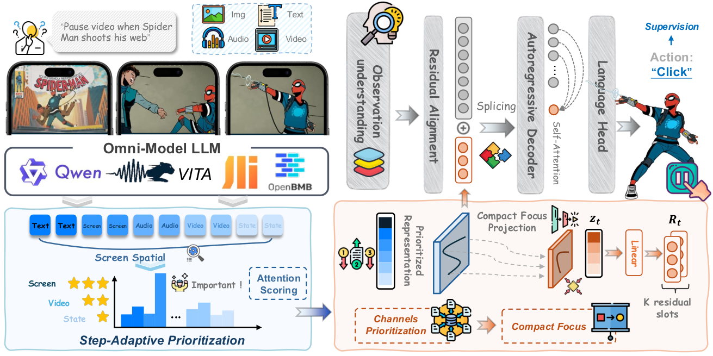

### TL;DR

Omni-modal GUI agents consume streaming screenshots, audio, video, interaction history and device state, and feeding all of that into every action step causes errors to compound across the trajectory — what the authors call *sequential distraction*. FocusGUI is a lightweight adapter that scores and compresses the most relevant input channels into a compact latent injected at the action boundary, trained purely on action supervision, with the omni-modal backbone kept frozen.

### Key idea

A per-step gating adapter learns which modality channels (screenshot vs. prior turns vs. audio etc.) matter for the next action, pools them into a short latent, and prepends that latent to the backbone's embeddings. Only the adapter is trained; the heavy base model is untouched.

### Main finding

Reports large gains in Type Match and Exact Match across four omni-modal backbones vs. the frozen backbone and vs. prior input-enhancement methods on GUI benchmarks (headline numbers in the paper).

### Why it matters

Shows that the dominant failure mode in long-horizon GUI agents is attention-budget misallocation, not raw capability — a cheap frozen-backbone adapter closes much of the gap, which is attractive when retraining the backbone is impractical.

### Knowledge graph integration

**Builds on / relates to existing pages:**
- [agents/README.md](../agents/README.md) — agents is still a stub topic; FocusGUI is one of the first omni-modal, long-horizon agent entries.
- [multimodal/README.md](../multimodal/README.md) — vision-language agent setting.

**Suggested new pages:**
- `agents/omni-modal-gui-agents.md` *(depth)* — covers FocusGUI's gated input compression for frozen-backbone agents.

---

## 2. PAR: Progress-Aligned Recurrence for Length Generalization in State Tracking

**Authors:** Pan Wang, Yihao Hu, Guangyuan Dong, et al. — *Ant International; NUS*
**Links:** [arXiv:2610.27628](https://arxiv.org/abs/2610.27628) · [HF](https://huggingface.co/papers/2610.27628) · [AlphaXiv](https://www.alphaxiv.org/abs/2610.27628)
**Topics:** `architectures`, `length-generalization`, `state-tracking`

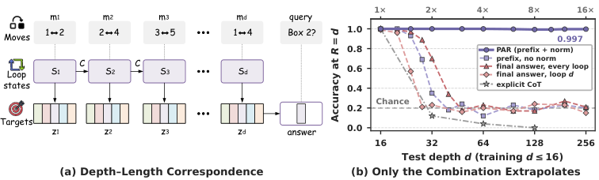

### TL;DR

RNN/SSM-style recurrent models often fail to generalize to longer sequences on tasks that need *state tracking* (parity, modular arithmetic, Dyck). PAR introduces a *progress-aligned recurrence* that reparameterizes recurrent dynamics so the state's rate-of-change tracks a progress variable rather than time index, letting the same trained model extrapolate to much longer sequences without positional-encoding tricks.

### Key idea

Treat recurrence depth as a scalar "progress" input and align the recurrence update so it is invariant to time dilation — effectively, the model learns a state-transition that commutes with changes in sequence length, which is what classical state-tracking tasks require.

### Main finding

PAR gets near-100% accuracy on parity, modular arithmetic and language-recognition tasks at 10×–100× the training length, where strong transformer and SSM baselines collapse.

### Why it matters

Length generalization has been the main open problem for recurrent architectures competing with transformers; PAR is one of the first mechanistic recipes to crack state-tracking length-generalization without finetuning per length.

### Knowledge graph integration

**Builds on / relates to existing pages:**
- [fundamentals/_positional-encoding.md](../fundamentals/_positional-encoding.md) — orthogonal lever on length generalization; PAR achieves it without a new PE.
- [architectures/transformer-block.md](../architectures/transformer-block.md) — PAR is proposed as a drop-in for recurrent blocks competing with attention.

**Suggested new pages:**
- `architectures/progress-aligned-recurrence.md` *(depth)* — the PAR mechanism and state-tracking benchmarks.

---

## 3. Specter: Fast MoE Inference via Quantization-Enabled Multi-Step Speculative Offloading

**Authors:** Wenfeng Wang, Xiaofeng Hou, et al.
**Links:** [arXiv:2511.14102](https://arxiv.org/abs/2511.14102) · [HF](https://huggingface.co/papers/2511.14102) · [AlphaXiv](https://www.alphaxiv.org/abs/2511.14102)
**Topics:** `MoE`, `efficient-inference`, `quantization`, `speculative-decoding`

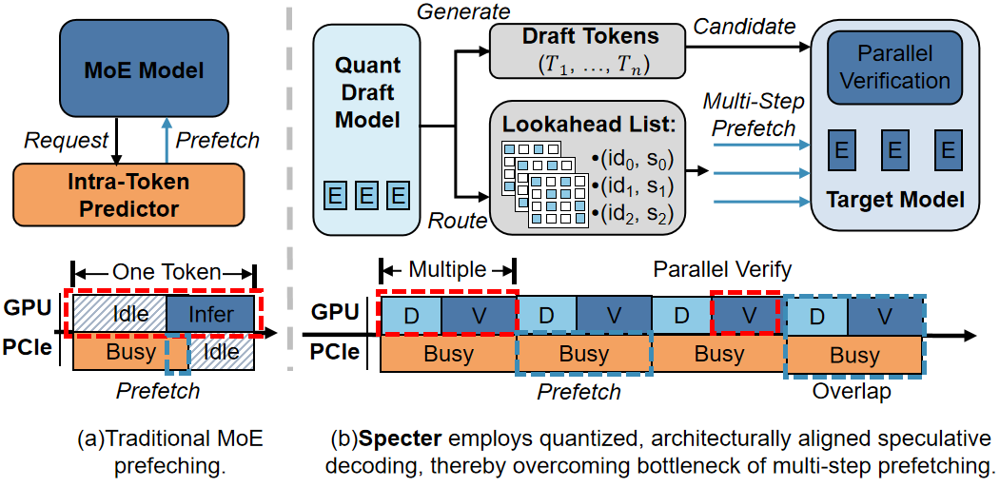

### TL;DR

Serving a large MoE on a single GPU typically means keeping experts in host memory and paging them over PCIe, which stalls decoding. Specter runs a *quantized draft model* that speculatively decodes several steps ahead and uses the draft's expert-routing predictions to prefetch the right experts before the main model needs them, hiding most of the PCIe transfer latency.

### Key idea

Combine three ideas: (a) a quantized draft model cheap enough to run per-step, (b) multi-step speculative decoding so the draft can see several future tokens, (c) use the draft's *router outputs* (not just its tokens) as expert prefetch hints for the heavy model.

### Main finding

1.50× average speedup (TPOT) and 1.88× peak over state-of-the-art offloading systems on single-GPU MoE inference.

### Why it matters

Opens single-GPU inference of serious MoEs (think DeepSeek-V3 scale with aggressive expert offload) by taking the hidden PCIe cost out of the critical path — a different lever than quantizing weights further.

### Knowledge graph integration

**Builds on / relates to existing pages:**
- [architectures/_moe.md](../architectures/_moe.md) — MoE routing is what Specter exploits for prefetch.
- [quantization/_number-formats.md](../quantization/_number-formats.md) — the draft model is quantized.
- [quantization/fp8.md](../quantization/fp8.md) — kind of quant used in the draft path.

**Suggested new pages:**
- `inference/speculative-decoding.md` *(depth)* — base technique, graph currently has no page for it.
- `inference/expert-offloading.md` *(depth)* — expert offloading and prefetch, the system-level trick Specter sits on.

---

## 4. Correction Training for Diffusion Models

**Authors:** Runqian Wang, Alexei A. Efros, Taesung Park, Yash Belhe — *UC Berkeley; Reve*
**Links:** [arXiv:2610.14136](https://arxiv.org/abs/2610.14136) · [HF](https://huggingface.co/papers/2610.14136) · [AlphaXiv](https://www.alphaxiv.org/abs/2610.14136)
**Topics:** `diffusion`, `training`

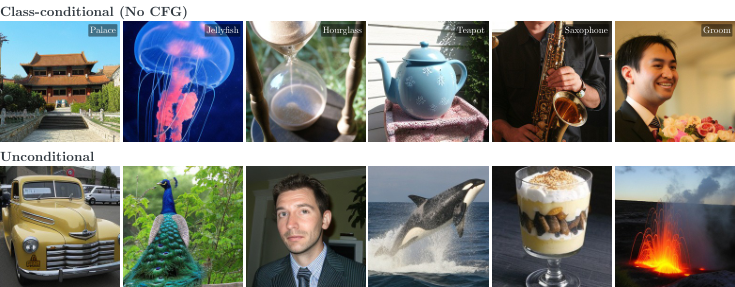

### TL;DR

Iterative diffusion sampling drifts because each step denoises from the model's own (imperfect) prediction, so errors accumulate — classic exposure bias. Correction training trains a small *corrector network* on top of the base denoiser's actual multi-step predictions, applied iteratively at inference, and then distills the corrector back into the base model so there's no inference overhead.

### Key idea

Expose the model at train time to the same off-distribution noisy latents it will see at inference (the base denoiser's intermediate outputs), fit a correction, then merge the correction back via distillation.

### Main finding

Sample-quality gains across DiT, SiT and JiT; competitive with classifier-free guidance but with better diversity; the distilled variant removes the extra forward pass.

### Why it matters

Exposure bias is one of the big remaining asymmetries between autoregressive and diffusion sampling. A plug-in correction that distills back is a clean path to higher-quality samples without CFG's known diversity cost.

### Knowledge graph integration

**Builds on / relates to existing pages:**
- [multimodal/README.md](../multimodal/README.md) — diffusion image generation is the application.

**Suggested new pages:**
- `multimodal/correction-training-diffusion.md` *(depth)* — the exposure-bias corrector + distillation recipe.

---

## 5. SWIFT: Self-guided Weak-to-strong Diffusion Models via Target Extrapolation

**Authors:** Yanjin He, Cuifeng Shen, Wanzhou Lei, et al. — *UMich; Alibaba; Berkeley; Nanjing*
**Links:** [arXiv:2610.25844](https://arxiv.org/abs/2610.25844) · [HF](https://huggingface.co/papers/2610.25844) · [AlphaXiv](https://www.alphaxiv.org/abs/2610.25844)
**Topics:** `diffusion`, `training`

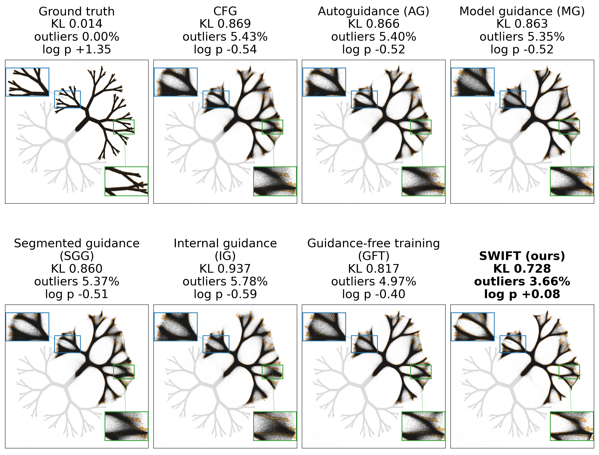

### TL;DR

A frozen *weak* denoiser (an early checkpoint of the same model) is used to *extrapolate* the regression target *away* from the weak prediction, amplifying under-fit components. The main model is trained on the extrapolated target with no backprop through the weak guide and no inference-time guidance; the weak checkpoint is thrown away after training.

### Key idea

Target extrapolation: instead of training to the posterior mean, train to `clean + α·(clean − weak)`. In spectral terms, this amplifies the directions the weak model is still missing, and the authors prove a non-trivial α range strictly lowers posterior-mean error.

### Main finding

Matches the baseline's best FID with ~half the total training compute on ImageNet-256; FID 1.15 without inference guidance and 0.99 with guidance on RAEv2.

### Why it matters

Self-guidance usually means a guidance *scale at inference*; SWIFT bakes guidance into training itself with no inference cost and no unconditional branch. Fits naturally into w2s and self-distillation pipelines.

### Knowledge graph integration

**Builds on / relates to existing pages:**
- [multimodal/README.md](../multimodal/README.md) — diffusion training technique.
- [post-training/rejection-sampling.md](../post-training/rejection-sampling.md) — same weak-to-strong motif in a different modality.

**Suggested new pages:**
- `multimodal/weak-to-strong-diffusion.md` *(depth)* — target extrapolation from a frozen weak checkpoint.

---

## 6. Breaking Diffusion: Parallel Reasoning with Draft Refinement

**Authors:** Jaesang Yu, Seoyeon Byun, Yun Wang, Yan Lu, Juho Kim — *KAIST; MSRA*
**Links:** [arXiv:2610.26542](https://arxiv.org/abs/2610.26542) · [HF](https://huggingface.co/papers/2610.26542) · [AlphaXiv](https://www.alphaxiv.org/abs/2610.26542)
**Topics:** `diffusion-LM`, `reasoning`

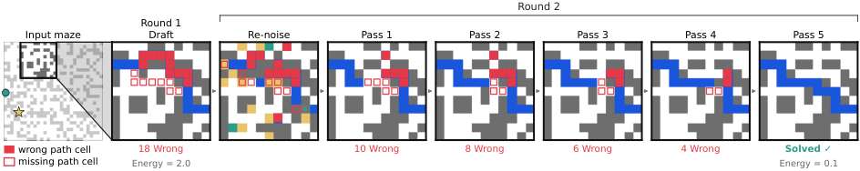

### TL;DR

Draft Refinement Language Models (DRLM) do reasoning by proposing a *whole-answer draft* and then iteratively revising it in parallel. A single denoiser reconstructs clean tokens from uniformly corrupted drafts and scores each candidate under a *cavity energy* that subtracts the token's own evidence; a propose–read–retain loop keeps revisions whose energy drops.

### Key idea

Replace autoregressive next-token reasoning with holistic draft refinement: an iterative discrete-diffusion loop that reads the whole draft at once and rewrites tokens whose cavity-energy decreases.

### Main finding

A 6M-parameter DRLM beats autoregressive and discrete-diffusion baselines on Countdown, Sudoku-Extreme and Maze-Hard — tasks where lookahead across the whole answer is decisive.

### Why it matters

Points to a non-autoregressive reasoning substrate that handles backtracking natively and is well-suited to constraint-satisfaction-style problems where left-to-right beam search is a poor fit.

### Knowledge graph integration

**Builds on / relates to existing pages:**
- [post-training/reasoning/mcts.md](../post-training/reasoning/mcts.md) — alternative lookahead primitive for reasoning tasks.
- [post-training/reasoning/long-cot-rl.md](../post-training/reasoning/long-cot-rl.md) — contrasts with left-to-right CoT reasoning.

**Suggested new pages:**
- `architectures/draft-refinement-lm.md` *(depth)* — the DRLM denoiser + cavity-energy mechanism.

---

## 7. Lafa: Large Flow Language Models

**Links:** [arXiv:2610.28559](https://arxiv.org/abs/2610.28559) · [HF](https://huggingface.co/papers/2610.28559) · [AlphaXiv](https://www.alphaxiv.org/abs/2610.28559)
**Topics:** `architectures`, `efficient-inference`, `flow-matching`

### TL;DR

Lafa scales a *blockwise continuous-flow* LM to 8B parameters on fewer than 30B training tokens. It uses causal attention across blocks and bidirectional flow matching inside each block, so blocks decode sequentially while tokens within a block decode in parallel; the architecture is prefix-cache-friendly and supports self-speculative decoding.

### Key idea

Combine the autoregressive block structure (so you keep a working prefix cache) with within-block flow matching (so each block is parallel-decoded). The flow objective replaces the discrete token loss inside each block, keeping continuous-latent benefits.

### Main finding

~2.54× throughput over a matched autoregressive baseline at comparable quality, at 8B scale under <30B tokens.

### Why it matters

Flow- and diffusion-LMs have historically been small-scale curiosities. Lafa is the first clean demonstration that a blockwise continuous-flow LM can scale to 8B and run with AR-grade throughput tooling (prefix cache, speculative decoding).

### Knowledge graph integration

**Builds on / relates to existing pages:**
- [architectures/transformer-block.md](../architectures/transformer-block.md) — block-level backbone.
- [pre-training/mtp.md](../pre-training/mtp.md) — adjacent parallel-prediction objective.

**Suggested new pages:**
- `architectures/flow-language-model.md` *(depth)* — the blockwise causal+flow design and self-speculative decoding setup.

---

## 8. Ask to Distill: Learning to Synthesize Data for On-Policy Distillation

**Authors:** Jiashuo Sun, Xueqiang Xu, Heng Wang, et al. — *UIUC; Texas A&M*
**Links:** [arXiv:2610.27450](https://arxiv.org/abs/2610.27450) · [HF](https://huggingface.co/papers/2610.27450) · [AlphaXiv](https://www.alphaxiv.org/abs/2610.27450)
**Topics:** `distillation`, `data`, `on-policy`

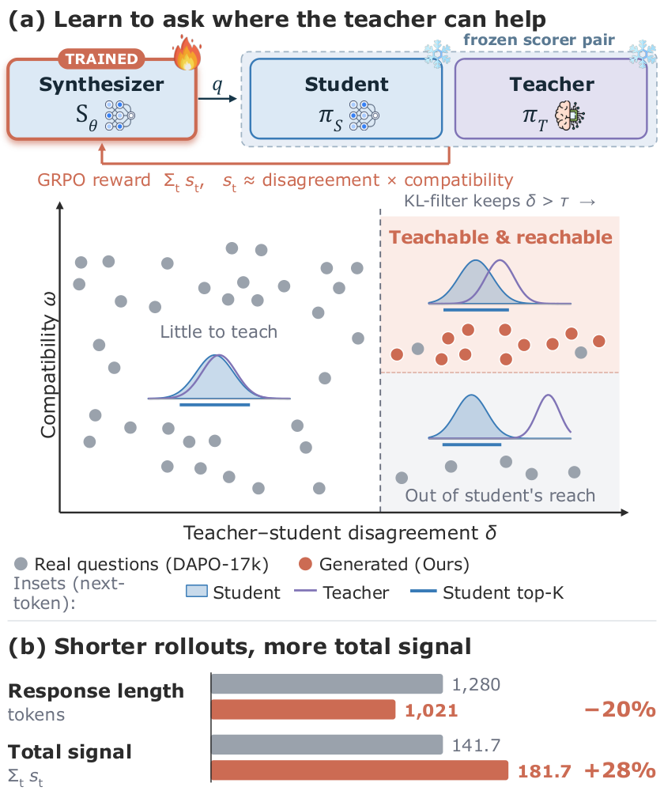

### TL;DR

A2D trains a *question generator* to produce prompts that maximize the teacher's useful signal on the student. Reward combines teacher–student disagreement with teacher probability on the student's top candidates, with length and diversity controls; the resulting prompt bank is then used for standard on-policy distillation.

### Key idea

Instead of distilling on real or random prompts, learn a prompt-synthesis policy whose reward is the *amount of distillation signal per prompt*. The generator, student and teacher co-interact: the generator asks what the student can't yet do but the teacher can.

### Main finding

Beats both student-generated prompts and KL-filtered real prompts on math, code and agentic tasks, with better teacher-gap recovery on average.

### Why it matters

Shifts distillation data-curation from "scrape and filter" to "generate on-demand against the current student" — the on-policy version of the active learning idea, now with LLM teachers.

### Knowledge graph integration

**Builds on / relates to existing pages:**
- [data/_data-curation.md](../data/_data-curation.md) — synthetic / curated distillation data.
- [post-training/fine-tuning/README.md](../post-training/fine-tuning/README.md) — distillation as fine-tuning.
- [post-training/rl-prompt-curation.md](../post-training/rl-prompt-curation.md) — RL over prompts, same template.

**Suggested new pages:**
- `post-training/fine-tuning/on-policy-distillation.md` *(depth)* — reward-driven question synthesis for distillation.

---

## 9. Self-Credit: Credit Assignment for Long-Horizon Agentic RL via Intra-group Rescaling

**Authors:** Fangcong Yin, Ming Yin, Tanvi Bhandarkar, et al. — *Meta*
**Links:** [arXiv:2610.28388](https://arxiv.org/abs/2610.28388) · [HF](https://huggingface.co/papers/2610.28388) · [AlphaXiv](https://www.alphaxiv.org/abs/2610.28388)
**Topics:** `RL`, `agents`, `credit-assignment`

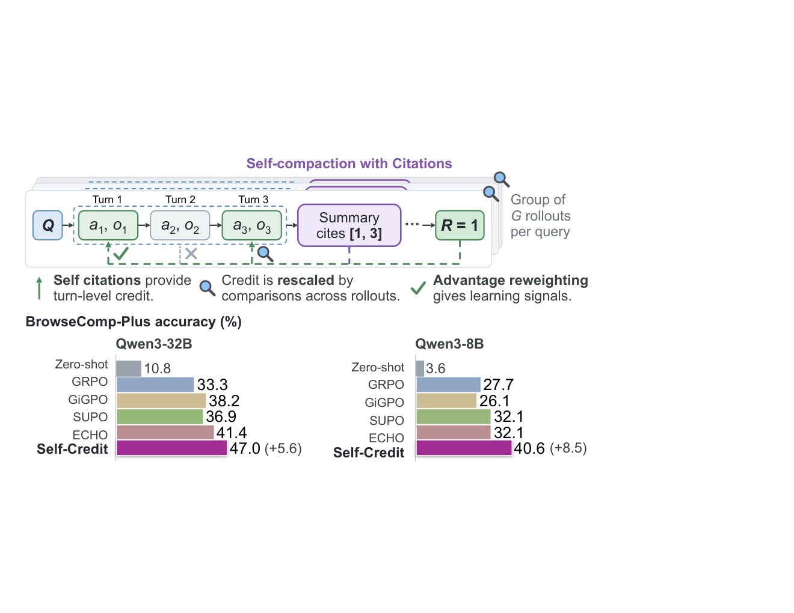

### TL;DR

Long-horizon agent RL with sparse outcome rewards gives every turn the same credit, which is wrong. Self-Credit has the policy *write summaries that cite earlier turns* containing the evidence it used; those citations become self-generated credit signals. An intra-group rescaling term compares cited actions across successful and failed rollouts in the same group and reweights advantages at the turn level.

### Key idea

Three stacked components on top of group-relative RL: (1) model-emitted citations as credit, (2) intra-group reweighting of cited turns using success/failure contrasts, (3) advantage reweighting that boosts actions critical for the task and demotes incidental ones.

### Main finding

+37.0 / +36.2 points over base Qwen3 8B / 32B on BrowseComp-Plus; +4.9 on GAIA and +4.7 on xBench-DeepSearch over the strongest baselines.

### Why it matters

Credit assignment is the headline open problem for agent RL. Using the policy's own citations as a credit mechanism is a cheap, scalable alternative to learned value heads or dense process rewards.

### Knowledge graph integration

**Builds on / relates to existing pages:**
- [post-training/grpo.md](../post-training/grpo.md) — group-relative RL is the base algorithm.
- [post-training/_rl.md](../post-training/_rl.md) — RL taxonomy.
- [post-training/reasoning/prm.md](../post-training/reasoning/prm.md) — alternative dense credit signal.
- [post-training/reasoning/orm.md](../post-training/reasoning/orm.md) — outcome rewards baseline Self-Credit improves on.

**Suggested new pages:**
- `post-training/reasoning/self-credit.md` *(depth)* — citation-based credit assignment + intra-group rescaling.

---

## 10. CoEvo-RSI: When Harnesses Evolve, Which Models Should Follow?

**Authors:** Guibin Zhang, Jie-Jing Shao, Cong Pang — *NUS; A\*STAR; SenseTime*
**Links:** [arXiv:2610.25078](https://arxiv.org/abs/2610.25078) · [HF](https://huggingface.co/papers/2610.25078) · [AlphaXiv](https://www.alphaxiv.org/abs/2610.25078)
**Topics:** `agents`, `self-improvement`, `fine-tuning`

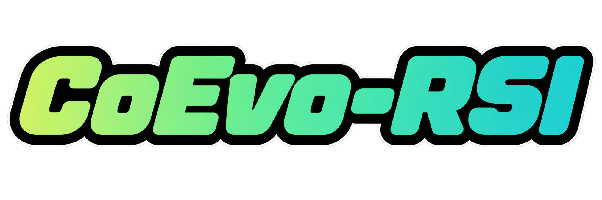

### TL;DR

In recursive self-improving agents, the harness (prompts, tools, scaffolding) and the model drift apart as the harness evolves. CoEvo-RSI maintains a shared *evolutionary archive* and uses bidirectional historical inheritance: harness proposals inform which model checkpoints are rejection-sampled, merged and SFT-adapted, and model progress informs which harness candidates survive.

### Key idea

Treat harness-model co-evolution as a single search problem over an archive. For each harness candidate, generate trajectories, do rejection sampling for successful ones, SFT only on the model's own rejected-sampled trajectories, and keep the pairing with the highest archive fitness.

### Main finding

A 9B Qwen3.5-9B model trained with CoEvo-RSI matches much larger models on failure attribution, role-aware text-to-SQL, and smart-home instruction following, using *only* SFT on self-sampled trajectories.

### Why it matters

Most self-improvement papers hold the harness fixed; CoEvo-RSI makes it co-evolve with the model and shows the mismatch between evolving scaffolding and a frozen model is a real cost. The recipe is also RL-free, which lowers the bar.

### Knowledge graph integration

**Builds on / relates to existing pages:**
- [post-training/rejection-sampling.md](../post-training/rejection-sampling.md) — the core data-generation step.
- [post-training/fine-tuning/README.md](../post-training/fine-tuning/README.md) — SFT update rule.
- [agents/README.md](../agents/README.md) — harness-model separation.

**Suggested new pages:**
- `agents/harness-model-coevolution.md` *(depth)* — the archive and bidirectional inheritance mechanism.

---

## 11. HarnessRL: Co-Evolving Policies with a Just-in-Time Training Harness for Open-Ended RL

**Authors:** Alibaba Token Hub; Mila
**Links:** [arXiv:2610.26426](https://arxiv.org/abs/2610.26426) · [HF](https://huggingface.co/papers/2610.26426) · [AlphaXiv](https://www.alphaxiv.org/abs/2610.26426)
**Topics:** `RL`, `rewards`, `rubric`

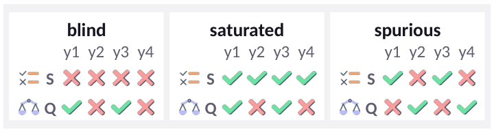

### TL;DR

Rubric-based RL (NL criteria used as rewards) fails in two ways: rewards that stop separating responses, and rewards that separate but don't track quality. HarnessRL evolves the *harness* — task sampling, rollout guidance and which rubric criteria are live — in response to each failure, with an evolver proposing changes and a critic admitting them only after measuring their effect on the current policy.

### Key idea

Just-in-time training harness: three evolvable levers (task mix, rollout prompt, rubric slice) are updated by an evolver/critic pair based on measured reward-separation and quality-correlation on the current policy.

### Main finding

Gains over the strongest baselines at 4B and 9B scales on Rubric-Mix-10k (medical, science, writing, role-play, instruction following), reaching the best checkpoint in roughly half the training steps.

### Why it matters

Open-ended RLHF/RLVR training is bottlenecked by reward quality; HarnessRL is a principled recipe for keeping the reward signal useful *throughout* training rather than freezing it at the start.

### Knowledge graph integration

**Builds on / relates to existing pages:**
- [post-training/_rl.md](../post-training/_rl.md) — RL class.
- [post-training/_rewards.md](../post-training/_rewards.md) — reward engineering taxonomy.
- [post-training/rl-prompt-curation.md](../post-training/rl-prompt-curation.md) — adjacent idea at the prompt level.
- [post-training/rlvr.md](../post-training/rlvr.md) — RLVR as a baseline.

**Suggested new pages:**
- `post-training/rubric-rl.md` *(depth)* — rubric-based RL and the evolver/critic harness loop.

---

## 12. On the Limits of Scale: Inverse Scaling in Vision-Language Models

**Authors:** Rohit Saxena, Alessandro Suglia, Marek Rei, Pasquale Minervini — *University of Edinburgh*
**Links:** [arXiv:2610.27360](https://arxiv.org/abs/2610.27360) · [HF](https://huggingface.co/papers/2610.27360) · [AlphaXiv](https://www.alphaxiv.org/abs/2610.27360)
**Topics:** `eval`, `multimodal`, `scaling`

### TL;DR

Evaluating 19 VLMs across 4 families on 8 multimodal benchmarks, the authors find persistent *inverse scaling* on specific subtasks: larger models in the family do worse. The effect is strongest in multi-image spatial reasoning, visual perception and university-level STEM; diagram understanding is largely spared.

### Key idea

A clean, family-controlled sweep that isolates where VLM scaling breaks down. No new method — the contribution is the measurement and the subtask taxonomy of inverse-scaling behaviors.

### Main finding

Robust inverse scaling in three of eight subtask clusters across all four model families, under matched evaluation protocols.

### Why it matters

Pushes back on default "scale solves it" reasoning for VLMs and gives a concrete map of where multimodal fine-tuning / curriculum design still matters more than parameter count.

### Knowledge graph integration

**Builds on / relates to existing pages:**
- [multimodal/README.md](../multimodal/README.md) — VLM evaluation.
- [evaluation/README.md](../evaluation/README.md) — benchmark meta-study.

*Suggested new pages:* nothing worth a standalone page yet — a note in a future `evaluation/_inverse-scaling.md` taxonomy would be the right home.

---

## 13. Sage-A1.5: From Long-Horizon Execution to Scientific Exploration with Capability Composition

**Authors:** Sage team (99 authors) — *Shanghai AI Lab et al.*
**Links:** [arXiv:2610.28578](https://arxiv.org/abs/2610.28578) · [HF](https://huggingface.co/papers/2610.28578) · [AlphaXiv](https://www.alphaxiv.org/abs/2610.28578)
**Topics:** `agents`, `MoE`, `scientific-discovery`

### TL;DR

Sage-A1.5 is a 35B Mixture-of-Experts agentic model extending the earlier A1 model with three capabilities: *agentic orchestration* (task delegation and parallel subagents with isolated contexts), *agentic verification* (progress checking, evidence validation and strategy revision during execution), and *open scientific discovery* (going beyond fixed questions to exploratory research).

### Key idea

Rather than scaling a single-agent policy, scale *capability composition*: a hierarchy of subagents with isolated contexts, orchestrated by a planner that revises its plan based on verification signals from in-flight evidence.

### Main finding

Demonstrated on complex agentic tasks and multidisciplinary scientific applications (the paper's benchmark table). Treated by the authors as a report on an open accessible agentic MoE for scientific exploration.

### Why it matters

Interesting bridge from the "long-horizon execution" line (DeepSeek-R1, Kimi-K1.5) into open-ended scientific research as the next evaluation frontier, with an architecture (MoE agent with hierarchical delegation) that other open systems can clone.

### Knowledge graph integration

**Builds on / relates to existing pages:**
- [architectures/_moe.md](../architectures/_moe.md) — 35B MoE backbone.
- [case-studies/kimi-k1-5.md](../case-studies/kimi-k1-5.md) — closest long-horizon agent precedent.
- [case-studies/deepseek-r1.md](../case-studies/deepseek-r1.md) — closest reasoning-agent precedent.
- [agents/README.md](../agents/README.md) — agent-system paper.

*Suggested new pages:* `case-studies/sage-a1-5.md` is possible, but the public abstract leans more on capability-composition claims than full training-recipe details, so holding off until the full tech report lands.

---

## 14. FlowState: Execution State as Memory for Long-Horizon LLM Agents

**Authors:** Minghao Li, Bangyan Li, Zifan Wang, et al. — *Ant International*
**Links:** [arXiv:2609.34565](https://arxiv.org/abs/2609.34565) · [HF](https://huggingface.co/papers/2609.34565) · [AlphaXiv](https://www.alphaxiv.org/abs/2609.34565)
**Topics:** `agents`, `memory`, `long-horizon`

### TL;DR

Instead of pouring full trajectories back into the context, FlowState stores *typed state nodes*, their relations, and pointers to raw tool outputs, and treats this graph as retrievable memory across requests. Within a loop it incrementally updates the current state and retrieves historical states on demand.

### Key idea

A typed, structured state object (not raw text) is the memory substrate. Updates to state are deltas; retrieval is a graph query, not a context dump.

### Main finding

Higher success than a full-context DeepSeek-V4-Flash baseline on MemoryArena and τ³-Bench, with roughly 41–43% lower token consumption.

### Why it matters

Token cost dominates long-horizon agents; moving from "stuff the context" to "query typed state" is the next step up from vector-store memory and may be what finally lets agents run for days.

### Knowledge graph integration

**Builds on / relates to existing pages:**
- [agents/README.md](../agents/README.md) — memory for long-horizon agents.

**Suggested new pages:**
- `agents/execution-state-memory.md` *(depth)* — typed state graphs as agent memory.

---

## 15. Matrix-Game 4.0: Harnessing Video Models for Real-Time Playable Game Worlds

**Authors:** Jihai Zhang, Runjia Qian, et al. — *Skywork AI; UCSD; CUHK; SJTU; Shanghai AI Lab*
**Links:** [arXiv:2610.27999](https://arxiv.org/abs/2610.27999) · [HF](https://huggingface.co/papers/2610.27999) · [AlphaXiv](https://www.alphaxiv.org/abs/2610.27999)
**Topics:** `diffusion`, `video`, `world-models`, `agents`

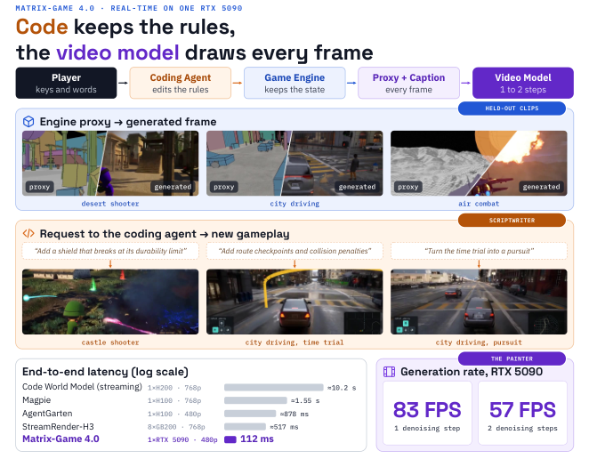

### TL;DR

Playable AI-rendered worlds need persistent state, executable rules, and ≤100 ms interaction latency. Matrix-Game 4.0 splits the system: a lightweight engine runs the game logic (state + rules), a multimodal coding agent translates player intents into game code and dynamic captions, and an autoregressive video renderer upscales engine-rendered low-poly proxies into detailed visuals. The renderer is trained on paired low-poly/high-fidelity video and distilled into a causal generator.

### Key idea

Separate *simulate* from *render*: do game logic on a cheap deterministic engine, use the generative model only to go from a low-poly proxy to photorealistic frames. Pair that with a coding-agent frontend that turns intents into executable game logic.

### Main finding

480p gameplay at 60 FPS on a single RTX 5090 with 112 ms key-press-to-display latency, with customizable shooter and driving games. Code, weights and low-poly assets released.

### Why it matters

Resolves the headline tension in neural game worlds — generative models can't satisfy both consistency *and* latency alone. Shifting state to a classical engine and using the model only for rendering is a strong architecture choice that other labs will copy.

### Knowledge graph integration

**Builds on / relates to existing pages:**
- [multimodal/README.md](../multimodal/README.md) — video generation and world modeling.

**Suggested new pages:**
- `multimodal/playable-video-world-models.md` *(depth)* — engine + autoregressive-renderer split.

---

## Notes

- Hero figures live in `assets/2026-10-21/`. Two papers (Lafa #7 and FlowState #14) had no suitable figure available via the arXiv HTML view; `cdn-thumbnails.huggingface.co` is blocked by this environment's proxy, so HF `og:image` thumbnails could not be used as fallback.
- Borderline inclusions: Matrix-Game 4.0 (#15) is video/game-focused but kept because of the engine-renderer split architecture and controllable video generation at scale.
- This digest is informational. No existing concept files, `READING-LIST.md`, or `PAPERS.md` were modified to produce it.
