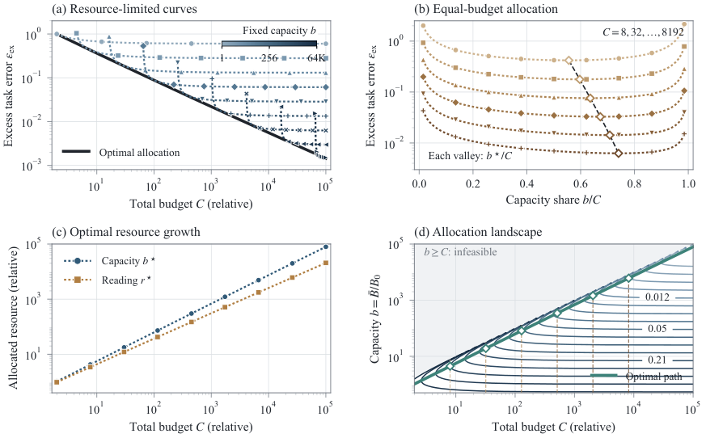

# Daily AI papers — 2026-10-22

*Curated from HF Daily Papers. 15 of ~58 papers kept after relevance filter.*

## Papers at a glance

| # | Title | Topics | Org |
| --- | --- | --- | --- |
| 1 | [Cache Engineering for Agents](#1-cache-engineering-for-agents) | `agents`, `efficient-inference`, `KV-cache` | Tsinghua |
| 2 | [PrismaCoder: Pushing the Boundaries of Open Multimodal Code Intelligence through Decomposed Rubric Synthesis](#2-prismacoder) | `multimodal`, `RL`, `data`, `rubric-reward` | HKU |
| 3 | [Socratic Skill Learning: Interleaving Teaching and Practice for Transferable Agent Skills](#3-socratic-skill-learning) | `agents`, `RL`, `eval` | Nanjing U. / Alibaba |
| 4 | [Retrieval Augmented Generation Compositionality](#4-rag-compositionality) | `RAG`, `eval` | (academic) |
| 5 | [PACE: Periodic and Channel-Aligned Encoding of Four-Bit Recurrent States](#5-pace) | `quantization`, `linear-attention`, `efficient-inference` | (academic) |
| 6 | [TraceForge: Distilling with Your Own Thinking](#6-traceforge) | `reasoning`, `distillation`, `post-training` | ALLE AI Lab |
| 7 | [Memory-Centric Continual Learning for AI Agents](#7-memory-centric-continual-learning) | `agents`, `memory`, `survey` | HIT / Tsinghua consortium |
| 8 | [Harness Scaling for Generalizable Agentic Reinforcement Learning](#8-harness-scaling) | `agents`, `RL` | IQuest / Beihang / RUC |
| 9 | [Sparsity Should Be ALLOTted by Output: Training-Free Allocation of Block-Sparse Attention for Video Diffusion Transformers](#9-allot) | `diffusion`, `efficient-inference`, `sparse-attention` | KlingAI / PKU |
| 10 | [Qwen-Audio-3.1-ASR Technical Report](#10-qwen-audio-3-1-asr) | `multimodal`, `audio`, `tech-report` | Alibaba Qwen |
| 11 | [Stratified Sparse Attention: Reducing the Sparse-to-Dense Gap at Extreme Sparsity](#11-stratified-sparse-attention) | `efficient-inference`, `attention`, `long-context` | Rice / Berkeley / Stanford |
| 12 | [Bridged Self-Distillation for On-Policy Learning](#12-bridged-self-distillation) | `RL`, `distillation`, `reasoning` | MCML / TUM / LMU |
| 13 | [Looped Uniform Diffusion Language Models](#13-looped-uniform-diffusion) | `diffusion-LM`, `architectures`, `efficient-training` | Sony AI / MBZUAI |
| 14 | [Hidden Messages Between Diffusion Language Model Agents: Causal Evidence for Latent Communication](#14-hidden-messages) | `interp`, `safety`, `agents`, `diffusion-LM` | ITMO / HSE |
| 15 | [DiffResearch: Accelerating Deep Research with Diffusion Language Models](#15-diffresearch) | `agents`, `diffusion-LM`, `efficient-inference` | ITMO |

---

## 1. Cache Engineering for Agents

**Authors:** Tianyu Fu, Ruoxi Wang, Zihan Min, Zhongqi Ren, Zhihao Li, Tengxuan Liu, Shengxu Mu, Hanling Zhang, Yu Wang — *Tsinghua University; CUHK*
**Links:** [arXiv:2610.28577](https://arxiv.org/abs/2610.28577) · [HF](https://huggingface.co/papers/2610.28577) · [AlphaXiv](https://www.alphaxiv.org/abs/2610.28577)
**Topics:** `agents`, `efficient-inference`, `KV-cache`

### TL;DR

A systematic treatment of KV-cache management when an LLM agent accumulates very long interleaved observation/action trajectories. Standard tricks (trim, summarize, truncate) edit the beginning of the trace, which invalidates every cached state after the edit and forces costly recomputation. The paper surveys and benchmarks a family of edit-friendly cache structures that keep the active cache useful across turns without full prefill.

### Key idea

Treat the KV cache as a *structured, editable* data store rather than an append-only buffer. The design space has two axes: (1) *what* gets kept — raw tokens, summarized spans, learned soft-tokens, or offloaded blocks; (2) *where* in the trace edits are allowed — prefix-safe, suffix-only, or arbitrary with recomputation masks. The paper lays out this taxonomy and measures each regime on realistic agent workloads.

### Main finding

End-to-end agent throughput is dominated by KV-cache recomputation triggered by context edits, not by model forward passes. A compact structured-edit scheme (prefix-anchored summaries + rolling suffix buffer) keeps >90% of the raw-trajectory accuracy at a fraction of the serving cost of standard rolling summarizers.

### Why it matters

Long-horizon agents are becoming the dominant inference workload. Current serving stacks (vLLM, SGLang) treat context as monolithic — editing anywhere forces a prefill. This paper argues cache engineering is a first-class systems problem, not a prompt-engineering afterthought, and sketches the layer that future agent frameworks will need to add.

### Knowledge graph integration

**Builds on / relates to existing pages:**
- [../architectures/mla.md](../architectures/mla.md) — KV-cache compression at the attention level; cache engineering sits on top.
- [../fundamentals/attention.md](../fundamentals/attention.md) — the attention/KV mechanism being managed.

**Suggested new pages:**
- `inference/agent-kv-cache.md` *(depth)* — covers structured, editable KV cache for long agent trajectories.
- `agents/trajectory-management.md` *(depth)* — the agent-side counterpart: when and how to summarize/trim.

---

## 2. PrismaCoder

**Authors:** PrismaCoder team — *HKU (based on `@connect.hku.hk` emails)*
**Links:** [arXiv:2610.20538](https://arxiv.org/abs/2610.20538) · [HF](https://huggingface.co/papers/2610.20538) · [AlphaXiv](https://www.alphaxiv.org/abs/2610.20538)
**Topics:** `multimodal`, `RL`, `data`, `rubric-reward`

### TL;DR

An open-source multimodal code intelligence stack — programs whose output is visual (charts, web pages, animations, documents). The team argues the open-vs-proprietary gap is a *data* problem and introduces PrismaForge, a pipeline that writes a hierarchical rubric per instruction (code-level + visual-level criteria), reuses the rubric both as the data-filter and as the RL reward, and ships a 2M-sample dataset and 9B/35B models.

### Key idea

**Decomposed rubric synthesis.** For each instruction, auto-generate a hierarchical rubric before any training signal exists. The rubric is used twice: as a scalar data-quality filter at SFT time, and as the reward model during RL — same decomposition, same criteria, two uses. This closes the loop where filtering and rewarding are usually two unrelated systems.

### Main finding

PrismaCoder-9B and PrismaCoder-35B are reported as leading open multimodal code models and competitive with proprietary systems. The dataset PrismaCoder-2M (~2M samples) is also released.

### Why it matters

Multimodal code generation (code → chart/web/animation) is becoming the bellwether of general multimodal reasoning. Rubric-as-reward reuses the same decomposition for data curation and RL post-training, cutting one source of mismatch between SFT and RL stages and giving a cleaner signal than scalar preference models.

### Knowledge graph integration

**Builds on / relates to existing pages:**
- [../post-training/rlvr.md](../post-training/rlvr.md) — RLVR with a verifiable, structured reward; rubric-as-reward is the next step up from binary verifiable rewards.
- [../data/quality-filtering.md](../data/quality-filtering.md) — the rubric also acts as the data-quality filter.
- [../post-training/rejection-sampling.md](../post-training/rejection-sampling.md) — complementary data curation strategy.

**Suggested new pages:**
- `post-training/rubric-as-reward.md` *(depth)* — covers rubric synthesis + dual use for filtering and RL reward.

---

## 3. Socratic Skill Learning

**Authors:** Han Li, Yifan Yao, Xinping Lei, Xinyu Che, Jiahao Wang, Dianyi Wang, Yucheng Fu, Jiakai Wang, Zhiqi Bai, Wenbo Su, Jiaheng Liu — *Nanjing University; Alibaba Group*
**Links:** [arXiv:2610.17860](https://arxiv.org/abs/2610.17860) · [HF](https://huggingface.co/papers/2610.17860) · [AlphaXiv](https://www.alphaxiv.org/abs/2610.17860)
**Topics:** `agents`, `RL`, `eval`

### TL;DR

A two-agent setup for teaching an LLM reusable "skills" (persistent task knowledge the agent can call across sessions). An Educator agent guides a Student agent through practice; the Student runs the task and writes the skill back as text. The paper also introduces SkillTransferBench and an "Issue-Guided SSL" variant that reduces how often the Educator has to intervene.

### Key idea

**Interleave teaching and practice.** Instead of either pure imitation (always follow a teacher) or pure RL (always learn from reward), the Educator intervenes only on sub-tasks where the Student struggles — flagged by "issues" the Student emits. The Student writes a skill document after each solved task and loads it on later related tasks. Transferability is measured on held-out tasks that share sub-skills.

### Main finding

Issue-Guided SSL reduces expert supervision cost while improving skill transfer on SkillTransferBench vs. pure practice or pure imitation baselines (the paper is the primary source for the benchmark too).

### Why it matters

Agents today either compile prompts (static skills) or do full RL (expensive, no reuse). This frames "skills" as persistent, inspectable text artifacts the agent writes about itself — a middle path between prompt engineering and weight updates, and a natural object for curriculum design.

### Knowledge graph integration

**Builds on / relates to existing pages:**
- [../post-training/_rl.md](../post-training/_rl.md) — agentic RL framing.
- [../post-training/rl-prompt-curation.md](../post-training/rl-prompt-curation.md) — curriculum / prompt selection analogue.

**Suggested new pages:**
- `agents/agent-skills.md` *(depth)* — covers skill documents as a persistence mechanism for agents.
- `agents/socratic-skill-learning.md` *(depth)* — the Educator/Student training loop.

---

## 4. RAG Compositionality

**Authors:** (not fully listed on HF page) — *academic*
**Links:** [arXiv:2610.29722](https://arxiv.org/abs/2610.29722) · [HF](https://huggingface.co/papers/2610.29722) · [AlphaXiv](https://www.alphaxiv.org/abs/2610.29722)
**Topics:** `RAG`, `eval`

### TL;DR

A controlled RAG evaluation framework (`lasagna`) sweeping 450 pipeline configurations across 8 benchmarks and corpora from 5K to 200K documents. The headline is that *isolated* improvements to RAG components (retriever, reranker, generator) frequently fail to compose — gains from each stage can cancel when combined, and the best configuration is corpus-size-dependent.

### Key idea

**Composition is not addition.** Each RAG component is evaluated under matched controls across many pipeline neighborhoods; the paper measures how often an improvement at stage *k* carries through to end-to-end score as a function of the configuration at stages ≠ *k*. "Faithfulness" and "retrieval quality" are also shown to prefer different design choices.

### Main finding

Across 450 configurations: isolated gains survive end-to-end in a minority of pipelines, retrieval quality and answer faithfulness demand opposing choices (recall-prioritizing retrievers hurt faithfulness, and vice versa), and the best pipeline *changes* as the corpus grows from 5K to 200K documents.

### Why it matters

Most RAG papers tune one component on one benchmark. This paper quantifies how fragile that signal is and gives a reusable evaluation harness. It also complicates the usual story that "better retriever + better reader = better RAG."

### Knowledge graph integration

**Builds on / relates to existing pages:**
- [../evaluation/README.md](../evaluation/README.md) — evaluation methodology for a system (RAG) that currently has no coverage in the graph.

**Suggested new pages:**
- `evaluation/rag-evaluation.md` *(depth)* — covers the lasagna methodology and compositionality findings.

---

## 5. PACE

**Authors:** (not listed on HF page) — *academic*
**Links:** [arXiv:2610.29545](https://arxiv.org/abs/2610.29545) · [HF](https://huggingface.co/papers/2610.29545) · [AlphaXiv](https://www.alphaxiv.org/abs/2610.29545)
**Topics:** `quantization`, `linear-attention`, `efficient-inference`

### TL;DR

A 4-bit *post-hoc* quantizer specifically for the recurrent state of linear-attention / hybrid language models (Mamba-style and friends). Rather than rounding the state after every generated token, PACE rounds **periodically** — once every few tokens — holding the intervening steps in a small full-precision buffer. Scales are shared along columns (where big entries cluster), and the few heads with the most rounding error stay at 8 bits.

### Key idea

Three ingredients: (1) *periodic* rounding instead of per-token, so the buffer runs cheap and quantization error doesn't accumulate step-wise; (2) **channel-aligned** scales (per-column, exploiting that large magnitudes gather in specific state columns); (3) **mixed-precision heads** — heads whose state is most rounding-sensitive stay in 8 bits, the rest go to 4.

### Main finding

Across four hybrid models from 4B to 35B parameters: PACE at mixed 4/8-bit heads matches 8-bit DAMP at ~⅔ the memory; all-4-bit PACE beats Q-Mamba at the same memory. Periodic rounding preserves the decoding speedup of the buffer.

### Why it matters

Linear-attention / Mamba models are serving-friendly because their state is fixed size — but only if that state actually fits. 4-bit state halves memory from 8-bit SOTA, which doubles concurrent sequences on the same GPU. The channel/column structure of the state turns out to be the quantization-friendly axis, mirroring the input-channel outliers people exploit in transformer quantization.

### Knowledge graph integration

**Builds on / relates to existing pages:**
- [../quantization/_number-formats.md](../quantization/_number-formats.md) — adds a new target (recurrent state) to the quantization taxonomy.
- [../quantization/fp8.md](../quantization/fp8.md) — mixed-precision analogue in the transformer world.

**Suggested new pages:**
- `architectures/linear-attention.md` *(depth)* — fills a graph gap; the whole family (Mamba, hybrid attention) has no page.
- `quantization/state-quantization.md` *(depth)* — covers PACE and periodic / channel-aligned recurrent-state quantization.

---

## 6. TraceForge

**Authors:** (not listed on HF page) — *Independent Researcher; API support from ALLE AI Lab*
**Links:** [arXiv:2610.29680](https://arxiv.org/abs/2610.29680) · [HF](https://huggingface.co/papers/2610.29680) · [AlphaXiv](https://www.alphaxiv.org/abs/2610.29680)
**Topics:** `reasoning`, `distillation`, `post-training`

### TL;DR

A reasoning-distillation recipe that *does not* use the teacher's reasoning trace. Instead, a generator and an adversarial critic in the **student's own model family** produce a "family-native" reasoning trace for each teacher answer. Students trained on these synthesized traces beat students trained on the teacher's own traces on two coding benchmarks (out of five tested).

### Key idea

**Family-native traces.** The teacher only provides the *answer*; the student family synthesizes the *reasoning* (generator writes a trace, adversarial critic tries to invalidate it, loop converges). This sidesteps the usual distillation failure where a student mimics surface tokens of the teacher's trace without the underlying reasoning habits.

### Main finding

Across five benchmarks: a student trained on family-native TraceForge traces beats a student trained on the teacher's own traces on two coding benchmarks; competitive on the others. The gap grows when teacher and student are from different families (where imitating foreign-style traces is most harmful).

### Why it matters

Reasoning distillation from R1-class models is the dominant pattern for open small models today — but it bakes in the teacher's style. TraceForge separates "where the answer comes from" (teacher) from "how the student narrates reaching it" (student family), which may be the right factoring for cross-family distillation.

### Knowledge graph integration

**Builds on / relates to existing pages:**
- [../post-training/reasoning/long-cot-rl.md](../post-training/reasoning/long-cot-rl.md) — long-CoT RL is the prevailing alternative; TraceForge is distillation-side.
- [../post-training/rejection-sampling.md](../post-training/rejection-sampling.md) — adversarial critic filters generated traces.
- [../case-studies/deepseek-r1.md](../case-studies/deepseek-r1.md) — R1-style trace distillation is the implicit baseline.

**Suggested new pages:**
- `post-training/reasoning/traceforge.md` *(depth)* — covers family-native trace synthesis for reasoning distillation.

---

## 7. Memory-Centric Continual Learning for AI Agents

**Authors:** (consortium of authors across six affiliations: HIT, SLAI, Tsinghua, SEU, China Telecom, Huawei) — *HIT / Tsinghua / Huawei consortium*
**Links:** [arXiv:2610.29357](https://arxiv.org/abs/2610.29357) · [HF](https://huggingface.co/papers/2610.29357) · [AlphaXiv](https://www.alphaxiv.org/abs/2610.29357)
**Topics:** `agents`, `memory`, `survey`

### TL;DR

A survey/position paper arguing agent memory should be judged by whether it changes future actions, not by lookup recall. Proposes a three-axis taxonomy (substrates, assets, policies), a two-loop lifecycle, an evaluation protocol with retention/adaptation/transfer, and a scaling framework spanning non-parametric and parametric memory.

### Key idea

**Memory as a learning substrate, not a cache.** Current agent-memory benchmarks score systems on how well they retrieve stored facts. The paper reframes memory evaluation around downstream *action change*: how much does having (vs. not having) the memory alter the next decision. Taxonomy axes: *substrate* (how it is stored), *assets* (what is stored), *policies* (what the agent does with it).

### Main finding

(Survey — no new empirical result.) Catalogs existing agent-memory systems against the proposed taxonomy and identifies underexplored combinations (e.g. parametric memory with task-level, not instance-level, policies).

### Why it matters

Agent memory is where current frontier systems demonstrably underperform humans. The field has settled on retrieval-cache benchmarks that may not predict real agent competence. A principled evaluation protocol — centered on action change — reframes what memory is for.

### Knowledge graph integration

**Builds on / relates to existing pages:**
- [../agents/README.md](../agents/README.md) — the whole folder is currently empty of depth files; this is a foundational input.
- [../evaluation/README.md](../evaluation/README.md) — proposed eval protocol belongs here.

**Suggested new pages:**
- `agents/_agent-memory.md` *(taxonomy)* — the substrates/assets/policies taxonomy and two-loop lifecycle.

---

## 8. Harness Scaling

**Authors:** Huatong Song, Chuan Hao, Ran Tao, Jian Yang, Bryan Dai, Wayne Xin Zhao, Ji-Rong Wen, et al. — *IQuest Research; Beihang University; Gaoling School of AI, Renmin University of China*
**Links:** [arXiv:2610.29458](https://arxiv.org/abs/2610.29458) · [HF](https://huggingface.co/papers/2610.29458) · [AlphaXiv](https://www.alphaxiv.org/abs/2610.29458)
**Topics:** `agents`, `RL`

### TL;DR

Argues that the *harness* — the execution scaffold that governs tool use, context handling, and multi-turn I/O — matters as much as model weights, and that RL training inside a single fixed harness overfits. "Harness Scaling" trains across a factorized space of harness configurations and shows transfer to unseen white-box *and* unseen external black-box harnesses.

### Key idea

Factorize the harness into independent axes (context strategy, tool schema, retry policy, …), build a compact training set with balanced coverage of combinations, and sample a *harness* alongside each task during RL. Nearby configurations are paired per task so the policy learns which parts of its behavior are harness-robust.

### Main finding

Across benchmarks, model scales, and RL algorithms: better generalization to unseen white-box harness configurations, and transfer to unseen external black-box harnesses that outperforms models trained in a single complex black-box harness.

### Why it matters

A real deployment gap: a model RL-trained inside one framework often collapses when swapped into another (different tool-call format, different context policy). Harness Scaling is a concrete recipe for the harness-robustness problem — a sibling of domain randomization for agents.

### Knowledge graph integration

**Builds on / relates to existing pages:**
- [../post-training/_rl.md](../post-training/_rl.md) — RL post-training infrastructure.
- [../post-training/rl-prompt-curation.md](../post-training/rl-prompt-curation.md) — curriculum over prompts; this extends it to curriculum over harnesses.

**Suggested new pages:**
- `agents/harness-scaling.md` *(depth)* — covers factorized harness-aware RL training.

---

## 9. ALLOT: Block-Sparse Attention for Video Diffusion

**Authors:** Tianze Xia, Xiaoling Zhou, Ruya Lan, Yiqiao Liao, Chengru Song, Shiming Xiang — *PKU; KlingAI Research; UCAS*
**Links:** [arXiv:2610.29441](https://arxiv.org/abs/2610.29441) · [HF](https://huggingface.co/papers/2610.29441) · [AlphaXiv](https://www.alphaxiv.org/abs/2610.29441)
**Topics:** `diffusion`, `efficient-inference`, `sparse-attention`

### TL;DR

A training-free scheme that re-allocates block-sparse attention budget in Video Diffusion Transformers by *output* importance rather than input similarity. Full 3D attention is expensive in video DiTs; standard sparsity patterns pick which keys to attend to from the query's own distribution, which this paper argues wastes capacity on blocks that contribute little to the output tokens the user cares about.

### Key idea

**Sparsity allocated by output.** For each query block, estimate expected contribution to downstream output tokens (via a cheap proxy over nearby timesteps), then allocate the sparse attention budget to keys that are important *for those outputs*, not for the query's own similarity map. Zero training; swap-in replacement for existing block-sparse kernels.

### Main finding

Training-free integration into standard video DiT pipelines; preserves quality at substantially higher sparsity than existing block-sparse attention methods.

### Why it matters

Video diffusion is the current gating factor for cheaper video generation at scale. Training-free sparsity that doesn't degrade quality is a direct speedup lever. The output-vs-input allocation idea likely transfers to long-context LLM sparse attention too.

### Knowledge graph integration

**Builds on / relates to existing pages:**
- [../fundamentals/attention.md](../fundamentals/attention.md) — the attention mechanism being sparsified.
- [../architectures/multi-head-attention.md](../architectures/multi-head-attention.md) — the full attention baseline.

**Suggested new pages:**
- `inference/block-sparse-attention.md` *(depth)* — covers output-aware sparse-attention allocation (ALLOT).

---

## 10. Qwen-Audio-3.1-ASR

**Authors:** Qwen Audio team (~45 authors, alphabetical) — *Alibaba / Qwen*
**Links:** [arXiv:2610.28711](https://arxiv.org/abs/2610.28711) · [HF](https://huggingface.co/papers/2610.28711) · [AlphaXiv](https://www.alphaxiv.org/abs/2610.28711)
**Topics:** `multimodal`, `audio`, `tech-report`

### TL;DR

Qwen's audio-language family extended beyond pure ASR into speaker-diarized transcription and general audio understanding (captioning, temporal grounding, sound event detection, audio QA, multiple-choice reasoning). Supports 30 languages + 16 Chinese dialects. Instruction-controlled features: historical-context conditioning, hierarchical hotword customization, native transcription polishing. Ships variants for async-file, low-latency streaming, interactive, and non-streaming deployment.

### Key idea

Keep the audio-LLM backbone but expand the task surface via instructions: the same model is told to transcribe, diarize, caption, ground events, or answer audio questions. Speaker-diarized ASR outputs structured text with speaker labels, timestamps, and overlap handling that stays consistent across turns.

### Main finding

Evaluations span conventional ASR, multilingual + dialectal speech, speaker-diarized transcription, and general audio understanding — the report positions the family as covering the full transcription-to-analysis range in one model lineage.

### Why it matters

Audio-LLMs are catching up to vision-LLMs. A single instruction-controlled audio foundation model that covers diarization *and* captioning *and* temporal grounding is a step toward making audio a first-class modality for agents (meeting assistants, call analytics, podcast digests).

### Knowledge graph integration

**Builds on / relates to existing pages:**
- [../case-studies/qwen2-5.md](../case-studies/qwen2-5.md) — same Qwen lineage; audio arm of the family.
- [../multimodal/README.md](../multimodal/README.md) — multimodal LLM family (currently no depth files).

**Suggested new pages:**
- `case-studies/qwen-audio-3-1.md` *(case study)* — full breakdown of the Qwen-Audio-3.1-ASR family.

---

## 11. Stratified Sparse Attention

**Authors:** Sahil Joshi, Prithvi Dixit, Aryan Katiyar, Agniva Chowdhury, Joseph E. Gonzalez, Anshumali Shrivastava, Aditya Desai, Kumar Krishna Agrawal — *Rice; UC Berkeley; Stanford; IIT Bombay*
**Links:** [arXiv:2610.28441](https://arxiv.org/abs/2610.28441) · [HF](https://huggingface.co/papers/2610.28441) · [AlphaXiv](https://www.alphaxiv.org/abs/2610.28441)
**Topics:** `efficient-inference`, `attention`, `long-context`

### TL;DR

A long-context sparse attention method combining **deterministic retrieval** of top-score tokens with **score-guided sampling** of the residual tail — correcting for inclusion probability so the sampled attention is unbiased. Closes the accuracy gap between sparse and dense attention at the extreme sparsity settings where prior methods (either pure retrieval or pure sampling) fail.

### Key idea

Two-tier KV-cache attention: top-k keys are selected deterministically (as in standard retrieval sparse attention), and the remaining tail is **sampled** using proxy attention scores — crucially, the sampled estimate is *unbiased* once you divide by inclusion probability. The retrieval tier captures the mass; the sampled tier captures the residual that pure retrieval always loses.

### Main finding

Consistent accuracy gains at matched sparsity over deterministic-only and sampling-only baselines across RULER, LongBench, LOFT, and AIME, with models from 3B to 27B. Up to **2.96× decode speedup** over FlashInfer at 1M-token context.

### Why it matters

At 1M-token context the KV cache dominates serving cost; sparse attention is the primary lever, but existing methods either lose accuracy (retrieval-only drops the tail) or add variance (sampling-only hurts top-k precision). SSA pays a tiny cost to combine them and matches dense attention much closer to the "all sparse" regime.

### Knowledge graph integration

**Builds on / relates to existing pages:**
- [../fundamentals/attention.md](../fundamentals/attention.md) — the sparsified operation.
- [../architectures/mla.md](../architectures/mla.md) — a complementary KV-cache reduction (compression, not sparsification).
- [../fundamentals/dca.md](../fundamentals/dca.md) — long-context attention variants.

**Suggested new pages:**
- `inference/stratified-sparse-attention.md` *(depth)* — covers SSA's retrieval+sampling combination.

---

## 12. Bridged Self-Distillation

**Authors:** Runsheng Chen, Yihong Liu, Raoyuan Zhao, Michael A. Hedderich, Hinrich Schütze, Matthias Grabmair — *Munich Center for Machine Learning (TUM / LMU)*
**Links:** [arXiv:2610.26397](https://arxiv.org/abs/2610.26397) · [HF](https://huggingface.co/papers/2610.26397) · [AlphaXiv](https://www.alphaxiv.org/abs/2610.26397)
**Topics:** `RL`, `distillation`, `reasoning`

### TL;DR

An on-policy distillation framework that works with *any* teacher that emits reasoning traces — including a shared-tokenizer teacher, a cross-tokenizer teacher, or a closed-API teacher that returns only text. The teacher's trace is given as *privileged context* to a copy of the student (the "self-teacher"), which scores the student's own rollouts; a verifier decides update direction and the self-teacher's token-level guidance sets penalty weights.

### Key idea

**The self-teacher is the student with teacher-trace context.** Instead of distilling the teacher's hidden states (requires shared tokenizer) or its logits (requires API access), BSD runs the student twice: once in the normal setting, and once conditioned on the teacher trace as privileged context. The gap between the two becomes the training signal, and the student can always "watch itself with hints" regardless of what the teacher is.

### Main finding

Across 12 teacher-student pairs and 3 math benchmarks (AIME-class): BSD improves over the base model and beats distillation baselines tailored to each specific scenario (shared-tokenizer, cross-tokenizer, closed-API) — one unified method dominates three families of per-setting hacks.

### Why it matters

Closed-API reasoning teachers are the only way to distill from the strongest commercial models. BSD removes the dependence on logit/hidden-state access, which is the usual blocker. The "self-teacher under privileged context" idea is a clean on-policy signal that doesn't require anything the API won't give you.

### Knowledge graph integration

**Builds on / relates to existing pages:**
- [../post-training/_rl.md](../post-training/_rl.md) — on-policy RL framing.
- [../post-training/grpo.md](../post-training/grpo.md) — related on-policy preference / reward schemes.
- [../post-training/rejection-sampling.md](../post-training/rejection-sampling.md) — a verifier is used to pick direction.

**Suggested new pages:**
- `post-training/bridged-self-distillation.md` *(depth)* — covers the privileged-context self-teacher distillation loop.

---

## 13. Looped Uniform Diffusion LMs

**Authors:** Saiteja Utpala, Chieh-Hsin Lai, Yuki Mitsufuji, Praneeth Vepakomma — *Sony AI / MBZUAI (inferred from author affiliations)*
**Links:** [arXiv:2610.30066](https://arxiv.org/abs/2610.30066) · [HF](https://huggingface.co/papers/2610.30066) · [AlphaXiv](https://www.alphaxiv.org/abs/2610.30066)
**Topics:** `diffusion-LM`, `architectures`, `efficient-training`

### TL;DR

Shows that **looping early Transformer layers** inside a uniform diffusion language model gives large training and inference efficiency wins — same objective, same sampler, just a looped stack. Reaches the validation NLL of a non-looped baseline with 2.8–3.3× fewer training FLOPs, and at matched NFE budget cuts generation perplexity by up to ~10%.

### Key idea

**Layer-looping specialized to diffusion LMs.** The denoising objective is run on a stack whose first few layers are iterated multiple times. This lets a small model emulate a deeper one for a given training step, with the loop count sampled during training so the model learns to be robust to variable loop depth at inference. Training sampling slightly biased toward *fewer* loops lets inference use fewer loops too, with no accuracy hit.

### Main finding

- 2.8× fewer training FLOPs to match baseline NLL on OpenWebText, 3.3× on FineWeb-Edu.
- Up to **9.8% lower generation perplexity** at matched NFE at inference.
- Loop-biased training sampling cuts inference loops by 12% without hurting accuracy.

### Why it matters

Diffusion LMs are an active alternative to autoregressive LMs, and inference cost is their main cost center (many denoising steps). Looped transformers are a known trick in classification, but adapting them to diffusion LMs — where the same model is called many times per sample anyway — gives a compounded speedup.

### Knowledge graph integration

**Builds on / relates to existing pages:**
- [../architectures/transformer-block.md](../architectures/transformer-block.md) — the block being looped.
- [../pre-training/README.md](../pre-training/README.md) — training efficiency framing.

**Suggested new pages:**
- `architectures/diffusion-language-models.md` *(depth)* — covers the uniform-diffusion-LM family (fills a graph gap).
- `architectures/looped-transformers.md` *(depth)* — covers layer looping as an architectural pattern, with diffusion LMs as the headline application.

---

## 14. Hidden Messages Between Diffusion LM Agents

**Authors:** Alexey Gavrilov, Sergey Muravyov, Ilya Makarov — *ITMO University; HSE University*
**Links:** [arXiv:2610.28905](https://arxiv.org/abs/2610.28905) · [HF](https://huggingface.co/papers/2610.28905) · [AlphaXiv](https://www.alphaxiv.org/abs/2610.28905)
**Topics:** `interp`, `safety`, `agents`, `diffusion-LM`

### TL;DR

Causal evidence that two diffusion LM agents can exchange *compact hidden messages* through continuous latent vectors — bypassing their text channel. One agent compresses its denoising state into four signed dense vectors; the receiver uses the content (ablations: replacing or deranging the vectors drops task accuracy). Across Tiny-A2D, Dream-7B, and distributed QASC, a *single* late transfer outperforms four recurrent exchanges when the task doesn't need back-and-forth.

### Key idea

**Latent channel between agents.** Diffusion LMs have a continuous denoising state that is not surfaced as text. The sender encodes task-relevant content into four dense vectors and the receiver reads them in place of its initial state; the paper then measures whether swapping, zeroing, or permuting these vectors causally reduces the receiver's accuracy.

### Main finding

Replacing or deranging the latent message degrades receiver accuracy in a content-specific way (not just a generic noise effect) across three testbeds — causal evidence that example-specific information crosses the boundary. Single late-stage transfer suffices for feedforward tasks; recurrent exchange is needed when the dependency itself requires it.

### Why it matters

Multi-agent LLM systems are usually monitored at the *text* channel. If agents can route task-relevant info through a latent channel we don't log, oversight assumptions break. For diffusion LMs this is now empirically demonstrated — a concrete safety-relevant pattern plus an interpretability handle (the latent is small and causally probeable).

### Knowledge graph integration

**Builds on / relates to existing pages:**
- [../safety/_scheming.md](../safety/_scheming.md) — covert communication is one of the capabilities scheming threat models invoke.
- [../safety/cot-monitoring.md](../safety/cot-monitoring.md) — monitoring the text channel is insufficient when a latent channel exists.
- [../interpretability/README.md](../interpretability/README.md) — causal probing of latent exchanges.

**Suggested new pages:**
- `safety/latent-steganography.md` *(depth)* — covers hidden-channel communication between model agents.

---

## 15. DiffResearch

**Authors:** Alan-Barsag Gazzaev, Alexey Gavrilov, Mikhail Mozikov, Sergey Muravyov — *ITMO University (plus AXXX, Moscow)*
**Links:** [arXiv:2610.28909](https://arxiv.org/abs/2610.28909) · [HF](https://huggingface.co/papers/2610.28909) · [AlphaXiv](https://www.alphaxiv.org/abs/2610.28909)
**Topics:** `agents`, `diffusion-LM`, `efficient-inference`

### TL;DR

A multi-agent **deep research** framework in which every stage (plan, decompose, write) is driven by a *diffusion* language model instead of an autoregressive one. Keeping scaffold, retrieval, prompts, and evaluation fixed, swapping in a diffusion LM gives about **6× faster** end-to-end deep-research runs on 100 Deep Research Bench tasks, mostly from faster planning and writing.

### Key idea

**Diffusion LMs as agent cores.** Deep-research agents spend most of their wallclock in long-form generation (plan trees, section drafts). Diffusion LMs decode in parallel, so swapping them in for autoregressive cores keeps the pipeline but cuts latency. The paper also introduces a *fast decomposition* mode that reads intermediate denoising states for an early plan — halving decomposition latency without report-quality loss.

### Main finding

- ~6× faster end-to-end on 100 Deep Research Bench tasks.
- Fast decomposition mode halves decomposition latency at the median with no quality drop.
- A system built on a stronger diffusion backbone places above several commercial systems on a public leaderboard snapshot.

### Why it matters

Deep-research agents are a canonical heavy workload for LLMs. If diffusion LMs can match autoregressive quality at a fraction of the latency on this workload, there's an architectural shift lurking for *all* long-horizon agent generation, not just chat-length responses. Fast decomposition from intermediate states is also a new lever that autoregressive LMs cannot copy.

### Knowledge graph integration

**Builds on / relates to existing pages:**
- [../agents/README.md](../agents/README.md) — deep research is the canonical heavy agent workload.
- [../post-training/_rl.md](../post-training/_rl.md) — related post-training setup for agents.

**Suggested new pages:**
- `agents/deep-research.md` *(depth)* — covers the deep-research agent pattern (fills a graph gap).
- `architectures/diffusion-language-models.md` *(depth)* — shared with #13; this paper is a motivating application.

---

## Notes

- Borderline inclusions are flagged in-section with an italic *Borderline: …* note. None used today.
- Hero figures live in `assets/2026-10-22/`. Most figures could not be downloaded — HF's `cdn-thumbnails.huggingface.co` is not reachable from this environment, and arXiv HTML's `x1.png` returns an HTML stub for most papers. Only `2610.29357` (Memory-Centric Continual Learning) has a figure.
- This digest is informational. No existing concept files, `READING-LIST.md`, or `PAPERS.md` were modified to produce it.
