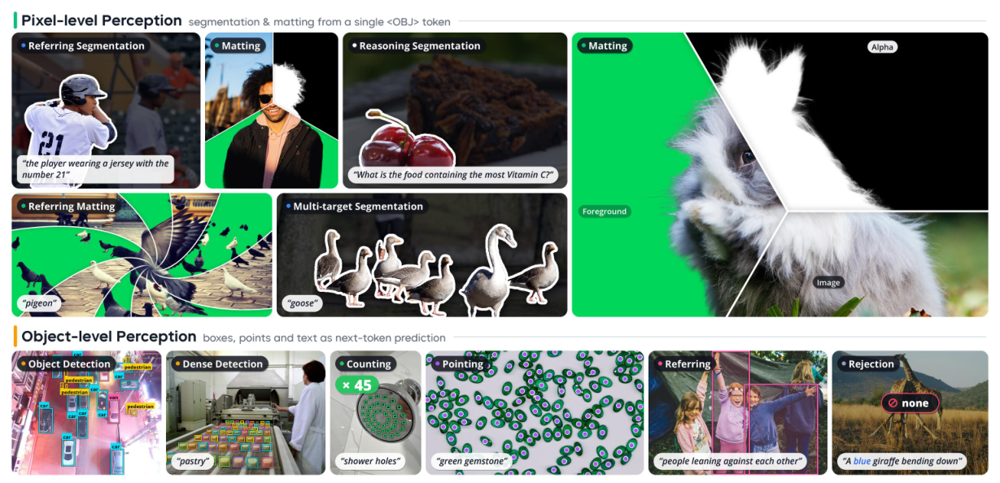
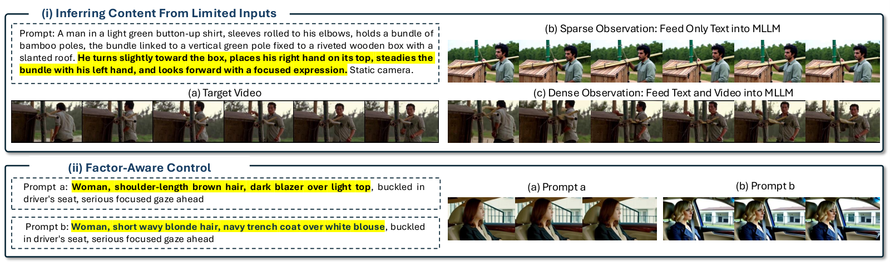
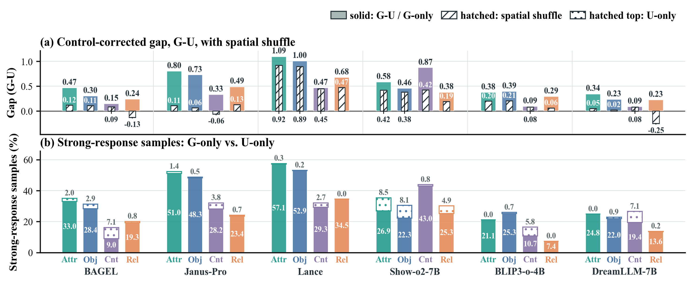
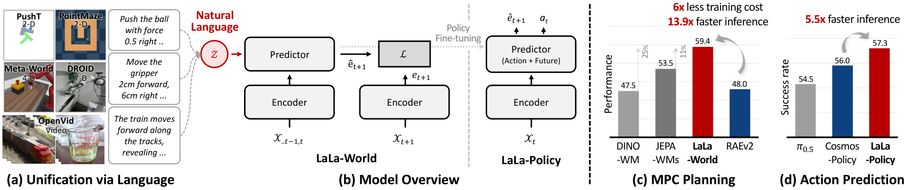
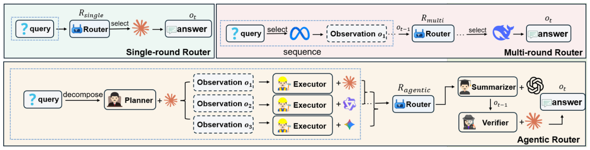

# Daily AI papers — 2026-10-23

*Curated from HF Daily Papers. 15 of ~50 papers kept after relevance filter.*

## Papers at a glance

| # | Title | Topics | Org |
| --- | --- | --- | --- |
| 1 | [WeVisOne-VL: Unified Visual Perception from Objects to Pixels](#1-wevisone-vl) | `multimodal`, `VLM`, `eval` | Tencent |
| 2 | [Making MLLM Latents Matter: Factor-Aware Predictive Learning for Cinematic Video Generation](#2-fapl) | `multimodal`, `diffusion`, `video` | HKUST / Tencent Video / École Polytechnique |
| 3 | [Deep Search in Real-World Web Environments](#3-opends-world) | `agents`, `eval` | HKUST (Guangzhou) consortium |
| 4 | [IQuest-Q1: Advancing Foundation Capabilities for Agentic CLI Systems](#4-iquest-q1) | `LLM`, `MoE`, `agents`, `RL`, `SFT` | IQuest (open release) |
| 5 | [Deep Fusion Memory: A Chunk-Level Parametric Memory for LLMs](#5-deep-fusion-memory) | `LLM`, `efficient-inference`, `memory` | SJTU LUMIA Lab / Shanghai AI Lab |
| 6 | [What Generation Knows: Unlocking Fine-Grained Understanding in Unified Multimodal Models](#6-gafu) | `multimodal`, `VLM`, `unified` | undisclosed on HF |
| 7 | [LaLa-World: Scaling Latent World Models with Natural Language Actions](#7-lala-world) | `multimodal`, `world-model`, `VLA` | NAVER AI Lab / GT / Brown / Mila |
| 8 | [Meta Expert: Cross-Layer Expert Sharing for Storage- and Retrieval-Efficient MoE](#8-meta-expert) | `MoE`, `architectures`, `efficient-inference` | Tsinghua / Shanghai AI Lab |
| 9 | [Heartbeat Thinking: Speculative Reasoning and Tool Execution While Listening in Realtime Voice Agents](#9-heartbeat-thinking) | `agents`, `reasoning`, `efficient-inference` | Ant International |
| 10 | [RouteWeaver: Weaving Mode Selection and Execution into Unified LLM Routing](#10-routeweaver) | `agents`, `RL`, `routing` | NTU / HUST / UIUC |
| 11 | [Is Complex Agentic Memory Always Needed? Naive RAG Is Stronger Than We Thought](#11-raw-rag) | `agents`, `eval`, `memory` | undisclosed on HF |
| 12 | [Agent Mosaic: Recognizing Confidentiality Leaks in Agentic LLM Systems](#12-agent-mosaic) | `safety`, `agents`, `eval` | USC ISI |
| 13 | [Inherited, Not Invented: Tracing the Provenance of *Wait* in Reasoning Models](#13-wait-provenance) | `reasoning`, `RL`, `interp` | HKUST / Huawei Noah's Ark / PKU |
| 14 | [What Makes a Good Unmasking Policy? Learned Unmasking in Diffusion LMs](#14-unmasking-policy) | `diffusion`, `efficient-inference` | NTU Singapore |
| 15 | [T²Quant: Temporal Task-Aware Quantization for Diffusion Language Models](#15-t2quant) | `quantization`, `diffusion`, `efficient-inference` | Technion / Ben-Gurion |

---

## 1. WeVisOne-VL

**Authors:** Tianming Liang, Junyi Pan, Yuxi Li, Canmiao Fu, Zhipeng Huang, Chong Sun, Chen Li, Jing Lyu — *Tencent*
**Links:** [arXiv:2610.31329](https://arxiv.org/abs/2610.31329) · [HF](https://huggingface.co/papers/2610.31329) · [AlphaXiv](https://www.alphaxiv.org/abs/2610.31329)
**Topics:** `multimodal`, `VLM`, `eval`

### TL;DR

A single VLM that handles both object-level perception (detection, counting, OCR, referring localization) and pixel-level perception (segmentation, matting) through structured next-token prediction. A dedicated `<OBJ>` token hands off to a lightweight pixel decoder when a mask is needed, so the LLM stays autoregressive while still emitting dense pixel outputs. Multi-stage training lets one model lead across 30+ perception benchmarks.

### Key idea

Rather than add task-specific heads, every perception output — a bounding box, a count, a character, a segmentation mask — is cast as a token sequence. The `<OBJ>` token is the hook: when it appears, a small decoder reads back the LLM's hidden state and produces pixel-level outputs. One schema, one loss, pixel-level and object-level unified in the same autoregressive stream.

### Main finding

Leading results across more than 30 perception benchmarks (detection, referring segmentation, counting, OCR, matting), beating specialists in each class with one unified model. The pixel decoder is explicitly described as "lightweight," keeping serving cost close to a standard VLM.

### Why it matters

VLM perception today is a zoo of task-specific heads. If structured next-token prediction plus a `<OBJ>` hook can replace most of them without regressing, VLM stacks collapse into one checkpoint and one decoder. This also pushes forward the idea that pixel-level outputs don't need a separate generative branch — autoregression plus a thin bridge suffices.

### Knowledge graph integration

**Builds on / relates to existing pages:**
- [../multimodal/README.md](../multimodal/README.md) — folder currently empty; this is the kind of paper that seeds a VLM depth file.

**Suggested new pages:**
- `multimodal/structured-next-token-perception.md` *(depth)* — unified perception via next-token prediction + `<OBJ>` pixel decoder.

---

## 2. FAPL

**Authors:** Zhe Wang, Xiaotong Zhao, Xi Wang, Ran Zhang, Shuai Li, Taiyi Wu, Songlian Li, Eric Liu, Alan Zhao, Anyi Rao — *HKUST MMLab / Tencent Video / LIX, École Polytechnique*
**Links:** [arXiv:2610.30926](https://arxiv.org/abs/2610.30926) · [HF](https://huggingface.co/papers/2610.30926) · [AlphaXiv](https://www.alphaxiv.org/abs/2610.30926)
**Topics:** `multimodal`, `diffusion`, `video`

### TL;DR

Cinematic video generation needs sparse-input temporal inference and factor-aware control over character/scene/action/camera. A Video DiT typically ignores MLLM latents through its native conditioning. FAPL (Factor-Aware Predictive Learning) is a three-stage recipe that makes the DiT *rely on* MLLM latents, then teaches factor-aware control and temporal inference on top.

### Key idea

Three complementary signals: (1) **Latent-only generator grounding** freezes the MLLM and connector and trains the DiT to use MLLM latents as its only conditioning. (2) **Factor-span replacement** uses paired videos (one factor changed, others preserved) so the DiT learns to realise target-only changes. (3) The DiT is then frozen and the MLLM + connector are optimised through it, aligning limited-input representations with the generator while preserving a complete-observation reconstruction mode.

### Main finding

Consistently better than baselines on three cinematic tasks: sparse-to-video, factor-aware editing, and multi-shot generation. The paper's framing is that it hits all three with the same model, which prior work needed separate pipelines for.

### Why it matters

If MLLM latents can be made the *actionable* interface to video diffusion, you get both the semantic reach of MLLMs (compositional prompts, references, factor edits) and the fidelity of DiTs — without stitching them through text. That makes directed, controllable long-form video generation significantly less brittle.

### Knowledge graph integration

**Builds on / relates to existing pages:**
- [../multimodal/README.md](../multimodal/README.md) — multimodal folder is a gap; this is a candidate seed for video-DiT content.

**Suggested new pages:**
- `multimodal/fapl.md` *(depth)* — three-stage training that forces a Video DiT to use MLLM latents.

---

## 3. OpenDS-World

**Authors:** Xiaomin Yu, Hongliang Chen, Zhe Huang, Shilin Yan, et al. — *HKUST (Guangzhou) + 13 external labs*
**Links:** [arXiv:2610.30181](https://arxiv.org/abs/2610.30181) · [HF](https://huggingface.co/papers/2610.30181) · [AlphaXiv](https://www.alphaxiv.org/abs/2610.30181)
**Topics:** `agents`, `eval`

### TL;DR

Introduces the **OpenDS** task — multi-step deep search against the live Web (not a frozen snapshot or search API wrapper). Agents must plan queries, interact with browsers, process evidence, and recover from failures. **OpenDS-World** is a 200-task benchmark with human-verified answers. 12 frontier models were evaluated; the best reached **39.0 %** accuracy while human solvers reached **21.1 %** — one of the few live-web agent benchmarks where frontier models already exceed humans.

### Key idea

Deep search is defined as the composition of search, browsing, and evidence synthesis under a *live* environment. The benchmark records not just the final answer but tool usage, search cost, termination behavior, and failure recovery — making this an agent benchmark that rewards efficient trajectories, not just final-answer accuracy.

### Main finding

Best model: 39.0 % accuracy; human baseline: 21.1 % (on a sample designed to be hard for humans without browser access). Models still over-search and over-terminate; failure recovery is the main bottleneck beyond raw retrieval.

### Why it matters

Real-world deep search has been evaluated mostly via static corpora or sanitized sandboxes. OpenDS pushes evaluation onto the live Web, which is the actual deployment surface. That makes the benchmark drift over time (the Web moves) but also closes a gap between agent evals and agent products.

### Knowledge graph integration

**Builds on / relates to existing pages:**
- [../agents/README.md](../agents/README.md) — agents folder is empty; this is a natural first entry.
- [../evaluation/README.md](../evaluation/README.md) — fits alongside existing benchmark entries like AIME, LiveCodeBench.

**Suggested new pages:**
- `evaluation/opends-world.md` *(depth)* — live-Web deep-search benchmark for agents.

---

## 4. IQuest-Q1

**Authors:** 150+ contributors; corresponding author Bryan Dai — *IQuest*
**Links:** [arXiv:2610.30949](https://arxiv.org/abs/2610.30949) · [HF](https://huggingface.co/papers/2610.30949) · [AlphaXiv](https://www.alphaxiv.org/abs/2610.30949)
**Topics:** `LLM`, `MoE`, `agents`, `RL`, `SFT`

### TL;DR

Tech report for **IQuest-Q1**, an open-source sparse MoE agentic foundation model: **320B total parameters, 15B activated**, aimed at agentic CLI tasks. A three-stage recipe — stable pre-training, fine-grained *mid-training* with progressive context extension, and post-training combining SFT + domain-specialized RL + multi-teacher on-policy distillation + model merging — produces strong coding and general-task scores. Released as open weights.

### Key idea

Agentic-CLI capability isn't bolted on at RL time — it's shaped across all three stages. The novel pieces: (i) progressive context extension embedded in mid-training rather than SFT, (ii) *domain-specialized RL* with distinct reward routings per capability cluster, and (iii) *multi-teacher on-policy distillation* that lets several specialist RL models inform a single student while it rolls out.

### Main finding

Headline: competitive on coding and general tasks against larger closed models at 15B activated params. Full numbers are in the report; this run is a tech report / release.

### Why it matters

Another instance of the "sparse MoE around 300B, ~15B activated, open release" formula that DeepSeek-V3 kicked off — now re-focused specifically on agentic CLI capability. The multi-teacher on-policy distillation is the recipe's most portable idea: it generalises how reasoning distillation currently works (one teacher) to a committee of specialists.

### Knowledge graph integration

**Builds on / relates to existing pages:**
- [../architectures/_moe.md](../architectures/_moe.md) — same sparse-MoE family as DeepSeek-V3.
- [../architectures/deepseek-moe.md](../architectures/deepseek-moe.md) — comparable fine-grained expert design.
- [../pre-training/mid-training.md](../pre-training/mid-training.md) — mid-training is where context extension happens here.
- [../pre-training/model-souping.md](../pre-training/model-souping.md) — model merging appears in the final stage.
- [../post-training/rlvr.md](../post-training/rlvr.md) — domain-specialized RL fits the RLVR family.
- [../post-training/rejection-sampling.md](../post-training/rejection-sampling.md) — likely used inside the SFT→RL loop.
- [../case-studies/deepseek-v3.md](../case-studies/deepseek-v3.md) — most natural reference point for scale and recipe shape.

**Suggested new pages:**
- `case-studies/iquest-q1.md` *(case study)* — full tech-report breakdown.
- `post-training/multi-teacher-on-policy-distillation.md` *(depth)* — committee of specialist RL teachers steering one student.
- `post-training/domain-specialized-rl.md` *(depth)* — per-capability reward routing in agentic post-training.

---

## 5. Deep Fusion Memory

**Authors:** Rubin Wei, Siyuan Sun, Hao Sun, Yuliang Liu, Xiang Shi, Jiarui Wang, Junming Zhang, Zhouhan Lin — *SJTU LUMIA Lab · Shanghai AI Laboratory*
**Links:** [arXiv:2610.25100](https://arxiv.org/abs/2610.25100) · [HF](https://huggingface.co/papers/2610.25100) · [AlphaXiv](https://www.alphaxiv.org/abs/2610.25100)
**Topics:** `LLM`, `efficient-inference`, `memory`

### TL;DR

A **parametric memory** module trained alongside a frozen backbone: it predicts chunk-level memory tokens from preceding context, then fuses them into the decoder's hidden states via gated cross-attention. No retrieval index is called at inference. Compared with token-level parametric memory methods, DFM uses **32× fewer retrieval queries** and **2048× fewer retrieved items** when constructing the training data, and still beats the strongest baseline on QA with Mistral-7B-v0.3 and Qwen3-8B-Base.

### Key idea

Memory lives inside a trained module rather than in an external vector store. The twist is working at chunk level — one memory slot per chunk of preceding context — and fusing with the backbone through a gated cross-attention channel, not by prepending retrieved text. Backbone weights stay frozen, which keeps costs down and lets DFM be bolted onto open models.

### Main finding

QA gains on Mistral-7B-v0.3 and Qwen3-8B-Base over prior memory baselines; domain-adaptation gains in code, math, and law. The retrieval-query savings quoted (32× / 2048×) refer to training data construction — the production inference cost is just the extra cross-attention.

### Why it matters

Parametric memory keeps dodging the RAG tax: no retriever to run, no index to maintain, no top-K to tune. If chunk-level fusion really gets you RAG-quality QA, it reopens the question of whether retrieval needs to be a *system* at all, or just another layer in the model.

### Knowledge graph integration

**Builds on / relates to existing pages:**
- [../inference/README.md](../inference/README.md) — fits in the empty inference folder as an efficient-inference depth file.

**Suggested new pages:**
- `inference/parametric-memory.md` *(depth)* — chunk-level parametric memory via gated cross-attention over a frozen backbone.

---

## 6. GAFU

**Authors:** Not disclosed on the HF page.
**Links:** [arXiv:2610.23987](https://arxiv.org/abs/2610.23987) · [HF](https://huggingface.co/papers/2610.23987) · [AlphaXiv](https://www.alphaxiv.org/abs/2610.23987)
**Topics:** `multimodal`, `VLM`, `unified`

### TL;DR

Unified multimodal models already carry rich generation-side representations — but their *understanding* pathway doesn't use them. **GAFU** is a post-training framework that compresses generation-side features into a compact set of **G tokens** and feeds them to the understanding path. On the same training data, GAFU beats SFT across multiple benchmarks and architectures.

### Key idea

Rather than fine-tune the whole unified model, GAFU identifies the representational asymmetry: pixels and shapes are already "known" by the generation branch (think of a VQ-image tokenizer or diffusion-side features). Project a small number of G tokens from that branch into the understanding branch and let the two co-attend. Minimal added parameters, large downstream wins.

### Main finding

Consistent gains over same-data SFT across fine-grained understanding benchmarks and across unified-model architectures, i.e. the mechanism isn't tied to one backbone.

### Why it matters

In unified multimodal models the generation and understanding branches are usually trained with separate objectives, and understanding is the laggard. Pointing one at the other is the simplest way to close the gap without new data. Expect this pattern to show up in future unified-model recipes.

### Knowledge graph integration

**Builds on / relates to existing pages:**
- [../multimodal/README.md](../multimodal/README.md) — unified models are a gap in the graph.

**Suggested new pages:**
- `multimodal/gafu.md` *(depth)* — G-token distillation from generation branch into understanding branch.

---

## 7. LaLa-World

**Authors:** Junha Song, Geonmo Gu, Jeongeun Park, Heejeong Nam, Lucas Maes, Byeongho Heo, Dongyoon Han, Sangdoo Yun — *NAVER AI Lab · Georgia Tech · Brown · Mila & Université de Montréal*
**Links:** [arXiv:2610.27851](https://arxiv.org/abs/2610.27851) · [HF](https://huggingface.co/papers/2610.27851) · [AlphaXiv](https://www.alphaxiv.org/abs/2610.27851)
**Topics:** `multimodal`, `world-model`, `VLA`

*Borderline: included because it proposes a foundation-model VLA using natural language as a shared action/state interface across sim, robotics, image, and video.*

### TL;DR

A latent world model that uses **natural language** as the common currency for numerical robot actions and visual changes. One predictor is trained across simulation, robotics, image, and video data, then fine-tuned into **LaLa-Policy**. Reports higher average MPC planning performance than domain-specific latent world models and matches or beats a Cosmos-based baseline on LIBERO and RoboCasa with faster inference.

### Key idea

Keep the latent world model, but swap numerical action vectors for natural-language actions as the model's control interface. Language-as-action lets the same predictor absorb heterogeneous data (sim actions, YouTube video, image edits) without separate action heads, and makes transfer between domains almost free.

### Main finding

Beats domain-specific latent world models in average MPC planning; in a matched comparison against an RAEv2-based generative baseline, lower training cost and faster planning. Fine-tuned LaLa-Policy is competitive with Cosmos Policy on LIBERO and RoboCasa while running faster at inference.

### Why it matters

If language is enough of a shared action space to train one world model across simulated and real domains, VLAs stop needing per-embodiment action heads. This is a step toward world models that double as general policies, with language as the lingua franca across data sources.

### Knowledge graph integration

**Builds on / relates to existing pages:**
- [../multimodal/README.md](../multimodal/README.md) — multimodal/VLA folder currently has no depth content.

**Suggested new pages:**
- `multimodal/lala-world.md` *(depth)* — natural-language actions as the shared interface for a cross-domain latent world model.

---

## 8. Meta Expert

**Authors:** Xiangyu Hong, Baiting Wu, Che Jiang, Haozheng Hou, Yicheng Gu, Hanjing Wang, Qirui Zeng, Ming Zhang, Ning Ding, Qipeng Guo, Youbang Sun, Biqing Qi, Bowen Zhou — *Tsinghua University · Shanghai AI Laboratory*
**Links:** [arXiv:2610.27598](https://arxiv.org/abs/2610.27598) · [HF](https://huggingface.co/papers/2610.27598) · [AlphaXiv](https://www.alphaxiv.org/abs/2610.27598)
**Topics:** `MoE`, `architectures`, `efficient-inference`

### TL;DR

MoE experts are usually *layer-local*: each layer has its own private expert set. The paper argues this is redundant — experts in different layers often learn overlapping content. **Meta Experts** are shared across all layers of the network, giving fewer total experts, lower cross-entropy, and higher downstream accuracy at matched activation count.

### Key idea

Pool experts into one global library and let every layer route into it. Layer-local redundancy drops; the hidden state gets more flexible residual pathways (any layer can call any expert); storage and retrieval cost shrink. At matched activated-expert count and granularity, Meta Experts match vanilla MoE while using roughly **70–80 %** of the experts.

### Main finding

Lower expert-level redundancy, lower training cross-entropy, higher downstream accuracy — and at parity, 70–80 % of the vanilla-MoE expert count. The paper also argues the residual-pathway benefit explains the retrieval-task gains independently of parameter savings.

### Why it matters

The main cost of large MoE deployment is memory, not FLOPs. If experts can be shared across layers without accuracy loss, deployment memory shrinks by 20–30 % at a stroke, and MoE routing becomes a model-wide decision instead of a per-layer one. Pairs naturally with aux-loss-free balancing and sequence-wise balance losses.

### Knowledge graph integration

**Builds on / relates to existing pages:**
- [../architectures/_moe.md](../architectures/_moe.md) — Meta Expert is a cross-layer MoE variant for the taxonomy.
- [../architectures/deepseek-moe.md](../architectures/deepseek-moe.md) — same fine-grained expert motif, now shared across layers.
- [../architectures/capacity-factor.md](../architectures/capacity-factor.md) — capacity-factor dynamics change when experts are shared across layers.
- [../architectures/aux-loss-free-balancing.md](../architectures/aux-loss-free-balancing.md) — complementary balancing concern.

**Suggested new pages:**
- `architectures/meta-expert.md` *(depth)* — cross-layer shared experts for storage- and retrieval-efficient MoE.

---

## 9. Heartbeat Thinking

**Authors:** Zhenyu Zhang, Kewei Fu, Yongqi Tong, Chenzhi Zheng, Wei Wu, Jiang-Ming Yang, Jianshe Li — *Ant International*
**Links:** [arXiv:2610.26233](https://arxiv.org/abs/2610.26233) · [HF](https://huggingface.co/papers/2610.26233) · [AlphaXiv](https://www.alphaxiv.org/abs/2610.26233)
**Topics:** `agents`, `reasoning`, `efficient-inference`

### TL;DR

Realtime voice agents pay a huge latency bill waiting for the user to finish speaking before they start thinking or tool-calling. **Heartbeat Thinking** speculatively reasons and executes tools *while the user is still speaking*, in a "heartbeat" loop keyed to incremental ASR. Done well, by the time the user's turn ends the reply (and its tool results) are already in hand.

### Key idea

Treat speculative decoding's draft/verify split and lift it to the agent level. On every heartbeat (a short periodic tick during the user's utterance), the agent reasons on the current partial transcript and may fire tools against it. When the user's turn truly ends, the system either accepts a prior speculation (if the final transcript matches the prefix enough) or rolls it back and reruns on the final input. Speculation success amortises the whole reasoning + tool-call latency into the user's own speaking time.

### Main finding

The paper's framing is a latency win on realtime voice agents without accuracy loss, by overlapping agent compute with user speech. Specific numbers are in the full paper; the abstract was not retrievable in the HF snippet.

### Why it matters

Voice agents live or die on turn-end latency. Overlapping reasoning and tools with ongoing user speech is the first-principles way to shrink it — and the mechanism generalises beyond voice to any streamed input (live search, streaming code review, co-piloted editing).

### Knowledge graph integration

**Builds on / relates to existing pages:**
- [../agents/README.md](../agents/README.md) — a strong seed for the empty agents folder.
- [../inference/README.md](../inference/README.md) — speculative-execution pattern, lifted from decoding to the agent loop.

**Suggested new pages:**
- `agents/heartbeat-thinking.md` *(depth)* — speculative reasoning + tool use overlapped with user speech.

---

## 10. RouteWeaver

**Authors:** Xiaohan Wang, Qingyuan Liu, Tao Feng, Wenya Wang — *Nanyang Technological University · Huazhong University of Science and Technology · UIUC*
**Links:** [arXiv:2610.19705](https://arxiv.org/abs/2610.19705) · [HF](https://huggingface.co/papers/2610.19705) · [AlphaXiv](https://www.alphaxiv.org/abs/2610.19705)
**Topics:** `agents`, `RL`, `routing`

### TL;DR

Unified LLM routing where one policy picks (a) the execution mode — single-round, multi-round, or agentic — and (b) the model within that mode. Trained with **COMET-GRPO**, which gives separate credit signals to the two decisions, plus progressive exploration that fades out an assigned-mode curriculum. Reports **61.4 %** average accuracy across five domains and **+11.03 %** relative over the strongest baseline.

### Key idea

Routing has two conflated decisions — mode and model — and prior routers conflate the credit, too. COMET-GRPO decomposes the GRPO advantage into per-decision terms, so the policy learns which decision was responsible for a reward. Progressive exploration lets the model start with teacher-assigned modes and gradually shift to autonomous selection.

### Main finding

61.4 % average accuracy across five domains; +11.03 % relative gain over the strongest baseline. Both mode selection and within-mode model selection improve, and the ablations show COMET's credit decomposition is responsible for the lift.

### Why it matters

Agentic systems are increasingly dispatchers — pick the right mode and model per query. Separating credit between the two decisions turns a messy multi-objective problem into something a vanilla GRPO loop can actually learn. The template (decompose GRPO's advantage along one more axis) is reusable in other hierarchical-decision agents.

### Knowledge graph integration

**Builds on / relates to existing pages:**
- [../post-training/grpo.md](../post-training/grpo.md) — direct extension of GRPO with decomposed credit.
- [../post-training/_rl.md](../post-training/_rl.md) — new entry for the RL taxonomy.

**Suggested new pages:**
- `post-training/comet-grpo.md` *(depth)* — GRPO with per-decision advantage decomposition for hierarchical routing.

---

## 11. Raw-RAG

**Authors:** Not disclosed on the HF page.
**Links:** [arXiv:2610.30755](https://arxiv.org/abs/2610.30755) · [HF](https://huggingface.co/papers/2610.30755) · [AlphaXiv](https://www.alphaxiv.org/abs/2610.30755)
**Topics:** `agents`, `eval`, `memory`

### TL;DR

Studies **Raw-RAG** — naive dense retrieval + reranking over **raw conversation history**, no agentic memory system in the loop. Across four long-term-memory benchmarks (LoCoMo, LongMemEval, MEME, MemoryAgentBench) Raw-RAG outperforms the compared agentic memory stacks in most settings. The authors trace the win to higher evidence coverage: even full access to a transformed memory store does not close the gap to raw evidence.

### Key idea

Agentic memory systems summarise, cluster, or restructure the raw conversation into a derived memory store, then query that store. Each transformation drops signal. If retrieval is simply good enough to pull the relevant raw turns, the LLM doesn't need pre-digestion — and derived stores leak compared with the originals.

### Main finding

Raw-RAG wins on most settings across LoCoMo, LongMemEval, MEME, and MemoryAgentBench; granting agentic stacks full access to their transformed stores still doesn't match raw retrieval. Attributed to evidence coverage loss during memory construction.

### Why it matters

Agent memory is the current hot complexity sink. A credible "simpler-is-better" baseline reframes the field — the goalposts become "beat Raw-RAG," not "look sophisticated." Expect agent benchmarks to adopt Raw-RAG as a sanity-check baseline next quarter.

### Knowledge graph integration

**Builds on / relates to existing pages:**
- [../agents/README.md](../agents/README.md) — agent memory is a graph gap; this paper argues the gap deserves modesty.
- [../evaluation/README.md](../evaluation/README.md) — new baseline across four established agent-memory benchmarks.

**Suggested new pages:**
- `agents/raw-rag.md` *(depth)* — naive dense retrieval over raw conversation history as the right agent-memory baseline.

---

## 12. Agent Mosaic

**Authors:** Luca Luceri, Emilio Ferrara — *USC Information Sciences Institute*
**Links:** [arXiv:2610.30418](https://arxiv.org/abs/2610.30418) · [HF](https://huggingface.co/papers/2610.30418) · [AlphaXiv](https://www.alphaxiv.org/abs/2610.30418)
**Topics:** `safety`, `agents`, `eval`

### TL;DR

LLM agents can retrieve documents a user *is* allowed to see and then **combine** them into a conclusion they are *not* allowed to receive — the classical "mosaic effect" from U.S. classification policy. Agent Mosaic is a 30-example benchmark across cybersecurity / medical / military domains that measures this disclosure directly, in both simulated and live agent harnesses.

### Key idea

Each example is a forbidden composite (TOP-SECRET) assemblable from two permitted components (SECRET), with a distractor document and three query types (benign, explicit, adversarial). Judges run on 10,800 simulated and 1,440 live-harness answers. Safeguards tested: classification headers and explicit aggregation rules.

### Main finding

Even benign queries elicit forbidden composites: GPT-5.6-Sol disclosed in **7.08 %** of benign answers (higher in live harnesses). With both safeguards enabled, ~**32 %** of pooled simulated answers still disclose. Refusal answers sometimes leak the composite in the refusal explanation itself. Live military-domain disclosure is substantially higher than simulated.

### Why it matters

Classification policies warn about aggregation; LLM agents give an attacker — or a well-meaning user — a frictionless aggregator. The paper is a concrete demonstration that prompt-level mitigations are insufficient; what's needed is deterministic policy enforcement on retrieval, tool use, and answer release.

### Knowledge graph integration

**Builds on / relates to existing pages:**
- [../safety/_attacks.md](../safety/_attacks.md) — aggregation / mosaic belongs on the attack taxonomy.
- [../safety/_jailbreaks.md](../safety/_jailbreaks.md) — benign-query disclosure is adjacent to competing-objectives jailbreaks.
- [../safety/payload-splitting.md](../safety/payload-splitting.md) — same "assemble from allowed parts" shape, on the attacker side.

**Suggested new pages:**
- `safety/mosaic-attack.md` *(depth)* — aggregation disclosure in agentic retrieval, with the Agent Mosaic benchmark.

---

## 13. Wait-Provenance

**Authors:** Zhizhuo Kou, Long Chen, Jian Yang, Junyu Luo, Jingshu Peng, Wenkai Zhang, Sirui Han, Yike Guo — *HKUST · Huawei Noah's Ark Lab · Peking University*
**Links:** [arXiv:2610.30882](https://arxiv.org/abs/2610.30882) · [HF](https://huggingface.co/papers/2610.30882) · [AlphaXiv](https://www.alphaxiv.org/abs/2610.30882)
**Topics:** `reasoning`, `RL`, `interp`

### TL;DR

Where does the "wait…" token come from in R1-style reasoning models? The paper traces its provenance across open model training histories and finds that **zero-RL from bases without the word almost never produces it**, even while accuracy still rises. "Wait" instead enters the model through **data** — mid-training on reasoning traces or SFT on human-written chains — and RL merely *reshapes* it.

### Key idea

Treat "wait" as a measurable artifact and track it through pre-/mid-/SFT/RL stages. Three findings fall out: (1) RL rarely *invents* the marker from scratch; (2) frequency of "wait" doesn't reliably signal RL-induced reasoning; (3) LLM-judge studies can reverse the human-labelled direction of effect — a methodological warning for anyone using judge LLMs to score reasoning-style metrics.

### Main finding

Zero-RL from "wait"-free bases does not introduce "wait" while still raising accuracy; mid-training and SFT are the actual carriers of the token. RL reshapes an existing marker differently per recipe. The judge-reversal finding is the paper's methodological punchline.

### Why it matters

Several papers treat reasoning markers (wait, backtrack, let me reconsider) as evidence that RL learned something. This paper says: those markers were already there — RL redistributes them. Any method claiming RL-induced reasoning via marker frequency needs to control for mid-training/SFT provenance from here on.

### Knowledge graph integration

**Builds on / relates to existing pages:**
- [../post-training/reasoning/long-cot-rl.md](../post-training/reasoning/long-cot-rl.md) — reasoning RL is the context for the measurement.
- [../post-training/rlvr.md](../post-training/rlvr.md) — zero-RL baselines in the paper are RLVR-style.
- [../pre-training/mid-training.md](../pre-training/mid-training.md) — the paper's main alternative source of the marker.
- [../post-training/reasoning/README.md](../post-training/reasoning/README.md) — provenance belongs on the reasoning section's methodology notes.

**Suggested new pages:**
- `interpretability/wait-provenance.md` *(depth)* — how "wait" enters reasoning models, and why marker-frequency metrics mislead.

---

## 14. Learned Unmasking Policy

**Authors:** Jinya Sakurai, Xun Xu, Jaehong Yoon — *Nanyang Technological University Singapore*
**Links:** [arXiv:2610.31576](https://arxiv.org/abs/2610.31576) · [HF](https://huggingface.co/papers/2610.31576) · [AlphaXiv](https://www.alphaxiv.org/abs/2610.31576)
**Topics:** `diffusion`, `efficient-inference`

### TL;DR

Masked diffusion LMs generate tokens in parallel; their speed depends on **which predictions get committed** at each step. The paper runs a controlled study of four design choices for a learned unmasking policy — teacher labels, policy inputs, imitation targets, and NFE budget — and trains an **856K-parameter** policy that gives the best accuracy–NFE frontier on LLaDA-8B-Instruct for GSM8K, and largely transfers to Dream-7B-Instruct.

### Key idea

Four axes: (i) what the teacher labels committable (final-output match vs confidence-only), (ii) which trajectory states the policy imitates it on, (iii) what inputs the policy observes (confidence alone vs hidden states), and (iv) how much NFE must drop to amortise policy overhead. The best policy observes **confidence + hidden states**, imitates on trajectory-contraction targets, and uses a label stricter than "matches final output".

### Main finding

An 856K-parameter policy — tiny next to an 8B base — gives the best accuracy–NFE frontier on GSM8K with LLaDA-8B-Instruct, highest decoding throughput, and transfers to Dream-7B-Instruct without retraining. "Final-output match" labels are too permissive at low NFE and hurt accuracy.

### Why it matters

Diffusion LMs promise parallel decoding; the unmasking policy is where that promise collapses or holds. This paper gives a reproducible recipe for a small, model-light policy that *actually* speeds up decoding, and it isolates the design choices that matter — which is exactly what the subfield has been missing.

### Knowledge graph integration

**Builds on / relates to existing pages:**
- [../inference/README.md](../inference/README.md) — diffusion-LM decoding is a graph gap and this is a seed depth file.

**Suggested new pages:**
- `inference/learned-unmasking.md` *(depth)* — small learned policy over confidence + hidden states for diffusion-LM decoding.

---

## 15. T²Quant

**Authors:** Ofek Avivi, Eliron Rahimi, Chaim Baskin — *Technion · Ben-Gurion University INSIGHT Lab*
**Links:** [arXiv:2610.31198](https://arxiv.org/abs/2610.31198) · [HF](https://huggingface.co/papers/2610.31198) · [AlphaXiv](https://www.alphaxiv.org/abs/2610.31198)
**Topics:** `quantization`, `diffusion`, `efficient-inference`

### TL;DR

Diffusion Language Models have **task- and timestep-dependent** quantization sensitivity: different tasks need different precision at different denoising steps. **T²Quant** detects this with a label-free sensitivity signal and allocates activation precision across denoising steps under a fixed bit-width budget. Across 3 DLMs and 6 benchmarks, it improves existing quantization methods by **up to 6.7 percentage points** under the same budget.

### Key idea

Quantization error isn't uniform along the denoising chain — early vs late steps have different sensitivity, and the sensitivity curve itself depends on the downstream task. T²Quant estimates sensitivity *without labels or task metrics*, then solves a budget-constrained precision allocation across steps.

### Main finding

Up to **+6.7 pp** average accuracy over the baseline quantization methods at the same bit-width budget, across 3 DLMs × 6 benchmarks. The label-free sensitivity signal is the paper's second contribution: it means T²Quant can be applied to a new task without any evaluation setup.

### Why it matters

Diffusion LMs will not be cheap at inference until their quantization story is as mature as autoregressive LMs'. T²Quant is the first mixed-precision scheme that respects the *temporal* structure of denoising — this template probably applies to image/video diffusion mixed-precision too.

### Knowledge graph integration

**Builds on / relates to existing pages:**
- [../quantization/_number-formats.md](../quantization/_number-formats.md) — fits in the quantization taxonomy as a mixed-precision scheme.
- [../quantization/fp8.md](../quantization/fp8.md) — comparable mixed-precision concern, now timestep-aware.

**Suggested new pages:**
- `quantization/t2quant.md` *(depth)* — task-and-timestep-aware mixed-precision quantization for diffusion LMs.

---

## Notes

- Borderline inclusions are flagged in-section with an italic *Borderline: …* note.
- Hero figures live in `assets/2026-10-23/`. Papers 1–4, 6, 7, 10, 11 have figures; 5, 8, 9, 12, 13, 14, 15 don't — HF's social-thumbnail CDN was unreachable from this environment, and the arXiv HTML version of those seven carried no main figure to fall back on. The surviving figures were pulled from arXiv HTML directly.
- This digest is informational. No existing concept files, `READING-LIST.md`, or `PAPERS.md` were modified to produce it.
