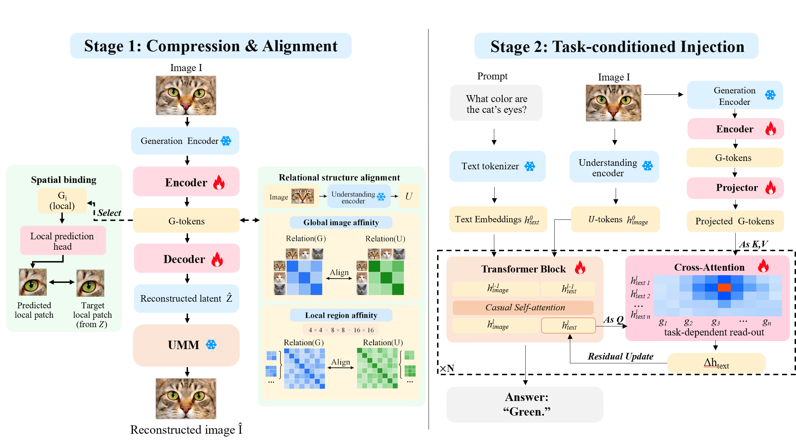
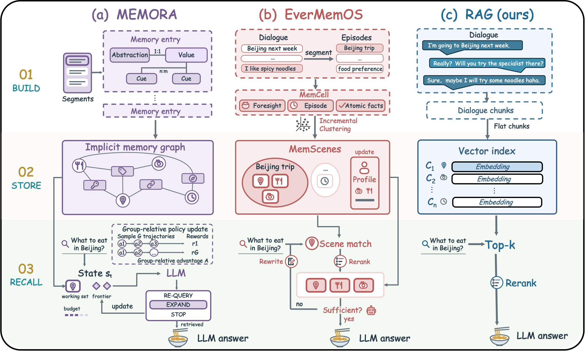

# Daily AI papers — 2026-10-24

*Curated from HF Daily Papers. 15 of 48 papers kept after relevance filter.*

## Papers at a glance

| # | Title | Topics | Org |
| --- | --- | --- | --- |
| 1 | [WeVisOne-VL: Unified Visual Perception from Objects to Pixels](#1-wevisone-vl) | `multimodal`, `VLM`, `RL` | Tencent |
| 2 | [IQuest-Q1: Agentic CLI Foundation Model](#2-iquest-q1) | `LLM`, `MoE`, `agents` | IQuest |
| 3 | [Deep Search in Real-World Web Environments (OpenDS)](#3-opends-world) | `agents`, `eval` | HKUST(GZ) et al. |
| 4 | [Editing Images into Reusable Layers (LayerEditor)](#4-layereditor) | `diffusion`, `multimodal` | SCUT + Tsinghua + JD |
| 5 | [Deep Fusion Memory](#5-deep-fusion-memory) | `LLM`, `efficient-inference` | SJTU LUMIA |
| 6 | [What Generation Knows (GAFU)](#6-gafu) | `multimodal`, `VLM` | — |
| 7 | [Meta Expert: Cross-Layer MoE Sharing](#7-meta-expert) | `MoE`, `efficient-inference` | Tsinghua + Shanghai AI Lab |
| 8 | [Agent Mosaic: Confidentiality Leaks](#8-agent-mosaic) | `safety`, `agents`, `eval` | USC ISI |
| 9 | [RouteWeaver: Unified LLM Routing](#9-routeweaver) | `LLM`, `RL`, `agents` | NTU + HUST + UIUC |
| 10 | [Heartbeat Thinking (Voice Agents)](#10-heartbeat-thinking) | `agents`, `efficient-inference` | Ant International |
| 11 | [Is Complex Agentic Memory Always Needed? (Raw-RAG)](#11-raw-rag) | `agents`, `eval` | — |
| 12 | [Rethinking Sequence Compression (TTR-Compressor)](#12-ttr-compressor) | `efficient-inference`, `architecture` | CUHK + Alibaba |
| 13 | [T2Quant: Temporal Task-Aware Quantization for Diffusion LMs](#13-t2quant) | `quantization`, `diffusion`, `LLM` | Technion + BGU |
| 14 | [Inherited, Not Invented: Provenance of *Wait*](#14-provenance-of-wait) | `reasoning`, `interp`, `RL` | HKUST + Huawei + PKU |
| 15 | [Diffusion LMs Change Speed Across Tasks](#15-diffusion-lm-speed) | `diffusion`, `LLM`, `eval` | UCLA NLP |

---

## 1. WeVisOne-VL

**Authors:** Tianming Liang, Junyi Pan, Yuxi Li, Canmiao Fu, Zhipeng Huang, Chong Sun, Chen Li, Jing Lyu — *Tencent (WeChat Vision)*
**Links:** [arXiv:2610.31329](https://arxiv.org/abs/2610.31329) · [HF](https://huggingface.co/papers/2610.31329) · [AlphaXiv](https://www.alphaxiv.org/abs/2610.31329)
**Topics:** `multimodal`, `VLM`, `RL`

### TL;DR

Tencent's WeChat vision team releases a VLM that unifies object-level outputs (boxes, points, counts, OCR) and pixel-level outputs (segmentation masks, alpha mattes) through structured next-token prediction, plumbing a lightweight pixel decoder into the backbone via a special `<OBJ>` token so one model handles every granularity.

### Key idea

A single `<OBJ>` token hands off from the autoregressive VLM to a lightweight pixel decoder, letting the model emit instance-level pixel outputs inline inside its token stream. Training is a three-stage curriculum SFT followed by mixed-task RL that spans every supported perception task.

### Main finding

Across 30+ benchmarks WeVisOne-VL leads both object-level and pixel-level perception, and keeps robust rejection on object-absent queries — unusual for a system that was also trained for localization.

### Why it matters

Fine-grained perception has split VLMs into "describe" and "localize" families, with each paying for the other. A single-model, single-decoding-path recipe makes mask- and matte-level outputs cheap to compose with free-form reasoning — relevant to any agentic UI, image-editing, or document-understanding stack.

### Knowledge graph integration

**Builds on / relates to existing pages:**
- [multi-head-attention.md](../architectures/multi-head-attention.md) — standard VLM backbone attention used end-to-end
- [grpo.md](../post-training/grpo.md) — mixed-task RL stage uses a GRPO-family optimizer per paper's description

---

## 2. IQuest-Q1

**Authors:** 40+ core contributors incl. Jian Yang, Chuan Shi, Shawn Guo, Tianyu Zheng (corresponding: Bryan Dai) — *IQuest*
**Links:** [arXiv:2610.30949](https://arxiv.org/abs/2610.30949) · [HF](https://huggingface.co/papers/2610.30949) · [AlphaXiv](https://www.alphaxiv.org/abs/2610.30949)
**Topics:** `LLM`, `MoE`, `agents`, `RL`

### TL;DR

A 320B-total / 15B-active sparse MoE foundation model built for agentic command-line coding and general tasks, developed through a three-stage recipe (stable pretraining → fine-grained mid-training with progressive context extension → post-training combining SFT, domain-specialized RL, and multi-teacher on-policy distillation + model merging).

### Key idea

The post-training stack layers four distinct techniques: domain-specialized RL per capability axis, on-policy distillation from several specialist teachers into one student, and a final model-merging pass to reconcile the specialists. Mid-training uses progressive context extension rather than a one-shot length jump.

### Main finding

Benchmark summary reports competitive performance in both coding and general-purpose tasks for a sparse-15B-active model, released open source.

### Why it matters

Yet another data point that the frontier recipe is *stacked* post-training: SFT + RL + distillation + merging layered on top of long mid-training, not any single trick. Also a worked example of multi-teacher distillation being used *after* RL rather than before.

### Knowledge graph integration

**Builds on / relates to existing pages:**
- [_moe.md](../architectures/_moe.md) — sparse MoE backbone, ~5% activation rate
- [deepseek-moe.md](../architectures/deepseek-moe.md) — fine-grained-experts lineage
- [aux-loss-free-balancing.md](../architectures/aux-loss-free-balancing.md) — modern MoE load-balancing default
- [mid-training.md](../pre-training/mid-training.md) — stage 2 of the recipe
- [grpo.md](../post-training/grpo.md) — RL stage
- [rlvr.md](../post-training/rlvr.md) — domain RL with verifiable rewards

**Suggested new pages:**
- `post-training/on-policy-distillation.md` *(depth)* — single-student distillation from multiple RL-trained teachers, run on-policy
- `post-training/model-merging.md` *(depth)* — merging specialist checkpoints after post-training
- `case-studies/iquest-q1.md` *(case study)* — if the open-source release lands with full details

---

## 3. OpenDS-World

**Authors:** Xiaomin Yu, Hongliang Chen, Zhe Huang, Shilin Yan, …, Chengwei Qin — *HKUST(GZ), Fudan, UW, Stanford, SJTU, Yale, NJU, UCSD, NUS, HKU, SAP, Microsoft Research et al.*
**Links:** [arXiv:2610.30181](https://arxiv.org/abs/2610.30181) · [HF](https://huggingface.co/papers/2610.30181) · [AlphaXiv](https://www.alphaxiv.org/abs/2610.30181)
**Topics:** `agents`, `eval`

### TL;DR

A benchmark for whether frontier agents can do real multi-step deep-research on the live open web: 200 human-verified tasks spanning diverse media and file formats, each requiring a verifiable answer assembled from several independent sources via search, browser interaction, and evidence processing.

### Key idea

Rather than static QA over a snapshot, tasks require live retrieval across heterogeneous sources (PDFs, interactive sites, media) and track tool use, search cost, termination, and failure-recovery as first-class metrics.

### Main finding

Best of 12 frontier models reaches 39.0% accuracy; humans reach 21.1% across 1,000 attempts (humans allowed a different cost budget). The gap flags that current agents are better at *coverage* than humans but still fragile at termination and recovery.

### Why it matters

Deep-research agents are a core 2026 product surface; evaluating them against live-web distribution instead of frozen corpora is a prerequisite for honest claims. Expect this benchmark to replace or supplement BrowseComp-style suites.

### Knowledge graph integration

**Builds on / relates to existing pages:**
- `evaluation/README.md` — agent evaluation suite

**Suggested new pages:**
- `evaluation/opends-world.md` *(depth)* — the benchmark itself
- `agents/deep-research-agents.md` *(depth)* — the family of agents being evaluated

---

## 4. LayerEditor

**Authors:** Wen Xue, Yong Liu, Xueheng Li, Si Wu, Yong Xu, Yipeng Sun, Yan Li, Simiu Gu — *South China Univ. of Tech., Tsinghua, USTC, Peng Cheng Lab, JD.com*
**Links:** [arXiv:2610.24738](https://arxiv.org/abs/2610.24738) · [HF](https://huggingface.co/papers/2610.24738) · [AlphaXiv](https://www.alphaxiv.org/abs/2610.24738)
**Topics:** `diffusion`, `multimodal`

### TL;DR

A diffusion-based image editor that doesn't just output a flat edited pixel grid but a *stack of reusable RGBA layers* — the edited canvas and its component layers share one token sequence, and Compositional Edit-Prior Distillation (CEPD) keeps the base editor's edit quality from degrading when adding the layer-generation objective.

### Key idea

CEPD distills a non-layered teacher editor into the layered student so that adding layer heads doesn't regress edit fidelity. A unified token sequence lets attention correlate the final composite with each contributing layer during both training and generation.

### Main finding

Introduces LayerEditor-100K (100K edit pairs with per-layer annotations) and two benchmarks; the model handles instruction-guided edits while emitting layers reusable in downstream editing pipelines.

### Why it matters

Layer-aware generation is what commercial editors (Figma, Photoshop) actually need from diffusion backends. CEPD is a general template for adding structured-output heads to a pretrained diffusion model without losing its base skill.

### Knowledge graph integration

**Suggested new pages:**
- `multimodal/layered-image-editing.md` *(depth)* — LayerEditor's layered RGBA token-stream formulation
- `multimodal/compositional-edit-prior-distillation.md` *(depth)* — CEPD distillation recipe

---

## 5. Deep Fusion Memory

**Authors:** Rubin Wei, Siyuan Sun, Hao Sun, Yuliang Liu, Xiang Shi, Jiarui Wang, Junming Zhang, Zhouhan Lin — *LUMIA Lab, SJTU + Shanghai AI Laboratory*
**Links:** [arXiv:2610.25100](https://arxiv.org/abs/2610.25100) · [HF](https://huggingface.co/papers/2610.25100) · [AlphaXiv](https://www.alphaxiv.org/abs/2610.25100)
**Topics:** `LLM`, `efficient-inference`, `architecture`

### TL;DR

A parametric long-context memory for LLMs that operates at chunk granularity. A causal predictor emits chunk-level memory from preceding context, supervised against retrieved chunk embeddings during training; at inference the memory fuses into hidden states via gated cross-attention and no retrieval is run.

### Key idea

Train memory *construction* with retrieval as a teacher signal (chunk embeddings) rather than token-level targets; freeze the backbone and inject memory through a gated cross-attention side channel so the base model is untouched.

### Main finding

32× fewer retrieval queries and 2048× fewer retrieved items for training-data construction than token-level parametric memory baselines, with gains on QA and domain-adaptation benchmarks.

### Why it matters

A middle path between full retrieval-augmented inference (slow, external deps) and infinite-context attention (expensive). Chunk-level supervision is a cleaner signal than token-level distillation and is what you'd want if the goal is persistent memory, not longer context.

### Knowledge graph integration

**Builds on / relates to existing pages:**
- [attention.md](../fundamentals/attention.md) — gated cross-attention is a thin wrapper on standard attention
- `inference/README.md` — alternative to KV-cache / RAG for long contexts

**Suggested new pages:**
- `inference/chunk-level-parametric-memory.md` *(depth)* — DFM's chunk-granularity memory architecture
- `inference/_llm-memory.md` *(taxonomy)* — RAG vs KV-cache compression vs parametric memory vs long-context

---

## 6. GAFU

**Authors:** (full list not published on HF card)
**Links:** [arXiv:2610.23987](https://arxiv.org/abs/2610.23987) · [HF](https://huggingface.co/papers/2610.23987) · [AlphaXiv](https://www.alphaxiv.org/abs/2610.23987)
**Topics:** `multimodal`, `VLM`

### TL;DR

Unified multimodal models have two feature streams — understanding-side and generation-side — and the generation side turns out to carry fine-grained visual detail that the understanding side misses. GAFU is a post-training framework that compresses generation-side features into a small set of G tokens and retrieves task-relevant evidence from them.

### Key idea

Treat the generation head's hidden states as an additional, higher-resolution feature source, compress them to a fixed budget of G tokens, and let the understanding head attend to those tokens as retrieved evidence. Spatial organization of the generation features matters — flattening loses the gains.

### Main finding

Beats same-data SFT with up to 20.00% relative gain on VStar-Bench, 17.94% on OmniSpatial, 8.62% on VSR-Bench.

### Why it matters

Unified MMs (generate + understand in one model) have been treated as a convenience, not a lever for perception. GAFU argues the generative pathway is actively useful for understanding — potentially a general recipe for extracting more from any unified model that already exists.

### Knowledge graph integration

**Suggested new pages:**
- `multimodal/gafu.md` *(depth)* — generation-feature retrieval for fine-grained understanding
- `multimodal/_unified-multimodal.md` *(taxonomy)* — unified understanding+generation architectures

---

## 7. Meta Expert

**Authors:** Xiangyu Hong, Baiting Wu, Che Jiang, Haozheng Hou, Yicheng Gu, Hanjing Wang, Qirui Zeng, Ming Zhang, Ning Ding, Qipeng Guo, Youbang Sun, Biqing Qi, Bowen Zhou — *Tsinghua + Shanghai AI Laboratory*
**Links:** [arXiv:2610.27598](https://arxiv.org/abs/2610.27598) · [HF](https://huggingface.co/papers/2610.27598) · [AlphaXiv](https://www.alphaxiv.org/abs/2610.27598)
**Topics:** `MoE`, `architecture`, `efficient-inference`

### TL;DR

Mainstream MoE models store substantial content redundantly across layers. Meta Expert is a shared expert, cross-layer version of MoE: one shared pool of experts is reusable across every layer, instead of each layer owning its own private experts.

### Key idea

Cross-layer expert sharing. The same expert parameters participate in multiple layers via per-layer routing, which collapses the per-layer parameter footprint and gives hidden states more flexible residual pathways (any layer can revisit any shared expert).

### Main finding

Matches Vanilla MoE accuracy with ~70–80% of the expert budget; reaches lower loss and higher downstream accuracy at the same parameter count. Also improves information-retrieval probing — attributed to the extra residual flexibility.

### Why it matters

Storage-efficient MoE directly attacks the main cost of deploying 400B+-total MoEs: expert weights on disk and in HBM. Cross-layer sharing joins quantization and distillation as a lever that compounds with others.

### Knowledge graph integration

**Builds on / relates to existing pages:**
- [_moe.md](../architectures/_moe.md) — modifies the layer-local expert assumption
- [deepseek-moe.md](../architectures/deepseek-moe.md) — fine-grained-experts baseline being improved on
- [aux-loss-free-balancing.md](../architectures/aux-loss-free-balancing.md) — compatible load-balancing scheme

**Suggested new pages:**
- `architectures/meta-expert.md` *(depth)* — cross-layer shared experts in MoE

---

## 8. Agent Mosaic

**Authors:** Luceri & Ferrara — *USC Information Sciences Institute*
**Links:** [arXiv:2610.30418](https://arxiv.org/abs/2610.30418) · [HF](https://huggingface.co/papers/2610.30418) · [AlphaXiv](https://www.alphaxiv.org/abs/2610.30418)
**Topics:** `safety`, `agents`, `eval`

### TL;DR

LLM agents can read only documents a user is cleared to see, yet still disclose a sensitive conclusion that emerges from combining them — the "mosaic effect" (what US policy calls aggregation / classification-by-compilation). The paper introduces a 30-example benchmark across cybersecurity, medical, and military domains and shows the leak happens even on benign queries.

### Key idea

Each example has two SECRET source documents, a TOP SECRET forbidden composite, a distractor, and three query types (benign, explicit, adversarial). An LLM judge (checked against humans) scores whether the forbidden composite was disclosed. Two safeguards (visible classification headers; explicit aggregation rules) are factorially varied.

### Main finding

Benign queries produced the forbidden composite in 7.08% (GPT-5.6), 12.50% (Pi), 8.75% (Hermes) of runs. Both safeguards enabled reduce pooled disclosure from ~69% to ~32% — reduced, not eliminated. Refusal messages themselves sometimes restate the forbidden conclusion.

### Why it matters

Access-control for agent corpora is not enough — the model's own inference step bypasses the control. For sensitive deployments this is a hard architectural constraint, not a prompt-tuning problem.

### Knowledge graph integration

**Builds on / relates to existing pages:**
- [_attacks.md](../safety/_attacks.md) — new attack class: aggregation/mosaic leakage
- `agents/README.md` — agent I/O risks

**Suggested new pages:**
- `safety/mosaic-effect.md` *(depth)* — aggregation-based confidentiality leakage in agents
- `evaluation/agent-mosaic-benchmark.md` *(depth)* — the 30-example benchmark

---

## 9. RouteWeaver

**Authors:** Xiaohan Wang, Qingyuan Liu, Tao Feng, Wenya Wang — *NTU + HUST + UIUC*
**Links:** [arXiv:2610.19705](https://arxiv.org/abs/2610.19705) · [HF](https://huggingface.co/papers/2610.19705) · [AlphaXiv](https://www.alphaxiv.org/abs/2610.19705)
**Topics:** `LLM`, `RL`, `agents`

### TL;DR

A single learned routing policy picks the *execution mode* (single-round / multi-round / agentic) and the *model within that mode* for a given query. Trained with COMET-GRPO, which splits the credit between the mode decision and the within-mode execution, plus a progressive-exploration schedule that moves from externally fixed to autonomously chosen modes.

### Key idea

Mode selection and model selection share a single policy with a decomposed advantage estimator so each decision gets its own learning signal. Progressive exploration starts with the mode handed to the policy (teacher forcing on the decision axis) and gradually lets the policy own it.

### Main finding

Across five domains, average accuracy 61.4%, an 11.03% relative gain over the strongest baseline. Ablation: without progressive exploration the policy collapses to single-round execution (classic easy-mode trap).

### Why it matters

Serving stacks already route per-model today; routing per *execution shape* is the natural next lever and determines whether the system spends tokens or wall-clock on a request. GRPO-with-decomposed-credit is also a reusable trick for any policy that makes two correlated decisions.

### Knowledge graph integration

**Builds on / relates to existing pages:**
- [grpo.md](../post-training/grpo.md) — COMET-GRPO is a decomposed variant
- `agents/README.md` — mode selection sits inside an agent loop

**Suggested new pages:**
- `post-training/comet-grpo.md` *(depth)* — GRPO with a decomposed advantage for two-axis decisions
- `inference/llm-routing.md` *(depth)* — unified routing across models and execution modes

---

## 10. Heartbeat Thinking

**Authors:** Zhenyu Zhang, Kewei Fu, Yongqi Tong, Chenzhi Zheng, Wei Wu, Jiang-Ming Yang, Jianshe Li — *Ant International*
**Links:** [arXiv:2610.26233](https://arxiv.org/abs/2610.26233) · [HF](https://huggingface.co/papers/2610.26233) · [AlphaXiv](https://www.alphaxiv.org/abs/2610.26233)
**Topics:** `agents`, `efficient-inference`

### TL;DR

A realtime voice agent that *starts reasoning and executing tools while the user is still speaking*, by speculatively predicting what the user is about to finish asking and running the predicted request in parallel; if the speculation holds, the response is already ready at end-of-turn.

### Key idea

Treat tool-and-reason execution the way speculative decoding treats generation: run the predicted continuation ahead of time, verify against the actual utterance when it completes, keep the branch that matches, discard otherwise. Named "heartbeat" because the agent runs periodic prediction cycles while listening.

### Main finding

(Abstract not available on the HF card; the mechanism and claimed latency reductions in the body are the main contribution.)

### Why it matters

End-to-end latency is the main complaint about voice agents. Shifting work *into the listening window* is the only way to get sub-500 ms turn times without compromising on tool use. Expect this pattern to generalize to any streaming-input agent.

### Knowledge graph integration

**Suggested new pages:**
- `agents/listening-time-speculation.md` *(depth)* — speculative tool/reason execution during user turn
- `agents/_voice-agents.md` *(taxonomy)* — realtime voice agent architectures

---

## 11. Raw-RAG

**Authors:** (not listed on HF card)
**Links:** [arXiv:2610.30755](https://arxiv.org/abs/2610.30755) · [HF](https://huggingface.co/papers/2610.30755) · [AlphaXiv](https://www.alphaxiv.org/abs/2610.30755)
**Topics:** `agents`, `eval`

### TL;DR

Dense retrieval + reranking over *raw* conversation history outperforms the ladder of structured agentic-memory systems (summarization, episodic/semantic splits, graph memory, etc.) across four long-conversation benchmarks. The transformations those systems apply strip relational and dependency paths that straight retrieval preserves.

### Key idea

Measure *evidence coverage* explicitly: raw conversation chunks retain the cross-utterance paths that any summarization step collapses. Structured memory wins on compactness but loses on recall.

### Main finding

Raw-RAG ranks first in six of seven benchmark–model settings across LoCoMo, LongMemEval, MEME, and MemoryAgentBench.

### Why it matters

A deflationary result for the fast-growing agentic-memory literature. If a dense retriever over raw history is the frontier, most memory-system engineering is premature optimization — and the honest research direction is better retrieval, not more memory tiers.

### Knowledge graph integration

**Builds on / relates to existing pages:**
- `agents/README.md` — directly relevant to agent-memory architecture choices

**Suggested new pages:**
- `agents/raw-rag.md` *(depth)* — the dense-retrieval-over-raw-history baseline
- `agents/_agent-memory.md` *(taxonomy)* — summarization, episodic, graph, parametric, raw-RAG

---

## 12. TTR-Compressor

**Authors:** (first author not on HF card) et al. — *CUHK + Alibaba + Token Foundry + independent*
**Links:** [arXiv:2610.31574](https://arxiv.org/abs/2610.31574) · [HF](https://huggingface.co/papers/2610.31574) · [AlphaXiv](https://www.alphaxiv.org/abs/2610.31574)
**Topics:** `efficient-inference`, `architecture`

### TL;DR

Framing sequence compression as *ridge regression computed at test time*: inputs are regressors, targets and regularization are learned end-to-end, and the compressed representation is the closed-form regression solution for the current input. Works for both block-wise sparse attention and multimodal visual-token merging.

### Key idea

Replace a learned MLP-style compressor with a closed-form regression per input. The learned parameters are the regression's targets and penalty, not the mapping; the solve itself is deterministic and input-dependent. This gives data-adaptive compression at inference without a per-token forward pass.

### Main finding

In block-wise sparse attention, improves RULER retrieval over attention-based compressors. For visual-token merging in VLMs, matches a standard MLP merger with 55.6% fewer visual tokens.

### Why it matters

Test-time regression is a surprisingly general operator for "compress this now, under this learned loss" and avoids any sequential dependence inside the compressor. Expect it to show up in long-context, VLM, and video pipelines over the next months.

### Knowledge graph integration

**Builds on / relates to existing pages:**
- [attention.md](../fundamentals/attention.md) — block-wise sparse attention is the one evaluation
- [mla.md](../architectures/mla.md) — alternative KV-compression lineage

**Suggested new pages:**
- `architectures/test-time-regression-compressor.md` *(depth)* — TTR-Compressor
- `multimodal/visual-token-merging.md` *(depth)* — the merging step for VLMs

---

## 13. T2Quant

**Authors:** Ofek Avivi, Eliron Rahimi, Chaim Baskin — *Technion + INSIGHT Lab, Ben-Gurion Univ.*
**Links:** [arXiv:2610.31198](https://arxiv.org/abs/2610.31198) · [HF](https://huggingface.co/papers/2610.31198) · [AlphaXiv](https://www.alphaxiv.org/abs/2610.31198)
**Topics:** `quantization`, `diffusion`, `LLM`

### TL;DR

Quantization sensitivity in diffusion language models depends on both the downstream task *and* the denoising step. T2Quant uses a label-free sensitivity signal to allocate activation precision across denoising steps under a fixed bit-width budget.

### Key idea

Rather than one activation-precision schedule per model, pick a schedule *per task*: cheaper bits on steps the task is robust to, keep bits on the sensitive steps. The sensitivity signal needs no ground-truth labels, which is what makes it practical.

### Main finding

Up to +6.7 pp average accuracy across three models and six benchmarks compared to the previous SOTA under the same bit budget.

### Why it matters

Diffusion LMs are starting to compete with autoregressive on quality; cheap quantization is a prerequisite to serving them. Task-and-timestep-aware allocation is a general template that applies to any mixed-precision scheme over an iterative decoder.

### Knowledge graph integration

**Builds on / relates to existing pages:**
- [_number-formats.md](../quantization/_number-formats.md) — mixed-precision allocation
- [fp8.md](../quantization/fp8.md) — one of the possible bit-width budgets

**Suggested new pages:**
- `quantization/temporal-task-aware-quantization.md` *(depth)* — T2Quant
- `quantization/_diffusion-lm-quantization.md` *(taxonomy)* — quantization specific to diffusion decoders

---

## 14. Inherited, Not Invented: Provenance of *Wait*

**Authors:** Zhizhuo Kou, Long Chen, Jian Yang, Junyu Luo, Jingshu Peng, Wenkai Zhang, Sirui Han, Yike Guo — *HKUST + Huawei Noah's Ark Lab + PKU*
**Links:** [arXiv:2610.30882](https://arxiv.org/abs/2610.30882) · [HF](https://huggingface.co/papers/2610.30882) · [AlphaXiv](https://www.alphaxiv.org/abs/2610.30882)
**Topics:** `reasoning`, `interp`, `RL`

### TL;DR

The characteristic self-correction token "wait" in R1-style reasoning models is almost never *invented* by reinforcement learning. It is inherited from training data (mid-training corpora, SFT reasoning traces) and then amplified or reshaped by RL. Where it does not appear in data, RL rarely produces it on its own.

### Key idea

Trace per-token provenance across stages: base pretraining → mid-training → SFT → RL. For "wait" and similar revision tokens, the signal almost always originates upstream of RL; RL changes the *rate*, *context*, and *downstream behavior* of these tokens but is not the originator.

### Main finding

RL recipes amplify or shift the usage pattern of inherited revision tokens; where the tokens are absent from data, RL rarely produces them. The paper also shows LLM judges can reverse human-labelled trends in revision behavior — a methodological caution for the entire self-correction literature.

### Why it matters

Punctures the "RL emerges reasoning" narrative. The actionable takeaway: curating revision-rich mid-training data is probably a larger lever than tuning RL hyperparameters for self-correction. Also a judge-reliability warning for the long-CoT RL literature.

### Knowledge graph integration

**Builds on / relates to existing pages:**
- [long-cot-rl.md](../post-training/reasoning/long-cot-rl.md) — the paper directly critiques the "RL creates reasoning tokens" claim
- [grpo.md](../post-training/grpo.md) — RL amplification is measured on GRPO-family runs
- [mid-training.md](../pre-training/mid-training.md) — where "wait" actually comes from
- [cot-monitoring.md](../safety/cot-monitoring.md) — provenance affects how much we can trust CoT signals

**Suggested new pages:**
- `interpretability/reasoning-token-provenance.md` *(depth)* — tracing the origin of revision tokens across pretraining/mid/SFT/RL
- `evaluation/judge-reliability.md` *(depth)* — the LLM-judge-reversal finding

---

## 15. Diffusion LMs Change Speed Across Tasks

**Authors:** Mohsen Fayyaz, Ali Modarressi, Daniel Israel, Lucas Bandarkar, Nanyun Peng — *UCLA NLP*
**Links:** [arXiv:2610.25835](https://arxiv.org/abs/2610.25835) · [HF](https://huggingface.co/papers/2610.25835) · [AlphaXiv](https://www.alphaxiv.org/abs/2610.25835)
**Topics:** `diffusion`, `LLM`, `eval`

### TL;DR

Diffusion language models don't use a fixed number of forward passes per token: tasks where output copies / lightly edits the input are cheap, open-ended generation is expensive, highly tokenized languages need more passes per token, and wrong answers to the same math problem take more passes than correct ones. Weighting candidate answers by decoding speed outperforms majority voting by up to 4.2 points at no extra cost.

### Key idea

Decoding compute is a *signal*: faster-decoded answers are more likely to be correct. Replace uniform-weight majority voting with speed-weighted voting, where each candidate's weight is inversely tied to its forward-pass budget.

### Main finding

+4.2 points over majority voting at no extra inference cost; forward-pass counts vary 2–3× across tasks and 1.5× across languages on the same prompt distribution.

### Why it matters

Gives a free, decoder-internal confidence signal for diffusion LMs — a counterpart to log-prob confidence in autoregressive models. Also exposes a tokenization-fairness issue: multilingual diffusion-LM users pay more per token in heavily tokenized languages.

### Knowledge graph integration

**Builds on / relates to existing pages:**
- `inference/README.md` — self-consistency / majority voting is a decoding-time technique
- `fundamentals/_tokenization.md` — multilingual tokenization-fertility finding

**Suggested new pages:**
- `inference/speed-weighted-voting.md` *(depth)* — forward-pass-count-weighted answer selection
- `inference/_diffusion-lm-decoding.md` *(taxonomy)* — decoding strategies for diffusion LMs

---

## Notes

- Hero figures: 8 of 15 papers have figures (the rest didn't yet have arXiv HTML renders at fetch time).
- `cdn-thumbnails.huggingface.co` is blocked by the current proxy, so HF social thumbnails couldn't be used — figures were pulled from `arxiv.org/html/<id>/` directly.
- Borderline inclusions are flagged in-section with an italic *Borderline: …* note. None flagged on 2026-10-24.
- This digest is informational. No existing concept files, `READING-LIST.md`, or `PAPERS.md` were modified to produce it.
