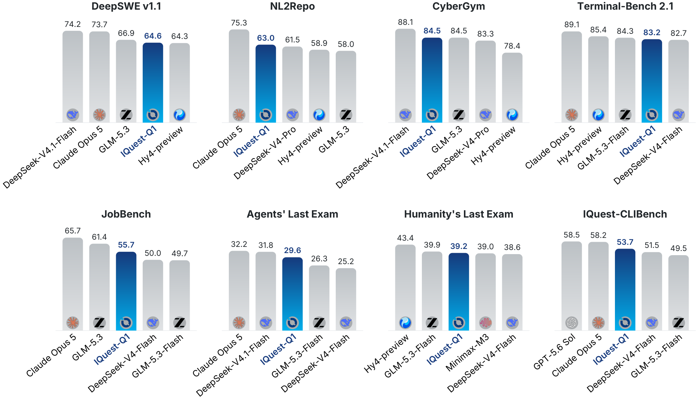
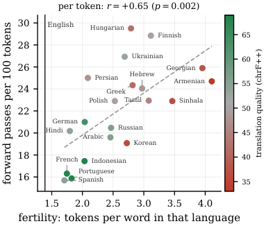

# Daily AI papers — 2026-10-25

*Curated from HF Daily Papers. 15 of ~48 papers kept after relevance filter.*

## Papers at a glance

| # | Title | Topics | Org |
| --- | --- | --- | --- |
| 1 | [IQuest-Q1: Advancing Foundation Capabilities for Agentic CLI Systems](#1-iquest-q1) | `LLM`, `MoE`, `agents`, `RL`, `distillation` | IQuest consortium |
| 2 | [WeVisOne-VL: Unified Visual Perception from Objects to Pixels](#2-wevisone-vl) | `multimodal`, `VLM`, `perception` | Tencent |
| 3 | [Editing Images into Reusable Layers via Compositional Edit-Prior Distillation](#3-layereditor) | `diffusion`, `editing`, `distillation` | SCUT / JD / Tsinghua |
| 4 | [Making MLLM Latents Matter: Factor-Aware Predictive Learning for Cinematic Video Generation](#4-fapl) | `multimodal`, `diffusion`, `video` | HKUST / Tencent Video |
| 5 | [Deep Search in Real-World Web Environments](#5-opends) | `agents`, `eval`, `tool-use` | HKUST(GZ) + consortium |
| 6 | [Deep Fusion Memory: A Chunk-Level Parametric Memory for LLMs](#6-deep-fusion-memory) | `LLM`, `memory`, `efficient-inference` | SJTU / Shanghai AI Lab |
| 7 | [Meta Expert: Cross-Layer Expert Sharing for Storage- and Retrieval-Efficient MoE](#7-meta-expert) | `architectures`, `MoE` | Tsinghua / Shanghai AI Lab |
| 8 | [Is Complex Agentic Memory Always Needed? Naive RAG Is Stronger Than We Thought](#8-raw-rag) | `agents`, `RAG`, `eval` | (unspecified) |
| 9 | [Inherited, Not Invented: Tracing the Provenance of *Wait* in Reasoning Models](#9-provenance-of-wait) | `reasoning`, `interp`, `RL` | HKUST / Huawei Noah |
| 10 | [Heartbeat Thinking: Speculative Reasoning and Tool Execution in Realtime Voice Agents](#10-heartbeat-thinking) | `agents`, `speculative`, `multimodal` | Ant International |
| 11 | [Agent Mosaic: Recognizing Confidentiality Leaks in Agentic LLM Systems](#11-agent-mosaic) | `safety`, `agents`, `eval` | USC ISI |
| 12 | [Different Tasks, Different Timesteps: Temporal Task-Aware Quantization for Diffusion LMs](#12-t2quant) | `quantization`, `diffusion-LM` | Technion / BGU |
| 13 | [Rethinking Sequence Compression with Test-time Regression](#13-ttr-compressor) | `efficient-inference`, `architectures` | CUHK / Alibaba Token Foundry |
| 14 | [RouteWeaver: Weaving Mode Selection and Execution into Unified LLM Routing](#14-routeweaver) | `agents`, `RL`, `routing` | NTU / UIUC |
| 15 | [Diffusion Language Models Change Speed Across Tasks and Languages](#15-dlm-speed) | `diffusion-LM`, `efficient-inference`, `eval` | UCLA NLP |

---

## 1. IQuest-Q1

**Authors:** ~130-author team (corresp. Bryan Dai) — *IQuest open-source release*
**Links:** [arXiv:2610.30949](https://arxiv.org/abs/2610.30949) · [HF](https://huggingface.co/papers/2610.30949) · [AlphaXiv](https://www.alphaxiv.org/abs/2610.30949)
**Topics:** `LLM`, `MoE`, `agents`, `RL`, `distillation`

### TL;DR

An open-source 320B-total-parameter sparse MoE foundation model (~15B active per token) built end-to-end as an *agentic* model — i.e. trained from the start to drive CLI/coding agent scaffolds. The paper describes three training stages (stable pretraining, mid-training to broaden domains and extend context, agent-flavored post-training) plus a model-merging step that reconciles expert and checkpoint deltas.

### Key idea

Three ingredients wired together: (1) a 320B/15B-active MoE backbone whose pretraining prioritizes stability over raw loss; (2) a mid-training phase that re-weights data mixtures toward long-context, multi-format, and agent-flavored sequences; (3) post-training that combines SFT, domain-specialized RL ("specialized RL" per environment), and multi-teacher *on-policy distillation* across several agent scaffolds — then merges expert-wise and checkpoint-wise deltas with conflict reduction.

### Main finding

The authors position the model as a frontier open-source *agentic CLI* model, highlighting strong coding and general-task scores. The headline move is that distilling from several agent scaffolds *on-policy* — not just copying teacher outputs — lets a single checkpoint absorb heterogeneous tool-use styles without catastrophic interference.

### Why it matters

If the open release holds up, this is one of the first frontier-scale models explicitly architected around agent trajectories rather than chat turns. The multi-teacher-on-policy-distillation + merge recipe is a template other labs will likely copy for turning any strong base into an agent-first model without paying the full RL bill per scaffold.

### Knowledge graph integration

**Builds on / relates to existing pages:**
- [../architectures/_moe.md](../architectures/_moe.md) — 320B/15B sparse MoE in the DeepSeek-style regime.
- [../architectures/deepseek-moe.md](../architectures/deepseek-moe.md) — direct architectural ancestor for the fine-grained-expert MoE style.
- [../architectures/aux-loss-free-balancing.md](../architectures/aux-loss-free-balancing.md) — balancing idiom MoE agent models now default to.
- [../pre-training/mid-training.md](../pre-training/mid-training.md) — mid-training phase broadens data and extends context.
- [../pre-training/model-souping.md](../pre-training/model-souping.md) — model merging across experts and checkpoints is a cousin.
- [../post-training/rlvr.md](../post-training/rlvr.md) — specialized RL for coding/agent tasks is RLVR-flavored.
- [../post-training/reasoning/long-cot-rl.md](../post-training/reasoning/long-cot-rl.md) — long-horizon trajectory RL for agents.
- [../case-studies/deepseek-v3.md](../case-studies/deepseek-v3.md) — closest existing case-study comparison for MoE agentic models.

**Suggested new pages:**
- `case-studies/iquest-q1.md` *(case study)* — full breakdown of the 320B/15B agentic MoE recipe.
- `post-training/multi-teacher-on-policy-distillation.md` *(depth)* — multi-scaffold on-policy distillation for agent training.
- `pre-training/expert-merge.md` *(depth)* — merging expert and checkpoint deltas with conflict reduction.

---

## 2. WeVisOne-VL

**Authors:** Tianming Liang, Junyi Pan, Yuxi Li, Canmiao Fu, Zhipeng Huang, Chong Sun, Chen Li, Jing Lyu — *Tencent*
**Links:** [arXiv:2610.31329](https://arxiv.org/abs/2610.31329) · [HF](https://huggingface.co/papers/2610.31329) · [AlphaXiv](https://www.alphaxiv.org/abs/2610.31329)
**Topics:** `multimodal`, `VLM`, `perception`

### TL;DR

A unified VLM that handles object-level perception (detection, counting, grounding, OCR) *and* pixel-level perception (segmentation, matting) through a single structured-token-prediction interface, with a lightweight pixel decoder bolted onto the LM head and a multi-stage curriculum that ramps task complexity from boxes to masks.

### Key idea

Treat every perception task as structured token prediction over a shared vocabulary that encodes coordinates, counts, polygons, and binary masks. A compact pixel decoder re-projects a small number of mask-tokens from the LM into dense maps, so segmentation and matting ride on the same autoregressive stack without a heavy per-task head.

### Main finding

One model matches or beats task-specific baselines across detection, counting, OCR, grounding, segmentation, and matting on the paper's suite — i.e. a *single* VLM covers the full object→pixel spectrum rather than needing a per-task adapter.

### Why it matters

VLMs have been collapsing one perception task at a time (detection → counting → grounding → …). Unifying all the way through pixel masks and matting via token-prediction + a tiny decoder suggests the "two heads" split (text head + dense head) can shrink to one, which is important for agents that reason about scenes and then act on specific pixels.

### Knowledge graph integration

**Builds on / relates to existing pages:**
- [../multimodal/README.md](../multimodal/README.md) — fits in the multimodal topic area, which has only a stub.

**Suggested new pages:**
- `multimodal/_vlm-perception.md` *(taxonomy)* — overview of VLMs that do dense perception (detection, segmentation, OCR, matting) in one stack.
- `multimodal/structured-token-perception.md` *(depth)* — token-prediction interface + pixel decoder for unified perception.

---

## 3. LayerEditor

**Authors:** Wen Xue, Yong Liu, Xueheng Li, Si Wu, Yong Xu, Yipeng Sun, Yan Li, Simiu Gu — *SCUT / Tsinghua / USTC / PCL / JD.com*
**Links:** [arXiv:2610.24738](https://arxiv.org/abs/2610.24738) · [HF](https://huggingface.co/papers/2610.24738) · [AlphaXiv](https://www.alphaxiv.org/abs/2610.24738)
**Topics:** `diffusion`, `editing`, `distillation`

### TL;DR

An instruction-driven image editor that emits a reusable *RGBA layer stack* alongside the edited image in a single forward pass. Trained with **Compositional Edit-Prior Distillation** that preserves the base editor's abilities while adding the layer-emission skill, and released with LayerEditor-100K + two layered-editing benchmarks.

### Key idea

Jointly tokenize the final canvas *and* each output layer as one shared sequence that the editor must predict given an instruction. The Compositional Edit-Prior Distillation (CEPD) objective keeps the base model's non-layered editing behavior intact while teaching it to also decompose the edit — which stops the common collapse of fine-tuning away the editor's generality.

### Main finding

The model produces instruction-consistent *and* reusable (compositional) layered outputs on their benchmarks while matching flat-edit baselines on standard image-edit metrics — i.e. layer emission is "free" rather than paid for by regressing the editor.

### Why it matters

Layered RGBA output turns a one-shot edit into *stock material* for downstream design or re-composition. The CEPD recipe is a reusable template whenever you want to add a new output modality to a strong base model without hurting it.

### Knowledge graph integration

**Suggested new pages:**
- `multimodal/compositional-edit-prior-distillation.md` *(depth)* — fine-tuning recipe that adds a new output modality without regressing the base.
- `multimodal/layered-image-editing.md` *(depth)* — editing with RGBA layer-stack outputs.

---

## 4. FAPL

**Authors:** Zhe Wang, Xiaotong Zhao, Xi Wang, Ran Zhang, Shuai Li, Taiyi Wu, Songlian Li, Eric Liu, Alan Zhao, Anyi Rao — *HKUST MMLab / Tencent Video / École Polytechnique*
**Links:** [arXiv:2610.30926](https://arxiv.org/abs/2610.30926) · [HF](https://huggingface.co/papers/2610.30926) · [AlphaXiv](https://www.alphaxiv.org/abs/2610.30926)
**Topics:** `multimodal`, `diffusion`, `video`

### TL;DR

A three-stage training recipe (Factor-Aware Predictive Learning) that teaches a video DiT to use frozen multimodal-LLM latents as its *predictive* conditioning signal — rather than CLIP-style projection — and then disentangles character / scene / action / camera as independently controllable factors.

### Key idea

Stage 1: train the generator conditioned on frozen MLLM latents so the latents become the semantic backbone. Stage 2: within paired videos, swap spans of a single factor (character, scene, action, camera) between the two MLLM latent streams and ask the generator to produce the swapped variant — this teaches *per-factor* control. Stage 3: fine-tune the MLLM + connector *through* a frozen generator with text-only and text+video inputs so the MLLM learns to produce latents the generator can use.

### Main finding

FAPL outperforms baselines on sparse-to-video (inferring missing frames/shots), factor-aware editing (change only character, only scene, …), and multi-shot generation — i.e. the paired-swap curriculum actually buys controllable factors rather than mushing them.

### Why it matters

MLLM-conditioned video gen typically treats the LLM as a text proxy. Making the MLLM a *predictive learner* and training through a frozen generator aligns the latent space with the generator's needs, which is a general template for any conditioning-model + generator pipeline.

### Knowledge graph integration

**Builds on / relates to existing pages:**
- [../multimodal/README.md](../multimodal/README.md) — fits the (currently stub) multimodal area.

**Suggested new pages:**
- `multimodal/factor-aware-predictive-learning.md` *(depth)* — three-stage recipe aligning MLLM latents with a frozen video generator.
- `multimodal/_video-generation-conditioning.md` *(taxonomy)* — ways video DiTs are conditioned (text, image, MLLM latents).

---

## 5. OpenDS

**Authors:** Xiaomin Yu, Hongliang Chen, Zhe Huang et al. — *HKUST(GZ)-led 25-author consortium*
**Links:** [arXiv:2610.30181](https://arxiv.org/abs/2610.30181) · [HF](https://huggingface.co/papers/2610.30181) · [AlphaXiv](https://www.alphaxiv.org/abs/2610.30181)
**Topics:** `agents`, `eval`, `tool-use`

### TL;DR

A new deep-search benchmark (OpenDS-World) of 200 human-verified tasks across eight domains, run on the live open web with full interaction (not frozen snapshots). Twelve frontier models evaluated under a shared tool setup: best scored 39.0%, human solvers 21.1%, and 42.5% of tasks went unsolved by every human participant.

### Key idea

Move deep-search eval off static corpora and onto the actual web: tasks require searching, browsing, processing evidence across formats, and reaching a single verifiable answer — all while the pages drift under the agent. The benchmark isolates coordination failures and long-horizon management as the dominant error modes, not single-tool failure.

### Main finding

More tool calls or longer runs do *not* reliably improve accuracy. The ceiling is lifted by better *coordination* (planning across tools, keeping state) rather than raw tool access. Human-vs-model gap is already small for frontier systems on tasks where humans can succeed, but a large tail of tasks remains unsolved by everyone.

### Why it matters

The field has been overfitting to frozen snapshots and single-tool benchmarks. OpenDS-World stresses the parts of agentic deep search that production systems actually fail on, and the 42.5%-nobody-solves-it tail is a credible "frontier" line for future deep-search work.

### Knowledge graph integration

**Builds on / relates to existing pages:**
- [../agents/README.md](../agents/README.md) — fits the (stub) agents area.
- [../evaluation/README.md](../evaluation/README.md) — new agent/deep-search benchmark alongside the existing coding/reasoning ones.

**Suggested new pages:**
- `evaluation/opends-world.md` *(depth)* — the benchmark (tasks, domains, scoring).
- `agents/_deep-search-agents.md` *(taxonomy)* — overview of deep-search agent benchmarks and designs.

---

## 6. Deep Fusion Memory

**Authors:** Rubin Wei, Siyuan Sun, Hao Sun, Yuliang Liu, Xiang Shi, Jiarui Wang, Junming Zhang, Zhouhan Lin — *SJTU LUMIA Lab / Shanghai AI Laboratory*
**Links:** [arXiv:2610.25100](https://arxiv.org/abs/2610.25100) · [HF](https://huggingface.co/papers/2610.25100) · [AlphaXiv](https://www.alphaxiv.org/abs/2610.25100)
**Topics:** `LLM`, `memory`, `efficient-inference`

### TL;DR

A *parametric* long-term memory for LLMs: a causal predictor generates chunk-level memory from preceding context, supervised against retrieved chunk embeddings, and the memory is fused into the frozen backbone via gated cross-attention. At inference time there is no retrieval step — memory lives in hidden states.

### Key idea

Instead of retrieving tokens and prefixing them, train a small causal predictor to synthesize per-chunk memory conditioned on the preceding context, with the training target being the chunk's retrieved embedding. The backbone stays frozen; a gated cross-attention module injects the predicted memory into hidden states layer by layer. The retrieval→prefix pipeline becomes a learned, chunk-level residual.

### Main finding

Gains over strong retrieval baselines on six QA benchmarks and on code / math / law domain adaptation — all without retrieval at inference and without unfreezing the backbone.

### Why it matters

Retrieval-prefixing is the dominant long-context idiom, but its context cost grows linearly with recall. Parametric chunk-level memory is a different point on the frontier: constant inference cost, no retrieval dependency, but needs an offline training pass per corpus. Interesting middle ground between RAG and fine-tuning.

### Knowledge graph integration

**Suggested new pages:**
- `inference/parametric-memory.md` *(depth)* — chunk-level memory synthesized by a learned predictor and fused via gated cross-attention.
- `inference/_long-term-memory.md` *(taxonomy)* — overview of long-term memory for LLMs (RAG, prefix-tuning memory, parametric memory, cache compression).

---

## 7. Meta Expert

**Authors:** Xiangyu Hong, Baiting Wu, Che Jiang, Haozheng Hou, Yicheng Gu, Hanjing Wang, Qirui Zeng, Ming Zhang, Ning Ding, Qipeng Guo, Youbang Sun, Biqing Qi, Bowen Zhou — *Tsinghua / Shanghai AI Laboratory*
**Links:** [arXiv:2610.27598](https://arxiv.org/abs/2610.27598) · [HF](https://huggingface.co/papers/2610.27598) · [AlphaXiv](https://www.alphaxiv.org/abs/2610.27598)
**Topics:** `architectures`, `MoE`

### TL;DR

Instead of giving each MoE layer its own private expert pool, share a *global* expert pool ("Meta Experts") across all layers. At fixed activated-experts and granularity, Meta-Expert MoE matches vanilla MoE with only 70–80% of the experts and lowers both cross-entropy and downstream task error.

### Key idea

Mainstream MoE pays a storage/retrieval cost for private per-layer experts even though many experts across depth encode near-duplicate transformations. Meta Experts collapse the per-layer pools into one shared bank that every layer routes into; because residual pathways reshape depth-wise, the same expert can play different roles at different depths without wasting capacity on redundancy.

### Main finding

Across controlled scaling comparisons, Meta Expert matches vanilla MoE quality with ~70–80% of the experts, with lower cross-entropy loss and higher downstream accuracy at matched activation budget — plus a theoretical argument that depth-shared experts enrich residual pathways.

### Why it matters

Expert storage and all-to-all routing are the two biggest systems bottlenecks in large MoEs. Cutting pool size by 20–30% at matched quality compounds into real memory and expert-parallel savings. Direct relevance to any lab training frontier MoEs.

### Knowledge graph integration

**Builds on / relates to existing pages:**
- [../architectures/_moe.md](../architectures/_moe.md) — new row in the MoE variant table.
- [../architectures/deepseek-moe.md](../architectures/deepseek-moe.md) — fine-grained-expert ancestor whose per-layer pool is what Meta-Expert replaces.
- [../architectures/capacity-factor.md](../architectures/capacity-factor.md) — shared pool changes capacity-factor accounting across depth.

**Suggested new pages:**
- `architectures/meta-expert.md` *(depth)* — cross-layer shared-expert MoE.

---

## 8. Raw-RAG

**Authors:** (author list not surfaced on page) — *(unspecified)*
**Links:** [arXiv:2610.30755](https://arxiv.org/abs/2610.30755) · [HF](https://huggingface.co/papers/2610.30755) · [AlphaXiv](https://www.alphaxiv.org/abs/2610.30755)
**Topics:** `agents`, `RAG`, `eval`

### TL;DR

A controlled study showing that for long-horizon conversation tasks, a naive **Raw-RAG** baseline — dense retrieval + reranking over *raw* conversation history, with no extraction, summarization, or mutation — beats complex "agentic memory" systems on 6 of 7 benchmark-model settings across LoCoMo, LongMemEval, MEME, and MemoryAgentBench.

### Key idea

Measure memory *coverage*, not sophistication. Complex memory systems extract, summarize, or mutate history, which trades evidence coverage for compactness. The study isolates coverage as the dominant lever: retrieval over unmutated history wins because downstream LMs need the raw tokens.

### Main finding

Raw-RAG ranks first in 6 of 7 benchmark-model settings; attributed primarily to higher evidence coverage; preserving raw information matters more than summarization quality.

### Why it matters

Agentic-memory research has multiplied extraction / summarization / graph layers. This paper is a clean rebuttal: before adding complexity, prove it beats raw retrieval. Likely to realign a lot of memory system work toward "cheap raw retrieval + reranker" as the default to beat.

### Knowledge graph integration

**Builds on / relates to existing pages:**
- [../agents/README.md](../agents/README.md) — strong signal for the (currently stub) agents section.

**Suggested new pages:**
- `agents/raw-rag.md` *(depth)* — raw-history dense retrieval + reranker as an agentic memory baseline.
- `agents/_agent-memory.md` *(taxonomy)* — overview of memory systems for conversational agents (raw-RAG, episodic, graph, summarization).

---

## 9. Provenance of *Wait*

**Authors:** Zhizhuo Kou, Long Chen, Jian Yang, Junyu Luo, Jingshu Peng, Wenkai Zhang, Sirui Han, Yike Guo — *HKUST / Huawei Noah's Ark Lab / Peking University*
**Links:** [arXiv:2610.30882](https://arxiv.org/abs/2610.30882) · [HF](https://huggingface.co/papers/2610.30882) · [AlphaXiv](https://www.alphaxiv.org/abs/2610.30882)
**Topics:** `reasoning`, `interp`, `RL`

### TL;DR

An interpretability-style audit of where the "wait" / self-reflection pattern in reasoning models actually comes from. The headline claim: RL does *not* teach "wait" from scratch — the token arrives through mid-training or SFT on reasoning traces. Zero-RL from bases that lack it almost never produces it, yet RL still raises accuracy a lot.

### Key idea

Trace the "wait" token through open models' training histories using label-free measures (frequency, position, form, usage) and an injected-error test. Where "wait" exists before RL, RL amplifies, re-forms, or re-tunes its error-signal sensitivity; where it doesn't, RL cannot invent it.

### Main finding

RL ≠ reflection: large RL accuracy gains don't need the marker, and marker frequency alone doesn't indicate RL-induced reasoning. The marker is inherited from data, and even an LLM judge can reverse human-labeled revision trends — i.e. the common story that "RL taught the model to think" is probably wrong.

### Why it matters

A major correction to the "RL induces reflection" narrative that drove a lot of R1-era interpretation. Reframes mid-training / SFT data as the actual source of reflective idiom, with RL as an amplifier. Important for anyone building reasoning models or interpreting their traces.

### Knowledge graph integration

**Builds on / relates to existing pages:**
- [../post-training/reasoning/long-cot-rl.md](../post-training/reasoning/long-cot-rl.md) — directly challenges the standard narrative on what long-CoT RL does.
- [../pre-training/mid-training.md](../pre-training/mid-training.md) — relocates the origin of reflective behavior to mid-training data.
- [../safety/cot-monitoring.md](../safety/cot-monitoring.md) — if "wait" isn't RL-induced, CoT-monitoring assumptions need to be revisited.

**Suggested new pages:**
- `interpretability/reasoning-marker-provenance.md` *(depth)* — label-free tracing of reflection tokens through training stages.

---

## 10. Heartbeat Thinking

**Authors:** Zhenyu Zhang, Kewei Fu, Yongqi Tong (corresp.), Chenzhi Zheng, Wei Wu, Jiang-Ming Yang, Jianshe Li — *Ant International*
**Links:** [arXiv:2610.26233](https://arxiv.org/abs/2610.26233) · [HF](https://huggingface.co/papers/2610.26233) · [AlphaXiv](https://www.alphaxiv.org/abs/2610.26233)
**Topics:** `agents`, `speculative`, `multimodal`

### TL;DR

A realtime voice-agent architecture that runs *speculative* reasoning and tool calls on partial utterances while the user is still speaking. A separate Responder commits only once the user finishes, discarding unneeded speculative work. On FDBench v3, speculative tool coverage rose 34.67% → 50.67% and mean final-response latency dropped 6.90s → 4.39s versus a windowed baseline.

### Key idea

Treat the running ASR stream as a *speculator* that triggers reasoning and tool execution on best-guess intents at heartbeat intervals; only commit outputs via a Responder gated on end-of-utterance. Analogous to speculative decoding but at the agent-task level — speculated tool calls either hit (cover more intents) or are cheaply rolled back.

### Main finding

~16-point jump in tool coverage and ~36% latency reduction on FDBench v3; task quality improved on FDBench but *regressed* slightly on SpeechFCEval and AudioCRAG — a real tradeoff between speed and precision in speculative tool firing.

### Why it matters

Voice agents are latency-bounded in a way text agents aren't; "wait until end of turn" is the dominant latency source. Lifting speculative-execution patterns from inference (speculative decoding) up to agent action is a general template that generalizes beyond voice.

### Knowledge graph integration

**Suggested new pages:**
- `agents/speculative-tool-execution.md` *(depth)* — speculative reasoning + tool calls on partial inputs, gated by a commit step.
- `agents/_realtime-voice-agents.md` *(taxonomy)* — overview of realtime voice-agent designs (fully streaming, windowed, speculative).

---

## 11. Agent Mosaic

**Authors:** Luca Luceri, Emilio Ferrara — *USC Information Sciences Institute*
**Links:** [arXiv:2610.30418](https://arxiv.org/abs/2610.30418) · [HF](https://huggingface.co/papers/2610.30418) · [AlphaXiv](https://www.alphaxiv.org/abs/2610.30418)
**Topics:** `safety`, `agents`, `eval`

### TL;DR

A benchmark + study for the **"mosaic effect"**: an agent discloses a TOP SECRET composite inference by combining two individually-permitted SECRET documents. 30 examples across cybersecurity, medical, military; 10,800 answers in simulation + 1,440 live under Pi / Hermes harnesses with GPT-5.6 Sol.

### Key idea

Confidentiality isn't a per-document property — it's a *property of synthesis*. The benchmark constructs minimal examples where each source is individually allowed but the aggregation is forbidden. Standard output filtering fires on the dangerous *statement*, but not on the dangerous *inference derivation*.

### Main finding

- Benign queries triggered forbidden composites in 7–13% of answers.
- Classification headers + aggregation rules cut pooled disclosure 69% → 32% — real but not sufficient.
- *Refusals* can leak the composite by explaining what was refused.
- Domain-specific drift: military disclosure rose in live harnesses vs simulation.

Conclusion: deterministic checks at retrieval, tool use, and answer release are needed; LLM-only guardrails leak.

### Why it matters

Multi-document agentic workflows are the dominant deployment pattern (RAG, enterprise agents, deep research). Mosaic disclosure is a systemic hole that LLM-only safety training doesn't close. Shifts the burden from "train the model to refuse" to "wrap the loop with deterministic policy checks," a concrete architectural prescription.

### Knowledge graph integration

**Builds on / relates to existing pages:**
- [../safety/_attacks.md](../safety/_attacks.md) — new attack class to add to the taxonomy (synthesis/aggregation disclosure).
- [../safety/refusal-suppression.md](../safety/refusal-suppression.md) — refusals themselves can be the leak channel here.
- [../safety/safety-case.md](../safety/safety-case.md) — mosaic effect is a concrete gap in safety cases for multi-document agents.

**Suggested new pages:**
- `safety/mosaic-effect.md` *(depth)* — aggregation / synthesis disclosure in multi-doc agents.
- `agents/_agent-safety.md` *(taxonomy)* — overview of agent-specific safety failure modes (mosaic, tool misuse, prompt injection via retrieval).

---

## 12. T2Quant

**Authors:** Ofek Avivi, Eliron Rahimi, Chaim Baskin — *Technion / Ben-Gurion University (INSIGHT Lab)*
**Links:** [arXiv:2610.31198](https://arxiv.org/abs/2610.31198) · [HF](https://huggingface.co/papers/2610.31198) · [AlphaXiv](https://www.alphaxiv.org/abs/2610.31198)
**Topics:** `quantization`, `diffusion-LM`

### TL;DR

Activation-precision allocation for *diffusion* language models that moves bits across denoising steps rather than across layers. Sensitivity to quantization is estimated label-free per (task, denoising step), and T2Quant allocates precision under a fixed bit-width budget. Up to +6.7 pp average accuracy over strong baselines across 3 diffusion LMs and 6 benchmarks.

### Key idea

Diffusion LMs are *iterative*, so quantization error accumulates across denoising steps and matters differently per step. T2Quant estimates per-step sensitivity label-free (no ground truth), then redistributes activation bits across the denoising schedule to keep the heavy steps high-precision and the easy steps low-precision. The budget is held constant.

### Main finding

Up to +6.7 pp accuracy improvement over existing quantization methods at matched budget, across three diffusion LMs and six benchmarks — a free lunch provided the schedule-aware allocator is used.

### Why it matters

Diffusion LMs are catching up fast on text, but inference cost (number of forward passes × per-pass cost) is their Achilles' heel. Schedule-aware activation quantization is a tool specific to the diffusion-LM regime that transfers cleanly across backbones, which makes it one of the first clearly diffusion-LM-native inference optimizations.

### Knowledge graph integration

**Builds on / relates to existing pages:**
- [../quantization/README.md](../quantization/README.md) — fits the (sparse) quantization area.
- [../quantization/_number-formats.md](../quantization/_number-formats.md) — bit-budget allocation complements per-tensor format choice.

**Suggested new pages:**
- `quantization/t2quant.md` *(depth)* — temporal task-aware activation quantization for diffusion LMs.
- `quantization/_diffusion-lm-quantization.md` *(taxonomy)* — overview of quantization for diffusion LMs (per-step, per-task, per-layer).

---

## 13. TTR-Compressor

**Authors:** (author list not surfaced on HF page) — *CUHK / Token Foundry, Alibaba*
**Links:** [arXiv:2610.31574](https://arxiv.org/abs/2610.31574) · [HF](https://huggingface.co/papers/2610.31574) · [AlphaXiv](https://www.alphaxiv.org/abs/2610.31574)
**Topics:** `efficient-inference`, `architectures`

### TL;DR

Treat sequence compression as a *test-time regression*: at the forward pass, the input tokens define a small regression problem whose closed-form fitted coefficients become the compressed representation. The regression is learned end-to-end but *solved* analytically per batch. Improves RULER retrieval and matches an MLP visual-token merger using 55.6% fewer tokens.

### Key idea

Pooling and learned projections throw information away in a fixed way. TTR instead instantiates a small regression at each compression step, fits it on the fly to the current tokens with a closed-form solver, and returns the coefficients as the compressed vector. The *parameters* of the regressor (basis functions, loss weights) are what's learned end-to-end; the fit itself is deterministic.

### Main finding

Improves retrieval accuracy on RULER over attention-based compressors used inside block-wise sparse attention; as a visual-token merger for multimodal LLMs it matches a standard MLP merger with 55.6% fewer visual tokens.

### Why it matters

Sequence compression sits in two hot paths (long-context attention, VLM token merging). A closed-form compressor is attractive because it decouples compression quality from how large a projection you can afford to train — the regressor's capacity scales with input, not with learned params.

### Knowledge graph integration

**Suggested new pages:**
- `inference/ttr-compressor.md` *(depth)* — test-time-regression sequence compression for long-context and VLM token merging.
- `inference/_sequence-compression.md` *(taxonomy)* — overview of compressors (pooling, MLP projection, attention merger, TTR).

---

## 14. RouteWeaver

**Authors:** Xiaohan Wang, Qingyuan Liu, Tao Feng, Wenya Wang — *NTU / UIUC / HUST*
**Links:** [arXiv:2610.19705](https://arxiv.org/abs/2610.19705) · [HF](https://huggingface.co/papers/2610.19705) · [AlphaXiv](https://www.alphaxiv.org/abs/2610.19705)
**Topics:** `agents`, `RL`, `routing`

### TL;DR

A unified LLM router that *picks the execution style* (single call, sequential, multi-agent) *and* the model within that style, trained with COMET-GRPO (which splits the learning signal for mode choice from the signal for execution) plus a progressive-exploration curriculum. +11.03% relative over the strongest baseline, 61.4% average accuracy across five domains.

### Key idea

Prior routers assume execution style is fixed and only choose which model to call. RouteWeaver treats mode selection as part of the policy: one network emits (mode, model) jointly. COMET-GRPO is the critical trick — mode choice gets a *separate* advantage signal from the within-mode execution so the two learning problems don't collide. Progressive exploration starts the router on assigned modes and gradually opens up autonomous selection.

### Main finding

+11.03% relative accuracy over the strongest baseline, 61.4% average across five domains; ablations show both the mode/execution signal split *and* progressive exploration are load-bearing — remove progressive exploration and the router collapses to always-single-round.

### Why it matters

Model routing has been one-dimensional (which model). Collapsing "which execution style" into the same policy is more honest about how production LLM apps actually work, and the two-signal GRPO split is a reusable pattern anywhere a policy has to make nested choices.

### Knowledge graph integration

**Builds on / relates to existing pages:**
- [../post-training/grpo.md](../post-training/grpo.md) — COMET-GRPO is a GRPO variant with disentangled mode/execution advantages.
- [../post-training/_rl.md](../post-training/_rl.md) — new RL training regime for routers.
- [../agents/README.md](../agents/README.md) — agentic routing is the production face of this.

**Suggested new pages:**
- `agents/llm-routing.md` *(depth)* — unified mode-and-model LLM routing.
- `post-training/comet-grpo.md` *(depth)* — GRPO variant that splits mode-selection and execution advantage signals.

---

## 15. DLM Speed

**Authors:** Mohsen Fayyaz, Ali Modarressi, Daniel Israel, Lucas Bandarkar, Nanyun Peng — *UCLA NLP*
**Links:** [arXiv:2610.25835](https://arxiv.org/abs/2610.25835) · [HF](https://huggingface.co/papers/2610.25835) · [AlphaXiv](https://www.alphaxiv.org/abs/2610.25835)
**Topics:** `diffusion-LM`, `efficient-inference`, `eval`

### TL;DR

Measurement study of how many forward passes diffusion LMs actually use per token across tasks and languages. Passes-per-token varies ~an order of magnitude between copy/edit tasks and open-ended writing. Two drivers explain most of the variance: how much of the output is novel vs copied from input, and how rare the output tokens are in that task.

### Key idea

Diffusion LMs can emit several tokens per forward pass and choose their own schedule, so "same length" ≠ "same cost." The study tracks passes-per-token across 2 models × 10 tasks and finds the number is dominated by (a) novelty of output relative to input and (b) rarity of output tokens in-task. Reasoning-answer tokens that repeat the trace are nearly free; open-ended generation is expensive.

### Main finding

Correctness correlates with cost: wrong answers take *more* passes per token than correct ones — i.e. decoding effort is a usable *signal* of answer quality. Weighting candidate answers by decoding speed beats majority voting by up to +4.2 points at no extra inference cost.

### Why it matters

Two takeaways. (1) Diffusion-LM throughput benchmarking needs to be task-stratified — "tokens/sec" numbers are misleading if the task mix is wrong. (2) Decoding speed is a free, model-internal confidence signal, cheap to combine with majority voting / self-consistency, which gives diffusion LMs a self-supervised-answer-selection story autoregressive models don't have.

### Knowledge graph integration

**Builds on / relates to existing pages:**
- [../evaluation/README.md](../evaluation/README.md) — new angle on diffusion-LM evaluation.

**Suggested new pages:**
- `inference/_diffusion-lm-decoding.md` *(taxonomy)* — overview of diffusion-LM decoding strategies and their cost structure.
- `evaluation/decoding-speed-as-confidence.md` *(depth)* — using passes-per-token as a confidence signal for answer selection.

---

## Notes

- Hero figures live in `assets/2026-10-25/`. 8 of 15 papers have a figure (teaser / overview downloaded from the arXiv HTML page). Papers 6, 7, 9, 10, 11, 12, 13, 15 had no clearly-identified teaser on their arXiv HTML page and are rendered without a figure.
- IQuest-Q1 is tagged as a Phase-3 tech-report case-study candidate (320B/15B-active frontier open-source agentic MoE with a complete pretraining + mid-training + post-training recipe).
- This digest is informational. No existing concept files, `READING-LIST.md`, or `PAPERS.md` were modified to produce it.
