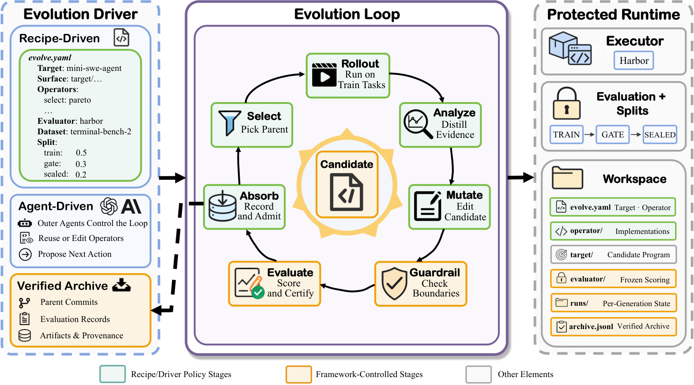
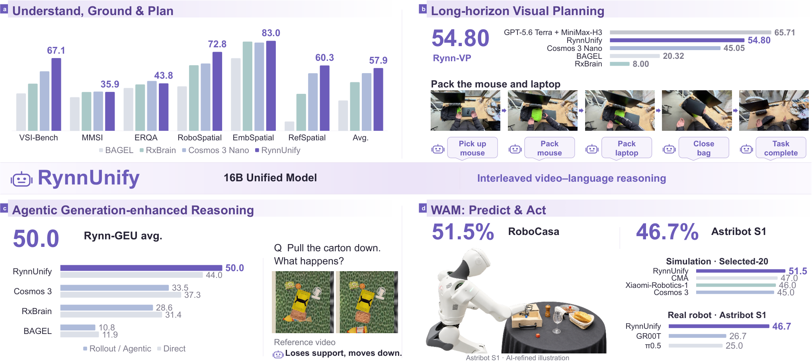
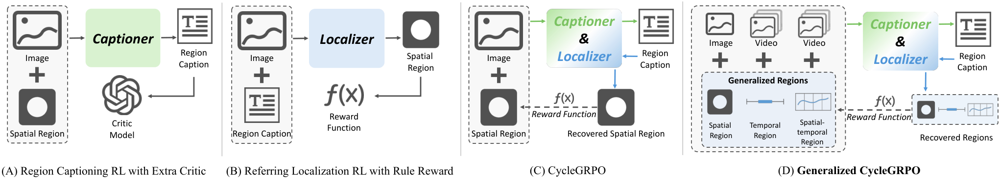
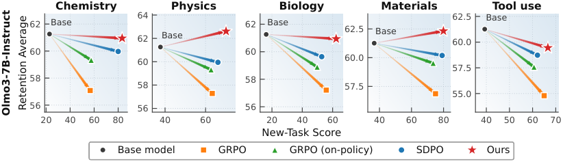
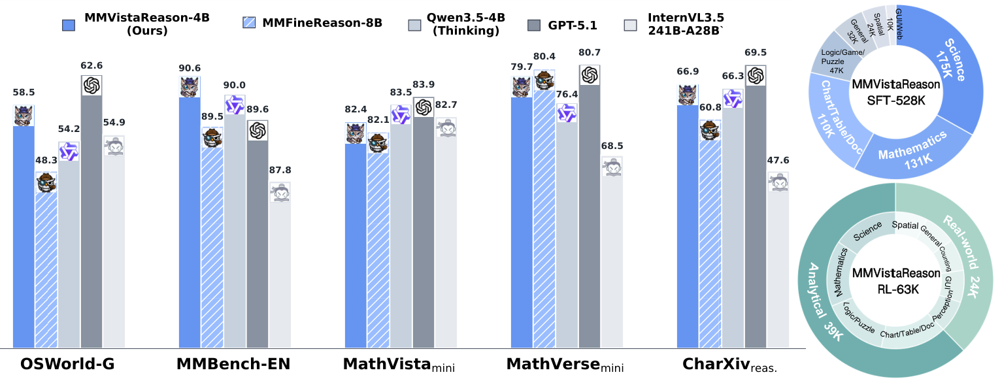
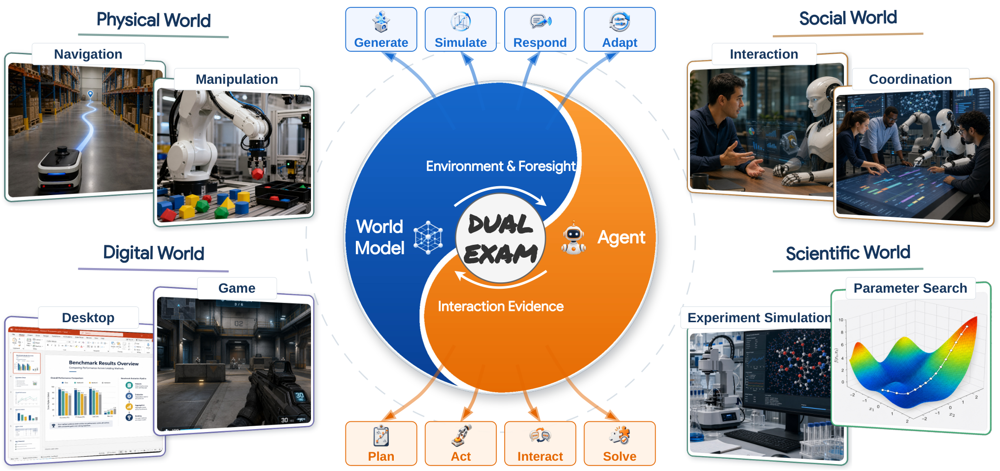

# Daily AI papers — 2026-10-26

*Curated from HF Daily Papers. 15 of 44 papers kept after relevance filter.*

## Papers at a glance

| # | Title | Topics | Org |
| --- | --- | --- | --- |
| 1 | [Reading, Writing, Sharing, and Interacting with the World through Video](#1-a-survey-toward-unified-video-world-models) | `multimodal`, `video`, `survey` | NUS / NTU / Oxford |
| 2 | [UserArena: Benchmarking Interactive User Simulation for Long-Horizon Shopping Agents](#2-userarena) | `agents`, `eval`, `post-training` | Industry (unlisted) |
| 3 | [HiSTEVE 1.0: Harnessing Human-Interface VLA Agents for Open-World Games](#3-histeve-10) | `agents`, `VLA`, `multimodal` | Unlisted |
| 4 | [RSIHub: A Composable Framework for Agent-Evolution Methods](#4-rsihub) | `agents`, `systems` | UC Berkeley + collab |
| 5 | [RynnUnify: Towards Unified Embodied Brain](#5-rynnunify) | `multimodal`, `agents`, `RL` | DAMO Academy / Alibaba |
| 6 | [Omni-Woodpecker: Hallucination Correction via Evidence-Prior Rebalancing for Omni LLMs](#6-omni-woodpecker) | `multimodal`, `safety`, `inference` | Nanjing Univ. |
| 7 | [Every Weight Is a Path of Shared Discrete Decisions](#7-twig-every-weight-is-a-path) | `quantization`, `efficient-inference` | ITMO University |
| 8 | [On-Policy Self-Training: Data-Free Self-Improvement in LLMs](#8-on-policy-self-training-opst) | `post-training`, `reasoning` | Unlisted |
| 9 | [Building Auditable AI Text Detectors with Sparse Autoencoders](#9-auditable-ai-text-detectors-with-saes) | `interp`, `safety`, `eval` | Penn NLP |
| 10 | [MultiAgent-OPD: End-to-End Training of Hierarchical Multi-Agent Systems with On-Policy Distillation](#10-multiagent-opd) | `agents`, `post-training`, `RL` | Alibaba |
| 11 | [Speculative Diffusion is a Tale of Two Tradeoffs](#11-speculative-diffusion) | `inference`, `efficient-inference`, `diffusion` | UCLA |
| 12 | [Generalized CycleGRPO for Fine-Grained Multimodal Understanding and Grounding](#12-generalized-cyclegrpo) | `RL`, `multimodal`, `GRPO` | NUS / UCAS / NTU |
| 13 | [Function-Space Temporal Self-Distillation for Policy Optimization](#13-fspo) | `post-training`, `reasoning`, `RL` | IIT Kanpur |
| 14 | [MMVistaReason: Open-Data and Post-Training Recipes for Multimodal Reasoning](#14-mmvistareason) | `multimodal`, `reasoning`, `post-training` | Zhejiang Univ. / Ant |
| 15 | [Dual Exam: Controlled Evaluation of Multimodal Agents and World Models](#15-dual-exam) | `eval`, `agents`, `multimodal` | Multi-org consortium |

---

## 1. A Survey Toward Unified Video World Models

**Authors:** Meng Luo, Bobo Li, Ziwei Liu, Shuicheng Yan, Ming-Hsuan Yang, Philip Torr, Hao Fei — *NUS / NTU / UC Merced / Oxford*
**Links:** [arXiv:2610.31668](https://arxiv.org/abs/2610.31668) · [HF](https://huggingface.co/papers/2610.31668) · [AlphaXiv](https://www.alphaxiv.org/abs/2610.31668)
**Topics:** `multimodal`, `video`, `survey`, `world-models`

### TL;DR

A survey that reframes the video foundation-model landscape through the lens of **world modeling**. It treats any observed video as a lossy, temporally ordered projection of a latent world and organizes the entire literature along four axes: reading (inferring world properties), writing (generating video), sharing (unifying understanding and generation), and interacting (updating the state under actions). It separates *video-level coherence* (frames look smooth) from *world-level consistency* (state is causally correct across time), and traces the field's shift from clip recognition and visual fidelity toward persistent state, controllable evolution and physical plausibility.

### Key idea

A four-operation taxonomy — Read / Write / Share / Interact — that unifies video understanding, video generation, any-to-video, and action-conditioned world prediction into a single evaluation surface. The split *between* temporal coherence (visuals) and world-state consistency (causality) is the paper's organizing distinction.

### Main finding

A survey; the contribution is the framework and the open-challenge inventory, not a benchmark number. Highlights of challenges: lack of long-horizon state persistence, poor physical plausibility, and the near-total absence of evaluations grounded in interaction rather than static clip quality.

### Why it matters

Fixes the "video model vs. world model" vocabulary problem and gives the community a shared coordinate system for comparing methods that today ship as isolated papers. Expect to see it cited as the reference taxonomy in subsequent world-model benchmarks and multimodal-foundation-model tech reports.

### Knowledge graph integration

**Builds on / relates to existing pages:**
- [multimodal/README.md](../multimodal/README.md) — multimodal LLM landing page; this survey covers video foundations and VLMs that extend into generation.

**Suggested new pages:**
- `multimodal/_video-foundation-models.md` *(taxonomy)* — covers reading/writing/sharing/interacting video models as one class.

---

## 2. UserArena

**Authors:** (not listed on HF page) — *Industry team (unlisted; e-commerce platform)*
**Links:** [arXiv:2610.30932](https://arxiv.org/abs/2610.30932) · [HF](https://huggingface.co/papers/2610.30932) · [AlphaXiv](https://www.alphaxiv.org/abs/2610.30932)
**Topics:** `agents`, `eval`, `post-training`, `distillation`

### TL;DR

A real-world e-commerce benchmark for interactive shopping agents: **64,729 session trajectories from 11,010 users** paired with a live interactive environment. It introduces a five-level evaluation protocol and validates offline numbers against a production A/B test. Alongside the benchmark, the paper proposes **On-Policy Trajectory Distillation (OPTD)**, which trains a user simulator by distilling trajectory-level intent on-policy, and reports it beats baseline simulators across every evaluation level.

### Key idea

Two parts: (1) a shopping-agent benchmark that's grounded in real session logs so simulated performance can be checked against production A/B outcomes; (2) **OPTD** — distill trajectory-level user intent on-policy, so the simulator stays close to real user behavior rather than drifting into reward-hacky shortcuts.

### Main finding

OPTD gives the best overall fidelity across the five evaluation levels among the simulators evaluated, with simulator performance correlating well with offline A/B test outcomes.

### Why it matters

Long-horizon agent evals are brittle because synthetic users are too easy. UserArena anchors agent development to real traffic and shows that *how* you train the simulator (OPTD) materially changes which agent "wins." OPTD itself extends the on-policy-distillation playbook into the user-modeling direction.

### Knowledge graph integration

**Builds on / relates to existing pages:**
- [agents/README.md](../agents/README.md) — agents landing; this is an agent benchmark.
- [post-training/grpo.md](../post-training/grpo.md) — OPTD sits in the on-policy family GRPO occupies for policy learning.

**Suggested new pages:**
- `post-training/on-policy-distillation.md` *(depth)* — on-policy distillation as a training pattern (shared with #10 MultiAgent-OPD).
- `evaluation/user-simulation-benchmarks.md` *(depth)* — benchmarking the simulator itself, not just the agent.

---

## 3. HiSTEVE 1.0

**Authors:** (not listed on HF page) — *Unlisted (project is in the STEVE Minecraft-agent lineage)*
**Links:** [arXiv:2610.31162](https://arxiv.org/abs/2610.31162) · [HF](https://huggingface.co/papers/2610.31162) · [AlphaXiv](https://www.alphaxiv.org/abs/2610.31162)
**Topics:** `agents`, `VLA`, `multimodal`

### TL;DR

A **hierarchical Vision-Language-Action agent** for open-world Minecraft that pairs a VLA policy with a *capability-aware agent harness* — the harness decomposes a long-horizon goal and only hands sub-tasks that match the policy's actual atomic skills. Reported numbers: **85.0% on MineStudio Bench** and **37.4% average success on OpenHA**, and the agent completes long-horizon crafting sequences such as iron pickaxe from scratch.

### Key idea

Separate atomic skill mastery from long-horizon planning explicitly: the VLA policy keeps the low-level control and language-conditioned action space; a wrapper plans sub-goals and routes only tasks the policy can plausibly solve, based on learned capability estimates. The failure mode of monolithic Minecraft agents (over-committing to tasks the atomic policy fails) is addressed by this routing layer.

### Main finding

SOTA on both MineStudio Bench (atomic) and OpenHA (open-ended) under the harness-plus-VLA pattern, and the agent reliably executes multi-step crafting that non-hierarchical VLA baselines fail at.

### Why it matters

Suggests that the current ceiling on open-world embodied agents isn't skill coverage but *task-routing fidelity* — the agent needs to know what it can do. The "capability-aware harness" is a template other open-world agents will likely imitate.

### Knowledge graph integration

**Builds on / relates to existing pages:**
- [agents/README.md](../agents/README.md) — long-horizon agent systems.

**Suggested new pages:**
- `agents/capability-aware-routing.md` *(depth)* — the routing pattern for hierarchical VLA.
- `multimodal/vla.md` *(depth)* — covers VLA agents more generally (RynnUnify also needs it).

---

## 4. RSIHub

**Authors:** Siyu Ye, Xiaodong Gu, Jiaqi Li, Zilong Zheng, Zimu Wang, et al. — *UC Berkeley + collaborators*
**Links:** [arXiv:2610.32253](https://arxiv.org/abs/2610.32253) · [HF](https://huggingface.co/papers/2610.32253) · [AlphaXiv](https://www.alphaxiv.org/abs/2610.32253)
**Topics:** `agents`, `systems`, `eval`

### TL;DR

An open-source framework that supplies shared infrastructure for *agent-evolution* methods — methods that iteratively refine an agent's prompts, skills, tools, or orchestration from execution feedback. Method logic lives in composable recipes; the framework owns execution, evaluation, recovery and lineage. Evaluation is pulled **outside** the editable surface so methods can't game it. The authors re-implement AHE, Hyperagents, A-Evolve and GEPA on top of it; biggest gain is **+13.5 pts pass@1** on Terminal Bench 2 and τ³ Banking, but **method rankings swap across tasks and gains don't always transfer**.

### Key idea

Treat agent-evolution methods like optimizers: standardize the trainee API (prompts/skills/tools/orchestration), the feedback loop, and crucially the evaluation substrate — then benchmark competing methods on apples-to-apples ground truth.

### Main finding

With evaluation held constant, no single agent-evolution method dominates across benchmarks, and in-domain gains underpredict held-out gains. A standardized substrate is itself the finding — it exposes that prior claims were partly artifacts of each method's own eval harness.

### Why it matters

Agent-evolution has been a crowded, hard-to-compare space. A shared, honest substrate changes it from a vibes-based competition into something measurable. Also a template for the open-source community to re-run claims from gated papers.

### Knowledge graph integration

**Builds on / relates to existing pages:**
- [agents/README.md](../agents/README.md) — agent evolution is adjacent to the training-with-environments space.

**Suggested new pages:**
- `agents/_agent-evolution.md` *(taxonomy)* — covers prompt/skill/tool/orchestration refinement methods.
- `evaluation/agent-evolution-benchmarks.md` *(depth)* — the eval harness side.

---

## 5. RynnUnify

**Authors:** Bohan Hou, Kun Xiang, Zixuan Wang, Yinzhou Tang, et al. (23 authors) — *DAMO Academy, Alibaba Group*
**Links:** [arXiv:2610.32965](https://arxiv.org/abs/2610.32965) · [HF](https://huggingface.co/papers/2610.32965) · [AlphaXiv](https://www.alphaxiv.org/abs/2610.32965)
**Topics:** `multimodal`, `agents`, `RL`, `VLA`

### TL;DR

A **16B unified embodied foundation model** that combines embodied understanding with long-horizon visual planning via interleaved video-language reasoning. An **agentic extension** (RL-trained) decides *when* to roll out an internal video prediction to reason about unobserved state; a **world-action extension** turns the model into a VLA for real-robot control. On **Rynn-VP it beats Cosmos 3 Nano by +9.75**, on **Rynn-GEU the agentic extension adds +6.0**, **51.5% success on composite RoboCasa365 tasks**, and **46.7% on three real-robot tasks**.

### Key idea

Fuse four capabilities — spatial reasoning, physical prediction, grounding, and action control — into a single backbone with two inference-time extensions. The agentic extension is the headline: it learns via RL *when invoking an imagined video prediction is worth the cost*, rather than always or never.

### Main finding

A unified backbone outperforms specialized checkpoints on both understanding and planning benchmarks, and the agentic video-prediction call is a positive-ROI design decision that an RL policy can learn.

### Why it matters

Points to a path for embodied foundation models where "think by imagining" is a learned, selective tool rather than a baked-in step. Combined with HiSTEVE's capability-aware routing, two separate papers in one day converge on *selective internal computation* for embodied agents.

### Knowledge graph integration

**Builds on / relates to existing pages:**
- [multimodal/README.md](../multimodal/README.md) — unified multimodal + action model.
- [post-training/grpo.md](../post-training/grpo.md) — the agentic extension is RL-trained on binary task reward.

**Suggested new pages:**
- `multimodal/vla.md` *(depth)* — shared with #3 HiSTEVE.
- `multimodal/world-model-rollout.md` *(depth)* — using video prediction as an internal tool at inference.

---

## 6. Omni-Woodpecker

**Authors:** Zijian Liu, Chaoyou Fu, Yan Yang, Caifeng Shan, Ran He — *Nanjing University & UCAS*
**Links:** [arXiv:2610.27103](https://arxiv.org/abs/2610.27103) · [HF](https://huggingface.co/papers/2610.27103) · [AlphaXiv](https://www.alphaxiv.org/abs/2610.27103)
**Topics:** `multimodal`, `safety`, `inference`

### TL;DR

A **training-free** hallucination-correction method for omni-modal (audio + vision + text) LLMs that intervenes **inside the fused hidden representations** rather than at the decoded output. It identifies conflicting modality cues, separates grounded evidence from learned priors, and rebalances the fused state before decoding. Tested on Qwen2.5-Omni-7B and VideoLLaMA2-AV; improves hallucination benchmarks and keeps/mildly improves general omni-modal reasoning.

### Key idea

Hallucinations in omni-LLMs come from the *fused* representation being pulled by language priors even when audio or video evidence disagrees. By intervening on the hidden state (not post-hoc on tokens), you fix the problem at its source without retraining.

### Main finding

Training-free gains on hallucination benchmarks across two different omni-LLM backbones with no measured regression on general tasks.

### Why it matters

Omni-models are shipping fast and training-based fixes are expensive. A hidden-state-level, training-free lever is attractive as an inference-time module. The "evidence vs. prior" decomposition is also an interpretability-flavored framing that could carry over to text-only hallucination work.

### Knowledge graph integration

**Builds on / relates to existing pages:**
- [multimodal/README.md](../multimodal/README.md) — omni-LLMs are the multimodal extension beyond VLMs.
- [interpretability/README.md](../interpretability/README.md) — hidden-state intervention is an interpretability-adjacent technique.

**Suggested new pages:**
- `multimodal/hallucination-correction.md` *(depth)* — training-free hallucination mitigation via representation surgery.

---

## 7. TWIG: Every Weight Is a Path

**Authors:** Stamatis Lefkimmiatis (lead) — *LEAD Lab, ITMO University*
**Links:** [arXiv:2610.31931](https://arxiv.org/abs/2610.31931) · [HF](https://huggingface.co/papers/2610.31931) · [AlphaXiv](https://www.alphaxiv.org/abs/2610.31931)
**Topics:** `quantization`, `efficient-inference`, `pruning`

### TL;DR

**TWIG (Tree-structured Weights with Inherited Gates)** represents each neural network weight as the terminus of a small path of discrete decisions — a sign, a power-of-two shift, a zero gate, or a table index. Weights that are related share the upper part of their paths. Pruning, quantization, low-rank factorization, codebooks and weight sharing all become **edits to the same object**, selectable by one optimizer. Early measurements on five LLM weight matrices: **~9–15% fewer additions than GPTQ** at 3–4 bits on typical matrices, **20–55% fewer** on outlier-heavy matrices.

### Key idea

Instead of modeling weight compression as independent techniques (quantization, pruning, factorization, codebook), model every weight as a path in a shared decision tree. The compression spectrum then collapses into one choice of *where to put the shared gates* — a single optimization problem.

### Main finding

At equal layer error, TWIG beats GPTQ by 9–55% in required additions, with the biggest gains where quantization normally struggles (outliers). Framed as an inference-cost metric, not just bit-width.

### Why it matters

Reframes the quantization-vs-pruning turf war into a single search problem, and shows the search can find structures hardware would prefer (power-of-two decisions → mostly wires and adders). Hinting at a unified compression-and-codesign pipeline rather than six separate tools.

### Knowledge graph integration

**Builds on / relates to existing pages:**
- [quantization/_number-formats.md](../quantization/_number-formats.md) — TWIG's power-of-two decisions sit alongside INT/FP number formats.
- [quantization/fp8.md](../quantization/fp8.md) — comparable positioning as an inference-cost lever.

**Suggested new pages:**
- `quantization/twig.md` *(depth)* — tree-structured weight representation with inherited gates.
- `quantization/_weight-compression.md` *(taxonomy)* — unify quantization / pruning / factorization / codebooks as variants of one search problem.

---

## 8. On-Policy Self-Training (OPST)

**Authors:** (not fully listed) — *Unlisted team*
**Links:** [arXiv:2610.32770](https://arxiv.org/abs/2610.32770) · [HF](https://huggingface.co/papers/2610.32770) · [AlphaXiv](https://www.alphaxiv.org/abs/2610.32770)
**Topics:** `post-training`, `reasoning`, `distillation`

### TL;DR

**Data-free self-improvement**: given only coarse topic labels ("Abstract Algebra"), the model generates its own questions, rationales and candidate answers, then distills them with an **EMA copy of itself as teacher**. The teacher sees the rationale+answer as privileged context; the student only sees the question. Two gates — *pseudo-verification* (answer must reproduce under paraphrase) and a *consensus gate* (drop questions the student already nails) — keep the curriculum near the capability frontier. On **Gemma 4 E2B** OPST adds **+10.2 MMLU, +4.0 GPQA, +7.5 HellaSwag** with no human data; it beats SFT, GRPO and curated-question baselines on the same self-generated data.

### Key idea

Teacher-as-EMA-of-student with *privileged-context distillation*: the teacher gets to see what the student wrote and answer, which stabilizes targets and makes the teacher strictly stronger than the student at any step. Combined with a self-consistency filter and a frontier-targeting curriculum, this closes the loop with no external labels.

### Main finding

Hefty gains over strong baselines (SFT, GRPO) trained on the **same** synthetic data; ablations say the privileged *rationale* matters more than the privileged *answer*. Visual OPST on unlabeled images adds **+6.9 VQAv2** at 2B. Honest limitation: self-consistency ≠ correctness, so consistent errors can be reinforced.

### Why it matters

If this holds up at larger scales, the "data wall" for post-training weakens — a model's own exploration becomes a credible training distribution. The privileged-context trick is also a cleaner way to think about teacher-student distillation in general (what signal does the teacher get that the student doesn't?).

### Knowledge graph integration

**Builds on / relates to existing pages:**
- [post-training/grpo.md](../post-training/grpo.md) — OPST is compared head-to-head and beats GRPO on self-generated data.
- [post-training/rlvr.md](../post-training/rlvr.md) — self-training here plays the role verifiable rewards play in RLVR.
- [post-training/reasoning/README.md](../post-training/reasoning/README.md) — the headline benchmarks are reasoning.

**Suggested new pages:**
- `post-training/on-policy-self-training.md` *(depth)* — OPST specifically.
- `post-training/privileged-context-distillation.md` *(depth)* — teacher-with-answer-rationale distillation (shared pattern with FSPO #13).

---

## 9. Auditable AI Text Detectors with SAEs

**Authors:** (not listed on HF page) — *Penn NLP (per acknowledgements)*
**Links:** [arXiv:2610.30006](https://arxiv.org/abs/2610.30006) · [HF](https://huggingface.co/papers/2610.30006) · [AlphaXiv](https://www.alphaxiv.org/abs/2610.30006)
**Topics:** `interp`, `safety`, `eval`, `SAE`

### TL;DR

Converts a fine-tuned AI-text detector into a **human-readable concept classifier** by training **sparse autoencoders (SAEs)** on the detector's internal activations, auto-labeling each feature, retaining only features whose descriptions clear a fidelity threshold, and training a simple classifier on those features. Reported to **generalize better to out-of-distribution text** than both the original neural detector and stylometric baselines.

### Key idea

Opaque detectors are strong but can't be audited; interpretable detectors are weak. Use SAEs as a *post-hoc interpretability layer* that keeps the detector's learned signal but exposes it as human-named linguistic markers — and reap generalization as a bonus.

### Main finding

SAE-based detectors generalize better to OOD AI text than both the neural detector they distill and classical stylometric features, while retaining audit traces (every decision factors through named concepts).

### Why it matters

High-stakes AI-text detection (peer review, education, courts) is already deployed; opacity is a real liability. This is a concrete pattern for *using SAEs in production* rather than just as a research instrument — likely to be imitated for any classifier that needs an audit trail.

### Knowledge graph integration

**Builds on / relates to existing pages:**
- [interpretability/README.md](../interpretability/README.md) — SAEs are the backbone interpretability technique here.
- [safety/README.md](../safety/README.md) — AI-text detection sits in the safety/governance surface.

**Suggested new pages:**
- `interpretability/sparse-autoencoders.md` *(depth)* — SAE fundamentals, needed as prereq.
- `interpretability/sae-feature-labeling.md` *(depth)* — auto-labeling SAE features and keeping only high-fidelity ones.
- `evaluation/ai-text-detection.md` *(depth)* — the AI-text-detection benchmark setup.

---

## 10. MultiAgent-OPD

**Authors:** Jiaxin Zhao, Yongdong Luo, Yibo Hu, Meiguang Jin, Junfeng Ma, Weixun Wang, Weihang Pan, Zhongan Bi — *Alibaba Group (and partners)*
**Links:** [arXiv:2610.23234](https://arxiv.org/abs/2610.23234) · [HF](https://huggingface.co/papers/2610.23234) · [AlphaXiv](https://www.alphaxiv.org/abs/2610.23234)
**Topics:** `agents`, `post-training`, `RL`, `distillation`

### TL;DR

**End-to-end training of a hierarchical multi-agent system** — a Leader, parallel Searchers and an Answerer — via a mix of **on-policy distillation and RL**. A separately-trained Teacher model provides *process supervision* to the Searcher sub-agents; the Leader and Answerer learn from outcome-based rewards only. Reported **38.68% macro avg@4** across seven QA/retrieval datasets, beating listed baselines.

### Key idea

Split the credit-assignment problem: the sub-agent that most needs dense feedback (Searcher) gets distilled from a dedicated Teacher; the roles whose output is naturally judged by downstream outcome (Leader, Answerer) stay on sparse RL rewards. Train the whole stack end-to-end so the sub-agents co-adapt.

### Main finding

Mixed process-plus-outcome supervision beats pure outcome RL on hierarchical multi-agent QA, with Alibaba's internal evaluations placing it ahead of its named baselines.

### Why it matters

The field has been circling how to train *teams* of agents end-to-end; MultiAgent-OPD is a working recipe that uses existing ingredients (on-policy distillation + outcome RL) and avoids the pathologies of pure outcome RL on multi-agent setups (sparse credit, drift).

### Knowledge graph integration

**Builds on / relates to existing pages:**
- [post-training/grpo.md](../post-training/grpo.md) — outcome-reward RL on Leader/Answerer uses GRPO-style group baselines.
- [agents/README.md](../agents/README.md) — hierarchical agent systems.

**Suggested new pages:**
- `post-training/on-policy-distillation.md` *(depth)* — shared with #2 UserArena.
- `agents/hierarchical-multi-agent-training.md` *(depth)* — end-to-end training of Leader/Searcher/Answerer teams.

---

## 11. Speculative Diffusion

**Authors:** Daniel Israel, Guy Van den Broeck, Aditya Grover — *UCLA*
**Links:** [arXiv:2610.31819](https://arxiv.org/abs/2610.31819) · [HF](https://huggingface.co/papers/2610.31819) · [AlphaXiv](https://www.alphaxiv.org/abs/2610.31819)
**Topics:** `inference`, `efficient-inference`, `diffusion`

### TL;DR

Uses a **diffusion LLM as the drafter** in speculative decoding, and then jointly tunes two tradeoff knobs: **diffusion effort** (how many denoising steps the drafter runs) and **acceptance leniency** (lossy vs lossless verification). Varying both together extends the speed-quality Pareto frontier beyond what single-step diffusion drafting achieves — the two tradeoffs compose non-trivially.

### Key idea

Diffusion LMs produce multiple tokens in parallel, so they're a natural fit for the drafter role. But diffusion has its own quality-vs-steps knob *in addition* to speculative decoding's own acceptance threshold — so the correct frontier is a 2D surface, not a single axis.

### Main finding

Non-trivial Pareto improvement when both knobs are tuned together; previous diffusion-drafter work implicitly held one of them fixed.

### Why it matters

Speculative decoding is one of the few places where inference cost can be slashed without quality loss; diffusion LMs are becoming a serious inference-side architecture. This paper gives the design-of-experiment template for making them cooperate.

### Knowledge graph integration

**Builds on / relates to existing pages:**
- [inference/README.md](../inference/README.md) — speculative decoding and inference-time efficiency.

**Suggested new pages:**
- `inference/speculative-decoding.md` *(depth)* — foundational depth file; multiple variants (draft model, EAGLE, Medusa) sit under it.
- `inference/speculative-diffusion-drafting.md` *(depth)* — diffusion-LM-as-drafter variant.
- `architectures/diffusion-lm.md` *(depth)* — the architecture itself.

---

## 12. Generalized CycleGRPO

**Authors:** Xin Zhang, Haochen Wang, Beibei Lin, Zhaoxiang Zhang, Robby T. Tan, Jason Li, Dacheng Tao — *NUS / UCAS / NTU*
**Links:** [arXiv:2610.29552](https://arxiv.org/abs/2610.29552) · [HF](https://huggingface.co/papers/2610.29552) · [AlphaXiv](https://www.alphaxiv.org/abs/2610.29552)
**Topics:** `RL`, `GRPO`, `multimodal`, `grounding`

### TL;DR

A unified RL framework that couples **region understanding** and **localization** via a GRPO-cycle: understanding and grounding are trained as paired rewards (describe region → re-localize description → check match). The framework spans **spatial, temporal and spatio-temporal regions**, and the paper also introduces **DOVE**, a benchmark for distinctive occurrence-level video-caption evaluation.

### Key idea

Rather than train understanding and grounding separately with different objectives, train both heads together under a GRPO cycle: a correct understanding must round-trip through grounding, and vice versa. The cycle gives both heads a dense, non-degenerate signal.

### Main finding

Unified training beats separate heads on multiple multimodal grounding and understanding tasks; the cycle extends the standard GRPO template to a paired-rewards setting without architectural changes.

### Why it matters

GRPO has been treated as single-reward algorithm; CycleGRPO shows it generalizes cleanly to coupled rewards and multiple reasoning cycles — a template for anywhere you need two outputs that have to agree.

### Knowledge graph integration

**Builds on / relates to existing pages:**
- [post-training/grpo.md](../post-training/grpo.md) — directly builds on GRPO's group-relative advantages.
- [post-training/_rl.md](../post-training/_rl.md) — RL for multimodal post-training.

**Suggested new pages:**
- `post-training/cycle-grpo.md` *(depth)* — the paired-rewards GRPO variant.
- `multimodal/grounding-rl.md` *(depth)* — RL for multimodal grounding tasks.

---

## 13. FSPO

**Authors:** Arnab Bhattacharya, Vinay Kumar Verma — *IIT Kanpur*
**Links:** [arXiv:2610.19687](https://arxiv.org/abs/2610.19687) · [HF](https://huggingface.co/papers/2610.19687) · [AlphaXiv](https://www.alphaxiv.org/abs/2610.19687)
**Topics:** `post-training`, `reasoning`, `RL`, `distillation`

### TL;DR

**Function-Space Policy Optimization** keeps a sparse set of *historical* next-token distributions as **fixed teachers**, so the student is distilling against a stable function-space target instead of a moving self-teacher. On **Olmo3-7B-Instruct** FSPO is **+4 pts avg** over the strongest baseline under a 5-hour training budget and cuts peak memory from **~70 GB → 56 GB**.

### Key idea

Self-distillation's instability comes from the teacher moving with the student. FSPO freezes a sparse set of past-checkpoint distributions as targets in *function space* (per-token output distributions), avoiding both the moving-target problem and the full-replay memory cost.

### Main finding

Higher average accuracy than its baselines under equal compute budget, with a materially lower peak-memory footprint — the sparse historical targets are small to keep around.

### Why it matters

Function-space distillation is a lightweight alternative to full-replay or heavy teacher ensembles for RLVR-style training; the specific trick (sparse historical snapshots) is easy to retrofit onto other post-training pipelines.

### Knowledge graph integration

**Builds on / relates to existing pages:**
- [post-training/grpo.md](../post-training/grpo.md) — FSPO is positioned as a post-RL/RLVR add-on for token-level density.
- [post-training/rlvr.md](../post-training/rlvr.md) — the setting is reasoning RL under verifiable rewards.
- [post-training/reasoning/README.md](../post-training/reasoning/README.md) — benchmarks are reasoning.

**Suggested new pages:**
- `post-training/function-space-distillation.md` *(depth)* — sparse historical teacher distributions as fixed targets.

---

## 14. MMVistaReason

**Authors:** Juekai Lin, Honglin Lin, Yuqian Yuan, Xiaolong Wu, Jie Cao, Liang Liang, Yunqi Cao, Yun Zhu, Wenqiao Zhang, Lijun Wu — *Zhejiang Univ. / Ant Group AFu Team / SJTU / Tongji*
**Links:** [arXiv:2610.01352](https://arxiv.org/abs/2610.01352) · [HF](https://huggingface.co/papers/2610.01352) · [AlphaXiv](https://www.alphaxiv.org/abs/2610.01352)
**Topics:** `multimodal`, `reasoning`, `post-training`, `distillation`

### TL;DR

An open-data post-training recipe for multimodal reasoning. Addresses three bottlenecks (coverage, data efficiency, cross-domain interference) via two datasets (**MVR-SFT-528K**, **MVR-RL-63K**), a mixture of specialized RL experts for analytical vs real-world reasoning, and consolidation through **multi-teacher on-policy distillation**. Reported averages **72.8** at 4B and **74.4** at 9B across 15 multimodal benchmarks.

### Key idea

Fight cross-domain interference the way MoE handles capacity: train *specialists* for each reasoning sub-domain with RL, then merge them back into a single student via on-policy multi-teacher distillation. Treats the specialist bank itself as a dataset-generation device.

### Main finding

Open-data recipe reaches competitive multimodal-reasoning averages at both 4B and 9B scales; the specialist→distilled-generalist pipeline is empirically better than training a single generalist directly on the merged data.

### Why it matters

An open-data recipe that works at modest scale is a credible foundation for others to re-run and extend. The specialist-then-distill structure echoes the DeepSeek-R1 pipeline but adapted for multimodal.

### Knowledge graph integration

**Builds on / relates to existing pages:**
- [post-training/grpo.md](../post-training/grpo.md) — the RL experts are GRPO-flavored.
- [post-training/reasoning/README.md](../post-training/reasoning/README.md) — the reasoning side of the recipe.
- [multimodal/README.md](../multimodal/README.md) — multimodal post-training.
- [data/README.md](../data/README.md) — new open-data recipe (MVR-SFT, MVR-RL).

**Suggested new pages:**
- `post-training/multi-teacher-distillation.md` *(depth)* — specialist-to-generalist merge via on-policy distillation.
- `multimodal/mmvistareason-recipe.md` *(depth)* — the specific recipe (ties together #10, #8, #13).

---

## 15. Dual Exam

**Authors:** Zhefan Rao, Meng Chu, Xuan Zhang, Jingfan Chen, et al. (90-author multi-org consortium ending with Haoxuan Che) — *Multi-institution consortium*
**Links:** [arXiv:2610.31066](https://arxiv.org/abs/2610.31066) · [HF](https://huggingface.co/papers/2610.31066) · [AlphaXiv](https://www.alphaxiv.org/abs/2610.31066)
**Topics:** `eval`, `agents`, `multimodal`, `world-models`

### TL;DR

A **controlled evaluation framework** that cross-tests multimodal agents and world models: agents evaluated under a *fixed* environment response mechanism; world models evaluated under *fixed* action interventions. Scope: **1,088-item agent eval across 10 configurations**, **400-case world-model eval across 8 scenarios**, plus a **150-case pilot** of one agent–world-model pairing. Honest caveat: current results characterize component capabilities and do **not** yet establish whether they predict coupled performance.

### Key idea

To compare agents fairly you must freeze the environment; to compare world models fairly you must freeze the actions. Dual Exam makes those freezes explicit and symmetric, and only then runs the paired evaluation as a smaller pilot.

### Main finding

Characterizes component capabilities at scale, and reports (honestly) that whether component scores predict coupled scores is an open question — a rare benchmark release that doesn't overclaim.

### Why it matters

The multimodal agent/world-model eval literature has been muddled by comparing agent in environment A against agent in environment B. Dual Exam is a serious attempt at a shared control.

### Knowledge graph integration

**Builds on / relates to existing pages:**
- [evaluation/README.md](../evaluation/README.md) — multimodal and agent evaluation landing.

**Suggested new pages:**
- `evaluation/dual-exam.md` *(depth)* — the Dual Exam benchmark itself.
- `evaluation/_multimodal-agent-benchmarks.md` *(taxonomy)* — covers UserArena, Dual Exam, Kolab, JockeyBench and others as a class.

---

## Notes

- Borderline inclusions are flagged in-section with an italic *Borderline: …* note.
- Hero figures live in `assets/2026-10-26/`. Papers without a figure in this digest either had no accessible `og:image` or the download failed; this is noted silently per paper.
- This digest is informational. No existing concept files, `READING-LIST.md`, or `PAPERS.md` were modified to produce it.
