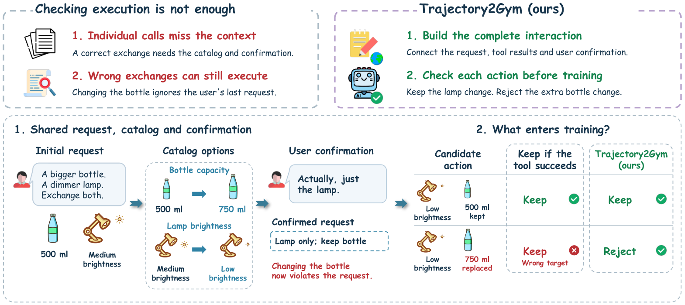
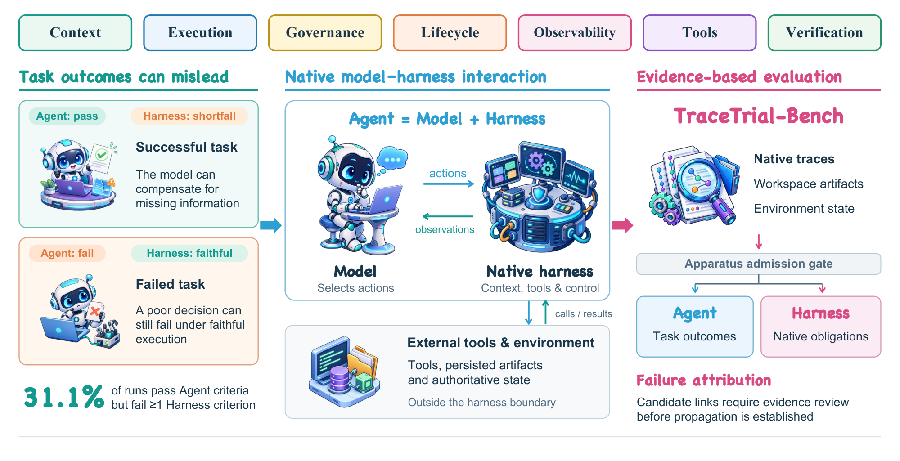
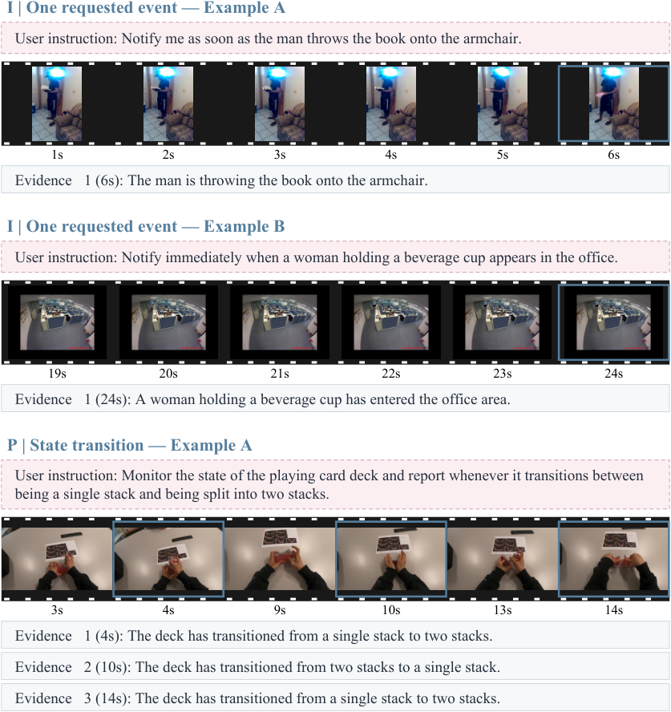
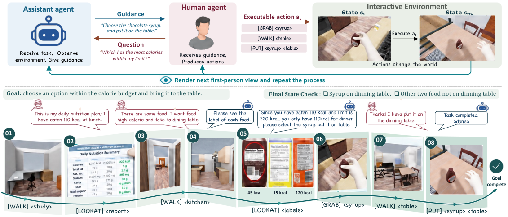
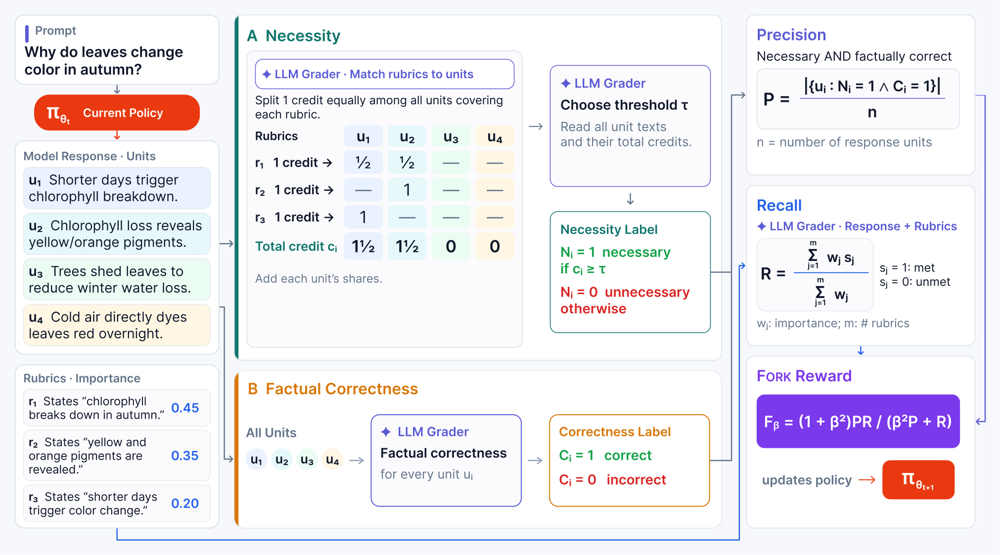
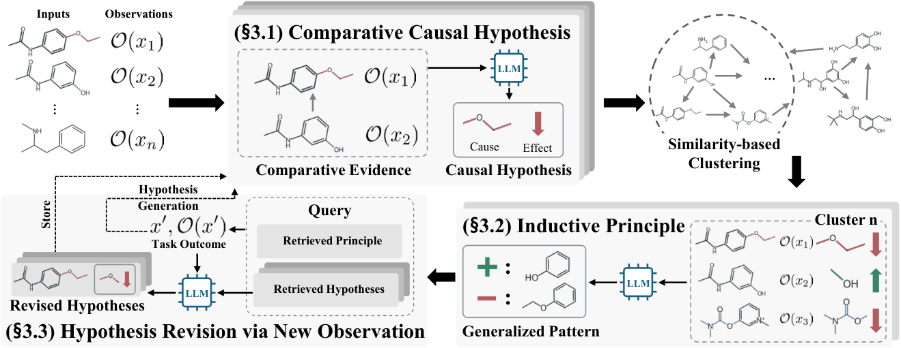
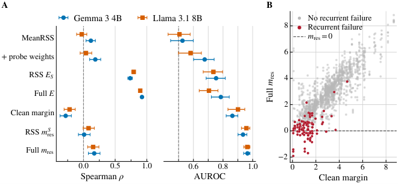
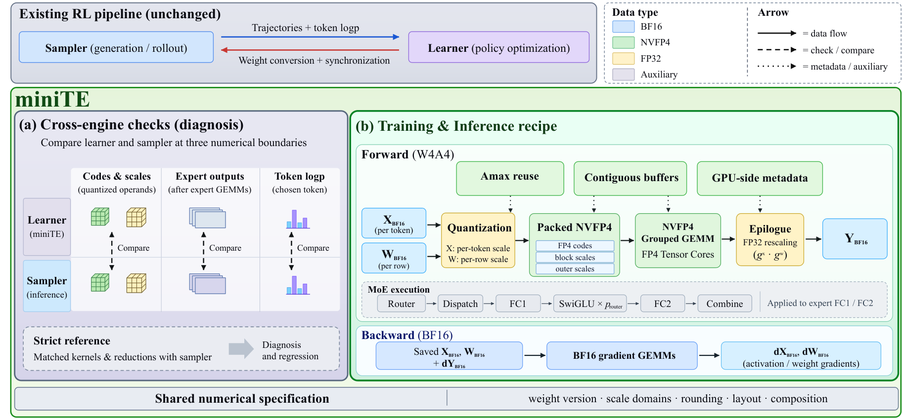

# Daily AI papers — 2026-10-27

*Curated from HF Daily Papers. 14 of ~61 papers kept after relevance filter.*

## Papers at a glance

| # | Title | Topics | Org |
| --- | --- | --- | --- |
| 1 | [Trajectory2Gym: Decision-Grounded Compositional Interaction Synthesis for Tool-Use Agents](#1-trajectory2gym) | `agents`, `RL`, `data` | LINs Lab / Westlake |
| 2 | [Trial by Trace: Benchmarking AI Agent Harnesses for Reliability and Failure Attribution](#2-trial-by-trace) | `agents`, `eval` | TraceLite AI / CAS / Tsinghua |
| 3 | [StreamVibe: Proactive Video Agents for Evolving User Intent](#3-streamvibe) | `agents`, `multimodal`, `eval` | Google (and co-authors) |
| 4 | [DynaFlow: Learning Free-Form Multi-Agent Orchestration](#4-dynaflow) | `agents`, `SFT` | NUS |
| 5 | [InteractiveWorld: A Verifiable Human-Centric Environment for Building Better Interactive MLLM Assistants](#5-interactiveworld) | `agents`, `multimodal`, `eval` | Meta / Duke |
| 6 | [Eat Your Precision: Precision Objective Mitigates Reward Hacking in Rubric-based RL](#6-eat-your-precision) | `RL`, `reward-hacking`, `rubric` | Not disclosed |
| 7 | [Principia: Test-Time Hypotheses to Principle Construction for Scientific Discovery](#7-principia) | `agents`, `reasoning` | Not disclosed |
| 8 | [Representation Redistribution in Sparse Autoencoders](#8-sae-redistribution) | `interp`, `safety`, `SAE` | UW–Madison |
| 9 | [Δτ-Bench: Pushing Agents Toward a Moving Capability](#9-dtau-bench) | `agents`, `eval` | UCL (and co-authors) |
| 10 | [Trustworthy Recursive Self-Improvement in the Era of Large Models](#10-trustworthy-rsi) | `safety`, `survey`, `agents` | Renmin Univ. of China |
| 11 | [ProAS: A Progress-Aware Advantage Shaping Framework for Multi-Turn Agentic RL](#11-proas) | `RL`, `agents` | LINs Lab |
| 12 | [miniTE: Diagnosing and Bridging the Execution Gap in Native NVFP4 Reinforcement Learning](#12-minite) | `quantization`, `RL`, `systems` | Not disclosed |
| 13 | [S3AC: Stabilized, Selective, and Scalable Actor–Critic for LLM Reasoning](#13-s3ac) | `RL`, `reasoning` | Shanghai AI Lab |
| 14 | [Extreme Compression of Per-Layer Embeddings via Cross-Layer Latent Vector Quantization (OPTIC)](#14-optic) | `quantization`, `efficient-inference` | MBZUAI / Westlake |

---

## 1. Trajectory2Gym

**Authors:** Zhihao Wen, Yitong Lin, Siyuan Lu, Pan Wang, Wei Wu, Jiang-Ming Yang, Tao Lin — *LINs Lab (Westlake University)*
**Links:** [arXiv:2610.33568](https://arxiv.org/abs/2610.33568) · [HF](https://huggingface.co/papers/2610.33568) · [AlphaXiv](https://www.alphaxiv.org/abs/2610.33568)
**Topics:** `agents`, `RL`, `data`

### TL;DR

Successful tool-use trajectories make bad training data when they hide the real dependency structure of the task or include actions the agent couldn't have justified from its visible history. Trajectory2Gym rebuilds each task as an executable environment, synthesizes new trajectories targeted at under-covered dependency structures, and masks tokens the agent couldn't have grounded. Trained on this cleaner mix, five Qwen3 sizes improve on Tau1, Tau2, and BFCL — most on stateful, multi-turn benchmarks.

### Key idea

Reframe trajectory distillation as **decision-grounded compositional interaction synthesis**: (1) convert each training task into a Gym-style environment with explicit tool-dependency graphs, (2) sample new trajectories to balance coverage of those graphs, and (3) only supervise action tokens the agent could have decided from its visible observation history. The grounded-tokens filter cuts out plausibly-correct-but-unjustified imitation.

### Main finding

Across the Qwen3 family (0.5B → 32B), Trajectory2Gym lifts task success on Tau1, Tau2, and BFCL benchmarks over SFT on the raw successful trajectories, with the sharpest deltas on stateful, multi-turn evaluations where dependency structure matters most.

### Why it matters

Current agent SFT pipelines treat "trajectory succeeded" as the quality signal. This paper shows that success is cheap and leaky — the gold data for tool use is a *coverage-controlled, grounded-only* subset of successful traces. It gives a reproducible recipe for data curation when training tool-use agents.

### Knowledge graph integration

**Builds on / relates to existing pages:**
- [../agents/README.md](../agents/README.md) — core training-data recipe for tool-use agents.
- [../post-training/rejection-sampling.md](../post-training/rejection-sampling.md) — the "mask ungrounded actions" step is a per-token cousin of rejection sampling.
- [../post-training/rl-prompt-curation.md](../post-training/rl-prompt-curation.md) — related in spirit: curate training inputs by structural coverage.

**Suggested new pages:**
- `agents/trajectory2gym.md` *(depth)* — the environment-rebuild + grounded-supervision recipe.
- `agents/_agent-sft.md` *(taxonomy)* — overview of trajectory-based SFT variants for tool-use agents.

---

## 2. Trial by Trace

**Authors:** Multi-author (names not resolved on HF page) — *TraceLite AI, Institute of Automation CAS, Zhongguancun Academy, IIE CAS, Tsinghua, BIT*
**Links:** [arXiv:2610.32285](https://arxiv.org/abs/2610.32285) · [HF](https://huggingface.co/papers/2610.32285) · [AlphaXiv](https://www.alphaxiv.org/abs/2610.32285)
**Topics:** `agents`, `eval`

### TL;DR

Agent benchmarks usually blur "the model was wrong" with "the harness was wrong." TraceTrial-Bench treats the agent harness itself as the system under test: 95 executable tasks, 3,420 runs across 4 harnesses × 9 models, with trajectory tracing, multi-source evidence gathering, and a two-layer eval that separately scores task success and harness reliability across seven harness components.

### Key idea

Decompose the agent runtime into seven harness components (tool invocation, memory, planning glue, retries, state restore, trajectory logging, failure attribution). For each run, record traces, cross-check them against environment state, and attribute failures to specific components — so an eval can say "task succeeded, but memory and retry failed" or "task failed because of the harness, not the model."

### Main finding

Harness macro-scores span **59.8%–72.0%** across the four tested harnesses. Strikingly, **31.1% of runs that pass the task fail at least one harness criterion** — meaning current agent benchmarks regularly reward lucky-but-broken runtimes.

### Why it matters

Harness quality is a hidden variable that confounds every "best agent model" comparison today. Making it a first-class, auditable dimension of agent evaluation is a prerequisite for honest leaderboards and for reproducible agent training.

### Knowledge graph integration

**Builds on / relates to existing pages:**
- [../agents/README.md](../agents/README.md) — definition of "harness" / agent runtime that this paper decomposes.
- [../evaluation/README.md](../evaluation/README.md) — slots into the LLM-eval methodology section.

**Suggested new pages:**
- `evaluation/agent-harness-benchmark.md` *(depth)* — the two-layer (task × harness) evaluation protocol.
- `agents/_agent-harness.md` *(taxonomy)* — seven-component view of agent runtimes.

---

## 3. StreamVibe

**Authors:** Chengzhi Liu, Yuxiang Lai, Yuzhe Yang, Yanqing Liu, Jiheng Hou, Yue Cao, Haonan Wang, Ruixi Fan, Lan Wang, Sheng Liu, Songyou Peng, Yale Song, Kevin Qinghong Lin, Xin Eric Wang, Jui-Hsin Lai, Youbao Tang — *Google (and multi-org collaborators)*
**Links:** [arXiv:2610.34662](https://arxiv.org/abs/2610.34662) · [HF](https://huggingface.co/papers/2610.34662) · [AlphaXiv](https://www.alphaxiv.org/abs/2610.34662)
**Topics:** `agents`, `multimodal`, `eval`

### TL;DR

A proactive, streaming video assistant that doesn't wait to be asked. StreamVibe-VL is a streaming vision-language model that continuously watches a scene, infers implicit user intent, and decides *when* to speak. It's paired with a hierarchical-memory harness that tracks evolving intent across time, and evaluated on StreamVibe-Bench (4.1K eval + 85K train samples spanning explicit, implicit, and dynamic intents).

### Key idea

Shift the VLM contract from "answer when asked" to "answer when it would help." Three pieces: a streaming VLM that produces per-frame response-worthiness signals, a hierarchical memory (short-term scene buffer + long-term intent log) that updates as the user's intent drifts, and a benchmark that scores both answer quality *and* response timing.

### Main finding

StreamVibe-VL + harness: **+10.7%** on combined response-timing/answer-quality over strong streaming baselines, and **+12.3%** on proactive interaction scenarios.

### Why it matters

Pushes VLM agents from Q&A toward always-on assistants. "When to speak" is the gating skill for live video copilots, AR glasses, and continuous meeting agents — and until now there was no standardized way to measure it.

### Knowledge graph integration

**Builds on / relates to existing pages:**
- [../multimodal/README.md](../multimodal/README.md) — streaming VLM is a new axis for the multimodal taxonomy.
- [../agents/README.md](../agents/README.md) — the harness pattern (hierarchical memory + decision policy) is standard agent machinery.

**Suggested new pages:**
- `multimodal/streaming-vlm.md` *(depth)* — streaming/online inference for VLMs with "when to answer" heads.
- `evaluation/streamvibe-bench.md` *(depth)* — timing-aware proactive-video benchmark.

---

## 4. DynaFlow

**Authors:** Ruhao Liu, Qi Li, Shizun Wang, Xinchao Wang — *National University of Singapore*
**Links:** [arXiv:2610.34467](https://arxiv.org/abs/2610.34467) · [HF](https://huggingface.co/papers/2610.34467) · [AlphaXiv](https://www.alphaxiv.org/abs/2610.34467)
**Topics:** `agents`, `SFT`

### TL;DR

Instead of hand-coding multi-agent workflows or using an LLM-as-router at every step, DynaFlow trains one "main agent" to emit *free-form executable workflows* that call sub-agents, verify their outputs, and iterate. Only the main agent is trained (SFT → refinement); sub-agents stay fixed. On math reasoning, scientific QA, and multi-hop retrieval, DynaFlow (Qwen3.5-27B backbone) hits 88.08% overall vs. 77.18% for the strongest baseline.

### Key idea

Treat multi-agent orchestration as **program synthesis conditioned on a task**: the main agent writes a short program whose primitives are calls to specialist sub-agents and verification steps. Train only that programmer with SFT + a refinement stage, so the sub-agent zoo stays modular and swappable without re-training.

### Main finding

**+10.90 pp** over the strongest baseline across six benchmarks (math reasoning / science QA / multi-hop retrieval) in Forced mode; 88.08% overall with a Qwen3.5-27B main agent.

### Why it matters

Points away from hand-crafted agent graphs and from heavy RL-trained orchestrators, and toward "train the planner, freeze the specialists." Lower per-task retraining cost and a cleaner mental model for agent factories.

### Knowledge graph integration

**Builds on / relates to existing pages:**
- [../agents/README.md](../agents/README.md) — multi-agent orchestration is squarely in the agents chapter.
- [../post-training/README.md](../post-training/README.md) — SFT + refinement recipe for the main planner.

**Suggested new pages:**
- `agents/multi-agent-orchestration.md` *(depth)* — workflow-as-code multi-agent coordination.

---

## 5. InteractiveWorld

**Authors:** Qinsi Wang, Wei Wen, Chong Zhou, Saksham Suri, Zechun Liu, Lemeng Wu, Hai Helen Li, Yiran Chen, Raghuraman Krishnamoorthi, Qi Qian — *Meta (with Duke University)*
**Links:** [arXiv:2610.33966](https://arxiv.org/abs/2610.33966) · [HF](https://huggingface.co/papers/2610.33966) · [AlphaXiv](https://www.alphaxiv.org/abs/2610.33966)
**Topics:** `agents`, `multimodal`, `eval`

### TL;DR

A closed-loop simulation environment where an MLLM assistant must *guide* a scripted human avatar through physical tasks — the human observes, interprets natural-language guidance, and acts on its own. InteractiveBench ships 120 multi-turn tasks across six categories with state-based graders. Frontier MLLMs top out at **20% on Guidance** and **25% on Planning**.

### Key idea

Push MLLM evaluation beyond passive Q&A: the model must produce guidance that another agent (the simulated human) can *act on*, which forces grounded, step-by-step instructions and real-time error recovery. Grading is state-based (did the human reach the target state), not just answer-level.

### Main finding

Across 12 frontier MLLMs, the best model scores at most **20% on Guidance** and **25% on Planning** — a big gap from the "already solved" picture painted by static multimodal benchmarks.

### Why it matters

Shifts the MLLM frontier eval from "describe this image" to "coach another agent through a task." That's the real target for AR/physical-world assistants, and today's models are nowhere close.

### Knowledge graph integration

**Builds on / relates to existing pages:**
- [../multimodal/README.md](../multimodal/README.md) — benchmark for grounded multimodal assistants.
- [../evaluation/README.md](../evaluation/README.md) — new interactive-eval methodology.
- [../agents/README.md](../agents/README.md) — assistant-in-the-loop with a scripted embodied agent.

**Suggested new pages:**
- `evaluation/interactivebench.md` *(depth)* — human-centric closed-loop MLLM benchmark.

---

## 6. Eat Your Precision

**Authors:** Not resolved on HF page — *affiliations not disclosed*
**Links:** [arXiv:2610.33512](https://arxiv.org/abs/2610.33512) · [HF](https://huggingface.co/papers/2610.33512) · [AlphaXiv](https://www.alphaxiv.org/abs/2610.33512)
**Topics:** `RL`, `reward-hacking`, `rubric`

### TL;DR

Rubric-based rewards (grade a response by matching it against a checklist) make RL on non-verifiable tasks possible but reward "cover everything plus noise." The authors introduce **Fork**, a reward that combines rubric *coverage* (recall over checklist items) with a *precision* term that requires each unit of the response to be both necessary and factually correct. Fork preserves coverage, shortens responses, and raises win rates vs. the base model.

### Key idea

Treat rubric scoring as recall and plug an explicit precision term into the reward: for every claim/unit in the generated response, check whether it is (a) covered by a rubric item and (b) factually correct. Reward hacking that stuffs irrelevant extras into the answer no longer pays, because precision drags the score down.

### Main finding

Fork keeps coverage close to vanilla rubric reward, cuts response length, and improves win rates against the base model — a direct answer to the length- and padding-hacking pathology of rubric RL.

### Why it matters

Rubric RL is the main lever for post-training on "soft" tasks (writing, reasoning explanations, planning), and length/noise hacking is its biggest failure mode. A clean precision term is a low-cost, drop-in fix.

### Knowledge graph integration

**Builds on / relates to existing pages:**
- [../post-training/_rewards.md](../post-training/_rewards.md) — new entry in the rubric-reward family.
- [../post-training/rlvr.md](../post-training/rlvr.md) — rubric RL sits adjacent to RLVR for non-verifiable tasks.
- [../post-training/grpo.md](../post-training/grpo.md) — Fork reward can slot into GRPO-style pipelines.
- [../post-training/reasoning/length-penalty.md](../post-training/reasoning/length-penalty.md) — related anti-length-hacking lever.

**Suggested new pages:**
- `post-training/rubric-reward.md` *(depth)* — rubric-based reward for non-verifiable RL.
- `post-training/precision-reward.md` *(depth)* — the precision objective proposed by Fork.

---

## 7. Principia

**Authors:** Not resolved on HF page — *affiliations not disclosed*
**Links:** [arXiv:2610.32195](https://arxiv.org/abs/2610.32195) · [HF](https://huggingface.co/papers/2610.32195) · [AlphaXiv](https://www.alphaxiv.org/abs/2610.32195)
**Topics:** `agents`, `reasoning`

### TL;DR

An LLM-driven scientific-discovery loop that *constructs* principles rather than merely retrieving them. Given related inputs and their experimental outcomes, Principia forms comparative causal hypotheses, abstracts recurring relationships into broader principles, and revises both as new observations come in. Beats baselines that only use internal knowledge, external sources, or experience summaries, across molecular optimization, protein engineering, gene perturbation, and molecular property prediction.

### Key idea

A three-stage inference-time loop: (1) **hypothesize** by comparing paired inputs/outcomes, (2) **principle-construct** by unifying hypotheses that recur across comparisons, (3) **revise** when new observations contradict the current principle set. The loop is memory-grounded — principles persist and compose, so later experiments reuse earlier abstractions.

### Main finding

Across four scientific-discovery benchmarks (molecular optimization, protein engineering, gene perturbation, molecular property prediction), Principia outperforms internal-knowledge, retrieval-augmented, and experience-summary baselines; the generated principles are reported to match the scientific literature.

### Why it matters

Most agentic-science systems treat the LLM as a one-shot oracle or a shallow retriever. Explicitly separating hypothesis / principle / revision is a path toward agents that *accumulate theory*, not just facts — relevant for autonomous labs and long-horizon research agents.

### Knowledge graph integration

**Builds on / relates to existing pages:**
- [../agents/README.md](../agents/README.md) — long-horizon scientific-discovery agent loop.
- [../post-training/reasoning/README.md](../post-training/reasoning/README.md) — hypothesis/principle construction is a reasoning-time technique.

**Suggested new pages:**
- `agents/scientific-discovery-agent.md` *(depth)* — hypothesize/principle/revise loop.

---

## 8. SAE Redistribution

**Authors:** Haotian Ma — *University of Wisconsin–Madison*
**Links:** [arXiv:2610.21240](https://arxiv.org/abs/2610.21240) · [HF](https://huggingface.co/papers/2610.21240) · [AlphaXiv](https://www.alphaxiv.org/abs/2610.21240)
**Topics:** `interp`, `safety`, `SAE`

### TL;DR

Semantics-preserving prompt rewrites don't just add noise to SAE activations — they systematically **redistribute** which features fire. The paper defines the **Redistribution Sensitivity Score (RSS)**, which picks out features whose per-rewrite shifts are consistent in direction, and shows that these ~20 features can rank recurrent safety-readout failures almost as well as using the full feature set (AUROC 0.935–0.958 vs. 0.964–0.965).

### Key idea

Rather than studying SAE features in isolation, compare their activations across *meaning-preserving* prompt variants. The RSS keeps a feature only if its activation changes repeatedly in the same direction under rewriting. Combining the compact RSS feature set with the clean decision margin of a frozen safety classifier captures the bulk of its failure modes with ~1% of its features.

### Main finding

Across **27 pretrained SAEs from 8 LMs**: RSS-selected features (median ~20) + a frozen linear safety readout rank failures with AUROC **0.935 / 0.958**, within ~1 point of the full-feature AUROC **0.965 / 0.964**.

### Why it matters

SAE interpretability work usually looks at single-feature meaning. This paper reframes the useful signal as *relational*: how features *shift* under paraphrase. That gives safety work a cheap, model-agnostic handle on jailbreak-adjacent failure modes.

### Knowledge graph integration

**Builds on / relates to existing pages:**
- [../interpretability/README.md](../interpretability/README.md) — SAE-feature analysis for safety.
- [../safety/_jailbreaks.md](../safety/_jailbreaks.md) — related to paraphrase-driven jailbreaks (mismatched generalization).
- [../safety/mismatched-generalization.md](../safety/mismatched-generalization.md) — RSS surfaces exactly the features that mismatch under paraphrase.

**Suggested new pages:**
- `interpretability/sae.md` *(depth)* — sparse autoencoders for LM feature decomposition (gap in the graph).
- `interpretability/rss.md` *(depth)* — the redistribution sensitivity score itself.

---

## 9. Δτ-Bench

**Authors:** Shuofei Qiao, Xuanguang Pan, Yijun Chen, Wendi Feng, Bin Wu, Runnan Fang, Yuqi Zhu, Shumin Deng, Emine Yilmaz — *University College London (lead)*
**Links:** [arXiv:2610.34238](https://arxiv.org/abs/2610.34238) · [HF](https://huggingface.co/papers/2610.34238) · [AlphaXiv](https://www.alphaxiv.org/abs/2610.34238)
**Topics:** `agents`, `eval`

### TL;DR

Most agent benchmarks hold their tool universe fixed. Δτ-Bench instead evolves the ecosystem: **1,588 multi-turn tasks across 42 domains and six successive ecosystem states** that model realistic churn (tools deprecated, replaced, extended). The strongest model/harness reaches only **42.3%**. The paper also proposes **Steward**, an ecosystem manager that incrementally maintains skills and dynamically provisions tools at execution time.

### Key idea

Treat tool ecosystems as a non-stationary environment and evaluate agents' ability to *adapt* across versions. Pair the benchmark with Steward, which (a) keeps a persistent skill library tied to tool interfaces, and (b) resolves which tools to surface for each step based on current availability.

### Main finding

On Δτ-Bench's moving target, the best configuration tops out at **42.3%** task success — well below static-tool benchmarks. Steward sustains higher success across ecosystem transitions with lower maintenance overhead than periodic full retraining.

### Why it matters

In production, tool catalogs change weekly. A benchmark that bakes in ecosystem evolution — plus a lightweight runtime that handles it — is a template for how agent evaluation should actually be done going forward.

### Knowledge graph integration

**Builds on / relates to existing pages:**
- [../agents/README.md](../agents/README.md) — tool-use agents under non-stationary ecosystems.
- [../evaluation/README.md](../evaluation/README.md) — benchmark design for agents.

**Suggested new pages:**
- `evaluation/dtau-bench.md` *(depth)* — moving-ecosystem benchmark for tool-use agents.
- `agents/skill-library.md` *(depth)* — persistent-skill agent runtimes.

---

## 10. Trustworthy Recursive Self-Improvement

**Authors:** Ang Gao, Jinyi Bai, Qipeng Wang, Tongyu Wen, Jiahao Zhao, Keyu Qu, Chenglei Shen, Zhongxiang Sun, Junhao Zhang, Jun Xu, Xiao Zhang — *Gaoling School of AI, Renmin University of China (lead); UCAS*
**Links:** [arXiv:2610.35193](https://arxiv.org/abs/2610.35193) · [HF](https://huggingface.co/papers/2610.35193) · [AlphaXiv](https://www.alphaxiv.org/abs/2610.35193)
**Topics:** `safety`, `survey`, `agents`

### TL;DR

Survey of **recursive self-improvement (RSI)** for large-model agents: systems that update their own models, prompts, memories, tools, and workflows — including the mechanisms that govern those updates. Argues that self-modification alone doesn't give trustworthy improvement, organizes requirements for trustworthy RSI into four themes, and reviews current risks, safeguards, and evaluation evidence.

### Key idea

Separate "the system changes itself" from "the system changes *how* it changes itself." The latter is where safety guarantees have to live. The authors propose a four-theme framework (foundations, risks, evaluation, open challenges) and map existing RSI research into it.

### Main finding

Not an empirical paper — the contribution is a structured map of the RSI design space, risk catalogue, and evaluation gaps, plus a reading list.

### Why it matters

RSI is the natural extrapolation of today's agent + continual-tool-synthesis trajectory, but there's no shared vocabulary for talking about it safely. This survey anchors future work and will likely become a reference taxonomy.

### Knowledge graph integration

**Builds on / relates to existing pages:**
- [../safety/README.md](../safety/README.md) — safety for self-modifying systems.
- [../safety/_scheming.md](../safety/_scheming.md) — scheming risks compound under RSI.
- [../agents/README.md](../agents/README.md) — RSI formalizes "agents that improve themselves."

**Suggested new pages:**
- `safety/_rsi.md` *(taxonomy)* — overview of recursive-self-improvement risks and safeguards.
- `safety/recursive-self-improvement.md` *(depth)* — the RSI concept and its four-theme trust framework.

---

## 11. ProAS

**Authors:** Bowen Ding, Mingda Wan, Yuhan Chen, Jiyao Yuan, Qi Zhu, Futing Wang, Heyuan Deng, Fei Mi, Lifeng Shang, Tao Lin — *LINs Lab*
**Links:** [arXiv:2610.18683](https://arxiv.org/abs/2610.18683) · [HF](https://huggingface.co/papers/2610.18683) · [AlphaXiv](https://www.alphaxiv.org/abs/2610.18683)
**Topics:** `RL`, `agents`

### TL;DR

Critic-free RL (GRPO-style) is cheap but gives weak credit assignment on long, multi-turn agent trajectories. ProAS is a plug-in that improves credit assignment by building a **dynamic reference graph** of trajectory steps, masking unreasonable incentives, and asymmetrically redistributing penalties. On Qwen2.5-1.5B/7B, peak success climbs to **91.9%/94.3% on ALFWorld** and **66.7%/70.8% on WebShop**, with up to **2.44× faster convergence**.

### Key idea

Rather than retrofitting a critic, extract progress structure *from the batch of rollouts themselves*. Steps that are reference-redundant (would be penalized under any similar trajectory) get their advantage flattened; steps that are genuinely load-bearing get a stronger (asymmetrically shaped) signal. The graph updates per batch — no extra model.

### Main finding

Qwen2.5-1.5B-Instruct → **91.9%** on ALFWorld, **66.7%** on WebShop; Qwen2.5-7B-Instruct → **94.3% / 70.8%**. Convergence **up to 2.44×** faster than the critic-free baseline.

### Why it matters

Multi-turn agentic RL has been a credit-assignment nightmare and the field has been splitting between "add a critic back" and "live with the noise." ProAS is a third path: shape advantages from reference-graph structure, keep the critic-free setup.

### Knowledge graph integration

**Builds on / relates to existing pages:**
- [../post-training/grpo.md](../post-training/grpo.md) — ProAS is a drop-in modification of GRPO-style critic-free RL.
- [../post-training/_rl.md](../post-training/_rl.md) — new entry in the RL-variants taxonomy.
- [../post-training/rlvr.md](../post-training/rlvr.md) — targets the multi-turn-agent regime of RLVR.

**Suggested new pages:**
- `post-training/proas.md` *(depth)* — progress-aware advantage shaping for multi-turn agentic RL.

---

## 12. miniTE

**Authors:** Zhen Li, Mingfa Feng, Yiming Zhang, Yang Yu, Changhai Zhou, Pengxiang Li, Dongkuan Wu, Congkai Xie, Hongxia Yang, Lin Yang, Jianmin Wu, Cheng Lin, Tao Zhao, Shuai Zhang, Shuang Yu, Yongming Shi, Junjie Lai — *Affiliations not disclosed on HF page*
**Links:** [arXiv:2610.23928](https://arxiv.org/abs/2610.23928) · [HF](https://huggingface.co/papers/2610.23928) · [AlphaXiv](https://www.alphaxiv.org/abs/2610.23928)
**Topics:** `quantization`, `RL`, `systems`

### TL;DR

Native NVFP4 could massively speed up LLM RL training, but RL has two engines (sampler + learner) that must agree numerically — and matching weights and formats isn't enough. miniTE argues the real culprit is the **execution gap** between those engines, and ships a stack (diagnostics + cross-engine numerical alignment + optimized W4A4 GEMM) that closes it without changing the RL objective. On Qwen3-30B-A3B the learner hits **33,540 tok/s on a single B300 node, 1.39× BF16** and **1.47× TE NVFP4**, with evaluation quality close to BF16.

### Key idea

Reframe low-precision RL as a *cross-engine* numerical problem. Diagnose where sampler and learner diverge (not just activation stats; actual kernel-level execution), then align them with purpose-built W4A4 GEMM kernels and a reference execution profile. The RL loss is untouched.

### Main finding

Qwen3-30B-A3B, single B300 node: **33,540 tok/s** full learner update throughput — **1.39×** BF16 and **1.47×** vanilla TE NVFP4. Training is stable; benchmarks sit close to BF16, beating naive TE NVFP4 on evaluation.

### Why it matters

NVFP4 training has been promising for a year but repeatedly tripped by numerical drift between RL components. This paper reframes the problem (execution-gap, not just precision-gap), releases the kernels, and makes NVFP4 RL practical on current hardware.

### Knowledge graph integration

**Builds on / relates to existing pages:**
- [../quantization/_number-formats.md](../quantization/_number-formats.md) — NVFP4 slots into the number-format taxonomy.
- [../pre-training/fp8-training.md](../pre-training/fp8-training.md) — low-precision training lineage.
- [../post-training/_rl.md](../post-training/_rl.md) — practical infra for RL post-training.
- [../systems/README.md](../systems/README.md) — infra-level contribution for distributed RL.

**Suggested new pages:**
- `quantization/nvfp4.md` *(depth)* — the NVFP4 format and its practical tradeoffs.
- `post-training/nvfp4-rl.md` *(depth)* — the execution-gap framing for low-precision RL.

---

## 13. S3AC

**Authors:** Guangran Cheng, Chengqi Lyu, Xiangsen Wang, Yanan Sun, Wenwei Zhang — *Shanghai AI Laboratory (plus independent)*
**Links:** [arXiv:2610.35518](https://arxiv.org/abs/2610.35518) · [HF](https://huggingface.co/papers/2610.35518) · [AlphaXiv](https://www.alphaxiv.org/abs/2610.35518)
**Topics:** `RL`, `reasoning`

### TL;DR

Critic-free RLVR (GRPO and friends) gives weak token-level credit. A learned critic should fix it, but long reasoning trajectories make critic training unstable. S3AC bundles a practical critic-training recipe with **DAPS** (Difficulty-Aware Prompt Selection) to get stable, scalable actor-critic RL. Gains over a strong GRPO variant are reported from **1.5B to 397B** parameters.

### Key idea

Three ingredients make the critic trainable at scale: (1) stabilization tricks for value learning under long trajectories, (2) selectivity — update the critic on prompts where the critic actually matters, (3) scalability — prompt-level difficulty-aware sampling (DAPS) that keeps the hard-but-not-impossible band of problems in rotation.

### Main finding

Beats a modern GRPO variant across **1.5B → 397B** parameter scales on long-reasoning RL tasks (specific numbers in the paper).

### Why it matters

Resurrects actor-critic for LLM RL at frontier scale — a direction the field had largely given up on when GRPO showed critic-free could work. If the recipe generalizes, it brings tighter credit assignment back to long-CoT training.

### Knowledge graph integration

**Builds on / relates to existing pages:**
- [../post-training/ppo.md](../post-training/ppo.md) — actor-critic lineage.
- [../post-training/grpo.md](../post-training/grpo.md) — baseline S3AC compares against and improves.
- [../post-training/_rl.md](../post-training/_rl.md) — new entry in RL variants.
- [../post-training/reasoning/long-cot-rl.md](../post-training/reasoning/long-cot-rl.md) — target regime (long reasoning traces).
- [../post-training/rl-prompt-curation.md](../post-training/rl-prompt-curation.md) — DAPS is a prompt-curation variant.

**Suggested new pages:**
- `post-training/s3ac.md` *(depth)* — stabilized actor-critic for LLM reasoning.
- `post-training/daps.md` *(depth)* — difficulty-aware prompt selection for RLVR.

---

## 14. OPTIC

**Authors:** Yaxin Luo, Xiaohan Zhao, Peng Sun, Xinyi Shang, Jiacheng Cui, Yonina C. Eldar, Zhiqiang Shen — *MBZUAI (lead) / Westlake / Weizmann / UCL*
**Links:** [arXiv:2610.31309](https://arxiv.org/abs/2610.31309) · [HF](https://huggingface.co/papers/2610.31309) · [AlphaXiv](https://www.alphaxiv.org/abs/2610.31309)
**Topics:** `quantization`, `efficient-inference`

### TL;DR

Per-Layer Embeddings (PLE) make up **35.2%** of Gemma 4 E4B's parameters. OPTIC compresses them to **~100×** by storing *one quantized code per token* and decoding to each layer's embedding through a small layer-specific affine decoder. At 100×, it retains **97.8%** of the uncompressed model's performance across seven benchmarks and sits well above conventional quantizers.

### Key idea

Codebook + per-layer affine decoder, fitted jointly to the PLE *output path*: a token's identity becomes a VQ code, and each layer gets an affine map that reconstructs its slice of the embedding. The decoders are tiny, the codes are shared across layers, and serving reduces GPU memory with minimal added latency.

### Main finding

**~100× compression** of PLE: retains **97.8%** average of uncompressed performance across seven benchmarks; higher ratios keep most of the quality while conventional quantizers collapse. GPU-memory serving savings are substantial at near-equivalent latency.

### Why it matters

PLE is a growing fraction of parameters in modern on-device LMs (Gemma 3/4 E-series). OPTIC says that fraction can be nearly free by moving from per-layer quantization to a *cross-layer* latent VQ view — relevant for anyone shipping Gemma-E-class models on-device.

### Knowledge graph integration

**Builds on / relates to existing pages:**
- [../quantization/_number-formats.md](../quantization/_number-formats.md) — VQ-based weight compression as a non-scalar alternative.
- [../quantization/README.md](../quantization/README.md) — extreme-compression entry point.
- [../inference/README.md](../inference/README.md) — serving-memory win for on-device models.

**Suggested new pages:**
- `quantization/optic.md` *(depth)* — cross-layer latent VQ for per-layer embeddings.
- `quantization/_vector-quantization.md` *(taxonomy)* — codebook-based weight compression.

---

## Notes

- Hero figures live in `assets/2026-10-27/`. Missing figures for #4 (DynaFlow), #9 (Δτ-Bench), #11 (ProAS), #13 (S3AC) and #14 (OPTIC) — the HF `og:image` wasn't resolvable and the arXiv HTML teaser URLs 404'd on these papers; sections omit the figure line.
- This digest is informational. No existing concept files, `READING-LIST.md`, or `PAPERS.md` were modified to produce it.
