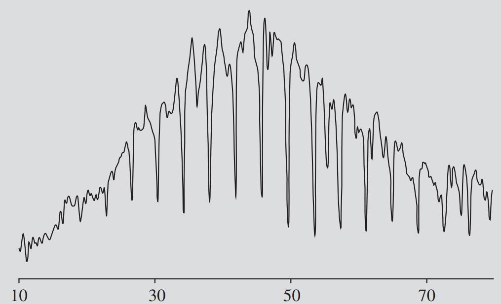
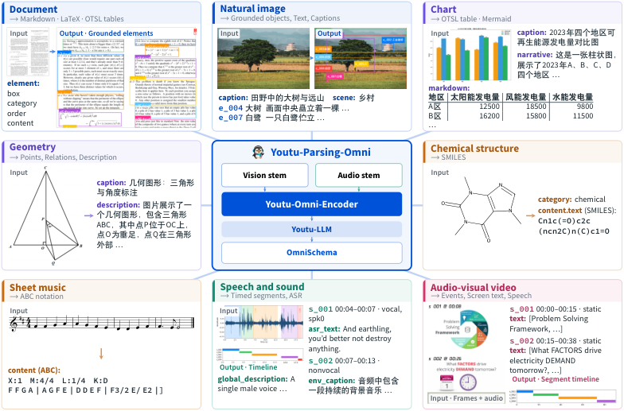
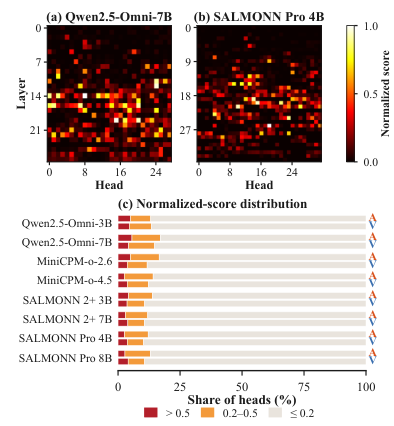
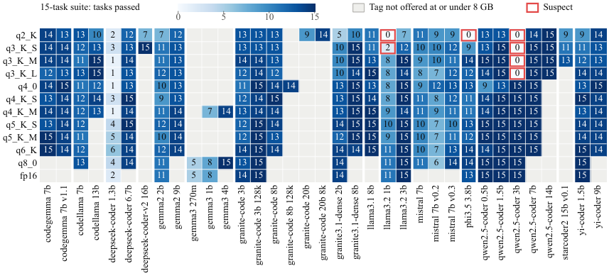
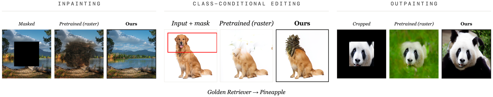

# Daily AI papers — 2026-10-30

*Curated from HF Daily Papers. 15 of 39 papers kept after relevance filter.*

## Papers at a glance

| # | Title | Topics | Org |
| --- | --- | --- | --- |
| 1 | [Intrinsic Distribution Matching](#1-intrinsic-distribution-matching) | `diffusion`, `distillation` | Inclusion AI · Westlake · Tsinghua |
| 2 | [A-RSI: Adaptive Task Refresh for Zero-Data Multimodal Self-Improvement](#2-a-rsi-adaptive-task-refresh-for-zero-data-multimodal-self-improvement) | `multimodal`, `RL`, `reasoning` | IIE / CAS · CUHK · Würzburg |
| 3 | [Your Benchmark Is an Empirical Measure Over Difficulty](#3-your-benchmark-is-an-empirical-measure-over-difficulty) | `eval` | UIUC · UCSD · NYU |
| 4 | [Look Only When Needed: Certificate-Guided Visual Routing for Efficient Diffusion VLMs](#4-look-only-when-needed-certificate-guided-visual-routing-for-efficient-diffusion-vlms) | `multimodal`, `diffusion`, `efficient-inference` | KAIST AI |
| 5 | [Youtu-Parsing-Omni: One Encoder, One Schema, All Modalities](#5-youtu-parsing-omni-one-encoder-one-schema-all-modalities) | `multimodal`, `eval` | Tencent |
| 6 | [WorkFactory: Turning Professional Intents into Executable Work for Scalable Agent Training](#6-workfactory-turning-professional-intents-into-executable-work-for-scalable-agent-training) | `agents`, `SFT` | IQuest Research + Zhejiang / Renmin / SJTU / PKU |
| 7 | [A Broader Look into MLLM's Retrieval Heads](#7-a-broader-look-into-mllms-retrieval-heads) | `interp`, `multimodal` | IIE / CAS · Tencent |
| 8 | [Multi-Token Prediction Done Right](#8-multi-token-prediction-done-right) | `LLM`, `efficient-inference` | MIT |
| 9 | [Your LR Schedule May Not Be Principled: Effective LR Scheduling in Weight-Normalized Training](#9-your-lr-schedule-may-not-be-principled) | `LLM`, `pre-training` | ByteDance Seed |
| 10 | [Broken on Arrival: Non-Functional Quantized LLM Artifacts in Public Model Registries and How to Catch Them](#10-broken-on-arrival-non-functional-quantized-llm-artifacts) | `quantization`, `eval`, `safety` | Independent |
| 11 | [Weaken to Strengthen: Weakening-Induced On-Policy Self-Distillation for Large Reasoning Models](#11-weaken-to-strengthen-wisd) | `reasoning`, `quantization` | MIT · NVIDIA |
| 12 | [Matched Capabilities, Different Behaviors: A Controlled Study of MCP and CLI Interfaces for Language Agents](#12-matched-capabilities-different-behaviors-mcp-vs-cli) | `agents`, `MCP` | ModalityDance |
| 13 | [Training Foundation Models with a Single Algorithm](#13-training-foundation-models-with-a-single-algorithm) | `LLM`, `pre-training`, `RL` | CMU · JHU · Aurora |
| 14 | [Unlocking Any-Order Generation in Pretrained Autoregressive Image Models](#14-unlocking-any-order-generation-in-pretrained-autoregressive-image-models) | `multimodal`, `diffusion` | Stony Brook · ILLS · ÉTS Montréal |
| 15 | [Glance: The Generator Is Its Own Reranker](#15-glance-the-generator-is-its-own-reranker) | `LLM`, `efficient-inference` | Airun Intelligence Labs |

---

## 1. Intrinsic Distribution Matching

**Authors:** Deyuan Liu, Yansen Han, Kaiwen Zheng, Jun Xie, Jiacheng Liu, Zhenglin Cheng, Peng Sun, Jintao Zhang, Jianguo Li, Tao Lin — *Inclusion AI, Westlake University, Tsinghua, Zhejiang University, Shanghai Innovation Institute, MBZUAI*
**Links:** [arXiv:2610.39633](https://arxiv.org/abs/2610.39633) · [HF](https://huggingface.co/papers/2610.39633) · [AlphaXiv](https://www.alphaxiv.org/abs/2610.39633)
**Topics:** `diffusion`, `distillation`

### TL;DR

A few-step text-to-image distillation method that augments distribution-matching distillation (DMD) with an explicit *moment* constraint. The authors decompose the reverse-KL gradient into a Gaussian moment component and a non-Gaussian residual, then add a loss that matches feature means and per-coordinate standard deviations between generator and teacher. Features come from the generator's own EMA copy — no external DINOv2 — and the full DMD correction is kept on top.

### Key idea

Keep the standard DMD score-difference supervision, but add an *intrinsic* moment-matching loss computed on the generator's EMA features. The decomposition shows that the matched statistics (mean and per-coordinate std) correspond to an identifiable Gaussian component of the reverse-KL field, so the constraint is principled rather than heuristic.

### Main finding

On Z-Image-Turbo 6B and Qwen-Image 20B, with full-parameter and LoRA tuning, IDM reaches 94.25% / 90.20% on Chinese/English LongText-Bench at 2 network evaluations — the best among compared methods at that budget. Ablations show the moment loss contributes independently of the DMD correction, and EMA features are competitive with DINOv2 features across five metrics.

### Why it matters

Few-step T2I distillation keeps collapsing text fidelity. IDM shows a drop-in loss that improves it without plugging in another backbone, and reframes DMD as "DMD + the Gaussian moment component you forgot to supervise." Likely to be mixed into other distillation stacks quickly.

### Knowledge graph integration

**Suggested new pages:**
- `post-training/distribution-matching-distillation.md` *(depth)* — covers the DMD family (score-based distillation of a teacher distribution for few-step diffusion), with IDM as the latest variant.

---

## 2. A-RSI: Adaptive Task Refresh for Zero-Data Multimodal Self-Improvement

**Authors:** Yu Liu, Youxing Li, Yuedong Tan, Zhiwei Yang, Zihan Su, Hanqi Feng, Shaojie Zhang, Libin Liao, Zihao Wan, Chenxu Wu, Cong Cao, Fangfang Yuan, Yanbing Liu, Ziheng Chen, Pei Fu, Radu Timofte, Zongwei Wu, Nicu Sebe, Barnabas Poczos, Jian Luan — *IIE / CAS, CUHK, University of Würzburg, CMU, MPI-IS, University of Trento, XJTU*
**Links:** [arXiv:2610.38568](https://arxiv.org/abs/2610.38568) · [HF](https://huggingface.co/papers/2610.38568) · [AlphaXiv](https://www.alphaxiv.org/abs/2610.38568)
**Topics:** `multimodal`, `RL`, `reasoning`

### TL;DR

A self-improvement loop for multimodal reasoning that never touches human-authored training data. A static library of model-authored programs generates multimodal questions with independently-checkable reference answers; the training loop monitors on-policy reward variation and accuracy and *refreshes the task pool* when the signal declines, rather than deciding what to generate next.

### Key idea

Separate two questions that prior self-improvement work conflates: *what experience to generate* and *when to acquire fresh experience*. A-RSI pins "what" to a verifier-friendly program library, and uses training-log statistics (reward variance, accuracy) as a refresh trigger — no validation or test scores involved, no majority-vote supervision over the model's own uncertain predictions.

### Main finding

On an 11-benchmark multimodal suite, A-RSI raises the average from 57.77 to 61.05 using 800 fresh tasks. The two decisions (refresh policy, verifiable answer generation) are audited separately.

### Why it matters

Zero-data multimodal self-improvement with independently-checkable answers is a credible path past the "no verifier, no reward" bottleneck for multimodal RL. The refresh-timing lever is a cheap knob most pipelines currently leave implicit.

### Knowledge graph integration

**Builds on / relates to existing pages:**
- [rlvr.md](../post-training/rlvr.md) — RL from verifiable rewards; A-RSI's independently-verifiable answers are the multimodal RLVR analog.
- [rl-prompt-curation.md](../post-training/rl-prompt-curation.md) — relates to the "what prompts to RL on" question, but A-RSI focuses on *when* to refresh them.

**Suggested new pages:**
- `post-training/adaptive-task-refresh.md` *(depth)* — covers reward-variance-triggered refresh of the RL task pool.

---

## 3. Your Benchmark Is an Empirical Measure Over Difficulty

**Authors:** Naicheng Yu, Jiawen Gong, Jingyan Shen, Huan Zhang, Yifan Sun — *UIUC, UCSD, NYU*
**Links:** [arXiv:2610.29927](https://arxiv.org/abs/2610.29927) · [HF](https://huggingface.co/papers/2610.29927) · [AlphaXiv](https://www.alphaxiv.org/abs/2610.29927)
**Topics:** `eval`

### TL;DR

Reframes a benchmark as an empirical measure over item difficulty, not a bag of questions. Formalizes two failure modes — *measure mismatch* (benchmark difficulty distribution ≠ intended one) and *coverage gaps* (uncovered regions of the difficulty axis) — gives diagnostic metrics with theoretical guarantees, and introduces BenchFill, a difficulty-targeted item rewriting algorithm that patches local coverage gaps.

### Key idea

Treat each benchmark item as a draw from a distribution over a scalar difficulty. Then "a model is X% on benchmark Y" is really an integral of the model's correctness curve against that benchmark's difficulty measure — and most reported numbers are comparing integrals over different measures.

### Main finding

Analysis of 25 popular benchmarks across 7 domains with estimated per-item difficulty: many implicitly overweight certain difficulty regions, limiting leaderboard interpretability; others have substantial coverage gaps that hide localized progress.

### Why it matters

A principled lens for why benchmark numbers can disagree and why "saturated" benchmarks sometimes aren't. BenchFill gives a concrete way to repair coverage without re-authoring from scratch.

### Knowledge graph integration

**Builds on / relates to existing pages:**
- [mmlu.md](../evaluation/mmlu.md), [math500.md](../evaluation/math500.md), [humaneval.md](../evaluation/humaneval.md) — concrete benchmarks the paper's measure-view would apply to.

**Suggested new pages:**
- `evaluation/benchmark-as-difficulty-measure.md` *(depth)* — covers the measure-mismatch / coverage-gap framework and BenchFill.

---

## 4. Look Only When Needed: Certificate-Guided Visual Routing for Efficient Diffusion VLMs

**Authors:** Donghyeon Cho, Joowon Kim, Seungho Shin, Eunho Yang — *KAIST AI*
**Links:** [arXiv:2610.36671](https://arxiv.org/abs/2610.36671) · [HF](https://huggingface.co/papers/2610.36671) · [AlphaXiv](https://www.alphaxiv.org/abs/2610.36671)
**Topics:** `multimodal`, `diffusion`, `efficient-inference`

### TL;DR

Diffusion VLMs re-encode the whole image at every denoising step, and image tokens are 89–97% of the input. LOWN avoids most of this: at each step it predicts masked tokens *without* the image and only processes the image when the no-image prediction disagrees with the last image-conditioned one. Agreement acts as a *certificate* that the image is not needed, and the count of certified tokens drives how many to unmask that step.

### Key idea

Treat the image as a conditional modality that most steps don't actually need. Measure disagreement between a cheap "no-image" prediction and the last cached image-conditioned one; if they agree, reuse. The certificate is both the skip criterion and the pace controller.

### Main finding

On LLaDA-V, image-conditioning only changes a token at 22.8% of steps on average (as low as 7.9%). LOWN retains 99.6% of LLaDA-V's score across 10 benchmarks at **35.3% of decoding FLOPs**. Training-free, no tuned threshold, composes with visual token pruning and KV caching.

### Why it matters

Diffusion VLM inference has been expensive because the image is "always on." A principled, training-free skip rule that keeps 99.6% of accuracy at ~1/3 the FLOPs is immediately deployable.

### Knowledge graph integration

**Suggested new pages:**
- `inference/certificate-guided-visual-routing.md` *(depth)* — covers LOWN and the broader "skip image when the prediction already agrees" pattern for diffusion VLMs.
- `multimodal/diffusion-vlm.md` *(depth)* — covers diffusion-style VLMs (LLaDA-V family) as a distinct class from AR VLMs; this paper is one of the first efficiency wins specific to that class.

---

## 5. Youtu-Parsing-Omni: One Encoder, One Schema, All Modalities

**Authors:** Yunhang Shen, Zhangquan Chen, Xiaotian Li, Zhongpeng Cai, Qing Zhou, Zekai Zhang, Kun Zhang, Zezhong Wu, Jian Hu, Haihan Gao, Heting Gao, Xin Li, Yinsong Liu, Deqian Jiang, Di Yin, Haoyu Cao, Xing Sun, et al. (30 total) — *Tencent*
**Links:** [arXiv:2610.39301](https://arxiv.org/abs/2610.39301) · [HF](https://huggingface.co/papers/2610.39301) · [AlphaXiv](https://www.alphaxiv.org/abs/2610.39301)
**Topics:** `multimodal`, `eval`

### TL;DR

A single 5B parser for documents, images, audio, and video. The encoder (initialized from a pretrained LM for strong text reading) encodes all modalities with shared weights in a unified space-time coordinate system; a few fusion layers let video attend to concurrent audio. All ten parsing tasks share one output schema (OmniSchema), which lets a single on-policy self-distillation procedure (OSAD) supervise all of them with the same token-role objective.

### Key idea

**OSAD** — in each round, train the model on *its own* rollouts against token-level targets from a reference-conditioned copy of itself, then refresh the reference with the trained weights. Parser and supervision co-evolve, no fixed external teacher.

### Main finding

96.96 Overall on OmniDocBench v1.6; 75.08 Avg. on OmniParsingBench (best among open-weight models), with the gap concentrated in audio and video. Also 95.02 on chart parsing and matches a dedicated optical-music model in sheet-music transcription — from a single 5B checkpoint.

### Why it matters

A credible existence proof that one shared-weight encoder across every modality, plus one task schema, can match specialized systems — and that on-policy self-distillation can be the supervision for all of them simultaneously.

### Knowledge graph integration

**Suggested new pages:**
- `multimodal/osad.md` *(depth)* — covers on-policy self-distillation with a reference-conditioned self-copy as supervision.
- `multimodal/omni-encoder.md` *(depth)* — the LM-initialized shared encoder pattern across text/image/audio/video.

---

## 6. WorkFactory: Turning Professional Intents into Executable Work for Scalable Agent Training

**Authors:** Tingyang Chen, Jia Deng, Qiyao Wang, Shuo Tang, Yike Yang, Tao Ren, Wayne Xin Zhao, Feng Chang, Jujie He, Chuan Hao, Ran Tao, Bryan Dai — *IQuest Research, Zhejiang, Renmin / GSAI, SIAT, SJTU, PKU*
**Links:** [arXiv:2610.37161](https://arxiv.org/abs/2610.37161) · [HF](https://huggingface.co/papers/2610.37161) · [AlphaXiv](https://www.alphaxiv.org/abs/2610.37161)
**Topics:** `agents`, `SFT`

### TL;DR

A pipeline that turns short professional *intents* into fully specified, executable agent tasks. Information-level planning builds a per-task information-support graph (what info is needed, where it lives, what depends on what); probe executions catch tasks whose environment is missing or inconsistent, then repair them while preserving intent. Yields 112,686 tasks across 612 occupations, used to SFT Qwen into the WorkPilot family (4B / 27B / 35B-A3B).

### Key idea

The bottleneck for agent SFT isn't the number of task *descriptions* — it's whether each description is *executable* and whether the teacher trajectory on it is reliable. Explicit information-support graphs + probe-driven repair build the environment to match the intent.

### Main finding

WorkPilot-35B-A3B rises from **879 → 1565 Elo on GDPval-AA v2.1**. Component analyses show planning and repair reduce probe-diagnosed environment defects and improve downstream performance. Model scaling shows diminishing returns and a non-monotonic execution length.

### Why it matters

Agent SFT keeps hitting walls because the data generator doesn't know what makes a task *runnable*. The information-support-graph framing is a concrete, reusable discipline for generating tasks that teachers can actually solve.

### Knowledge graph integration

**Builds on / relates to existing pages:**
- [rejection-sampling.md](../post-training/rejection-sampling.md) — teacher-rollout filtering follows the same "keep demos that succeed" pattern.

**Suggested new pages:**
- `agents/task-synthesis.md` *(depth)* — covers information-support-graph–driven task generation for agent SFT.

---

## 7. A Broader Look into MLLM's Retrieval Heads

**Authors:** Jia Wang, Yuqing Li, Jiangnan Li, Zheng Lin, Mo Yu — *Institute of Information Engineering (CAS), Tencent, UCAS*
**Links:** [arXiv:2610.32411](https://arxiv.org/abs/2610.32411) · [HF](https://huggingface.co/papers/2610.32411) · [AlphaXiv](https://www.alphaxiv.org/abs/2610.32411)
**Topics:** `interp`, `multimodal`

### TL;DR

Retrieval heads — a sparse set of attention heads that move evidence from the context to the output — generalize to audio-visual input. Paired "spoken or shown" probes with fixed evidence show the heads stay sparse in the new modality and are mostly *shared* across modalities. Ablating them removes nearly all audio-visual retrieval. Training them with a ranking objective turns the mechanism into a lever.

### Key idea

Treat retrieval heads as a cross-modality mechanism, not a text-only artifact. The <2% of heads shared across modalities are a disproportionately important subspace: ablating them also damages document understanding, spatial perception, and visual math.

### Main finding

Across 18 LM, VLM, and omni-modal checkpoints, omni-modal models largely preserve their backbone's retrieval heads. Training only these heads with a ranking objective raises Qwen3-VL-8B page Recall@1 on MMDocIR by **+6.03 points**, with gains across three model families.

### Why it matters

A functional-head-level target for improving multimodal retrieval that is cheap (train <2% of heads), interpretable (ablation studies isolate the mechanism), and transfers across model families. Example of mech-interp becoming a training handle rather than just an audit.

### Knowledge graph integration

**Suggested new pages:**
- `interpretability/retrieval-heads.md` *(depth)* — covers retrieval heads, their cross-modality sharing, and ranking-objective training as a usage pattern.

---

## 8. Multi-Token Prediction Done Right

**Authors:** Jayden Teoh et al. — *MIT*
**Links:** [arXiv:2610.38331](https://arxiv.org/abs/2610.38331) · [HF](https://huggingface.co/papers/2610.38331) · [AlphaXiv](https://www.alphaxiv.org/abs/2610.38331)
**Topics:** `LLM`, `pre-training`, `efficient-inference`

### TL;DR

Standard multi-token prediction (MTP) is quietly misoptimized. The MTP cross-entropy gradient decomposes *exactly* into (a) a KL self-distillation term pulling each MTP head toward the next-token-prediction distribution — the useful signal — and (b) a residual with low SNR that buries the KL signal, worsening with scale. Soft-MTP recovers only the KL part via a straight-through gradient-routing trick on shared linear output heads, as a one-line change over standard MTP.

### Key idea

**KL gradient-recovery trick:** when two distributions share a linear output head, you can obtain the gradient of their KL *exactly* by combining their cross-entropy gradients through straight-through routing — avoiding the vocab-sized logit matrix a direct KL would require, and reusing the kernel the trainer already runs. Soft-MTP applies this to drop the noisy residual while backpropagating only the KL self-distillation signal.

### Main finding

From 167M to 1.2B parameters, Soft-MTP beats standard MTP on NTP perplexity, speculative-decoding speed, and zero-shot accuracy at every scale; lower MTP perplexity from 689M onward; stronger math and code reasoning after fine-tuning at 1.2B. Supports both DeepSeek- and Meta-style MTP, adds no parameters, incurs no measurable overhead. Matches or exceeds direct KL minimization.

### Why it matters

MTP is now a default pretraining ingredient (DeepSeek-V3, Llama) because it helps downstream and enables speculative decoding. Showing the standard objective has an *exactly identifiable* noise term is both diagnostic (why MTP scales oddly) and prescriptive (strip the residual, keep the KL).

### Knowledge graph integration

**Builds on / relates to existing pages:**
- [mtp.md](../pre-training/mtp.md) — direct refinement; Soft-MTP replaces the standard MTP loss with its KL-only component.
- [deepseek-v3.md](../case-studies/deepseek-v3.md) — the DeepSeek-style MTP head architecture Soft-MTP applies to.

**Suggested new pages:**
- `pre-training/soft-mtp.md` *(depth)* — covers the gradient decomposition and the KL-only MTP recipe.

---

## 9. Your LR Schedule May Not Be Principled

**Authors:** Qifan Yu, Xinyu Ma, Xingyan Bin, Di He — *ByteDance Seed*
**Links:** [arXiv:2610.40362](https://arxiv.org/abs/2610.40362) · [HF](https://huggingface.co/papers/2610.40362) · [AlphaXiv](https://www.alphaxiv.org/abs/2610.40362)
**Topics:** `LLM`, `pre-training`

### TL;DR

The "weight-normalized (WN) beats weight-decay (WD) for pretraining" story is driven by the *effective learning rate* (ELR) trajectory induced by WN, not by normalization itself. Matching the ELR between WN and WD collapses the two training dynamics. The authors propose AIR (Affine Inverse-square-Root): a 1/√t decay with an affine adjustment that hits prescribed peak and terminal LRs over a finite horizon. The late stage of the ELR schedule carries most of the signal.

### Key idea

Design schedules against **ELR**, not nominal LR. Under WN, the nominal-LR → ELR mapping is non-trivial; most published cosine-with-WN comparisons were really comparing *different* ELR trajectories to WD, not isolating the normalization. AIR is theoretically derived (1/√t) and shape-matched to the required peak and terminal via affine terms.

### Main finding

128B-token MoE pretraining: AIR beats cosine and other candidates on training loss, downstream performance, and hyperparameter robustness, reducing terminal training loss by **~0.01 relative to cosine** at matched cumulative LR. Imposing the same ELR trajectory under WD reproduces the dynamics.

### Why it matters

Reframes LR-schedule debates: there is one scheduling object (ELR), and the "WN vs WD" split largely dissolves. Likely to change how comparisons across LR schedules are reported for large pretraining runs.

### Knowledge graph integration

**Builds on / relates to existing pages:**
- [_lr-schedules.md](../pre-training/_lr-schedules.md) — AIR is a new entry in the LR-schedule taxonomy.
- [wsd-schedule.md](../pre-training/wsd-schedule.md) — WSD is the current late-stage-matters schedule; AIR formalizes why late ELR dominates.
- [_training-stability.md](../pre-training/_training-stability.md) — WN vs WD is a stability knob the paper directly reinterprets.

**Suggested new pages:**
- `pre-training/air-schedule.md` *(depth)* — covers the AIR schedule and the ELR-as-scheduling-object thesis.

---

## 10. Broken on Arrival: Non-Functional Quantized LLM Artifacts

**Author:** Aditi Patodiya — *independent*
**Links:** [arXiv:2609.05881](https://arxiv.org/abs/2609.05881) · [HF](https://huggingface.co/papers/2609.05881) · [AlphaXiv](https://www.alphaxiv.org/abs/2609.05881)
**Topics:** `quantization`, `eval`, `safety`

### TL;DR

A systematic audit of code-capable GGUF models in public registries. All 305 eligible tags in the official Ollama library (15 model lines) and 22 popular Hugging Face files were screened on 15 coding tasks; suspects were retested on all 164 HumanEval+ tasks. Seven official Ollama tags (**2.3%**) solved at most 6 of them. All were low-bit quantizations of models with ≤4B parameters. Reproducible from the original weights — not corrupted — but the published uncalibrated recipe was broken.

### Key idea

Separate "exactly reproducible" from "functional": tensor-for-tensor match of a registry file to a clean rebuild does *not* imply the file works. The missing ingredient on failing low-bit tags was an **importance matrix** at quantization time; adding it recovered three Qwen2.5-Coder-3B builds from 0 to 76–113 solved tasks. The same uncalibrated recipe left Qwen2.5-Coder-1.5B functional, so the failure is model-specific.

### Main finding

7/305 (2.3%) code-capable Ollama tags are non-functional on HumanEval+. All low-bit, all small models. None of 66 sampled "passing" tags was non-functional. Author releases **quantcheck** (v3.3) and the audit data; recommends screening low-bit tags before publication.

### Why it matters

Users download quantized weights trusting the registry. 2.3% silent breakage at the low-bit / small-model corner is an actionable warning for anyone shipping quants, and the result is reproducible/measurable, not anecdotal. The "exactly reproducible ≠ functional" distinction is important for registry hygiene.

### Knowledge graph integration

**Builds on / relates to existing pages:**
- [fp8.md](../quantization/fp8.md), [_number-formats.md](../quantization/_number-formats.md) — adjacent low-precision formats; the GGUF stack lives in the same tradeoff space.
- [humaneval.md](../evaluation/humaneval.md) — the audit uses HumanEval+ as the functional test.

**Suggested new pages:**
- `quantization/importance-matrix.md` *(depth)* — covers imatrix calibration for GGUF/llama.cpp quantization (the key missing ingredient in the failing tags).

---

## 11. Weaken to Strengthen (WISD)

**Authors:** Song Han, Han Cai, et al. — *MIT · NVIDIA*
**Links:** [arXiv:2610.38681](https://arxiv.org/abs/2610.38681) · [HF](https://huggingface.co/papers/2610.38681) · [AlphaXiv](https://www.alphaxiv.org/abs/2610.38681)
**Topics:** `reasoning`, `distillation`, `quantization`

### TL;DR

Self-distillation for reasoning models without privileged information. Instead of constructing a *stronger* self-teacher (voting, longer sampling, extra tools), WISD constructs a *weaker* self-counterpart via low-bit quantization or magnitude pruning, and uses the contrast between the model and its weakened copy as training signal — on-policy, no labels, no stronger teacher.

### Key idea

Flip the self-distillation direction. If you cannot build a trustworthy stronger self-teacher from unlabeled prompts, you can almost always build a trustworthy *weaker* self-counterpart (quantize, prune). The gap between the two is a reliable training signal even when neither acts as ground truth.

### Main finding

Across architectures and scales on math/coding: quantization-based WISD +4.0 pp average, pruning-based WISD +5.5 pp. Qwen3.5-4B: 57.7 → **70.5 on HMMT 2025**, 39.1 → **56.7 on LiveCodeBench v6**. Qwen3.6-35B-A3B: 68.5 → 74.6 and 61.8 → 69.5 on the same.

### Why it matters

Removes the "need a stronger teacher" bottleneck for reasoning-model self-improvement, with ingredients (quant, prune) that every post-training stack already has. Repurposes quantization and pruning as *supervision sources*, not just deployment tricks.

### Knowledge graph integration

**Builds on / relates to existing pages:**
- [long-cot-rl.md](../post-training/reasoning/long-cot-rl.md) — WISD is an alternative RL-free self-improvement route for the same target models.
- [rejection-sampling.md](../post-training/rejection-sampling.md) — contrast-based self-training with no external teacher.
- [livecodebench.md](../evaluation/livecodebench.md), [aime.md](../evaluation/aime.md) — benchmarks used; HMMT 2025 overlaps the AIME-style regime.

**Suggested new pages:**
- `post-training/reasoning/wisd.md` *(depth)* — covers weakening-induced self-distillation with quantization/pruning as the weakening operator.

---

## 12. Matched Capabilities, Different Behaviors: MCP vs CLI

**Authors:** Zhenning Shi, Liang Pang, Yongqi Li — *ModalityDance*
**Links:** [arXiv:2610.34298](https://arxiv.org/abs/2610.34298) · [HF](https://huggingface.co/papers/2610.34298) · [AlphaXiv](https://www.alphaxiv.org/abs/2610.34298)
**Topics:** `agents`, `MCP`, `eval`

### TL;DR

A controlled comparison of Model Context Protocol (MCP) and command-line (CLI) interfaces that expose the *same* semantic operations through different model-facing representations. Matched Interface Comparison and Analysis (MICA) renders both from a shared semantic-action contract and routes decoded actions through the same runtime, so differences are purely representational. **94.3% of 2,004 paired episodes diverge structurally.** The authors propose DART, which preserves validated semantic commitments while repairing interface-specific realization.

### Key idea

Interface representation is a *decision environment variable*, not surface. Even when CLI and MCP expose the same semantic operations with the same runtime, agents choose different actions, follow different failure pathways, and recover differently. Matched-state probes localize the sensitivity to presentation, realization, and feedback.

### Main finding

Across six models and three interactive environments, DART improves benchmark score in **all six evaluated settings by up to 9.0 points** and reduces MCP token cost in all three environments by up to **27.1k tokens per task**.

### Why it matters

MCP is being adopted as a de-facto agent interface, but there's been no clean "same capabilities, different wrapper" comparison. The result argues interface choice should be in the training pipeline, not treated as a serving-time wrapper.

### Knowledge graph integration

**Builds on / relates to existing pages:**
- [agents/README.md](../agents/README.md) — directly relevant to the still-sparse agents folder.

**Suggested new pages:**
- `agents/mcp-vs-cli.md` *(depth)* — covers MICA's controlled comparison, structured-divergence finding, and DART's repair step.

---

## 13. Training Foundation Models with a Single Algorithm

**Authors:** Yuda Song, Alvin Zhang, Fahim Tajwar, Daman Arora, Jeff Schneider, Daniel Khashabi, Ruslan Salakhutdinov, J. Andrew Bagnell, Aarti Singh, Andrea Zanette — *CMU · JHU · Aurora Innovation*
**Links:** [arXiv:2610.40564](https://arxiv.org/abs/2610.40564) · [HF](https://huggingface.co/papers/2610.40564) · [AlphaXiv](https://www.alphaxiv.org/abs/2610.40564)
**Topics:** `LLM`, `pre-training`, `RL`

### TL;DR

Pretraining, midtraining, SFT, and RL are presented as the same algorithm. By deriving suitable RL objectives as maximum-likelihood fitting against model-generated *target distributions*, every stage becomes "likelihood-based training on a chosen data mixture." Staged training becomes a special case; the open design choice is which data to train on, in what proportion, and when. The authors instantiate this in a single trainer that mixes static corpora with on-policy RL generations.

### Key idea

"Algorithmic separation is not fundamental." The thing we call RL on an LLM, for a wide class of objectives, is maximum-likelihood training on a model-generated target distribution — so it slots into the same loop as SFT and pretraining without a separate algorithmic frame. The real question is scheduling data mixtures.

### Main finding

Unified training improves the accuracy–compute tradeoff and task coverage, preserves broader capabilities (less staged-training regression), and gives a stronger starting point for continual learning. Qualitative emphasis is on the framework; concrete numbers are reported for mixed static-plus-RL training.

### Why it matters

Reframes the modern LLM training pipeline — currently a chain of nominally distinct stages (pretrain → mid-train → SFT → RLHF → RLVR) — as one algorithm scheduling data. If this holds up at scale, "post-training" and "pretraining" become labels on a schedule, not separate codepaths.

### Knowledge graph integration

**Builds on / relates to existing pages:**
- [_post-training.md](../post-training/_post-training.md), [_rl.md](../post-training/_rl.md) — the staged frame this paper argues against.
- [mid-training.md](../pre-training/mid-training.md) — mid-training is one of the "stages" collapsed into the unified view.
- [rlvr.md](../post-training/rlvr.md) — verifiable-reward RL fits cleanly in the proposed maximum-likelihood frame.

**Suggested new pages:**
- `pre-training/unified-training.md` *(depth)* — covers the single-algorithm framing and the "which data, in what proportion, when" scheduling view.

---

## 14. Unlocking Any-Order Generation in Pretrained Autoregressive Image Models

**Authors:** Rishav Pramanik, Marco Pedersoli, Zhaozheng Yin — *Stony Brook University, International Laboratory on Learning Systems (ILLS), LIVIA / ÉTS Montréal*
**Links:** [arXiv:2610.39293](https://arxiv.org/abs/2610.39293) · [HF](https://huggingface.co/papers/2610.39293) · [AlphaXiv](https://www.alphaxiv.org/abs/2610.39293)
**Topics:** `multimodal`, `diffusion`

### TL;DR

Pretrained raster-scan autoregressive (AR) image models already know the joint distribution over tokens — they just lack *non-sequential conditional pathways*, which is why they cannot inpaint, outpaint, or edit. A two-piece recipe adapts them: future-aware positional embeddings (resolving a target-position identifiability problem at negligible overhead) and an ordering curriculum that traces a stable path from the pretrained raster solution to a good any-order basin.

### Key idea

Instead of training a discrete-diffusion image model from scratch at ~3× compute of standard AR training (and sacrificing KV caching / vLLM compatibility), *unlock* the AR model you already have. The positional-embedding fix tells the model which position it is predicting; the curriculum keeps optimization near the pretrained basin.

### Main finding

Across LlamaGen-L/XL and RAR-L/XL: ImageNet inpainting FID **6.21 vs MaskGIT 10.44**, competitive with MAR-L on outpainting, trades a 1.2–1.9 increase in class-conditional FID for the flexibility, costs **13–33% additional compute beyond pretraining**, and leaves the standard AR inference stack (KV cache, vLLM) untouched.

### Why it matters

Discrete diffusion gets most of the recent attention for any-order generation, but it breaks the AR inference stack. This paper shows the capability can be extracted from AR models at a fraction of the cost — likely to turn into a common post-training step for AR image generators.

### Knowledge graph integration

**Suggested new pages:**
- `multimodal/any-order-ar.md` *(depth)* — covers the future-aware PE + ordering-curriculum recipe for unlocking any-order generation from raster-scan AR image models.

---

## 15. Glance: The Generator Is Its Own Reranker

**Authors:** Adilet Metinov, Chingiz Arziev — *Airun Intelligence Labs*
**Links:** [arXiv:2610.40454](https://arxiv.org/abs/2610.40454) · [HF](https://huggingface.co/papers/2610.40454) · [AlphaXiv](https://www.alphaxiv.org/abs/2610.40454)
**Topics:** `LLM`, `efficient-inference`

### TL;DR

RAG stacks typically serve a separate reranker and generator, duplicating model residency and passage processing. Glance equips the generator itself with a lightweight *decision adapter* and *pointer head* that score candidate passages from a shared prefill. Short relevance probes branch from the cached context so each passage gets a score without a separate query-passage prefill. One resident 9B backbone covers generation, general decisions, and reranking, at ~0.1 GiB extra memory per decision skill.

*Borderline: included as a representative example of "share the prefill across RAG stages" rather than a radically new technique.*

### Key idea

Reuse the generator's cached prefill as the backbone of a reranker. The pointer head reads from the shared KV cache; a per-passage probe is a short branched decode, not a new prefill. The adapter plus pointer head together add trivial memory, and the probe is activation-only, so generation can resume from the original passage cache afterward.

### Main finding

After 39 minutes of MS MARCO fine-tuning: nDCG@10 **0.741 on SciFact** (vs bge-reranker-v2-m3 0.721) and **0.345 on NFCorpus** (vs 0.326). On 300 HotpotQA questions, selected context improves answer F1 by **+0.045** over cross-encoder-selected context (paired bootstrap 95% CI [0.014, 0.076]). Reranking quality keeps rising to 200 candidates (43k tokens) scored from one shared prefill.

### Why it matters

For latency-constrained RAG, running a dedicated reranker is a big fraction of inference cost. Collapsing that into the generator with ~0.1 GiB overhead is cheap enough to roll out, and the scaling-with-candidate-count result is useful on its own.

### Knowledge graph integration

Links to inference/ RAG infrastructure once that folder lands. No new concept file suggested — primary contribution is a serving architecture, not a reusable training technique.

---

## Notes

- Borderline inclusions are flagged in-section with an italic *Borderline: …* note.
- Hero figures live in `assets/2026-10-30/`. Papers 9, 11, 12 and 15 had no first-figure match on arXiv HTML and no `og:image` on HF; the figure was omitted for those four.
- This digest is informational. No existing concept files, `READING-LIST.md`, or `PAPERS.md` were modified to produce it.
