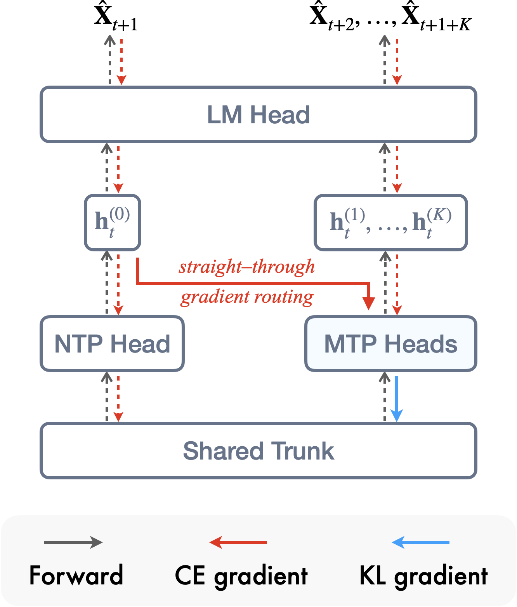
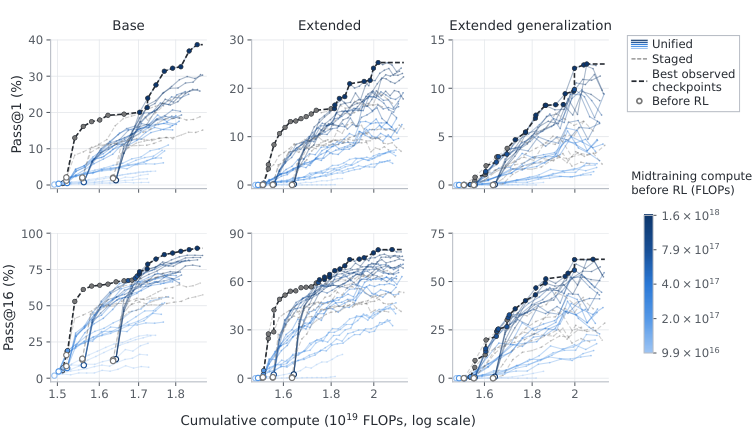
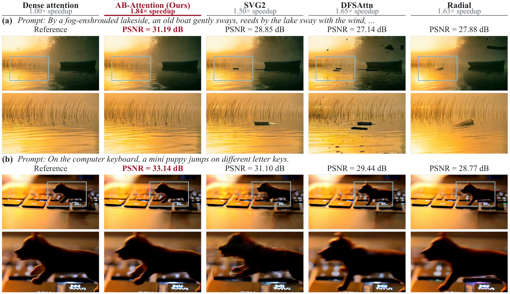
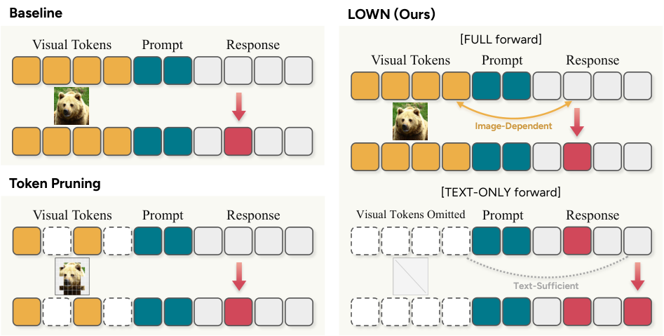
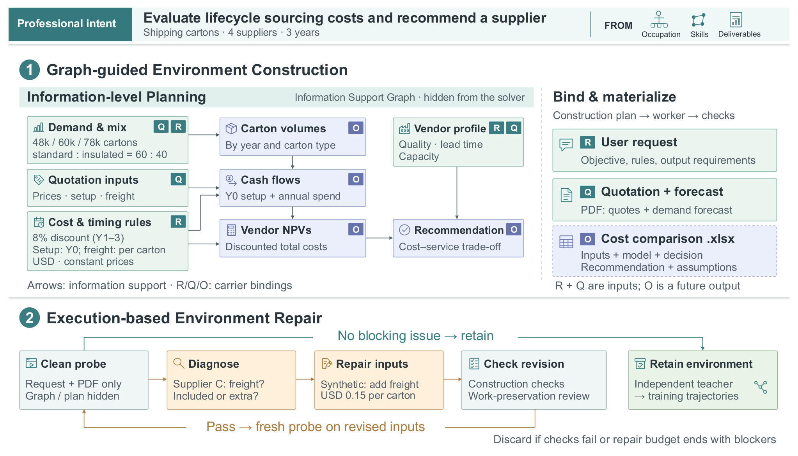
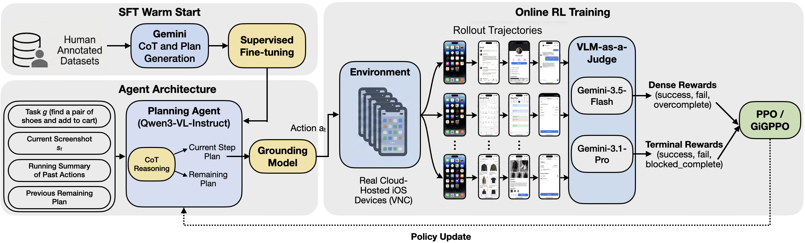
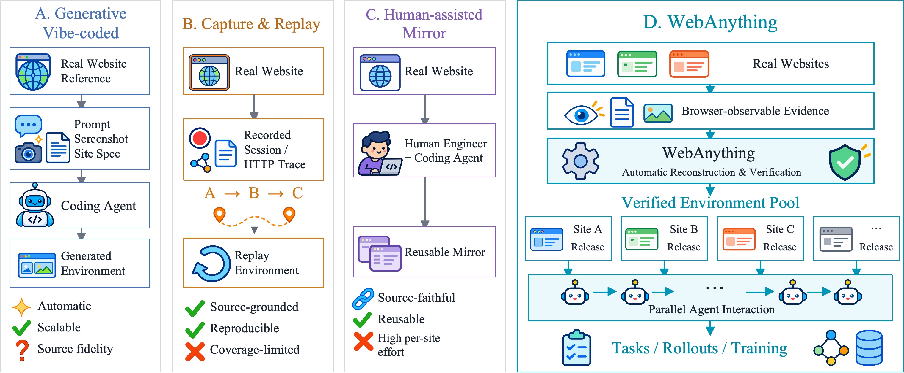

# Daily AI papers — 2026-10-31

*Curated from HF Daily Papers. 15 of ~39 papers kept after relevance filter.*

## Papers at a glance

| # | Title | Topics | Org |
| --- | --- | --- | --- |
| 1 | [Multi-Token Prediction Done Right](#1-multi-token-prediction-done-right) | `pretraining`, `MTP`, `speculative-decoding` | MIT |
| 2 | [Your LR Schedule May Not Be Principled: Effective Learning Rate Scheduling in Weight-Normalized Training](#2-air-lr-schedule) | `pretraining`, `lr-schedule`, `MoE` | ByteDance Seed |
| 3 | [Training Foundation Models with a Single Algorithm](#3-unified-training) | `pretraining`, `post-training`, `RL`, `SFT` | CMU / JHU / Aurora |
| 4 | [Weaken to Strengthen: Weakening-Induced On-Policy Self-Distillation for Large Reasoning Models](#4-wisd) | `reasoning`, `RL`, `distillation`, `quantization` | MIT / NVIDIA |
| 5 | [AB-Attention: Accurate Block Attention for Accelerating Video Diffusion Transformers](#5-ab-attention) | `architectures`, `diffusion`, `efficient-inference` | CUHK-SZ / NUS / HKUST / … |
| 6 | [Look Only When Needed: Certificate-Guided Visual Routing for Efficient Diffusion VLMs](#6-lown) | `multimodal`, `diffusion`, `efficient-inference` | KAIST AI |
| 7 | [Read, Allocate, Route: Role-Coupled Tokenization for Pixel-Space Generative Transformers](#7-specslot) | `diffusion`, `architectures`, `multimodal` | (unspecified) |
| 8 | [A Broader Look into MLLM's Retrieval Heads](#8-mllm-retrieval-heads) | `interp`, `multimodal`, `long-context` | CAS / Tencent |
| 9 | [Proving and Improving the Platonic Representation Hypothesis with JEPAs](#9-platonic-jepa) | `interp`, `representation`, `multimodal` | (unspecified) |
| 10 | [A-RSI: Adaptive Task Refresh for Zero-Data Multimodal Self-Improvement](#10-a-rsi) | `multimodal`, `self-improvement`, `RL` | iie-CAS / CMU / Trento |
| 11 | [WorkFactory: Turning Professional Intents into Executable Work for Scalable Agent Training](#11-workfactory) | `agents`, `data`, `SFT` | RUC / IQuest |
| 12 | [Online Dense Reinforcement Learning with Planning-Grounding Agent for UI Navigation on Live iOS Apps](#12-gigppo) | `agents`, `RL`, `multimodal` | Apple |
| 13 | [WebAnything: From the Wild Web to Scalable Agent Environments](#13-webanything) | `agents`, `data`, `eval` | NTU / Qiji Zhifeng |
| 14 | [Matched Capabilities, Different Behaviors: A Controlled Study of MCP and CLI Interfaces for Language Agents](#14-mica-dart) | `agents`, `eval`, `MCP` | (unspecified) |
| 15 | [Broken on Arrival: Non-Functional Quantized LLM Artifacts in Public Model Registries and How to Catch Them](#15-broken-on-arrival) | `quantization`, `eval` | (unspecified) |

---

## 1. Multi-Token Prediction Done Right

**Authors:** Jayden T. (corresp.) et al. — *MIT*
**Links:** [arXiv:2610.38331](https://arxiv.org/abs/2610.38331) · [HF](https://huggingface.co/papers/2610.38331) · [AlphaXiv](https://www.alphaxiv.org/abs/2610.38331)
**Topics:** `pretraining`, `MTP`, `speculative-decoding`

### TL;DR

The paper dissects the gradient of the standard Multi-Token Prediction (MTP) objective and identifies a residual *drift* term that pulls the next-token head and the multi-token heads in conflicting directions. Replacing MTP with a *soft* variant that keeps only the KL self-distillation signal (Soft-MTP) is a one-line change — no new parameters, no measurable overhead — and improves perplexity, speculative-decoding acceptance, zero-shot accuracy, and math/code fine-tuning across 167M → 1.2B parameters.

### Key idea

Standard MTP, as used in DeepSeek-V3, trains each auxiliary head to predict a token *k* steps ahead with its own cross-entropy loss. The authors show the gradient of that loss decomposes into (a) a KL self-distillation signal that aligns the head with the next-token distribution and (b) a residual that *interferes* with next-token learning. **Soft-MTP** keeps (a) and drops (b): train the *k*-step head against the softmax output of the main head rather than against hard labels. The result is a KL-only auxiliary that only ever strengthens the primary objective.

### Main finding

Across model sizes from 167M to 1.2B, Soft-MTP consistently beats both vanilla next-token training and the DeepSeek-style MTP baseline on validation perplexity, HumanEval/MATH fine-tuning, zero-shot MMLU-style evaluations, and the acceptance rate of self-speculative decoding using the MTP head as its own draft. All at zero added parameters.

### Why it matters

MTP is now standard in frontier pretraining (DeepSeek-V3, OLMoE drafts, …) because it both lifts quality and gives you a built-in draft for speculative decoding. The result here says the *way* everyone writes the MTP loss has a correctable flaw — switching the loss is cheap and strictly better. This probably updates default recipes.

### Knowledge graph integration

**Builds on / relates to existing pages:**
- [../pre-training/mtp.md](../pre-training/mtp.md) — direct refinement of the depth-1 MTP objective used in DeepSeek-V3.
- [../case-studies/deepseek-v3.md](../case-studies/deepseek-v3.md) — DeepSeek-V3 is MTP's biggest production user; this is the direct successor loss.
- [../post-training/_rl.md](../post-training/_rl.md) — KL self-distillation ties the loss to the same reference-anchoring mechanism used by DPO/PPO.

**Suggested new pages:**
- `pre-training/soft-mtp.md` *(depth)* — the KL-only MTP loss, its gradient derivation, and the acceptance-rate improvement at speculative-decoding time.

---

## 2. Your LR Schedule May Not Be Principled: Effective Learning Rate Scheduling in Weight-Normalized Training {#2-air-lr-schedule}

**Authors:** Qifan Yu, Xinyu Ma, Xingyan Bin, Di He — *ByteDance Seed*
**Links:** [arXiv:2610.40362](https://arxiv.org/abs/2610.40362) · [HF](https://huggingface.co/papers/2610.40362) · [AlphaXiv](https://www.alphaxiv.org/abs/2610.40362)
**Topics:** `pretraining`, `lr-schedule`, `MoE`

### TL;DR

Under weight normalization (QK-norm, RMSNorm placements, etc.), the *effective* learning rate felt by the parameters is not the LR you set — it depends on the current norm. The authors show that most of the quality gain usually attributed to normalization actually comes from the shape of this effective-LR trajectory, and propose **AIR** (Affine Inverse-square-Root), a 1/√t decay affinely stretched to hit chosen peak and terminal values over a fixed token budget. On 128B-token MoE pretraining, AIR beats cosine on loss, downstream, and hyperparameter robustness.

### Key idea

Define the *effective learning rate* (ELR) as the LR as seen by the normalized weight direction, i.e. the LR divided by the current weight norm. In weight-normalized training the ELR trajectory under cosine is *not* a cosine — it drifts, often sub-optimally. AIR hand-shapes the ELR directly: an inverse-square-root base curve (classical, principled for stochastic approximation) is affinely transformed with two parameters so that at step 1 the ELR equals a chosen peak and at step T it equals a chosen terminal, over a finite horizon. The affine step is what makes an infinite-horizon schedule usable for a bounded pretraining run.

### Main finding

On a 128B-token Mixture-of-Experts pretraining run, AIR lowers terminal training loss by about 0.01 nats vs. cosine at matched *cumulative* learning rate, improves downstream task scores, and is less sensitive to peak-LR choice. The authors argue the gains at frontier scale extrapolate because ELR drift grows with run length.

### Why it matters

The LR schedule and the normalization choice interact in a way most recipes paper over by just tuning cosine's peak. AIR separates the two concerns: pick normalization for what it does to the optimization geometry, then shape the ELR directly. Clean baseline for anyone comparing WSD / cosine / two-stage schedules in weight-normalized setups.

### Knowledge graph integration

**Builds on / relates to existing pages:**
- [../pre-training/_lr-schedules.md](../pre-training/_lr-schedules.md) — adds a principled fourth option alongside cosine / two-stage cosine / WSD.
- [../pre-training/wsd-schedule.md](../pre-training/wsd-schedule.md) — AIR is the inverse-sqrt analogue of WSD's "stable then decay" idea, with a smooth curve instead of two phases.
- [../pre-training/_training-stability.md](../pre-training/_training-stability.md) — ELR analysis connects schedule choice to normalization-induced stability.
- [../architectures/qk-norm.md](../architectures/qk-norm.md) — one of the normalizations whose ELR behavior AIR explicitly models.

**Suggested new pages:**
- `pre-training/air-schedule.md` *(depth)* — Affine Inverse-square-Root decay: the ELR argument, the two-parameter affine fit, and the 128B-token MoE comparison.

---

## 3. Training Foundation Models with a Single Algorithm {#3-unified-training}

**Authors:** Yuda Song, Alvin Zhang, Fahim Tajwar, Daman Arora, Jeff Schneider, Daniel Khashabi, Ruslan Salakhutdinov, J. Andrew Bagnell, Aarti Singh, Andrea Zanette — *CMU / JHU / Aurora Innovation*
**Links:** [arXiv:2610.40564](https://arxiv.org/abs/2610.40564) · [HF](https://huggingface.co/papers/2610.40564) · [AlphaXiv](https://www.alphaxiv.org/abs/2610.40564)
**Topics:** `pretraining`, `post-training`, `RL`, `SFT`

### TL;DR

A reframing of the full foundation-model pipeline — pretraining, midtraining, SFT, and RL — as *one* maximum-likelihood problem over different data sources (static corpora + RL-generated rollouts). The authors call it **Unified Training**: a single likelihood-based trainer mixes all stages, which gives better accuracy–compute tradeoffs, broader task coverage, less catastrophic forgetting, and a stronger starting point for continual learning compared with sequential stage-wise training.

### Key idea

Treat SFT as maximum likelihood on human data, RL as maximum likelihood on model-generated data weighted by reward (reward-weighted regression), and pretraining as maximum likelihood on web data. All three become maximum likelihood with different sampling distributions. Mix them in one trainer rather than running three sequential passes; schedule the mixing weights over time to recover any of the classical pipelines as special cases. The result: a continual-learning-friendly, single-algorithm recipe.

### Main finding

At matched compute, unified training beats the standard pretrain → SFT → RL pipeline on accuracy, retains more general capabilities after task specialization, and provides a better initialization for *later* continual-learning tasks. The paper argues these gains stem from avoiding the forgetting that each pipeline stage inflicts on the previous one.

### Why it matters

The pretrain/SFT/RL split is operationally convenient but theoretically arbitrary — this paper makes the theoretical case that it's a special case of one algorithm, and shows the general case does better. If this holds up it changes how frontier recipes are structured: fewer discrete stage transitions, more flexibility to interleave new data as it arrives.

### Knowledge graph integration

**Builds on / relates to existing pages:**
- [../post-training/_post-training.md](../post-training/_post-training.md) — unifies the SFT→RL progression this taxonomy describes.
- [../post-training/_rl.md](../post-training/_rl.md) — reward-weighted regression is the policy-gradient reduction they lean on.
- [../pre-training/mid-training.md](../pre-training/mid-training.md) — midtraining becomes a mixing-weight schedule rather than a distinct stage.
- [../post-training/rejection-sampling.md](../post-training/rejection-sampling.md) — rejection-sampling SFT is a limiting case of the unified objective.

**Suggested new pages:**
- `post-training/unified-training.md` *(depth)* — the single-likelihood formulation, data-source mixing weights, and the continual-learning claims.

---

## 4. Weaken to Strengthen: Weakening-Induced On-Policy Self-Distillation for Large Reasoning Models {#4-wisd}

**Authors:** (first author redacted on page), Han Cai, Song Han — *MIT · NVIDIA*
**Links:** [arXiv:2610.38681](https://arxiv.org/abs/2610.38681) · [HF](https://huggingface.co/papers/2610.38681) · [AlphaXiv](https://www.alphaxiv.org/abs/2610.38681)
**Topics:** `reasoning`, `RL`, `distillation`, `quantization`

### TL;DR

**WISD** (Weakening-Induced Self-Distillation) builds a *weaker* copy of a reasoning model — via low-bit quantization or magnitude pruning — and then trains the original model to pull *away* from the weakened one on its own on-policy rollouts. No teacher model, no privileged labels: the signal is the log-prob gap between the original and its deliberately degraded sibling. The authors report +4.0 avg accuracy under quantized-weakening and +5.5 under pruning-weakening, across math and coding benchmarks.

### Key idea

Classic self-distillation trains the student against a (frozen, stronger) teacher. WISD inverts the setup: construct a *weaker* copy $\pi_{\text{weak}}$ by quantizing or pruning the current model, then train the current model to maximize the log-probability gap $\log \pi_\theta - \log \pi_{\text{weak}}$ on tokens it actually generated. The gap is a per-token signal of "what did I learn beyond the degraded version of myself." Because the weak model is just the current model minus some capacity, the signal shifts naturally as training proceeds — on-policy, teacher-free, label-free.

### Main finding

On DeepSeek-R1-style and Qwen-style reasoning base models, WISD gives averaged +4.0 points on math+code benchmarks when weakening is quantization and +5.5 when weakening is magnitude pruning, with larger pointwise gains on specific model–benchmark pairs. Works without a stronger teacher, which closes a classic distillation gap for frontier-size models that have no teacher to learn from.

### Why it matters

For frontier reasoning models there isn't a better teacher — classical distillation is unavailable. WISD gives a self-contained alternative that uses the model's own degradation profile as the training signal. It also doubles as a mechanistic argument that quantization/pruning gaps encode something recoverable about what the model actually relies on.

### Knowledge graph integration

**Builds on / relates to existing pages:**
- [../post-training/_rl.md](../post-training/_rl.md) — WISD is a policy-gradient variant with the KL-to-weakened-self as reward signal.
- [../post-training/reasoning/long-cot-rl.md](../post-training/reasoning/long-cot-rl.md) — targets the same long-CoT reasoning capability band.
- [../post-training/grpo.md](../post-training/grpo.md) — the GRPO objective is the natural host for the weakened-self advantage.
- [../quantization/fp8.md](../quantization/fp8.md) — low-bit quantization is one of the two "weakenings" the paper uses.
- [../case-studies/deepseek-r1.md](../case-studies/deepseek-r1.md) — one of the base models evaluated.

**Suggested new pages:**
- `post-training/reasoning/wisd.md` *(depth)* — WISD: the weakened-self construction (quantization and pruning), the on-policy KL objective, and the +4/+5.5 result.

---

## 5. AB-Attention: Accurate Block Attention for Accelerating Video Diffusion Transformers {#5-ab-attention}

**Authors:** Bin Xu, Mo Zhang, Zhengfeiyang Zhang, Xinfeng Yang, Yixing Ma, Wei Wang, HeXin Wang, Pengfei Zhou, Wangbo Zhao — *CUHK-Shenzhen · NUS · HKUST · Berkeley · Tokyo · Fudan · Shandong · InfRec*
**Links:** [arXiv:2610.39663](https://arxiv.org/abs/2610.39663) · [HF](https://huggingface.co/papers/2610.39663) · [AlphaXiv](https://www.alphaxiv.org/abs/2610.39663)
**Topics:** `architectures`, `diffusion`, `efficient-inference`

### TL;DR

A training-free sparse-attention method for video diffusion transformers (Wan2.1, HunyuanVideo). Three parts: a cheap per-query-block selector that scores many small key/value blocks, an importance-weighted sampler that *estimates* dense attention from the chosen blocks rather than truncating, and a tensor-core-aware kernel that packs the sampled blocks into full tiles so finer selection costs no extra compute. 89–92% of attention ops skipped, up to 2.23× end-to-end speedup, and PSNR *improved* by up to 4.4 dB over the strongest prior sparse-attention baseline.

### Key idea

Prior video-DiT sparse-attention schemes either (a) threshold at a coarse block granularity, which wastes attention on near-zero tiles, or (b) threshold at fine granularity, which breaks tensor-core kernels. AB-Attention clusters queries inside each block to cheaply score many *small* KV blocks, then does importance sampling: picked blocks are reweighted by inverse selection probability so the attention sum is an unbiased estimator of dense attention. A fused kernel then packs small sampled blocks into tensor-core-friendly tiles — fine selection becomes free.

### Main finding

On Wan2.1 and HunyuanVideo, AB-Attention attains 89–92% attention sparsity with a 2.23× wall-clock speedup and up to +4.4 dB PSNR vs. the strongest sparse baseline. Training-free: drop-in at inference.

### Why it matters

Video diffusion is bottlenecked by 3D attention; most sparse-attention tricks pay for compute savings in quality. AB-Attention argues you can get both by framing block selection as *estimation* rather than *truncation*, and by designing the sparsity pattern around tensor-core shapes rather than against them. Likely to port directly to video DiTs and to long-context text diffusion.

### Knowledge graph integration

**Builds on / relates to existing pages:**
- [../fundamentals/attention.md](../fundamentals/attention.md) — AB-Attention is a block-level attention approximation.
- [../architectures/multi-head-attention.md](../architectures/multi-head-attention.md) — plugs into the standard MHA path.
- [../inference/README.md](../inference/README.md) — training-free inference-time acceleration, in the sparse-attention family.

**Suggested new pages:**
- `architectures/ab-attention.md` *(depth)* — importance-sampled block attention: query clustering, inverse-probability reweighting, and tensor-core-tile packing.

---

## 6. Look Only When Needed: Certificate-Guided Visual Routing for Efficient Diffusion VLMs {#6-lown}

**Authors:** Donghyeon Cho, Joowon Kim, Seungho Shin, Eunho Yang — *KAIST AI*
**Links:** [arXiv:2610.36671](https://arxiv.org/abs/2610.36671) · [HF](https://huggingface.co/papers/2610.36671) · [AlphaXiv](https://www.alphaxiv.org/abs/2610.36671)
**Topics:** `multimodal`, `diffusion`, `efficient-inference`

### TL;DR

Diffusion VLMs (LLaDA-V and friends) re-encode the full image at every denoising step even though removing the image changes an unmasked token at only ~22.8% of steps. **LOWN** is a training-free decoder that first predicts masked tokens *without* the image; it only re-runs the image-conditioned pass when the text-only prediction disagrees with the previous image-conditioned one. On ten benchmarks LOWN keeps 99.6% of LLaDA-V's score at **35.3%** of the decoding FLOPs.

### Key idea

Treat the image as an on-demand side-channel instead of an always-on prefix. At each denoising step, run two forward passes conceptually: cheap (text-only) and expensive (image-conditioned). If the cheap pass's prediction matches the last expensive one, trust it and reuse the previous image-conditioned logits — unmask as many tokens as agree. Only when they disagree do you pay for the expensive pass. The number of agreeing tokens dynamically determines how many positions are unmasked per step.

### Main finding

LOWN preserves 99.6% of LLaDA-V's benchmark average across 10 benchmarks while cutting decoding FLOPs to 35.3% of baseline. Generalizes across LLaDA-family DVLMs, composes with visual-token pruning, and still works under KV-caching.

### Why it matters

Diffusion VLMs are expensive because 89–97% of their tokens are visual. The paper's observation — that most denoising steps don't *need* the image once the model is confident — points to an adaptive, per-step compute budget as the right axis for VLM efficiency. The disagreement-triggered "certificate" is simple enough to drop into existing pipelines.

### Knowledge graph integration

**Builds on / relates to existing pages:**
- [../multimodal/README.md](../multimodal/README.md) — diffusion VLM is the primary target.
- [../inference/README.md](../inference/README.md) — adaptive compute at decode time belongs in the inference-efficiency bucket.

**Suggested new pages:**
- `multimodal/lown.md` *(depth)* — certificate-guided visual routing for diffusion VLMs: the two-pass test, the per-step unmask schedule, and the FLOP curve.

---

## 7. Read, Allocate, Route: Role-Coupled Tokenization for Pixel-Space Generative Transformers {#7-specslot}

**Authors:** (not shown on HF page) — *(unspecified)*
**Links:** [arXiv:2610.40647](https://arxiv.org/abs/2610.40647) · [HF](https://huggingface.co/papers/2610.40647) · [AlphaXiv](https://www.alphaxiv.org/abs/2610.40647)
**Topics:** `diffusion`, `architectures`, `multimodal`

### TL;DR

In pixel-space generative transformers (JiT and variants) the patch grid controls *everything* a token does — what it reads, what it writes, and how far it communicates — so modeling finer detail blows up global attention. **SpecSlot** decouples these roles via a three-stage pipeline: **Read** evidence at a sparse anchor grid, **Allocate** each anchor into K slots that own disjoint radial-DCT frequency bands, **Route** only the lowest-frequency slot through global attention while all slots mix locally. At ImageNet-512, SpecSlot-K4 improves FID by 2.84 over a FLOPs-matched JiT and extends to text-to-image.

### Key idea

Separate anchor density (how many spatial locations the model attends over) from spectral subdivision (how much frequency detail each anchor represents). Anchors are the only objects in the global attention sequence; slots live under each anchor and own frequency bands via a radial DCT basis. A pixel-level spatial head reads from slot states to reconstruct detail. Resolution and detail scale by changing K (slots per anchor), while the global sequence length stays short.

### Main finding

On ImageNet-256 and -512 the operating points sit between JiT's low- and high-cost settings; at 512 resolution SpecSlot-K4 beats a FLOPs-matched JiT by 2.84 FID. Transfers to text-to-image, scoring higher than JiT-B/8 on DPG-Bench at 40.6% lower forward cost.

### Why it matters

The patch-grid-as-everything design is the main cost scaling bottleneck for high-resolution pixel-space generation. Role-coupled tokenization is a clean architectural move that disentangles "where to attend" from "what detail to represent." Portable to video and multimodal generation stacks.

### Knowledge graph integration

**Builds on / relates to existing pages:**
- [../architectures/transformer-block.md](../architectures/transformer-block.md) — modifies the transformer block's token roles.
- [../fundamentals/attention.md](../fundamentals/attention.md) — the global/local attention split is the mechanism.
- [../multimodal/README.md](../multimodal/README.md) — relevant for the pixel-space branch of generative multimodal.

**Suggested new pages:**
- `architectures/role-coupled-tokenization.md` *(depth)* — the Read/Allocate/Route decomposition, radial-DCT slot bands, and the FID / DPG numbers.

---

## 8. A Broader Look into MLLM's Retrieval Heads {#8-mllm-retrieval-heads}

**Authors:** Yuqing Li, Jiangnan Li, Zheng Lin, Mo Yu, (one author appears missing from the rendered byline) — *Institute of Information Engineering, CAS · Tencent · UCAS*
**Links:** [arXiv:2610.32411](https://arxiv.org/abs/2610.32411) · [HF](https://huggingface.co/papers/2610.32411) · [AlphaXiv](https://www.alphaxiv.org/abs/2610.32411)
**Topics:** `interp`, `multimodal`, `long-context`

### TL;DR

The paper extends the retrieval-heads line of work to omni-modal LLMs. Using paired audio-visual probes where the same answer appears either spoken or on-screen, it shows that retrieval heads stay sparse (<2% of heads) and are largely *shared* across modalities. Ablating them nearly erases audio-visual retrieval; a shared subset also damages document understanding, spatial perception, and visual math. Training these heads with a ranking loss raises Qwen3-VL-8B's page Recall@1 on MMDocIR by +6.03 points.

### Key idea

Retrieval heads — the small set of attention heads that "needle in a haystack" at long context — were previously identified in text-only LLMs. The authors build an audio-visual probe (same answer, two modalities) and identify retrieval heads in omni-modal models by causal ablation. The finding is twofold: the retrieval behavior is attributable to a tiny, cross-modal subset of heads, and these heads are inherited from the text or VLM backbone when a model is extended to new modalities. They then specialize this subset with a ranking-contrastive objective.

### Main finding

Across 18 omni-modal checkpoints, retrieval heads are <2% of heads and largely cross-modal. Zeroing them collapses audio-visual retrieval; the shared subset also degrades document QA, spatial perception, visual math. Training only the retrieval heads with a page-ranking loss gives +6.03 Recall@1 on MMDocIR for Qwen3-VL-8B, plus document-retrieval gains across three model families.

### Why it matters

Clean mechanistic result for omni-modal models: capability transfer across modalities routes through the *same* heads. That makes retrieval heads both a diagnostic (what the model inherited) and a cheap intervention point (train 2% of heads to lift retrieval across the stack). Updates the retrieval-heads literature for the multimodal era.

### Knowledge graph integration

**Builds on / relates to existing pages:**
- [../interpretability/README.md](../interpretability/README.md) — mechanistic interpretability of attention heads is the method.
- [../multimodal/README.md](../multimodal/README.md) — the target systems are omni-modal MLLMs.
- [../fundamentals/attention.md](../fundamentals/attention.md) — the retrieval behavior is attributed to specific heads.

**Suggested new pages:**
- `interpretability/retrieval-heads.md` *(depth)* — retrieval heads in omni-modal LLMs: identification via causal ablation, cross-modal sharing, and ranking-loss specialization.

---

## 9. Proving and Improving the Platonic Representation Hypothesis with JEPAs {#9-platonic-jepa}

**Authors:** (not shown on HF page) — *(unspecified)*
**Links:** [arXiv:2610.39302](https://arxiv.org/abs/2610.39302) · [HF](https://huggingface.co/papers/2610.39302) · [AlphaXiv](https://www.alphaxiv.org/abs/2610.39302)
**Topics:** `interp`, `representation`, `multimodal`

### TL;DR

A proof that Joint-Embedding Predictive Architectures (JEPAs) learn the spectral embedding of their positive pairs, hence that two JEPAs trained on different modalities but on the *same world* must learn aligned representations up to a rotation — the **Platonic Representation Theorem**. The paper distinguishes **good views** (two observations of the same scene) from **bad views** (corruptions of one observation) and argues next-token prediction is a bad-view JEPA. A 109M-parameter *good-view* text JEPA outperforms LMs up to 72B on the paper's alignment benchmark; a captioner built from frozen vision encoders plus a single learned rotation produces captions.

### Key idea

JEPAs minimize prediction error between encoded views; the paper shows this is equivalent to spectral embedding on the positive-pair graph. If the positive-pair graphs for two modalities both describe the same underlying world states, their spectral embeddings coincide up to orthogonal transformation. The practical consequence: train on *good views* (different observations of one scene) and the model learns a modality-neutral geometry; train on *bad views* (reconstructive / corruptive positives) and the embedding wastes dimensions on nuisance. Next-token prediction, in this frame, is a bad-view JEPA.

### Main finding

Good-view text JEPAs align better with frozen vision encoders than bad-view JEPAs or next-token LMs, and alignment has a measurable scaling law. A 109M-parameter good-view text JEPA out-aligns LMs up to 72B. Stitching a frozen vision encoder to a frozen good-view text JEPA via a single orthogonal rotation produces fluent captioning without additional training.

### Why it matters

The Platonic Representation Hypothesis — that scaled-up models of different modalities converge to a shared geometry — has been intuitive but informal. This paper gives it a theorem and shows the sufficient condition (good-view positive pairs) is actionable: by *picking* training positives you decide whether the representation lands on the Platonic manifold or on a modality-specific detour. Updates priors about why next-token prediction is weirdly expensive to align across modalities.

### Knowledge graph integration

**Builds on / relates to existing pages:**
- [../interpretability/README.md](../interpretability/README.md) — representation-geometry analysis is interpretability.
- [../multimodal/README.md](../multimodal/README.md) — the cross-modal alignment story.
- [../fundamentals/attention.md](../fundamentals/attention.md) — contrast with next-token prediction's representation geometry.

**Suggested new pages:**
- `interpretability/platonic-representation.md` *(depth)* — the Platonic Representation Theorem: JEPA-as-spectral-embedding, good-view vs. bad-view positives, and the frozen-rotation captioner.

---

## 10. A-RSI: Adaptive Task Refresh for Zero-Data Multimodal Self-Improvement {#10-a-rsi}

**Authors:** Youxing Li\*, Yuedong Tan\*, Yu Liu\*, Zhiwei Yang, Zihan Su, Hanqi Feng, Shaojie Zhang, Libin Liao, Zihao Wan, Chenxu Wu, Cong Cao, Fangfang Yuan, Yanbing Liu, Ziheng Chen, Pei Fu, Radu Timofte, Zongwei Wu, Nicu Sebe, Barnabas Poczos, Jian Luan — *IIE-CAS · CUHK · Würzburg · CMU · MPI-IS · Trento · XJTU*
**Links:** [arXiv:2610.38568](https://arxiv.org/abs/2610.38568) · [HF](https://huggingface.co/papers/2610.38568) · [AlphaXiv](https://www.alphaxiv.org/abs/2610.38568)
**Topics:** `multimodal`, `self-improvement`, `RL`

### TL;DR

**A-RSI** monitors training logs during multimodal self-improvement RL and swaps out the training-task pool when the pool stops providing useful gradient signal — no validation set, no human labels. New tasks come from a fixed library of model-written programs that generate images, questions, and reference answers *together*, so training is strictly zero-data (no external labeled examples). Qwen-VL baseline climbs 57.77 → 61.05 average across 11 benchmarks with 800 fresh tasks.

### Key idea

Self-improvement RL plateaus when the current task pool has become too easy (reward saturates) or too noisy (reward variance explodes). A-RSI detects both from training-time signals (reward curves and advantage statistics) and triggers a refresh: discard the saturated task pool, keep model weights, and sample a new pool from a fixed library of parametric task generators. Each generator is an executable program that produces (image, question, reference answer) tuples, so no labeled dataset is needed. The refresh schedule is online and label-free.

### Main finding

With 800 refresh tasks drawn from the generator library, A-RSI pushes a Qwen-VL baseline from 57.77 to 61.05 average over an 11-benchmark multimodal suite, keeping model weights across refreshes. Ablations credit most of the gain to the refresh *trigger* rather than to raw volume; a separate analysis attributes a fraction of the gain to the model learning to finish answers within the output budget.

### Why it matters

Multimodal RL is bottlenecked by task supply (labeled multimodal data is expensive and gets gamed). A-RSI shows an executable-generator + saturation-triggered refresh loop is enough to keep improvement going, without any external supervision. Compatible with existing self-improvement recipes; cheap to adopt.

### Knowledge graph integration

**Builds on / relates to existing pages:**
- [../post-training/_rl.md](../post-training/_rl.md) — the training loop is on-policy RL with scalar rewards.
- [../post-training/rl-prompt-curation.md](../post-training/rl-prompt-curation.md) — closely related: curating prompts for RL. A-RSI is an adaptive-schedule version.
- [../multimodal/README.md](../multimodal/README.md) — target: multimodal self-improvement.
- [../data/quality-filtering.md](../data/quality-filtering.md) — the saturation trigger is a quality signal over training-time logs.

**Suggested new pages:**
- `multimodal/a-rsi.md` *(depth)* — adaptive task refresh for zero-data multimodal self-improvement: the saturation trigger, the task-generator library, and the 11-benchmark lift.

---

## 11. WorkFactory: Turning Professional Intents into Executable Work for Scalable Agent Training {#11-workfactory}

**Authors:** Tingyang Chen, Jia Deng, Qiyao Wang, Shuo Tang, Yike Yang, Tao Ren, Wayne Xin Zhao, Feng Chang, Jujie He, Chuan Hao, Ran Tao, Bryan Dai — *Zhejiang U. · Renmin U. of China · SIAT · SJTU · Peking U. · IQuest*
**Links:** [arXiv:2610.37161](https://arxiv.org/abs/2610.37161) · [HF](https://huggingface.co/papers/2610.37161) · [AlphaXiv](https://www.alphaxiv.org/abs/2610.37161)
**Topics:** `agents`, `data`, `SFT`

### TL;DR

**WorkFactory** generates realistic professional tasks for agent training. From a described work goal, it plans *backward*: which facts, rules, and intermediate results are needed, and where should each appear in the environment, while leaving the actual calculation to the agent at execution time. A test-run step catches un-completable or contradictory environments and repairs them without altering the intent. 112,686 tasks across 612 occupations; the WorkPilot models fine-tuned on this corpus beat their Qwen bases on four professional-work benchmarks.

### Key idea

Professional tasks are hard to synthesize because they require consistent sub-environments: the agent needs the right documents, databases, and tools in the right states. WorkFactory decouples *task intent* from *environment construction*. Given an intent ("prepare a quarterly expense report under policy X"), the planner enumerates required artifacts and policies and plants them in a sandboxed environment, with gaps the agent must fill. A verifier agent then attempts the task; any failure feeds back into environment repair, not intent rewriting.

### Main finding

112,686 tasks × 612 occupations; teacher-agent solutions are used to SFT Qwen bases at three sizes, producing the WorkPilot family. All three outperform their bases on four professional benchmarks; the largest reported lift is WorkPilot-35B-A3B on GDPval-AA. Ablations show the planning + repair steps materially reduce defective environments and lift downstream scores.

### Why it matters

Realistic agent training data is the current bottleneck for enterprise agents. WorkFactory's planner-first, test-run-and-repair approach gives a scalable template for synthetic agent corpora — comparable in flavor to WebAnything (same digest, #13) but for office/professional work rather than the web. Combined, these two lines of work suggest a near-term pipeline where most "agent training data" is procedurally generated.

### Knowledge graph integration

**Builds on / relates to existing pages:**
- [../agents/README.md](../agents/README.md) — agent training-data pipeline.
- [../post-training/rejection-sampling.md](../post-training/rejection-sampling.md) — teacher-agent solutions used for SFT follow a rejection-sampling-style curation.
- [../data/_data-curation.md](../data/_data-curation.md) — synthetic-task generation sits in curation.

**Suggested new pages:**
- `agents/workfactory.md` *(depth)* — backward-planning synthetic professional tasks: environment planner, test-run verifier, and the 112k-task corpus.

---

## 12. Online Dense Reinforcement Learning with Planning-Grounding Agent for UI Navigation on Live iOS Apps {#12-gigppo}

**Authors:** Peitong Duan, Khashayar Gatmiry, Jeffrey Nichols, Samy Bengio, Emmanuel Abbe — *Apple*
**Links:** [arXiv:2610.39264](https://arxiv.org/abs/2610.39264) · [HF](https://huggingface.co/papers/2610.39264) · [AlphaXiv](https://www.alphaxiv.org/abs/2610.39264)
**Topics:** `agents`, `RL`, `multimodal`

### TL;DR

Apple splits a UI agent into a *planner* (trained with online RL) and a *grounder* (trained with SFT to map plans to screen coordinates). An LLM judge gives step-by-step progress rewards plus a terminal task-completion reward; the planner is optimized with PPO. The authors introduce **GiGPPO**, which borrows outcomes from *visually similar screens* in parallel rollouts to improve the value estimate. Running hundreds of iOS simulators concurrently, their 8B agents beat SFT, match Gemini-3.1-Pro on UINavBench, and transfer to Android with ~7× the SFT baseline's success rate.

### Key idea

UI navigation agents are usually trained with SFT on human trajectories (memorizes) or with terminal-only RL (sparse). GiGPPO (**G**rounded **i**mitation-free **G**eneralized PPO) does two things. First, split the agent: the planner outputs a textual plan, the grounder (SFT, frozen during RL) turns the plan into pixel coordinates. Only the planner takes RL gradient. Second, dense reward: an LLM judge scores each step for apparent progress, plus a terminal reward on task completion. Third, GiGPPO's value estimate borrows observed outcomes from parallel trajectories at *visually similar* screens — the planner's advantage estimator becomes less noisy without extra rollouts.

### Main finding

With hundreds of concurrent virtual iOS devices, GiGPPO-trained 8B agents beat SFT baselines, match Gemini-3.1-Pro on UINavBench, and transfer to Android with ~7× SFT's success rate. Ablations show both the planner/grounder split and the dense-reward judge are needed; GiGPPO specifically helps when terminal-only reward is too sparse.

### Why it matters

Live-app RL for UI agents has been fragile because the reward is terminal and rollouts are slow. Apple's split-architecture + visually-similar-state value sharing cracks both — this is a plausible template for other GUI-agent work. Also an existence proof that 8B open-weight planners can approach frontier closed models on this task given the right RL loop.

### Knowledge graph integration

**Builds on / relates to existing pages:**
- [../post-training/ppo.md](../post-training/ppo.md) — GiGPPO is a PPO variant with a cross-trajectory value estimator.
- [../post-training/_rl.md](../post-training/_rl.md) — slots in as "dense terminal + process reward" with a group-aware baseline.
- [../post-training/_rewards.md](../post-training/_rewards.md) — the LLM-as-judge dense reward belongs in the rewards taxonomy.
- [../agents/README.md](../agents/README.md) — UI-navigation agent architecture.

**Suggested new pages:**
- `agents/planner-grounder-ui-agent.md` *(depth)* — Apple's split UI agent: planner (RL), grounder (SFT), LLM-judge dense reward, GiGPPO value sharing.

---

## 13. WebAnything: From the Wild Web to Scalable Agent Environments {#13-webanything}

**Authors:** Zikun Cai, Chaoyun Zhang, Pinxue Guo, Bingxuan Li, Rui Zheng, Hang Yan — *Nanyang Technological U. · Shanghai Qiji Zhifeng*
**Links:** [arXiv:2610.37786](https://arxiv.org/abs/2610.37786) · [HF](https://huggingface.co/papers/2610.37786) · [AlphaXiv](https://www.alphaxiv.org/abs/2610.37786)
**Topics:** `agents`, `data`, `eval`

### TL;DR

**WebAnything** turns real website URLs into reusable, executable sandboxed environments for web agents without the per-site rebuilding that WebHarbor and WebArena need. An Explorer–Builder records page structure, resources, and interaction outcomes; an Independent Verifier audits each frozen environment against the captured source, sending discrepancies back for local repair or targeted re-capture. 244 environments across 14 domains, 12,984 accepted tasks; wins 12 of 14 blind-audit comparisons vs. human-assisted WebHarbor mirrors. Fine-tuning Qwen3.5-9B on 5,856 trajectories lifts REAL, Odysseys-Easy, and WebArena-Verified.

### Key idea

Historically, agent-training web environments were either (a) real sites (unstable, legal issues, slow) or (b) hand-rebuilt mirrors (expensive, incomplete). WebAnything automates mirroring: the Explorer–Builder records what the live site does; the Verifier is an independent agent that checks the frozen replica against the recorded evidence and site rules. Discrepancies become either repair patches (local fixes) or re-capture requests (re-crawl specific pages). This closes the loop without a human in the pipeline per site.

### Main finding

244 sites · 14 domains · 12,984 accepted tasks. Blind audits: WebAnything mirrors beat human-assisted WebHarbor mirrors on 3/3 fidelity metrics and win 12/14 head-to-head comparisons (2 ties, 0 losses). Fine-tuning Qwen3.5-9B on 5,856 trajectories from these environments lifts REAL, Odysseys-Easy, and WebArena-Verified scores.

### Why it matters

Web-agent training is bottlenecked by environment supply. If WebAnything's audit-and-repair loop scales, "mine any site" becomes a reasonable training-data source — directly competitive with Anthropic's / OpenAI's internal web-sim stacks. Pairs naturally with GiGPPO-style online RL (#12).

### Knowledge graph integration

**Builds on / relates to existing pages:**
- [../agents/README.md](../agents/README.md) — web agent environments and training.
- [../data/_data-curation.md](../data/_data-curation.md) — the Verifier/repair loop is quality curation over synthetic environments.
- [../evaluation/README.md](../evaluation/README.md) — environment fidelity itself is evaluated here.

**Suggested new pages:**
- `agents/webanything.md` *(depth)* — Explorer–Builder + Independent-Verifier loop for turning live sites into agent sandboxes.

---

## 14. Matched Capabilities, Different Behaviors: A Controlled Study of MCP and CLI Interfaces for Language Agents {#14-mica-dart}

**Authors:** Zhenning Shi, Liang Pang, Yongqi Li — *(unspecified)*
**Links:** [arXiv:2610.34298](https://arxiv.org/abs/2610.34298) · [HF](https://huggingface.co/papers/2610.34298) · [AlphaXiv](https://www.alphaxiv.org/abs/2610.34298)
**Topics:** `agents`, `eval`, `MCP`

### TL;DR

The authors run a controlled study where the *same* tools are exposed to an agent either as MCP calls or as CLI commands, with identical underlying capabilities. Across 6 models × 3 environments, interface format changes action selection, failure patterns, and recovery; **94.3%** of 2,004 paired episodes diverge, with early divergences propagating. They introduce **DART**, which freezes the agent's semantic decisions and repairs interface-specific handling — up to **+9.0** benchmark points and **−27.1k** MCP tokens per task.

### Key idea

Build one *semantic action contract* and render it as both an MCP interface and a CLI, so both agents see the same capabilities with the same semantics but different syntactic frames. Run them side-by-side on identical rollouts. The study shows that interface form is a *first-class* variable in agent behavior — not a thin veneer. DART then exploits this: lock in the semantic decision made under one interface, and let interface-specific repair handle the remaining mistakes. Separate the two kinds of error (semantic vs. surface) and fix each separately.

### Main finding

94.3% of 2,004 paired MCP/CLI episodes diverge, with early-step differences carrying through to task outcomes. DART improves scores by up to +9.0 points across six models × three environments and cuts MCP token spend by up to 27.1k tokens per task, matching or beating MCP-native agents at CLI cost.

### Why it matters

MCP's recent rise assumed interface form was more or less neutral. This paper argues it is a significant intervention point — and gives a concrete repair recipe. For agent developers, "pick the interface" moves from engineering taste to a tunable design axis.

### Knowledge graph integration

**Builds on / relates to existing pages:**
- [../agents/README.md](../agents/README.md) — tool-interface design is central to this folder.
- [../evaluation/README.md](../evaluation/README.md) — the paired-trajectory evaluation design belongs here.

**Suggested new pages:**
- `agents/interface-design-mcp-cli.md` *(depth)* — MICA/DART study: the paired-rollout methodology, 94.3% divergence result, and DART's semantic-decision locking.

---

## 15. Broken on Arrival: Non-Functional Quantized LLM Artifacts in Public Model Registries and How to Catch Them {#15-broken-on-arrival}

**Authors:** (byline missing on page) — *(unspecified)*
**Links:** [arXiv:2609.05881](https://arxiv.org/abs/2609.05881) · [HF](https://huggingface.co/papers/2609.05881) · [AlphaXiv](https://www.alphaxiv.org/abs/2609.05881)
**Topics:** `quantization`, `eval`

### TL;DR

An empirical census of quantized LLM artifacts on Ollama and Hugging Face finds seven *official* Ollama tags that produce non-functional outputs — all low-bit quantizations of small models. Rebuilding five of them from their original weights without an importance matrix reproduces the failure; adding an importance matrix restores function. The paper argues public registries should *functionally screen* low-bit tags before publication, and proposes a lightweight screening test.

### Key idea

Low-bit quantization recipes (sub-4-bit GGUF, extreme GPTQ) can land in states where the generated text is garbled even when the file loads fine. The paper tests all Ollama-official quantizations plus community-popular HF variants, counting "non-functional" when outputs degrade below a token-coherence threshold. The failure mode isn't file corruption — it reproduces from the original weights under the same recipe. The fix is calibration: an importance matrix (iMatrix) restores function. Takeaway: screen before publish, don't ship un-iMatrix sub-4-bit of small models.

### Main finding

Seven Ollama-official quantized tags are non-functional; all are low-bit quantizations of small models. Rebuilding them from scratch with the same recipe reproduces the failure, confirming it's a recipe issue, not a storage issue. Adding an importance matrix restores function for the measured subset.

### Why it matters

Public registries ship these artifacts to end users (edge deployments, local chat). "Low-bit of small model" is exactly the regime most popular with hobbyists and devices — and exactly where silent breakage lives. A trivial functional screen would catch all seven cases pre-publish. The methodology is portable: any registry can run it.

### Knowledge graph integration

**Builds on / relates to existing pages:**
- [../quantization/README.md](../quantization/README.md) — directly about quantization-recipe quality in public artifacts.
- [../quantization/_number-formats.md](../quantization/_number-formats.md) — the failure cases concentrate at specific low-bit formats.
- [../evaluation/README.md](../evaluation/README.md) — functional screening *is* a quantization-evaluation protocol.

**Suggested new pages:**
- `quantization/functional-screening.md` *(depth)* — functional screening for quantized LLM artifacts: the Ollama census, iMatrix calibration rescue, and the proposed pre-publish test.

---

## Notes

- Borderline inclusions: none flagged this cycle; a wide net was cast on efficient-inference papers (AB-Attention, LOWN, SpecSlot) and three were kept because each introduces a distinct mechanism.
- Hero figures live in `assets/2026-10-31/`. Three papers (#2 AIR, #4 WISD, #14 MCP/CLI) have no HTML figure available on arXiv; those sections omit `![Hero figure]`.
- This digest is informational. No existing concept files, `READING-LIST.md`, or `PAPERS.md` were modified to produce it.
