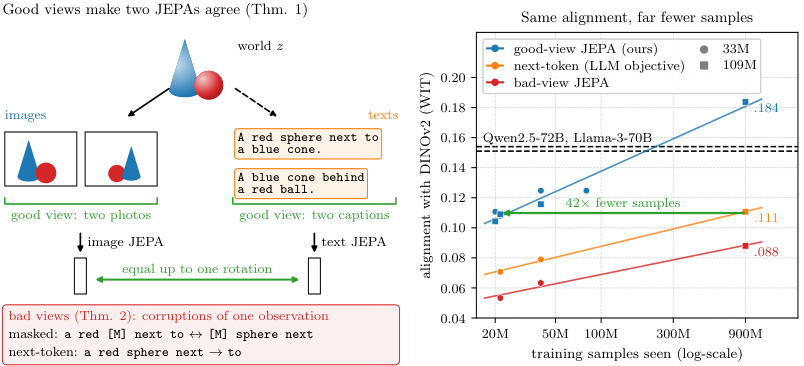
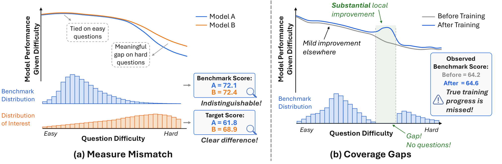
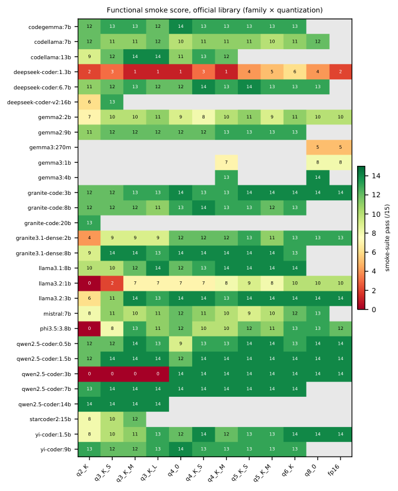
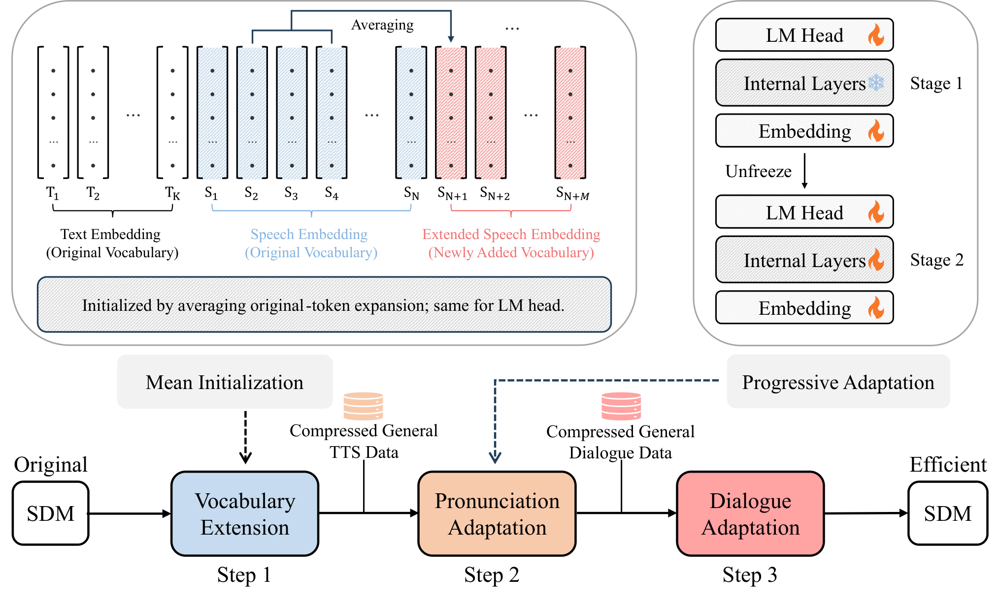
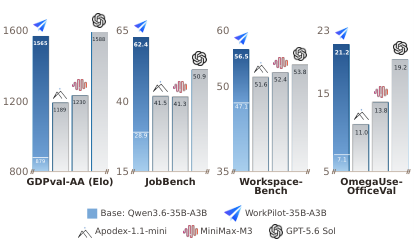

# Daily AI papers — 2026-11-01

*Curated from HF Daily Papers. 15 of 39 papers kept after relevance filter.*

## Papers at a glance

| # | Title | Topics | Org |
| --- | --- | --- | --- |
| 1 | [Multi-Token Prediction Done Right](#1-soft-mtp) | `pre-training`, `MTP`, `architecture` | MIT |
| 2 | [Your LR Schedule May Not Be Principled](#2-air-schedule) | `pre-training`, `LR-schedule`, `MoE` | ByteDance Seed |
| 3 | [Training Foundation Models with a Single Algorithm](#3-unified-training) | `pre-training`, `RL`, `SFT` | CMU / JHU |
| 4 | [Weaken to Strengthen: On-Policy Self-Distillation for Reasoning](#4-wisd) | `reasoning`, `RL`, `distillation`, `quantization` | MIT / NVIDIA |
| 5 | [Look Only When Needed: Certificate-Guided Visual Routing for Diffusion VLMs](#5-lown) | `multimodal`, `diffusion`, `efficient-inference` | KAIST AI |
| 6 | [Proving and Improving the Platonic Representation Hypothesis with JEPAs](#6-jepa-platonic) | `interp`, `representation`, `multimodal` | FAIR / Brown |
| 7 | [A Broader Look into MLLM's Retrieval Heads](#7-mllm-retrieval-heads) | `interp`, `multimodal`, `attention` | CAS / Tencent |
| 8 | [Your Benchmark Is an Empirical Measure Over Difficulty](#8-benchfill) | `eval`, `benchmarks` | UIUC / UCSD / NYU |
| 9 | [Broken on Arrival: Non-Functional Quantized LLM Artifacts](#9-broken-on-arrival) | `quantization`, `eval` | (single author) |
| 10 | [Glance: The Generator Is Its Own Reranker](#10-glance) | `inference`, `retrieval`, `RAG` | Airun Intelligence Labs |
| 11 | [CoSTA: Compressed Speech Token Adaptation for Spoken Dialogue](#11-costa) | `multimodal`, `audio`, `efficient-inference` | CAS |
| 12 | [AB-Attention: Accurate Block Attention for Video Diffusion](#12-ab-attention) | `attention`, `diffusion`, `efficient-inference` | InfRec / CUHK-SZ |
| 13 | [WorkFactory: Turning Professional Intents into Executable Work](#13-workfactory) | `agents`, `data`, `SFT` | ZJU / RUC / IQuest |
| 14 | [A-RSI: Adaptive Task Refresh for Zero-Data Multimodal Self-Improvement](#14-a-rsi) | `multimodal`, `RL`, `self-improvement` | IIE-CAS consortium |
| 15 | [Intrinsic Distribution Matching for One-Step T2I](#15-idm) | `diffusion`, `distillation`, `text-to-image` | Inclusion AI / Westlake / Tsinghua |

---

## 1. Multi-Token Prediction Done Right 

**Authors:** Jayden Teoh et al. — *MIT*
**Links:** [arXiv:2610.38331](https://arxiv.org/abs/2610.38331) · [HF](https://huggingface.co/papers/2610.38331) · [AlphaXiv](https://www.alphaxiv.org/abs/2610.38331)
**Topics:** `pre-training`, `MTP`, `architecture`, `self-distillation`

### TL;DR

Standard Multi-Token Prediction (MTP) heads mix a useful self-distillation signal with a noisy residual that grows with scale and hurts both next-token and multi-token losses. Soft-MTP replaces the raw next-token CE at each MTP head with a KL-to-primary-head objective reconstructed via a straight-through gradient trick, giving a cleaner distillation signal without materializing vocab-sized logits — a one-line code change with no extra parameters.

### Key idea

Decompose the MTP cross-entropy gradient into (a) a KL-divergence term from the primary head's distribution and (b) a residual term that is noisy at scale. Keep only (a). Because materializing the full vocab-sized logits of both heads would be expensive, use a **straight-through / gradient-recovery** routing that rebuilds the KL gradient from the already-computed CE gradients. Zero overhead, no new parameters.

### Main finding

Across 167M–1.2B models, Soft-MTP lowers next-token perplexity, improves zero-shot accuracy, and gives faster self-speculative decoding than vanilla MTP. After fine-tuning, math and code benchmarks improve as well. The authors frame it as a "free lunch" for MTP optimization.

### Why it matters

MTP is now a frontier default (DeepSeek-V3) because of the parallel pretraining signal and the free speculative-decode draft head. The paper's diagnosis — that the real benefit was always the distillation sub-signal, polluted by a residual that only gets worse with scale — reframes MTP as a self-distillation technique and gives a plug-in fix for anyone training with MTP heads.

### Knowledge graph integration

**Builds on / relates to existing pages:**
- [../pre-training/mtp.md](../pre-training/mtp.md) — direct successor; sharpens the MTP objective by isolating the KL distillation component.
- [../case-studies/deepseek-v3.md](../case-studies/deepseek-v3.md) — DeepSeek-V3 uses depth-1 MTP; Soft-MTP targets exactly this setup.
- [../architectures/transformer-block.md](../architectures/transformer-block.md) — MTP modules sit on top of the backbone.

**Suggested new pages:**
- `pre-training/soft-mtp.md` *(depth)* — the gradient-recovery trick as its own technique.

---

## 2. Your LR Schedule May Not Be Principled 

**Authors:** Qifan Yu, Xinyu Ma, Xingyan Bin, Di He — *ByteDance Seed*
**Links:** [arXiv:2610.40362](https://arxiv.org/abs/2610.40362) · [HF](https://huggingface.co/papers/2610.40362) · [AlphaXiv](https://www.alphaxiv.org/abs/2610.40362)
**Topics:** `pre-training`, `LR-schedule`, `MoE`, `weight-norm`

### TL;DR

The "weight-normalized training" gains attributed to removing weight decay are driven by the *effective* learning-rate (ELR) trajectory they induce, not by normalization itself. Match the ELR trajectory of WN with a weight-decayed run and you reproduce the same loss curve. The authors propose AIR, an affine-adjusted inverse-square-root decay that targets ELR directly and beats cosine on 128B-token MoE pretraining.

### Key idea

Treat ELR = (nominal LR) / (weight norm) as the scheduling object. Derive a 1/√t decay (`t` = training step) that corresponds to a principled ELR trajectory for weight-normalized optimizers, then add an affine adjustment so it matches a prescribed peak and terminal LR over a finite horizon. Call the result **AIR** (Affine Inverse-square-Root decay).

### Main finding

On a 128B-token MoE pretraining run, AIR beats cosine, WSD and other candidates on terminal loss, downstream score, and hyperparameter robustness — reducing terminal training loss by ~0.01 at matched cumulative LR. Replaying AIR's ELR trajectory on a weight-decay run recovers the WN benefit, confirming the mechanism is ELR, not normalization.

### Why it matters

LR schedule design has been operating on the nominal LR axis; the paper argues the right axis is ELR, which bakes in the weight-norm dynamics most pretraining runs already have. If this holds up, cosine-style schedules will likely be replaced in the MoE and WN-training regimes.

### Knowledge graph integration

**Builds on / relates to existing pages:**
- [../pre-training/_lr-schedules.md](../pre-training/_lr-schedules.md) — adds a new entry (ELR-targeting) to the schedule taxonomy.
- [../pre-training/wsd-schedule.md](../pre-training/wsd-schedule.md) — direct competitor; both re-think what late-stage LR should look like.
- [../pre-training/_training-stability.md](../pre-training/_training-stability.md) — weight-norm/decay stability underlies the whole analysis.

**Suggested new pages:**
- `pre-training/air-schedule.md` *(depth)* — affine inverse-square-root LR schedule.
- `pre-training/effective-learning-rate.md` *(depth)* — ELR as the first-class scheduling object.

---

## 3. Training Foundation Models with a Single Algorithm 

**Authors:** Yuda Song, Alvin Zhang, Fahim Tajwar, Daman Arora, Jeff Schneider, Daniel Khashabi, Ruslan Salakhutdinov, J. Andrew Bagnell, Aarti Singh, Andrea Zanette — *CMU / JHU / Aurora Innovation*
**Links:** [arXiv:2610.40564](https://arxiv.org/abs/2610.40564) · [HF](https://huggingface.co/papers/2610.40564) · [AlphaXiv](https://www.alphaxiv.org/abs/2610.40564)
**Topics:** `pre-training`, `RL`, `SFT`, `mid-training`

### TL;DR

Pretraining, mid-training, SFT and RL are usually treated as four distinct stages with different objectives and tooling. This paper collapses all four under a single likelihood-based training algorithm: RL objectives are rewritten as maximum-likelihood fits to model-generated targets, so what matters is which data to mix in what proportions and when. A unified trainer combining static corpora with on-policy generations beats staged recipes on accuracy–compute, task coverage, and retention.

### Key idea

Frame every post-training signal — SFT labels, preference pairs, RLHF rollouts, verifier-filtered RL — as a maximum-likelihood problem over a (possibly model-generated) target distribution. Then "training" is just picking which distributions to mix at each step. One algorithm, four knobs: static-vs-generated ratio, mixture weights, filtering, and update order.

### Main finding

Unified training outperforms canonical staged pipelines on an accuracy–compute Pareto curve, retains broader task coverage, and gives a stronger initialization for continual learning. The gains hold across scales they tested.

### Why it matters

Staged training is operationally expensive (separate codepaths, separate hyperparameters, separate failure modes) and often leaks capability between stages (SFT forgetting after RL, mid-training degrading SFT). A single-trainer formulation is attractive both scientifically (one objective to understand) and operationally (one codepath to maintain). Expect frontier labs to probe this direction.

### Knowledge graph integration

**Builds on / relates to existing pages:**
- [../pre-training/mid-training.md](../pre-training/mid-training.md) — mid-training is one of the stages this paper collapses.
- [../post-training/_post-training.md](../post-training/_post-training.md) — directly reframes the SFT → RL progression as a single ML objective.
- [../post-training/_rl.md](../post-training/_rl.md) — RL objectives recast as max-likelihood over model-generated targets.
- [../post-training/rejection-sampling.md](../post-training/rejection-sampling.md) — filtered on-policy data is a key mixture ingredient.

**Suggested new pages:**
- `pre-training/unified-training.md` *(depth)* — single-algorithm recipe mixing static and generated data.

---

## 4. Weaken to Strengthen: On-Policy Self-Distillation for Reasoning 

**Authors:** Yecheng Wu, Song Han, Han Cai — *MIT / NVIDIA*
**Links:** [arXiv:2610.38681](https://arxiv.org/abs/2610.38681) · [HF](https://huggingface.co/papers/2610.38681) · [AlphaXiv](https://www.alphaxiv.org/abs/2610.38681)
**Topics:** `reasoning`, `RL`, `distillation`, `quantization`

### TL;DR

WISD builds a *weaker* copy of a reasoning model by low-bit quantization or magnitude pruning, then uses the log-prob contrast between the full and weakened models as an on-policy training signal — no reference answers, no labels, no stronger teacher. Across math and code benchmarks the authors report +4.0 pts (quantization-weakening) and +5.5 pts (pruning-weakening) on average.

### Key idea

Flip the usual distillation setup: instead of chasing a stronger teacher, train the model to pull *away* from a weakened version of itself. The weakened policy is produced by cheap, reversible operations (quantization, pruning) that preserve on-manifold behavior while degrading reasoning. The contrast is a label-free reward signal that compounds with on-policy generation.

### Main finding

Across diverse reasoning backbones on standard math/coding suites, weakening by quantization yields +4.0 average accuracy and weakening by pruning +5.5 — without privileged labels. Applicable where RLVR-style verifiers are not available.

### Why it matters

Current reasoning-RL pipelines depend on verifiers or ground truth. WISD gives a verifier-free, label-free training signal that is cheap to generate (quantization/pruning are one-liners) and does not require a stronger model. Attractive for improving models at the frontier where a teacher doesn't exist.

### Knowledge graph integration

**Builds on / relates to existing pages:**
- [../post-training/reasoning/long-cot-rl.md](../post-training/reasoning/long-cot-rl.md) — alternative training signal for long-CoT reasoning without a verifier.
- [../post-training/rlvr.md](../post-training/rlvr.md) — proposed as a label-free alternative when verifiable rewards aren't available.
- [../post-training/grpo.md](../post-training/grpo.md) — compatible with group-relative on-policy sampling.
- [../quantization/_number-formats.md](../quantization/_number-formats.md) — quantization is used as a *weakening operator* here, not for inference efficiency.

**Suggested new pages:**
- `post-training/reasoning/wisd.md` *(depth)* — weakening-induced self-distillation.
- `post-training/_self-distillation.md` *(taxonomy)* — organize self-distillation variants (vanilla, Soft-MTP, WISD, etc.).

---

## 5. Look Only When Needed: Certificate-Guided Visual Routing for Diffusion VLMs 

**Authors:** Donghyeon Cho, Joowon Kim, Seungho Shin, Eunho Yang — *KAIST AI*
**Links:** [arXiv:2610.36671](https://arxiv.org/abs/2610.36671) · [HF](https://huggingface.co/papers/2610.36671) · [AlphaXiv](https://www.alphaxiv.org/abs/2610.36671)
**Topics:** `multimodal`, `diffusion`, `efficient-inference`

### TL;DR

LOWN is a training-free decoding method for diffusion vision-language models (e.g. LLaDA-V) that skips image processing at each step whenever a cheap text-only prediction agrees with the previous image-conditioned prediction — using the agreement itself as a certificate. Keeps 99.6% of LLaDA-V's score at 35.3% of decoding FLOPs across 10 benchmarks.

### Key idea

At each decoding step, run two forward passes: one with image tokens, one without. If their predictions agree on the just-decoded span, treat that as a *certificate* that the image was not needed for that step and skip image conditioning for a window of future steps. The agreement check is a stability/consistency test, not a learned classifier — training-free.

### Main finding

Across 10 benchmarks on LLaDA-V, LOWN retains 99.6% of baseline score at 35.3% of decoding FLOPs. Routing is adaptive — compute-heavy image tokens are only visited when outputs disagree with text-only predictions.

### Why it matters

Diffusion VLMs are expensive because every denoising step pays the vision-tower cost. Showing that most steps don't need the image — detectable at inference time without training — turns dense visual conditioning into a routing problem and opens the door to similar certificates for autoregressive VLMs.

### Knowledge graph integration

**Builds on / relates to existing pages:**
- [../multimodal/README.md](../multimodal/README.md) — a VLM efficient-decoding technique for the multimodal section.
- [../inference/README.md](../inference/README.md) — step-level routing is an inference-time optimization.

**Suggested new pages:**
- `multimodal/visual-routing.md` *(depth)* — certificate-guided image-skip decoding for VLMs.
- `inference/early-exit-vlm.md` *(depth)* — image-conditioning early-exit at the decoding-step level.

---

## 6. Proving and Improving the Platonic Representation Hypothesis with JEPAs 

**Authors:** Randall Balestriero, Yann LeCun — *FAIR / Brown*
**Links:** [arXiv:2610.39302](https://arxiv.org/abs/2610.39302) · [HF](https://huggingface.co/papers/2610.39302) · [AlphaXiv](https://www.alphaxiv.org/abs/2610.39302)
**Topics:** `interp`, `representation`, `multimodal`, `self-supervised`

### TL;DR

A theoretical result: when Joint-Embedding Predictive Architectures (JEPAs) are trained with "good views" (semantically-matched positive pairs of one underlying scene), their learned representations converge to the same embedding, up to rotation, regardless of the training run — a formal Platonic Representation Theorem. Empirically, next-token prediction is a JEPA with *bad* views, which explains why LMs only slowly align with vision as they scale.

### Key idea

Define a JEPA formally, assume positive pairs are two "good views" of a shared latent scene, and prove the learned embedding is unique up to orthogonal transform. Then reinterpret next-token prediction as a JEPA where consecutive tokens are the positive pair — a weak notion of "same scene", hence the slow convergence of LM representations to vision representations.

### Main finding

Good-view JEPAs reach the same alignment as next-token prediction with 42× fewer samples. A 109M text-JEPA aligns better with DINOv2 and CLIP image embeddings than LMs up to 72B parameters, trained on captions from 145k up to 940M images.

### Why it matters

The Platonic Representation Hypothesis has had empirical support but no theoretical backbone. Providing one — and showing that NTP's slow alignment is a *view quality* problem, not a scale problem — argues for small language models trained with better positive-pair signals rather than brute scale.

### Knowledge graph integration

**Builds on / relates to existing pages:**
- [../interpretability/README.md](../interpretability/README.md) — representation geometry is an interpretability concern.
- [../fundamentals/attention.md](../fundamentals/attention.md) — JEPA framing contrasts with next-token-prediction loss.

**Suggested new pages:**
- `interpretability/platonic-representation.md` *(depth)* — the hypothesis, the theorem, and the view-quality framing.
- `pre-training/_self-supervised.md` *(taxonomy)* — JEPA / contrastive / NTP as a view-quality spectrum.

---

## 7. A Broader Look into MLLM's Retrieval Heads 

**Authors:** Yuqing Li, Jiangnan Li, Zheng Lin, Mo Yu — *IIE-CAS / UCAS / Tencent*
**Links:** [arXiv:2610.32411](https://arxiv.org/abs/2610.32411) · [HF](https://huggingface.co/papers/2610.32411) · [AlphaXiv](https://www.alphaxiv.org/abs/2610.32411)
**Topics:** `interp`, `multimodal`, `attention`, `long-context`

### TL;DR

The sparse set of "retrieval heads" first identified in text-only LLMs is largely preserved in multimodal LLMs — the same heads do the retrieval across text, vision and audio modalities, mostly inherited from the backbone. Ablating them kills nearly all audio-visual retrieval; training them with a ranking objective improves MMDocIR Recall@1 by 6.03 points on Qwen3-VL-8B.

### Key idea

Run the retrieval-head identification procedure (per-head activations on needle-style tasks) on 18 LLM, VLM and omni-modal checkpoints. Retrieval heads are sparse (<5%), largely shared across modalities, and mostly stable through multimodal fine-tuning — i.e. the heads doing audio-visual retrieval are the same heads that did text retrieval. Add a direct ranking objective on just those heads to boost retrieval.

### Main finding

Ablating retrieval heads removes essentially all audio-visual retrieval capability. A targeted ranking objective on just those heads adds 6.03 pts to Qwen3-VL-8B's page Recall@1 on MMDocIR — far above general fine-tuning gains.

### Why it matters

Multimodal retrieval has been attacked at the model-wide fine-tune level. This localizes it to a tiny set of attention heads that transfer across modalities, which is both an interpretability finding (circuits are reusable across modalities) and a practical training target (cheap, surgical fine-tunes).

### Knowledge graph integration

**Builds on / relates to existing pages:**
- [../interpretability/README.md](../interpretability/README.md) — retrieval heads are the clearest circuit-level finding in LLMs; this paper extends it to MLLMs.
- [../multimodal/README.md](../multimodal/README.md) — localized MLLM mechanism for cross-modal retrieval.
- [../architectures/mla.md](../architectures/mla.md) — attention-head structure is the substrate.

**Suggested new pages:**
- `interpretability/retrieval-heads.md` *(depth)* — the sparse heads that implement in-context retrieval, text and multimodal.

---

## 8. Your Benchmark Is an Empirical Measure Over Difficulty 

**Authors:** Naicheng Yu, Jiawen Gong, Jingyan Shen, Huan Zhang — *UIUC / UCSD / NYU*
**Links:** [arXiv:2610.29927](https://arxiv.org/abs/2610.29927) · [HF](https://huggingface.co/papers/2610.29927) · [AlphaXiv](https://www.alphaxiv.org/abs/2610.29927)
**Topics:** `eval`, `benchmarks`, `measurement`

### TL;DR

A benchmark implicitly defines a probability measure over difficulty levels. The paper formalizes this view, names two failure modes — **measure mismatch** (empirical difficulty distribution differs from the intended one) and **coverage gaps** (difficulty regions with no items) — audits 25 benchmarks across 7 domains, and introduces BenchFill, a targeted item-rewriting method to patch coverage gaps.

### Key idea

Treat each benchmark as a sample of (item, difficulty) pairs that induces an empirical measure over difficulty. Compute diagnostic statistics on this measure: a mismatch score vs the stated goal of the benchmark, and a coverage score detecting difficulty bands with no items. Then grow underrepresented bands by rewriting existing items at the needed difficulty via BenchFill.

### Main finding

Audits of 25 benchmarks reveal pervasive coverage gaps and mismatch — most "comprehensive" benchmarks measure a non-uniform or heavily skewed difficulty distribution. BenchFill reduces coverage gaps while keeping the item style of the original benchmark.

### Why it matters

Benchmark-driven progress depends on the benchmark actually spanning the capability it claims. If frontier models and small models produce the same mean score on a benchmark with poor coverage, the benchmark can't locate where progress is happening. BenchFill is a cheap retrofit for the leaderboards we already have.

### Knowledge graph integration

**Builds on / relates to existing pages:**
- [../evaluation/README.md](../evaluation/README.md) — benchmark-design methodology that applies across the whole evaluation folder.
- [../evaluation/mmlu.md](../evaluation/mmlu.md) — MMLU is one of the 25 benchmarks audited.
- [../data/decontamination.md](../data/decontamination.md) — complementary benchmark hygiene concern.

**Suggested new pages:**
- `evaluation/benchmark-difficulty.md` *(depth)* — the difficulty-measure view of benchmarks and BenchFill rewriting.

---

## 9. Broken on Arrival: Non-Functional Quantized LLM Artifacts 

**Authors:** A. Patodiya (single-author per earlier version)
**Links:** [arXiv:2609.05881](https://arxiv.org/abs/2609.05881) · [HF](https://huggingface.co/papers/2609.05881) · [AlphaXiv](https://www.alphaxiv.org/abs/2609.05881)
**Topics:** `quantization`, `eval`, `release-process`

### TL;DR

Tests 305 official Ollama GGUF tags and 22 Hugging Face community files for a basic functional test. Finds 7 non-functional official tags, all low-bit (≤ Q4) quantizations of small (≤4B) models. Rebuilding from original weights reproduces the files tensor-for-tensor — i.e. the registry builds themselves are "correct" but the recipe is wrong. Adding an importance matrix (`imatrix`) during quantization restores function for three Qwen2.5-Coder-3B builds. Proposes a ~30-second, 15-task functional screen as a publication gate.

### Key idea

A publicly-indexed low-bit quantized model can be *bit-perfect vs the published recipe* and still produce incoherent output, because the recipe lacked calibration data (importance matrix). Running a tiny 15-task functional test catches these before shipping; the paper measures how often community/official registries miss this check.

### Main finding

Of 305 official Ollama tags, 7 fail basic functional tests. All failures are ≤Q4 quants of ≤4B-parameter models. The 22-file Hugging Face community sample has similar failures. Adding `imatrix` calibration fixes three Qwen2.5-Coder-3B builds. The proposed 30-second screen catches all failures.

### Why it matters

Model registries are shipping broken low-bit artifacts that users download by the millions. Shows the problem is reproducible (not a one-off corruption), caused by missing `imatrix` calibration, and cheaply detectable. Argues for a publication gate on quantized releases.

### Knowledge graph integration

**Builds on / relates to existing pages:**
- [../quantization/_number-formats.md](../quantization/_number-formats.md) — Q4/Q3 low-bit integer formats are where failures concentrate.
- [../quantization/fp8.md](../quantization/fp8.md) — contrast case: FP8 training doesn't exhibit this failure mode because it uses explicit scales.
- [../evaluation/README.md](../evaluation/README.md) — advocates functional screening as a release-time eval.

**Suggested new pages:**
- `quantization/imatrix-calibration.md` *(depth)* — importance-matrix calibration for GGUF low-bit quantization.
- `evaluation/functional-screening.md` *(depth)* — small-task functional screen as a publication gate.

---

## 10. Glance: The Generator Is Its Own Reranker 

**Authors:** Adilet Metinov, Chingiz Arziev — *Airun Intelligence Labs*
**Links:** [arXiv:2610.40454](https://arxiv.org/abs/2610.40454) · [HF](https://huggingface.co/papers/2610.40454) · [AlphaXiv](https://www.alphaxiv.org/abs/2610.40454)
**Topics:** `inference`, `retrieval`, `RAG`

### TL;DR

Glance adds a lightweight *decision adapter* and a *pointer head* to a generator model so it can rerank candidate passages from a shared prefill of the context — no separate reranker. One 9B backbone handles generation, decisions and reranking, adding ~0.1 GiB per decision skill. After 39 minutes of MS MARCO fine-tuning it beats bge-reranker-v2-m3 on nDCG@10 for SciFact and NFCorpus, and improves HotpotQA answer F1.

### Key idea

Reranking has traditionally used a dedicated cross-encoder. Glance observes that during RAG the generator already pays the KV-cache cost of prefilling the candidate passages; a pointer head over those positions is almost free. Add a thin adapter that activates the pointer head when the model is asked for a ranking decision — same backbone, same prefill, one head.

### Main finding

Beats bge-reranker-v2-m3 on nDCG@10 for SciFact/NFCorpus after 39 minutes of MS MARCO fine-tuning on a single backbone. Reranking quality keeps improving up to 200 candidates (vs typical rerankers plateauing at ~50). HotpotQA answer F1 also improves over cross-encoder-selected context. Limited to two retrieval datasets and one backbone family.

### Why it matters

Collapses a two-model RAG pipeline (generator + cross-encoder reranker) into one model with shared prefill. Cheap in deployment and allows reranking to scale with the generator's context length rather than the cross-encoder's fixed window.

### Knowledge graph integration

**Builds on / relates to existing pages:**
- [../inference/README.md](../inference/README.md) — prefill-reuse / adapter-based inference head.
- [../multimodal/README.md](../multimodal/README.md) — generator-as-judge pattern used elsewhere for multimodal reranking.

**Suggested new pages:**
- `inference/generator-reranker.md` *(depth)* — pointer-head reranking from a shared prefill.

---

## 11. CoSTA: Compressed Speech Token Adaptation 

**Authors:** Yingzhuo Deng, Chong Li, Bingxin Liu, Tianyu Peng, Can Xie, Siyao Song, Shuo Ren, Jiajun Zhang — *IACAS / UCAS / Wuhan AI Research*
**Links:** [arXiv:2610.21143](https://arxiv.org/abs/2610.21143) · [HF](https://huggingface.co/papers/2610.21143) · [AlphaXiv](https://www.alphaxiv.org/abs/2610.21143)
**Topics:** `multimodal`, `audio`, `efficient-inference`

### TL;DR

Post-hoc framework for spoken dialogue models that *decouples* the token space used for generation from the one used for speech synthesis: the LM generates a compressed token stream, which a deterministic expander maps back to the original speech tokens before the vocoder. Keeps the original tokenizer and decoder; achieves ~1.7× faster speech-token generation at preserved response quality.

### Key idea

Modern spoken dialogue models tie their output rate to the vocoder's token rate. CoSTA breaks the tie: train the LM to generate fewer, denser tokens, then deterministically expand them before synthesis. The vocoder and audio tokenizer are untouched — the compression is purely on the LM output side.

### Main finding

On bilingual benchmarks: ~1.7× faster expanded speech-token generation, lower full-response latency, higher throughput, with response quality preserved. Transfers across backbones and composes with low-rate speech tokenization.

### Why it matters

Latency in spoken dialogue models is dominated by the token generation rate × vocoder rate. Decoupling the two decouples a dialogue system's generation budget from its audio-quality budget — a general lever for voice agents.

### Knowledge graph integration

**Builds on / relates to existing pages:**
- [../multimodal/README.md](../multimodal/README.md) — audio-LLM efficiency technique.
- [../inference/README.md](../inference/README.md) — tokenizer-space compression as an inference optimization.
- [../fundamentals/_tokenization.md](../fundamentals/_tokenization.md) — the compressed-vs-expanded token-space split is a tokenization-level choice.

**Suggested new pages:**
- `multimodal/speech-token-compression.md` *(depth)* — decoupled generation/synthesis token spaces for spoken LLMs.

---

## 12. AB-Attention: Accurate Block Attention for Video Diffusion 

**Authors:** Bin Xu, Mo Zhang, Zhengfeiyang Zhang, Xinfeng Yang, Yixing Ma, Wei Wang, HeXin Wang, Pengfei Zhou, Wangbo Zhao — *InfRec / CUHK-SZ / Fudan / UC Berkeley / HKUST / NUS / U. Tokyo*
**Links:** [arXiv:2610.39663](https://arxiv.org/abs/2610.39663) · [HF](https://huggingface.co/papers/2610.39663) · [AlphaXiv](https://www.alphaxiv.org/abs/2610.39663)
**Topics:** `attention`, `diffusion`, `efficient-inference`

### TL;DR

Training-free block-sparse 3D attention for video diffusion transformers. Scores key/value blocks by clustering queries within each query block, samples blocks with probability proportional to the score, then reweights by inverse inclusion probability so one sparse pass gives an *unbiased estimator* of dense attention. On Wan2.1 and HunyuanVideo: 89–92% of attention skipped, +4.4 dB PSNR over the strongest baseline, up to 2.23× end-to-end speedup.

### Key idea

Treat sparse attention as *Monte-Carlo estimation of dense attention*. Score blocks via intra-block query clustering, sample proportional to score, and apply inverse-probability-weighted reweighting — the usual unbiased-sampling trick, applied at the attention-block level. A packed kernel groups small sampled blocks into full tiles so the sparsity gives real speedup.

### Main finding

On Wan2.1 and HunyuanVideo: skip 89–92% of attention tokens with up to +4.4 dB PSNR over strongest baseline (vs degrading at high sparsity like other dynamic block-sparse methods). End-to-end speedup up to 2.23×, training-free.

### Why it matters

Dense 3D attention is the single largest cost in video DiTs; existing high-sparsity schemes lose fidelity because they bias the estimator. Framing block-sparse attention as an unbiased sampler gives a principled recipe that keeps fidelity at extreme sparsity — directly useful for every video diffusion model shipping today.

### Knowledge graph integration

**Builds on / relates to existing pages:**
- [../architectures/_moe.md](../architectures/_moe.md) — related sparse-routing taxonomy (block-sparse attention is adjacent).
- [../fundamentals/attention.md](../fundamentals/attention.md) — attention-mechanism baseline.
- [../multimodal/README.md](../multimodal/README.md) — video DiT efficient-inference technique.
- [../inference/README.md](../inference/README.md) — training-free decoding/sampling optimization.

**Suggested new pages:**
- `architectures/ab-attention.md` *(depth)* — unbiased block-sparse attention via importance sampling.
- `architectures/_sparse-attention.md` *(taxonomy)* — sliding-window / block-sparse / unbiased-sampling variants.

---

## 13. WorkFactory: Turning Professional Intents into Executable Work 

**Authors:** Tingyang Chen, Jia Deng, Qiyao Wang, Shuo Tang, Yike Yang, Tao Ren, Wayne Xin Zhao, Feng Chang, et al. — *ZJU / RUC / SIAT / SJTU / PKU / IQuest Research*
**Links:** [arXiv:2610.37161](https://arxiv.org/abs/2610.37161) · [HF](https://huggingface.co/papers/2610.37161) · [AlphaXiv](https://www.alphaxiv.org/abs/2610.37161)
**Topics:** `agents`, `data`, `SFT`

### TL;DR

A framework for synthesizing executable professional-work tasks for agent training. Plans *backward* from an intended output through an "information support graph", then uses probe executions to detect and repair missing/inconsistent context without changing the intended work. Built 112,686 tasks across 612 occupations and fine-tuned Qwen (4B/27B/35B-A3B) into the WorkPilot family — all three improve over base on four professional-work benchmarks.

### Key idea

Agent training needs executable tasks with grounded environments; writing them by hand doesn't scale. WorkFactory inverts the task-design loop: start from a desired output, derive the required information graph, probe-execute to find missing pieces, and auto-repair the environment. The task + repaired environment pair becomes a trainable trajectory.

### Main finding

112,686 tasks across 612 occupations. Teacher-trajectory SFT on Qwen 4B/27B/35B-A3B all outperform their base on four professional-work benchmarks. Scaling data shows model-dependent diminishing returns; the planning/repair step provably reduces environment defects.

### Why it matters

Agent-training data is the current bottleneck: handcrafted environments cover few occupations, synthetic tasks tend to be ungrounded. WorkFactory's backward-planning + probe-repair recipe is a plausible way to produce millions of grounded, executable tasks across professions, including ones no human curator has seen.

### Knowledge graph integration

**Builds on / relates to existing pages:**
- [../agents/README.md](../agents/README.md) — agent-training data pipeline.
- [../post-training/rejection-sampling.md](../post-training/rejection-sampling.md) — probe-and-repair is a relative of rejection sampling applied to environments.
- [../data/_data-curation.md](../data/_data-curation.md) — synthetic task curation at scale.

**Suggested new pages:**
- `agents/agent-task-synthesis.md` *(depth)* — backward-planning + probe-repair for synthetic agent tasks.

---

## 14. A-RSI: Adaptive Task Refresh for Zero-Data Multimodal Self-Improvement 

**Authors:** Yu Liu, Youxing Li, Yuedong Tan et al. — *IIE-CAS consortium (CMU/CUHK/MPI/Trento/UCAS)*
**Links:** [arXiv:2610.38568](https://arxiv.org/abs/2610.38568) · [HF](https://huggingface.co/papers/2610.38568) · [AlphaXiv](https://www.alphaxiv.org/abs/2610.38568)
**Topics:** `multimodal`, `RL`, `self-improvement`

### TL;DR

Recursive self-improvement for multimodal models with **zero external data**. A fixed library of model-written programs synthesizes tasks and computes their own reference answers; a scheduler watches reward variance and training-accuracy in logs and *refreshes* the task pool when the learning signal starts to decline. Raises an 11-benchmark average from 57.77 to 61.05 with 800 fresh tasks.

### Key idea

The novelty is in the scheduler, not the data: a self-improving model needs to know *when* its training experience has stopped being useful, not just *what* to generate next. A-RSI monitors reward dispersion and accuracy and triggers a task refresh — swapping stale programs for new ones from the library — when learning signal saturates.

### Main finding

Across 11 multimodal benchmarks: average score 57.77 → 61.05 using only model-generated, self-verified tasks. No external labels, no human curation, no third-party data.

### Why it matters

Recursive self-improvement proposals usually assume unlimited task diversity; in practice training saturates on a stale pool well before compute runs out. A-RSI makes task scheduling an explicit RL-side variable, with a cheap signal (reward variance in logs) driving refresh.

### Knowledge graph integration

**Builds on / relates to existing pages:**
- [../multimodal/README.md](../multimodal/README.md) — multimodal post-training technique.
- [../post-training/_rl.md](../post-training/_rl.md) — RL recipe for self-improvement.
- [../post-training/rl-prompt-curation.md](../post-training/rl-prompt-curation.md) — direct cousin — prompt/task curation during RL.

**Suggested new pages:**
- `post-training/task-refresh.md` *(depth)* — reward-variance-triggered task refresh for self-improvement.

---

## 15. Intrinsic Distribution Matching for One-Step T2I 

**Authors:** Deyuan Liu, Yansen Han, Kaiwen Zheng, Jun Xie, Jiacheng Liu, Zhenglin Cheng, Peng Sun, Jintao Zhang, Jianguo Li, Tao Lin — *Inclusion AI / Westlake / Tsinghua / ZJU / SII / MBZUAI*
**Links:** [arXiv:2610.39633](https://arxiv.org/abs/2610.39633) · [HF](https://huggingface.co/papers/2610.39633) · [AlphaXiv](https://www.alphaxiv.org/abs/2610.39633)
**Topics:** `diffusion`, `distillation`, `text-to-image`

### TL;DR

Adds an *intrinsic* moment-matching loss on top of distribution-matching distillation (DMD) for one- and few-step text-to-image generation. The moments (feature means and per-coordinate stds) are computed from the generator's own EMA copy — no external feature encoder. On Z-Image-Turbo (6B) and Qwen-Image (20B), with LoRA or full-param tuning, hits 94.25% / 90.20% on LongText-Bench (Chinese / English) at 2 NFE.

### Key idea

DMD matches distributions by learning a surrogate score; adding a moment-matching term (first and second order per-coordinate) sharpens the match. Compute those moments on features from the generator's EMA copy rather than a frozen pretrained encoder, keeping the whole pipeline "intrinsic" — no external vision backbone.

### Main finding

Z-Image-Turbo 6B and Qwen-Image 20B both benefit from IDM. At 2 network evaluations the authors report 94.25% (Chinese) and 90.20% (English) on LongText-Bench. Full-param and LoRA tuning both work.

### Why it matters

Diffusion distillation into few-step samplers is now the production path for T2I. Removing the external feature encoder (CLIP/DINO) simplifies training infra and avoids a known source of bias in the distilled distribution; moment-matching turns out to be a cheap, effective extra signal.

### Knowledge graph integration

**Builds on / relates to existing pages:**
- [../post-training/rejection-sampling.md](../post-training/rejection-sampling.md) — distribution-matching as a distillation objective is adjacent.
- [../multimodal/README.md](../multimodal/README.md) — T2I diffusion distillation technique.

**Suggested new pages:**
- `multimodal/intrinsic-distribution-matching.md` *(depth)* — DMD + EMA-feature moment matching.
- `multimodal/_diffusion-distillation.md` *(taxonomy)* — few-step distillation variants (DMD, consistency, flow matching, IDM).

---

## Notes

- Borderline inclusions are flagged in-section with an italic note where applicable.
- Hero figures live in `assets/2026-11-01/`. The following papers have no hero figure (no accessible arXiv HTML build at digest time): 2610.40362, 2610.38681, 2610.40454, 2610.38568.
- This digest is informational. No existing concept files, `READING-LIST.md`, or `PAPERS.md` were modified to produce it.
