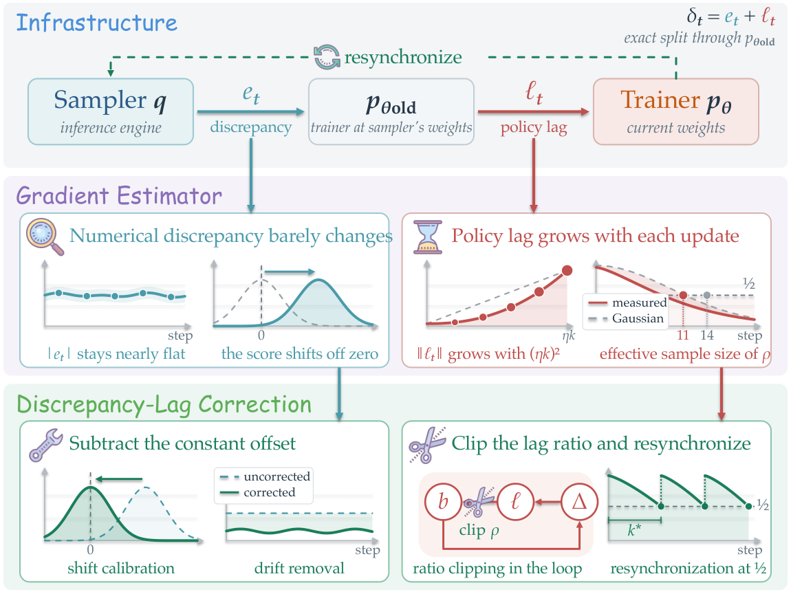
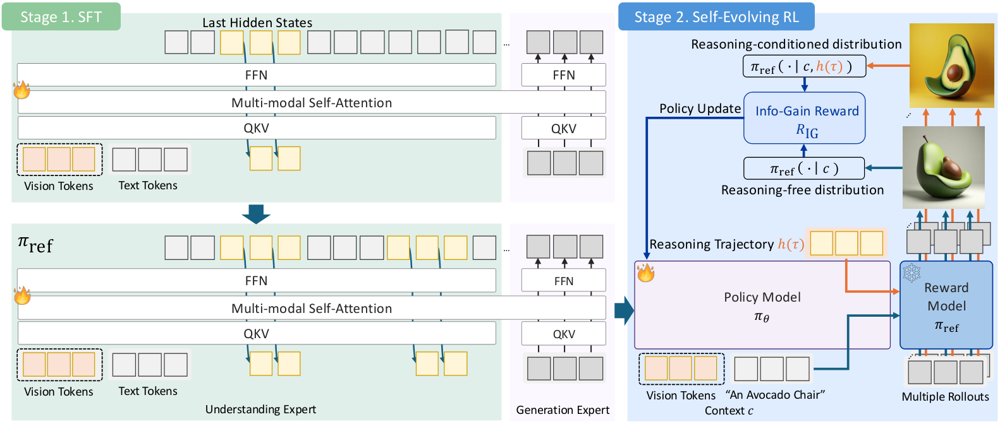
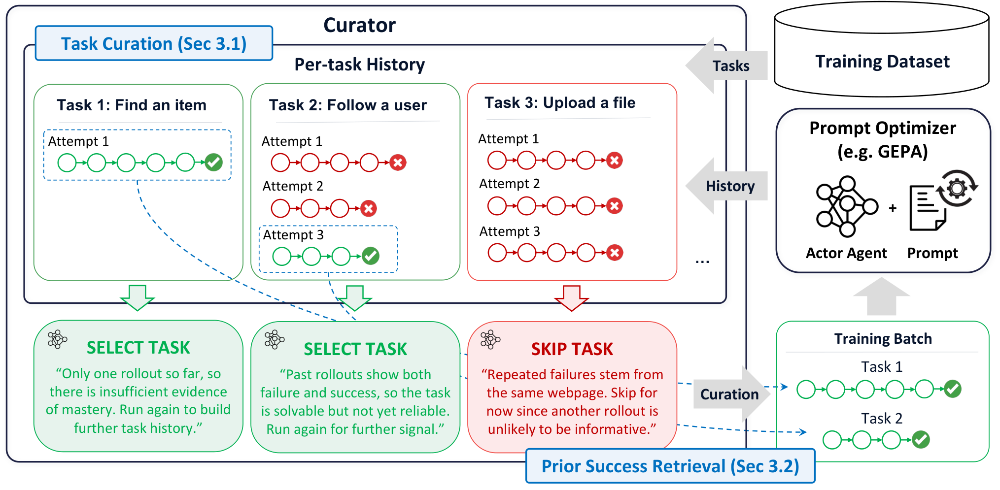
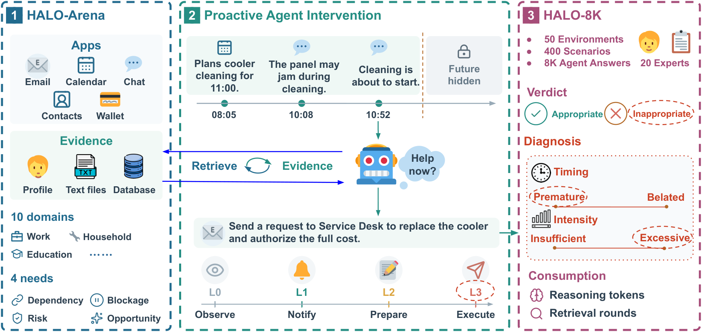
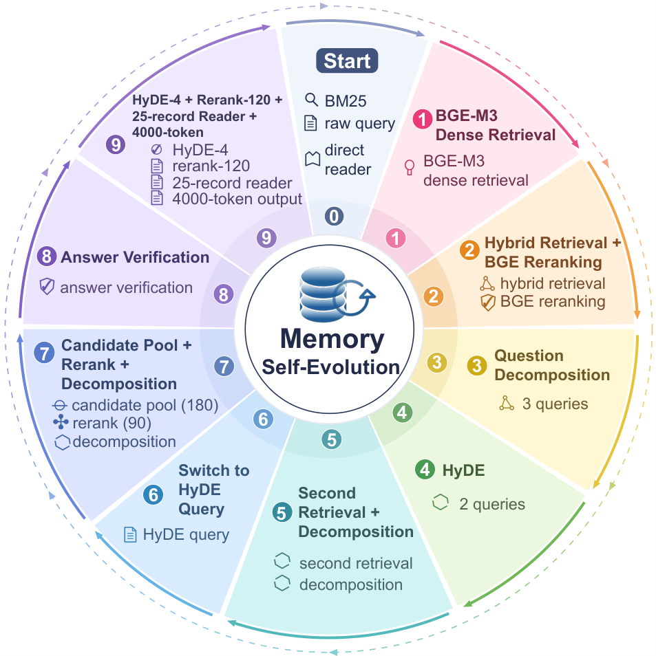
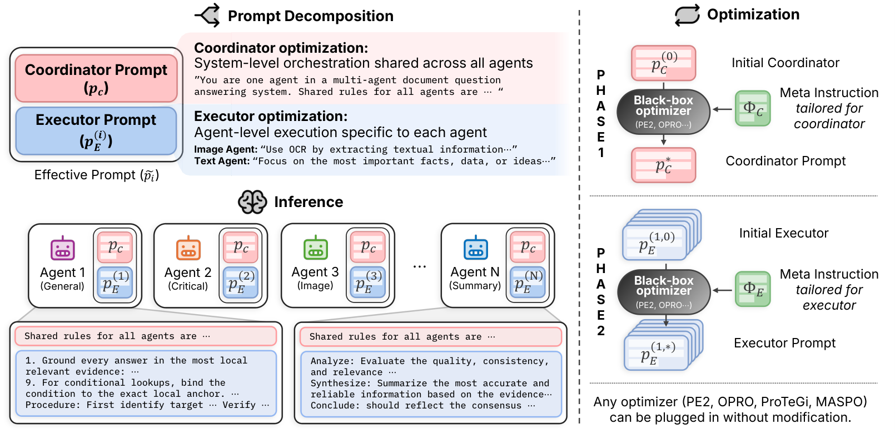
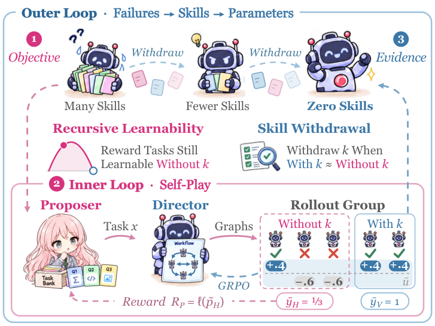
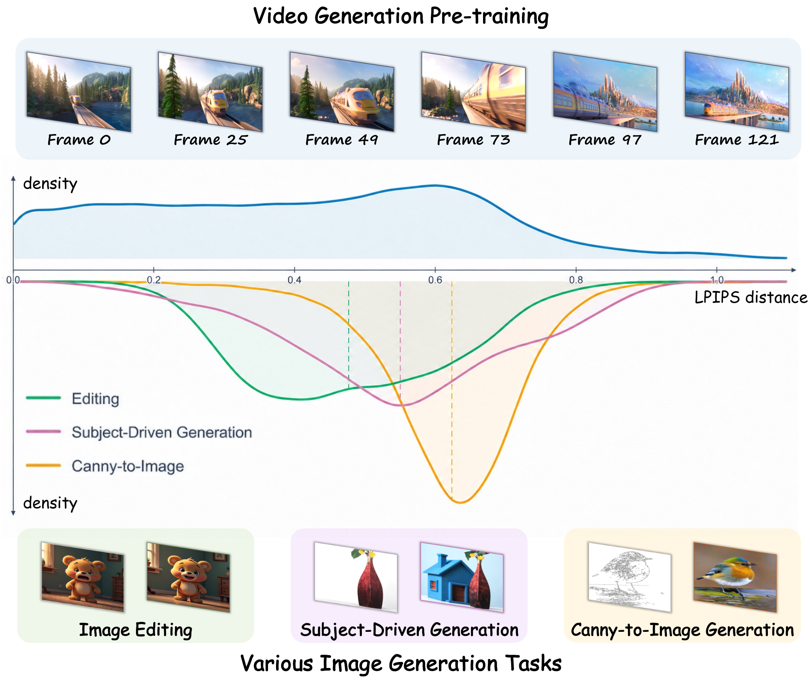
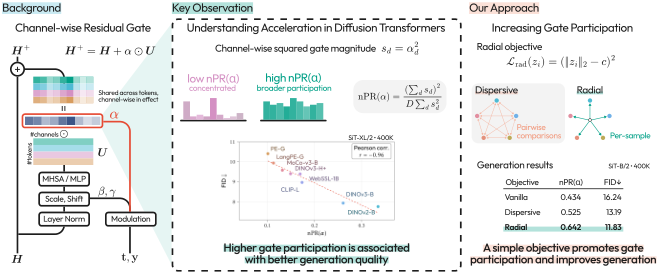
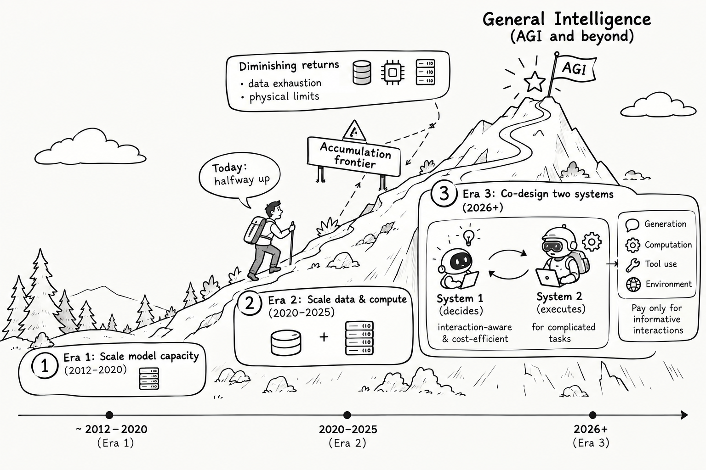

# Daily AI papers — 2026-11-02

*Curated from HF Daily Papers. 15 of ~37 papers kept after relevance filter.*

## Papers at a glance

| # | Title | Topics | Org |
| --- | --- | --- | --- |
| 1 | [Think Twice: The Metis-1.6 Technical Report](#1-metis-1-6) | `LLM`, `MoE`, `tech-report`, `case-study` | Lernex (single researcher) |
| 2 | [On the Origin and Evolution of Training-Inference Mismatch in LLM RL](#2-training-inference-mismatch) | `RL`, `post-training`, `systems` | GWU / Duke (inferred) |
| 3 | [Latent Reasoning in Continuous Space for Unified Multimodal Models (LARC)](#3-larc) | `multimodal`, `reasoning`, `RL` | (unspecified) |
| 4 | [Follow the Gradient: Tracing Safety Degradation Back to Training Data](#4-follow-the-gradient) | `safety`, `data`, `fine-tuning` | DatologyAI / UIUC |
| 5 | [GEPA-Curator: Curated Learning for Self Improving Agents](#5-gepa-curator) | `agents`, `prompt-opt`, `RL` | UC Berkeley / ICSI / LBNL |
| 6 | [HALO: Human-Grounded Granular Evaluation of Proactive Agents](#6-halo) | `agents`, `eval` | (unspecified) |
| 7 | [MemSteer: Turning User Histories into Supervision for Agent Memory Optimization](#7-memsteer) | `agents`, `memory` | (unspecified) |
| 8 | [CEPO: Improving Prompt Optimization in Multi-Agent Systems](#8-cepo) | `agents`, `prompt-opt` | Korea U. / KAIST / Google |
| 9 | [R²Orch: Recursive Self-Improvement for Agent Orchestration](#9-r2orch) | `agents`, `self-play`, `RL` | CUHK Shenzhen |
| 10 | [rTaste: Do Research Agents Have Taste?](#10-rtaste) | `agents`, `eval` | (unspecified) |
| 11 | [Apriel Voice 27B Preview: Open Speech, Reasoning, Tool Use](#11-apriel-voice) | `multimodal`, `speech`, `agents` | ServiceNow (inferred) |
| 12 | [FrameForge: Priors of Video Foundation Models for Unified Image Generation](#12-frameforge) | `diffusion`, `multimodal`, `generation` | (unspecified) |
| 13 | [No Channels Left Behind: Diffusion Acceleration via Residual Gates](#13-no-channels-left-behind) | `diffusion`, `interp` | NAVER AI Lab / Yonsei |
| 14 | [CodeSpecWeave: Scaling Long-Horizon Coding via Interdependent Specifications](#14-codespecweave) | `agents`, `RL`, `data`, `code` | Xiaomi / Beida |
| 15 | [Does Scaling Toward AGI Depend on What System-1 Lets System-2 Execute?](#15-system1-system2) | `position`, `reasoning` | (unspecified) |

---

## 1. Think Twice: The Metis-1.6 Technical Report {#1-metis-1-6}

**Authors:** Single researcher — *Lernex (models at huggingface.co/Lernex)*
**Links:** [arXiv:2610.37903](https://arxiv.org/abs/2610.37903) · [HF](https://huggingface.co/papers/2610.37903) · [AlphaXiv](https://www.alphaxiv.org/abs/2610.37903)
**Topics:** `LLM`, `MoE`, `tech-report`, `case-study`

### TL;DR

A full end-to-end tech report for *Metis-1.6*, a pair of language models (Praxis: 2.94B total / 0.46B active; Logos: 10.23B total / 1.18B active) built from scratch by a single researcher on roughly 1T tokens each. Both use a hybrid Mamba-2 + attention MoE block that is run **twice per token** (the "think twice" loop). Logos averages 52.93 across 40 post-trained benchmarks (7th of 17 compared models) and reaches 67.50% on AIME 2025 (2nd of 30). The paper is also unusually honest about failures: a misconfigured optimizer that never ran, an n-gram memory the model learned to disable, and a reward-sign bug in RL.

### Key idea

Three stacked choices define the architecture: (1) a **mixture-of-experts stack** on top of a **hybrid Mamba-2 + attention backbone**, (2) **weight-tied looping** — the whole transformer stack runs twice over each token, so compute depth doubles for the same parameter count, and (3) a conventional pretraining → 128k context-extension → SFT recipe. The report also records negative-result-level engineering lessons rare in frontier tech reports: an untouched RMSProp branch, a saturated n-gram cache, and a reward sign flip discovered only after RL.

### Main finding

Logos (10.23B total / 1.18B active) is competitive at math (67.50% AIME 2025, ranked 2/30) but weak at code, instruction following, and long context — a clear signature of the small active-parameter budget and the mostly math-weighted mid-training mixture. Average 52.93 across 40 benchmarks, 7th of 17.

### Why it matters

A worked example that a disciplined 1-trillion-token recipe plus a very small active-parameter MoE can get to Qwen-2.5-7B-class math scores from a solo-researcher setup — and a case study in what goes wrong when nobody else reviews the training config. The looped-MoE compute scheme is also a cheap test of "think longer by iterating the same block" as an alternative to simply making the model deeper.

### Knowledge graph integration

**Builds on / relates to existing pages:**
- [../architectures/_moe.md](../architectures/_moe.md) — Praxis/Logos use fine-grained MoE in the same vein as DeepSeekMoE.
- [../architectures/deepseek-moe.md](../architectures/deepseek-moe.md) — shared-expert + fine-grained routing lineage reused.
- [../architectures/aux-loss-free-balancing.md](../architectures/aux-loss-free-balancing.md) — load-balance style borrowed from the DeepSeek-V3 recipe.
- [../pre-training/mid-training.md](../pre-training/mid-training.md) — the 1T budget is split across pretraining / context extension / SFT, with a math-heavy mid-training mix.
- [../pre-training/_training-stability.md](../pre-training/_training-stability.md) — the "optimizer that never ran" failure sits in this taxonomy.
- [../post-training/rlvr.md](../post-training/rlvr.md) — the reward-sign bug is a canonical RLVR-era failure mode.
- [../case-studies/deepseek-v3.md](../case-studies/deepseek-v3.md) — closest architectural cousin on the MoE side, at ~50× the active-param count.

**Suggested new pages:**
- `case-studies/metis-1-6.md` *(case study)* — full breakdown of the Praxis/Logos recipe and documented failures.
- `architectures/looped-transformer.md` *(depth)* — the "think twice" weight-tied-loop mechanism.

---

## 2. On the Origin and Evolution of Training-Inference Mismatch in LLM Reinforcement Learning {#2-training-inference-mismatch}

**Authors:** Not disclosed on HF — correspondence emails hint at *George Washington University* and *Duke University*.
**Links:** [arXiv:2610.40945](https://arxiv.org/abs/2610.40945) · [HF](https://huggingface.co/papers/2610.40945) · [AlphaXiv](https://www.alphaxiv.org/abs/2610.40945)
**Topics:** `RL`, `post-training`, `systems`

### TL;DR

RL post-training for LLMs almost always uses a **fast inference engine** (vLLM/SGLang) to roll out trajectories and a **separate trainer** to update weights, so the sampling distribution and the gradient distribution never fully agree. The paper decomposes this gap into (a) a roughly constant **numerical discrepancy** from the inference engine and (b) a **policy lag** from stale weights that trainer updates amplify in a feedback loop. It proves that importance weighting controls the lag only while the effective sample size stays above ½, and introduces **DLC** (Discrepancy-Lag Correction) — centre the numerical term, clip the lag ratio, resynchronize the sampler when ESS drops — which keeps stale-sampler deviation inside twice the noise floor on Qwen3-0.6B/1.7B.

### Key idea

Treat the mismatch not as "the engine is noisy" but as *two* distinct, cumulative error terms: a near-constant numerical shift (engine kernels, FP precision, kernel selection) and a growing policy-lag drift (trainer has updated $k$ times since the sampler was last synced). Both are then handled with different tools: a mean-centering correction for the numerical term and an importance-weight **clip + ESS-triggered resync** for the lag.

### Main finding

Using DLC on Qwen3-0.6B and Qwen3-1.7B, the stale-sampler policy-gradient deviation stays within ~2× the baseline noise floor over long RL runs, where plain importance weighting lets it balloon by orders of magnitude. The ESS½ threshold is a concrete, implementable trigger for when to force a sampler↔trainer sync.

### Why it matters

Training-inference mismatch has quietly become one of the top sources of silent correctness bugs in open-source RLVR stacks (OpenRLHF, veRL, verifiers, …). Framing it as a two-term decomposition with a cheap, runtime-measurable trigger (ESS) is directly actionable for anyone running GRPO/RLVR today.

### Knowledge graph integration

**Builds on / relates to existing pages:**
- [../post-training/_rl.md](../post-training/_rl.md) — policy-gradient framing, importance sampling, KL regularization.
- [../post-training/grpo.md](../post-training/grpo.md) — mismatch directly interacts with GRPO's ratio estimation; the clip and ESS trigger plug into GRPO's PPO-clip step.
- [../post-training/ppo.md](../post-training/ppo.md) — generalizes the same analysis to PPO.
- [../post-training/rlvr.md](../post-training/rlvr.md) — the setting where mismatch bites hardest (sparse rule rewards, long rollouts).
- [../systems/partial-rollouts.md](../systems/partial-rollouts.md) — partial rollouts widen the lag between sampler and trainer.
- [../systems/ray.md](../systems/ray.md) — Ray-based rollout/trainer disaggregation is the exact setting the paper studies.

**Suggested new pages:**
- `post-training/training-inference-mismatch.md` *(depth)* — numerical-vs-lag decomposition, ESS½ rule, DLC.

---

## 3. Latent Reasoning in Continuous Space for Unified Multimodal Models (LARC) {#3-larc}

**Authors:** Author block not surfaced on HF — *Acknowledgments cite Suhyeok Jang, Junbeom Kim, Seonghu Jeon for feedback, not authorship.*
**Links:** [arXiv:2610.42149](https://arxiv.org/abs/2610.42149) · [HF](https://huggingface.co/papers/2610.42149) · [AlphaXiv](https://www.alphaxiv.org/abs/2610.42149)
**Topics:** `multimodal`, `reasoning`, `RL`

### TL;DR

Unified multimodal models (BAGEL etc.) can't scale their image-generation quality with more test-time compute the way LLMs can with longer chains of thought. LARC argues the mismatch is between **discrete-token CoT** and **continuous-latent image generation** and instead reasons in **continuous hidden state**. Two-stage recipe: a *curriculum* fine-tuning phase that gradually replaces text reasoning steps with latent steps, then an RL phase whose reward combines **information gain** and **diversity**, with no ground-truth reasoning chain required.

### Key idea

Replace the discrete-token "think-then-generate" of a VLM/MLLM with iterated continuous updates to a reasoning latent, so the generator's input space and the reasoning trace live in the same continuous manifold. The RL signal is intrinsic (information gain + diversity) rather than supervised, so no ground-truth reasoning annotations are needed — which is why this works for image generation, where there is no analogue of a math answer.

### Main finding

On GenEval, LARC posts state-of-the-art unified-model results, and crucially shows **monotonic test-time scaling**: letting the model iterate more latent reasoning steps keeps improving generation quality, unlike text-CoT baselines on the same backbone.

### Why it matters

Latent-space reasoning has been studied for text (Coconut, byte-latent), but LARC is one of the first to make it the primary scaling knob for *image generation*. If the result holds, it points toward a very different post-training recipe for multimodal models — closer to diffusion-style iterative refinement than to R1-style CoT RL.

### Knowledge graph integration

**Builds on / relates to existing pages:**
- [../post-training/reasoning/long-cot-rl.md](../post-training/reasoning/long-cot-rl.md) — direct analogue; LARC is the "no-text-CoT, continuous-state" cousin.
- [../post-training/reasoning/length-penalty.md](../post-training/reasoning/length-penalty.md) — information-gain reward is the latent-space counterpart.
- [../post-training/rlvr.md](../post-training/rlvr.md) — RL without ground-truth answers is a departure from classical RLVR.
- [../post-training/grpo.md](../post-training/grpo.md) — likely underlying optimizer.
- [../multimodal/README.md](../multimodal/README.md) — unified MLLMs context.

**Suggested new pages:**
- `post-training/reasoning/latent-reasoning.md` *(depth)* — curriculum + intrinsic-reward recipe for reasoning in continuous hidden space.

---

## 4. Follow the Gradient: Tracing Safety Degradation Back to Training Data {#4-follow-the-gradient}

**Authors:** Saket Reddy, Amro Abbas, Anshuman Suri, Ari Morcos, David Schwab, Pratyush Maini — *DatologyAI; UIUC*
**Links:** [arXiv:2610.37481](https://arxiv.org/abs/2610.37481) · [HF](https://huggingface.co/papers/2610.37481) · [AlphaXiv](https://www.alphaxiv.org/abs/2610.37481)
**Topics:** `safety`, `data`, `fine-tuning`

### TL;DR

Fine-tuning on instruction data can quietly weaken safety even when *no individual example looks harmful*. The paper introduces **SimpleLoRIF**, a scalable gradient-embedding method that attributes unsafe behavior back to the training examples whose gradients most align with it. Dropping the top-20% of Tulu 3 most aligned with unsafe responses produces **SafeTulu**, which cuts GCG attack success by up to 22% across Qwen/Llama/Olmo with little capability loss. They also report emergent misalignment AUC up to 0.865.

### Key idea

Reframe safety erosion from "we need better refusal data" to "some benign-looking training examples carry a safety-shifting gradient direction." LoRIF (Low-Rank Influence Function) uses a cheap, low-rank gradient embedding to compute, for every candidate training point, its alignment with the gradient that produces unsafe behavior at inference. "Simple" refers to a scalable approximation that avoids the usual influence-function Hessian solve.

### Main finding

Removing the 20% of training data with highest SimpleLoRIF alignment reduces GCG attack success rate by up to 22% on Qwen/Llama/Olmo, with capability preserved. The method's own detection AUC on emergent-misalignment-flavor examples reaches 0.865.

### Why it matters

A real move from "fix safety at the RLHF stage" to "fix safety at the data stage." If the method generalizes, data owners can filter *before* training and avoid much of the per-release safety-training arms race. It also gives interpretability a lever: trace a specific unsafe behavior back to specific examples, not just features.

### Knowledge graph integration

**Builds on / relates to existing pages:**
- [../data/quality-filtering.md](../data/quality-filtering.md) — SimpleLoRIF is a safety-aware extension of quality filtering.
- [../data/_data-curation.md](../data/_data-curation.md) — adds a safety-gradient criterion to the curation taxonomy.
- [../data/decontamination.md](../data/decontamination.md) — same shape (drop bad examples) but gradient-driven, not n-gram-driven.
- [../safety/_jailbreaks.md](../safety/_jailbreaks.md) — effect is measured in GCG attack success.
- [../safety/refusal-suppression.md](../safety/refusal-suppression.md) — related failure mode.
- [../safety/README.md](../safety/README.md) — data-side alignment lineage.

**Suggested new pages:**
- `safety/safety-data-attribution.md` *(depth)* — SimpleLoRIF, SafeTulu, the "benign-looking but harmful-direction" idea.

---

## 5. GEPA-Curator: Curated Learning for Self Improving Agents {#5-gepa-curator}

**Authors:** Zack Yu, Nicholas Lee, Minjae Lee, Lakshya Agarwal, Luca Manolache, Wonjun Kang, Matei Zaharia, Michael W. Mahoney, Kurt Keutzer, Sehoon Kim, Amir Gholami — *UC Berkeley / ICSI / LBNL / Furiosa AI / KAIST*
**Links:** [arXiv:2610.37651](https://arxiv.org/abs/2610.37651) · [HF](https://huggingface.co/papers/2610.37651) · [AlphaXiv](https://www.alphaxiv.org/abs/2610.37651)
**Topics:** `agents`, `prompt-opt`, `RL`

### TL;DR

Reflective prompt optimizers (GEPA, ACE) learn from failed rollouts, but a failed rollout can mean many things — bad prompt, harness bug, flaky environment, noisy judge — and the optimizer can be taught the wrong lesson. GEPA-Curator sits on top of any such optimizer with two components: **task curation** (skip tasks that would give an unreliable signal) and **prior-success retrieval** (feed past successful trajectories back in as context). On GoBrowse, ALFWorld, AppWorld, and τ-bench with Gemini 3.1 Pro and Claude Opus 5, it beats GEPA by up to 20.7% and ACE by up to 21.2%.

### Key idea

Treat the agent's rollout history as a dataset in need of curation: not every failure deserves a reflection, and past successes should re-enter the context for similar future tasks. Explicitly separate "did the agent fail because of the policy?" from "did it fail for a reason we can't learn from?"

### Main finding

Across four benchmarks and two frontier optimizers (Gemini 3.1 Pro, Claude Opus 5), GEPA-Curator matches or beats both GEPA and ACE on mean performance, with the largest gains (up to +20–21%) on noisy or long-horizon tasks.

### Why it matters

Prompt-optimizer research has been hitting a ceiling where more reflection stops helping. Adding a curation step directly on top is a cheap, model-agnostic plug-in — mirrors the shift from "more data" to "better data" in pretraining.

### Knowledge graph integration

**Builds on / relates to existing pages:**
- [../post-training/rl-prompt-curation.md](../post-training/rl-prompt-curation.md) — direct conceptual sibling for *agent* rollouts rather than RL prompts.
- [../post-training/rejection-sampling.md](../post-training/rejection-sampling.md) — prior-success retrieval is close to rejection sampling applied to past rollouts.
- [../post-training/_post-training.md](../post-training/_post-training.md) — agent-side analogue of post-training data curation.
- [../agents/README.md](../agents/README.md) — agent training and iteration loops.

**Suggested new pages:**
- `agents/experience-curation.md` *(depth)* — task-curation + prior-success retrieval for reflective prompt optimizers.

---

## 6. HALO: Human-Grounded Granular Evaluation of Proactive Agents {#6-halo}

**Authors:** Wenqi Pei, Xinyu Wang, Jinrui Liu, Cynthia Zhuge, Jie Sheng, Zihan Wang, Tenghao Huang, Muhao Chen
**Links:** [arXiv:2610.39086](https://arxiv.org/abs/2610.39086) · [HF](https://huggingface.co/papers/2610.39086) · [AlphaXiv](https://www.alphaxiv.org/abs/2610.39086)
**Topics:** `agents`, `eval`

### TL;DR

HALO is a human-annotated benchmark asking three questions about *proactive* agents: should the agent help without being asked, when, and how far? Scenarios span four need types and ten everyday domains; agents must retrieve evidence from databases or documents. The release — **HALO-8K** — includes 8,000 responses from 10 models, scored by 20 experts on acceptability and failure cause, plus effort metrics (reasoning tokens, retrieval rounds). The headline failure mode is **over-proactivity**: acting too early or too forcefully. Best proprietary models reach ~72.9% acceptability; best open-source ~56.6%.

### Key idea

Most agent benchmarks test whether an agent can execute a given task. HALO instead tests the *decision to act at all*, which is the operationally hard part for a deployed assistant — and separates failure modes along two axes (timing and intensity) rather than scoring a single number.

### Main finding

Over-proactivity dominates failure counts across all 10 evaluated agents; closed-source agents reach ~72.9%, open-source ~56.6% acceptability. Reasoning-token spend doesn't monotonically improve acceptability.

### Why it matters

Proactivity is a core deployment property for assistants that live in email, calendars, or chat threads. HALO is the first benchmark with granular (not aggregate) proactivity scoring and 20-expert human labels — a candidate for the "RewardBench of proactivity."

### Knowledge graph integration

**Builds on / relates to existing pages:**
- [../evaluation/README.md](../evaluation/README.md) — agent/VLM evaluation lineage.
- [../evaluation/ifeval.md](../evaluation/ifeval.md) — closest "did the agent follow instructions correctly" ancestor.
- [../agents/README.md](../agents/README.md) — agent evaluation surface.
- [../safety/_scheming.md](../safety/_scheming.md) — over-proactivity touches "acts without being asked" risk framing.

**Suggested new pages:**
- `evaluation/halo.md` *(depth)* — HALO-8K structure, acceptability + failure-cause axes, headline model numbers.

---

## 7. MemSteer: Turning User Histories into Supervision for Agent Memory Optimization {#7-memsteer}

**Authors:** Not surfaced on HF.
**Links:** [arXiv:2610.39276](https://arxiv.org/abs/2610.39276) · [HF](https://huggingface.co/papers/2610.39276) · [AlphaXiv](https://www.alphaxiv.org/abs/2610.39276)
**Topics:** `agents`, `memory`

### TL;DR

Agent-memory systems typically need expensive hand-labeled QA data to tune. MemSteer converts unlabeled user histories into **question-answer pairs with grounded supporting evidence**, then audits each pair via source grounding and blind answer recovery to filter noise. **MemSteer-Opt** then uses this supervision to diagnose whether memory failures live in storage, retrieval, or answer-generation — and revises the memory design without updating model parameters. Beats a BM25 baseline on ATM-Bench and RHELM, and matches human-annotated QA.

### Key idea

Replace manual annotation with a two-step auto-supervision: (1) build evidence-grounded Q/A plans from logs, (2) validate each via source-grounded audit (does the evidence actually imply the answer?) and blind recovery (would a reader get the answer back from the question and evidence alone?). Then use the resulting supervision to localize memory failures to one of three subsystems and change design without retraining.

### Main finding

On ATM-Bench and RHELM, MemSteer's auto-supervised pipeline matches or improves over BM25 and is competitive with human-labeled QA. The failure-mode-localization recipe is model-parameter-free.

### Why it matters

Memory is the current ceiling for long-lived agents. A supervision pipeline that scales without annotators and attributes failures to storage/retrieval/generation separately is more useful than yet another retriever.

### Knowledge graph integration

**Builds on / relates to existing pages:**
- [../agents/README.md](../agents/README.md) — agent memory and retrieval context.
- [../data/_data-curation.md](../data/_data-curation.md) — audit-based data filtering pattern.
- [../post-training/rejection-sampling.md](../post-training/rejection-sampling.md) — blind recovery check is a cousin.

*(No "Suggested new pages" — pattern overlaps meaningfully with existing memory-adjacent work; worth tracking rather than minting a page from a single paper.)*

---

## 8. CEPO: A General Framework for Improving Prompt Optimization in Multi-Agent Systems {#8-cepo}

**Authors:** Jongha Kim, Seohyun Lee, Jonathan Minho Chung, Jinsung Yoon, Hyunwoo J. Kim — *Korea University / KAIST / Google Cloud AI Research*
**Links:** [arXiv:2610.34722](https://arxiv.org/abs/2610.34722) · [HF](https://huggingface.co/papers/2610.34722) · [AlphaXiv](https://www.alphaxiv.org/abs/2610.34722)
**Topics:** `agents`, `prompt-opt`

### TL;DR

CEPO splits multi-agent prompts into a shared **coordinator prompt** (system-level routing/handoff) and per-agent **executor prompts** (role-specific execution), with role-aligned meta-instructions so the two update under different rules. Any existing prompt optimizer plugs in. Across 11 benchmarks in 4 domains, applying CEPO to 4 different optimizers consistently improves them, and a document-understanding ablation shows better budget efficiency as the number of agents grows.

### Key idea

Standard prompt optimizers treat each agent's prompt as a monolith, which conflates "how do I coordinate with other agents" with "how do I do my task." CEPO decomposes the prompt along that boundary and gives each piece its own meta-instructions, letting the search focus on the right surface for each level.

### Main finding

Across four existing optimizers on 11 benchmarks in 4 domains, CEPO consistently improves them. In a document-understanding system the gain grows with the number of agents, with better budget usage per improvement step.

### Why it matters

As multi-agent systems proliferate, prompt debt grows combinatorially. A coordinator/executor factoring that lets you reuse optimizers across stacks is a small, general-looking lever with cross-paper applicability.

### Knowledge graph integration

**Builds on / relates to existing pages:**
- [../agents/README.md](../agents/README.md) — multi-agent system coordination lives here.
- [../post-training/rl-prompt-curation.md](../post-training/rl-prompt-curation.md) — prompt-level engineering with a different unit of iteration.
- [../fundamentals/README.md](../fundamentals/README.md) — prompting primitives.

*(No new file — the paper is primarily an engineering framework on top of existing prompt optimizers.)*

---

## 9. R²Orch: Recursive Self-Improvement for Agent Orchestration via Self-Play within a Skill-Internalization Loop {#9-r2orch}

**Authors:** Mingda Zhang, Yun Huang, Qiang Huang, Yanjin Li, Rui Qian, Qichao Zhao, Tiesunlong Shen, Na Zhao, Jian Wang, Xiaoying Tang — *Chinese University of Hong Kong, Shenzhen (CUHKSZ)*
**Links:** [arXiv:2610.22740](https://arxiv.org/abs/2610.22740) · [HF](https://huggingface.co/papers/2610.22740) · [AlphaXiv](https://www.alphaxiv.org/abs/2610.22740)
**Topics:** `agents`, `self-play`, `RL`

### TL;DR

R²Orch trains an orchestrator model to allocate sub-tasks across agents via **recursive self-play**, with a learnable **task selection** head and a **skill withdrawal** mechanism that retires skills the orchestrator has internalized. The *Recursive Learnability* objective rewards selecting tasks that currently lie at the edge of the orchestrator's competence. Reports improvements across twelve datasets covering reasoning and interactive tasks, without any hand-designed curriculum.

### Key idea

Replace human curriculum design with a self-play objective that picks the "right-hard" task next, and give the orchestrator a way to say "I don't need to delegate this skill anymore," which both compresses the policy and signals progress.

### Main finding

Across twelve reasoning and interactive-task datasets, R²Orch improves over fixed-curriculum self-play and over orchestrators without skill-withdrawal.

### Why it matters

Points at a general scheme for growing an orchestrator from a weak one, without any curriculum engineering — a direction several multi-agent and tool-use training stacks have been circling.

### Knowledge graph integration

**Builds on / relates to existing pages:**
- [../post-training/_rl.md](../post-training/_rl.md) — self-play RL framing.
- [../post-training/rl-prompt-curation.md](../post-training/rl-prompt-curation.md) — the "hardness-aware prompt selection" lineage.
- [../post-training/reasoning/long-cot-rl.md](../post-training/reasoning/long-cot-rl.md) — the RL side of agent-reasoning training.
- [../agents/README.md](../agents/README.md) — orchestration and sub-agent allocation.

*(No new file suggested — self-play + curriculum learning is a broad area; wait for a stronger primary reference to anchor a page.)*

---

## 10. rTaste: Do Research Agents Have Taste? Evaluating Early Stage Research Judgment {#10-rtaste}

**Authors:** Not listed on HF.
**Links:** [arXiv:2610.40488](https://arxiv.org/abs/2610.40488) · [HF](https://huggingface.co/papers/2610.40488) · [AlphaXiv](https://www.alphaxiv.org/abs/2610.40488)
**Topics:** `agents`, `eval`

### TL;DR

Six frontier models each read seven recent NLP papers and propose minimum-viable experiments, forecast outcomes, and rank them, individually or in teams. A separate executor actually runs every proposal, and three auditor models score the results. Models produce sound and novel experiments, but their *rankings and forecasts* aren't clearly better than a fresh copy of the same model, and team configurations don't clearly help.

### Key idea

Separate "can a research agent propose a sensible experiment" from "can it tell which of its proposals is worth running." The first is well-benchmarked; the second — "taste" — is the limiting factor and until now hadn't been measured directly.

### Main finding

Frontier models match each other on proposal quality, but ranking and forecasting ability is largely indistinguishable from a fresh instance of the same model; teams add little.

### Why it matters

Research-agent demos often skip the taste bottleneck. rTaste is a reproducible, auditor-based way to probe it, and the result (no clear gain from teams or ensembles) is a cautionary data point for autonomous-researcher claims.

### Knowledge graph integration

**Builds on / relates to existing pages:**
- [../evaluation/README.md](../evaluation/README.md) — agent evaluation.
- [../agents/README.md](../agents/README.md) — autonomous research agents.
- [../safety/_scheming.md](../safety/_scheming.md) — autonomy-adjacent capability eval.

*(No new file suggested — benchmark is small; mint a page if a follow-up expands it.)*

---

## 11. Apriel Voice 27B Preview: An Open Model for Speech, Reasoning, and Tool Use {#11-apriel-voice}

**Authors:** Core contributors incl. Aman Tiwari, Akshay Kalkunte, Akintunde Oladipo, Jash Shah, …, led by Sridhar Nemala and Srinivas Sunkara.
**Links:** [arXiv:2610.40738](https://arxiv.org/abs/2610.40738) · [HF](https://huggingface.co/papers/2610.40738) · [AlphaXiv](https://www.alphaxiv.org/abs/2610.40738)
**Topics:** `multimodal`, `speech`, `agents`

### TL;DR

An open speech-LLM built on the Gemma 4 26B-A4B checkpoint that eats speech directly and uses a single reasoning backbone for both responses and tool calls, keeping its original text and image inputs. Two-stage training: speech adaptation + distillation from a frozen teacher. Evaluates on Big Bench Audio, Speech-BFCL, τ-Voice, and EVA, and is served through an interactive demo platform.

### Key idea

Rather than running an ASR → text-LLM → TTS pipeline, keep one reasoning model and feed it speech tokens; preserve existing text and image modalities so the same model still works end-to-end. Teacher-distillation during the speech adapter stage reuses the original Gemma-4 behavior.

### Main finding

Competitive scores on Big Bench Audio / Speech-BFCL / τ-Voice / EVA for an open 27B model, with tool-use preserved.

### Why it matters

The open equivalent of GPT-4o-voice is still a sparse space. Apriel Voice 27B is a credible open candidate — notable both as a model and as a *speech + reasoning + tool use* integration path.

### Knowledge graph integration

**Builds on / relates to existing pages:**
- [../multimodal/README.md](../multimodal/README.md) — modality-adapter + joint-reasoning stack.
- [../agents/README.md](../agents/README.md) — tool-calling-over-speech surface.
- [../post-training/_post-training.md](../post-training/_post-training.md) — the distillation stage sits here.

*(No new file — a model release rather than a novel technique; interesting if a tech-report follow-up appears.)*

---

## 12. FrameForge: Harnessing Priors of Video Foundation Models for Unified Image Generation {#12-frameforge}

**Authors:** Not surfaced on HF.
**Links:** [arXiv:2610.36545](https://arxiv.org/abs/2610.36545) · [HF](https://huggingface.co/papers/2610.36545) · [AlphaXiv](https://www.alphaxiv.org/abs/2610.36545)
**Topics:** `diffusion`, `multimodal`, `generation`

### TL;DR

A unified conditional-image-generation model that uses a pretrained **video** foundation model as its prior. Two components: **Mixture of Temporal Experts (MoTE)** chooses among temporal positional "experts" with different virtual intervals to model the condition→target distance, and **Chain of Temporal Reasoning (CoTR)** adds a latent intermediate state with an attention mask that routes information through it. Reports strong DreamBench, COCO2017, and GEdit-Bench numbers on subject-driven generation, canny-to-image, and image editing.

### Key idea

Instead of fixing where the condition sits relative to the target in a video model's temporal axis, let a mixture-of-experts choose per task, and let the model reason through a latent intermediate step before producing the target.

### Main finding

Strong results on three heterogeneous image-generation benchmarks under one model — competitive with task-specialized baselines.

### Why it matters

Reusing video foundation models as the backbone for image generation is a less-explored branch than diffusion-DiT scaling. If MoTE/CoTR generalize, pretrained video weights become usable image-generation substrates.

### Knowledge graph integration

**Builds on / relates to existing pages:**
- [../multimodal/README.md](../multimodal/README.md) — multimodal and generation surface.
- [../architectures/_moe.md](../architectures/_moe.md) — MoTE's "temporal experts" are MoE along the time axis.
- [../fundamentals/_positional-encoding.md](../fundamentals/_positional-encoding.md) — temporal positional experts live here.

*(No new file — paper is primarily a mechanism-tweak on video priors; revisit if MoTE becomes reused elsewhere.)*

---

## 13. No Channels Left Behind: Understanding Diffusion Acceleration through Residual Gates {#13-no-channels-left-behind}

**Authors:** Jaemyung Yu, Jaehui Hwang, Jong-Seok Lee, Dongyoon Han — *NAVER AI Lab / Yonsei University*
**Links:** [arXiv:2610.40914](https://arxiv.org/abs/2610.40914) · [HF](https://huggingface.co/papers/2610.40914) · [AlphaXiv](https://www.alphaxiv.org/abs/2610.40914)
**Topics:** `diffusion`, `interp`

### TL;DR

Why do auxiliary objectives (REPA, dispersive regularization) speed up diffusion-transformer training? The paper finds they re-shape the **AdaLN-Zero residual gate** — the vector that controls how conditioned updates enter the residual stream. Accelerated models get more sensitive to gate perturbations, and gates reflect semantic class relations. The authors introduce **normalized participation ratio (nPR)** to measure gate-magnitude spread across channels, show higher participation tracks better quality, and propose a *teacher-free* radial objective that improves FID over dispersive loss on ImageNet 256×256 with SiT-B/2.

### Key idea

Treat the AdaLN-Zero gate as a diagnostic surface for diffusion acceleration. Measure how many channels participate (nPR). Regularize training to raise participation without needing a teacher model, matching or beating teacher-based acceleration recipes.

### Main finding

A teacher-free radial regularizer raises nPR and improves FID over dispersive loss on ImageNet 256×256 with SiT-B/2.

### Why it matters

Diffusion-acceleration recipes have multiplied; interpreting them through a shared gate-level lens may consolidate the family and remove the "teacher model" requirement from many of them.

### Knowledge graph integration

**Builds on / relates to existing pages:**
- [../architectures/_normalization.md](../architectures/_normalization.md) — AdaLN and residual gating variants.
- [../interpretability/README.md](../interpretability/README.md) — interpretability-for-training lineage.
- [../multimodal/README.md](../multimodal/README.md) — diffusion-model context.

*(No new file — contribution is primarily analytic + a small loss term; mint a page if the method is adopted broadly.)*

---

## 14. When Requirements Interact: Scaling Long-Horizon Coding via Interdependent Specifications (CodeSpecWeave) {#14-codespecweave}

**Authors:** Minzheng Wang, Liang Zhao, Linghao Zhang, Lei Li, Shicheng Li, Xu Sun, Fuli Luo — *Xiaomi (internship) + unnamed labs*
**Links:** [arXiv:2610.40256](https://arxiv.org/abs/2610.40256) · [HF](https://huggingface.co/papers/2610.40256) · [AlphaXiv](https://www.alphaxiv.org/abs/2610.40256)
**Topics:** `agents`, `RL`, `data`, `code`

### TL;DR

Coding agents fail at tasks whose requirements interact (interface compatibility, error handling, invariants). The paper trains a **synthesizer agent** to build such tasks from developer-derived spec seeds and a **reviewer agent** to make the tests reliable, yielding 4,670 training tasks over 2,865 repositories. RL on this data substantially improves DeepSWE-v1.1, and the authors release **CodeSpecWeave-Bench**, a 100-task benchmark with 1,044 specifications that still clearly separates frontier models.

### Key idea

Treat coupled requirements as a first-class training signal: synthesize tasks + tests where multiple specifications must hold *simultaneously*, review generated trajectories to prune unreliable tests, and train with RL on this harder-than-usual code distribution.

### Main finding

RL on CodeSpecWeave meaningfully improves DeepSWE-v1.1; CodeSpecWeave-Bench separates frontier models and shows room for improvement.

### Why it matters

Most code-RL data is still "one-function, one-test." Interdependent-spec tasks move the training distribution closer to real software engineering, where interface-level correctness is the hard part.

### Knowledge graph integration

**Builds on / relates to existing pages:**
- [../post-training/rlvr.md](../post-training/rlvr.md) — code RL on verifiable tests.
- [../post-training/rl-prompt-curation.md](../post-training/rl-prompt-curation.md) — related data-side curation.
- [../post-training/grpo.md](../post-training/grpo.md) — likely optimizer.
- [../data/_data-curation.md](../data/_data-curation.md) — synthetic data pipeline.
- [../evaluation/livecodebench.md](../evaluation/livecodebench.md) — nearest code benchmark relative.
- [../agents/README.md](../agents/README.md) — SWE agents.

*(No new file — the main contribution is a data pipeline specific to coding RL; worth a depth page if a follow-up isolates the synthesizer/reviewer design.)*

---

## 15. Does Scaling Toward AGI Depend on What System-1 Lets System-2 Execute? {#15-system1-system2}

**Authors:** Yun Qu, Lizhou Cai, Heming Zou, Haoang Chi, Yiqin Lv, Xiang Li, Haiyan Feng, Mengyu Ge, Yize Geng, Yuhang Jiang, Yixiu Mao, Xiangyang Ji
**Links:** [arXiv:2610.39497](https://arxiv.org/abs/2610.39497) · [HF](https://huggingface.co/papers/2610.39497) · [AlphaXiv](https://www.alphaxiv.org/abs/2610.39497)
**Topics:** `position`, `reasoning`

### TL;DR

A position paper arguing that scaling has mostly scaled the "executive" (System-2) while ignoring the predictor-gate (System-1), and that **conditional interaction** — a *predict → gate → execute → update* loop between the two — can cut execution compute by roughly the inverse density of utility-relevant interactions. Under prediction error, exploration, and distribution shift this saving shrinks. Selection regret is bounded by predictor error and utility margin. Reframes "compute" as "informative compute."

*Borderline: included because the framing is directly relevant to the "test-time compute" literature even though no new method is trained.*

### Key idea

Treat the current scaling path (bigger reasoner) as System-2 only. Pair it with a cheap System-1 predictor that decides *whether* the current step is worth executing; the ratio of utility-relevant steps becomes the effective scaling coordinate.

### Main finding

A theoretical result: under ideal screening and equal execution costs, execution compute falls by a factor approaching 1/(density of utility-relevant interactions). Selection regret bounded by predictor error × utility margin.

### Why it matters

Positions "informative compute" as an alternative scaling axis to raw tokens-of-thinking, aligned with recent speculative-decoding, early-exit, and routing work.

### Knowledge graph integration

**Builds on / relates to existing pages:**
- [../post-training/reasoning/long-cot-rl.md](../post-training/reasoning/long-cot-rl.md) — reasoning compute framing.
- [../post-training/reasoning/length-penalty.md](../post-training/reasoning/length-penalty.md) — "stop thinking" is a predictor-gate special case.
- [../inference/README.md](../inference/README.md) — early-exit and speculative-decoding are predictor-gate instances.

*(No new file — position paper; incorporate the vocabulary rather than mint a page.)*

---

## Notes

- Hero figures live in `assets/2026-11-02/`. Papers without a figure (`#1`, `#4`, `#10`, `#11`, `#14`) either had no usable `og:image` or no retrievable arXiv figure.
- Borderline inclusions are flagged in-section with an italic *Borderline: …* note.
- This digest is informational. No existing concept files, `READING-LIST.md`, or `PAPERS.md` were modified to produce it.
