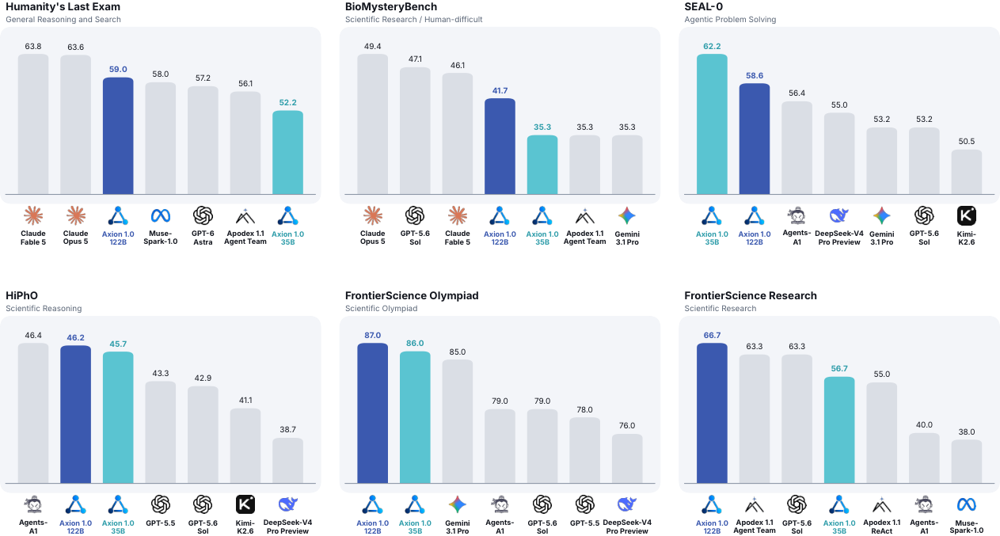
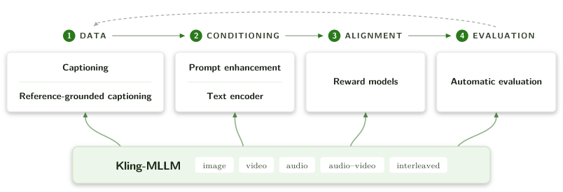
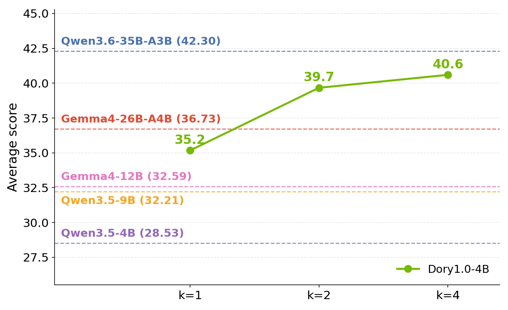
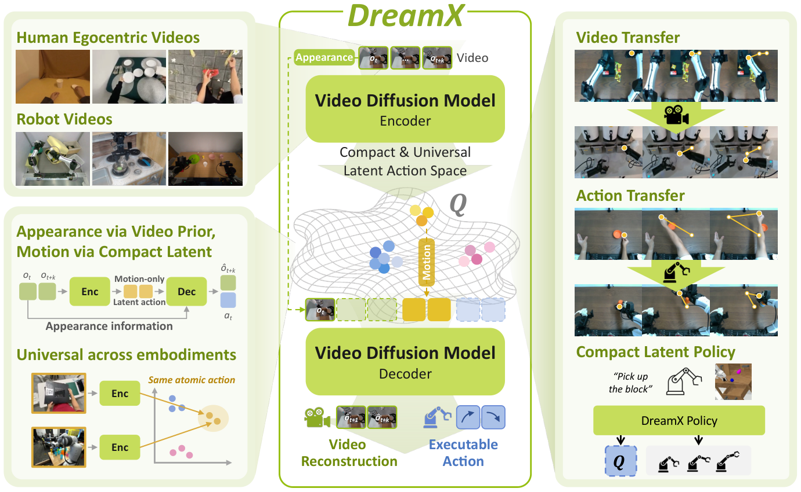
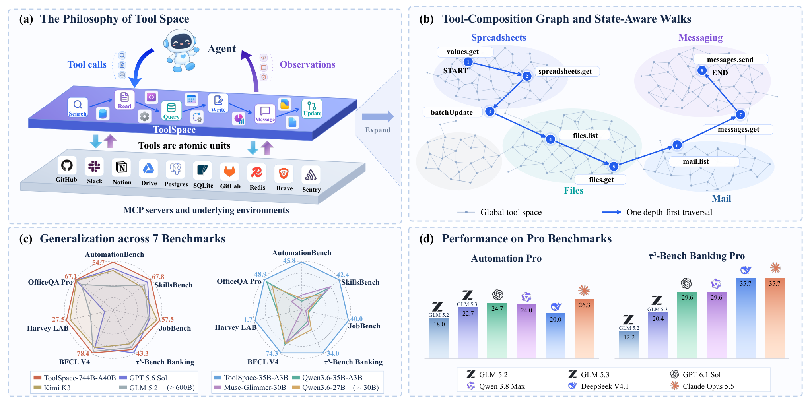
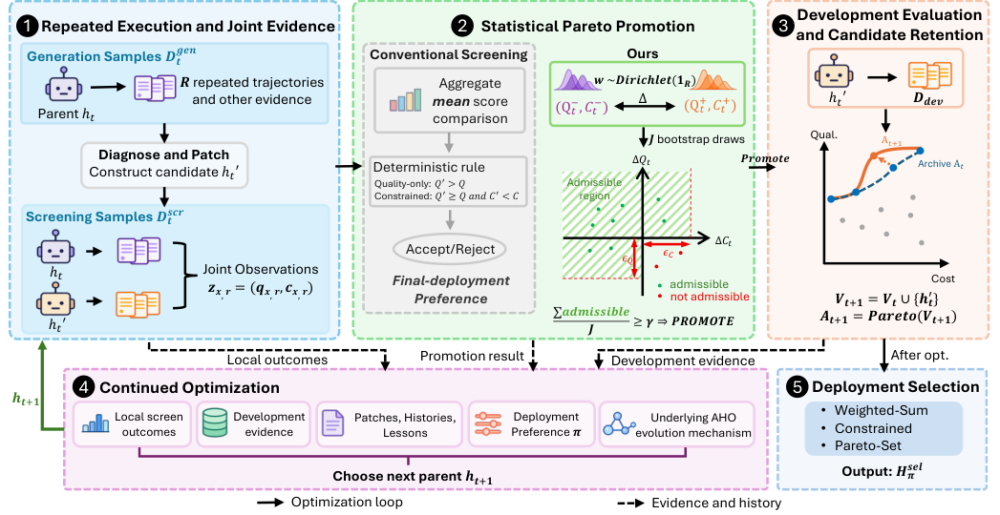
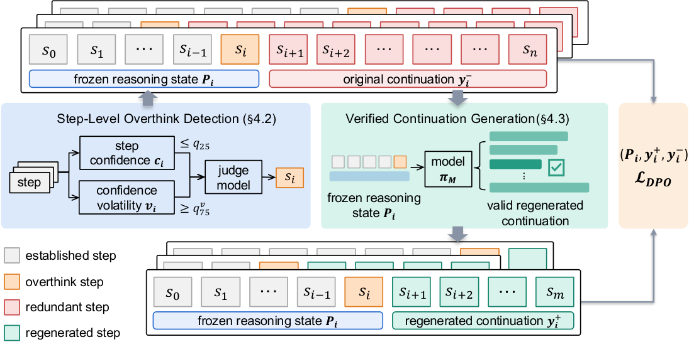

# Daily AI papers — 2026-11-04

*Curated from HF Daily Papers. 15 of ~52 papers kept after relevance filter.*

## Papers at a glance

| # | Title | Topics | Org |
| --- | --- | --- | --- |
| 1 | [Axion 1.0: Open Agent Foundation Models, Simplified](#1-axion-10) | `agents`, `RL`, `SFT`, `tool-use` | Not stated |
| 2 | [Behind Video Generation: Observations and Insights on Multimodal Understanding from Kling](#2-behind-video-generation-kling) | `multimodal`, `diffusion`, `video`, `rewards` | Kuaishou (Kling) |
| 3 | [Dory1.0-4B: A Looped Normalized-GPT](#3-dory10-4b) | `architectures`, `LLM`, `eval` | NVIDIA (inferred) |
| 4 | [DreamX: Video Diffusion Model is a Universal Latent Action Learner](#4-dreamx) | `multimodal`, `diffusion`, `video`, `world-model` | KAIST AI |
| 5 | [Route Anything: A Study of Model and Policy Routing for General-Purpose AI Systems](#5-route-anything) | `agents`, `routing`, `efficient-inference`, `eval` | NUS (Y. You lab) |
| 6 | [ToolSpace: Scaling Tool-Centric Environment Synthesis for Long-Horizon Agents](#6-toolspace) | `agents`, `tool-use`, `data`, `RL` | Renmin / Fudan |
| 7 | [Recursa: Toward Recursively Self-Improving Foundation Model Systems](#7-recursa) | `agents`, `self-improvement`, `eval` | Alibaba |
| 8 | [ParetoSaddler: Pareto-Guided Optimization of Agent Harnesses for Quality and Cost](#8-paretosaddler) | `agents`, `eval`, `cost`, `optimization` | Microsoft / UCL / POSTECH / MBZUAI |
| 9 | [Think Less, Locally: Local Preference Learning for Reasoning Compression](#9-loco-think-less-locally) | `reasoning`, `DPO`, `long2short` | XJTU / WeChat AI |
| 10 | [Adversarial Speculative Reasoning Improves Long Horizon Agents](#10-adversarial-speculative-reasoning) | `agents`, `inference`, `speculative`, `reasoning` | Subconscious Systems / MIT / Princeton / NEU |
| 11 | [SpecPilot: Autonomous Algorithm Discovery and Systems Optimization for Speculative Decoding](#11-specpilot) | `inference`, `speculative`, `agents` | Berkeley / Princeton / Stanford / NVIDIA |
| 12 | [Near-Zero Token Embeddings Silently Stall Training in Gated Sequence Models](#12-near-zero-token-embeddings) | `architectures`, `training-stability`, `SSM` | WUSTL / Nankai (inferred) |
| 13 | [Length Is Cheap, Competition Is Not: Attention Predicts Context Rot in Retrieval](#13-length-is-cheap) | `interp`, `long-context`, `eval` | UC San Diego |
| 14 | [Every Token Needs Its Own Teacher: Multi-Teacher Adaptive On-Policy Self-Distillation](#14-mta-opsd) | `post-training`, `distillation`, `reasoning` | TUM / MCML / Aalto |
| 15 | [Muon Makes the First Mixture-of-Experts Layer Harder to Balance](#15-muon-moe-balance) | `MoE`, `optimizer`, `training-stability` | UAM Madrid |

---

## 1. Axion 1.0

**Authors:** Not disclosed on the HF page — *Affiliation not disclosed; released as a fully open recipe*
**Links:** [arXiv:2611.03233](https://arxiv.org/abs/2611.03233) · [HF](https://huggingface.co/papers/2611.03233) · [AlphaXiv](https://www.alphaxiv.org/abs/2611.03233)
**Topics:** `agents`, `RL`, `SFT`, `tool-use`

### TL;DR

An open "agent foundation model" trained with a deliberately minimal three-stage pipeline: self-contained reasoning SFT → tool-dependent reasoning SFT → RL on long-horizon tool-use. No mid-training phase, no DPO, no on-policy distillation. The authors release every artifact needed to reproduce it: data construction code, filtering, verification harnesses, prompts, and training code.

### Key idea

Two deliberate simplifications. (a) **Model-aware adversarial problem synthesis** for Stage 1 — generate challenging reasoning problems from the base model's own successful solution strategies, so difficulty is pinned to the frontier of what the model can almost do. (b) **Deterministic-computation grounding** for Stage 2 — tool-use tasks derive from real data sources whose answers can be checked by executable code, giving verifiable rewards without a learned critic. Stage 3 is standard RL (RLVR-style) over long-horizon rollouts.

### Main finding

Competitive with leading commercial models on a broad suite of agentic benchmarks (HLE, restricted-review set), despite a training recipe that drops several components used by DeepSeek-R1 / Kimi / Qwen-Agent pipelines. The practical headline is reproducibility: everything from raw dataset construction to the RL loop is shipped.

### Why it matters

Agent foundation models have accreted many training stages (mid-training, DPO, OPD, RLHF-style preference RL on top of RLVR). Axion 1.0 is evidence that a three-stage SFT→SFT→RL recipe is enough when the first two stages are *data-centric* rather than *loss-centric*. For open-source teams, it defines a reproducible baseline against which future additions (DPO, distillation) must justify their cost.

### Knowledge graph integration

**Builds on / relates to existing pages:**
- [../post-training/rlvr.md](../post-training/rlvr.md) — Stage 3 uses verifier-based RL on tool-use tasks.
- [../post-training/_rl.md](../post-training/_rl.md) — three-stage SFT→SFT→RL recipe variant.
- [../post-training/rejection-sampling.md](../post-training/rejection-sampling.md) — "model-aware adversarial problem synthesis" is in the same family of self-generated-data pipelines.
- [../agents/README.md](../agents/README.md) — tool-use training the paper targets.
- [../case-studies/deepseek-r1.md](../case-studies/deepseek-r1.md) — contrasting multi-stage recipe (cold-start SFT → reasoning RL → rejection-sampled SFT → alignment RL).

**Suggested new pages:**
- `case-studies/axion-1-0.md` *(case study)* — end-to-end breakdown of the three-stage recipe.
- `post-training/adversarial-problem-synthesis.md` *(depth)* — model-aware data synthesis grounded in the base model's success trajectories.
- `agents/verifiable-tool-tasks.md` *(depth)* — building tool-use training sets with deterministic-computation verifiers.

---

## 2. Behind Video Generation: Kling

**Authors:** Kling Team (contributor list not in page excerpt) — *Kuaishou*
**Links:** [arXiv:2611.04916](https://arxiv.org/abs/2611.04916) · [HF](https://huggingface.co/papers/2611.04916) · [AlphaXiv](https://www.alphaxiv.org/abs/2611.04916)
**Topics:** `multimodal`, `diffusion`, `video`, `rewards`

### TL;DR

A technical report from the Kling video-generation program arguing that the *understanding* stack — captioners, prompt enhancers, text encoders, reward models, evaluators — is what gates generation quality, not the diffusion backbone alone. The team introduces **Kling-MLLM**, a shared multimodal foundation model over images, video, audio, and interleaved inputs, and specializes it into every role on the generation pipeline.

### Key idea

Fan out one Kling-MLLM into pipeline roles: (1) **dense captioners** and reference-grounded captioners for training-data annotation, (2) an **RL-trained prompt enhancer** that rewrites user prompts into generation-friendly form, (3) a **text encoder** trained with a perception-aligned loss (not just contrastive), (4) **two-part reward models** separating low-level fidelity from high-level semantics, and (5) **task-specific evaluators** for release gating.

### Main finding

Lessons-learned format: quality of generated video moved in lockstep with the quality of each understanding component, and improvements compound across generations of Kling. No single benchmark headline — the paper's position is that the gains come from the pipeline rather than one module.

### Why it matters

For teams building video or multimodal generative systems, the paper argues the correct research unit is the pipeline, not the generator. It also crystallizes the now-common pattern of training one omni-MLLM and specializing it into captioner / reward / evaluator roles instead of maintaining separate models for each.

### Knowledge graph integration

**Builds on / relates to existing pages:**
- [../multimodal/README.md](../multimodal/README.md) — unified image/video/audio foundation model.
- [../post-training/_rewards.md](../post-training/_rewards.md) — two-part reward model (fidelity + semantics).
- [../post-training/rlvr.md](../post-training/rlvr.md) — RL-trained prompt enhancer on top of verifiable judge feedback.

**Suggested new pages:**
- `case-studies/kling.md` *(case study)* — full breakdown of the Kling understanding stack.
- `multimodal/reference-grounded-captioning.md` *(depth)* — captioning method that grounds against reference images/clips.
- `multimodal/prompt-enhancer-rl.md` *(depth)* — RL-trained rewrite model for generation prompts.

---

## 3. Dory1.0-4B

**Authors:** Simeng Sun, Shantanu Acharya, Faisal Ladhak, Brian Chmiel, Santiago Akle Serano, Ron Banner, Boris Ginsburg, Krishna C. Puvvada — *NVIDIA (inferred from author list)*
**Links:** [arXiv:2611.03998](https://arxiv.org/abs/2611.03998) · [HF](https://huggingface.co/papers/2611.03998) · [AlphaXiv](https://www.alphaxiv.org/abs/2611.03998)
**Topics:** `architectures`, `LLM`, `eval`

### TL;DR

A 4B-parameter looped language model: one shared recurrent transformer block that runs a variable number of times at inference, so a single checkpoint serves multiple compute budgets. Backbone is a normalized transformer (nGPT-style) with interleaved sliding-window and full-attention layers. Pretrained on 6T tokens, extended to 256K context, post-trained with SFT + RLVR under a **difficulty-aware loop curriculum**.

### Key idea

Decouple parameter count from compute: the model's parameters are fixed, but the number of loop iterations is a per-request (or per-token) knob. Difficulty-aware curriculum biases hard RL samples toward more loops during training so the model learns to spend compute adaptively. **Last-loop KV caching** keeps serving memory at the non-looped level — only the final iteration's KV is written to cache, so a 3-loop pass doesn't tripled cache.

### Main finding

With two or more loops, Dory1.0-4B outperforms several larger baselines on average across 12 benchmarks, and generates fewer tokens on agentic tasks (reasoning is spent inside loops rather than in output). BF16 and quantized checkpoints released.

### Why it matters

Looped / universal transformers have been proposed many times; Dory makes two load-bearing moves — last-loop KV caching and loop-aware RL — that unlock practical deployment. It's a concrete architectural lever against "scale by widening/deepening" at a fixed param budget.

### Knowledge graph integration

**Builds on / relates to existing pages:**
- [../architectures/transformer-block.md](../architectures/transformer-block.md) — looped block shares all parameters across iterations.
- [../architectures/qk-norm.md](../architectures/qk-norm.md) — normalized transformer backbone uses QK normalization.
- [../architectures/_normalization.md](../architectures/_normalization.md) — nGPT-style unit-norm formulation for stability across loops.
- [../post-training/rlvr.md](../post-training/rlvr.md) — RL phase with verifiable rewards and loop budget.

**Suggested new pages:**
- `architectures/looped-transformer.md` *(depth)* — the shared-weights recurrence trick and last-loop KV cache.
- `architectures/ngpt.md` *(depth)* — the normalized-transformer formulation used as backbone.
- `post-training/difficulty-aware-loop-curriculum.md` *(depth)* — RL curriculum that allocates more loops to hard samples.

---

## 4. DreamX

**Authors:** Jisoo Kim, Chaehyun Kim, Junsu Kim, Jiho Park, Seongchan Kim, Eunbeen Hong, Soowon Son, Fu-En Yang, Seungryong Kim — *KAIST AI*
**Links:** [arXiv:2611.05377](https://arxiv.org/abs/2611.05377) · [HF](https://huggingface.co/papers/2611.05377) · [AlphaXiv](https://www.alphaxiv.org/abs/2611.05377)
**Topics:** `multimodal`, `diffusion`, `video`, `world-model`

### TL;DR

Repurposes a pretrained video diffusion model as a **universal latent action learner**. Each latent video frame is compressed 300× (from 1200 to 4 tokens) to form a compact "latent action," disentangled from visual appearance, that transfers across human and robot embodiments. Supports any-to-any video transfer, zero-shot action transfer, and policy learning in the latent action space.

### Key idea

Treat the diffusion model's learned latents as a universal action language. A small projector extracts 4-token "actions" per frame that preserve motion structure while dropping appearance. Because the base video diffusion model was pretrained on diverse cross-embodiment video, the latent space is already cross-embodiment and only needs a compression bottleneck to become a usable action space.

### Main finding

State-of-the-art among latent action models on LARY-Bench; supports zero-shot transfer of an action sequence from one embodiment to another; policy learning in the compact latent space is competitive with much larger action-head approaches.

### Why it matters

Video generators are increasingly the strongest "world model" primitives we have. DreamX cashes that in for robotics: instead of training a separate VLA, extract actions from a general video diffusion model's latents. The implicit bet is that scaling video pretraining → scaling cross-embodiment control.

### Knowledge graph integration

**Builds on / relates to existing pages:**
- [../multimodal/README.md](../multimodal/README.md) — video diffusion base models and their uses as world models.

**Suggested new pages:**
- `multimodal/_world-models.md` *(taxonomy)* — generative video models as world models vs. explicit dynamics models.
- `multimodal/latent-action-models.md` *(depth)* — diffusion-latent-based action spaces for cross-embodiment control.

---

## 5. Route Anything

**Authors:** Pengfei Zhou, Yixing Ma, Hexin Wang, Weidong Tang, Zhenglin Wan, Wangbo Zhao, Yang You — *NUS (Y. You lab, inferred)*
**Links:** [arXiv:2611.05275](https://arxiv.org/abs/2611.05275) · [HF](https://huggingface.co/papers/2611.05275) · [AlphaXiv](https://www.alphaxiv.org/abs/2611.05275)
**Topics:** `agents`, `routing`, `efficient-inference`, `eval`

### TL;DR

A theoretical and empirical study of **model and policy routing** for general-purpose systems. The authors build an omni-modal trajectory matrix — 374,401 scored runs from 452 candidate configurations across 25 benchmarks spanning language, image, video, speech, code, workplace agents, and robotic manipulation — and develop the first clean theory of optimal routing under quality-cost tradeoffs.

### Key idea

Separate **oracle routing** (what you could do if you knew the best candidate per input) from **learnable routing** (what you can do with features visible at routing time). The gap quantifies how much performance is lost to information scarcity at the router. A single router is trained across modalities using features derived from the input only.

### Main finding

Per-input oracle routing beats the best fixed candidate by **5.4 points** on average; learned routers recover most of that (within **0.3 points** across 16 benchmarks), while using **24% less policy time**. Routing lifts efficiency **8.82×** over the reference model on average.

### Why it matters

Routing is often treated as plumbing — the "which model do I call?" question — but the paper shows it's a first-class axis of system design with large recoverable gains. The theoretical frame (information-at-router as a bottleneck) also opens a design path: enrich the features visible to the router rather than train bigger routers.

### Knowledge graph integration

**Builds on / relates to existing pages:**
- [../agents/README.md](../agents/README.md) — multi-model agent systems; routing is a core component.
- [../evaluation/README.md](../evaluation/README.md) — 25-benchmark trajectory matrix as an evaluation substrate.

**Suggested new pages:**
- `agents/_routing.md` *(taxonomy)* — model/policy routing: oracle vs learned, feature-rich vs feature-poor, per-token vs per-request.
- `agents/learned-model-router.md` *(depth)* — train a cross-modal router from candidate-trajectory data.

---

## 6. ToolSpace

**Authors:** Zhichao Sun, Xinyu Yang, Rui Wang et al. — *Renmin University of China, Fudan University, SJTU*
**Links:** [arXiv:2611.05036](https://arxiv.org/abs/2611.05036) · [HF](https://huggingface.co/papers/2611.05036) · [AlphaXiv](https://www.alphaxiv.org/abs/2611.05036)
**Topics:** `agents`, `tool-use`, `data`, `RL`

### TL;DR

A framework for synthesizing *training environments* for long-horizon tool-use agents. Instead of starting from a database and deriving tools, ToolSpace mines **data / state / retry dependencies** from real MCP service traces using deterministic rules, clusters the resulting dependency graph into coherent environments, and generates verifiable tasks via **state-aware random walks** through the graph.

### Key idea

Invert the usual flow. Tools exist in the wild as MCP services with observable call traces; the paper reverse-engineers the *latent dependency structure* (which tool reads another's output, which state must precede which) from those traces, then composes new environments by sampling subgraphs. Random walks on the subgraph produce multi-step tasks whose correctness is checkable from the final state — verifiable rewards without human annotation.

### Main finding

Gains on seven tool-use benchmarks; introduces harder "Pro" versions of AutomationBench and τ³-Bench Banking. Scale curves improve with both data and environment diversity.

### Why it matters

Agent training is data-starved for the long tail of multi-step tool compositions. ToolSpace argues the fix is procedural environment generation from MCP traces rather than hand-curated task sets. If the trace-mining pipeline generalizes, the agent-RL community gets a self-scaling data source.

### Knowledge graph integration

**Builds on / relates to existing pages:**
- [../agents/README.md](../agents/README.md) — tool-calling and MCP-based agent environments.
- [../post-training/rlvr.md](../post-training/rlvr.md) — verifiable rewards from executable state checks.
- [../data/_data-curation.md](../data/_data-curation.md) — automated training-data construction from traces.

**Suggested new pages:**
- `agents/environment-synthesis.md` *(depth)* — mining MCP traces for dependencies and generating verifiable tool-use tasks.

---

## 7. Recursa

**Authors:** Erkang Zhu, Yin Lin, Xiaorong Shi, Xuanrui Lin, Jingren Zhou — *Alibaba*
**Links:** [arXiv:2611.04035](https://arxiv.org/abs/2611.04035) · [HF](https://huggingface.co/papers/2611.04035) · [AlphaXiv](https://www.alphaxiv.org/abs/2611.04035)
**Topics:** `agents`, `self-improvement`, `eval`

### TL;DR

A foundation-model *system* (not a weight update) that adapts to new domains by recursively improving a **knowledge repository** — domain skills + instructions on when to apply them + reflections on past task experiences. Bootstraps from domain materials, then iterates: parallel learners execute tasks, synthesize local improvements, and merge them into the shared repository.

### Key idea

Treat adaptation as **system-level** rather than parameter-level: the base weights never change, but a structured external memory grows by validated self-improvement cycles. Parallel workers each try a task, extract a candidate skill or correction, and submit it to a validator that merges accepted entries into the repository. "Recursive" because next-iteration workers read the updated repository.

### Main finding

On Harvey LAB's Firm Knowledge benchmark, Recursa lifts the held-out all-pass rate from **30.0% → 55.0%** with DeepSeek-V4.1-Flash and **35.0% → 46.0%** with Qwen3.8-Flash.

### Why it matters

An alternative to fine-tuning for domain adaptation: no gradient updates, no new training run. The knowledge repository is auditable and editable, which matters for regulated domains where opaque fine-tuned weights are a problem. It's also compatible with closed-weight APIs.

### Knowledge graph integration

**Builds on / relates to existing pages:**
- [../agents/README.md](../agents/README.md) — multi-worker agent system with shared memory.
- [../post-training/rl-prompt-curation.md](../post-training/rl-prompt-curation.md) — related idea of iteratively curating external content that shapes model behavior.

**Suggested new pages:**
- `agents/recursive-self-improvement.md` *(depth)* — parallel-learner + validator + merged-repository architecture.

---

## 8. ParetoSaddler

**Authors:** Xingzhi Qian, Sungho Park, Rongyuan Tan, Jianbo Yu, Jue Zhang, Lorenzo Cavallaro, Menglin Xia, Yanzhi Chen, Xinnuo Xu, Yu Kang, Xinran Zheng, Gagan Somashekar, Xuchao Zhang, Chetan Bansal, Qingwei Lin, Victor Rühle — *Microsoft, UCL, POSTECH, SUSTech, Southeast U., MBZUAI*
**Links:** [arXiv:2611.02079](https://arxiv.org/abs/2611.02079) · [HF](https://huggingface.co/papers/2611.02079) · [AlphaXiv](https://www.alphaxiv.org/abs/2611.02079)
**Topics:** `agents`, `eval`, `cost`, `optimization`

### TL;DR

An agent-harness optimizer that explicitly targets the **quality-cost Pareto frontier** instead of just quality. Separates two decisions: (a) promoting intermediate candidates during the search, and (b) selecting the final deployment candidate. Candidates run multiple times; **Bayesian bootstrap** analysis promotes those with credible gains in quality or cost.

### Key idea

Harness optimization usually collapses into a scalar: "pick the pipeline that gets the highest benchmark score." ParetoSaddler keeps the two-dimensional (quality, cost) view throughout. Repeated runs give a bootstrap distribution over (quality, cost); candidates are promoted when they credibly Pareto-dominate the incumbent set, and the final selector then picks a specific tradeoff point.

### Main finding

On ClawMark and GAIA2 under domain-disjoint splits, ParetoSaddler raises quality and lowers per-task cost relative to the starting harness — the two improve together rather than trading off.

### Why it matters

Production agent systems care about cost per task as much as score. Treating harness optimization as a Pareto-search problem gives a principled way to extract both axes simultaneously, instead of post-hoc pruning. The Bayesian-bootstrap promotion rule is also a reusable primitive for any multi-run evaluation pipeline where you want credibility on small-N comparisons.

### Knowledge graph integration

**Builds on / relates to existing pages:**
- [../agents/README.md](../agents/README.md) — harness optimization sits above the agent loop.
- [../evaluation/README.md](../evaluation/README.md) — Bayesian-bootstrap promotion is a general evaluation primitive.

**Suggested new pages:**
- `agents/harness-optimization.md` *(depth)* — Pareto-guided promotion of intermediate candidates with Bayesian-bootstrap credibility checks.

---

## 9. LoCo (Think Less, Locally)

**Authors:** Muyan Jiao, Jiangnan Li, Jinchao Zhang, Jie Zhou (Liyan Xu project lead) — *XJTU MOE KLINNS / WeChat AI, Tencent*
**Links:** [arXiv:2611.04814](https://arxiv.org/abs/2611.04814) · [HF](https://huggingface.co/papers/2611.04814) · [AlphaXiv](https://www.alphaxiv.org/abs/2611.04814)
**Topics:** `reasoning`, `DPO`, `long2short`

### TL;DR

A **local preference learning** method for reasoning compression. Detects "overthinking states" inside a model's own reasoning traces, freezes the reasoning prefix at that state, regenerates **shorter verified continuations** from it, and trains on the resulting pairs with DPO. No external teacher, no RL phase — pure self-generated, locally-paired DPO.

### Key idea

Previous long2short methods compare whole responses (global preference). LoCo locates the specific **state** where the model began to over-reason, and generates competing continuations from that state. The DPO pair is prefix-matched: same initial reasoning, different continuations. This makes the preference signal about *continuation length*, not about overall trace quality.

### Main finding

Trained only on self-generated math traces: completion length drops **41.7–45.4%** on math benchmarks and **23.4–36.3%** on code, while accuracy is maintained or improves. Transfers from math-only training to code benchmarks.

### Why it matters

A cleaner knob for the long2short problem than global-length DPO. The prefix-matching discipline localizes the reward signal to the compression decision, avoiding the length-bias failure mode of applying DPO to whole responses.

### Knowledge graph integration

**Builds on / relates to existing pages:**
- [../post-training/dpo.md](../post-training/dpo.md) — LoCo is a DPO variant with prefix-matched pairs.
- [../post-training/reasoning/long2short.md](../post-training/reasoning/long2short.md) — slots in as a new long2short method.
- [../post-training/reasoning/length-penalty.md](../post-training/reasoning/length-penalty.md) — alternative length-shaping lever.
- [../post-training/reasoning/long-cot-rl.md](../post-training/reasoning/long-cot-rl.md) — long-CoT reasoning model is the source of overthinking.

**Suggested new pages:**
- `post-training/reasoning/local-preference-learning.md` *(depth)* — prefix-matched DPO for overthinking suppression (a.k.a. LoCo).

---

## 10. Adversarial Speculative Reasoning

**Authors:** Hongyin Luo, Wei Fang, Lijie Yang, Owen Stepan, Daniel Suit, Jeff Krapf, Dana Wensberg, Jack O'Brien — *Subconscious Systems, MIT, Princeton, Northeastern*
**Links:** [arXiv:2611.05345](https://arxiv.org/abs/2611.05345) · [HF](https://huggingface.co/papers/2611.05345) · [AlphaXiv](https://www.alphaxiv.org/abs/2611.05345)
**Topics:** `agents`, `inference`, `speculative`, `reasoning`

### TL;DR

Reframes **speculative decoding** as a semantic lever, not just a speed trick. A draft model is trained to **be rejected at critical decision points**, so the target model generates those decisions itself. Output distribution is preserved (standard speculative-decoding guarantee), but accuracy on long-horizon agentic coding goes up.

### Key idea

Standard speculative decoding uses the draft as a greedy accelerator. Here, the draft is adversarially tuned: on tokens that correspond to high-impact agent decisions (e.g. which file to edit, which tool to call), the draft produces tokens the target would reject with high probability, forcing the target to write them. The target's distribution is unchanged, but **which tokens come from which model** shifts in a way that matters for long-horizon reasoning precision.

### Main finding

End-to-end agentic coding success rises on long-horizon benchmarks with no change to the target model or its output distribution — the gain comes entirely from redistributing which tokens are target-authored.

### Why it matters

Speculative decoding has been treated as a systems optimization. This paper shows it's also a semantic design surface for agents — one where you can route critical decisions back to the target model without retraining it. For agent platforms, it's a near-free quality lever on top of existing speculative-decoding infrastructure.

### Knowledge graph integration

**Builds on / relates to existing pages:**
- [../inference/README.md](../inference/README.md) — speculative decoding sits here.
- [../agents/README.md](../agents/README.md) — long-horizon agent reasoning is the target application.

**Suggested new pages:**
- `inference/speculative-decoding.md` *(depth)* — the baseline algorithm (draft + target with rejection sampling).
- `inference/adversarial-speculative-reasoning.md` *(depth)* — the draft-trained-to-be-rejected variant for semantic routing.

---

## 11. SpecPilot

**Authors:** Wenhao Chai, Yihao Liang, Yuezhou Hu, Shuyao Xu, Yi Pan, William X. Zheng, Kannan Ramchandran, Kurt Keutzer, Jiantao Jiao — *UC Berkeley, Princeton, Stanford, NVIDIA*
**Links:** [arXiv:2611.02501](https://arxiv.org/abs/2611.02501) · [HF](https://huggingface.co/papers/2611.02501) · [AlphaXiv](https://www.alphaxiv.org/abs/2611.02501)
**Topics:** `inference`, `speculative`, `agents`

### TL;DR

An autonomous agent loop that **discovers deployment-specific speculative-decoding optimizations**. Observation: released systems for parallel drafters leave significant speedup on the floor because (a) single-request steps read all target weights but accept few tokens, (b) batching halves the autoregressive speedup, and (c) best optimizations are deployment-dependent. SpecPilot uses a cost model to find the largest gaps, parallel agents to propose fixes, and token forcing to catch reward hacking, with a structured memory for reusing validated mechanisms.

### Key idea

Automate the humans-write-kernel loop. A cost model locates where realized speedup is farthest from the frontier; parallel agents propose code changes (kernel variants, scheduler tweaks, batching changes); a token-forcing check validates that proposed changes preserve the target distribution; accepted mechanisms are added to a shared memory keyed by deployment shape.

### Main finding

Without training or quality loss, speedup over autoregressive decoding rises from **4.46× → 10.87×** at single-request and **1.94× → 3.93×** under batching. Deployment-dependent — the discovered recipes vary by hardware and batch regime.

### Why it matters

Shows that the bulk of residual speculative-decoding speedup lives in deployment-specific systems choices, not in better draft-model algorithms. More broadly, it's a concrete example of autonomous agents doing low-level systems optimization — a template adaptable to other serving-engine subsystems (paged attention, continuous batching, KV compression).

### Knowledge graph integration

**Builds on / relates to existing pages:**
- [../inference/README.md](../inference/README.md) — speculative decoding serving regime.
- [../agents/README.md](../agents/README.md) — autonomous optimization agent architecture.
- [../systems/README.md](../systems/README.md) — kernel-level systems optimization.

**Suggested new pages:**
- `inference/speculative-decoding.md` *(depth)* — the canonical speculative-decoding algorithm page (currently missing).
- `agents/autonomous-systems-optimization.md` *(depth)* — cost-model-guided agent loops for systems-level tuning.

---

## 12. Near-Zero Token Embeddings

**Authors:** Xin Liu, Boyuan Sun, Yuxin Wang, Haoran Song, Mingjian Zhao, Mengyu Liu — *WUSTL / Nankai (inferred from author emails)*
**Links:** [arXiv:2611.04449](https://arxiv.org/abs/2611.04449) · [HF](https://huggingface.co/papers/2611.04449) · [AlphaXiv](https://www.alphaxiv.org/abs/2611.04449)
**Topics:** `architectures`, `training-stability`, `SSM`

### TL;DR

A training-stability study of **gated sequence models** (Mamba and hybrids). Finds that about **52.6% of surveyed untied gated / hybrid checkpoints contain near-zero input-embedding rows**, versus **0%** of weight-tied checkpoints. Diagnoses the mechanism and proposes two fixes.

### Key idea

The mechanism is a silent AdamW + gradient-clipping pathology. AdamW weight decay shrinks input-embedding rows for tokens that rarely or never appear in training. In gated sequence models, those near-zero rows **amplify gradients** enough to **overflow FP32 global-norm clipping**, which zeroes out the entire batch's gradient. Training plateaus with no loss signal that anything is wrong.

Two fixes:
- **GroupClip** (post-hoc) — decouple the clipping group for input embeddings in released checkpoints, so the rest of the model's gradients survive.
- **GateFloor** (pretraining) — add a positive offset to the gate so the amplification factor never collapses to zero.

### Main finding

52.6% of surveyed non-tied gated/hybrid checkpoints are affected; weight-tied checkpoints are not. Both fixes recover stable training in reproductions.

### Why it matters

A specific, measurable failure mode for a popular architecture family that trains "stably" by all usual signals (loss curve, grad norm). The mechanism — weight decay + gated amplification + global clipping — is the kind of silent interaction between well-understood components that production training regularly hits. Cheap fixes.

### Knowledge graph integration

**Builds on / relates to existing pages:**
- [../pre-training/_training-stability.md](../pre-training/_training-stability.md) — silent gradient-clipping failure mode.
- [../fundamentals/README.md](../fundamentals/README.md) — weight decay and input-embedding dynamics.

**Suggested new pages:**
- `architectures/_ssm.md` *(taxonomy)* — state-space / gated-sequence model family (Mamba, hybrids).
- `pre-training/gated-embedding-stall.md` *(depth)* — the near-zero-embedding → clip-overflow failure and the GroupClip / GateFloor fixes.

---

## 13. Length Is Cheap

**Authors:** Yinuo Liu — *UC San Diego, CSE*
**Links:** [arXiv:2611.04169](https://arxiv.org/abs/2611.04169) · [HF](https://huggingface.co/papers/2611.04169) · [AlphaXiv](https://www.alphaxiv.org/abs/2611.04169)
**Topics:** `interp`, `long-context`, `eval`

### TL;DR

Argues that LLMs degrade on long retrieval inputs mainly because of **competing content**, not length. Up to 32K tokens of neutral filler caused little loss; statements that conflict with the evidence caused large drops. Across **126,473 trials**, the attention mass left on the evidence predicted accuracy loss much better than log(length).

### Key idea

Decompose "long-context rot" into a length axis and a competition axis, and measure each. Neutral filler stresses length-only; contradictory distractors stress competition-only. A mechanistic probe tracks the attention mass remaining on the evidence tokens across depth and context length. Attention-on-evidence is a tight predictor; length alone is a loose one.

### Main finding

Attention-on-evidence predicts error substantially better than log(length). The authors also show that a popular masking-based long-context test fails a visible-text control, undermining its length-only conclusions.

### Why it matters

Reframes long-context evaluation: benchmarks and system designers should measure *competition* (distractor density, semantic overlap, conflicts) rather than raw length. The released probe and trial-level data make this operational for others building long-context evals.

### Knowledge graph integration

**Builds on / relates to existing pages:**
- [../interpretability/README.md](../interpretability/README.md) — attention probe.
- [../evaluation/README.md](../evaluation/README.md) — long-context benchmark design.
- [../fundamentals/attention.md](../fundamentals/attention.md) — attention-mass measurement.

**Suggested new pages:**
- `evaluation/long-context-rot.md` *(depth)* — the length vs competition decomposition and the attention-on-evidence probe.

---

## 14. MTA-OPSD

**Authors:** Yifu Luo, Zeyu Chen, Enkelejda Kasneci, Qi Chen, Gjergji Kasneci (Chuang Ma corresponding) — *TU München, MCML, relAI, ELLIS Institute Finland, Aalto*
**Links:** [arXiv:2610.40574](https://arxiv.org/abs/2610.40574) · [HF](https://huggingface.co/papers/2610.40574) · [AlphaXiv](https://www.alphaxiv.org/abs/2610.40574)
**Topics:** `post-training`, `distillation`, `reasoning`

### TL;DR

An **on-policy self-distillation** method where each token picks its own teacher. Instead of one fixed teacher per response, the method builds a *pool* of teachers that differ in reference truncation and exposure ratios; each token selects a preferred teacher via majority voting followed by KL-based final selection.

### Key idea

Tokens in a reasoning trace have different epistemic shapes — early tokens set up structure, middle tokens do the work, late tokens finalize. One global teacher averages across these needs. Build a pool of teachers (same base, different truncation / exposure hyperparameters) and let each token pick: majority-vote over top-$k$ candidate teachers, then pick the one with lowest KL to the student's local distribution.

### Main finding

On Qwen3 models for mathematical reasoning, average gains of up to **+5.9** points over the base model. The gain is additive over standard on-policy distillation.

### Why it matters

Converts self-distillation from a one-teacher problem to a routing problem — a theme shared with Route Anything (paper #5). Suggests that many "pick one teacher / one policy" training procedures have per-token versions worth exploring.

### Knowledge graph integration

**Builds on / relates to existing pages:**
- [../post-training/fine-tuning/README.md](../post-training/fine-tuning/README.md) — on-policy self-distillation is an SFT variant.
- [../post-training/_post-training.md](../post-training/_post-training.md) — fits into the post-training stack.

**Suggested new pages:**
- `post-training/fine-tuning/on-policy-self-distillation.md` *(depth)* — baseline OPSD algorithm.
- `post-training/fine-tuning/per-token-teacher-selection.md` *(depth)* — MTA-OPSD's per-token majority + KL teacher routing.

---

## 15. Muon MoE Balance

**Authors:** Not stated on page — *UAM Madrid (bachelor's thesis, supervised by Daniel Hernández-Lobato)*
**Links:** [arXiv:2610.37914](https://arxiv.org/abs/2610.37914) · [HF](https://huggingface.co/papers/2610.37914) · [AlphaXiv](https://www.alphaxiv.org/abs/2610.37914)
**Topics:** `MoE`, `optimizer`, `training-stability`

### TL;DR

A controlled study of Muon on two MoE language models (55M and 108M active params, FineWeb-Edu) showing that **Muon systematically raises the span of the first MoE layer's routing bias** at every seed. The rise follows Muon on the rest of the network, and the first router's inputs share a direction. Halving Muon's learning rate removes most of the rise; moving only the router to AdamW shifts the load dynamics.

*Borderline: included because the diagnosis cleanly connects the Muon-vs-AdamW debate to [aux-loss-free load balancing](../architectures/aux-loss-free-balancing.md).*

### Key idea

Pin Muon's effect on MoE balance to a specific mechanism: Muon's update structure, combined with the shared-direction router inputs in the first MoE layer, makes the first-layer router bias span grow more aggressively than it would under AdamW. Downstream MoE layers inherit this through the forward pass.

### Main finding

- First-layer routing-bias span rises at every seed under Muon.
- Halving the Muon learning rate recovers most of the AdamW-like behavior.
- Moving **only** the router to AdamW shifts expert loads more during warmup and slightly raises the loss — i.e. the obvious fix is not strictly a Pareto improvement.

### Why it matters

Muon is a popular optimizer for frontier training; MoE is the frontier architecture. This paper is the first clean empirical story on their interaction — specifically, how the choice of optimizer shifts load-balancing dynamics *before* any load-balancing loss kicks in. Implications for every team pairing Muon with DeepSeekMoE-style routing.

### Knowledge graph integration

**Builds on / relates to existing pages:**
- [../architectures/_moe.md](../architectures/_moe.md) — MoE routing and load balancing.
- [../architectures/aux-loss-free-balancing.md](../architectures/aux-loss-free-balancing.md) — bias-based balancing is exactly what Muon perturbs.
- [../architectures/load-balancing-loss.md](../architectures/load-balancing-loss.md) — the baseline mechanism this interacts with.
- [../pre-training/_training-stability.md](../pre-training/_training-stability.md) — optimizer-architecture interactions as a stability axis.

**Suggested new pages:**
- `pre-training/muon.md` *(depth)* — Muon optimizer, the orthogonalization step, and its known interactions.

---

## Notes

- Borderline inclusions are flagged in-section with an italic *Borderline: …* note.
- Hero figures live in `assets/2026-11-04/`. Missing figures mean no reliable image URL was recoverable from the arXiv HTML renderer for that paper (HF page served arXiv HTML, not the usual HF OG card).
- Case-study-shaped papers: **Axion 1.0** (#1) is the clearest tech-report candidate for Phase 3. **Kling** (#2) is a borderline tech-report (lessons-learned over the understanding stack rather than one end-to-end system release).
- This digest is informational. No existing concept files, `READING-LIST.md`, or `PAPERS.md` were modified to produce it.
