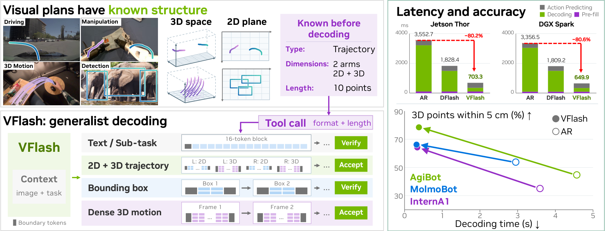
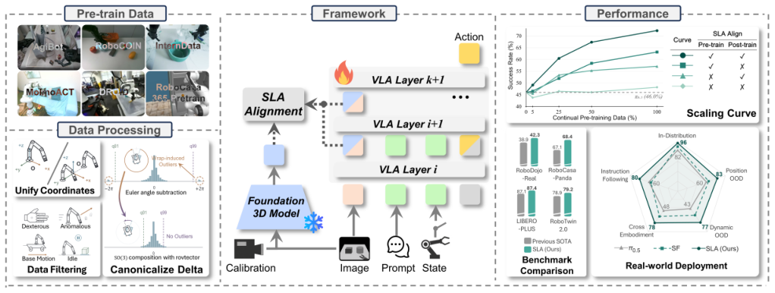
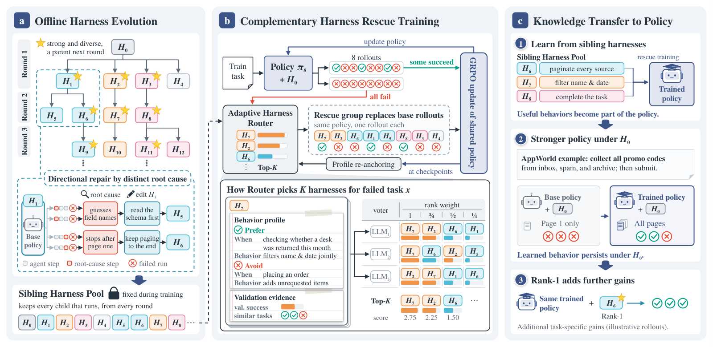
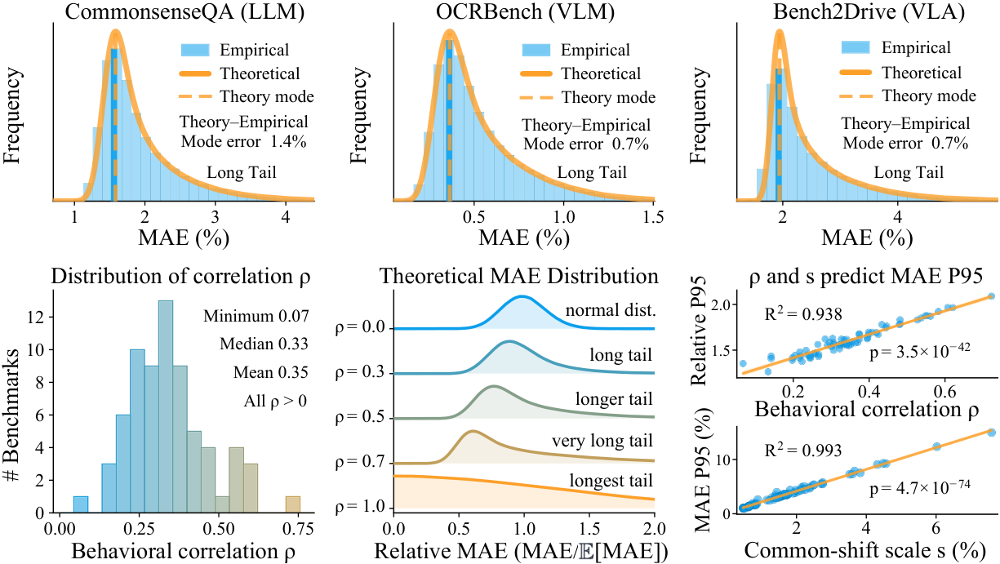
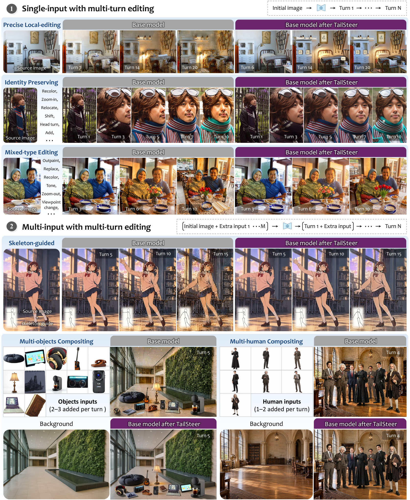
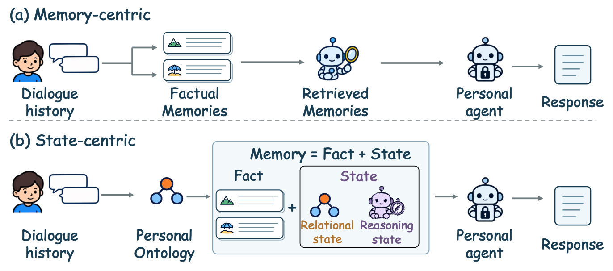
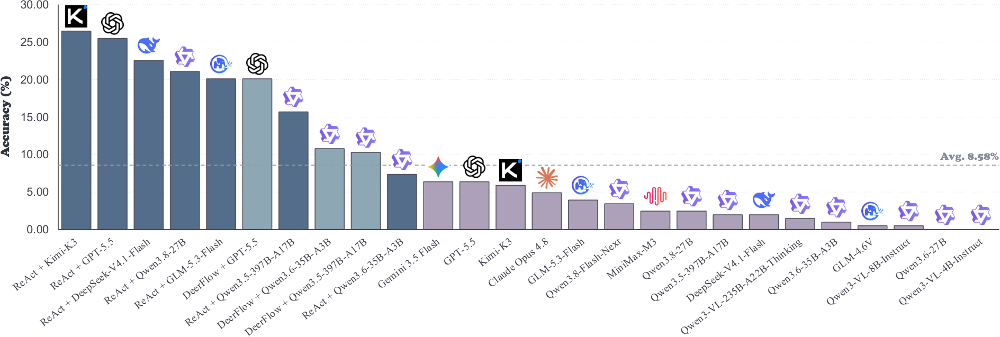
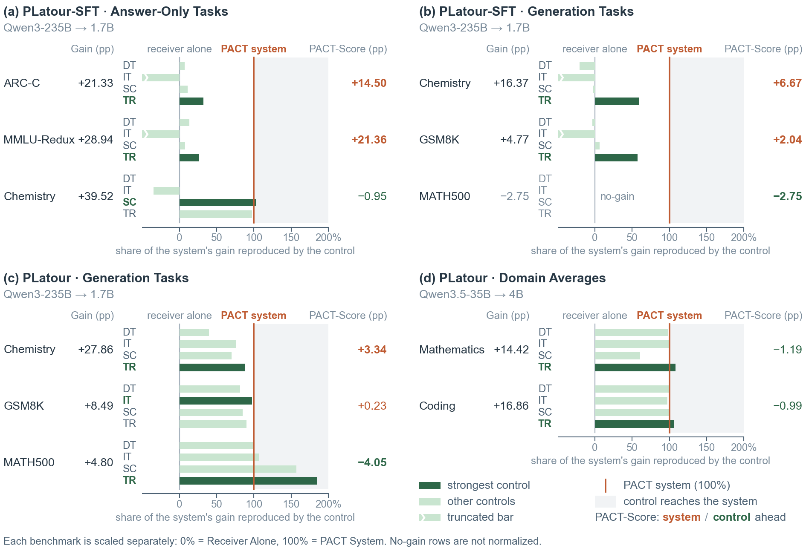
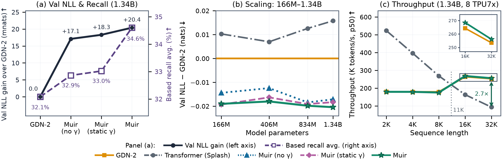
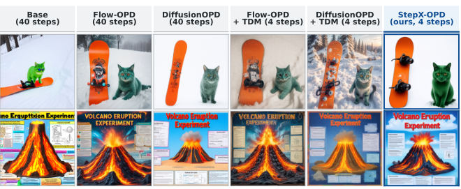

# Daily AI papers — 2026-11-07

*Curated from HF Daily Papers. 15 of 32 papers kept after relevance filter.*

## Papers at a glance

| # | Title | Topics | Org |
| --- | --- | --- | --- |
| 1 | [VFlash: Fast, Accurate Visual Planning via Flash Primitive Decoding](#1-vflash-fast-accurate-visual-planning-via-flash-primitive-decoding) | `multimodal`, `agents`, `efficient-inference` | NVIDIA |
| 2 | [SLA: Scaling Spatial-Language-Action Model via Continual Pre-training](#2-sla-scaling-spatial-language-action-model-via-continual-pre-training) | `multimodal`, `VLA` | HKUST (Guangzhou) |
| 3 | [Harness-S: Learning from Sibling Harnesses for Generalizable Agent Training](#3-harness-s-learning-from-sibling-harnesses-for-generalizable-agent-training) | `agents`, `RL` | Xiaohongshu / SJTU |
| 4 | [Random Is Almost Enough? Benchmark Compression via BestRand](#4-random-is-almost-enough-stable-and-low-cost-benchmark-compression-via-bestrand) | `eval` | CMU |
| 5 | [WeLM-Image: A Unified Image Generation Model towards Visual Intelligence](#5-welm-image-a-unified-image-generation-model-towards-visual-intelligence) | `multimodal`, `diffusion` | Tencent / WeChat Vision |
| 6 | [TailSteer: Trajectory-Tail Steering for Drift-Resistant Multi-turn Image Editing](#6-tailsteer-trajectory-tail-steering-for-drift-resistant-multi-turn-image-editing) | `diffusion`, `multimodal` | MMLab CUHK |
| 7 | [EvoMemState: Evolving Memory State for Personal Agents](#7-evomemstate-evolving-memory-state-for-personal-agents) | `agents`, `RL` | Xiamen University |
| 8 | [VisSearch-Bench: Evaluating Long Horizon Visual Search in Multimodal Agents](#8-vissearch-bench-evaluating-long-horizon-visual-search-in-multimodal-agents) | `eval`, `multimodal`, `agents` | Ant Group |
| 9 | [Towards Foundation Decision Models: Drex](#9-towards-foundation-decision-models-drex) | `LLM`, `RL`, `eval` | — |
| 10 | [On the Opportunities and Challenges of Prefill-to-Autoregressive Cross-Model Transfer](#10-on-the-opportunities-and-challenges-of-prefill-to-autoregressive-cross-model-transfer) | `efficient-inference` | King's College London |
| 11 | [Muir: Linear Attention with Sensitivity-Allocated Gating and Matched-Filter Readout](#11-muir-linear-attention-with-sensitivity-allocated-gating-and-matched-filter-readout) | `architectures`, `efficient-inference` | Google |
| 12 | [SAE Interprets MoE: Experts Exhibit Human-Interpretable Fine-Grained Specialization](#12-sae-interprets-moe-sparse-autoencoders-reveal-that-moe-experts-exhibit-human-interpretable-fine-grained-specialization) | `interp`, `MoE` | ByteDance Seed |
| 13 | [Decode Before You Hear: Speculative Listening for Full-Duplex Speech LMs](#13-decode-before-you-hear-speculative-listening-for-chunk-interleaved-full-duplex-speech-language-models) | `efficient-inference`, `multimodal` | CUHK Shenzhen |
| 14 | [StepX-OPD: Rethinking Multi-Teacher On-Policy Distillation in Diffusion Models](#14-stepx-opd-rethinking-multi-teacher-on-policy-distillation-in-diffusion-models) | `diffusion`, `RL` | StepFun |
| 15 | [Identically Trained Language Models Break on Different Jailbreaks](#15-identically-trained-language-models-break-on-different-jailbreaks) | `safety`, `eval` | Cerulean Labs |

---

## 1. VFlash: Fast, Accurate Visual Planning via Flash Primitive Decoding

**Authors:** Shihao Wang, Jin Huang, Chi-Pin Huang, Chiao-An Yang, Xianzhe Fan, Jing Wang, Zhiqi Li, Yuanguo Kuang, Ruijie Zheng, Johan Bjorck, Sifei Liu, Hang Su, Abhishek Badki, Lei Zhang, Alan Yuille, Linxi "Jim" Fan, Jan Kautz, Zhiding Yu — *NVIDIA*
**Links:** [arXiv:2611.08449](https://arxiv.org/abs/2611.08449) · [HF](https://huggingface.co/papers/2611.08449) · [AlphaXiv](https://www.alphaxiv.org/abs/2611.08449)
**Topics:** `multimodal`, `agents`, `efficient-inference`

### TL;DR

VFlash replaces the standard autoregressive token-by-token decoder for visual planning tasks (points, bounding boxes, trajectories) with a single-shot "flash" decoder that predicts all primitive coordinates in parallel. A lightweight drafter outputs the full plan in one forward pass, yielding both lower error and dramatically faster planning for 2D/3D robot trajectories and spatial reasoning tasks.

### Key idea

Visual primitives are structurally short but currently emitted as long strings of digit tokens by VLMs. VFlash adds a non-autoregressive "flash primitive head" that predicts coordinates jointly, bypassing serial token decoding. The main model handles grounding/language; the flash head collapses planning into a single step.

### Main finding

Reports lower prediction errors than autoregressive decoding on 2D and 3D robot trajectory benchmarks, ~25× faster generation for 3D point-motion forecasting, and 70.2% average success on four MolmoSpaces task suites vs. 62.6% for the autoregressive baseline.

### Why it matters

Removes the latency bottleneck that has made VLA/robot planning with VLMs impractical at interactive rates. Suggests a general pattern: structured numeric outputs don't belong in a token stream.

### Knowledge graph integration

**Builds on / relates to existing pages:**
- [multimodal/README.md](../multimodal/README.md) — VLA-style multimodal planning stack
- [agents/README.md](../agents/README.md) — tool/action outputs by an agent

**Suggested new pages:**
- `inference/flash-primitive-decoding.md` *(depth)* — non-autoregressive heads for structured numeric outputs
- `multimodal/_vla.md` *(taxonomy)* — Vision-Language-Action model family (needed given multiple VLA papers in today's digest)

---

## 2. SLA: Scaling Spatial-Language-Action Model via Continual Pre-training

**Authors:** Wenxuan Song, Qizhou Huang, Ziyang Zhou, Jingbo Wang, Junwu E, Pengwei Wang, Yan Wang, Shunbo Zhou, Haoang Li — *HKUST (Guangzhou), OLA Dimensions, BAAI, Tsinghua*
**Links:** [arXiv:2611.08373](https://arxiv.org/abs/2611.08373) · [HF](https://huggingface.co/papers/2611.08373) · [AlphaXiv](https://www.alphaxiv.org/abs/2611.08373)
**Topics:** `multimodal`, `VLA`

### TL;DR

SLA injects 3D spatial grounding into an existing 2D-image VLA policy (π0.5) via a continual pre-training stage. During training, SLA jointly predicts actions and aligns intermediate visual embeddings to features from a frozen 3D perception model, so the policy inherits spatial reasoning without altering inference cost.

### Key idea

A two-objective pretraining stage: action prediction + a distillation loss that matches selected VLM layer activations to a frozen 3D encoder's features. Adaptive layer selection picks which layers to align; probabilistic state dropout regularises against over-reliance on proprioception. The 3D encoder is dropped at inference.

### Borderline inclusion

*Borderline: VLA/robotics, included because it is a method contribution (continual-pretraining recipe for spatial grounding) applicable to any VLA stack, not a robotics-only control paper.*

### Main finding

State-of-the-art on several VLA benchmarks and +24.0 points average real-world success rate over the π0.5 baseline across manipulation tasks requiring spatial reasoning.

### Why it matters

Shows that frozen 3D perception models can be grafted onto 2D VLAs via distillation without inference-time overhead — a cheap path to spatial competence for everyone riding on 2D VLM backbones.

### Knowledge graph integration

**Builds on / relates to existing pages:**
- [multimodal/README.md](../multimodal/README.md) — multimodal pretraining recipes
- [pre-training/mid-training.md](../pre-training/mid-training.md) — continual pretraining as a distinct stage

**Suggested new pages:**
- `multimodal/spatial-grounding-distillation.md` *(depth)* — layer-wise alignment to a frozen 3D encoder

---

## 3. Harness-S: Learning from Sibling Harnesses for Generalizable Agent Training

**Authors:** Wenxiang Jiao, Bowen Fang, Shuai Shao, Jiachen Zhu, Rong Shan, Shijian Wang, Hao Wang, Yuan Lu, Weiwen Liu, Weinan Zhang — *Xiaohongshu, SJTU, Zhongguancun AI, SEU, CMU*
**Links:** [arXiv:2611.04277](https://arxiv.org/abs/2611.04277) · [HF](https://huggingface.co/papers/2611.04277) · [AlphaXiv](https://www.alphaxiv.org/abs/2611.04277)
**Topics:** `agents`, `RL`, `fine-tuning`

### TL;DR

Agent policies trained inside one scaffold ("harness") rarely transfer to another. Harness-S shows that *sibling* harnesses — variants of the same base scaffold (different tool sets, prompt formats, memory layouts) — expose complementary skills, and that a single policy can be trained to absorb those skills while remaining usable under the original harness.

### Key idea

Build sibling harness variants, collect successful rollouts across all siblings on tasks the base harness fails on, then train one policy on the aggregated trajectories with harness identity as a conditioning signal. At inference, the policy runs under the native harness but has absorbed cross-harness transfer.

### Main finding

Reports accuracy gains on AppWorld, SWE-Gym, and DBBench over a base-harness-only policy; further gains from a routing step that picks among siblings at inference.

### Why it matters

Agent training has been siloed by scaffold choice. If sibling harnesses are a cheap source of complementary skill data, agent RL can escape the "overfits to scaffold" failure mode and produce more portable policies.

### Knowledge graph integration

**Builds on / relates to existing pages:**
- [agents/README.md](../agents/README.md) — agent scaffolding and tool interfaces
- [post-training/rejection-sampling.md](../post-training/rejection-sampling.md) — keep successful rollouts, discard failures
- [post-training/rl-prompt-curation.md](../post-training/rl-prompt-curation.md) — curating the training distribution of an RL policy

**Suggested new pages:**
- `agents/sibling-harness-training.md` *(depth)* — cross-harness rollout aggregation for generalisable agents

---

## 4. Random Is Almost Enough? Stable and Low-Cost Benchmark Compression via BestRand

**Authors:** George Ling, Shanshan Zhong, Lijin Yang, Hao Yang, Nanxiang Li, Zhongzhan Huang — *Carnegie Mellon University*
**Links:** [arXiv:2611.00883](https://arxiv.org/abs/2611.00883) · [HF](https://huggingface.co/papers/2611.00883) · [AlphaXiv](https://www.alphaxiv.org/abs/2611.00883)
**Topics:** `eval`

### TL;DR

Evaluating frontier models on full benchmarks is expensive. BestRand studies when a random subset of items gives a faithful score estimate and derives an analytical approximation of the error distribution: it is long-tailed — most random subsets are fine, but a few are catastrophically off. The method keeps random sampling's cheapness while cutting the bad-tail outliers.

### Key idea

For each benchmark, draw many candidate random subsets, score cheaply with a surrogate signal, and pick the subset whose predicted full-score error is smallest. The analytical framework explains *why* a small amount of selection on top of random beats both pure random and heavier coreset methods.

### Main finding

Tested on 70+ text, multimodal, and agent benchmarks, plus a VLA extension. Reduces the worst-case estimation error relative to uniform random while matching its sampling cost.

### Why it matters

Benchmark compute is a real constraint for anyone evaluating dozens of model variants (RL training checkpoints, quantization recipes, finetunes). A well-grounded subset-selection rule saves a lot of GPU-hours without the "cherry-picked easy items" risk of hand-crafted coresets.

### Knowledge graph integration

**Builds on / relates to existing pages:**
- [evaluation/README.md](../evaluation/README.md) — benchmark design and subset evaluation
- [evaluation/mmlu.md](../evaluation/mmlu.md) — the kind of benchmark BestRand compresses

**Suggested new pages:**
- `evaluation/benchmark-compression.md` *(depth)* — BestRand and the long-tailed random-subset error theory

---

## 5. WeLM-Image: A Unified Image Generation Model towards Visual Intelligence

**Authors:** *WeChat Vision team* — *Tencent*
**Links:** [arXiv:2611.07392](https://arxiv.org/abs/2611.07392) · [HF](https://huggingface.co/papers/2611.07392) · [AlphaXiv](https://www.alphaxiv.org/abs/2611.07392)
**Topics:** `multimodal`, `diffusion`

### TL;DR

WeLM-Image is Tencent's unified image generation model covering text-to-image, instruction-based editing, and more complex visual-intelligence tasks (composition, reasoning-grounded edits) under a single checkpoint. The paper is pitched as a tech report with training-stage recipes and public benchmark comparisons.

### Key idea

A unified generation stack that routes all image tasks (generation, editing, compositional reasoning) through the same decoder, with a staged training recipe that progressively adds editing and instruction-following capabilities on top of a base generation model.

### Main finding

Benchmark results against SOTA generation + editing models; strong performance on compositional / instruction-driven image tasks. (Full numbers in the paper — the HF page emphasises the "visual intelligence" framing rather than a single scalar.)

### Why it matters

The frontier for image models is no longer raw generation quality but instructional + compositional faithfulness. A unified release from a major lab is useful as a reference recipe and as a point of comparison for open-source stacks like FLUX / SD3.5.

### Knowledge graph integration

**Builds on / relates to existing pages:**
- [multimodal/README.md](../multimodal/README.md) — unified multimodal stacks

**Suggested new pages:**
- `case-studies/welm-image.md` *(case study)* — if the training recipe is sufficiently documented

*(Borderline for a case study — the HF page is thin on recipe detail. Flag for follow-up once the full report lands.)*

---

## 6. TailSteer: Trajectory-Tail Steering for Drift-Resistant Multi-turn Image Editing

**Authors:** Ruikang Li, Zixuan Chen, Jiarui Wu, Mingde Yao, Yiyuan Zhang, Yujin Wang, Hanming Deng, Lewei Lu, Tianfan Xue — *MMLab-CUHK*
**Links:** [arXiv:2611.06741](https://arxiv.org/abs/2611.06741) · [HF](https://huggingface.co/papers/2611.06741) · [AlphaXiv](https://www.alphaxiv.org/abs/2611.06741)
**Topics:** `diffusion`, `multimodal`

### TL;DR

Chaining image edits for many turns causes slow visual drift — unedited regions quietly degrade. TailSteer is a final-stage training framework that keeps early denoising steps close to the base model and injects "preservation corrections" only near the end of the trajectory (the tail), supervised against the editor's own rollouts with the source image as the reference.

### Key idea

Split the denoising trajectory into head (close to prior, keep base model behaviour) and tail (apply learned preservation residuals). The tail objective is self-supervised: unchanged content in the rollout should match the input, which gives a loss without needing curated ground-truth edit pairs.

### Main finding

15–20-turn drift reduction across FLUX, SenseNova, and Qwen image-editing stacks with base-model editing quality largely preserved.

### Why it matters

Agentic image editing — where a user iterates many turns — has been bottlenecked by compounding drift. Trajectory-tail corrections are a cheap finetune that does not require labelled edit pairs.

### Knowledge graph integration

**Builds on / relates to existing pages:**
- [multimodal/README.md](../multimodal/README.md) — diffusion-based image models

**Suggested new pages:**
- `multimodal/trajectory-tail-steering.md` *(depth)* — self-supervised tail-only correction for drift-resistant editing

---

## 7. EvoMemState: Evolving Memory State for Personal Agents

**Authors:** Zhishang Xiang, Yunbo Tang, Zhongqiao Liu, Junkai Chen, Zerui Chen, Qingguo Hu, Yuxuan Zhang, William Grant, Qinggang Zhang, Jinsong Su — *Xiamen University, NTU, UBC, Waterloo, Jilin*
**Links:** [arXiv:2611.03743](https://arxiv.org/abs/2611.03743) · [HF](https://huggingface.co/papers/2611.03743) · [AlphaXiv](https://www.alphaxiv.org/abs/2611.03743)
**Topics:** `agents`, `RL`

### TL;DR

A memory framework for personal LLM agents that separates *what the agent remembers* from *how it uses those memories*. Facts are augmented with a "Relational State" tracking validity and inter-fact relations, and a "Reasoning State" produced by an RL-trained policy that decides which facts apply to the current request.

### Key idea

Two state layers wrap the standard long-term memory: a structured relational view over facts (so edits cascade correctly) and an RL-trained usage policy that composes retrieval with the user's current intent. Training reward comes from grounded response accuracy.

### Main finding

Outperforms existing memory systems (standard retrieval, MemGPT-style stacks) in both retrieval completeness and memory-grounded response accuracy on personal-assistant benchmarks.

### Why it matters

As personal agents accumulate months of conversation history, naïve retrieval breaks. Learned reasoning state over structured memories is a principled replacement for ever-growing context windows.

### Knowledge graph integration

**Builds on / relates to existing pages:**
- [agents/README.md](../agents/README.md) — agent memory, planning, retrieval
- [post-training/_rl.md](../post-training/_rl.md) — RL-trained policies in multi-component systems

**Suggested new pages:**
- `agents/agent-memory.md` *(depth)* — structured memory stacks with learned usage policies

---

## 8. VisSearch-Bench: Evaluating Long Horizon Visual Search in Multimodal Agents

**Authors:** ZhengXian Wu, Qianhao Nie, Zhuohong Chen, Junjie Gao, Yuyao Zhang, Yunyao Yu, Hangrui Xu, Cheng Cheng, Guiyu Ma, Jin Zhang, Xingzhong Xu, Kai Yang, Haoqian Wang — *Ant Group*
**Links:** [arXiv:2611.04894](https://arxiv.org/abs/2611.04894) · [HF](https://huggingface.co/papers/2611.04894) · [AlphaXiv](https://www.alphaxiv.org/abs/2611.04894)
**Topics:** `eval`, `multimodal`, `agents`

### TL;DR

A benchmark for multimodal agents on visually intensive search tasks that require integrating image context with web-style external information gathering. Even the best system fully solves only 26.47% of tasks — a wide gap to saturation.

### Key idea

Tasks are structured so a single-image answer is impossible: the agent must ground the image, form a query, execute a search, and synthesise across returned information. Evaluation is end-to-end task success, not per-step accuracy.

### Main finding

Top frontier systems reach 26.47% full-task success. Error analysis isolates grounding failures and premature answer commitment as dominant failure modes.

### Why it matters

Public multimodal-agent benchmarks are saturating; VisSearch-Bench reopens headroom and specifically stresses the vision × retrieval loop that is weakest in current stacks.

### Knowledge graph integration

**Builds on / relates to existing pages:**
- [evaluation/README.md](../evaluation/README.md) — benchmarks for multimodal and agentic systems
- [agents/README.md](../agents/README.md) — agent evaluation methodology

**Suggested new pages:**
- `evaluation/vissearch-bench.md` *(depth)* — long-horizon visual-search benchmark design

---

## 9. Towards Foundation Decision Models: Drex

**Authors:** Alisher Amantay, Zhanibek Datbayev, Darkhan Akhmetov, Yash Shah, Nurmukhamed Ubaidullayev, Raman Saparkhan Dos Baha, Abulhair Saparov
**Links:** [arXiv:2611.07854](https://arxiv.org/abs/2611.07854) · [HF](https://huggingface.co/papers/2611.07854) · [AlphaXiv](https://www.alphaxiv.org/abs/2611.07854)
**Topics:** `LLM`, `RL`, `eval`

### TL;DR

Drex is a family of four open "decision models" — models that take a user-supplied option set and return a probability distribution over options, directly, without autoregressive text generation. Pitched as a lower-cost, lower-latency alternative to LLM-as-classifier.

### Key idea

A decision model outputs a calibrated distribution over up to N candidate options in a single forward pass. Training combines SFT, a reinforcement-learning-from-feedback variant the authors call RLAF, and vision tuning for multimodal decisions.

### Main finding

Drex Max is competitive with frontier LLMs on real-data decision benchmarks, fast, reasonably calibrated, and stable under option reordering. Models released under open licenses.

### Why it matters

A lot of production use of LLMs is multiple-choice in disguise (routing, moderation, judge-LLM calls). A purpose-built decision model is both cheaper and less flaky than prompting a generative LLM to emit a label — and the reorder-stability property matters for downstream fairness.

### Knowledge graph integration

**Builds on / relates to existing pages:**
- [post-training/_rl.md](../post-training/_rl.md) — RL variants for post-training
- [post-training/cot-reward-model.md](../post-training/cot-reward-model.md) — closely-related judge/classifier head designs
- [evaluation/README.md](../evaluation/README.md) — classifier calibration evaluation

**Suggested new pages:**
- `post-training/decision-model.md` *(depth)* — non-generative decision heads over N options
- `case-studies/drex.md` *(case study)* — if the technical report justifies it after full read

---

## 10. On the Opportunities and Challenges of Prefill-to-Autoregressive Cross-Model Transfer

**Authors:** Junru Lu, Wei Liu, Jiangnan Ye, Jiazheng Li, Di Yin, Xing Sun, Tameem Adel, Yali Du, Lin Gui, Yulan He — *King's College London, Tencent Youtu Lab, NPL UK*
**Links:** [arXiv:2611.06976](https://arxiv.org/abs/2611.06976) · [HF](https://huggingface.co/papers/2611.06976) · [AlphaXiv](https://www.alphaxiv.org/abs/2611.06976)
**Topics:** `efficient-inference`, `LLM`

### TL;DR

PLatour is an open framework for Prefill-to-Autoregressive Cross-model Transfer (PACT): a large sender model processes the prompt (prefill only) and transfers something to a smaller receiver model, which does the autoregressive generation. The paper is a mixed message — it both shows gains and shows that many of those gains come from non-communication artefacts.

### Key idea

Decouple prefill and decode across two different models. The authors introduce PACT-Check: a controlled battery (uninformative sender signals, self-communication, receiver-only training) that isolates how much improvement is actually due to information flowing from sender to receiver.

### Main finding

PLatour outperforms open baselines and surpasses Mostik's reported results with a much smaller sender. But PACT-Check shows portions of the gain are reproducible with uninformative or self-signals — i.e. not from genuine cross-model transfer. The paper is unusually honest about this.

### Why it matters

Prefill/decode disaggregation has become a dominant inference pattern (vLLM, SGLang). Cross-*model* disaggregation is the natural next step; this paper flags that we need rigorous ablations before claiming big-model-prefill actually helps a small-model-decode.

### Knowledge graph integration

**Builds on / relates to existing pages:**
- [inference/README.md](../inference/README.md) — prefill/decode disaggregation
- [evaluation/README.md](../evaluation/README.md) — methodology for isolating confounders in ablations

**Suggested new pages:**
- `inference/prefill-decode-disaggregation.md` *(depth)* — the pattern itself (not yet in the graph)
- `inference/cross-model-prefill-transfer.md` *(depth)* — PACT and PACT-Check protocol

---

## 11. Muir: Linear Attention with Sensitivity-Allocated Gating and Matched-Filter Readout

**Authors:** Gil Tabak, Clemens JS Schaefer — *Google*
**Links:** [arXiv:2611.08376](https://arxiv.org/abs/2611.08376) · [HF](https://huggingface.co/papers/2611.08376) · [AlphaXiv](https://www.alphaxiv.org/abs/2611.08376)
**Topics:** `architectures`, `efficient-inference`

### TL;DR

A linear-attention variant built on the gated delta-rule family. Muir exploits an asymmetry: gated delta-rule models are much more sensitive to *write* updates than to *erase* updates, so the erase gate can use a much lower-rank projection while the write path keeps full capacity. A matched-filter readout head and wider FFN round out the recipe.

### Key idea

Allocate parameters along sensitivity: cheap low-rank erase gate (shared projection), full-rank write path, matched-filter readout that treats retrieval as a correlation decode. Plus a numerically stable chunkwise training formulation.

### Main finding

Lower perplexity than GDN-2 and a Transformer baseline across 166M–1.34B parameters, better long-context retrieval, and training-speed gains at 32K tokens.

### Why it matters

Linear attention has become the serious contender for long-context inference (Mamba, GDN, RWKV). Muir's asymmetric sensitivity argument is a useful design lens — and the matched-filter readout is a novel head.

### Knowledge graph integration

**Builds on / relates to existing pages:**
- [architectures/multi-head-attention.md](../architectures/multi-head-attention.md) — attention variants
- [fundamentals/attention.md](../fundamentals/attention.md) — baseline for comparison
- [architectures/mla.md](../architectures/mla.md) — another compression-oriented attention variant

**Suggested new pages:**
- `architectures/_linear-attention.md` *(taxonomy)* — Mamba / GDN / Muir / RWKV family (gap in the graph)
- `architectures/muir.md` *(depth)* — sensitivity-allocated gating + matched-filter readout

---

## 12. SAE Interprets MoE: Sparse AutoEncoders Reveal That MoE Experts Exhibit Human-Interpretable Fine-Grained Specialization

**Authors:** Anyuan Zhuo, Shaohua Zhang, Yuan Lin, Pinyan Lu — *ByteDance Seed*
**Links:** [arXiv:2611.08089](https://arxiv.org/abs/2611.08089) · [HF](https://huggingface.co/papers/2611.08089) · [AlphaXiv](https://www.alphaxiv.org/abs/2611.08089)
**Topics:** `interp`, `MoE`

### TL;DR

Train a sparse autoencoder on a MoE layer's output. Because the layer's output is already a router-weighted sum of expert outputs and the SAE's encoder is affine, each SAE latent's activation decomposes exactly as a linear combination over experts. On Qwen3-30B-A3B, this decomposition shows experts drive specific interpretable features at a finer granularity than the router's coarse gating.

### Key idea

Exploit the linearity of the affine SAE encoder to turn SAE interpretation into per-expert attribution. Analyse on three layers (4, 30, 46) of Qwen3-30B-A3B. Auto-interpret the latents with an LLM judge.

### Main finding

Expert *contribution* to interpretable latents is far more concentrated than their *gating probability*. Specialisation is fine-grained — well below the coarse domain level (not just "code expert" / "math expert" but sub-concepts).

### Why it matters

Opens a principled way to study what MoE experts actually do, something the field has struggled with. If experts specialise this finely, MoE interpretability is unlocked — and training techniques that target specialisation (not just load balance) become appealing.

### Knowledge graph integration

**Builds on / relates to existing pages:**
- [architectures/_moe.md](../architectures/_moe.md) — MoE taxonomy
- [architectures/deepseek-moe.md](../architectures/deepseek-moe.md) — fine-grained-expert design
- [architectures/aux-loss-free-balancing.md](../architectures/aux-loss-free-balancing.md) — expert routing
- [interpretability/README.md](../interpretability/README.md) — SAE-based interpretability

**Suggested new pages:**
- `interpretability/sparse-autoencoder.md` *(depth)* — SAEs on LLM activations (foundational gap in graph)
- `interpretability/sae-moe-attribution.md` *(depth)* — per-expert decomposition via SAEs

---

## 13. Decode Before You Hear: Speculative Listening for Chunk-Interleaved Full-Duplex Speech Language Models

**Authors:** Yutong Bian, Yanglin Zhang, Yuxiang Wang, Luoyuan Zhang, Rongshen He, Zihao Wang, Junwen Qiu, Jiaqi Li, Zhizheng Wu — *CUHK Shenzhen*
**Links:** [arXiv:2611.06982](https://arxiv.org/abs/2611.06982) · [HF](https://huggingface.co/papers/2611.06982) · [AlphaXiv](https://www.alphaxiv.org/abs/2611.06982)
**Topics:** `efficient-inference`, `multimodal`

### TL;DR

Full-duplex speech LMs process audio in fixed chunks. "Listen" chunks leave compute idle; "speak"/"tool-call" chunks need serial decoding, causing lag. Speculative Listening fills idle time by drafting the next chunk *under the assumption of silence*, then verifying when the real audio arrives. Two observed properties make it a nearly-free lunch.

### Key idea

Measure: (1) under-silence draft matches real-audio output in 95.3% of chunks; (2) 88% of changes start at the first token. So: draft the main branch under silence, and for the first-token case add a second draft branch starting from the runner-up first token. Keep both in a cross-chunk hypothesis pool; verify on audio arrival. Training-free and lossless.

### Main finding

Speak-chunk speedup 2.6–2.8×, tool-call-chunk speedup up to 23.4×. Average time-to-first-response dropped by 73% to 74–241 ms (near the ~200 ms human turn-gap). Maximum real-time lag cut by 94.4%. Benchmarked on TickTock-Bench.

### Why it matters

Interactive speech systems live or die by latency to first response. Speculative Listening is a speech-LM-native variant of speculative decoding that uses otherwise-wasted listening compute.

### Knowledge graph integration

**Builds on / relates to existing pages:**
- [inference/README.md](../inference/README.md) — speculative decoding family
- [multimodal/README.md](../multimodal/README.md) — speech LM stacks

**Suggested new pages:**
- `inference/speculative-decoding.md` *(depth)* — base technique, gap in the graph
- `inference/speculative-listening.md` *(depth)* — under-silence self-speculation for full-duplex speech LMs

---

## 14. StepX-OPD: Rethinking Multi-Teacher On-Policy Distillation in Diffusion Models

**Authors:** Chenru Wang, Xuanyang Zhang, Yucheng Han, Wenbo Nie, Wei Cheng, Xianfang Zeng, Gang Yu, Chi Zhang — *StepFun*
**Links:** [arXiv:2611.04386](https://arxiv.org/abs/2611.04386) · [HF](https://huggingface.co/papers/2611.04386) · [AlphaXiv](https://www.alphaxiv.org/abs/2611.04386)
**Topics:** `diffusion`, `RL`

### TL;DR

Distilling multiple capabilities (instruction following, text rendering, human preference) plus few-step sampling into a text-to-image diffusion model is typically done in two separate stages. StepX-OPD does both in one, with the student learning from frozen specialist teachers on states its *own* rollout visits.

### Key idea

On-policy distillation: student takes a trajectory, each teacher scores it on its specialty, and the student is updated against the aggregated multi-teacher signal. A velocity-regression loss applied on the low-noise tail stabilises the student. A variant specifically counters "prompt spillover" (models writing the prompt words into the image).

### Main finding

Highest normalised average among four-step sampling methods on SD3.5-Medium and FLUX.1-dev. SD3.5-Medium training uses ~37% fewer GPU-hours than the sequential multi-stage baseline.

### Why it matters

Few-step diffusion + capability distillation have been treated as separate problems. A unified on-policy recipe is cheaper and avoids the "second stage undoes the first" failure mode.

### Knowledge graph integration

**Builds on / relates to existing pages:**
- [post-training/_rl.md](../post-training/_rl.md) — on-policy training patterns
- [multimodal/README.md](../multimodal/README.md) — diffusion image models

**Suggested new pages:**
- `multimodal/on-policy-distillation-diffusion.md` *(depth)* — multi-teacher on-policy distillation for text-to-image

---

## 15. Identically Trained Language Models Break on Different Jailbreaks

**Authors:** Chi-Wei Chang, Mu-Tien Kuo, Kuan-Wei Lee, Meng-Hsun Tsai — *Cerulean Labs*
**Links:** [arXiv:2610.34074](https://arxiv.org/abs/2610.34074) · [HF](https://huggingface.co/papers/2610.34074) · [AlphaXiv](https://www.alphaxiv.org/abs/2610.34074)
**Topics:** `safety`, `eval`

### TL;DR

Train 1B base models from 25 different pretraining data recipes × 3 pretraining seeds per recipe, then apply identical safety post-training. The study finds that jailbreak vulnerability is driven almost entirely by **pretraining seed**, not by the data recipe — a result with big implications for safety eval reproducibility.

### Key idea

A controlled factorial study (data × seed) with downstream refusal pattern correlation as the dependent variable. Per-prompt refusal patterns correlate at 0.984 between post-trained copies of the same run, 0.811 across seeds, and 0.779 across recipes. The best attack against one checkpoint remains best after reseeding only 27% of the time.

### Main finding

Pretraining randomness dominates safety-test outcomes. Per-prompt refusal fingerprints are so stable within a run that they identify each model's pretraining history among 75 runs with high accuracy.

### Why it matters

Current safety evals assume that a representative model from a family generalises; this paper shows that assumption is shaky at the seed level. Red-teaming an eval of one checkpoint may tell you little about a sibling with a different seed. A sobering calibration result for safety research.

### Knowledge graph integration

**Builds on / relates to existing pages:**
- [safety/_jailbreaks.md](../safety/_jailbreaks.md) — jailbreak taxonomy
- [safety/_attacks.md](../safety/_attacks.md) — adversarial attack classification
- [evaluation/README.md](../evaluation/README.md) — reproducibility of capability/safety evals

**Suggested new pages:**
- `safety/pretraining-seed-jailbreak-variance.md` *(depth)* — seed-driven variance in safety-posttrained refusal patterns

---

## Notes

- Borderline inclusions are flagged in-section with an italic *Borderline: …* note. One paper (2611.05376, "Cognitive Symbionts") was dropped as a vision/position piece without a concrete method contribution.
- Hero figures live in `assets/2026-11-07/`. Four papers (Drex, SAE-interprets-MoE, Speculative Listening, Jailbreak-variance) have no hero figure because the arXiv HTML page did not surface a usable top figure.
- This digest is informational. No existing concept files, `READING-LIST.md`, or `PAPERS.md` were modified to produce it.
