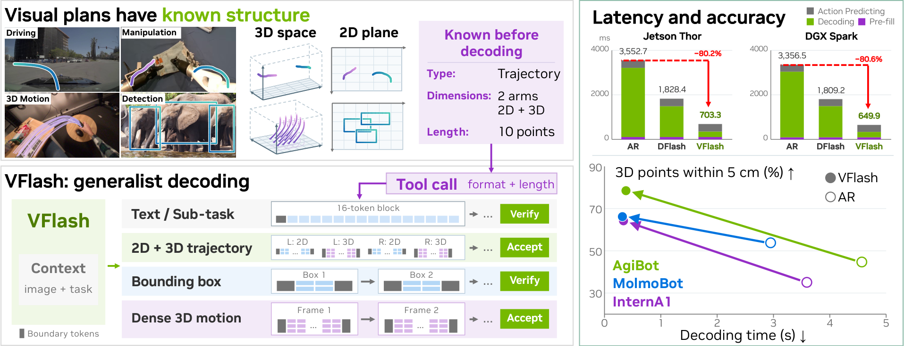
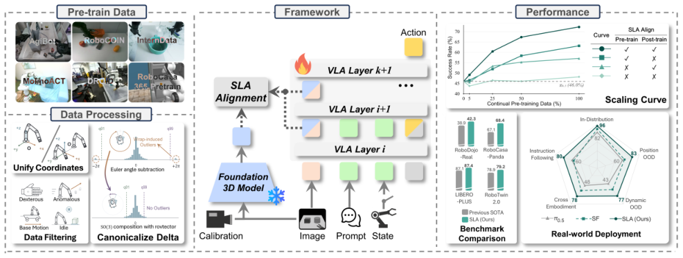
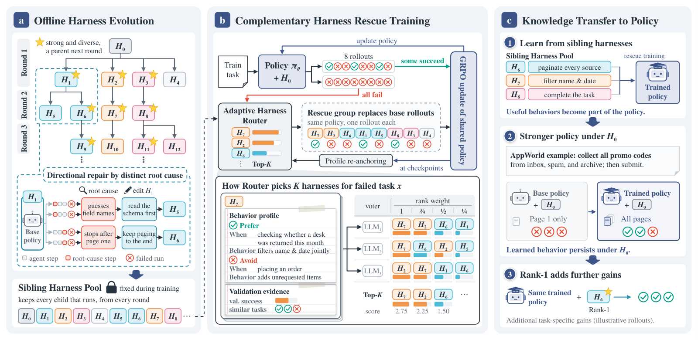
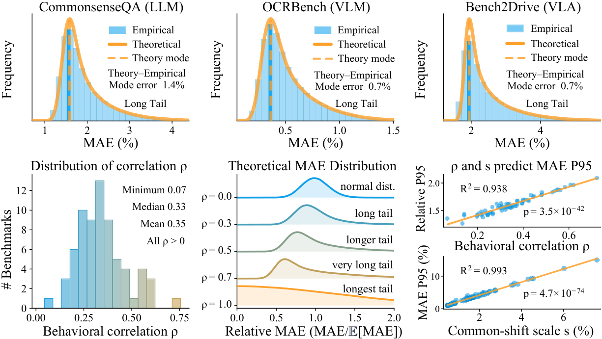
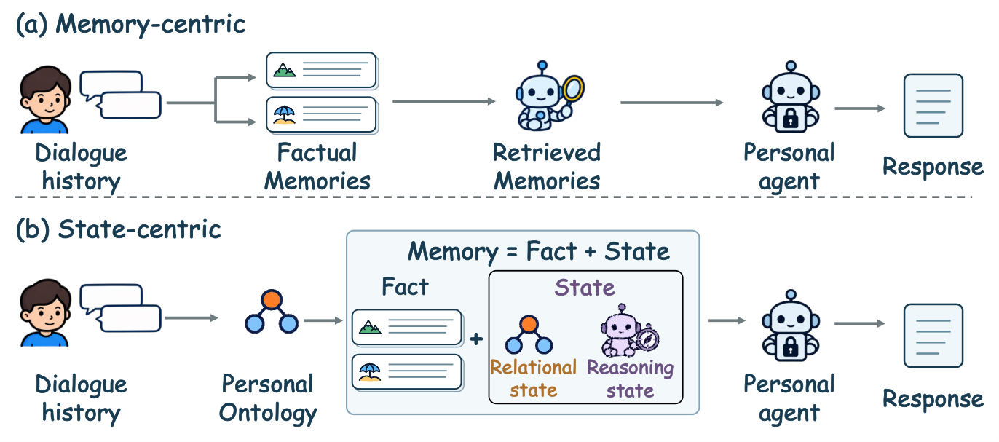
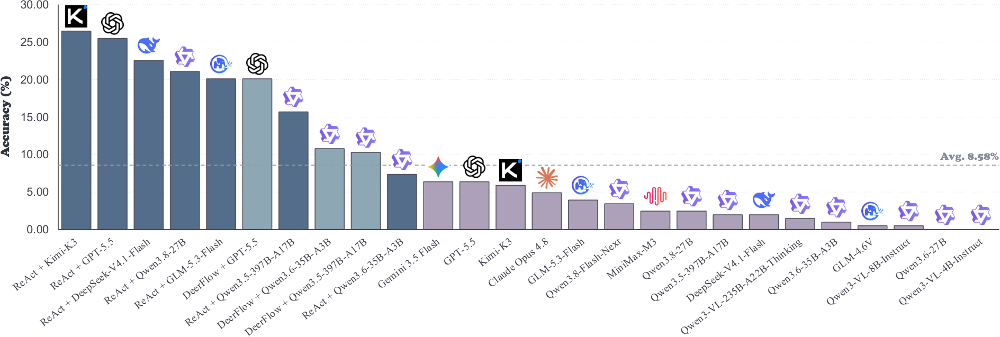
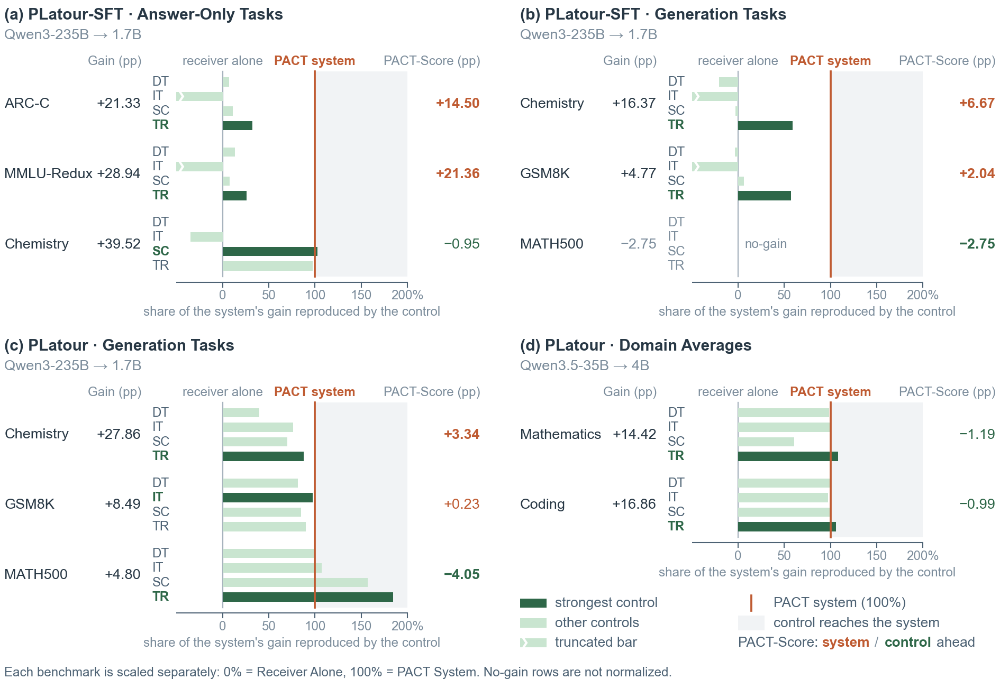
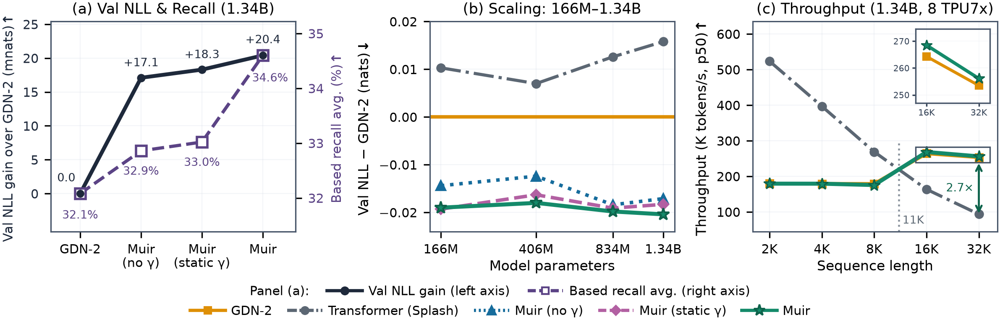
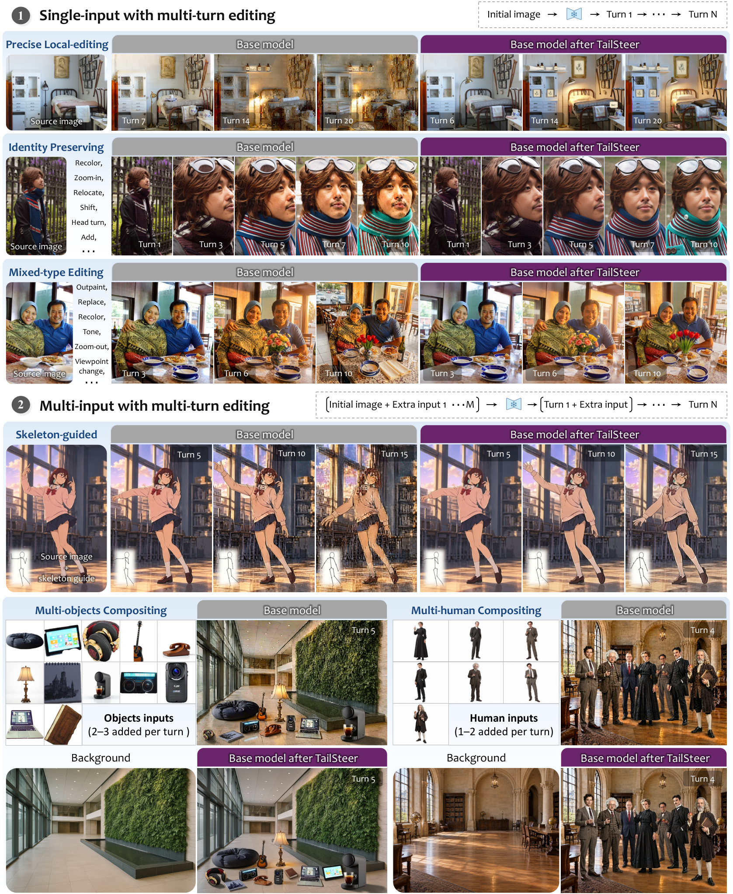

# Daily AI papers — 2026-11-08

*Curated from HF Daily Papers. 14 of ~32 papers kept after relevance filter.*

## Papers at a glance

| # | Title | Topics | Org |
| --- | --- | --- | --- |
| 1 | [VFlash: Fast, Accurate Visual Planning via Flash Primitive Decoding](#1-vflash) | `efficient-inference`, `multimodal`, `VLA` | NVIDIA / JHU |
| 2 | [SLA: Scaling Spatial-Language-Action Model via Continual Pre-training](#2-sla) | `multimodal`, `VLA`, `pre-training` | HKUST (GZ) / Tsinghua |
| 3 | [Harness-S: Learning from Sibling Harnesses for Generalizable Agent Training](#3-harness-s) | `agents`, `RL`, `rollouts` | Xiaohongshu / SJTU |
| 4 | [Random Is Almost Enough? Stable and Low-Cost Benchmark Compression via BestRand](#4-bestrand) | `eval`, `benchmarks` | CMU |
| 5 | [WeLM-Image: A Unified Image Generation Model towards Visual Intelligence](#5-welm-image) | `diffusion`, `multimodal` | WeChat Vision / Tencent |
| 6 | [EvoMemState: Evolving Memory State for Personal Agents](#6-evomemstate) | `agents`, `RL`, `memory` | Xiamen U. / NTU |
| 7 | [VisSearch-Bench: Evaluating Long Horizon Visual Search in Multimodal Agents](#7-vissearch-bench) | `eval`, `agents`, `multimodal` | Ant Group |
| 8 | [On the Opportunities and Challenges of Prefill-to-Autoregressive Cross-Model Transfer](#8-pact-platour) | `efficient-inference`, `multi-model` | King's College London / Tencent |
| 9 | [Muir: Linear Attention with Sensitivity-Allocated Gating and Matched-Filter Readout](#9-muir) | `architectures`, `linear-attention` | Google |
| 10 | [SAE Interprets MoE: Sparse AutoEncoders Reveal Fine-Grained Expert Specialization](#10-sae-interprets-moe) | `interp`, `MoE`, `SAE` | ByteDance Seed |
| 11 | [Decode Before You Hear: Speculative Listening for Chunk-Interleaved Full-Duplex Speech LMs](#11-speculative-listening) | `efficient-inference`, `speech`, `speculative-decoding` | CUHK-Shenzhen |
| 12 | [Tools Need Not Speak in Text: Latent Context Compression for Agents](#12-coca-cola) | `agents`, `efficient-inference`, `context` | Tsinghua AI Agent Group |
| 13 | [SwarmEvolve: Latent Agent Swarms for Evolutionary Discovery and Optimization](#13-swarmevolve) | `agents`, `evolutionary`, `code` | (unspecified) |
| 14 | [TailSteer: Trajectory-Tail Steering for Drift-Resistant Multi-turn Image Editing](#14-tailsteer) | `diffusion`, `editing`, `fine-tuning` | MMLab-CUHK |

---

## 1. VFlash

**Authors:** Shihao Wang, Jin Huang, Chi-Pin Huang, Chiao-An Yang, Ruijie Zheng, Johan Bjorck, Sifei Liu, Hang Su, Abhishek Badki, Lei Zhang, Alan Yuille, Linxi "Jim" Fan, Jan Kautz, Zhiding Yu, et al. — *NVIDIA / Johns Hopkins University*
**Links:** [arXiv:2611.08449](https://arxiv.org/abs/2611.08449) · [HF](https://huggingface.co/papers/2611.08449) · [AlphaXiv](https://www.alphaxiv.org/abs/2611.08449)
**Topics:** `efficient-inference`, `multimodal`, `VLA`

### TL;DR

Vision-language models used as world/action models produce *visual primitives* — points, bounding boxes, trajectories — one coordinate token at a time, which becomes the serving bottleneck when the plan is a long 3D trajectory. VFlash swaps the primitive decode for a lightweight parallel drafter that emits the whole primitive in a single forward pass, trained with a structural-equivalence objective rather than exact-token agreement.

### Key idea

Exploit the known schema of each primitive type (2 floats for a point, 4 for a box, variable-length lists for a trajectory) to predict all coordinates jointly through a *Flash Primitive Decoder* hung off the VLM. The decoder's layout is parameterized by (primitive-type, dimensionality, length), so the same drafter emits boxes and long 3D trajectories without retraining. Training does not force the draft to match the autoregressive teacher's token sequence; it just requires the predicted primitive to be structurally valid and geometrically correct.

### Main finding

~25× faster single-rollout generation on 3D point-motion forecasting versus token-level AR decoding, with lower error across 2D and 3D robot trajectory benchmarks. When plugged into a world-action model on MolmoSpaces, VFlash-conditioned plans reach 70.2% average success across four task suites vs 62.6% for the AR baseline.

### Why it matters

Decouples spatial-plan latency from sequence length, which has been the main reason VLM-as-policy pipelines struggle in closed-loop control. The general recipe — predict structured outputs in parallel against a schema instead of token-by-token — likely generalizes beyond robotics (JSON tool calls, bounding-box grounding, segmentation).

### Knowledge graph integration

**Builds on / relates to existing pages:**
- [../multimodal/README.md](../multimodal/README.md) — VLM-as-policy sits in the multimodal post-training stack; this is a decoding-side intervention.
- [../inference/README.md](../inference/README.md) — Flash Primitive Decoding is a structured speculative-decoding variant for non-text outputs.

**Suggested new pages:**
- `inference/parallel-primitive-decoding.md` *(depth)* — parallel decoding of structured visual primitives (points/boxes/trajectories) with schema-aware drafters.
- `multimodal/vla-decoding.md` *(depth)* — how action heads on top of VLMs should decode spatial outputs.

---

## 2. SLA

**Authors:** Wenxuan Song, Qizhou Huang, Ziyang Zhou, Jingbo Wang, Junwu E, Pengwei Wang, Yan Wang, Shunbo Zhou, Haoang Li — *HKUST (Guangzhou) / Tsinghua / BAAI / OLA Dimensions*
**Links:** [arXiv:2611.08373](https://arxiv.org/abs/2611.08373) · [HF](https://huggingface.co/papers/2611.08373) · [AlphaXiv](https://www.alphaxiv.org/abs/2611.08373)
**Topics:** `multimodal`, `VLA`, `pre-training`

### TL;DR

SLA extends the π0.5 policy with a continual pre-training stage that aligns the policy's own vision embeddings with 3D-perception features from a frozen OmniVGGT backbone. The alignment loss and a few training-only tricks (adaptive layer selection, state dropout, a unified heterogeneous robot-data mix) are discarded at deployment, so inference cost matches π0.5.

### Key idea

Spatial grounding doesn't need a separate 3D tower at inference — it can be *distilled into* the policy's intermediate activations during continual pre-training. SLA picks a learnable subset of layers whose embeddings get aligned to OmniVGGT's spatial features, uses state dropout to prevent over-reliance on proprioception, and trains on a heterogeneous union of robot datasets with task-and-embodiment conditioning.

### Main finding

State-of-the-art on RoboDojo-Real, RoboTwin 2.0 Clean2Random, RoboCasa-Panda, and LIBERO-Plus. On real robots, a 24.0-point average improvement over π0.5 across eight evaluation conditions.

### Why it matters

Validates a "borrow spatial priors via activation distillation" recipe: you can get 3D-aware behavior from a 2D VLM backbone without paying the 3D-perception cost at every step. The same pattern (training-only auxiliary tower, alignment loss, discard at inference) should apply to other perception priors (depth, flow, segmentation).

### Knowledge graph integration

**Builds on / relates to existing pages:**
- [../multimodal/README.md](../multimodal/README.md) — vision-language-action models are the frontier of multimodal post-training.
- [../pre-training/mid-training.md](../pre-training/mid-training.md) — SLA is a continual pre-training stage with auxiliary alignment losses, the mid-training archetype.

**Suggested new pages:**
- `multimodal/vla-spatial-alignment.md` *(depth)* — auxiliary alignment of policy activations to a frozen 3D perception backbone during VLA continual pre-training.

---

## 3. Harness-S

**Authors:** Wenxiang Jiao, Bowen Fang, Shuai Shao, Jiachen Zhu, Rong Shan, Shijian Wang, Hao Wang, Yuan Lu, Weiwen Liu, Weinan Zhang — *Xiaohongshu / SJTU / CMU / Southeast U. / Zhongguancun AI*
**Links:** [arXiv:2611.04277](https://arxiv.org/abs/2611.04277) · [HF](https://huggingface.co/papers/2611.04277) · [AlphaXiv](https://www.alphaxiv.org/abs/2611.04277)
**Topics:** `agents`, `RL`, `rollouts`

### TL;DR

Agent training suffers because no single harness (prompt scaffold + tool-use convention) solves every failure — fixes that help AppWorld can hurt SWE-Gym. Harness-S keeps a fixed pool of specialized *sibling* harnesses, invokes them only on tasks the base harness completely fails, and uses those rescued rollouts to train a policy that is then evaluated under the original harness.

### Key idea

Treat harnesses as a diversity source, not the policy's final home. A router scores each sibling harness on an incoming failed task using (i) behavior-profile embeddings and (ii) LLM voting, then runs the highest-ranked one to generate successful trajectories for RL / SFT. The training signal comes from siblings, but the evaluation harness never changes — so the policy learns to recover without a harness switch at inference.

### Main finding

Consistent gains over policy-only training on AppWorld, SWE-Gym, and DBBench. The paper frames this as "harness coverage" as an orthogonal axis to model capability.

### Why it matters

Clean separation between agent *scaffolding* and agent *weights*: use many scaffolds to mine training data, then collapse back to one scaffold at test time. Addresses the well-known lottery of harness-RL bakeoffs where results depend heavily on which prompt wrapper the authors happened to use.

### Knowledge graph integration

**Builds on / relates to existing pages:**
- [../agents/README.md](../agents/README.md) — this is a core contribution to agent-training infrastructure.
- [../post-training/rejection-sampling.md](../post-training/rejection-sampling.md) — sibling rescue is rejection sampling over harness variants.
- [../post-training/rl-prompt-curation.md](../post-training/rl-prompt-curation.md) — related to curating the *training distribution* for agent RL.
- [../systems/partial-rollouts.md](../systems/partial-rollouts.md) — relevant to rollout generation at scale.

**Suggested new pages:**
- `agents/harness-ensemble-training.md` *(depth)* — sibling-harness rescue as a data-generation step for agent RL.

---

## 4. BestRand

**Authors:** George Ling, Shanshan Zhong, Lijin Yang, Hao Yang, Nanxiang Li, Zhongzhan Huang — *Carnegie Mellon University*
**Links:** [arXiv:2611.00883](https://arxiv.org/abs/2611.00883) · [HF](https://huggingface.co/papers/2611.00883) · [AlphaXiv](https://www.alphaxiv.org/abs/2611.00883)
**Topics:** `eval`, `benchmarks`

### TL;DR

Benchmark compression replaces running the full suite with a scored subset. BestRand derives an analytic approximation of the estimation-error distribution for random sub-sampling — showing it's long-tailed — and clips the high-error tail with a small, cheap post-sampling filter. The result keeps random sampling's unbiasedness while killing the rare but ruinous errors.

### Key idea

Prove that subset-estimation error over modern foundation models follows a long-tailed distribution: most random subsets are near-exact, a few are badly off, and this tail is *intrinsic* to the models being evaluated (not a flaw of the sampler). BestRand uses a lightweight scoring rule to reject outlier subsets without the construction cost of adaptive methods like Anchor Points or IRT selection.

### Main finding

Over 70+ text, multimodal, and agent benchmarks (and extended to VLA eval): 50.2% reduction in high-error risk, 16.4% lower mean estimation error, and 21.8% lower OOD estimation error under distribution shift, all while using only 51.3% of the construction cost of competing methods.

### Why it matters

Full-suite benchmark runs cost real money on frontier models; defensible sub-sampling is now a mainstream ops problem. BestRand's result — random is almost enough — is practically useful because it keeps the nice statistical properties of random sampling and shifts the engineering problem to tail control.

### Knowledge graph integration

**Builds on / relates to existing pages:**
- [../evaluation/mmlu.md](../evaluation/mmlu.md), [../evaluation/livecodebench.md](../evaluation/livecodebench.md), [../evaluation/math500.md](../evaluation/math500.md) — all massive suites whose cost makes compression attractive.
- [../data/decontamination.md](../data/decontamination.md) — adjacent: sub-sampling the eval set is the mirror image of decontaminating the training set.

**Suggested new pages:**
- `evaluation/benchmark-compression.md` *(depth)* — sub-sampling benchmarks with controlled estimation error (BestRand, Anchor Points, IRT selection).

---

## 5. WeLM-Image

**Authors:** WeChat Vision team — *Tencent Inc.*
**Links:** [arXiv:2611.07392](https://arxiv.org/abs/2611.07392) · [HF](https://huggingface.co/papers/2611.07392) · [AlphaXiv](https://www.alphaxiv.org/abs/2611.07392)
**Topics:** `diffusion`, `multimodal`, `generative`

### TL;DR

WeChat's unified image generation stack: a single model targets text-to-image, image editing, multi-reference composition, and controllable generation. The paper positions image generation as one head of a broader visual-intelligence platform, with training recipes for each sub-task sharing a common DiT/VLM backbone.

### Key idea

Rather than training separate models per sub-task, WeLM-Image centers on one backbone and specializes it through task-conditioned prompts and lightweight task-specific adapters. The report focuses on training data composition, preference alignment on image outputs, and the trade-offs of a single-model-for-many-tasks recipe at production scale.

### Main finding

Tencent reports competitive numbers across T2I quality, instruction following for editing, and multi-reference composition, positioning WeLM-Image as the image counterpart of WeChat's language-model line.

### Why it matters

Another frontier-lab argument for *unification over specialization* in generative models. The relevant question for the field is whether per-task adapters will remain the dominant pattern or whether fully-unified training will catch up on each sub-task.

### Knowledge graph integration

**Builds on / relates to existing pages:**
- [../multimodal/README.md](../multimodal/README.md) — unified image generation is the generative cousin of unified VLM understanding.

**Suggested new pages:**
- `multimodal/unified-image-generation.md` *(depth)* — single-backbone recipes for T2I + editing + multi-reference generation.

*Borderline: this is a tech-report-style release for an image model rather than a single-technique paper — kept because unified generation is an active axis for multimodal LLMs.*

---

## 6. EvoMemState

**Authors:** Zhishang Xiang, Yunbo Tang, Zhongqiao Liu, Junkai Chen, Zerui Chen, Qingguo Hu, Yuxuan Zhang, William Grant, Qinggang Zhang, Jinsong Su — *Xiamen U. / NTU / UBC / Waterloo / Jilin U.*
**Links:** [arXiv:2611.03743](https://arxiv.org/abs/2611.03743) · [HF](https://huggingface.co/papers/2611.03743) · [AlphaXiv](https://www.alphaxiv.org/abs/2611.03743)
**Topics:** `agents`, `RL`, `memory`

### TL;DR

Personal-agent memory systems today store independent facts; they can't tell you which facts still apply, how facts constrain each other, or how to use them for the current request. EvoMemState augments persistent facts with *Relational States* (how facts relate and age) and a request-conditional *Reasoning State* (which facts to invoke, in which role), with the Reasoning State generated by a policy trained with RL.

### Key idea

Three-stage pipeline: (1) ontology-guided induction extracts persistent facts and builds Relational States tracking validity/scope/relations; (2) an RL-trained policy generates a Reasoning State per request, internalizing memory-use experience; (3) a reasoner combines facts + relational state + reasoning state to answer. Memory becomes a dynamic *graph with per-query views*, not a flat fact bag.

### Main finding

Consistent improvements over existing memory systems on long-term dialogue and memory-use benchmarks in both retrieval completeness and memory-grounded response accuracy.

### Why it matters

Pushes personal-agent memory past retrieval-over-facts toward state-aware reasoning. The RL-for-memory-use framing is the interesting primitive: the memory *controller* is trainable, not just the memory *store*.

### Knowledge graph integration

**Builds on / relates to existing pages:**
- [../agents/README.md](../agents/README.md) — long-term memory is core agent infrastructure.
- [../post-training/grpo.md](../post-training/grpo.md) — the Reasoning-State policy is trained with RL on memory-use trajectories.

**Suggested new pages:**
- `agents/agent-memory.md` *(depth)* — persistent-facts + relational-state + reasoning-state memory architectures for personal agents.

---

## 7. VisSearch-Bench

**Authors:** ZhengXian Wu, Qianhao Nie, Zhuohong Chen, Junjie Gao, Yuyao Zhang, Yunyao Yu, Hangrui Xu, Cheng Cheng, Guiyu Ma, Jin Zhang, Xingzhong Xu, Kai Yang, Haoqian Wang — *Ant Group*
**Links:** [arXiv:2611.04894](https://arxiv.org/abs/2611.04894) · [HF](https://huggingface.co/papers/2611.04894) · [AlphaXiv](https://www.alphaxiv.org/abs/2611.04894)
**Topics:** `eval`, `agents`, `multimodal`

### TL;DR

A benchmark for multi-step *visual* search: tasks that require interleaving visual grounding with external web/tool lookups across many turns. Even the strongest multimodal agent fully solves only 26.47% of tasks — a stark contrast to how saturated text-only search benchmarks already are.

### Key idea

Decouple "can the agent *see*" from "can the agent *search*" by designing tasks where neither OCR-plus-text search nor pure VLM reasoning suffices. The agent must plan over multiple visual retrievals, cross-reference evidence, and keep track of partial findings across a long horizon.

### Main finding

26.47% top-model completion rate; large gaps in planning horizon, visual grounding stability across turns, and tool-use integration surface as the dominant failure modes.

### Why it matters

Agent eval is overdue for a benchmark where the visual channel is the bottleneck. Long-horizon visual search is a natural setting for the next wave of multimodal RL training targets.

### Knowledge graph integration

**Builds on / relates to existing pages:**
- [../agents/README.md](../agents/README.md) — this fits the "agent evaluation" bucket.
- [../multimodal/README.md](../multimodal/README.md) — visually-grounded tool use is the frontier of VLM agents.

**Suggested new pages:**
- `evaluation/vissearch-bench.md` *(depth)* — long-horizon visual-search agent benchmark.

---

## 8. PACT / PLatour

**Authors:** Junru Lu, Wei Liu, Jiangnan Ye, Jiazheng Li, Tameem Adel, Yali Du, Lin Gui, Yulan He, Di Yin, Xing Sun — *King's College London / Tencent Youtu / NPL*
**Links:** [arXiv:2611.06976](https://arxiv.org/abs/2611.06976) · [HF](https://huggingface.co/papers/2611.06976) · [AlphaXiv](https://www.alphaxiv.org/abs/2611.06976)
**Topics:** `efficient-inference`, `multi-model`

### TL;DR

Prefill-to-Autoregressive Cross-model Transfer (PACT) pairs a *large* model that only runs the prefill with a *small* model that only runs the decode, connected by a trainable linear bridge. The paper open-sources **PLatour** (zero-init bridges, task-reward training) and introduces **PACT-Check**, a diagnostic for whether reported gains actually come from information transfer rather than from the smaller model's own capacity.

### Key idea

Decouple "large model understands the prompt" from "small model generates the response" — the prefill KV from the big model, remapped through a linear bridge, seeds the decode of the smaller model. The provocation is methodological: controlled experiments show some reported PACT gains are reproducible without useful signal from the sender, so PACT-Check measures how much of a gain genuinely survives when the sender's prefill is replaced with noise.

### Main finding

PLatour matches or beats open-source baselines and Mostik's reported results while using a smaller sender; PACT-Check shows that part of prior PACT gains vanish under their null baseline.

### Why it matters

Clean example of a *negative-result-aware* efficient-inference paper: the trick works, but the authors publish the diagnostic that proves earlier claims were partially driven by an artifact. Strong candidate for a cross-model-transfer taxonomy.

### Knowledge graph integration

**Builds on / relates to existing pages:**
- [../inference/README.md](../inference/README.md) — cross-model prefill/decode transfer is a disaggregated-serving relative.

**Suggested new pages:**
- `inference/cross-model-prefill-transfer.md` *(depth)* — prefill-on-big / decode-on-small with trainable bridges (PACT, PLatour).

---

## 9. Muir

**Authors:** Gil Tabak, Clemens JS Schaefer — *Google*
**Links:** [arXiv:2611.08376](https://arxiv.org/abs/2611.08376) · [HF](https://huggingface.co/papers/2611.08376) · [AlphaXiv](https://www.alphaxiv.org/abs/2611.08376)
**Topics:** `architectures`, `linear-attention`

### TL;DR

Muir is a gated linear-attention variant with two structural tweaks: the *erase gate* uses a lower-rank projection than the *write gate* (because what to forget is a simpler decision than what to store), and a *matched-filter readout* gate re-balances the row norms of the fixed-size KV state. Beats GDN-2 and a Transformer on perplexity and commonsense tasks from 166M to 1.34B parameters.

### Key idea

Linear attention compresses context into a fixed-size KV state whose rows accumulate different directions in feature space. Muir treats the three gates (write / erase / readout) asymmetrically: low-rank erase, full-rank write, and a readout that performs matched filtering against normalized state rows so that the retrieval signal doesn't get swamped by accumulated norm drift.

### Main finding

Lower perplexity and higher average commonsense accuracy than GDN-2 and a Transformer baseline across 166M–1.34B parameters, with retained long-context extrapolation.

### Why it matters

Linear-attention variants keep proliferating; Muir's separation of the gates is a crisp inductive bias that could apply to any gated SSM/linear-attention family (DeltaNet, RWKV, Mamba-2). Another argument that the fixed-state bottleneck is manageable if you treat read/write/erase asymmetrically.

### Knowledge graph integration

**Builds on / relates to existing pages:**
- [../fundamentals/attention.md](../fundamentals/attention.md) — baseline against which linear attention is defined.
- [../architectures/multi-head-attention.md](../architectures/multi-head-attention.md) — Muir is a drop-in block replacement.
- [../architectures/mla.md](../architectures/mla.md) — related compression-of-KV-state story (low-rank latent vs. gated linear state).

**Suggested new pages:**
- `architectures/_linear-attention.md` *(taxonomy)* — fills a gap: gated linear attention (DeltaNet, GLA, GDN-2, Muir) as a family.
- `architectures/muir.md` *(depth)* — low-rank erase + matched-filter readout linear-attention block.

---

## 10. SAE Interprets MoE

**Authors:** Anyuan Zhuo, Shaohua Zhang, Yuan Lin, Pinyan Lu — *ByteDance Seed*
**Links:** [arXiv:2611.08089](https://arxiv.org/abs/2611.08089) · [HF](https://huggingface.co/papers/2611.08089) · [AlphaXiv](https://www.alphaxiv.org/abs/2611.08089)
**Topics:** `interp`, `MoE`, `SAE`

### TL;DR

Train a sparse autoencoder on the output of a Mixture-of-Experts layer and study which experts activate which SAE features. Result: individual experts drive *specific* latent features, and this specialization is substantially more concentrated and fine-grained than what the router's weights or domain-label analyses had suggested.

### Key idea

Use the SAE's dictionary as the microscope: find features (concepts), then attribute each feature's activations back to the experts that caused them. Applied to Qwen3-30B-A3B layers 4, 30, and 46 — chosen to cover early, mid, and late layers — the attribution shows a near-one-to-one feature-to-expert ownership for many features.

### Main finding

Expert specialization is sharper than routing-weight analysis implied: many SAE features are near-exclusively produced by a single expert. The pattern holds across the three layers studied.

### Why it matters

Bridges two until-now-separate interpretability stories: SAEs (feature discovery) and MoE (modularity). If features are expert-owned, MoE routing choices become interpretable *targets* for steering, pruning, and safety analysis — expert-level interventions get a semantic meaning.

### Knowledge graph integration

**Builds on / relates to existing pages:**
- [../interpretability/README.md](../interpretability/README.md) — direct contribution to SAE + mech-interp.
- [../architectures/_moe.md](../architectures/_moe.md) — provides empirical content to the "do experts specialize?" question.
- [../architectures/deepseek-moe.md](../architectures/deepseek-moe.md) — fine-grained-expert design is validated by the specialization observed here.

**Suggested new pages:**
- `interpretability/sparse-autoencoder.md` *(depth)* — SAE basics, needed as a prereq for any SAE-flavored paper.
- `interpretability/sae-for-moe.md` *(depth)* — using SAEs to attribute features to MoE experts.

---

## 11. Speculative Listening

**Authors:** Yutong Bian, Yanglin Zhang, Yuxiang Wang, Luoyuan Zhang, Rongshen He, Zihao Wang, Junwen Qiu, Jiaqi Li, Zhizheng Wu — *CUHK-Shenzhen*
**Links:** [arXiv:2611.06982](https://arxiv.org/abs/2611.06982) · [HF](https://huggingface.co/papers/2611.06982) · [AlphaXiv](https://www.alphaxiv.org/abs/2611.06982)
**Topics:** `efficient-inference`, `speech`, `speculative-decoding`

### TL;DR

Full-duplex speech LMs spend most of their time listening, then must respond with low latency. Speculative Listening repurposes those idle chunks: the model drafts the next audio chunk assuming continued silence, plus a branch starting from the runner-up first token, then verifies the drafts when the real audio chunk arrives. Lossless, training-free, model-agnostic.

### Key idea

Rename idle time into draft time. During a listening chunk, the model has nothing to produce but can predict "if the user says nothing new, what would I decode next?"; it emits that draft plus an alternate branch rooted at the most-likely non-silence first token. When the actual chunk lands, verification is a cheap single forward pass — accepted drafts cost zero generation latency.

### Main finding

2.6–2.8× speedups on speak chunks, up to 23.4× on tool-call chunks, and a 73% average reduction in pre-response decoding delay on their TickTock-Bench suite — all without quality loss and without retraining.

### Why it matters

Full-duplex voice agents are a growing deployment target; their latency budget is dictated by the first audible token. Speculative Listening is the audio-stream analogue of EAGLE/Medusa: same philosophy (parallelize predictive work with verification), new axis (silent-listening idle time).

### Knowledge graph integration

**Builds on / relates to existing pages:**
- [../inference/README.md](../inference/README.md) — the inference folder is the natural home for a speculative-decoding variant.

**Suggested new pages:**
- `inference/_speculative-decoding.md` *(taxonomy)* — fills a clear gap: speculative decoding family (vanilla draft-model, EAGLE, Medusa, lookahead, speculative-listening).
- `inference/speculative-listening.md` *(depth)* — idle-time drafting for full-duplex speech LMs.

---

## 12. Coca-Cola

**Authors:** Tsinghua AI Agent Group — *Tsinghua University*
**Links:** [arXiv:2611.06500](https://arxiv.org/abs/2611.06500) · [HF](https://huggingface.co/papers/2611.06500) · [AlphaXiv](https://www.alphaxiv.org/abs/2611.06500)
**Topics:** `agents`, `efficient-inference`, `context`

### TL;DR

Tool outputs — search results, scraped pages, long JSON blobs — bloat agent contexts because they're always serialized as text. Coca-Cola skips the text round-trip: tool outputs are compressed into a handful of *continuous latent tokens* that are directly inserted into the agent's input embedding space. Trained with Action-Preserving Training so the compressed context induces the same next-action distribution as the raw text.

### Key idea

Separate *human-readable tool output* from *the agent's internal representation of that output*. A small encoder maps a raw observation to K latent tokens; those tokens occupy slots in the context window just like real token embeddings but skip the detokenization-retokenization-attention-over-text pipeline. The training signal is a KL between action distributions under full vs. compressed context — no reconstruction loss, no human-readable intermediate.

### Main finding

Across four web-search QA benchmarks and two model families: 70.01%–89.24% fewer tokens consumed, 24.45%–55.97% lower end-to-end runtime, and higher task performance than the text-tool-output baseline.

### Why it matters

A real shift in the agent-serving stack: tool outputs become *embeddings*, not strings, which decouples agent context length from tool-output verbosity. Opens a design space for RAG and web agents where retrieved content is compressed before it ever hits the attention block.

### Knowledge graph integration

**Builds on / relates to existing pages:**
- [../agents/README.md](../agents/README.md) — core agent-infra contribution (tool-output representation).
- [../inference/README.md](../inference/README.md) — context-length reduction is an inference-cost lever.

**Suggested new pages:**
- `agents/latent-tool-output.md` *(depth)* — compressing tool observations into continuous latent tokens for agent context.
- `agents/action-preserving-training.md` *(depth)* — KL-on-action-distribution objective for context compression.

---

## 13. SwarmEvolve

**Authors:** (author list not surfaced on HF page) — *(affiliation not disclosed on HF page)*
**Links:** [arXiv:2611.08483](https://arxiv.org/abs/2611.08483) · [HF](https://huggingface.co/papers/2611.08483) · [AlphaXiv](https://www.alphaxiv.org/abs/2611.08483)
**Topics:** `agents`, `evolutionary`, `code`

### TL;DR

An LLM-guided evolutionary search where hundreds of lightweight agents run in parallel, reason entirely in *latent* space (no text decoding), and share information by exchanging KV caches. A novelty filter preserves diverse hypotheses and a summarizer agent merges swarm-level caches into new candidate programs.

### Key idea

Decoding is expensive; evolutionary search is population-heavy; so don't decode the population. Keep each agent's "idea" as a KV cache, define crossover as cache merging by a summarizer agent, and define selection via a novelty filter that scores hypotheses in embedding space. Human-readable text is only produced at the final elite step.

### Main finding

Highest average score and faster convergence than OpenEvolve, ShinkaEvolve, and CodeEvolve across 21 mathematical and scientific-computing problems, using Qwen3 models.

### Why it matters

Pushes evolutionary-LLM search past the "have 50 models and compare samples" pattern toward a genuinely sub-token-level population loop. The latent-swarm abstraction is a general primitive — applicable to code synthesis, hypothesis generation, and RL population training.

### Knowledge graph integration

**Builds on / relates to existing pages:**
- [../agents/README.md](../agents/README.md) — LLM-guided search belongs to the agent-architecture bucket.
- [../post-training/_rl.md](../post-training/_rl.md) — population-based LLM methods are a cousin of population-based RL.

**Suggested new pages:**
- `agents/latent-swarm-evolution.md` *(depth)* — KV-cache-merging evolutionary search with LLM-generated novelty filters.

---

## 14. TailSteer

**Authors:** Ruikang Li, Zixuan Chen, Jiarui Wu, Mingde Yao, Yiyuan Zhang, Yujin Wang, Hanming Deng, Lewei Lu, Tianfan Xue — *MMLab-CUHK*
**Links:** [arXiv:2611.06741](https://arxiv.org/abs/2611.06741) · [HF](https://huggingface.co/papers/2611.06741) · [AlphaXiv](https://www.alphaxiv.org/abs/2611.06741)
**Topics:** `diffusion`, `editing`, `fine-tuning`

### TL;DR

Multi-turn image editing drifts: over 15–20 edit rounds, color/identity/structure corrode even when each single edit looks reasonable. TailSteer is a final-stage training recipe that keeps early denoising dynamics close to the base model and concentrates the editor's corrections near the *tail* of the diffusion trajectory — where the drift is most fixable — using the editor's own rollouts, with no curated editing pairs.

### Key idea

Constrain fine-tuning so that early-timestep scores stay near the base model's (preserving the base distribution) and let only late-timestep scores shift to counteract drift. Training data is self-generated via multi-turn rollouts of the editor itself; the base-model-anchored early tail acts as a regularizer that prevents fine-tuning from collapsing into the editing distribution.

### Main finding

Substantial drift reduction on 15–20-turn edit sequences across FLUX, SenseNova, and Qwen model families, with base-model fidelity largely preserved.

### Why it matters

Clean statement of a well-known failure mode (iterative edit drift) and a clean recipe for it. The "freeze head, train tail" split should apply beyond editing — e.g. to RLHF on diffusion, where you want preference tuning to touch only the trajectory-tail score.

### Knowledge graph integration

**Builds on / relates to existing pages:**
- (Diffusion coverage is thin in the current graph — this paper highlights the gap.)

**Suggested new pages:**
- `multimodal/_diffusion.md` *(taxonomy)* — long-overdue index of diffusion training/editing/sampling methods (fills a major gap).
- `multimodal/tail-steer.md` *(depth)* — tail-only fine-tuning for drift-resistant multi-turn image editing.

---

## Notes

- Borderline inclusions are flagged in-section with an italic *Borderline: …* note (see §5 WeLM-Image).
- Hero figures live in `assets/2026-11-08/`. SAE Interprets MoE (§10) and Speculative Listening (§11) have no hero figure — the source HF/arXiv HTML pages exposed no usable preview image.
- This digest is informational. No existing concept files, `READING-LIST.md`, or `PAPERS.md` were modified to produce it.
