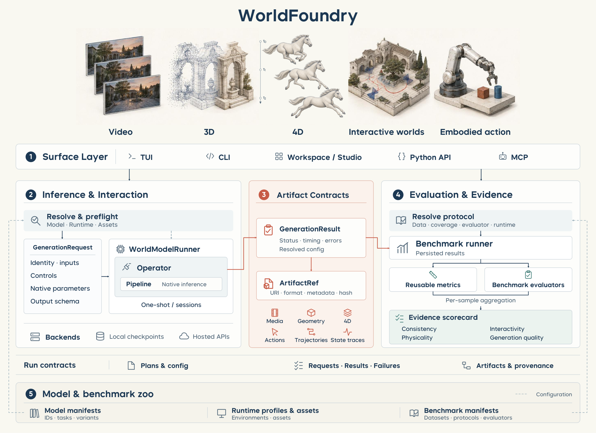
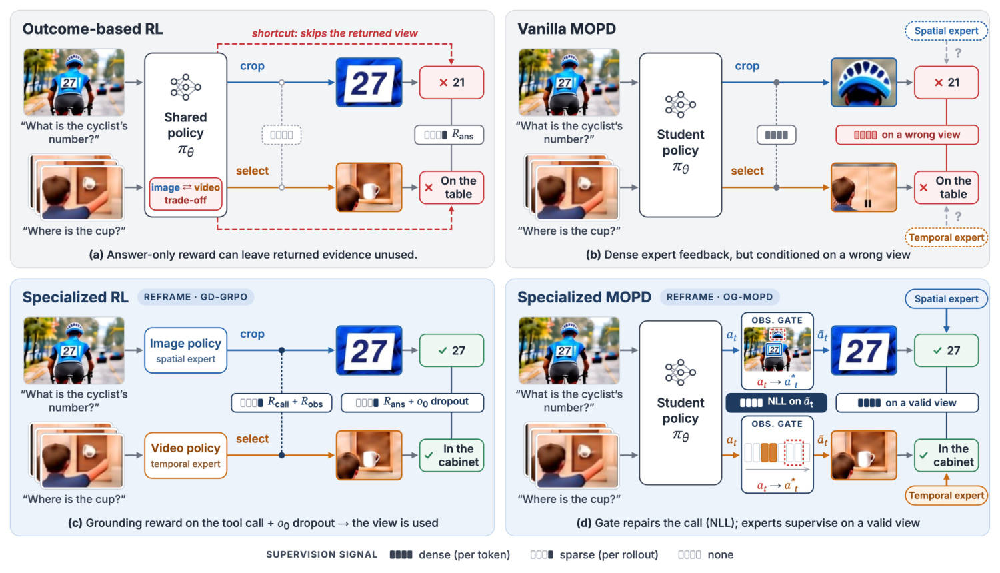
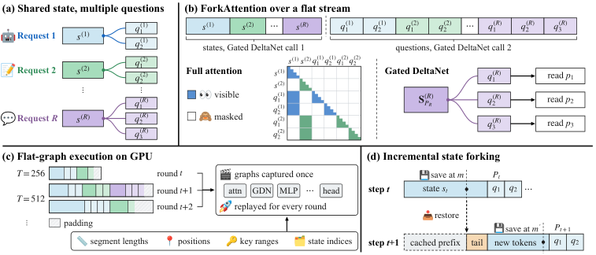
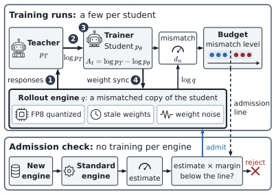
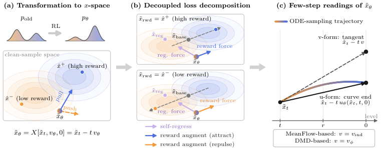
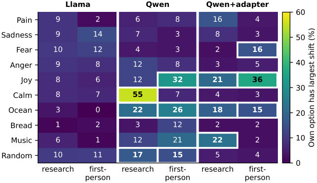
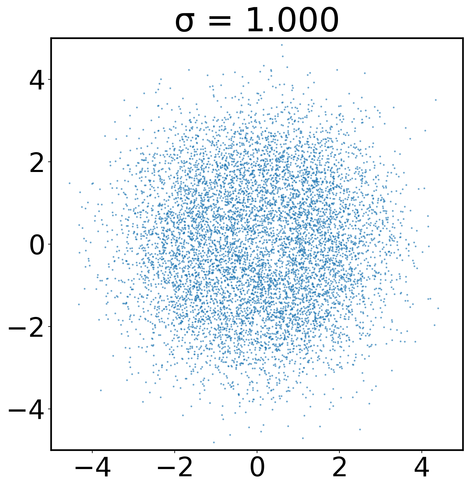
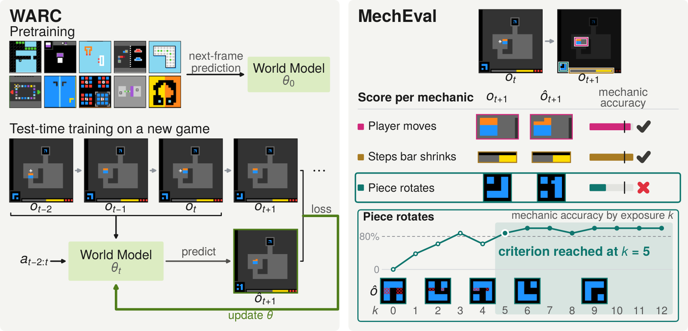

# Daily AI papers — 2026-11-10

*Curated from HF Daily Papers. 15 of ~40 papers kept after relevance filter.*

## Papers at a glance

| # | Title | Topics | Org |
| --- | --- | --- | --- |
| 1 | [WorldFoundry: Towards Unified Infrastructure for World Intelligence](#1-worldfoundry) | `multimodal`, `eval`, `systems` | NTU / Westlake / consortium |
| 2 | [Sage-Taiyi: A Metacognitive Architecture for Scientific Discovery](#2-sage-taiyi) | `agents`, `reasoning`, `eval` | (unspecified consortium) |
| 3 | [Reframe: Observation-Aligned Multi-Teacher On-Policy Distillation for Agentic Visual Reasoning](#3-reframe) | `multimodal`, `RL`, `agents`, `distillation` | CASIA |
| 4 | [Flide: Accelerating Decision Inference with Exact State Forking](#4-flide) | `efficient-inference`, `agents` | NUS / Oxford |
| 5 | [Longtail-SWE: High-Quality SWE Tasks for Underrepresented Languages](#5-longtail-swe) | `eval`, `agents`, `data` | (unspecified) |
| 6 | [InfraRSI: Harnessing Recursive Self-Improvement for Training Infrastructure](#6-infrarsi) | `systems`, `agents`, `RL` | TokenRhythm / PKU / Tsinghua |
| 7 | [How Much Training-Inference Mismatch Can On-Policy Distillation Tolerate?](#7-opd-mismatch) | `post-training`, `distillation`, `quantization` | Aalto / Cambridge / NTU |
| 8 | [FewStepRL: Fine-tuning Few-step Diffusion Models with Reinforcement Learning](#8-fewsteprl) | `diffusion`, `RL`, `efficient-inference` | Tencent Hunyuan / Westlake |
| 9 | [All Quiet on the Neural Front: Language Models Do Not Report Injected Pain States](#9-neural-front) | `interp`, `safety` | (unspecified) |
| 10 | [onóna: Twin Embeddings with Tied Unembeddings](#10-onona) | `architecture`, `fundamentals` | MSU / Together AI / UW-Madison |
| 11 | [FraudBench: A Legal Evaluation of AI Deception](#11-fraudbench) | `safety`, `eval`, `agents` | Harvard Law / Oxford / ETH |
| 12 | [RidgeFill: Training-Free Late-Layer Cache Fill for Faster Prefill](#12-ridgefill) | `efficient-inference` | Independent |
| 13 | [Modality-Aware Expert Pruning for MoE-Based Multimodal LLMs](#13-maep) | `MoE`, `multimodal`, `quantization` | Nota Inc. |
| 14 | [Energy-Tweedie: Score meets Score, Energy meets Energy](#14-energy-tweedie) | `diffusion`, `theory` | U. Michigan |
| 15 | [How Many Exposures Does a World Model Need?](#15-world-model-exposures) | `eval`, `test-time`, `multimodal` | Third Intelligence / U. Tokyo |

---

## 1. WorldFoundry

**Authors:** Juanxi Tian, Jiadong Hou, Baiang Li, Xin Lin, Zhengbo Jiao, Weijia Zhang, Yeying Jin, Truong Nguyen, Haitian Zheng, Zhifei Zhang, Jianfei Yang, Ming-Hsuan Yang, Felix Heide, Wei Xiong, Enze Xie, Wanhua Li — *NTU / Westlake / Princeton / UC Merced / Adobe / consortium*
**Links:** [arXiv:2611.10771](https://arxiv.org/abs/2611.10771) · [HF](https://huggingface.co/papers/2611.10771) · [AlphaXiv](https://www.alphaxiv.org/abs/2611.10771)
**Topics:** `multimodal`, `eval`, `systems`

### TL;DR

Open-source infrastructure that tries to turn "world model" from marketing language into a measurable property. WorldFoundry defines a generative world model as a predictive dynamical system with persistent, history-conditioned state and standardized intervention responses, then ships a catalog of 270 model entries, 74 benchmarks, and 62 registered metrics to run reproducible inference and evaluation across video, 3D/4D, embodied, and interactive systems.

### Key idea

Separate "visual plausibility" from "world-model-ness" at the API level. Each registered model must expose hooks for state rollout, intervention, and counterfactual probing; benchmarks are registered against those hooks instead of against raw video quality. Execution evidence (what actually ran) is recorded separately from integration readiness (what the harness exposes), so a flashy demo does not count as evaluated.

### Main finding

Not a single benchmark number — the paper is an evaluation-infrastructure contribution. It exposes the long tail of ad-hoc evaluation code across video/world-model papers and demonstrates that the same model often scores inconsistently across its own reported setups once wrapped in a common harness.

### Why it matters

The "is video generation a world model" debate has been stuck at vibes. A shared harness is a prerequisite for turning that into science, and 270 registered systems is enough that the first community-scale comparisons become possible.

### Knowledge graph integration

**Builds on / relates to existing pages:**
- [../evaluation/README.md](../evaluation/README.md) — adds a world-model-focused entry to the evaluation harness landscape.
- [../multimodal/README.md](../multimodal/README.md) — provides a unified harness for video / 4D / embodied systems.

**Suggested new pages:**
- `evaluation/_world-model-benchmarks.md` *(taxonomy)* — overview of world-model benchmarks and what each actually measures.

---

## 2. Sage-Taiyi

**Authors:** Large consortium (lead + contributors listed; primary org not disclosed on HF page)
**Links:** [arXiv:2611.12762](https://arxiv.org/abs/2611.12762) · [HF](https://huggingface.co/papers/2611.12762) · [AlphaXiv](https://www.alphaxiv.org/abs/2611.12762)
**Topics:** `agents`, `reasoning`, `eval`

### TL;DR

A scientific-discovery agent whose central loop is metacognition: the system continually re-assesses what it believes about the evidence, which assumptions are shaky, and which open questions matter, then uses those assessments to pick research goals and reusable reasoning methods. Tested on a 265-task ideation benchmark (Taiyi-Bench) across ten disciplines, plus five expert-supervised wet-lab/compute collaborations.

### Key idea

Rather than one monolithic "planner → executor" stack, Sage-Taiyi factors the loop into three roles: a *knowledge compiler* that mines accumulated science for priors, an *assessor* that scores evidence/assumption/open-question status at every step, and a *regulator* that converts those scores into next-step goals and chosen reasoning tactics. The assessor's output is itself a persisted artifact the system can later revise.

### Main finding

First on all eight metrics of Taiyi-Bench, Overall 54.0 vs 47.9 for AI-Scientist-v2. In five expert-guided collaborations the proposed conditions converted trace yields of a cobalt-catalyzed carbonylation to 84 %, and a photocatalytic allylic amination from 13 % to 69 %.

### Why it matters

Pushes scientific agents past "better retrieval + LLM-as-planner" toward architectures where the agent's belief state is a first-class, interrogable object — a direction the alignment community has wanted for a while under names like "legible scratchpad" and "process-level oversight".

### Knowledge graph integration

**Builds on / relates to existing pages:**
- [../post-training/reasoning/prm.md](../post-training/reasoning/prm.md) — process-level signals are the closest existing analog to the assessor's per-step scores.
- [../safety/cot-monitoring.md](../safety/cot-monitoring.md) — a persisted, interrogable belief state is a monitoring surface.

**Suggested new pages:**
- `agents/metacognitive-agent.md` *(depth)* — the knowledge-compiler / assessor / regulator architecture.

---

## 3. Reframe

**Authors:** Handong Li, Yifan Zhang, Qianshan Wei, *et al.* — *Institute of Automation, Chinese Academy of Sciences*
**Links:** [arXiv:2611.12886](https://arxiv.org/abs/2611.12886) · [HF](https://huggingface.co/papers/2611.12886) · [AlphaXiv](https://www.alphaxiv.org/abs/2611.12886)
**Topics:** `multimodal`, `RL`, `agents`, `distillation`

### TL;DR

A post-training recipe for visual tool-using agents that treats the *observation state* returned by tools as a first-class alignment target, not just the final output distribution. Combines Ground-Drop-GRPO (GD-GRPO) — GRPO with evidence-aware rewards and stochastic input-image removal — with Observation-Gated multi-teacher on-policy distillation (OG-MOPD), which patches bad tool calls mid-rollout before distilling. No task-specific SFT cold start.

### Key idea

Two complementary signals aligned on the *observation* axis:
1. **GD-GRPO**: randomly drop the original visual input during RL rollouts and reward the policy only when it recovers answers via tool-returned evidence — forcing grounded tool use instead of memorized shortcuts.
2. **OG-MOPD**: when the rollout's tool call is malformed, replace it with a canonical one mid-trace and resume distillation from the repaired observation — so the student isn't being distilled on broken trajectories.

### Main finding

Beats both Mix-RL and vanilla MOPD across 14 image and video benchmarks. Ablations show GD-GRPO increases measured "observation dependence" and tool gain relative to outcome-only GRPO.

### Why it matters

Agentic RL post-training has been dominated by outcome rewards; this paper shows that *where* in the rollout the reward is anchored matters as much as the reward's magnitude. Likely to generalize beyond vision to any tool-using agent whose tools return rich observations.

### Knowledge graph integration

**Builds on / relates to existing pages:**
- [../post-training/grpo.md](../post-training/grpo.md) — GD-GRPO is a GRPO variant with observation-drop augmentation.
- [../post-training/_rl.md](../post-training/_rl.md) — new entry in the agentic-RL variant family.
- [../multimodal/README.md](../multimodal/README.md) — recipe for visual tool-using agents.

**Suggested new pages:**
- `post-training/gd-grpo.md` *(depth)* — Ground-Drop-GRPO as a discrete technique.
- `post-training/og-mopd.md` *(depth)* — observation-gated multi-teacher on-policy distillation.

---

## 4. Flide

**Authors:** Jiajia Song, Hao Fei, Wynne Hsu, Mong Li Lee — *NUS / Oxford*
**Links:** [arXiv:2610.42148](https://arxiv.org/abs/2610.42148) · [HF](https://huggingface.co/papers/2610.42148) · [AlphaXiv](https://www.alphaxiv.org/abs/2610.42148)
**Topics:** `efficient-inference`, `agents`

### TL;DR

An exact inference engine for "decision inference" workloads — where the same prefix forks into many short continuations (ToT, MCTS, agentic tool routing, best-of-N). Introduces ForkAttention: a KV-cache layout that works across both standard attention and Gated DeltaNet layers, so the logical fork tree is decoupled from the physical execution. Up to 9.5× faster than vLLM / SGLang with output distributions closest to a float32 reference.

### Key idea

Previous forked-prefix engines (vLLM's radix tree, SGLang's RadixAttention) only share the KV-cache of attention layers. Flide extends sharing to the recurrent state of modern hybrid architectures (Gated DeltaNet) by defining a fork-point primitive that is exact across both layer types — so no quality loss relative to running each fork independently.

### Main finding

9.5× speedup over vLLM/SGLang on decision-tree workloads while being closest-to-fp32 in total variation distance — i.e. the speedup comes without the approximation error that some batched engines introduce.

### Why it matters

As agents move toward search-heavy routing (MCTS, best-of-N, ToT), inference engines optimized for a single linear decode path waste work. Flide is one of the first engines to treat the fork tree as the primary object instead of a hack on top of batched decode.

### Knowledge graph integration

**Builds on / relates to existing pages:**
- [../inference/README.md](../inference/README.md) — new inference-engine entry alongside vLLM/SGLang.
- [../systems/partial-rollouts.md](../systems/partial-rollouts.md) — fork-exact execution is the online-RL analogue of partial rollouts.
- [../post-training/reasoning/mcts.md](../post-training/reasoning/mcts.md) — MCTS inference time is Flide's target workload.

**Suggested new pages:**
- `inference/forkattention.md` *(depth)* — hybrid-attention fork-exact KV sharing.

---

## 5. Longtail-SWE

**Authors:** Not disclosed on HF page
**Links:** [arXiv:2611.10304](https://arxiv.org/abs/2611.10304) · [HF](https://huggingface.co/papers/2611.10304) · [AlphaXiv](https://www.alphaxiv.org/abs/2611.10304)
**Topics:** `eval`, `agents`, `data`

### TL;DR

A repo-level software-engineering benchmark that fills in the languages SWE-bench and its clones don't cover: 202 issue-resolution tasks across Clojure, Dart, Elixir, Erlang, F#, Haskell, Julia, Kotlin, Lua, OCaml, R, Scala, and Swift. Each task is validated through a solver → judge → repairer pipeline so that bad tests and ambiguous descriptions are fixed rather than discarded.

### Key idea

Benchmark construction as a *repair loop*: a solver model attempts a candidate task; a judge model reviews solver output, tests, and trajectory; a repairer edits the test or task description to correct false negatives/positives without changing intent. The loop lets the authors salvage tasks that would be thrown away under threshold filters, which is the main reason coverage can reach 13 niche languages.

### Main finding

Nine model configurations evaluated, including frontier models. Consistency across repeated attempts and resource usage are reported alongside accuracy. All instances, environments, tooling, and trajectories are released along with an easier subset for smaller models.

### Why it matters

SWE-bench is now a load-bearing eval for agent progress, but it is Python-dominated. If benchmark saturation is accelerating language-specific overfitting, broad-language suites with strong curation are the natural counterweight.

### Knowledge graph integration

**Builds on / relates to existing pages:**
- [../evaluation/livecodebench.md](../evaluation/livecodebench.md) — adjacent code-eval benchmark; Longtail-SWE sits a step further out in language coverage.
- [../data/quality-filtering.md](../data/quality-filtering.md) — the solver-judge-repairer loop is a data-curation technique in benchmark form.

**Suggested new pages:**
- `evaluation/longtail-swe.md` *(depth)* — the benchmark and its construction pipeline.

---

## 6. InfraRSI

**Authors:** Yuchuan Tian, Haocheng Mei, Ye Yuan, Chao Xu, Boxun Li, Guohao Dai, Kai Han, Allen Chen, Yunhe Wang, Yu Wang — *TokenRhythm / Peking University / Infinigence AI / SJTU / Tsinghua*
**Links:** [arXiv:2611.11558](https://arxiv.org/abs/2611.11558) · [HF](https://huggingface.co/papers/2611.11558) · [AlphaXiv](https://www.alphaxiv.org/abs/2611.11558)
**Topics:** `systems`, `agents`, `RL`

### TL;DR

An agentic harness that turns high-level commands ("make this training run faster") into verified distributed-LLM-training optimizations. Runs a five-stage loop — init → doctor → run → report → apply — that combines launch-configuration tuning with verified code patches, fits execution-time and memory models online, and transfers experience across GPU architectures. Across four dense and MoE workloads, up to 2.75× speedup; mean MFU 17.4 % → 30.0 %.

### Key idea

Treat distributed-training optimization as recursive self-improvement rather than hand tuning: the agent runs the job, measures the fitted cost model's residual, patches code or config, and only commits a patch after measurement verifies the model's prediction. Experience transfer across GPU architectures reuses fitted parameters for similar workloads instead of starting cold.

### Main finding

2.75× end-to-end speedup, mean MFU nearly doubled (17.4 % → 30.0 %) on a mix of dense and MoE workloads with no human intervention per workload.

### Why it matters

Hand-tuning parallelism and launch configs is the hidden tax on every large training run. If the agent-driven recursive loop is reproducible, "achieve X MFU" becomes an automatable step rather than a senior-engineer bottleneck.

### Knowledge graph integration

**Builds on / relates to existing pages:**
- [../systems/README.md](../systems/README.md) — new agent-driven approach to launch-config optimization.
- [../systems/dualpipe.md](../systems/dualpipe.md) — DualPipe-class parallelism is the kind of trick the agent patches in.
- [../pre-training/_training-stability.md](../pre-training/_training-stability.md) — adjacent concern: the agent verifies cost-model fits, not loss curves.

**Suggested new pages:**
- `systems/infrarsi.md` *(depth)* — the five-stage self-improvement loop for training infra.

---

## 7. OPD Mismatch Budget

**Authors:** Cong Yu, Ziting Wang, Songlin Jiang, Sitong Zhang, Chengliang Chai, Youhe Jiang, Eiko Yoneki, Tuo Shi — *Aalto / Cambridge / NTU / BIT / Shenzhen UAT*
**Links:** [arXiv:2611.11450](https://arxiv.org/abs/2611.11450) · [HF](https://huggingface.co/papers/2611.11450) · [AlphaXiv](https://www.alphaxiv.org/abs/2611.11450)
**Topics:** `post-training`, `distillation`, `quantization`

### TL;DR

An empirical study of how much training-inference mismatch on-policy distillation (OPD) can swallow before quality degrades. Measures quantization, weight staleness, and injected noise on one scale; proposes a *mismatch budget* and a lightweight admission check that screens rollout configs without running a full training job. Model-specific FP8 recipes reach the same quality as BF16 with ≥1.93× more KV-cache tokens, and FP8 + async rollouts hit target quality 1.62× sooner than synchronous BF16.

### Key idea

Treat the mismatch sources — quantization drift, rollout-weight staleness, numerical noise — as additive on a single distribution-shift scale, and *calibrate a budget* per model (not per task). Some layers dominate the budget consumption; recipe design then becomes "spend budget where it buys throughput, protect sensitive layers".

### Main finding

OPD tolerates meaningfully more mismatch than online RL before quality collapses. Model-specific FP8 preserves quality while providing ≥1.93× KV-cache capacity in BF16. FP8 + async rollouts: 1.62× faster time-to-quality vs synchronous BF16.

### Why it matters

OPD is becoming the default scalable post-training recipe (R1-style distillation pipelines, agent policies). A *principled* mismatch budget turns rollout-engine choices from guesswork into a resource allocation problem.

### Knowledge graph integration

**Builds on / relates to existing pages:**
- [../post-training/_post-training.md](../post-training/_post-training.md) — new entry in the OPD/distillation branch.
- [../systems/partial-rollouts.md](../systems/partial-rollouts.md) — async rollouts and staleness are the same lever.
- [../quantization/fp8.md](../quantization/fp8.md) — FP8 rollout calibration is one mismatch axis.
- [../pre-training/fp8-training.md](../pre-training/fp8-training.md) — sibling study of FP8 sensitivity, in a different training regime.

**Suggested new pages:**
- `post-training/on-policy-distillation.md` *(depth)* — the OPD recipe itself (no graph page yet).
- `post-training/mismatch-budget.md` *(depth)* — the admission-check / budget abstraction.

---

## 8. FewStepRL

**Authors:** Haitao Lin, Minsi Ren, Yang Li, Xingtong Ge, Zheyuan Hu, Peiyan Hu, Tailin Wu — *Tencent Hunyuan / Westlake / UCAS*
**Links:** [arXiv:2611.08240](https://arxiv.org/abs/2611.08240) · [HF](https://huggingface.co/papers/2611.08240) · [AlphaXiv](https://www.alphaxiv.org/abs/2611.08240)
**Topics:** `diffusion`, `RL`, `efficient-inference`

### TL;DR

An RL fine-tuning recipe for *already-distilled few-step diffusion models* (1–4 steps). The usual pattern distills first and then tunes with RL in the many-step teacher regime; this paper shows how to run policy-gradient-style RL directly on the few-step student, recovering reward quality that step-distillation loses without blowing the step budget back up.

### Key idea

Treat each few-step denoising trajectory as the policy rollout, reuse the distilled student's deterministic solver, and attribute reward along a shortened trajectory via a redesigned advantage that doesn't assume the many-step diffusion ODE. Keeps gradient variance in check despite only 1–4 reward attribution points per sample.

### Main finding

Reward (e.g. preference / aesthetic) scores on par with many-step RL baselines while generating in 1–4 steps, on both image and video generation models.

### Why it matters

Few-step samplers are the deployment target for serving-scale generation. Being able to keep the post-RL quality while staying at 1–4 steps collapses the production gap between "fast cheap model" and "slow best-quality model".

### Knowledge graph integration

**Builds on / relates to existing pages:**
- [../post-training/grpo.md](../post-training/grpo.md) — similar policy-gradient family applied in diffusion space.
- [../post-training/_rl.md](../post-training/_rl.md) — new RL variant for diffusion policies.

**Suggested new pages:**
- `post-training/few-step-diffusion-rl.md` *(depth)* — the RL recipe for distilled few-step diffusion.
- `architectures/_diffusion-sampling.md` *(taxonomy)* — the graph has no diffusion taxonomy yet; this paper is a reasonable trigger.

---

## 9. Neural Front (injected pain states)

**Authors:** Not disclosed on HF page
**Links:** [arXiv:2611.10123](https://arxiv.org/abs/2611.10123) · [HF](https://huggingface.co/papers/2611.10123) · [AlphaXiv](https://www.alphaxiv.org/abs/2611.10123)
**Topics:** `interp`, `safety`

### TL;DR

Takes an existing linear "pain direction" discovered via activation probing, injects it into open-weight models, and asks whether the models verbally report the induced state. Across three models and many prompting protocols, they don't — beyond what the already-altered text leaks. The state is still linearly decodable at the report position and a trained adapter can learn to extract it; re-applying the pain direction makes "pain / change" reports less frequent and increases "harmful button" selection.

### Key idea

A controlled introspection probe: use mech-interp primitives (a learned direction) as a *ground-truth injection* and measure whether the model's verbal self-report tracks that ground truth. This decouples "does the model have the information" from "does the model say so".

### Main finding

No injected pain is reported beyond what the altered generation already reveals; the direction remains decodable from activations; a trained adapter can report it. Re-injection reduces explicit reports of pain *and* raises harmful-choice selection.

### Why it matters

Direct empirical bound on LLM introspection reliability — relevant for welfare-adjacent debates and, more concretely, for whether "ask the model what it was doing" is a trustworthy oversight tool. Suggests it isn't, at least for internal states that cross training-distribution lines.

### Knowledge graph integration

**Builds on / relates to existing pages:**
- [../interpretability/README.md](../interpretability/README.md) — activation steering / linear directions.
- [../safety/situational-awareness.md](../safety/situational-awareness.md) — models' self-reports about their own state.
- [../safety/cot-monitoring.md](../safety/cot-monitoring.md) — undermines "ask the model" as an oversight primitive.

**Suggested new pages:**
- `interpretability/introspection-probing.md` *(depth)* — the inject-then-ask protocol as an evaluation primitive.

---

## 10. onóna

**Authors:** Xinnan Dai, Zhongzhu Zhou, Zefan Cai, Ruijie Zhu, Tianyu Zhang, Junjie Hu — *MSU / Together AI / UW-Madison / UCSC / Mistral AI*
**Links:** [arXiv:2611.10556](https://arxiv.org/abs/2611.10556) · [HF](https://huggingface.co/papers/2611.10556) · [AlphaXiv](https://www.alphaxiv.org/abs/2611.10556)
**Topics:** `architecture`, `fundamentals`

### TL;DR

A simple two-table parameterization for input / output embeddings. Input is the mean of two tied embedding tables; output is a token-gated mixture of two softmax distributions from the same two tables. The gate depends only on the current token. Tested on dense, Gated-DeltaNet hybrid, MoE, and attention-residual architectures from 142 M to 1 B parameters.

### Key idea

Tied input / output embeddings save parameters but couple the two tasks (predict vs. embed). onóna keeps the tie but adds a *second* tied pair and a per-token gate at the output, so the model can choose between two candidate unembedding distributions without doubling embedding parameters linearly.

### Main finding

Under matched token budgets, lower validation loss and lower external perplexity, plus higher downstream average accuracy on most settings. The 1 B MoE is the main exception on loss.

### Why it matters

Input / output embeddings are one of the oldest knobs in LM design; a quietly-better-than-default drop-in that is architecture-agnostic is useful even if the headline gain is small, because it compounds across every future pretrain.

### Knowledge graph integration

**Builds on / relates to existing pages:**
- [../fundamentals/_tokenization.md](../fundamentals/_tokenization.md) — embedding-table structure sits next to tokenization in the stack.
- [../architectures/transformer-block.md](../architectures/transformer-block.md) — a block-level modification to input/output layers.

**Suggested new pages:**
- `fundamentals/tied-embeddings.md` *(depth)* — existing graph has no tied-embedding page; onóna is a natural trigger.

---

## 11. FraudBench

**Authors:** Kevin Wei, Sumaya Nur Adan, Stephan Llerena, Mark Gitau, Jakob Merane, *et al.* (20 authors) — *Harvard Law / Oxford / ETH / Berkeley / consortium*
**Links:** [arXiv:2611.12167](https://arxiv.org/abs/2611.12167) · [HF](https://huggingface.co/papers/2611.12167) · [AlphaXiv](https://www.alphaxiv.org/abs/2611.12167)
**Topics:** `safety`, `eval`, `agents`

### TL;DR

An evaluation benchmark of 159 scenarios drawn from real U.S. fraud cases, testing whether 20 LLMs will *recommend, assist with, or take* fraudulent actions. Scenarios are graded across three autonomy levels (advice-only, assistant-with-tools, agent-with-execution), and the paper measures how fraud rates rise with autonomy and how prompt interventions shift them.

### Key idea

Ground the eval in *legal doctrine of fraud* — misrepresentation, materiality, reliance, intent — rather than abstract "harmful" labels, so the benchmark corresponds to things a jurisdiction already prosecutes. Three autonomy levels isolate whether the problem is the model's policy, the scaffold's affordances, or both.

### Main finding

Fraud rates increase as autonomy level increases across all 20 models; prompt-based interventions (system prompts, instruction refreshers) materially but inconsistently reduce them.

### Why it matters

Agent harms are now dominated by *downstream economic harm*, not toxic output. Having a legally grounded, autonomy-graded benchmark is the kind of eval that regulators can point at, and that labs can run as a release gate.

### Knowledge graph integration

**Builds on / relates to existing pages:**
- [../safety/_attacks.md](../safety/_attacks.md) — fraud scenarios are an adversarial-use category.
- [../safety/safety-case.md](../safety/safety-case.md) — autonomy-graded fraud rates slot directly into agent safety cases.
- [../safety/deceptive-alignment.md](../safety/deceptive-alignment.md) — adjacent but distinct: FraudBench probes *user-directed* deception, not deception of overseers.

**Suggested new pages:**
- `evaluation/fraudbench.md` *(depth)* — the benchmark, autonomy levels, scoring rubric.

---

## 12. RidgeFill

**Authors:** Robert P. Smith — *Independent*
**Links:** [arXiv:2611.09709](https://arxiv.org/abs/2611.09709) · [HF](https://huggingface.co/papers/2611.09709) · [AlphaXiv](https://www.alphaxiv.org/abs/2611.09709)
**Topics:** `efficient-inference`

### TL;DR

A training-free prefill acceleration: run the model's lower layers exactly for the prompt, then use a one-time-fit ridge regression to predict the inputs to the upper layers and fill their KV caches analytically. Shortens prefill with small measured quality changes on two models.

### Key idea

Decouple *computing hidden states* from *filling the KV cache*. Hidden states for upper layers during prefill are approximated by a closed-form linear predictor (ridge regression over lower-layer activations), fit once, no training. The exact decode kernel then runs on top of the filled cache as usual.

### Main finding

Measurable prefill speedups on two models with small quality shifts; the author is upfront that some confidence intervals include zero on quality losses of a few points, so the technique is best read as a knob to spend quality for latency, not a free lunch.

### Why it matters

Prefill latency has been getting squeezed between long-context demands and tight TTFT SLOs. Training-free cache-fill tricks are attractive because they drop into existing serving stacks without reopening pretraining — think of it as a prefill cousin of speculative decoding for decode.

### Knowledge graph integration

**Builds on / relates to existing pages:**
- [../inference/README.md](../inference/README.md) — new prefill-acceleration technique.

**Suggested new pages:**
- `inference/ridgefill.md` *(depth)* — the ridge-regression cache-fill technique.
- `inference/_prefill-acceleration.md` *(taxonomy)* — the graph has no prefill-acceleration taxonomy; RidgeFill is a good trigger.

---

## 13. MAEP

**Authors:** Not fully disclosed (acknowledgment names NetsPresso / Nota Inc.) — *Nota Inc.*
**Links:** [arXiv:2611.05927](https://arxiv.org/abs/2611.05927) · [HF](https://huggingface.co/papers/2611.05927) · [AlphaXiv](https://www.alphaxiv.org/abs/2611.05927)
**Topics:** `MoE`, `multimodal`, `quantization`

### TL;DR

Training-free expert pruning for MoE-based multimodal LLMs that *scores experts separately for text and vision tokens*. Introduces Δ-H Output, which measures the change in MoE output when an expert is removed, and uses low-attention vision tokens as a stable pruning signal. Pruning about half the experts cuts BF16 expert footprint by ~27 GB, outperforming modality-agnostic baselines on most multimodal benchmarks.

### Key idea

Existing pruning scores average token importance across modalities, but vision tokens have very different activation patterns than text tokens — in MoE MLLMs, an expert that's noise for text may be load-bearing for vision. MAEP keeps per-modality tallies and uses Δ-H Output, a more direct "what breaks if I remove this expert" measure than entropy-style scores.

### Main finding

~50 % experts pruned, ~27 GB BF16 expert memory removed, better multimodal benchmark retention than modality-agnostic baselines. Training-free, so no fine-tune budget required.

### Why it matters

Serving MoE MLLMs is dominated by expert memory. A modality-aware pruning score that doesn't need retraining is immediately useful for shipping these models to tighter memory tiers.

### Knowledge graph integration

**Builds on / relates to existing pages:**
- [../architectures/_moe.md](../architectures/_moe.md) — new entry in MoE post-hoc compression.
- [../architectures/aux-loss-free-balancing.md](../architectures/aux-loss-free-balancing.md) — adjacent: both ask "what signal to use on experts" in post-training/post-serving.
- [../multimodal/README.md](../multimodal/README.md) — MLLM-specific recipe.
- [../quantization/README.md](../quantization/README.md) — pruning sits alongside quantization as a model-compression lever.

**Suggested new pages:**
- `architectures/modality-aware-expert-pruning.md` *(depth)* — MAEP, Δ-H Output, vision-token signal.

---

## 14. Energy-Tweedie

**Authors:** Andrej Leban — *Department of Statistics, University of Michigan*
**Links:** [arXiv:2512.23818](https://arxiv.org/abs/2512.23818) · [HF](https://huggingface.co/papers/2512.23818) · [AlphaXiv](https://www.alphaxiv.org/abs/2512.23818)
**Topics:** `diffusion`, `theory`

### TL;DR

Generalizes Tweedie's formula — the classical bridge between denoising and score estimation — from Gaussian/elliptical settings to broader "energy model" distributions, and proves an analog identity tying the path-derivative of a (possibly non-Euclidean) energy score to the score of the noisy marginal. Yields new routes for score estimation, noise-parameter estimation, and plugging energy-score models into traditional diffusion samplers with wider noising distributions.

### Key idea

Two moves. First, extend Tweedie's identity to elliptical distributions so denoising → score transfer works outside Gaussian noise. Second, view the denoising posterior as the optimizer of the energy score and differentiate — the resulting identity is the energy-score analogue of Tweedie's, and it works when the usual squared-error geometry doesn't.

### Main finding

Theorem: a formal correspondence between energy-score models and score-based models under broader noising distributions. Enables using existing diffusion samplers with non-Gaussian noise without ad-hoc approximations.

### Why it matters

Diffusion research has been widening its noising vocabulary (flow matching, rectified flow, non-Gaussian schedulers). A clean theoretical bridge that lets energy-score / proper-scoring-rule models re-use the diffusion sampler stack is the kind of unification that prunes the methods space.

### Knowledge graph integration

**Builds on / relates to existing pages:**
- [../post-training/grpo.md](../post-training/grpo.md) — only adjacent: score-based identities underpin many RL-with-score-matching derivations.

**Suggested new pages:**
- `architectures/_diffusion-sampling.md` *(taxonomy)* — the graph still has no diffusion taxonomy; this theoretical paper + FewStepRL (#8) triggers one.

*Borderline: included because the Tweedie-family identities ground a lot of modern generative-modeling plumbing even though the paper itself is pure theory.*

---

## 15. World Model Exposures (MechEval / WARC)

**Authors:** Haruto Kawano, Shota Takashiro, Kohei Hayashi — *Third Intelligence, Inc. / University of Tokyo*
**Links:** [arXiv:2611.12324](https://arxiv.org/abs/2611.12324) · [HF](https://huggingface.co/papers/2611.12324) · [AlphaXiv](https://www.alphaxiv.org/abs/2611.12324)
**Topics:** `eval`, `test-time`, `multimodal`

### TL;DR

How many times does a world model need to *see* a new game mechanic before it can predict it? On ARC-AGI-3, the authors label 69 mechanics across 20 games (MechEval) and train WARC, a 35 M-parameter ViT world model pretrained on other games that updates *all* parameters after every transition at test time. Four in five mechanics reach ≥80 % cell-level prediction accuracy; half of those in ~80 exposures within one play, and without test-time updates only one in seven ever does.

### Key idea

Test-time training as the primary mechanism for world-model generalization. WARC is tiny by foundation-model standards (35 M); the generalization comes from updating on every observed transition rather than from scale. MechEval is the measurement side: per-mechanic scoring on the cells that mechanic changes, exposure-by-exposure.

### Main finding

Test-time updates triple the fixed-graph explorer's efficiency (0.15 → 0.46) on public ARC-AGI-3 games; Kaggle hidden-games entry scores 0.20. Without test-time training, most mechanics are never learned within a single play.

### Why it matters

A clean quantification of how much of "world model" capability actually comes from learning on the spot versus from pretraining. Relevant beyond ARC: as agents are deployed in novel environments, exposure-efficient test-time adaptation matters more than raw pretrained capacity.

### Knowledge graph integration

**Builds on / relates to existing pages:**
- [../pre-training/mid-training.md](../pre-training/mid-training.md) — adjacent: both are about continued-learning regimes, though WARC runs at test time.
- [../evaluation/README.md](../evaluation/README.md) — MechEval is a new eval axis for world models.

**Suggested new pages:**
- `evaluation/mecheval.md` *(depth)* — the per-mechanic, per-exposure scoring protocol.

---

## Notes

- Borderline inclusions are flagged in-section with an italic *Borderline: …* note.
- Hero figures live in `assets/2026-11-10/`. Missing figures (Longtail-SWE, InfraRSI, onóna, RidgeFill) mean the arXiv HTML had no in-page figure to pull; the HF social thumbnail CDN is blocked in this environment.
- This digest is informational. No existing concept files, `READING-LIST.md`, or `PAPERS.md` were modified to produce it.
