# Daily AI papers — 2026-11-12

*Curated from HF Daily Papers. 13 of 21 papers kept after relevance filter.*

## Papers at a glance

| # | Title | Topics | Org |
| --- | --- | --- | --- |
| 1 | [Scaling Mathematical Proof Supervision from Structured Textbooks](#1-scaling-mathematical-proof-supervision-from-structured-textbooks) | `LLM`, `data`, `reasoning`, `SFT` | Shanghai AI Lab |
| 2 | [SteerDistill: Quantizing LLM Agents via Closed-Loop Teacher Steering](#2-steerdistill-quantizing-llm-agents-via-closed-loop-teacher-steering) | `quantization`, `agents`, `distillation` | — |
| 3 | [Incentivizing Self-Learning in LLMs via Reinforcement Learning](#3-incentivizing-self-learning-in-llms-via-reinforcement-learning) | `RL`, `reasoning`, `agents` | Shanghai AI Lab |
| 4 | [Read Less, Solve More: Token-Efficient Sparse Reading for AI Agents](#4-read-less-solve-more-token-efficient-sparse-reading-for-ai-agents) | `agents`, `efficient-inference` | — |
| 5 | [Ensemble Routing for Prompt-Adaptive Cost-Aware LLM Inference](#5-ensemble-routing-for-prompt-adaptive-cost-aware-llm-inference) | `inference`, `routing`, `eval` | CNR Italy |
| 6 | [Interactive Visual Gym: Evaluating Visual Interaction Models with Simulated Users](#6-interactive-visual-gym-evaluating-visual-interaction-models-with-simulated-users) | `multimodal`, `agents`, `eval` | Salesforce AI |
| 7 | [GTAGym: Real AAA Game Tasks Environment for Evaluation and Reinforcement Learning](#7-gtagym-real-aaa-game-tasks-environment-for-evaluation-and-reinforcement-learning) | `agents`, `RL`, `eval` | SII / Fudan |
| 8 | [Evolving Infra: Agent-Adaptive LLM Serving at Scale](#8-evolving-infra-agent-adaptive-llm-serving-at-scale) | `inference`, `systems`, `agents` | Georgia Tech / NVIDIA / MIT |
| 9 | [Where Does Alignment Emerge? A Closer Look at the Platonic Representation Hypothesis](#9-where-does-alignment-emerge-a-closer-look-at-the-platonic-representation-hypothesis) | `interp`, `multimodal` | Helmholtz Munich / TUM |
| 10 | [Subliminal Learning in Vision-Language Models](#10-subliminal-learning-in-vision-language-models) | `safety`, `multimodal`, `distillation` | Johns Hopkins |
| 11 | [CogBattery: Human-Referenced Evaluation of Cognitive Tasks in LMs](#11-cogbattery-human-referenced-evaluation-of-cognitive-tasks-in-lms) | `eval`, `interp` | Tohoku |
| 12 | [WMIP: Depth-Parameterized Cumulative State Tracking Probe](#12-wmip-depth-parameterized-cumulative-state-tracking-probe) | `interp`, `eval` | Tohoku |
| 13 | [Probing Transformer Representations Layer by Layer, Module by Module](#13-probing-transformer-representations-layer-by-layer-module-by-module) | `interp`, `multimodal` | Huawei Noah's Ark |

---

## 1. Scaling Mathematical Proof Supervision from Structured Textbooks

**Authors:** Youqing Fang, Zhouqi Hua, Yinhao Tang, Yuzhe Gu, Lingkai Kong, Bin Liu, Weiming Zhang, Kai Chen, Yanan Sun, Wenwei Zhang — *Shanghai AI Laboratory (and collaborators)*
**Links:** [arXiv:2610.40394](https://arxiv.org/abs/2610.40394) · [HF](https://huggingface.co/papers/2610.40394) · [AlphaXiv](https://www.alphaxiv.org/abs/2610.40394)
**Topics:** `LLM`, `data`, `reasoning`, `SFT`

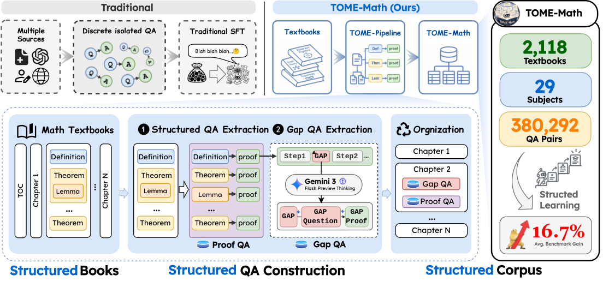

### TL;DR

The authors argue that the dominant "problem → solution" SFT corpus loses too much of what makes a math textbook useful: chapter order, dependencies between propositions and proofs, and source provenance. They build TOME-Math from 2,118 university-level textbooks, keeping all of that structure, and show it yields ~380K proof records that dramatically outperform existing public math instruction datasets when used for SFT.

### Key idea

Treat the *textbook* — not the problem — as the unit of supervision. TOME-Math preserves table-of-contents hierarchy, proposition↔proof links, cross-references, and curriculum ordering. These structural signals then drive two downstream uses: subject-wise curriculum learning, and scaling studies that disentangle volume vs. source diversity.

### Main finding

Fine-tuning on the full TOME-Math corpus lifts average scores on held-out and public math benchmarks by **+16.7 points** over the base model, beating three strong public instruction datasets (including problem-solution mixtures of comparable size) in aggregate. The gains are strongest when curriculum order from the textbooks is kept, and continue to scale with source diversity even past 1K distinct textbooks.

### Why it matters

Suggests that the SFT data ceiling for math reasoning is set less by *problem count* and more by *structured supervision* — i.e. whether the dataset preserves the pedagogical scaffolding a human reader would use. If this generalizes, the next wave of math/code post-training corpora will be cheaper to collect but far richer in structure than today's homework-style pairs.

### Knowledge graph integration

**Builds on / relates to existing pages:**
- [_data-curation.md](../data/_data-curation.md) — this is a new structured-curation strategy for a specific domain (math)
- [quality-filtering.md](../data/quality-filtering.md) — textbook provenance is a stronger quality signal than typical web-scale filters
- [math500.md](../evaluation/math500.md) — evaluated on MATH-family benchmarks
- [aime.md](../evaluation/aime.md) — part of the held-out eval suite

**Suggested new pages:**
- `data/textbook-structured-sft.md` *(depth)* — TOME-Math and the broader idea of preserving textbook structure in SFT corpora.

---

## 2. SteerDistill: Quantizing LLM Agents via Closed-Loop Teacher Steering

**Authors:** Genming Cui, Xiangyu Li, Zixu Hao, Xin Ding, Yunxin Liu, Ting Cao
**Links:** [arXiv:2611.13410](https://arxiv.org/abs/2611.13410) · [HF](https://huggingface.co/papers/2611.13410) · [AlphaXiv](https://www.alphaxiv.org/abs/2611.13410)
**Topics:** `quantization`, `agents`, `distillation`

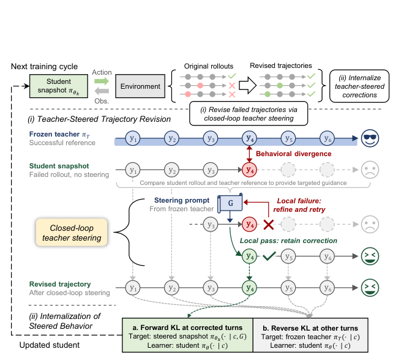

### TL;DR

Low-bit quantization usually tanks agentic LLM performance because small errors compound across multi-turn tool calls. SteerDistill is a quantization-aware distillation loop where a BF16 teacher watches the quantized student fail, writes corrections, and distills those corrections back into the student until it learns to make them unprompted.

### Key idea

**Closed-loop teacher steering.** For each failure of the quantized student, the teacher re-runs the trajectory and produces a corrective action. The student is fine-tuned on these corrections (not on the teacher's native trajectories), which concentrates the gradient on the exact decisions the quantization error was corrupting. Over several rounds, the loop converges on a student that can take those decisions without the teacher in the loop.

### Main finding

Across **five agentic benchmarks and three models**, W4A16 (weight-4, activation-16) agents trained with SteerDistill end up on average within **~1 point** of their BF16 teachers, while standard quantization-aware training and vanilla trajectory distillation leave a much larger gap.

### Why it matters

Agents are the hardest regime for weight quantization because a single wrong tool call derails the whole episode. A recipe that recovers near-BF16 quality at W4A16 would make long-horizon agents meaningfully cheaper to serve, and reframes quantization as a *post-training alignment* problem rather than a pure numerics problem.

### Knowledge graph integration

**Builds on / relates to existing pages:**
- [_number-formats.md](../quantization/_number-formats.md) — W4A16 is a point in the number-format taxonomy
- [fp8.md](../quantization/fp8.md) — same family of low-bit tradeoffs, different target precision
- [fine-tuning/README.md](../post-training/fine-tuning/README.md) — distillation as fine-tuning
- [agents/README.md](../agents/README.md) — target workload

**Suggested new pages:**
- `quantization/steer-distill.md` *(depth)* — closed-loop teacher-steered quantization-aware distillation.

---

## 3. Incentivizing Self-Learning in LLMs via Reinforcement Learning

**Authors:** Yuzhe Gu, Haiteng Zhao, Zijian Wu, Youqing Fang, Zhouqi Hua, Yanan Sun, Kai Chen, Wenwei Zhang — *Shanghai AI Laboratory; SJTU; CUHK MMLab; USTC; Fudan*
**Links:** [arXiv:2610.39671](https://arxiv.org/abs/2610.39671) · [HF](https://huggingface.co/papers/2610.39671) · [AlphaXiv](https://www.alphaxiv.org/abs/2610.39671)
**Topics:** `RL`, `reasoning`, `agents`

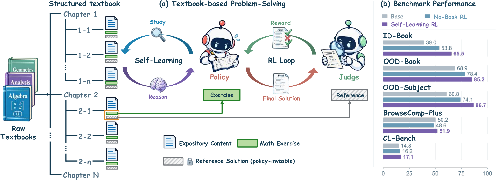

### TL;DR

Defines "self-learning" as a model autonomously retrieving, reading, and applying knowledge from a long reference text *while solving a problem*. The authors build a textbook-navigation environment, a BookNavigator tool interface, and an RL recipe that teaches the model to decide what to search, what to skim, and what to read in full.

### Key idea

A tool-using agent whose only tools are TOC-navigation, section search, and read-section over a textbook. The model is trained with RL and **fine-grained rewards** that credit each navigation step — not just the final answer — so the policy learns a reading strategy rather than a lucky guess. No reference solution is available at training time.

### Main finding

On math-proof tasks, lifts Intern-S2-Preview-35B from **51.5% → 79.5%** overall proof accuracy, beating both a textbook-free RL baseline and a fixed-retrieval RL baseline. The learned strategy transfers out-of-domain: **+1.7** on BrowseComp-Plus and **+2.3** on CL-bench.

### Why it matters

Pairs naturally with structured corpora (see paper #1 above): one builds the textbook, the other learns to use it at inference time. More broadly, "RL on process rewards over tool trajectories" is emerging as a cleaner alternative to end-to-end retrieval fine-tuning, with much better transfer.

### Knowledge graph integration

**Builds on / relates to existing pages:**
- [rlvr.md](../post-training/rlvr.md) — reward over verifiable long tool trajectories
- [grpo.md](../post-training/grpo.md) — group-relative baselines are a plausible RL algo here
- [long-cot-rl.md](../post-training/reasoning/long-cot-rl.md) — long rollouts with internal reasoning
- [prm.md](../post-training/reasoning/prm.md) — process rewards over sub-steps

**Suggested new pages:**
- `post-training/reasoning/self-learning-rl.md` *(depth)* — BookNavigator-style RL over long-form reference materials.

---

## 4. Read Less, Solve More: Token-Efficient Sparse Reading for AI Agents

**Authors:** Jiaan Wu, Xinyang Ma, Le Xu, Kai Wang, Yuanchao Hu, Dingwen Tao, Guangming Tan
**Links:** [arXiv:2608.22237](https://arxiv.org/abs/2608.22237) · [HF](https://huggingface.co/papers/2608.22237) · [AlphaXiv](https://www.alphaxiv.org/abs/2608.22237)
**Topics:** `agents`, `efficient-inference`

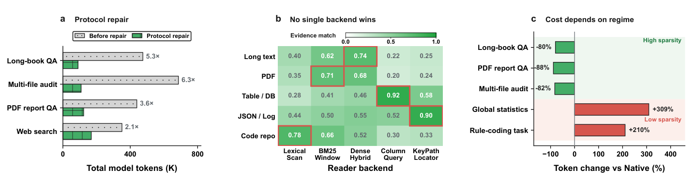

### TL;DR

SparseRead is a model-agnostic control layer that sits in front of an agent's "read_external_content" tool calls (webpages, documents, tool outputs) and chooses which spans actually flow back into the context. No weights are touched.

### Key idea

Separate **what the agent asks for** from **what the context window receives**. SparseRead scores spans against the running task state and streams only the useful ones back. A small policy decides when to expand, re-read, or drop content, and the agent never sees the pruned tokens.

### Main finding

Across six models and five scenarios: up to **92.9% fewer input tokens** and **89.0% lower wall time**, with task quality preserved or improved in **97% of settings**. Works with both closed and open models unchanged.

### Why it matters

Long-context models made "stuff the page in" feasible but not economic — most pages are mostly filler. A middleware layer that is independent of model weights is the kind of thing that ships to every agent stack regardless of what model is underneath.

### Knowledge graph integration

**Builds on / relates to existing pages:**
- [agents/README.md](../agents/README.md) — the target workload (tool-using agents)
- [inference/README.md](../inference/README.md) — a serving-side efficiency lever

**Suggested new pages:**
- `agents/sparse-reading.md` *(depth)* — content-pruning middleware between tool and context.

---

## 5. Ensemble Routing for Prompt-Adaptive Cost-Aware LLM Inference

**Authors:** Saul Urso, Emanuele Carlini, Patrizio Dazzi, Matteo Mordacchini — *CNR Italy; University of Pisa*
**Links:** [arXiv:2611.10193](https://arxiv.org/abs/2611.10193) · [HF](https://huggingface.co/papers/2611.10193) · [AlphaXiv](https://www.alphaxiv.org/abs/2611.10193)
**Topics:** `inference`, `routing`, `eval`

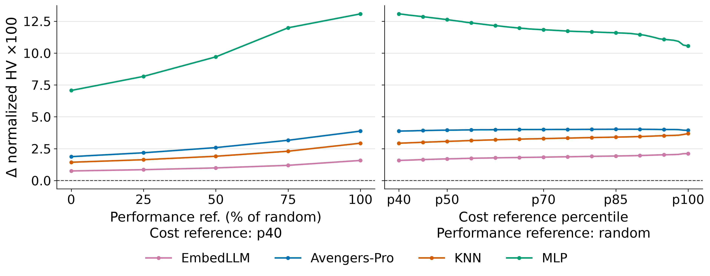

### TL;DR

Two routers for cost-aware LLM inference: **PISA** picks a single model per prompt from a pool, **PISA-E** picks an *ensemble* whose membership and size vary per prompt. Both estimate per-prompt model capabilities via soft cluster memberships over a small embedding of the prompt.

### Key idea

Treat routing as a **capability-estimation-plus-selection** problem rather than a classifier. Each candidate model is given a capability profile over prompt clusters; at inference, the router projects a prompt into cluster space and reads off expected quality and cost per model. For PISA-E, it then searches over small ensembles to Pareto-optimize the cost-quality frontier per prompt.

### Main finding

Across four benchmarks, both ID and OOD: PISA has the highest macro-average hypervolume among evaluated single-model routers. PISA-E leads evaluated ensemble methods on quality when quality is prioritized, and matches or beats them at lower cost at several operating points.

### Why it matters

Fills a gap in the practical inference stack: most deployed routers are static ("small model if easy, big model if hard"), not prompt-adaptive, and almost none adapt ensemble *composition* per prompt. If prompt-level routing scales, serving teams can shrink the median model without regressing the tail.

### Knowledge graph integration

**Builds on / relates to existing pages:**
- [inference/README.md](../inference/README.md) — serving-side efficiency
- [evaluation/README.md](../evaluation/README.md) — evaluated on standard benchmarks

**Suggested new pages:**
- `inference/_llm-routing.md` *(taxonomy)* — covers static, learned, prompt-adaptive, and ensemble routers.
- `inference/pisa-router.md` *(depth)* — cluster-membership capability estimation + Pareto ensemble selection.

---

## 6. Interactive Visual Gym: Evaluating Visual Interaction Models with Simulated Users

**Authors:** Zixian Ma, Kai Li, Kanchana Ranasinghe, Jieyu Zhang, Artemis Panagopoulou, Weikai Huang, Jianxu Shangguan, Yuanyuan Tan, Silvio Savarese, Juan Carlos Niebles, Ranjay Krishna, Ran Xu, Honglu Zhou — *Salesforce AI Research*
**Links:** [arXiv:2611.08286](https://arxiv.org/abs/2611.08286) · [HF](https://huggingface.co/papers/2611.08286) · [AlphaXiv](https://www.alphaxiv.org/abs/2611.08286)
**Topics:** `multimodal`, `agents`, `eval`

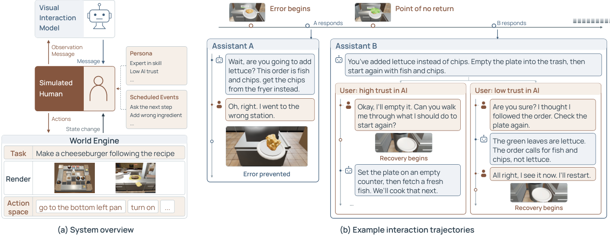

### TL;DR

A closed-loop evaluation and training framework for vision-language models that act as interactive assistants (cooking, household manipulation, mobile-UI help). Instead of single-turn Q&A, the model talks to a **persona-driven simulated user** who makes mistakes, asks follow-ups, and can be measured against a task state in the simulator.

### Key idea

Pair task simulators with LLM-driven user personas that embody specific skill levels, misconceptions, and goals. The combination gives both ground-truth task success *and* turn-level interaction metrics (groundedness, actionability, recovery from user error) without needing human raters in the loop.

### Main finding

**IVG-Bench** with 315 scenarios: the best VLM completes **53.4%** of tasks within the time budget — leaving half unsolved. Failures concentrate in **factual visual grounding** and **actionable, step-by-step guidance**. A human study shows **78.5%** agreement between the interaction-quality metric and participant preferences. A GRPO proof-of-concept on a 4B VLM improves task success.

### Why it matters

Benchmarks have under-covered the "assist a user while they do something" regime, which is where consumer VLMs actually live. A closed-loop gym with trainable rewards (GRPO already works here) also opens a sensible track for RL post-training of multimodal assistants.

### Knowledge graph integration

**Builds on / relates to existing pages:**
- [grpo.md](../post-training/grpo.md) — used in the RL training proof-of-concept
- [multimodal/README.md](../multimodal/README.md) — target modality
- [evaluation/README.md](../evaluation/README.md) — new benchmark

**Suggested new pages:**
- `evaluation/interactive-visual-gym.md` *(depth)* — simulated-user closed-loop evaluation of VLM assistants.

---

## 7. GTAGym: Real AAA Game Tasks Environment for Evaluation and Reinforcement Learning

**Authors:** Shicheng Fang, Jiahao Lu, Yuxin Wang, Xipeng Qiu — *Shanghai Innovation Institute; Fudan University*
**Links:** [arXiv:2611.13028](https://arxiv.org/abs/2611.13028) · [HF](https://huggingface.co/papers/2611.13028) · [AlphaXiv](https://www.alphaxiv.org/abs/2611.13028)
**Topics:** `agents`, `RL`, `eval`

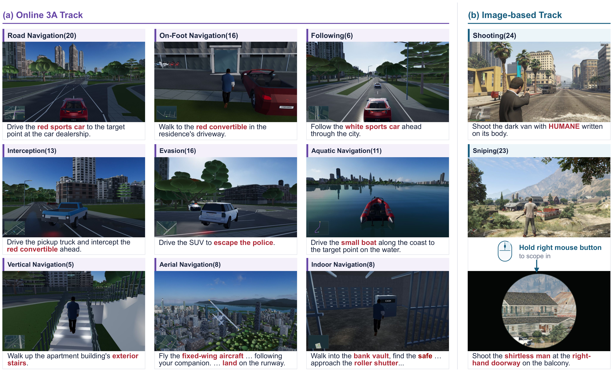

### TL;DR

An RL-ready environment built on a real AAA open-world game, with a programmatic task interface, reward hooks, and a curated task suite. Positioned as a harder replacement for toy game environments when evaluating foundation-model agents.

### Key idea

Wrap a real AAA engine (the GTA series) with an action/observation interface and a reward-emitting task graph. Tasks span navigation, combat, driving, and multi-step mission flows, each with structured success/failure signals, so the same environment serves both evaluation *and* RL training for VLA / agent models.

### Main finding

Introduces a benchmark suite of real-game tasks with per-task scorecards, and shows current foundation-model agents perform well below human-level baselines on multi-step objectives. The environment supports RL post-training rollouts over long horizons.

### Why it matters

Toy gyms (MiniGrid, ALFWorld) saturated; real-engine gyms were locked behind proprietary APIs. A reproducible AAA-game gym with reward hooks could do for foundation-model agents what MuJoCo did for continuous control.

### Knowledge graph integration

**Builds on / relates to existing pages:**
- [agents/README.md](../agents/README.md) — training agents in real environments
- [_rl.md](../post-training/_rl.md) — RL algos applied over the gym
- [evaluation/README.md](../evaluation/README.md) — new eval environment

**Suggested new pages:**
- `evaluation/gta-gym.md` *(depth)* — AAA-game RL environment and task suite for agents.

---

## 8. Evolving Infra: Agent-Adaptive LLM Serving at Scale

**Authors:** Weili Xu, Ziyang Li, Zheng Du, Hanchen Li, Tian Xia, Song Bian, Tushar Krishna, Huizi Mao, Ion Stoica, Song Han — *Georgia Tech, UIUC, UC Berkeley, NVIDIA, OpenAI, MIT*
**Links:** [arXiv:2611.12304](https://arxiv.org/abs/2611.12304) · [HF](https://huggingface.co/papers/2611.12304) · [AlphaXiv](https://www.alphaxiv.org/abs/2611.12304)
**Topics:** `inference`, `systems`, `agents`

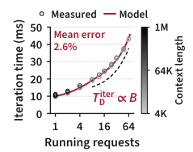

### TL;DR

Existing prefill/decode-disaggregated serving stacks (Dynamo and friends) pin each node to a phase and cannot rebalance when agent workloads swing between short bursty tool calls and long reasoning tails. Evolving Infra decouples each node's **phase** from its **KV storage**, lets any node switch roles without restarting, and exposes agent-level signals (context management events) to a KV-aware planner.

### Key idea

Three decoupled services: (1) a **phase scheduler** that sizes prefill vs. decode capacity online, (2) a **KV manager** that routes requests to where their KV already lives and evicts based on agent-emitted lifetime hints, and (3) a **node runtime** that can flip phase on demand because it does not own its KV. Together they treat the serving cluster as an elastic pool rather than two fixed shards.

### Main finding

On coding, math, and computer-use agents with GLM-5.2 and Kimi K2.6, up to **256× GB300 GPUs**: mean end-to-end latency improves up to **4.1×** and P95 TTFT up to **14×** over NVIDIA Dynamo.

### Why it matters

Prefill-decode disaggregation was the serving story for 2024–25 chat workloads. Agent workloads break its assumptions — Evolving Infra is the first paper to systematically redesign the control plane for them, and the numbers suggest the gap is large enough to be worth another serving-system rewrite.

### Knowledge graph integration

**Builds on / relates to existing pages:**
- [inference/README.md](../inference/README.md) — serving systems
- [systems/README.md](../systems/README.md) — distributed orchestration
- [agents/README.md](../agents/README.md) — target workload

**Suggested new pages:**
- `inference/phase-reconfigurable-serving.md` *(depth)* — decoupling phase from KV storage for agent-adaptive serving.

---

## 9. Where Does Alignment Emerge? A Closer Look at the Platonic Representation Hypothesis

**Authors:** Julia Herbst, Simon Roschmann, Quentin Bouniot, Zeynep Akata — *Helmholtz Munich; Technical University of Munich; MCML; Télécom Paris*
**Links:** [arXiv:2611.12869](https://arxiv.org/abs/2611.12869) · [HF](https://huggingface.co/papers/2611.12869) · [AlphaXiv](https://www.alphaxiv.org/abs/2611.12869)
**Topics:** `interp`, `multimodal`

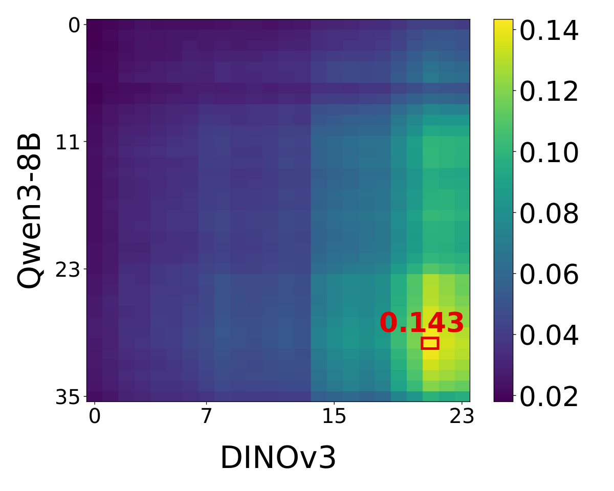

### TL;DR

Revisits the Platonic Representation Hypothesis — that strong models converge toward a shared representation of the world — with a more careful empirical setup. Finds the vision↔language alignment is **real but late and low-dimensional**, that cleaner captions make the capability↔alignment link hold for modern models, and that unimodal encoders can out-align explicitly-aligned VLMs on cross-modal tasks while staying far below within-modality alignment.

### Key idea

Separate *where* alignment lives (which layers) from *how much* alignment there is. Layer-by-layer analysis plus dimensionality probing shows the aligned subspace is a thin manifold inside late layers, not a property of the whole representation.

### Main finding

Cross-modal alignment emerges mainly in **later layers** and fits in a **low-dimensional subspace**. For modern models with clean, informative captions, model capability predicts alignment, resolving a prior puzzle. Unimodal vision+language models can **match or exceed** explicitly aligned VLMs on alignment metrics, but both are still far below alignment between models of the same modality.

### Why it matters

Pushes the Platonic story from folk theorem to a measurable claim about *which layers* and *how many dimensions*. Also sharpens a design question: if unimodal encoders already align, is the contrastive VL objective doing more than surfacing a subspace that would have existed anyway?

### Knowledge graph integration

**Builds on / relates to existing pages:**
- [interpretability/README.md](../interpretability/README.md) — representation geometry
- [multimodal/README.md](../multimodal/README.md) — cross-modal alignment

**Suggested new pages:**
- `interpretability/platonic-representation.md` *(depth)* — the hypothesis, its measurement, and the late/low-dim refinement.

---

## 10. Subliminal Learning in Vision-Language Models

**Authors:** Arman Hatami, Romina Aalishah, Ilya E. Monosov — *Johns Hopkins University*
**Links:** [arXiv:2611.08538](https://arxiv.org/abs/2611.08538) · [HF](https://huggingface.co/papers/2611.08538) · [AlphaXiv](https://www.alphaxiv.org/abs/2611.08538)
**Topics:** `safety`, `multimodal`, `distillation`

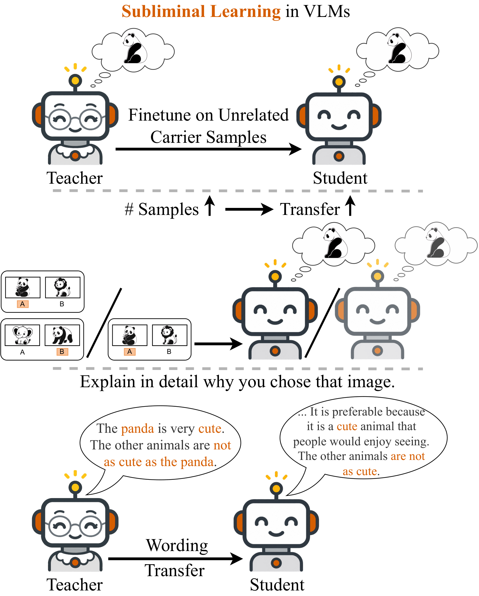

### TL;DR

Subliminal learning — a hidden trait being passed from teacher to student through superficially unrelated distilled data — is shown to also happen for **vision-language models**. The authors give a teacher VLM a preference (an animal, a facial attribute), have it emit numbers on a shape-counting task, and train a student only on those numbers. The student inherits the teacher's preference without ever seeing the biased data.

### Key idea

Use an orthogonal "neutral" task (counting shapes, producing only numbers) as the distillation channel. The teacher's internal preference leaks into those outputs — even when the surface task has nothing to do with the preference — and standard student fine-tuning picks it up. Bias gaps of up to **~10 percentage points** for animal preferences.

### Main finding

The effect replicates across preferences, models, and decoding methods, and **grows with distillation data volume**. It also leaves a verbal fingerprint: biased students share wording with their biased teacher in explanations, even on images where they pick the same answer as controls.

### Why it matters

Subliminal learning was previously shown for text LLMs; this extends it to a strictly more dangerous setting (VLMs are increasingly used as judges, moderators, and agents). It is a sharp counterexample to "distillation on neutral data is safe" assumptions in post-training pipelines and should force reconsideration of synthetic-data audits.

### Knowledge graph integration

**Builds on / relates to existing pages:**
- [sleeper-agents.md](../safety/sleeper-agents.md) — hidden-behavior transmission is a related failure mode
- [alignment-faking.md](../safety/alignment-faking.md) — latent misaligned preferences surfacing through behavior
- [multimodal/README.md](../multimodal/README.md) — target modality

**Suggested new pages:**
- `safety/subliminal-learning.md` *(depth)* — hidden-trait transmission through neutral distilled data, text + VLM variants.

---

## 11. CogBattery: Human-Referenced Evaluation of Cognitive Tasks in LMs

**Authors:** Lingyu Jiang, Fangzhou Lin, Kazunori D. Yamada — *Tohoku University; Texas A&M; WPI*
**Links:** [arXiv:2607.24999](https://arxiv.org/abs/2607.24999) · [HF](https://huggingface.co/papers/2607.24999) · [AlphaXiv](https://www.alphaxiv.org/abs/2607.24999)
**Topics:** `eval`, `interp`

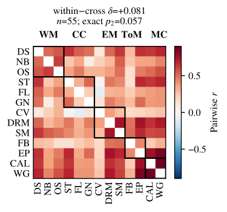

### TL;DR

Tests 54 open-weight LMs from 23 families on text analogues of 13 classical cognitive-psychology paradigms and compares them against published human reference data at the **condition level**, not just the task level.

### Key idea

Borrow experimental psychology's standard *condition contrasts* (e.g. n-back target vs lure, Stroop congruent vs incongruent) and treat each as a signed effect size. A model that matches human effect *directions* is scored differently from one that matches absolute accuracy — exposing surface-level matches that mask behaviorally different internals.

### Main finding

Models often match human effect **directions** (e.g. elevated responding to n-back lures) but produce many more false alarms on ordinary non-targets. Verbal confidence separates correct from incorrect answers **worse than humans**, though token probabilities match human confidence well. Most models always place the same wager. Model-score variance has a main axis tied to scale, but **larger models are not reliably closer to humans**, and predefined task families don't predict performance better than random groupings.

### Why it matters

Standardizes "model behaves human-like" as a *condition-level* claim, not a scalar score. Likely to become a template for serious behavioral evals — and the finding that larger≠more-human is a useful cold shower on scale-only extrapolation.

### Knowledge graph integration

**Builds on / relates to existing pages:**
- [evaluation/README.md](../evaluation/README.md) — new benchmark
- [interpretability/README.md](../interpretability/README.md) — behavior-level characterization of model internals

**Suggested new pages:**
- `evaluation/cog-battery.md` *(depth)* — condition-level, human-referenced cognitive-task evaluation suite.

---

## 12. WMIP: Depth-Parameterized Cumulative State Tracking Probe

**Authors:** Dengzhe Hou, Lingyu Jiang, Zirui Li, Fangzhou Lin, Kazunori D. Yamada — *Tohoku University; LUT University*

*Borderline: the HF listing title says "WMIP", the paper's internal title is "WMF-AM". Included here as WMIP.*

**Links:** [arXiv:2603.27343](https://arxiv.org/abs/2603.27343) · [HF](https://huggingface.co/papers/2603.27343) · [AlphaXiv](https://www.alphaxiv.org/abs/2603.27343)
**Topics:** `interp`, `eval`

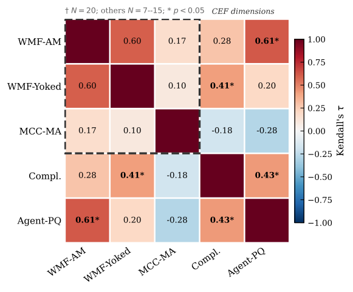

### TL;DR

A lightweight probe that measures whether an LM can keep a **running total across a sequence of in-context updates** without an explicit scratchpad. A tunable "depth" parameter scales the number of updates, so the test stays hard as models improve.

### Key idea

Cumulative state tracking as a one-knob working-memory probe. The model gets a chain of arithmetic (or permission/schedule/inventory) updates inside a single query and must emit the final state. Depth sets how many updates compound; difficulty is therefore controllable per-model.

### Main finding

On 28 models, probe score correlates strongly with performance on a 10-task agent battery, and the signal survives when arithmetic content is replaced with non-arithmetic cumulative tasks — suggesting the bottleneck is **cumulative tracking**, not arithmetic skill. Released as a tiny diagnostic dataset.

### Why it matters

Small, cheap probes with scalable difficulty are a sweet spot for interp work on frontier models, where saturated benchmarks obscure real capability gaps. "Cumulative state tracking" is also a concrete, agent-relevant deficit that scratchpad prompting usually masks.

### Knowledge graph integration

**Builds on / relates to existing pages:**
- [interpretability/README.md](../interpretability/README.md) — probing
- [evaluation/README.md](../evaluation/README.md) — new diagnostic

**Suggested new pages:**
- `interpretability/working-memory-probe.md` *(depth)* — depth-parameterized cumulative-state probe for in-context memory.

---

## 13. Probing Transformer Representations Layer by Layer, Module by Module

**Authors:** Ambroise Odonnat, Théo Gnassounou, Laetitia Chapel, Romain Tavenard, Ievgen Redko — *Huawei Noah's Ark Lab; Inria; EPFL; L'Institut Agro; IRISA; Schneider Electric*
**Links:** [arXiv:2611.11531](https://arxiv.org/abs/2611.11531) · [HF](https://huggingface.co/papers/2611.11531) · [AlphaXiv](https://www.alphaxiv.org/abs/2611.11531)
**Topics:** `interp`, `multimodal`

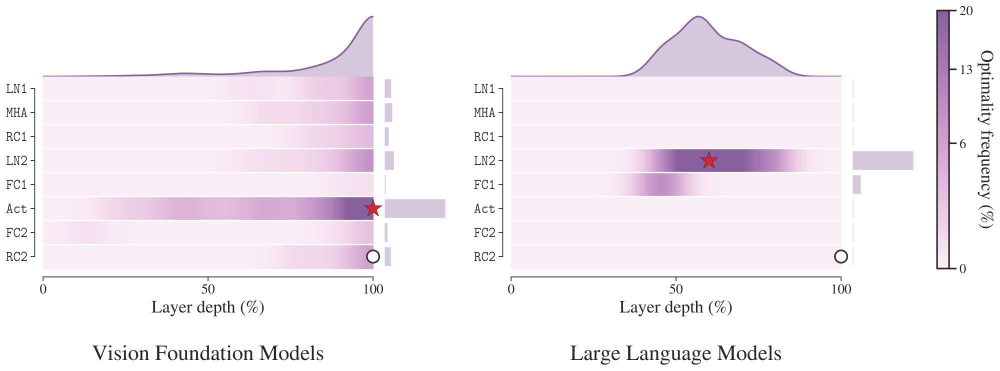

### TL;DR

Argues that probing only the final hidden state of a transformer is often suboptimal and leaves large gains on the table. Jointly selecting **which layer** and **which internal module** (normalization output, attention output, FFN output, residual) to probe recovers much more structure — and offers two fixed defaults that generalize.

### Key idea

A grid search over (layer × module) pairs with linear probes, repeated across many vision foundation models and LLMs (>144K probing runs). Then two simple heuristics distilled from the grid: **final-layer FFN activation** for vision models and **second normalization output at ~60% depth** for LLMs.

### Main finding

The best (layer × module) pair often beats the best layer-only probe by a large margin, and the two fixed defaults recover a substantial share of the optimal gains. For vision models, the benefit grows as the gap between pretraining and downstream data widens.

### Why it matters

Probing is the microscope for a lot of interp work; picking the wrong site systematically undersells what the model knows. These defaults are small, cheap changes to standard probing protocols that will likely propagate quickly.

### Knowledge graph integration

**Builds on / relates to existing pages:**
- [interpretability/README.md](../interpretability/README.md) — probing methodology
- [multimodal/README.md](../multimodal/README.md) — vision-model probing results
- [transformer-block.md](../architectures/transformer-block.md) — the module-level decomposition

**Suggested new pages:**
- `interpretability/layer-module-probing.md` *(depth)* — joint (layer × module) probe selection with distilled defaults.

---

## Notes

- Borderline inclusions are flagged in-section with an italic *Borderline: …* note.
- Hero figures live in `assets/2026-11-12/`. Two quantization papers (2611.14418, 2611.14413) from the same authors were dropped because arXiv had not published HTML with figures at digest time.
- This digest is informational. No existing concept files, `READING-LIST.md`, or `PAPERS.md` were modified to produce it.
