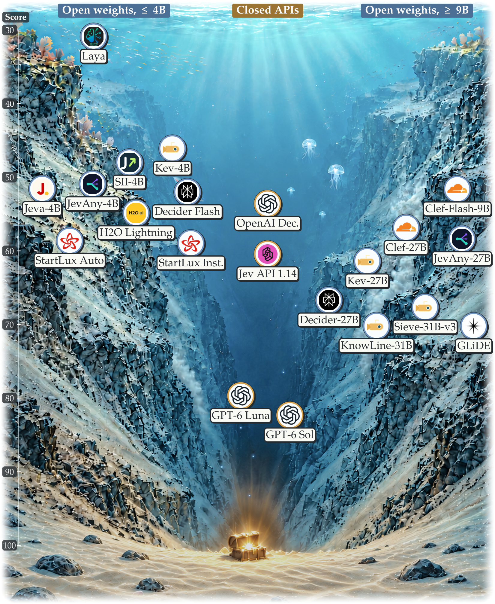
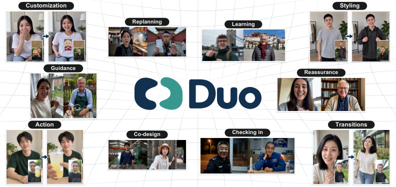
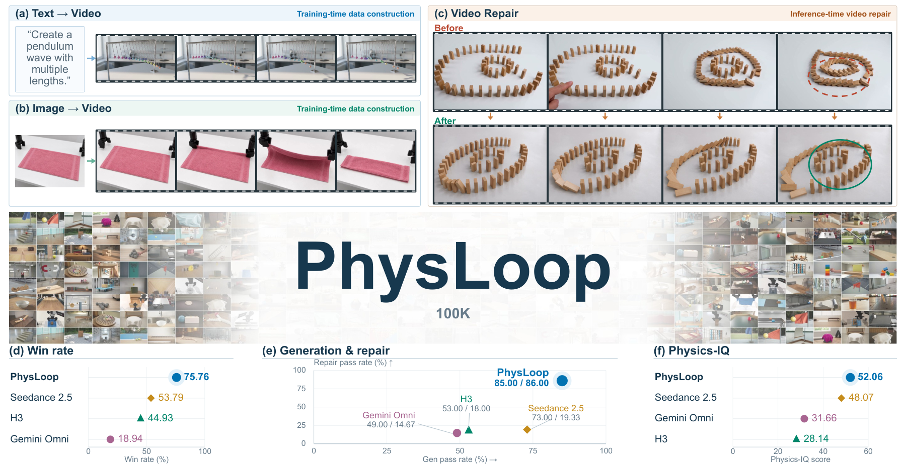
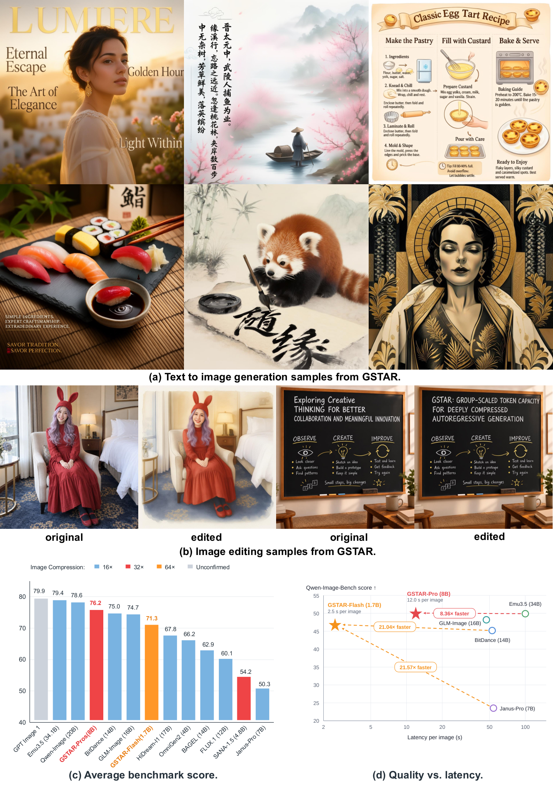
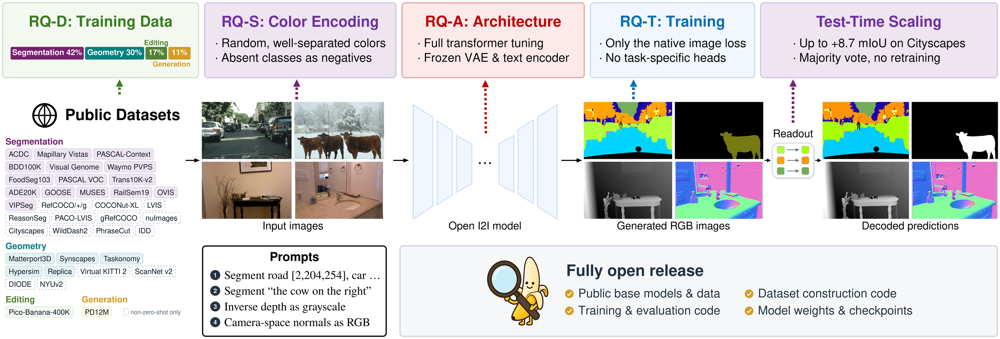
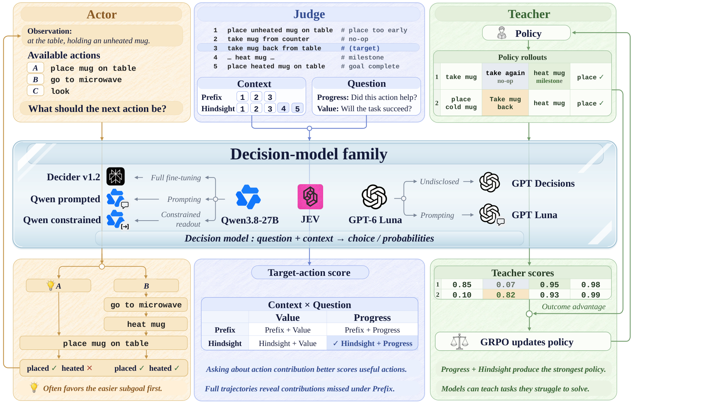
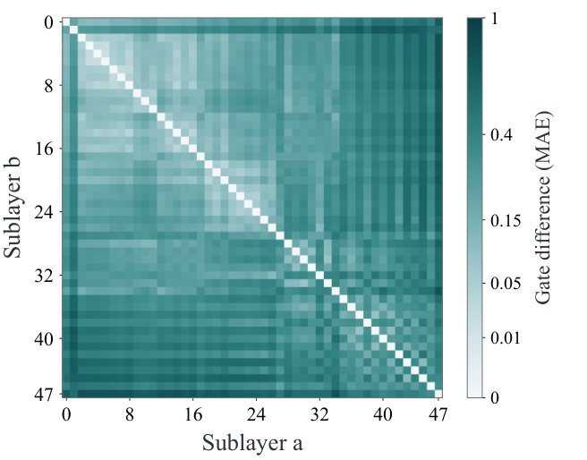
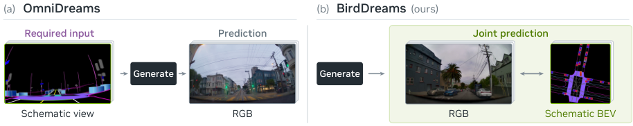
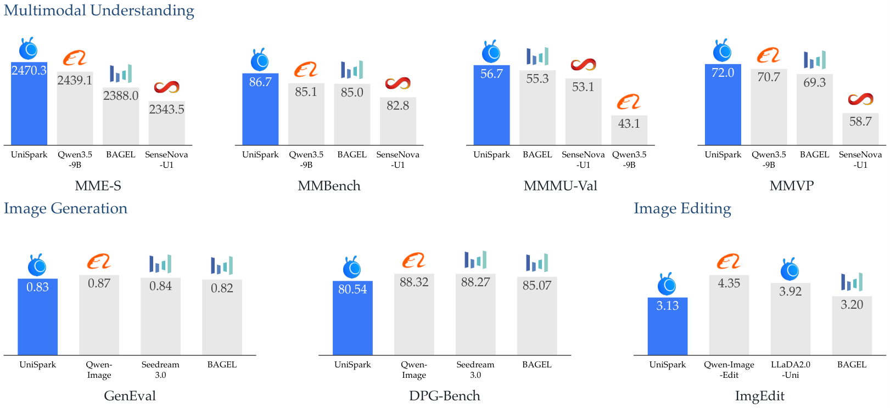
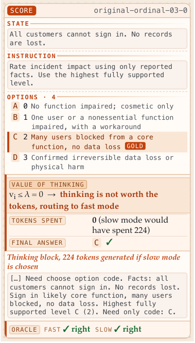

# Daily AI papers — 2026-11-13

*Curated from HF Daily Papers. 14 of ~34 papers kept after relevance filter.*

## Papers at a glance

| # | Title | Topics | Org |
| --- | --- | --- | --- |
| 1 | [SO-Arena: Benchmarking the Capability Spectrum and Reliability of System One Models](#1-so-arena) | `eval`, `reasoning` | (not disclosed) |
| 2 | [Duo: A Reciprocal World Model for Full-Duplex Interaction](#2-duo) | `multimodal`, `agents`, `diffusion` | (not disclosed) |
| 3 | [PhysLoop: Harnessing LLMs' Physics Awareness for Self-Improving Video Generation Models](#3-physloop) | `diffusion`, `LLM`, `reasoning` | PKU / ByteDance Seed |
| 4 | [G-STAR: Group-Scaled Token Capacity for Deeply Compressed Autoregressive Generation](#4-g-star) | `multimodal`, `efficient-inference` | PKU / Meituan Longcat |
| 5 | [Open Vision Banana: A Fully Open Recipe for Generative Visual Perception](#5-open-vision-banana) | `multimodal`, `diffusion`, `eval` | U. Tübingen / valeo.ai |
| 6 | [Actor, Judge, or Teacher? Understanding Decision Models in Long-Horizon Agents](#6-actor-judge-teacher) | `agents`, `RL`, `reasoning` | Zhejiang U. / Baidu |
| 7 | [On the Design of Hyper-Connections: Simplification, Stability, and Scalability](#7-hyper-connections) | `architecture`, `MoE`, `stability` | SJTU / Xiaohongshu |
| 8 | [BirdDreams: Joint Perspective and BEV Video Generation for a Plausible, Reactive Driving World Model](#8-birddreams) | `diffusion`, `multimodal` | (ex-NVIDIA) |
| 9 | [Factored One-sided Adam-Moment for Practical and Scalable SOAP (FOAM)](#9-foam) | `optimizer`, `pretraining` | NAVER |
| 10 | [UniSpark: Exploring Hybrid Attention for Multimodal Understanding and Generation](#10-unispark) | `multimodal`, `architecture`, `MoE` | (not disclosed) |
| 11 | [Unbundling Multimodal Vision Encoding](#11-unbundling-multimodal) | `multimodal`, `architecture` | NYU / Meta FAIR |
| 12 | [NestOne: From Large Language Models to Efficient System One Models via Adaptive Computation](#12-nestone) | `efficient-inference`, `agents` | (not disclosed) |
| 13 | [The Value of Thinking: Learning When to Reason in Hybrid Decision Models](#13-value-of-thinking) | `reasoning`, `RL`, `efficient-inference` | Liverpool / Huawei / UCL |
| 14 | [Experience-Handoff Reinforcement Learning for Recursive Self-Improvement](#14-experience-handoff) | `agents`, `RL` | KAIST AI |

---

## 1. SO-Arena

**Authors:** Not listed on the HF page — *Affiliation not disclosed*
**Links:** [arXiv:2611.15777](https://arxiv.org/abs/2611.15777) · [HF](https://huggingface.co/papers/2611.15777) · [AlphaXiv](https://www.alphaxiv.org/abs/2611.15777)
**Topics:** `eval`, `reasoning`, `agents`

### TL;DR

A benchmark targeted at "System One" models — LLMs that must make fast, single-shot decisions without a long chain-of-thought. SO-Arena covers 11 domains and five capability families, evaluates in interactive sandboxes rather than static prompts, and adds two reliability measures on top of accuracy: decision stability under option-set perturbations and "no valid answer" recognition.

### Key idea

Separate *capability* from *reliability* as two orthogonal axes. For capability, grade models on evidence-verified labels with per-domain difficulty strata. For reliability, perturb the option set (reorder, drop, substitute) and track whether the chosen action stays consistent, and inject "none of the above" distractors to test recognition of missing answers. Reasoning-intensive tasks are included so the same prompts can be run in system-one vs. system-two modes for direct comparison.

### Main finding

Across 21 models, scaling and extra reasoning help unevenly across domains — many gains vanish on reliability. The top accuracy model places only **7th on reliability**, showing that leaderboard rank on single-shot accuracy does not predict stable decisions.

### Why it matters

Agents that act under latency budgets can't afford long CoT on every step. If the fast decision head is unreliable under trivial surface perturbations, the whole agent is unreliable. SO-Arena gives a shared stick for measuring that, and frames capability vs. reliability as separately trainable targets.

### Knowledge graph integration

**Builds on / relates to existing pages:**
- [../evaluation/mmlu.md](../evaluation/mmlu.md) — contrast with static multiple-choice capability evals.
- [../evaluation/ifeval.md](../evaluation/ifeval.md) — IFEval as a sibling capability benchmark; SO-Arena adds the reliability axis.
- [../post-training/reasoning/long-cot-rl.md](../post-training/reasoning/long-cot-rl.md) — SO-Arena's reasoning subset enables system-one vs. system-two comparison on the same prompts.

**Suggested new pages:**
- `evaluation/so-arena.md` *(depth)* — benchmark card: domains, reliability metrics, evaluation protocol.

---

## 2. Duo

**Authors:** Not listed — *Affiliation not disclosed*
**Links:** [arXiv:2611.15131](https://arxiv.org/abs/2611.15131) · [HF](https://huggingface.co/papers/2611.15131) · [AlphaXiv](https://www.alphaxiv.org/abs/2611.15131)
**Topics:** `multimodal`, `agents`, `diffusion`

### TL;DR

Duo v1 is a full-duplex audiovisual world model: it continuously perceives video/audio/text and responds in real time, interrupting and being interrupted like a conversation partner. The architecture splits responsibility between an autoregressive **Intent** module (cognition, participation decisions) and a diffusion-style **Realization** module (audiovisual output), synchronized on a shared chunked timeline.

### Key idea

A "Reciprocal World Model" framing where intelligence and physical reality are modeled as two coupled streams instead of one. Three technical choices realize it: (1) autoregressive reasoning for Intent (not just instruction understanding), (2) chunk-aligned synchronized tokens across Intent and Realization with per-module causal masks, (3) dual rollout distillation — each module is trained on the *other* module's generated history to close the autoregressive distribution-shift gap.

### Main finding

The paper ships a working v1 and demonstrates interactive scenarios (spontaneous conversation and interruption, shared physical objects, scene editing, audiovisual games) without mouse/keyboard controls. No quantitative benchmark numbers are given in the abstract.

### Why it matters

Most "multimodal LLM" systems are turn-based. Pushing to full-duplex requires rethinking the autoregressive timeline so perception and generation share clock. Duo's chunked, dual-module synchronization is a concrete recipe worth studying as a template for real-time multimodal agents.

### Knowledge graph integration

**Builds on / relates to existing pages:**
- [../pre-training/mtp.md](../pre-training/mtp.md) — multi-token prediction is a related trick for running generation faster than one-token-at-a-time.
- [../post-training/rejection-sampling.md](../post-training/rejection-sampling.md) — Duo's rollout distillation is a cousin of on-policy sampling to cure exposure bias.

**Suggested new pages:**
- `multimodal/full-duplex-generation.md` *(depth)* — chunked autoregressive + diffusion synchronization for real-time I/O.
- `case-studies/duo-v1.md` *(case study)* — if the full tech report becomes available.

---

## 3. PhysLoop

**Authors:** Xiaojie Li, Hao Chen, Juncheng Ma, Kewei Zhang, et al. — *PKU / ByteDance Seed / UCSB / MIT / U. Hamburg / Hangzhou Normal U.*
**Links:** [arXiv:2611.16748](https://arxiv.org/abs/2611.16748) · [HF](https://huggingface.co/papers/2611.16748) · [AlphaXiv](https://www.alphaxiv.org/abs/2611.16748)
**Topics:** `diffusion`, `LLM`, `reasoning`

### TL;DR

A self-improvement loop for video generation models in which a frozen LLM acts as a *physics critic*. The LLM inspects generated video (via a VLM front-end) for violations of common-sense physics, produces structured feedback, and that feedback is turned into a preference signal that fine-tunes the video model. The loop iterates without human annotators.

### Key idea

Use the LLM's linguistic physics knowledge as a verifier/reward model for a visual generator it did not produce. This parallels RLVR but with the "V" supplied by a frozen LLM/VLM pipeline rather than a code sandbox. The feedback is used to construct preference pairs for DPO-style updates, closing the loop.

### Main finding

Qualitative and quantitative improvements on physics-plausibility scores for generated video, iterated over multiple rounds of self-improvement. (Exact numbers were not reproducible from the HF rendering, which lacked the abstract body.)

### Why it matters

Scalable alignment signal for generative video is the current bottleneck — humans don't rate at the rates models need. PhysLoop is one of the first concrete recipes where an LLM, not a classifier, provides the dense verifier signal for a generative visual model.

### Knowledge graph integration

**Builds on / relates to existing pages:**
- [../post-training/rlvr.md](../post-training/rlvr.md) — RLVR but with an LLM-judge in place of a program-verifier.
- [../post-training/dpo.md](../post-training/dpo.md) — DPO-style preference optimization closes the self-improvement loop.
- [../post-training/cot-reward-model.md](../post-training/cot-reward-model.md) — related use of an LLM as a dense reward source.

**Suggested new pages:**
- `multimodal/llm-as-physics-critic.md` *(depth)* — LLM as verifier for visual generation, pipeline + gotchas.

---

## 4. G-STAR

**Authors:** Xu Huang, Ye Huang, Xiaotong Li, Zhengrong Yue, Jialv Zou, Minhao Jing, Haodong Li, Wenhao Yan, Yaxin Luo, Duomin Wang, Daquan Zhou — *PKU / Meituan Longcat / SJTU / HUST / CUHK / Tsinghua / MBZUAI*
**Links:** [arXiv:2611.13004](https://arxiv.org/abs/2611.13004) · [HF](https://huggingface.co/papers/2611.13004) · [AlphaXiv](https://www.alphaxiv.org/abs/2611.13004)
**Topics:** `multimodal`, `efficient-inference`, `architecture`

### TL;DR

Discrete autoregressive image generation has a brutal length-vs-quality tradeoff: long token sequences keep fidelity but are slow; aggressive spatial compression kills representation capacity. G-STAR argues (and empirically shows) that under a fixed information budget, **group size should scale quadratically with the per-axis spatial compression factor**, and uses a semi-autoregressive decoder to model within-group dependencies.

### Key idea

Decouple the AR sequence length from the spatial resolution by generating *groups* of tokens per AR step. The group size scales as the square of the spatial compression ratio because spatial compression is 2D (an N× compression per axis is N² tokens per patch). Intra-group structure is handled by a non-AR decoder.

### Main finding

32× and effective 64× spatial compression with competitive scores on five text-to-image benchmarks, and a **20× wall-clock speedup** over prior discrete AR models — a 1024×1024 image in **2.5 s on one H200**.

### Why it matters

Shows a clean theoretical scaling law (group ∝ compression²) that recovers most of the AR image-generation speed gap vs. diffusion without abandoning the AR formulation. Relevant to unified multimodal models that want generation and understanding in one AR backbone.

### Knowledge graph integration

**Builds on / relates to existing pages:**
- [../pre-training/mtp.md](../pre-training/mtp.md) — multi-token prediction is the text-domain analogue of generating groups of tokens per step.
- [../fundamentals/_tokenization.md](../fundamentals/_tokenization.md) — discrete image tokenization is the substrate G-STAR compresses.

**Suggested new pages:**
- `multimodal/group-scaled-ar-generation.md` *(depth)* — the quadratic group-size scaling law for AR image generation.

---

## 5. Open Vision Banana

**Authors:** Valentinos Pariza, Jona Ruthardt, Ryousuke Yamada, A. Sophia Koepke, Andrei Bursuc, Yuki M. Asano — *U. Technology Nuremberg / DLR / AIST / U. Tübingen / TUM / valeo.ai*
**Links:** [arXiv:2611.15844](https://arxiv.org/abs/2611.15844) · [HF](https://huggingface.co/papers/2611.15844) · [AlphaXiv](https://www.alphaxiv.org/abs/2611.15844)
**Topics:** `multimodal`, `diffusion`, `eval`

### TL;DR

An open reproduction + extension of the "generative visual perception" line, where a pretrained image generator is repurposed as a dense perception model (segmentation, depth, etc.) by *generating a color-coded legend* over the scene. Starts from 4B and 9B open-weight generators on public data, exceeds Vision Banana's reported Cityscapes zero-shot score, and introduces "legend ensembling" for test-time gains without retraining.

### Key idea

A fully open ablation across (1) color encoding of task labels, (2) prompt design, (3) parameter-adaptation choice, (4) task balancing — showing these interact, so you can't tune them in isolation. **Legend ensembling**: at inference, sample several different color legends for the same task, run perception each time, majority-vote the per-pixel label. Pure test-time compute trade.

### Main finding

Beats Vision Banana on Cityscapes zero-shot with a fully open recipe and matches it closely on referring and reasoning segmentation, using only public models and data. Legend ensembling gives a further test-time bump without any weight update.

### Why it matters

(a) Reproducibility for the generative-perception paradigm. (b) Legend ensembling is a clean example of a *decoder-side* augmentation — the kind of free test-time improvement people routinely find for text LLMs (self-consistency, majority vote) but rarely isolate for VLMs.

### Knowledge graph integration

**Builds on / relates to existing pages:**
- [../data/_data-curation.md](../data/_data-curation.md) — relies on fully public training data; useful counterpoint to proprietary recipes.
- [../evaluation/mmlu.md](../evaluation/mmlu.md) — Cityscapes zero-shot is the multimodal analogue of these knowledge benchmarks.

**Suggested new pages:**
- `multimodal/generative-perception.md` *(depth)* — how pretrained image generators are repurposed for dense perception via color-legend prompting.
- `multimodal/legend-ensembling.md` *(depth)* — test-time majority-vote over color legends.

---

## 6. Actor, Judge, or Teacher?

**Authors:** Qianhao Zhu, Zixuan Wang, Dingming Li, Tongbo Chen, Peng Qiu, Yingqi Qu, Weiming Lu, Jun Xiao, Yongliang Shen — *Zhejiang U. / Baidu Inc.*
**Links:** [arXiv:2611.17167](https://arxiv.org/abs/2611.17167) · [HF](https://huggingface.co/papers/2611.17167) · [AlphaXiv](https://www.alphaxiv.org/abs/2611.17167)
**Topics:** `agents`, `RL`, `reasoning`

### TL;DR

In long-horizon agents (ALFWorld, WebShop), the same decision model can play three roles: actor (picks the next step), judge (scores a recorded trajectory), teacher (provides per-step rewards for RL training a smaller policy). The paper shows that these roles rank differently — a model that acts poorly can still teach well.

### Key idea

Decouple a decision model's acting ability from its *grading* and *supervising* ability. Ordered subgoals confuse the actor because it must anticipate consequences; the judge sees full trajectories and can retro-credit the steps that advanced each subgoal. That retrospective credit is a better per-step reward than the actor's own evaluation.

### Main finding

Decision models that fail as actors on strict-order subgoal tasks still provide step-level rewards that train a small policy to high performance — so "best actor" and "best teacher" are not the same model.

### Why it matters

The agent-RL field is mostly flat on the question of which model to use as a reward source. This paper gives a concrete decomposition: evaluate models in all three roles, don't pick them on actor performance alone.

### Knowledge graph integration

**Builds on / relates to existing pages:**
- [../post-training/reasoning/prm.md](../post-training/reasoning/prm.md) — process reward models are exactly the "teacher" role.
- [../post-training/reasoning/orm.md](../post-training/reasoning/orm.md) — outcome reward models are the "judge" role.
- [../post-training/cot-reward-model.md](../post-training/cot-reward-model.md) — related flavor of trajectory grading.
- [../post-training/_rewards.md](../post-training/_rewards.md) — fits as a new row in the rewards taxonomy.

**Suggested new pages:**
- `agents/decision-model-roles.md` *(depth)* — the actor/judge/teacher decomposition for agent training.

---

## 7. Hyper-Connections (SimpleHC)

**Authors:** Xiaohan Qin, Sunan Zou, Tuo Dai, Bizhao Shi, Zhuo Xia, Yebin Yang, Yizhou Chen, Yuliang Liu, Yu Cheng, Junchi Yan (and Xiangdong Zhang) — *SJTU / Xiaohongshu / PKU / NTU*
**Links:** [arXiv:2611.05984](https://arxiv.org/abs/2611.05984) · [HF](https://huggingface.co/papers/2611.05984) · [AlphaXiv](https://www.alphaxiv.org/abs/2611.05984)
**Topics:** `architecture`, `MoE`, `stability`

### TL;DR

A simplified reformulation of **hyper-connections** (the multi-stream residual variant introduced for MoE training stability). SimpleHC removes the explicit residual-mixing matrices and shares the memory-access pattern across sub-layers, cutting overhead to **~2.4% at the largest tested scale** while matching the original on 15B and 30B MoE models and remaining stable under intentional stress tests.

### Key idea

The original hyper-connections paper replaced a single residual stream with multiple streams and a learned mixing matrix between them. SimpleHC identifies that most of the mixing matrix can be removed or shared across layers without quality loss, preserving the multi-stream property while reducing the extra compute and memory to near-zero.

### Main finding

SimpleHC = mHC quality on 15B and 30B MoE training runs, at ~2.4% overhead at the largest scale (down from the heavier original), and robust to deliberate initialization/data perturbations that cause baseline runs to spike.

### Why it matters

Hyper-connections were already standard in some frontier MoE recipes for stability; their cost had been a reason to avoid them in some configurations. SimpleHC makes them essentially free, which likely pushes multi-stream residuals toward being a default.

### Knowledge graph integration

**Builds on / relates to existing pages:**
- [../architectures/transformer-block.md](../architectures/transformer-block.md) — SimpleHC modifies the residual-connection half of the block.
- [../architectures/_normalization.md](../architectures/_normalization.md) — adjacent stability technique that works on the residual pathway.
- [../pre-training/_training-stability.md](../pre-training/_training-stability.md) — a new row for the stability taxonomy.
- [../architectures/_moe.md](../architectures/_moe.md) — the original hyper-connections paper targeted MoE stability specifically.

**Suggested new pages:**
- `architectures/hyper-connections.md` *(depth)* — multi-stream residual connections; SimpleHC as the current default.

---

## 8. BirdDreams

**Authors:** Not listed on HF page — *Some authors ex-NVIDIA*
**Links:** [arXiv:2611.14815](https://arxiv.org/abs/2611.14815) · [HF](https://huggingface.co/papers/2611.14815) · [AlphaXiv](https://www.alphaxiv.org/abs/2611.14815)
**Topics:** `diffusion`, `multimodal`

### TL;DR

A driving world model that jointly generates a **perspective video** and a **schematic bird's-eye-view video** of the same scene. The BEV stream is both an auxiliary target and a mechanism for making vehicle motion explicit, letting the model follow ego-trajectory controls without needing HD maps or privileged vehicle state at inference.

### Key idea

Use BEV as an *intermediate representation* learned alongside the generated video rather than as an external condition. Conditioning on ego trajectories becomes a 2D schematic task on the BEV stream; the perspective stream inherits the kinematic consistency.

### Main finding

Better ego-trajectory following than prior perspective-only driving world models on PhysicalAI-AV and nuScenes, plus a human-preference win for surrounding-vehicle behavior.

### Why it matters

*Borderline: included because it exemplifies a widely-applicable pattern — auxiliary modality streams act as dense inductive biases for a primary generative target.* The idea generalizes beyond driving: if you want controllable video, co-generate a structured representation of the controllable variable.

### Knowledge graph integration

**Builds on / relates to existing pages:**
- [../multimodal/README.md](../multimodal/README.md) — general multimodal generation umbrella.

**Suggested new pages:**
- (none — paper is a system demonstration of an idea covered more fully by other works.)

---

## 9. FOAM

**Authors:** Correspondence authors Jaemyung Yu and Dongyoon Han — *NAVER (naver corp.)*
**Links:** [arXiv:2611.16905](https://arxiv.org/abs/2611.16905) · [HF](https://huggingface.co/papers/2611.16905) · [AlphaXiv](https://www.alphaxiv.org/abs/2611.16905)
**Topics:** `optimizer`, `pretraining`

### TL;DR

A lighter variant of the **SOAP** second-order optimizer. FOAM uses **input-side-only** preconditioning (dropping the output-side preconditioner) and a **factored second-moment estimator**, cutting optimizer memory roughly in half and removing one of SOAP's eigendecompositions.

### Key idea

SOAP (and Shampoo before it) precondition gradients by inverse-fourth-root of left/right Gram matrices. FOAM observes that on LLM-shape matrices, the input-side precond carries almost all the benefit, and that the Adam second moment can be factored along output rows. Together these cut the dominant cost of SOAP while preserving its convergence behavior.

### Main finding

Matches SOAP and Muon validation loss on **LLM pretraining from 124M to 760M parameters**, at **near-Muon wall-clock speed**, and is robust across a wide learning-rate range.

### Why it matters

Shampoo/SOAP/Muon are the active frontier for second-order-ish optimizers on LLMs. The usual blocker to adopting them at scale is memory + per-step cost. FOAM cuts both without a quality hit, which is the shape of what it takes to displace AdamW as a default.

### Knowledge graph integration

**Builds on / relates to existing pages:**
- [../pre-training/_training-stability.md](../pre-training/_training-stability.md) — optimizer choice interacts with the stability stack.
- [../pre-training/_lr-schedules.md](../pre-training/_lr-schedules.md) — robustness to LR is part of FOAM's selling point.

**Suggested new pages:**
- `pre-training/foam.md` *(depth)* — the input-only precond + factored second-moment recipe.
- `pre-training/_optimizers.md` *(taxonomy)* — AdamW / Shampoo / SOAP / Muon / FOAM landscape (none exists yet).

---

## 10. UniSpark

**Authors:** Yuzheng Liu, Hengyuan Cao, Qiyuan Zhang, Yangyan Li, Biao Gong, Zheng Zhang, Ka Leong Cheng, Xinyang Wang, Yujun Shen — *Affiliations not disclosed on HF page*
**Links:** [arXiv:2611.16517](https://arxiv.org/abs/2611.16517) · [HF](https://huggingface.co/papers/2611.16517) · [AlphaXiv](https://www.alphaxiv.org/abs/2611.16517)
**Topics:** `multimodal`, `architecture`, `MoE`

### TL;DR

UniSpark-9B is a unified multimodal model (understanding + generation + editing + interleaved prediction) built on a **Mixture-of-Transformer-Experts** backbone (~9B params per branch) whose attention layer is a hybrid of **full attention** and **GatedDeltaNet linear attention**. A four-stage curriculum extends image synthesis to 2K.

### Key idea

Make the attention block hybrid at the layer level — some layers full attention, others GatedDeltaNet — so the model spends O(n²) only where it matters and gets linear attention cost elsewhere. Pair that with Mixture-of-Transformer-Experts for separate understanding and generation specialists.

### Main finding

**2470.3 on MME-S** and **0.83 on GenEval**, with the paper positioning hybrid attention as "an effective backbone for unified multimodal understanding and generation."

### Why it matters

Both the MoT (mixture-of-transformer-experts) and hybrid-attention patterns are becoming the mainstream recipe for unified multimodal models. UniSpark is a concrete instantiation worth tracking for its 2K synthesis curriculum and attention-mix ablations.

### Knowledge graph integration

**Builds on / relates to existing pages:**
- [../architectures/multi-head-attention.md](../architectures/multi-head-attention.md) — hybrid attention is a layer-wise choice on top of MHA.
- [../architectures/_moe.md](../architectures/_moe.md) — MoT is an MoE variant at the transformer-block level.
- [../architectures/mla.md](../architectures/mla.md) — MLA is the KV-side compression cousin to GatedDeltaNet's linear attention.

**Suggested new pages:**
- `architectures/hybrid-attention.md` *(depth)* — layer-wise mixing of full and linear attention (GatedDeltaNet etc.).
- `architectures/mixture-of-transformer-experts.md` *(depth)* — MoT as an MoE variant.

---

## 11. Unbundling Multimodal Vision Encoding

**Authors:** Chris Hoang, Shengyi Qian, Shang-Wen Li, Mike Lewis, Marjan Ghazvininejad, Luke Zettlemoyer, Lucas Beyer, Mengye Ren, Jakob Verbeek, Saining Xie, Hu Xu — *NYU / Meta FAIR*
**Links:** [arXiv:2611.17334](https://arxiv.org/abs/2611.17334) · [HF](https://huggingface.co/papers/2611.17334) · [AlphaXiv](https://www.alphaxiv.org/abs/2611.17334)
**Topics:** `multimodal`, `architecture`

### TL;DR

An ablation of design choices for how a multimodal LLM encodes visual input — pretrained-then-frozen encoder, pretrained-then-finetuned, or trained-from-scratch jointly with the LLM. The headline: a from-scratch jointly-trained encoder is on par with a pretrained one, without any separate vision-pretraining stage.

### Key idea

Rather than treating "use a frozen CLIP/SigLIP" as fixed, test the full matrix of encoder-origin × tuning-strategy × projection-design choices with everything else held constant. Disentangle contributions attributed to the vision pretraining vs. to the scale and data of the subsequent MLLM training.

### Main finding

A jointly trained-from-scratch encoder matches a strong pretrained encoder, and some long-held folk choices (encoder frozen, large projection) don't survive ablation.

### Why it matters

Challenges the standard VLM recipe. If you no longer need a pretrained vision encoder, the whole multimodal-pipeline design budget shifts.

### Knowledge graph integration

**Builds on / relates to existing pages:**
- [../multimodal/README.md](../multimodal/README.md) — this is a core VLM-design ablation.

**Suggested new pages:**
- `multimodal/vision-encoder-choices.md` *(depth or taxonomy)* — pretrained vs. joint-from-scratch encoders in MLLMs, with the Unbundling results as the current reference.

---

## 12. NestOne

**Authors:** Not listed on HF page — *Affiliation not disclosed*
**Links:** [arXiv:2611.16321](https://arxiv.org/abs/2611.16321) · [HF](https://huggingface.co/papers/2611.16321) · [AlphaXiv](https://www.alphaxiv.org/abs/2611.16321)
**Topics:** `efficient-inference`, `agents`

### TL;DR

An early-exit scheme for turning an LLM into a System-One decision model. Rather than running full depth on every input, NestOne jointly trains a full model and a family of shared-weight prefix sub-models (via self-distillation), plus a lightweight gate that decides per-input how deep to run.

### Key idea

Observation: for decision tasks, most of the information needed by the decision head lives in middle layers, not the final layer. NestOne operationalizes this by giving every prefix of the network its own decision head and training all heads jointly with KL distillation from the full-depth head. At inference, a cheap gate picks the shallowest head whose predicted confidence suffices.

### Main finding

Across seven decision benchmarks, NestOne **matches or beats** independently trained models at each depth while cutting inference cost compared with always running full depth.

### Why it matters

Agent systems need to decide fast. Static distillation gives you one small model; NestOne gives you a *family* at one training cost, with per-input routing. Sits at the intersection of adaptive computation and early exit.

### Knowledge graph integration

**Builds on / relates to existing pages:**
- [../post-training/rejection-sampling.md](../post-training/rejection-sampling.md) — related selection-after-generation idea, here applied at depth selection.
- [../post-training/reasoning/length-penalty.md](../post-training/reasoning/length-penalty.md) — length-penalty is the reasoning analogue of trading depth for cost.

**Suggested new pages:**
- `inference/early-exit.md` *(depth)* — self-distilled nested sub-models + a gated depth router.

---

## 13. The Value of Thinking

**Authors:** Ke Xu, Meng Fang, Haitham Ammar, Weilin Luo, Jun Wang — *U. Liverpool / Huawei Noah's Ark / UCL*
**Links:** [arXiv:2611.16961](https://arxiv.org/abs/2611.16961) · [HF](https://huggingface.co/papers/2611.16961) · [AlphaXiv](https://www.alphaxiv.org/abs/2611.16961)
**Topics:** `reasoning`, `RL`, `efficient-inference`

### TL;DR

"Zero-or-T thinking": the model either answers directly (zero CoT tokens) or produces a full autoregressive reasoning trace of length T. A lightweight self-routing block estimates the *value of thinking* for the current input and escalates only when that value exceeds a per-request price. Training uses a new RL algorithm, CDPO, that handles the discrete router decision.

### Key idea

Rather than tuning the number of reasoning tokens continuously, make it a binary gate. Attach a small routing head to a frozen backbone. Train it with a cost-aware RL objective (CDPO) that treats "thinking" as a priced option and learns per-request which inputs clear the bar.

### Main finding

Reports higher JevBench accuracy than full thinking with much lower median latency, and an **80.1% token-cost reduction on MiniWoB** — i.e., the router skips reasoning on the easy majority of requests without quality loss.

### Why it matters

Tops the "thinking is expensive, don't always think" lineage. Compared with always-on CoT, 80%+ token savings is a deployment-relevant number. Compared with adaptive CoT (continuous length), the zero-or-T gate is simpler to train and easier to price.

### Knowledge graph integration

**Builds on / relates to existing pages:**
- [../post-training/reasoning/long-cot-rl.md](../post-training/reasoning/long-cot-rl.md) — base paradigm the gate decides to engage or skip.
- [../post-training/reasoning/length-penalty.md](../post-training/reasoning/length-penalty.md) — related tool for trading reasoning tokens against cost.
- [../post-training/dpo.md](../post-training/dpo.md) — CDPO is a cost-aware DPO variant.
- [../post-training/grpo.md](../post-training/grpo.md) — alternative RL objective to CDPO.

**Suggested new pages:**
- `post-training/reasoning/zero-or-t-thinking.md` *(depth)* — the binary gate on reasoning, trained with cost-aware DPO.

---

## 14. Experience-Handoff RL

**Authors:** Doyoung Kim, Byeongguk Jeon, Kailin Zhang, Sherry Yang — *KAIST AI*
**Links:** [arXiv:2611.16409](https://arxiv.org/abs/2611.16409) · [HF](https://huggingface.co/papers/2611.16409) · [AlphaXiv](https://www.alphaxiv.org/abs/2611.16409)
**Topics:** `agents`, `RL`

### TL;DR

Standard agentic RL updates only the actor's policy from scalar rewards, throwing away the rich environment feedback (error logs, intermediate states) collected during the rollout. Experience-Handoff RL co-trains the agent as **actor, reflector, and curator** of task-local playbooks, so the model learns *what to write down* for future rollouts, not just what to do in this one.

### Key idea

Fix the Agentic Context Engineering (ACE) harness and treat its playbook as a trainable artifact. Evaluate candidate handoff artifacts by their **downstream effect on future actor rollouts**, and co-optimize action, reflection, and curation roles under that shared downstream reward. The gradient update is still scalar-reward RL, but the thing being optimized includes "what the model writes for its own future use."

### Main finding

Higher held-out performance across agentic benchmarks than scalar-reward baselines that only update the actor, showing that training recursive self-improvement at the artifact level is tractable.

### Why it matters

Pushes the frontier of agent self-improvement beyond trajectory-level RL: the agent now co-trains its *scaffolding*. The pattern (optimize not just actions but the artifacts future rollouts inherit) generalizes to any agent system with a memory / notes / playbook component.

### Knowledge graph integration

**Builds on / relates to existing pages:**
- [../post-training/rlvr.md](../post-training/rlvr.md) — verifier-based RL for agents; Experience-Handoff adds artifact co-optimization.
- [../post-training/grpo.md](../post-training/grpo.md) — plausible training algorithm for the scalar-reward step.
- [../systems/partial-rollouts.md](../systems/partial-rollouts.md) — rollout infrastructure that handoff-RL reuses.
- [../post-training/_rl.md](../post-training/_rl.md) — new taxonomy row for RL over agent artifacts.

**Suggested new pages:**
- `agents/experience-handoff-rl.md` *(depth)* — co-training actor, reflector, curator against a shared downstream reward.
- `agents/agentic-context-engineering.md` *(depth)* — the ACE harness this paper builds on (if source paper is available).

---

## Notes

- Borderline inclusions are flagged in-section with an italic *Borderline: …* note.
- Hero figures live in `assets/2026-11-13/`. Four papers (FOAM, Unbundling Multimodal, NestOne, Experience-Handoff) have no arXiv HTML renders and no usable `og:image` through the HF proxy, so their figure lines are omitted.
- This digest is informational. No existing concept files, `READING-LIST.md`, or `PAPERS.md` were modified to produce it.
