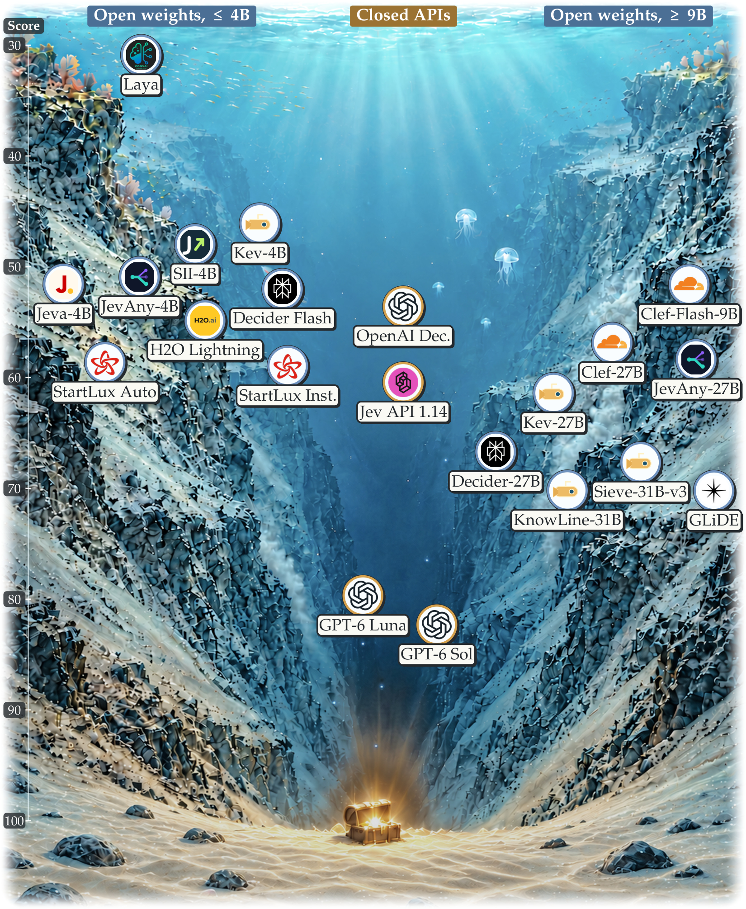
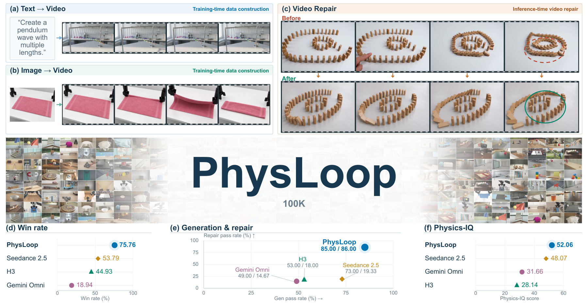
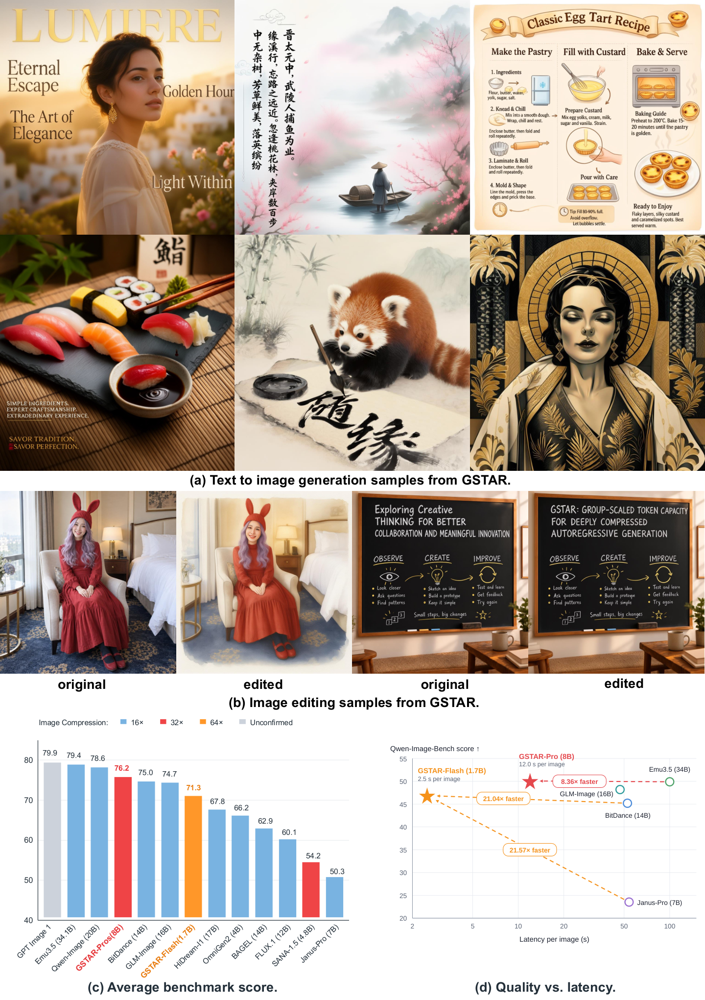
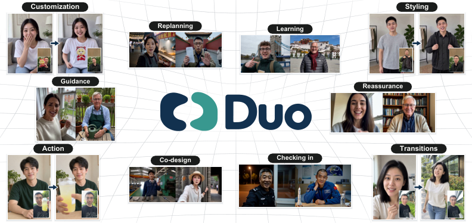
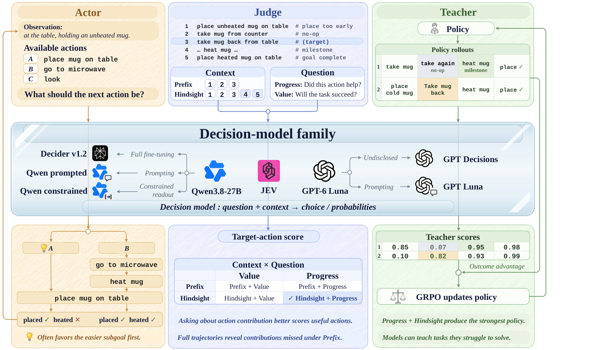
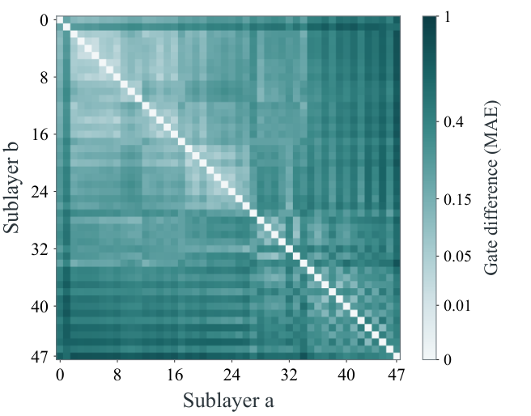
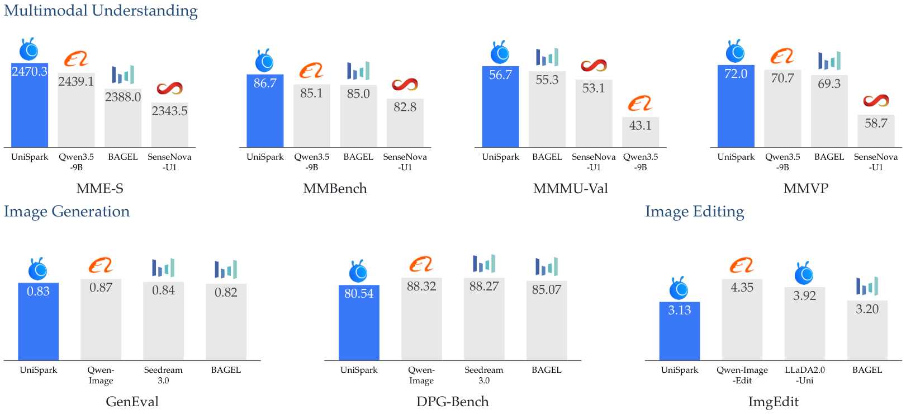
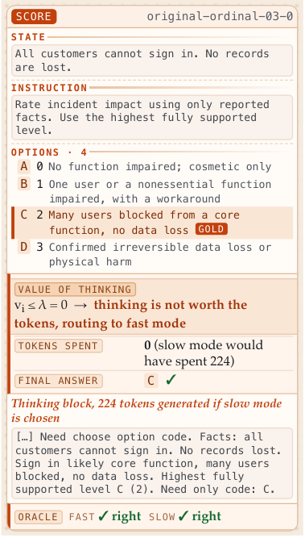
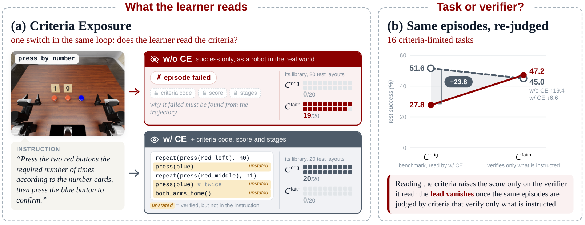

# Daily AI papers — 2026-11-14

*Curated from HF Daily Papers. 14 of 33 papers kept after relevance filter.*

## Papers at a glance

| # | Title | Topics | Org |
| --- | --- | --- | --- |
| 1 | [SO-Arena: Benchmarking System One Decision Models](#1-so-arena) | `eval`, `LLM`, `reasoning` | (unspecified) |
| 2 | [PhysLoop: LLM-Judge Physics Feedback for Video Generation](#2-physloop) | `diffusion`, `video`, `RL`, `LLM-judge` | Peking U. / ByteDance Seed |
| 3 | [G-STAR: Group-Scaled Deeply Compressed Autoregressive Image Generation](#3-g-star) | `diffusion`, `multimodal`, `efficient-inference` | Peking U. / Meituan Longcat |
| 4 | [Duo: A Reciprocal World Model for Full-Duplex Interaction](#4-duo) | `multimodal`, `audio`, `world-model` | (unspecified) |
| 5 | [Open Vision Banana: A Fully Open Recipe for Generative Visual Perception](#5-open-vision-banana) | `multimodal`, `VLM`, `diffusion`, `eval` | U. Tübingen / UTN / valeo.ai |
| 6 | [Actor, Judge, or Teacher? Decision Models in Long-Horizon Agents](#6-actor-judge-teacher) | `agents`, `RL`, `GRPO` | Zhejiang U. / Baidu |
| 7 | [SimpleHC: Rethinking the Design of Hyper-Connections](#7-simplehc) | `architecture`, `stability`, `MoE` | SJTU / Xiaohongshu / PKU |
| 8 | [Unbundling Multimodal Vision Encoding](#8-unbundling-vision-encoding) | `multimodal`, `VLM`, `architecture` | NYU / Meta FAIR |
| 9 | [FOAM: Factored One-Sided Adam-Moment SOAP](#9-foam) | `optimizer`, `pre-training`, `efficient-training` | NAVER |
| 10 | [UniSpark: Hybrid Attention for Unified Multimodal Understanding & Generation](#10-unispark) | `multimodal`, `MoE`, `hybrid-attention`, `flow-matching` | Ant Group / (unspecified) |
| 11 | [HDM: Learning When to Reason (Zero-or-T Thinking)](#11-hdm) | `reasoning`, `RL`, `efficient-inference`, `agents` | U. Liverpool / Huawei / UCL |
| 12 | [ACE-RL: Experience-Handoff RL for Recursive Self-Improvement](#12-ace-rl) | `agents`, `RL`, `self-improvement` | KAIST AI |
| 13 | [NestOne: LLMs → Efficient System One via Adaptive Computation](#13-nestone) | `efficient-inference`, `early-exit`, `distillation` | (unspecified) |
| 14 | [Instruction-Faithful Criteria for Embodied Self-Improvement](#14-instruction-faithful) | `RL`, `eval`, `verifier`, `agents` | Peking U. (DAGroup) |

---

## 1. SO-Arena

**Authors:** Not disclosed on HF page
**Links:** [arXiv:2611.15777](https://arxiv.org/abs/2611.15777) · [HF](https://huggingface.co/papers/2611.15777) · [AlphaXiv](https://www.alphaxiv.org/abs/2611.15777)
**Topics:** `eval`, `LLM`, `reasoning`

### TL;DR

A large-scale benchmark for **System One** decision models — the single-forward-pass, structured-output mode of an LLM that returns a typed choice (plus probabilities) without emitting a chain-of-thought. 2,919 tasks across 11 domains and five capability families, with difficulty tiers, interactive sandbox evaluation, and a dedicated **reliability** axis (decision stability under option reordering and the ability to recognize "no correct option").

### Key idea

Separate *capability* from *reliability* for decision models. A model that picks the right answer at rank-1 may still change its mind when the options are shuffled or fail to abstain when nothing fits — SO-Arena scores these explicitly and compares System One against System Two (reasoning) variants on the same tasks.

### Main finding

Across 21 models, the best System One capability does **not** imply reliable decisions: the capability leader ranks only seventh in reliability, and System Two often wins on structured decisions even when its underlying knowledge is comparable.

### Why it matters

As agent harnesses offload more routing and tool-selection to single-pass decision calls (System One), reliability under permutation and abstention becomes the production-relevant metric — this benchmark gives the community a shared yardstick and surfaces a capability-reliability gap that generic LLM benchmarks miss.

### Knowledge graph integration

**Builds on / relates to existing pages:**
- [../evaluation/mmlu.md](../evaluation/mmlu.md) — MMLU is the ancestor of structured multiple-choice decision evals; SO-Arena generalizes it to typed outputs and reliability.
- [../evaluation/ifeval.md](../evaluation/ifeval.md) — like IFEval, focuses on *format* reliability as a first-class axis, not accuracy alone.

**Suggested new pages:**
- `evaluation/so-arena.md` *(depth)* — benchmark description, reliability metrics (reorder stability, no-answer recognition), System One vs System Two protocol.

---

## 2. PhysLoop

**Authors:** Xiaojie Li, Hao Chen, Juncheng Ma, Kewei Zhang, Zhongjing Du, Guoqiang Wei, Fangfang Wang, Zhen Dong, Zhiyang Dou, Liming Zhao, Yan Zeng, Jianwei Zhang, Daquan Zhou — *Peking U. / ByteDance Seed / UCSB / MIT / UHH / HNU*
**Links:** [arXiv:2611.16748](https://arxiv.org/abs/2611.16748) · [HF](https://huggingface.co/papers/2611.16748) · [AlphaXiv](https://www.alphaxiv.org/abs/2611.16748)
**Topics:** `diffusion`, `video`, `RL`, `LLM-judge`

### TL;DR

A self-improvement loop for video diffusion models that uses an LLM's physics awareness as the training signal. The LLM-judge inspects generated clips and returns dense feedback on physical plausibility (object permanence, gravity, contact dynamics); that signal drives preference / reward optimization of the video generator in a closed loop.

### Key idea

Rather than hand-building a physics simulator or scraping physics annotations, use a frontier multimodal LLM as a *physics judge* and distil its verdicts into reward or preference signals the video model can train on. The loop iterates generation → LLM critique → policy update.

### Main finding

Reports measurable gains on physical-plausibility metrics over strong video-generation baselines while retaining general-purpose video quality. Exact numbers require the full paper (HF page shows only the teaser).

### Why it matters

Video world models are rapidly becoming the testbed for *simulated physics*. Using an LLM-judge as the reward model shortcuts the need for ground-truth physics — a template now familiar from text/code RLVR, exported into the video domain.

### Knowledge graph integration

**Builds on / relates to existing pages:**
- [../post-training/cot-reward-model.md](../post-training/cot-reward-model.md) — LLM-as-judge as the reward model, now extended to video.
- [../post-training/rlvr.md](../post-training/rlvr.md) — physics plausibility as the "verifier" in RLVR applied to video generation.

**Suggested new pages:**
- `multimodal/video-rlhf.md` *(depth)* — RLHF/RLAIF applied to video diffusion with an LLM physics judge.

---

## 3. G-STAR

**Authors:** Xu Huang, Ye Huang, Xiaotong Li, Zhengrong Yue, Jialv Zou, Minhao Jing, Haodong Li, Wenhao Yan, Yaxin Luo, Duomin Wang, Daquan Zhou — *Peking U. / Meituan Longcat / SJTU / HUST / CUHK / Tsinghua / MBZUAI*
**Links:** [arXiv:2611.13004](https://arxiv.org/abs/2611.13004) · [HF](https://huggingface.co/papers/2611.13004) · [AlphaXiv](https://www.alphaxiv.org/abs/2611.13004)
**Topics:** `diffusion`, `multimodal`, `efficient-inference`, `tokenization`

### TL;DR

An autoregressive image generator built on product-quantized tokens with a principled **group-scaling rule**: as spatial compression tightens, group size must scale quadratically with the per-axis compression factor to preserve representational capacity. Yields 32× (effective 64×) compression and a 20× speedup at 1024×1024.

### Key idea

Product-quantize each spatial token into a group of sub-codes, and scale group size with compression so the AR decoder sees enough bits per position. A **semi-autoregressive decoder** handles the intra-group dependencies this creates — groups are decoded in parallel inside, autoregressive across spatial positions.

### Main finding

Competitive with prior discrete AR image models on five text-to-image benchmarks while running ~20× faster at 1024×1024 (2.5s per image on one H200).

### Why it matters

Autoregressive image tokenization has been bottlenecked by sequence length. A clean scaling rule for product-quantization capacity reopens AR as a competitive alternative to diffusion at high resolution, and the same tokenizer can feed unified multimodal LLMs.

### Knowledge graph integration

**Builds on / relates to existing pages:**
- [../fundamentals/_tokenization.md](../fundamentals/_tokenization.md) — product-quantized visual tokens are a variant of the broader tokenization taxonomy.

**Suggested new pages:**
- `multimodal/g-star.md` *(depth)* — the group-scaling rule, semi-AR decoder, product-quantized visual tokens.

---

## 4. Duo

**Authors:** Not disclosed on HF page
**Links:** [arXiv:2611.15131](https://arxiv.org/abs/2611.15131) · [HF](https://huggingface.co/papers/2611.15131) · [AlphaXiv](https://www.alphaxiv.org/abs/2611.15131)
**Topics:** `multimodal`, `audio`, `world-model`

### TL;DR

A **full-duplex** audiovisual world model: the system continuously perceives the user's audio + video stream while simultaneously generating its own audio and visual response, enabling natural interruptions and shared activities. Combines an autoregressive reasoning module (*Intent*) with a flow-matching / generation module (*Realization*), fused over a unified timeline.

### Key idea

Decompose interaction into two modules: *Intent* (what to do) is autoregressive on text/action tokens; *Realization* (how to render it as sound + pixels) is generative. Both share a causal chunked timeline so inputs and outputs overlap in real time. **Dual rollout distillation** reduces train/test distribution shift between the two modules.

### Main finding

Demonstrates spontaneous conversation, mid-utterance interruption handling, and shared on-screen activities in a single unified model. Quantitative numbers not on the teaser page.

### Why it matters

Turn-taking assistants are the last big step before conversational agents feel alive. Duo is one of the first attempts to make full-duplex *audio+video* a trainable objective rather than a glued-together pipeline of ASR / dialogue / TTS / video.

### Knowledge graph integration

**Builds on / relates to existing pages:**
- [../multimodal/README.md](../multimodal/README.md) — extends the multimodal taxonomy into the full-duplex interactive setting.

**Suggested new pages:**
- `multimodal/full-duplex.md` *(depth)* — causal chunked timelines, dual rollout distillation, Intent/Realization decomposition.

---

## 5. Open Vision Banana

**Authors:** Valentinos Pariza, Jona Ruthardt, Ryousuke Yamada, A. Sophia Koepke, Andrei Bursuc, Yuki M. Asano — *UTN / DLR / AIST / U. Tübingen / TUM / valeo.ai*
**Links:** [arXiv:2611.15844](https://arxiv.org/abs/2611.15844) · [HF](https://huggingface.co/papers/2611.15844) · [AlphaXiv](https://www.alphaxiv.org/abs/2611.15844)
**Topics:** `multimodal`, `VLM`, `diffusion`, `eval`

### TL;DR

A fully open, reproducible recipe for **generative visual perception** — using an image-generation model as a universal perception head (segmentation, referring, reasoning). Studies the design axes (color encoding, prompt design, parameter adaptation, task balancing) and introduces *legend ensembling*, a training-free test-time scaling trick.

### Key idea

Perception as conditional generation: ask a generative model to paint the segmentation / referring mask as colored legends over the image. **Legend ensembling** varies the legend's palette and prompt at inference and ensembles the predictions — a pure inference-time improvement, no extra training.

### Main finding

Beats Vision Banana's reported zero-shot Cityscapes mIoU (73.9 vs 69.9) and gets within range on referring / reasoning segmentation. Legend ensembling adds up to +8.7 mIoU on Cityscapes and +15.0 on COCO-Object. Preserves the base model's image-editing ability.

### Why it matters

Closes one of the last reproducibility gaps in the "generation-as-perception" line — full dataset pipeline, training code, and checkpoints released. Legend ensembling is also a useful test-time scaling trick for any generation-based perception head.

### Knowledge graph integration

**Builds on / relates to existing pages:**
- [../multimodal/README.md](../multimodal/README.md) — generative perception is a growing branch of the multimodal taxonomy.

**Suggested new pages:**
- `multimodal/generative-visual-perception.md` *(depth)* — recipe, design axes, and legend ensembling as test-time scaling.

---

## 6. Actor, Judge, or Teacher?

**Authors:** Qianhao Zhu, Zixuan Wang, Dingming Li, Tongbo Chen, Peng Qiu, Yingqi Qu, Weiming Lu, Jun Xiao, Yongliang Shen — *Zhejiang U. / Baidu Inc.*
**Links:** [arXiv:2611.17167](https://arxiv.org/abs/2611.17167) · [HF](https://huggingface.co/papers/2611.17167) · [AlphaXiv](https://www.alphaxiv.org/abs/2611.17167)
**Topics:** `agents`, `RL`, `GRPO`, `eval`

### TL;DR

Studies three roles that pretrained models can play in long-horizon agents: **actor** (pick the next action), **judge** (score a completed trajectory), and **teacher** (produce signal to improve another policy). Finds that weak actors can still be strong judges and strong teachers — and uses this to boost a 1.5B policy via GRPO.

### Key idea

Decouple role capability. Even models that fail as actors (especially when a hard subgoal must come before an easier one) can reliably separate helpful from unhelpful actions when given the *full* trajectory. Those judgments plug into GRPO as a dense teaching signal.

### Main finding

Across six open models, all struggle as actors on subgoal-ordering tasks but perform well as judges. Adding their judge scores as an auxiliary signal to GRPO raises a 1.5B policy's success rate on ALFWorld and WebShop.

### Why it matters

Agent post-training is bottlenecked by rollout cost and reward sparsity. "A bad actor can still be a good teacher" argues for repurposing cheap frontier judgments as dense per-step signal — avoiding the need to deploy the frontier model itself as the actor.

### Knowledge graph integration

**Builds on / relates to existing pages:**
- [../post-training/grpo.md](../post-training/grpo.md) — the teacher-signal augmentation plugs directly into GRPO's group-relative baseline.
- [../post-training/cot-reward-model.md](../post-training/cot-reward-model.md) — the "judge" role is a per-step CoT reward model.
- [../post-training/_rewards.md](../post-training/_rewards.md) — adds a new entry to the taxonomy of reward signal sources for agents.

**Suggested new pages:**
- `agents/judge-as-teacher.md` *(depth)* — the actor/judge/teacher decoupling and its GRPO integration for agent training.

---

## 7. SimpleHC

**Authors:** Xiaohan Qin, Sunan Zou, Tuo Dai, Bizhao Shi, Zhuo Xia, Yebin Yang, Yizhou Chen, Yuliang Liu, Yu Cheng, Junchi Yan — *SJTU / Xiaohongshu / PKU / NTU*
**Links:** [arXiv:2611.05984](https://arxiv.org/abs/2611.05984) · [HF](https://huggingface.co/papers/2611.05984) · [AlphaXiv](https://www.alphaxiv.org/abs/2611.05984)
**Topics:** `architecture`, `stability`, `MoE`

### TL;DR

Analyzes **Hyper-Connections** (HC) — a family of generalized residual-stream architectures — and proposes **SimpleHC**, which drops the residual mixing and shares memory access across sublayers. Matches the strongest HC variant (mHC) on 15B and 30B MoE models with only ~2.4% training-time overhead over a vanilla residual baseline.

### Key idea

HC variants work because they stabilize the residual stream, not because of residual mixing. Remove mixing, share one memory-read/write per block across sublayers, and most of the benefit survives — at near-zero overhead.

### Main finding

SimpleHC matches mHC on 15B and 30B MoE training runs, with 2.4% extra end-to-end wall time over the vanilla residual baseline at the largest scale and improved stability under stress tests.

### Why it matters

Hyper-connections have been one of the quietly-adopted stability tricks at frontier scale; collapsing the family to a near-free variant makes it a default-worthy addition to large MoE training recipes.

### Knowledge graph integration

**Builds on / relates to existing pages:**
- [../architectures/transformer-block.md](../architectures/transformer-block.md) — HC is a transformer-block-level modification of the residual pathway.
- [../architectures/_moe.md](../architectures/_moe.md) — validated primarily at MoE scale.
- [../pre-training/_training-stability.md](../pre-training/_training-stability.md) — the motivation is residual-stream stability.

**Suggested new pages:**
- `architectures/hyper-connections.md` *(depth)* — SimpleHC and the broader HC family, with the shared memory-access construction.

---

## 8. Unbundling Multimodal Vision Encoding

**Authors:** Chris Hoang, Shengyi Qian, Shang-Wen Li, Mike Lewis, Marjan Ghazvininejad, Luke Zettlemoyer, Lucas Beyer, Mengye Ren, Jakob Verbeek, Saining Xie, Hu Xu — *NYU / Meta FAIR*
**Links:** [arXiv:2611.17334](https://arxiv.org/abs/2611.17334) · [HF](https://huggingface.co/papers/2611.17334) · [AlphaXiv](https://www.alphaxiv.org/abs/2611.17334)
**Topics:** `multimodal`, `VLM`, `architecture`

### TL;DR

A controlled compute-matched study of **where** and **how** a multimodal LLM should allocate vision capacity. Three findings: (1) separate encoder pretraining is unnecessary if you train jointly at matched compute, (2) *dedicated* vision parameters are still required — pure encoder-free models trail on VQA — and (3) that dedicated capacity can live inside the early layers of the backbone, not necessarily in a front-loaded encoder.

### Key idea

Decouple three dimensions people usually bundle (separate pretraining, separate module, pre-backbone placement) and ablate each. Train every variant from scratch on the same data at matched compute. The ablation cleanly says: the module matters, where it sits does not, and standalone pretraining does not pay for itself.

### Main finding

Early-layer vision modules inside the backbone match pre-encoder designs on VQA while cutting time to first token. Encoder-free (no dedicated vision params) still underperforms even with a larger backbone. Results hold across model sizes and whether you start from a pretrained LM.

### Why it matters

Challenges a design convention copied from CLIP-era VLMs. If early-layer vision modules work as well as front-loaded encoders, the next generation of VLMs can drop a stage of pretraining and improve latency without quality loss.

### Knowledge graph integration

**Builds on / relates to existing pages:**
- [../multimodal/README.md](../multimodal/README.md) — overhauls the "vision encoder + projector + LM" default.
- [../architectures/transformer-block.md](../architectures/transformer-block.md) — places dedicated vision capacity inside backbone blocks.

**Suggested new pages:**
- `multimodal/_vlm-architectures.md` *(taxonomy)* — pre-encoder vs backbone-embedded vs encoder-free VLM designs.

---

## 9. FOAM

**Authors:** Not fully listed on HF page; correspondence: jaemyung.yu, dongyoon.han — *NAVER (naver-ai)*
**Links:** [arXiv:2611.16905](https://arxiv.org/abs/2611.16905) · [HF](https://huggingface.co/papers/2611.16905) · [AlphaXiv](https://www.alphaxiv.org/abs/2611.16905)
**Topics:** `optimizer`, `pre-training`, `efficient-training`

### TL;DR

FOAM is a lightweight variant of the **SOAP** second-order optimizer. Two simplifications: (1) precondition only on the **input side** (drop the output-side factor), and (2) replace SOAP's dense rotated second-moment buffer with a **row-and-column factored** estimator. The result matches SOAP and Muon on LLM pretraining loss with ~50% of SOAP's optimizer state at near-Muon wall-clock speed.

### Key idea

Under a K-FAC-style assumption with a diagonal output curvature, both simplifications are nearly exact. In practice the authors measure ~15–20% relative deviation but still recover SOAP's convergence. Factoring the second moment turns O(d²) state into O(d) per layer.

### Main finding

Across 124M–760M pretraining runs, FOAM matches SOAP/Muon on val loss, cuts SOAP's optimizer state ~2×, and runs near Muon's wall-clock throughput. Robust across a 3× LR range.

### Why it matters

Second-order / spectral optimizers (Muon, Shampoo, SOAP) are gaining traction at frontier scale. Collapsing SOAP to a half-state, Muon-speed variant makes second-order updates more practical for large runs where optimizer memory bites.

### Knowledge graph integration

**Builds on / relates to existing pages:**
- [../pre-training/_training-stability.md](../pre-training/_training-stability.md) — second-order methods trade some stability for faster convergence; FOAM sits here.

**Suggested new pages:**
- `pre-training/_optimizers.md` *(taxonomy)* — AdamW / Muon / SOAP / FOAM / Shampoo with state-vs-speed tradeoffs.
- `pre-training/foam.md` *(depth)* — the one-sided factored SOAP recipe.

---

## 10. UniSpark

**Authors:** Yuzheng Liu, Hengyuan Cao, Qiyuan Zhang, Yangyan Li, Biao Gong, Zheng Zhang, Ka Leong Cheng, Xinyang Wang, Yujun Shen — *(unspecified; Biao Gong is project lead)*
**Links:** [arXiv:2611.16517](https://arxiv.org/abs/2611.16517) · [HF](https://huggingface.co/papers/2611.16517) · [AlphaXiv](https://www.alphaxiv.org/abs/2611.16517)
**Topics:** `multimodal`, `MoE`, `hybrid-attention`, `flow-matching`

### TL;DR

A 9B unified multimodal model that uses a **Mixture-of-Transformer-Experts** backbone mixing **full attention** and **GatedDeltaNet linear attention**. Text is produced autoregressively; images are produced by flow matching. A blockwise training protocol keeps noisy visual targets out of later autoregressive predictions while still letting clean visuals act as context.

### Key idea

Hybrid attention (softmax + linear) inside an MoE of transformer experts — different experts specialize for different token modalities — unifies understanding and generation in a single stack. Four-stage curriculum stretches image generation up to 2K resolution.

### Main finding

MME-S 2470.3 and GenEval 0.83 on a 9B model, with instruction editing and interleaved text-image generation in the same checkpoint.

### Why it matters

The MoT-expert + hybrid-attention combination is becoming a viable backbone for unified generative-and-understanding multimodal models; this is one of the cleaner open demonstrations that linear attention can co-exist with high-resolution image generation.

### Knowledge graph integration

**Builds on / relates to existing pages:**
- [../architectures/_moe.md](../architectures/_moe.md) — Mixture-of-Transformer-Experts generalizes MoE routing to whole-block modality experts.
- [../fundamentals/attention.md](../fundamentals/attention.md) — mixes full and linear attention in the same backbone.

**Suggested new pages:**
- `architectures/_linear-attention.md` *(taxonomy)* — Linear/DeltaNet/GatedDeltaNet variants and their hybrid-attention combinations.

---

## 11. HDM — Learning When to Reason

**Authors:** Ke Xu, Meng Fang, Haitham Ammar, Weilin Luo, Jun Wang — *U. Liverpool / Huawei Noah's Ark / UCL*
**Links:** [arXiv:2611.16961](https://arxiv.org/abs/2611.16961) · [HF](https://huggingface.co/papers/2611.16961) · [AlphaXiv](https://www.alphaxiv.org/abs/2611.16961)
**Topics:** `reasoning`, `RL`, `efficient-inference`, `agents`

### TL;DR

**Zero-or-T thinking**: for each query, either (a) answer in a single forward pass with no reasoning tokens generated, or (b) run full autoregressive CoT for T tokens. A small **self-routing block** on top of a frozen backbone estimates the value of reasoning for this input and decides. A new RL method (**CDPO**) trains the router from episode-level returns when no per-decision labels are available.

### Key idea

Make the reason/no-reason decision discrete and learn it. The router estimates expected reward gain from reasoning minus a configurable price per token; the backbone's weights never move, so the method is a drop-in on an existing SFT/RL-tuned LLM.

### Main finding

HDM-4B matches a reasoning-always baseline on JevBench (0.857 vs 0.851) at much lower latency, and cuts token cost 80.1% on the MiniWoB agentic benchmark.

### Why it matters

As reasoning models become the default, the next optimization is *when not to reason*. Zero-or-T is a clean binary formulation that composes with existing reasoning post-training, and CDPO extends the trainable scope to agentic episodes where no per-step reasoning label exists.

### Knowledge graph integration

**Builds on / relates to existing pages:**
- [../post-training/reasoning/long2short.md](../post-training/reasoning/long2short.md) — long2short controls *how long* to reason; HDM controls *whether* to reason.
- [../post-training/reasoning/length-penalty.md](../post-training/reasoning/length-penalty.md) — length-penalty is a continuous cost on reasoning; HDM moves to a discrete gate.
- [../post-training/dpo.md](../post-training/dpo.md) — CDPO is an agentic-episode variant of DPO.

**Suggested new pages:**
- `post-training/reasoning/adaptive-reasoning.md` *(depth)* — the zero-or-T formulation, self-routing block, CDPO.

---

## 12. ACE-RL

**Authors:** Doyoung Kim, Byeongguk Jeon, Kailin Zhang, Sherry Yang — *KAIST AI*
**Links:** [arXiv:2611.16409](https://arxiv.org/abs/2611.16409) · [HF](https://huggingface.co/papers/2611.16409) · [AlphaXiv](https://www.alphaxiv.org/abs/2611.16409)
**Topics:** `agents`, `RL`, `self-improvement`

### TL;DR

Keeps the **Agentic Context Engineering** (ACE) harness fixed and trains one model in three roles — *actor*, *reflector*, and *playbook curator*. Every playbook edit is scored by whether the next attempt's task reward improves. Turns passive reflection / compaction into a learned feedback loop.

### Key idea

Typical "experience-handoff" methods (reflect, compact, memorize) are hand-written and non-learned. ACE-RL treats each edit the reflector proposes to the shared playbook as an action, and the reward is the delta in subsequent attempt-level task score. One policy fills three roles.

### Main finding

Beats baseline agentic harnesses on held-out task performance across multiple benchmarks (numbers in the full paper; the abstract reports higher held-out scores).

### Why it matters

As agents get longer horizons, the sidechannel of hand-written "notebooks" is becoming a bottleneck. Learning what to write is the natural next step and unlocks recursive self-improvement at the *harness* level rather than the *policy* level.

### Knowledge graph integration

**Builds on / relates to existing pages:**
- [../post-training/grpo.md](../post-training/grpo.md) — the three-role policy is trained with GRPO-family objectives on scoped rollouts.
- [../post-training/_rewards.md](../post-training/_rewards.md) — introduces a new kind of reward signal: downstream-attempt improvement.

**Suggested new pages:**
- `agents/experience-handoff.md` *(depth)* — the ACE-RL actor/reflector/curator setup and playbook-edit reward.

---

## 13. NestOne

**Authors:** Not disclosed on HF page
**Links:** [arXiv:2611.16321](https://arxiv.org/abs/2611.16321) · [HF](https://huggingface.co/papers/2611.16321) · [AlphaXiv](https://www.alphaxiv.org/abs/2611.16321)
**Topics:** `efficient-inference`, `early-exit`, `distillation`

### TL;DR

Converts an LLM into an efficient **System One** decision model by jointly training the full model with **nested prefix sub-models** that share the final layers and the decision head. A lightweight gate reads each intermediate hidden state and decides whether to exit early. One training run yields a spectrum of depth-efficiency tradeoffs.

### Key idea

Decision information concentrates in middle layers. Rather than train separate small distillations (which just mimic the big model's shallow behavior), train one model with multiple "exit points" that share the head and distil from the full forward pass.

### Main finding

Across seven decision benchmarks, NestOne matches or beats separately-distilled smaller models at each depth, from a single training run, with a learned exit gate for per-input depth selection.

### Why it matters

For production decision workloads (routing, policy selection), being able to carve an efficient model at any depth from one training run is a direct cost win. The "middle layers carry the decision" observation also connects to the interp line on representation localization.

### Knowledge graph integration

**Builds on / relates to existing pages:**
- [../post-training/fine-tuning/README.md](../post-training/fine-tuning/README.md) — self-distillation across nested sub-models is a fine-tuning variant.

**Suggested new pages:**
- `inference/early-exit.md` *(depth)* — nested-sub-model self-distillation with a learned exit gate.

---

## 14. Instruction-Faithful Criteria

**Authors:** Wenbo Huang, Jianxin Bi, Shunyu Yang, Ruiyang Si, Rui Ni, Qiang Wang, Shulong Jiang, Yintianrun Zhang, Feixiang Ruan, Kewei Zhang, Ye Huang, Shukai Gong, Daquan Zhou — *Peking U. (DAGroup)*
**Links:** [arXiv:2611.08318](https://arxiv.org/abs/2611.08318) · [HF](https://huggingface.co/papers/2611.08318) · [AlphaXiv](https://www.alphaxiv.org/abs/2611.08318)
**Topics:** `RL`, `eval`, `verifier`, `agents`

### TL;DR

When embodied self-improvement exposes the benchmark's success criteria to the agent, the agent **learns the verifier, not the task**: perturb the criteria (without changing the instruction) and the gains vanish. Proposes *instruction-faithful criteria* that better track whether the generated program actually performs the instructed task.

### Key idea

Separate "the criteria used to score" from "the instruction given to the agent". If gains disappear when criteria are slightly rephrased while instructions remain identical, you have Goodhart. Instruction-faithful criteria are constructed to track instruction-level success, not any one benchmark's scoring harness.

### Main finding

Criteria-exposed training gains collapse under criteria perturbation; skills learned this way transfer poorly. The proposed instruction-faithful criteria preserve gains under perturbation and transfer better.

### Why it matters

An RLVR-style sanity check for every verifier-driven agentic training pipeline. If your verifier is the gradient, verifier gaming is the dominant failure mode — and this paper offers a diagnostic and a partial fix.

### Knowledge graph integration

**Builds on / relates to existing pages:**
- [../post-training/rlvr.md](../post-training/rlvr.md) — RLVR assumes the verifier is faithful; this paper quantifies the failure mode.
- [../safety/_attacks.md](../safety/_attacks.md) — criteria-gaming is a form of specification gaming / reward hacking.

**Suggested new pages:**
- `post-training/verifier-gaming.md` *(depth)* — criteria exposure, perturbation diagnostic, instruction-faithful construction.

---

## Notes

- 4 of 14 kept papers (SimpleHC, Unbundling Vision Encoding, FOAM, NestOne, ACE-RL) had no usable hero figure on the arXiv HTML preview — their `![Hero figure]` lines are intentionally omitted.
- This digest is informational. No existing concept files, `READING-LIST.md`, or `PAPERS.md` were modified to produce it.
