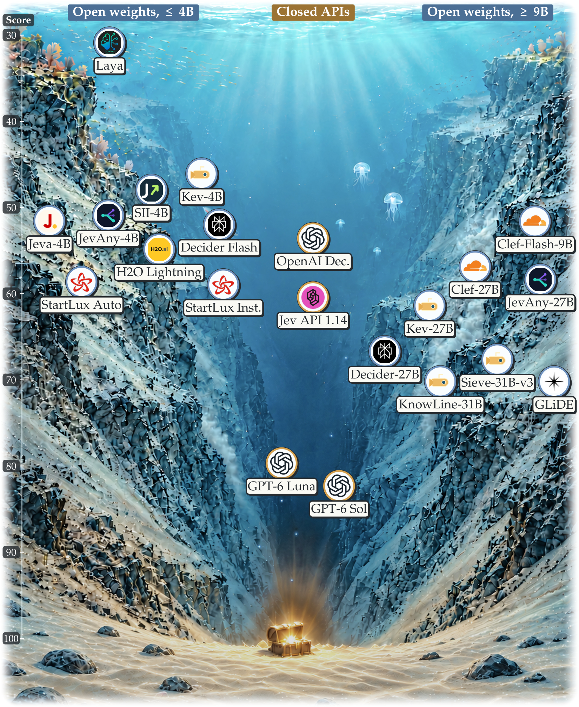
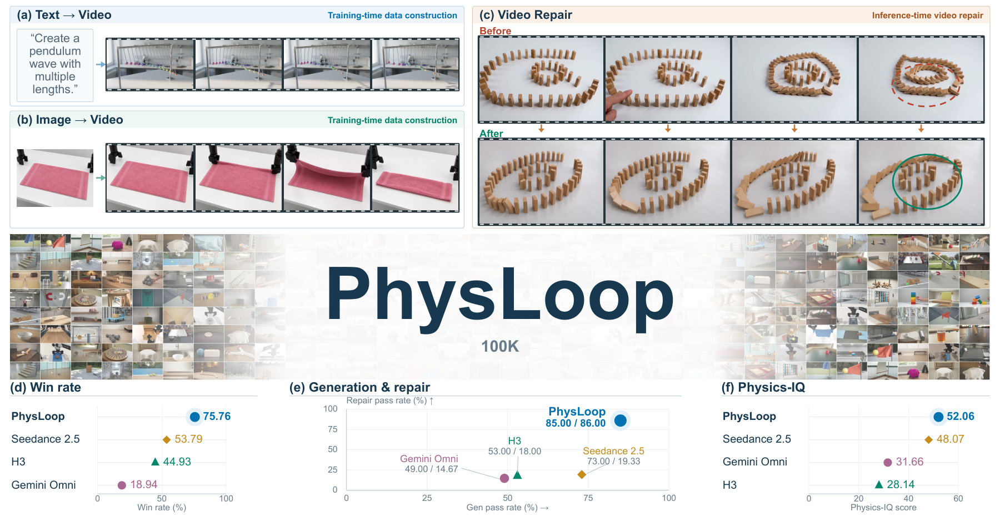
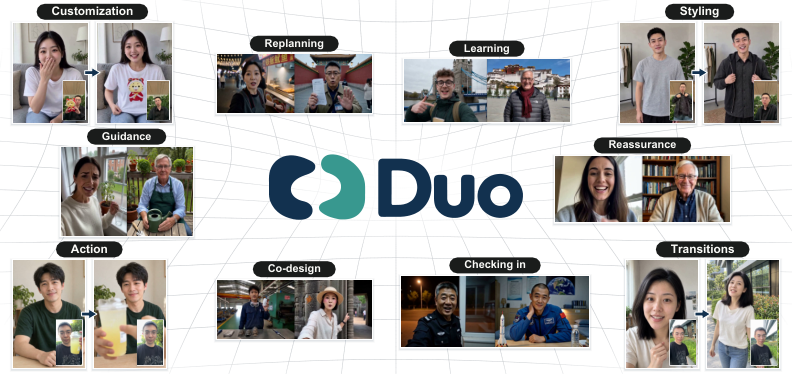
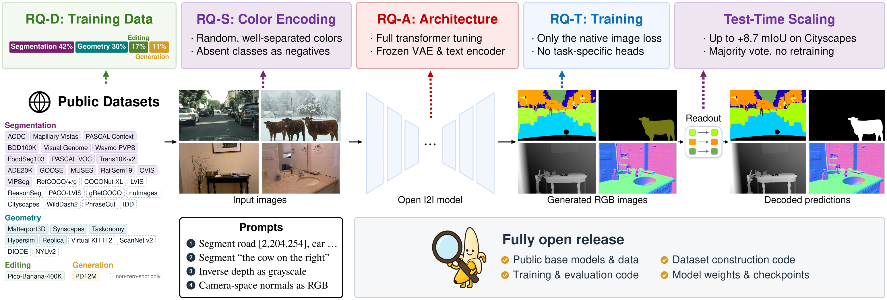
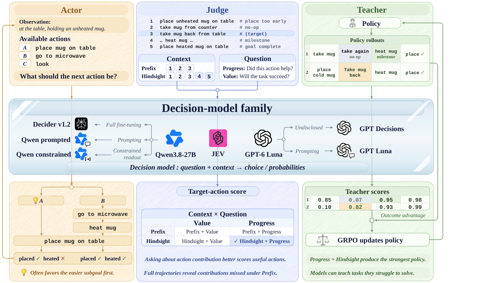
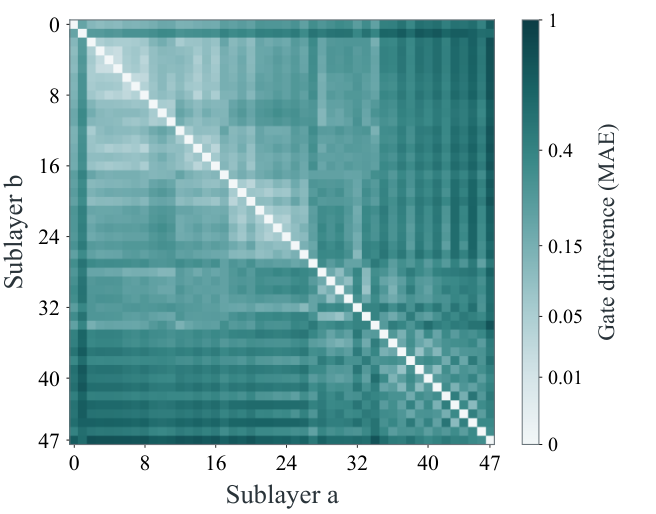
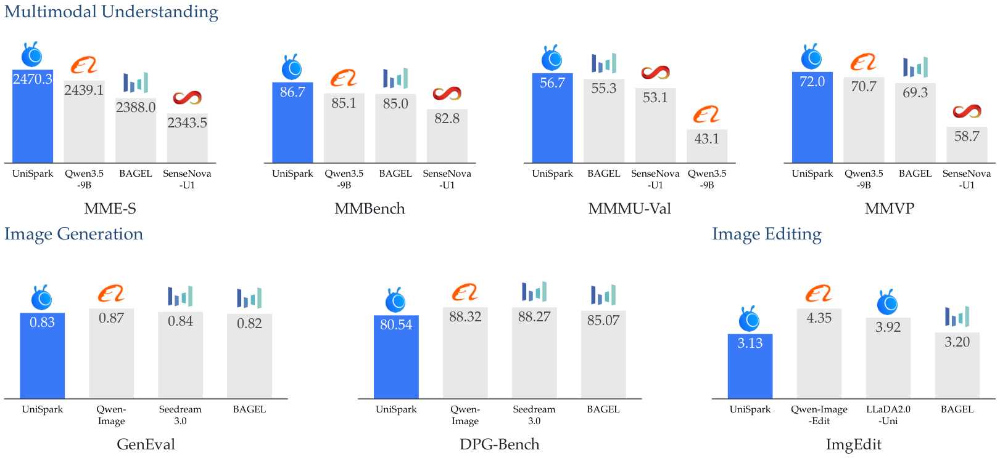
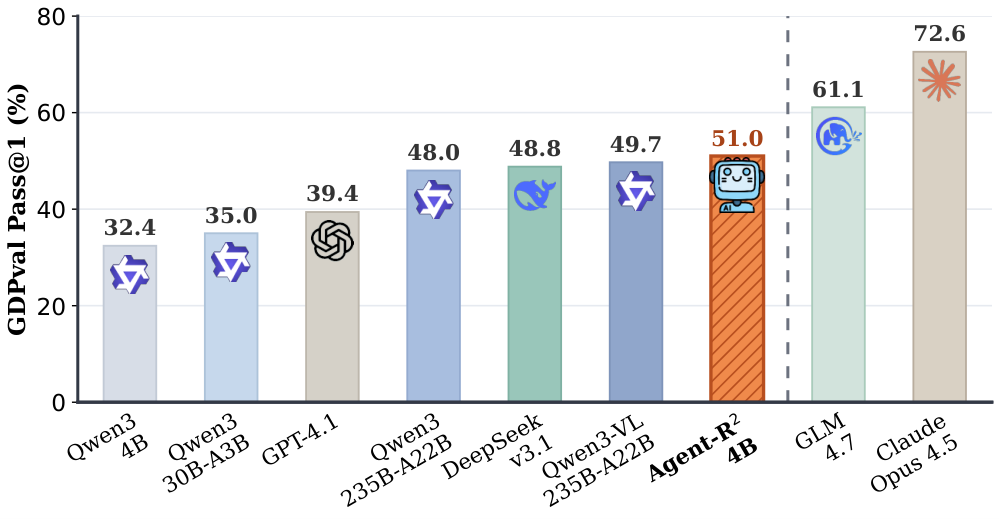
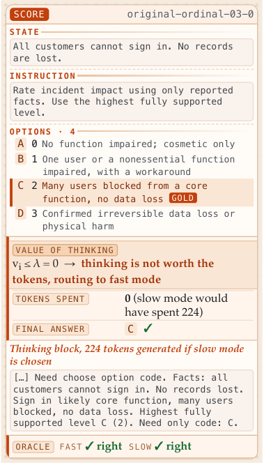
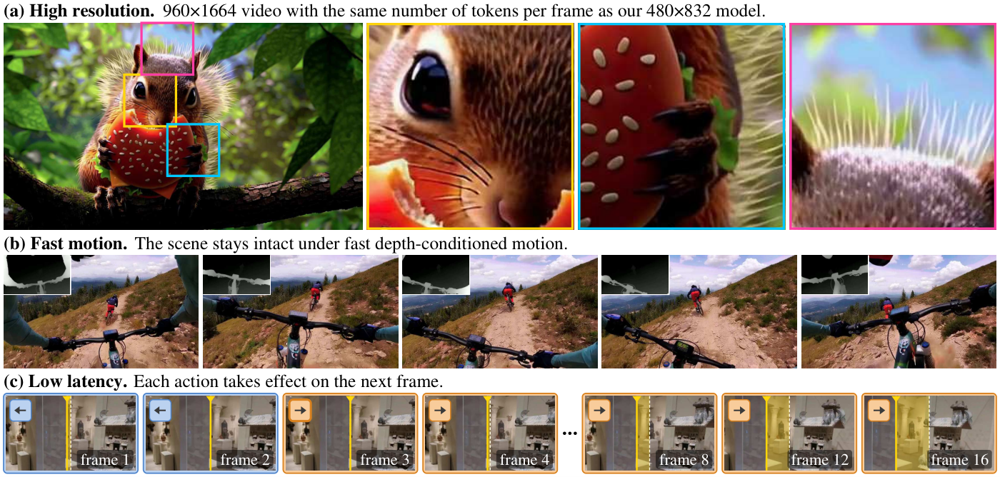

# Daily AI papers — 2026-11-15

*Curated from HF Daily Papers. 15 of 34 papers kept after relevance filter.*

## Papers at a glance

| # | Title | Topics | Org |
| --- | --- | --- | --- |
| 1 | [SO-Arena: Benchmarking the Capability Spectrum and Reliability of System One Models](#1-so-arena) | `eval`, `LLM` | — |
| 2 | [PhysLoop: Harnessing LLMs' Physics Awareness for Self-Improving Video Generation Models](#2-physloop) | `diffusion`, `multimodal`, `RL` | PKU · ByteDance Seed |
| 3 | [G-STAR: Group-Scaled Token Capacity for Deeply Compressed Autoregressive Generation](#3-g-star) | `multimodal`, `efficient-inference` | PKU · Meituan |
| 4 | [Duo: A Reciprocal World Model for Full-Duplex Interaction](#4-duo) | `multimodal`, `agents` | — |
| 5 | [Open Vision Banana: A Fully Open Recipe for Generative Visual Perception](#5-open-vision-banana) | `multimodal`, `diffusion` | UTN · Tübingen · valeo.ai |
| 6 | [Actor, Judge, or Teacher? Understanding Decision Models in Long-Horizon Agents](#6-actor-judge-teacher) | `agents`, `RL`, `eval` | ZJU · Baidu |
| 7 | [On the Design of Hyper-Connections: Simplification, Stability, and Scalability](#7-simplehc) | `architectures`, `MoE` | SJTU · Xiaohongshu · PKU · NTU |
| 8 | [Unbundling Multimodal Vision Encoding](#8-unbundling-multimodal-vision-encoding) | `multimodal`, `architectures` | NYU · Meta FAIR |
| 9 | [Factored One-sided Adam-Moment for Practical and Scalable SOAP](#9-foam) | `fundamentals`, `pre-training` | NAVER |
| 10 | [UniSpark: Exploring Hybrid Attention for Multimodal Understanding and Generation](#10-unispark) | `architectures`, `multimodal` | — |
| 11 | [Agent-R²: Scaling Agents for Realistic Productivity Work via Real-Source Data Synthesis](#11-agent-r2) | `agents`, `RL`, `data` | ZJU · Baidu |
| 12 | [The Value of Thinking: Learning When to Reason in Hybrid Decision Models](#12-value-of-thinking) | `reasoning`, `efficient-inference` | Liverpool · Huawei · UCL |
| 13 | [Experience-Handoff Reinforcement Learning for Recursive Self-Improvement](#13-ace-rl) | `agents`, `RL` | KAIST AI |
| 14 | [From Large Language Models to Efficient System One Models via Adaptive Computation](#14-nestone) | `efficient-inference`, `LLM` | — |
| 15 | [Back to Pixels: Lifting Latent Video Diffusion into Pixel Space](#15-pixvid) | `diffusion`, `multimodal` | Roblox |

---

## 1. SO-Arena

**Authors:** (anonymous page; authors not listed on HF)
**Links:** [arXiv:2611.15777](https://arxiv.org/abs/2611.15777) · [HF](https://huggingface.co/papers/2611.15777) · [AlphaXiv](https://www.alphaxiv.org/abs/2611.15777)
**Topics:** `eval`, `LLM`

### TL;DR

"System One" models — LLMs tuned to answer in zero or very few generated tokens, trading away CoT for latency — are a growing serving-side pattern, but no public benchmark isolates whether their one-shot answers are *reliable*. SO-Arena fills that gap with 11 domains, five capability families, and separate reliability probes (option-reordering stability, recognition of "no correct answer").

### Key idea

A two-axis benchmark: *capability* (evidence-grounded multiple-choice + interactive sandbox, broken into difficulty tiers) and *reliability* (does the model flip under option permutations, and does it notice when every option is wrong). Scoring the two axes independently exposes decision-model robustness failures that pure accuracy hides.

### Main finding

Across 21 evaluated models, the best capability-ranked System One model places only **7th on reliability**. Strong top-line scores don't imply the model picks consistent answers under trivial perturbations.

### Why it matters

As low-latency decision models get deployed inside agent loops (routing, retrieval, planning), their *stability under adversarial option framing* becomes a first-class property. SO-Arena gives the field a shared way to quantify it and pins down a now-measurable tradeoff between capability and reliability in fast LLMs.

### Knowledge graph integration

**Builds on / relates to existing pages:**
- [mmlu.md](../evaluation/mmlu.md) — comparable multi-domain MCQ structure, but SO-Arena adds reliability axes on top
- [ifeval.md](../evaluation/ifeval.md) — same "capability isn't enough" framing as instruction-following eval

**Suggested new pages:**
- `evaluation/so-arena.md` *(depth)* — the benchmark, its two axes, the 21-model result
- `inference/system-one-models.md` *(depth)* — the deployment pattern (zero-token decision LLMs) that SO-Arena measures

---

## 2. PhysLoop

**Authors:** Xiaojie Li, Hao Chen, Juncheng Ma, Kewei Zhang, Zhongjing Du, Guoqiang Wei, Fangfang Wang, Zhen Dong, Zhiyang Dou, Liming Zhao, Yan Zeng, Jianwei Zhang, Daquan Zhou — *Peking University · ByteDance Seed · UCSB · MIT · Hamburg · Hangzhou Normal*
**Links:** [arXiv:2611.16748](https://arxiv.org/abs/2611.16748) · [HF](https://huggingface.co/papers/2611.16748) · [AlphaXiv](https://www.alphaxiv.org/abs/2611.16748)
**Topics:** `diffusion`, `multimodal`, `RL`

### TL;DR

Video generators routinely produce physically implausible motion. PhysLoop closes a loop: a large VLM/LLM critic scores each generated clip for physics violations (gravity, collision, rigidity, continuity), and the signal drives self-improvement of the video generator — no human physics-fail labels needed.

### Key idea

An LLM-judge pipeline is treated as a reward signal for a video diffusion model. The critic's physics-aware feedback is distilled into preference pairs; the generator is fine-tuned against them in a RLHF-style loop so that physically plausible clips become reinforcing.

### Main finding

The self-improving loop raises physics-correctness and motion-consistency scores on a curated benchmark while preserving overall visual quality metrics. Iterated critic–generator rounds compound.

### Why it matters

Shows that a frontier LLM's implicit physics prior is dense enough to supervise a *generative* model that produces no language at all. The template — pretrained LLM as reward model for a modality it can't itself produce — generalizes beyond video.

### Knowledge graph integration

**Builds on / relates to existing pages:**
- [cot-reward-model.md](../post-training/cot-reward-model.md) — same "LLM-as-judge" reward pattern applied to a different output modality
- [_rewards.md](../post-training/_rewards.md) — slots into the reward-model taxonomy as a cross-modal variant

**Suggested new pages:**
- `multimodal/llm-physics-reward.md` *(depth)* — cross-modal LLM-as-judge for video physics

---

## 3. G-STAR

**Authors:** Xu Huang, Ye Huang, Xiaotong Li, Zhengrong Yue, Jialv Zou, Minhao Jing, Haodong Li, Wenhao Yan, Yaxin Luo, Duomin Wang, Daquan Zhou — *PKU · Meituan · SJTU · HUST · CUHK · Tsinghua · MBZUAI*
**Links:** [arXiv:2611.13004](https://arxiv.org/abs/2611.13004) · [HF](https://huggingface.co/papers/2611.13004) · [AlphaXiv](https://www.alphaxiv.org/abs/2611.13004)
**Topics:** `multimodal`, `efficient-inference`

### TL;DR

Discrete autoregressive image models eat latency because they emit thousands of tokens per image. Aggressive spatial compression shortens the sequence but destroys per-token information. G-STAR shows the fix is to *scale the product-quantization group size quadratically with the per-axis compression factor*, keeping the information budget constant.

### Key idea

Under a fixed nominal information budget with product quantization, group size should scale as the square of per-axis spatial compression. G-STAR applies this at 32× and effective 64× compression and pairs it with a semi-autoregressive decoder that models intra-group dependencies.

### Main finding

Competitive scores on five text-to-image benchmarks; **1024×1024 in 2.5 s on a single H200** — about **20× faster** than prior discrete autoregressive image generators.

### Why it matters

Reopens discrete-AR as a credible path for image generation now that latency is competitive with diffusion. The scaling rule is also a clean handle for anyone shrinking token streams in audio / video / 3D AR models.

### Knowledge graph integration

**Builds on / relates to existing pages:**
- [capacity-factor.md](../architectures/capacity-factor.md) — different context (MoE), but same "fixed budget → how do you allocate capacity per token" question

**Suggested new pages:**
- `multimodal/g-star.md` *(depth)* — quadratic group-size scaling for deeply compressed AR image generation

---

## 4. Duo

**Authors:** (project page lists a Project Lead; full author list not rendered)
**Links:** [arXiv:2611.15131](https://arxiv.org/abs/2611.15131) · [HF](https://huggingface.co/papers/2611.15131) · [AlphaXiv](https://www.alphaxiv.org/abs/2611.15131)
**Topics:** `multimodal`, `agents`

### TL;DR

Full-duplex conversational AI usually means half-duplex turn-taking plus a VAD hack. Duo v1 goes further: it watches and listens continuously, decides on its own when to speak, and streams audiovisual output on a single timeline — users can interrupt, co-speak, and share the screen with it.

### Key idea

The Reciprocal World Model splits the agent into an "Intent" module (autoregressive reasoning over whether and how to participate) and a "Realization" module (generates audio+visual behavior). Three enabling techniques: autoregressive intent modeling, causal chunk conditioning on a unified timeline, and dual rollout distillation to compress the real-time path.

### Main finding

Qualitatively: users hold spontaneous conversations with interruptions, play games against the agent, and inhabit shared virtual scenes without using mouse or keyboard. Quantitative numbers are in the paper; this write-up is primarily a system paper.

### Why it matters

Formalizes a split — "think continuously / decide to act / render" — that has been ad-hoc in voice agents. If the Intent/Realization decomposition holds up it becomes a natural scaffold for any real-time embodied agent.

### Knowledge graph integration

**Suggested new pages:**
- `multimodal/duo-rwm.md` *(depth)* — the Reciprocal World Model + Intent/Realization split
- `agents/full-duplex-loop.md` *(depth)* — the full-duplex interaction pattern (perceive-while-speaking) as an agentic scaffold

---

## 5. Open Vision Banana

**Authors:** Valentinos Pariza, Jona Ruthardt, Ryousuke Yamada, A. Sophia Koepke, Andrei Bursuc, Yuki M. Asano — *Fundamental AI Lab (UTN) · DLR · AIST · Tübingen AI Center · TUM MCML · valeo.ai*
**Links:** [arXiv:2611.15844](https://arxiv.org/abs/2611.15844) · [HF](https://huggingface.co/papers/2611.15844) · [AlphaXiv](https://www.alphaxiv.org/abs/2611.15844)
**Topics:** `multimodal`, `diffusion`

### TL;DR

A fully open, reproducible recipe for repurposing a pretrained image generator as a multi-task perception model — segmentation, depth, surface normals — that generalizes zero-shot. Introduces "legend ensembling," a training-free test-time trick that fuses several color-legend passes by majority vote.

### Key idea

Perception is framed as *generation*: the image model outputs a colored overlay keyed to a legend describing what each color means. "Legend ensembling" runs several randomly-shuffled legends at inference and votes, which averages out legend-color biases without retraining.

### Main finding

Beats the proprietary Vision Banana's reported Cityscapes zero-shot score; legend ensembling further improves mIoU on Cityscapes and COCO-Object. Full training code, data, weights released.

### Why it matters

Shows a pretrained text-to-image generator is a strong *perception* backbone — a counter to the "need a dedicated encoder" assumption. Legend ensembling is a cheap, general trick for any categorical generative-perception output.

### Knowledge graph integration

**Builds on / relates to existing pages:**
- `multimodal/README.md` — fills the first depth entry for generative-perception / repurposed image generators

**Suggested new pages:**
- `multimodal/generative-visual-perception.md` *(depth)* — turning pretrained image generators into perception models
- `multimodal/legend-ensembling.md` *(depth)* — the test-time legend-shuffle majority-vote trick

---

## 6. Actor, Judge, Teacher

**Authors:** Qianhao Zhu, Zixuan Wang, Dingming Li, Tongbo Chen, Peng Qiu, Yingqi Qu, Weiming Lu, Jun Xiao, Yongliang Shen — *Zhejiang University · Baidu*
**Links:** [arXiv:2611.17167](https://arxiv.org/abs/2611.17167) · [HF](https://huggingface.co/papers/2611.17167) · [AlphaXiv](https://www.alphaxiv.org/abs/2611.17167)
**Topics:** `agents`, `RL`, `eval`

### TL;DR

"Decision models" (LLMs that output typed choices with probabilities, no free-form CoT) are often proposed as drop-in replacements for Actors inside long-horizon agents. The authors run a controlled study across three Decision Models and three general LLMs on ALFWorld and WebShop, and find Actor isn't where decision models shine — Judge and Teacher roles are.

### Key idea

Three roles for decision models inside an agent loop: **Actor** (pick next action), **Judge** (score a recorded trajectory), **Teacher** (give step-level rewards during RL training). The paper also proposes **JEV** — Judge via per-step expected-value estimation conditioned on the whole trajectory — as a step-reward signal for GRPO-style training.

### Main finding

Decision models are weak Actors when a subgoal must *precede* an easier one; they are strong Judges when prompted as "did this action help reach the goal, trajectory visible" rather than "will this task succeed." A 1.5B policy trained with JEV as the Teacher beats the same policy trained with GRPO on outcome rewards alone.

### Why it matters

Reframes where fast decision LLMs belong in the stack: not as the primary planner, but as a step-level reward model for cheap process-level RL on smaller policies. That changes the economics of long-horizon agent RL.

### Knowledge graph integration

**Builds on / relates to existing pages:**
- [grpo.md](../post-training/grpo.md) — JEV slots in as the step-level reward feeding GRPO
- [prm.md](../post-training/reasoning/prm.md) — same "dense, step-level process reward" motivation
- [_rewards.md](../post-training/_rewards.md) — a new entry in the reward-model taxonomy

**Suggested new pages:**
- `post-training/jev-reward.md` *(depth)* — per-step expected-value judge from a decision model as a step reward

---

## 7. SimpleHC

**Authors:** Xiaohan Qin, Sunan Zou, Tuo Dai, Bizhao Shi, Zhuo Xia, Yebin Yang, Yizhou Chen, Yuliang Liu, Yu Cheng, Junchi Yan — *SJTU · Xiaohongshu · PKU · NTU*
**Links:** [arXiv:2611.05984](https://arxiv.org/abs/2611.05984) · [HF](https://huggingface.co/papers/2611.05984) · [AlphaXiv](https://www.alphaxiv.org/abs/2611.05984)
**Topics:** `architectures`, `MoE`

### TL;DR

Hyper-Connections replace the vanilla residual stream with a *set* of parallel connection paths that sublayers read from and write to with learned mixing. They train more stably at scale, but the original formulation is heavy (O(n²) in the path count). SimpleHC strips it to a near-no-cost version while keeping the stability benefits.

### Key idea

Two simplifications: (1) remove the learned residual-mixing matrix across hyper-connections — just concatenate and project — and (2) share the hyper-connection memory *across sublayers* in a block (one shared buffer, multiple read/write heads), amortizing both parameter cost and the memory-traffic overhead.

### Main finding

On 15B and 30B MoE models, SimpleHC matches full mHC performance while adding only **~2.4% training time** over a vanilla residual at the largest tested scale, with improved gradient stability throughout.

### Why it matters

Hyper-connections sit in the "nice property, prohibitive cost" bucket; this moves them toward "roughly free." Expect frontier MoE trainers to try it as a drop-in residual replacement.

### Knowledge graph integration

**Builds on / relates to existing pages:**
- [transformer-block.md](../architectures/transformer-block.md) — direct replacement for the standard residual
- [_normalization.md](../architectures/_normalization.md) — same "stability of the deep stack" territory

**Suggested new pages:**
- `architectures/simple-hc.md` *(depth)* — the simplification + shared-memory variant of hyper-connections

---

## 8. Unbundling Multimodal Vision Encoding

**Authors:** Chris Hoang, Shengyi Qian, Shang-Wen Li, Mike Lewis, Marjan Ghazvininejad, Luke Zettlemoyer, Lucas Beyer, Mengye Ren, Jakob Verbeek, Saining Xie, Hu Xu — *NYU · Meta FAIR*
**Links:** [arXiv:2611.17334](https://arxiv.org/abs/2611.17334) · [HF](https://huggingface.co/papers/2611.17334) · [AlphaXiv](https://www.alphaxiv.org/abs/2611.17334)
**Topics:** `multimodal`, `architectures`

### TL;DR

Multimodal LLMs almost always bolt on a *pretrained* vision encoder. This paper carefully factorizes that design choice into three parts — a visual prior, dedicated vision parameters, and placement *before* fusion — and ablates them in a from-scratch setting. The pretrained visual prior turns out to be unnecessary.

### Key idea

Controlled apples-to-apples training from scratch: separate (a) whether vision weights are pretrained, (b) whether there is a dedicated vision pathway at all, and (c) whether that pathway sits before the fused backbone or inside its early layers. Only the *dedicated capacity* matters; placement inside early LLM layers works as well as a separate encoder.

### Main finding

A jointly from-scratch trained encoder matches a pretrained one at comparable compute. Pushing the dedicated vision capacity *inside* the backbone's early layers (no external encoder) recovers the same accuracy.

### Why it matters

If this holds at scale, the recipe simplifies: drop the separate ViT + projector and spend that budget on wider early LLM layers. Changes what a "multimodal pretraining" codebase actually looks like.

### Knowledge graph integration

**Builds on / relates to existing pages:**
- `multimodal/README.md` — directly challenges the folder's implicit assumption of a separate encoder

**Suggested new pages:**
- `multimodal/unified-early-fusion.md` *(depth)* — the from-scratch recipe with vision capacity inside backbone early layers

---

## 9. FOAM

**Authors:** (authors not rendered on HF; NAVER corporate correspondence, github.com/naver-ai)
**Links:** [arXiv:2611.16905](https://arxiv.org/abs/2611.16905) · [HF](https://huggingface.co/papers/2611.16905) · [AlphaXiv](https://www.alphaxiv.org/abs/2611.16905)
**Topics:** `fundamentals`, `pre-training`

### TL;DR

SOAP (Shampoo-with-Adam) is one of the strongest second-order optimizers for LLM pre-training but drags around a doubled optimizer state. FOAM is a drop-in SOAP variant: input-side-only preconditioning plus a factored second-moment estimator cut the extra state roughly in half with no loss.

### Key idea

Two changes to SOAP: (1) precondition only along the *input* (left) axis of the weight matrix, not both axes, and (2) replace the second-moment accumulator with a rank-1 factorization (Adafactor-style) in the preconditioned coordinate system. Result: cheaper state, near-Muon wall-clock, SOAP's convergence.

### Main finding

Across LLM pre-training from **124M to 760M parameters**, FOAM matches SOAP and Muon on validation loss, uses **~50% of SOAP's optimizer state**, runs at **near-Muon wall-clock**, and tolerates a wide learning-rate range.

### Why it matters

Makes second-order pre-training optimizers memory-competitive with AdamW. The LR-range tolerance also matters for big-model runs where hyperparameter sweeps are prohibitive.

### Knowledge graph integration

**Builds on / relates to existing pages:**
- [_training-stability.md](../pre-training/_training-stability.md) — stability + LR-range robustness lives here

**Suggested new pages:**
- `fundamentals/foam.md` *(depth)* — the FOAM optimizer (SOAP variant)
- `fundamentals/_optimizers.md` *(taxonomy)* — AdamW / Shampoo / SOAP / Muon / FOAM — the graph has none yet

---

## 10. UniSpark

**Authors:** Yuzheng Liu, Hengyuan Cao, Qiyuan Zhang, Yangyan Li, Biao Gong, Zheng Zhang, Ka Leong Cheng, Xinyang Wang, Yujun Shen
**Links:** [arXiv:2611.16517](https://arxiv.org/abs/2611.16517) · [HF](https://huggingface.co/papers/2611.16517) · [AlphaXiv](https://www.alphaxiv.org/abs/2611.16517)
**Topics:** `architectures`, `multimodal`

### TL;DR

A 9B unified model that does image understanding *and* image generation in one backbone. The architectural bet is **hybrid attention** — vanilla full attention paired with GatedDeltaNet linear attention — inside a Mixture-of-Transformer-Experts arrangement, trained with next-token prediction plus visual flow matching.

### Key idea

Instead of picking either full or linear attention, UniSpark alternates them inside an MoE-of-transformer-blocks. Different experts carry different attention flavors; the gate routes tokens accordingly. Loss mixes language-model prediction with a flow-matching objective on visual outputs.

### Main finding

Competitive on VQA, text-to-image generation, instruction-based editing, and interleaved text-image prediction. Reports MME-S and GenEval numbers (see paper table).

### Why it matters

An existence proof that hybrid attention — which has been showing up in speech and context-extension work — scales into a serious multimodal generative model. Suggests "one big full-attention tower" may not stay dominant as unified multimodal models grow.

### Knowledge graph integration

**Builds on / relates to existing pages:**
- [mla.md](../architectures/mla.md) — in the same "attention-variant space" where UniSpark lives
- [_moe.md](../architectures/_moe.md) — MoT-experts is a close cousin of MoE
- [multi-head-attention.md](../architectures/multi-head-attention.md) — contrasts with the full-only default

**Suggested new pages:**
- `architectures/hybrid-attention.md` *(depth)* — alternating full + linear (GatedDeltaNet) attention in one stack
- `architectures/_attention-variants.md` *(taxonomy)* — MHA / GQA / MLA / linear / hybrid — none exists yet

---

## 11. Agent-R²

**Authors:** Zixuan Wang, Yuchen Yan, Qifei Wu, Yao Chen, Yingqi Qu, Ruiqing Zhang, Yongliang Shen — *Zhejiang University · Baidu*
**Links:** [arXiv:2611.08219](https://arxiv.org/abs/2611.08219) · [HF](https://huggingface.co/papers/2611.08219) · [AlphaXiv](https://www.alphaxiv.org/abs/2611.08219)
**Topics:** `agents`, `RL`, `data`

### TL;DR

Productivity agents (fill in a report, edit a spreadsheet, chase a deliverable through attached files) fail because the post-training data doesn't look like real desk work. Agent-R² synthesizes 4k training tasks grounded in real occupational seeds, real web-sourced files, and deliverable-level rubrics — then trains against those rubrics with RL.

### Key idea

A three-stage data-synthesis pipeline: (1) seed with real occupations, (2) mine corpus evidence of their workflows, (3) attach real web-sourced files instead of LLM-generated stand-ins. Each task gets a fine-grained *deliverable* rubric. The policy is SFT-then-RL (rubric-RL) on these 4k instances.

### Main finding

A **4B** model trained on 4k instances beats **Qwen3-235B-A22B-Thinking-2507** on both **GDPval (51.0 vs 48.0)** and **OfficeQA (14.8 vs 13.8)**. Mitigates "shortcut behavior" (confidently fabricated deliverables).

### Why it matters

A sharp data-quality result: 4k well-rubric'd real-source tasks outclass orders-of-magnitude-larger models on realistic office work. Reinforces that for productivity agents, rubric fidelity is the lever, not data scale.

### Knowledge graph integration

**Builds on / relates to existing pages:**
- [rlvr.md](../post-training/rlvr.md) — rubric-RL is a close cousin of verifier-RL
- [grpo.md](../post-training/grpo.md) — underlying optimizer
- [rl-prompt-curation.md](../post-training/rl-prompt-curation.md) — same "curate the prompts before you RL" ethos, pushed into agent-task space

**Suggested new pages:**
- `agents/agent-r2.md` *(depth)* — the real-source data synthesis + deliverable-rubric RL recipe

---

## 12. Value of Thinking

**Authors:** Ke Xu, Meng Fang, Haitham Ammar, Weilin Luo, Jun Wang — *Liverpool · Huawei Noah's Ark · UCL*
**Links:** [arXiv:2611.16961](https://arxiv.org/abs/2611.16961) · [HF](https://huggingface.co/papers/2611.16961) · [AlphaXiv](https://www.alphaxiv.org/abs/2611.16961)
**Topics:** `reasoning`, `efficient-inference`

### TL;DR

Every question gets full CoT at the same price today. The authors train a single model to do either **zero tokens of reasoning** or **full-length T tokens** per query, and a small learned block decides per-request whether reasoning is worth the cost.

### Key idea

**Zero-or-T thinking:** one model, two modes (answer immediately or reason for a budget T). A small predictor estimates the "value of reasoning" for each incoming question; the system only pays for CoT when that value exceeds a configurable price. Trained with **Calibrated Decision Policy Optimisation (CDPO)**, a method that works without per-decision labels — only episodic outcomes.

### Main finding

On JevBench, **+0.7% accuracy** over a prior token-free system with **–72.5% median latency**. Also evaluated on MMLU-Pro, AGIEval, GPQA-Diamond, BANKING77, MiniWoB.

### Why it matters

A clean, trainable version of "think only when you need to," turning per-query compute into a learned decision rather than a hand-tuned policy. Fits serving stacks that already have budgeted-generation knobs.

### Knowledge graph integration

**Builds on / relates to existing pages:**
- [long2short.md](../post-training/reasoning/long2short.md) — related in spirit (long CoT → short), but Value-of-Thinking decides per-query
- [length-penalty.md](../post-training/reasoning/length-penalty.md) — length-cost is baked in here as a learned cost
- [long-cot-rl.md](../post-training/reasoning/long-cot-rl.md) — contrasts with the "always-long-CoT" training objective

**Suggested new pages:**
- `post-training/reasoning/zero-or-t-thinking.md` *(depth)* — the per-request CoT gating via a small value-of-thinking predictor + CDPO

---

## 13. ACE-RL

**Authors:** Doyoung Kim, Byeongguk Jeon, Kailin Zhang, Sherry Yang — *KAIST AI*
**Links:** [arXiv:2611.16409](https://arxiv.org/abs/2611.16409) · [HF](https://huggingface.co/papers/2611.16409) · [AlphaXiv](https://www.alphaxiv.org/abs/2611.16409)
**Topics:** `agents`, `RL`

### TL;DR

Most RL on agents optimizes *actions*. ACE-RL optimizes a different artifact: the *playbook* an agent writes for its future self. One model acts, reflects, and edits a persistent playbook; the RL signal scores each playbook edit by how much it improves *future* rollouts' outcomes.

### Key idea

Reframe agentic RL as RL over **experience artifacts**. Inside an Agentic Context Engineering harness, the same model plays three roles — Actor, Reflector, Curator — and the Curator's playbook edits are the credit-assignment target. The reward on an edit is the delta it causes in held-out rollout returns.

### Main finding

Higher held-out task performance than baselines that optimize actions directly. Edits that *generalize* across future rollouts get reinforced; narrow one-off tricks fade out.

### Why it matters

Pushes "recursive self-improvement" from a slogan to a trainable objective: the artifact being improved is explicitly the one the model will rely on later. A natural fit for long-running agent deployments.

### Knowledge graph integration

**Builds on / relates to existing pages:**
- [_rl.md](../post-training/_rl.md) — new entry in the RL taxonomy (target isn't actions, it's an artifact)
- [grpo.md](../post-training/grpo.md) — same family of policy-gradient methods
- `agents/README.md` — fills a gap: no page yet on persistent-memory / context-engineering agents

**Suggested new pages:**
- `post-training/ace-rl.md` *(depth)* — RL where the update target is the playbook, not the action trajectory

---

## 14. NestOne

**Authors:** (not rendered on HF)
**Links:** [arXiv:2611.16321](https://arxiv.org/abs/2611.16321) · [HF](https://huggingface.co/papers/2611.16321) · [AlphaXiv](https://www.alphaxiv.org/abs/2611.16321)
**Topics:** `efficient-inference`, `LLM`

### TL;DR

Turning an LLM into a fast "System One" decision model usually keeps every layer running at inference. NestOne jointly trains a full model and shorter prefix models that share its final layers and output head; a lightweight gate reads each intermediate hidden state and decides whether to stop early.

### Key idea

**Nested decoder-only training.** The full model and several shorter sub-models co-train with weight-tying for the shared head. At inference, a learned gate inspects intermediate hidden states and triggers early exit through the shared head. One checkpoint → a continuum of depth-cost tradeoffs.

### Main finding

Across seven decision benchmarks, NestOne **matches or beats separately trained fixed-depth models at every depth**, with a better overall accuracy-efficiency Pareto.

### Why it matters

Early-exit for LLMs has existed as an idea for years but rarely matches dedicated depth-tuned baselines. NestOne is a credible "one model, many depths" result, aligned with the broader System One / fast-decision trend.

### Knowledge graph integration

**Builds on / relates to existing pages:**
- `inference/README.md` — fills an obvious gap: no inference page on early exit / adaptive depth

**Suggested new pages:**
- `inference/nestone.md` *(depth)* — nested-depth joint training + learned early-exit gate
- `inference/_adaptive-compute.md` *(taxonomy)* — early exit / speculative decoding / zero-or-T thinking / nested depth

---

## 15. PixVid

**Authors:** Yanke Song, Shuo Chen, Chris Rockwell, Guande He, Nan Liu, Desai Xie, Tianpei Gu, Yong-Hyun Park, Aryan V S, Dennis Yuren Menn, Ming-Hsuan Yang, Xun Huang — *Roblox*
**Links:** [arXiv:2611.17336](https://arxiv.org/abs/2611.17336) · [HF](https://huggingface.co/papers/2611.17336) · [AlphaXiv](https://www.alphaxiv.org/abs/2611.17336)
**Topics:** `diffusion`, `multimodal`

### TL;DR

Latent video diffusion is efficient but inherits the VAE's reconstruction ceiling. PixVid keeps the diffusion transformer and swaps the VAE decoder for a conv head that renders directly into pixels — the model predicts clean video rather than velocity, with a larger noise shift.

### Key idea

Lift a pretrained latent video DiT (Wan2.1-14B) into pixel space by replacing the decoder. Two training-side ingredients matter: predicting the clean video target (rather than velocity) and increasing the noise shift. Keeps the DiT weights, only re-trains the pixel-rendering head.

### Main finding

Generates at **twice the resolution** with the same per-frame token count as the latent baseline, without blowing up compute. Directly removes the VAE-decoder bottleneck.

### Why it matters

A practical path off the latent-diffusion ceiling for video. Also an existence proof that the latent → pixel migration doesn't require retraining the generator — just the output head and the objective.

### Knowledge graph integration

**Builds on / relates to existing pages:**
- `multimodal/README.md` — the folder has no diffusion depth file; PixVid motivates one

**Suggested new pages:**
- `multimodal/pixvid.md` *(depth)* — pixel-space video diffusion via decoder swap + clean-target + noise-shift
- `multimodal/_video-diffusion.md` *(taxonomy)* — latent vs pixel space, flow vs velocity, VAE bottlenecks

---

## Notes

- Hero figures live in `assets/2026-11-15/`. Four papers (Unbundling Multimodal Vision Encoding, FOAM, ACE-RL, NestOne) had no accessible arXiv-HTML figure at fetch time and show no hero image.
- No paper in today's set is a full frontier model tech report, so no Phase 3 case study follows.
- This digest is informational. No existing concept files, `READING-LIST.md`, or `PAPERS.md` were modified to produce it.
