# Daily AI papers — 2026-11-16

*Curated from HF Daily Papers. 14 of ~40 papers kept after relevance filter.*

## Papers at a glance

| # | Title | Topics | Org |
| --- | --- | --- | --- |
| 1 | [Envisioning Agentic Robotics: A New Era of Robotic Systems](#1-envisioning-agentic-robotics) | `agents`, `VLA`, `position` | Position paper |
| 2 | [Gamer: A Generalist VLA Foundation Model for Long-Horizon Real-Time Game Agent](#2-gamer-vla) | `agents`, `VLA`, `RL`, `multimodal` | Not disclosed |
| 3 | [VibePrevisBench: Evaluating Agentic Coding for 4D Scene Generation in Blender](#3-vibeprevisbench) | `agents`, `eval`, `multimodal` | Tianjin U. / Kling AI |
| 4 | [MIRIX-2.0: Multi-Agent Memory System](#4-mirix-20) | `agents`, `memory` | MIRIX AI |
| 5 | [MMFlash: Faster Speculative Decoding for Vision-Language Models](#5-mmflash) | `efficient-inference`, `speculative-decoding`, `multimodal` | NUS |
| 6 | [Rethinking in Spikes: Mitigating Hallucinations in MDLMs with Step-Aware Decoding](#6-steprefine) | `diffusion`, `multimodal`, `decoding` | Cornell (submitter) |
| 7 | [V-JEPA-LM: Video-Language Models That Read Dynamics Beyond Static Representations](#7-v-jepa-lm) | `multimodal`, `video`, `VLM` | Hanyang U. |
| 8 | [Loopback Transformer: Towards a Unified View of Residual Looped Transformers](#8-loopback-transformer) | `architecture`, `efficient` | UW-Madison |
| 9 | [Aligning AI Teams](#9-aligning-ai-teams) | `safety`, `agents`, `alignment` | Not disclosed |
| 10 | [WebArena-Pro: A Heterogeneous, Multimodal, Reproducible Benchmark for Web Agents](#10-webarena-pro) | `agents`, `eval`, `multimodal` | McGill / Mila / ServiceNow |
| 11 | [JVT: Just Video Transformer makes pixel-space video diffusion simple](#11-jvt) | `diffusion`, `video`, `architecture` | Not disclosed |
| 12 | [AI Reviews Are Biased Towards the Appendix](#12-ai-reviews-biased) | `eval`, `LLM`, `safety` | U. Cincinnati |
| 13 | [Interpreting Coding Agents Through Their Behavioral Trajectories](#13-interpreting-coding-agents) | `agents`, `interp`, `eval` | Nebius |
| 14 | [Disen-Forcing: Disentangling Semantic Anchoring from Motion for Autoregressive Video Diffusion](#14-disen-forcing) | `diffusion`, `video`, `distillation` | Sony AI (likely) |

---

## 1. Envisioning Agentic Robotics

**Authors:** Multi-institution consortium (contributor list in paper appendix) — *Affiliation not disclosed on HF page*
**Links:** [arXiv:2611.18359](https://arxiv.org/abs/2611.18359) · [HF](https://huggingface.co/papers/2611.18359) · [AlphaXiv](https://www.alphaxiv.org/abs/2611.18359)
**Topics:** `agents`, `VLA`, `position`

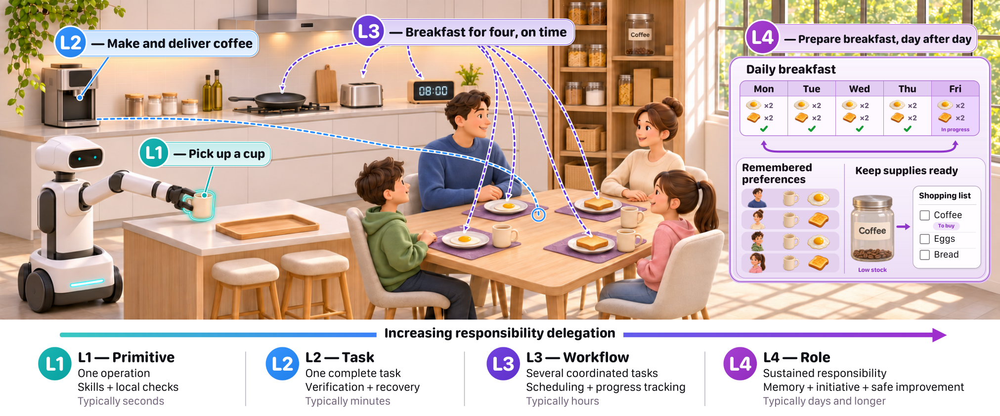

### TL;DR

A position paper arguing that *agentic robotics* — frontier foundation models wrapped in an "embodied harness" (perception stack, memory, planner, tool interface) acting as the decision-making core — is the next regime for robot systems, superseding end-to-end VLA stacks. Proposes a dual evaluation framework covering both model capabilities and closed-loop system performance, and lays out a research roadmap for scaling robot responsibility.

### Key idea

Separate the *agent core* (a frontier VLM/LLM with reasoning and tool use) from the *embodied harness* (controllers, world modelling, memory, safety guards). Reuse principles from digital agents — multi-turn planning, tool calling, evaluation on heterogeneous environments — rather than training one monolithic VLA. Argue that the harness is what distinguishes agentic robotics from a raw policy and should be evaluated jointly with the model.

### Main finding

This is a position / framework paper rather than a measurement result. Contributions are the taxonomy of embodied-harness components, the dual eval framework (capabilities + closed-loop), and the roadmap. *Borderline: included because the embodied-agent framing is central to a kept topic (agents, VLA).*

### Why it matters

Reframes the "end-to-end VLA" versus "agent-with-tools" debate for robotics. Carries over design patterns from software agents (MCP, planners, memory, verifier loops) into physical settings, suggesting that capability wins in frontier LLM/VLM agents transfer to robots when the harness is right — and giving a shared yardstick to compare systems built on different model stacks.

### Knowledge graph integration

**Builds on / relates to existing pages:**
- [../agents/README.md](../agents/README.md) — reuses the tool-calling + multi-turn-execution playbook from software agents.
- [../case-studies/README.md](../case-studies/README.md) — argues for agent-core + harness case studies as the right unit of comparison.

**Suggested new pages:**
- `agents/embodied-harness.md` *(depth)* — the perception-memory-planner-controller wrapper around a foundation model.
- `agents/_agents.md` *(taxonomy)* — overview of software agents vs embodied agents vs tool-only agents.

---

## 2. Gamer: A Generalist VLA Foundation Model for Long-Horizon Real-Time Game Agent

**Authors:** Not disclosed on HF page — *Affiliation not disclosed*
**Links:** [arXiv:2611.18397](https://arxiv.org/abs/2611.18397) · [HF](https://huggingface.co/papers/2611.18397) · [AlphaXiv](https://www.alphaxiv.org/abs/2611.18397)
**Topics:** `agents`, `VLA`, `RL`, `multimodal`

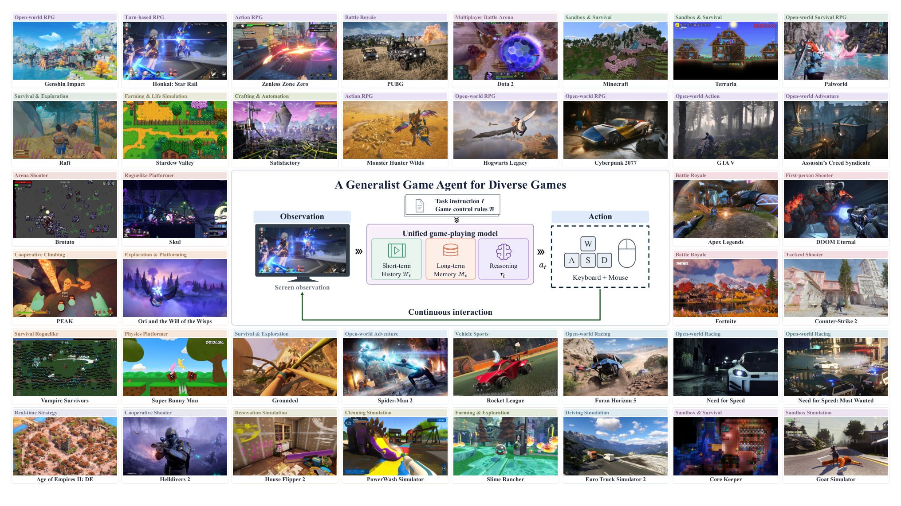

### TL;DR

Gamer is a generalist vision-language-action agent for long-horizon play in 3D open-world and 2D competitive games. Trained in three stages — continued pre-training on tens of thousands of hours of keyboard-and-mouse gameplay, *sparse-thinking* instruction tuning (think only at decision points, act fast otherwise), and a multi-turn RL variant of GRPO adapted for long trajectories — and served with a cloud-edge inference engine for real-time control.

### Key idea

Three stacked tricks: (1) keyboard-mouse continued pretraining to give the base VLM an action prior; (2) *sparse-thinking SFT* that interleaves short CoT bursts only at high-stakes decisions, keeping per-step latency low; (3) a multi-turn GRPO-style RL loop that assigns credit over long horizons with trajectory-level rewards. Serving splits perception on the edge and reasoning in the cloud to hit real-time latency.

### Main finding

Reports solid generalization across several 3D open-world games (held-out titles) and competitive results on 2D game benchmarks, outperforming prior game agents on long-horizon tasks. Sparse-thinking is a key efficiency lever — most frames bypass reasoning, so the cloud-edge engine can keep up with interactive play.

### Why it matters

Games are the cleanest long-horizon, partially-observable RL benchmark with a real-time latency bar. Gamer's split between a VLM action prior, cheap-when-idle reasoning, and a multi-turn RL recipe is the same shape that would be needed for broader embodied / UI agents. The sparse-thinking idea is reusable far outside games.

### Knowledge graph integration

**Builds on / relates to existing pages:**
- [../post-training/grpo.md](../post-training/grpo.md) — the RL stage is a multi-turn variant of GRPO.
- [../post-training/reasoning/long-cot-rl.md](../post-training/reasoning/long-cot-rl.md) — sparse-thinking is a budgeted-CoT counterpart, trading always-on reasoning for latency.
- [../systems/partial-rollouts.md](../systems/partial-rollouts.md) — multi-turn long-horizon RL needs partial-rollout machinery.

**Suggested new pages:**
- `agents/sparse-thinking.md` *(depth)* — interleave short CoT only at decision points to keep latency bounded.
- `post-training/reasoning/multi-turn-grpo.md` *(depth)* — GRPO adapted to long trajectories with trajectory-level credit.
- `case-studies/gamer.md` *(case study)* — full three-stage game-agent recipe + cloud-edge serving.

---

## 3. VibePrevisBench: Evaluating Agentic Coding for 4D Scene Generation in Blender

**Authors:** Muxi Diao, Lele Yang, Wenbin Xu et al. — *Tianjin University / Kling AI / BUPT / HK PolyU*
**Links:** [arXiv:2611.15789](https://arxiv.org/abs/2611.15789) · [HF](https://huggingface.co/papers/2611.15789) · [AlphaXiv](https://www.alphaxiv.org/abs/2611.15789)
**Topics:** `agents`, `eval`, `multimodal`

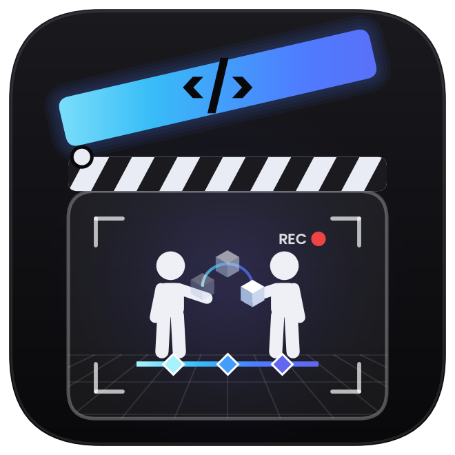

### TL;DR

A 242-task benchmark where a coding agent turns a brief (script, photo, continuation, or reference video) into an executable Blender 4D scene and renders a *graybox proxy video*. Two scorers: a rule-based *Scene Check* re-runs the code and compares exported scene facts against hidden ground truth in nine dimensions, and a VLM-based *Screen Check* judges whether those facts are visually recognizable in the proxy. 11 frontier coding agents evaluated.

### Key idea

Decouple "is the scene right" (deterministic, code-level ground truth) from "is the scene legible" (visual, VLM-judged). Hidden ground-truth facts and re-execution avoid prompt leakage, while the VLM check fails agents whose correct code still renders unreadable views. The dual scoring makes failures diagnosable (code wrong vs camera wrong vs layout wrong).

### Main finding

Three take-aways across 11 agents: (1) multimodal spatial/camera understanding is the biggest separator; (2) all agents master basic staging but fail on challenging camera requests; (3) agents inspect their own renders but rarely correct their errors. Self-verification is the missing step.

### Why it matters

A rare benchmark that forces an agent to write code that produces a *geometric* artifact, then verifies both execution and visual outcome. Points to a general template for agent evals that require closed-loop visual feedback — not just unit tests on code.

### Knowledge graph integration

**Builds on / relates to existing pages:**
- [../evaluation/README.md](../evaluation/README.md) — agent benchmarks class.
- [../agents/README.md](../agents/README.md) — coding-agent evaluation under multimodal feedback.

**Suggested new pages:**
- `evaluation/vibeprevisbench.md` *(depth)* — the 4D-scene coding-agent benchmark design.
- `evaluation/_agent-benchmarks.md` *(taxonomy)* — overview of agent benchmarks (web, code, scene).

---

## 4. MIRIX-2.0: Multi-Agent Memory System

**Authors:** Weizhi Zhang, Jiayan Nan, Peng Xia, Yu Wang (equal contribution) — *MIRIX AI*
**Links:** [arXiv:2611.12068](https://arxiv.org/abs/2611.12068) · [HF](https://huggingface.co/papers/2611.12068) · [AlphaXiv](https://www.alphaxiv.org/abs/2611.12068)
**Topics:** `agents`, `memory`

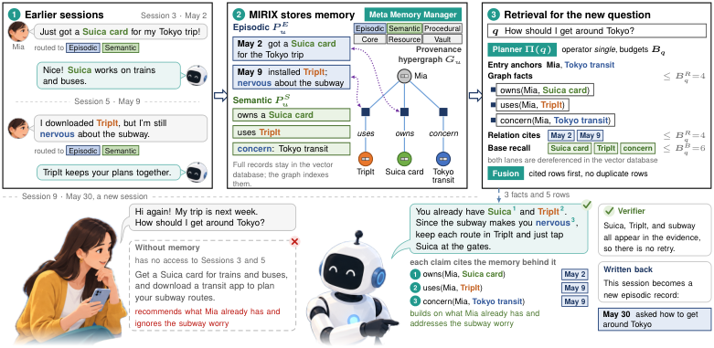

### TL;DR

A multi-agent memory system for LLM agents that keeps complete typed records as the primary store, indexes them with a *provenance hypergraph* under explicit retrieval budgets, and runs an offline consolidation process (*AutoDream*) outside the write path. Works with closed and open models with no fine-tuning; 91.4% on LoCoMo and 72.6% on LongMemEval-S.

### Key idea

Separate three layers: (1) a typed-record store that keeps every observation (no lossy summarization at write time); (2) a provenance hypergraph where retrieval runs under a *budget* that bounds latency and token cost; (3) *AutoDream*, an async consolidation agent that compresses, re-indexes, and promotes structure off the critical path — analogous to sleep-time replay in biological memory.

### Main finding

Top accuracy on 4 of 5 QA benchmarks (including 91.4% LoCoMo, 72.6% LongMemEval-S), gains on procedural-memory tasks, and faster answer times than HyperMem with AutoDream disabled. Fine-tuning not required.

### Why it matters

Pushes agent memory past "summarize and overwrite" into a system-level design with explicit retrieval budgets and offline consolidation. The write/read-path split is the kind of pattern that scales to long-running agents where memory can grow for months.

### Knowledge graph integration

**Builds on / relates to existing pages:**
- [../agents/README.md](../agents/README.md) — long-horizon agent architecture.

**Suggested new pages:**
- `agents/agent-memory.md` *(depth)* — typed records + provenance hypergraph + budgeted retrieval.
- `agents/autodream-consolidation.md` *(depth)* — offline memory consolidation outside the write path.
- `agents/_agent-memory.md` *(taxonomy)* — summary vs record-store vs hypergraph memory designs.

---

## 5. MMFlash: Faster Speculative Decoding for Vision-Language Models

**Authors:** Zigeng Chen, Song Wang, Gongfan Fang, Xinchao Wang — *National University of Singapore*
**Links:** [arXiv:2611.18482](https://arxiv.org/abs/2611.18482) · [HF](https://huggingface.co/papers/2611.18482) · [AlphaXiv](https://www.alphaxiv.org/abs/2611.18482)
**Topics:** `efficient-inference`, `speculative-decoding`, `multimodal`

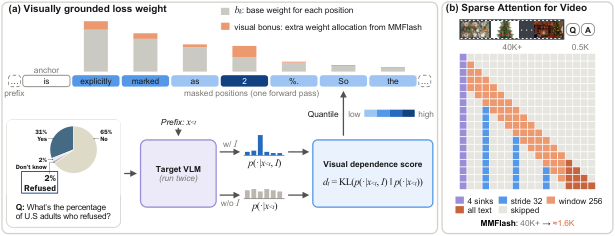

### TL;DR

A diffusion-based drafter for speculative decoding tailored to VLMs. Introduces a *visual-dependence* metric, up-weights visually dependent tokens in the drafter's loss, and uses sparse attention to keep long video inputs tractable. Reports up to **3.58× lossless speedup**, beating EAGLE-3 by up to 195.4% and prior DFlash by up to 17.1%.

### Key idea

Standard draft models mis-predict exactly the tokens that depend hardest on image/video context (colors, object attributes, counts), so verification rejects them and speedup collapses. MMFlash scores each training token by its *visual dependence* (counterfactual perturbation of the visual input) and weights the drafter loss accordingly. The drafter itself is a diffusion LM (parallel token refinement) so long video contexts use sparse attention.

### Main finding

Up to **3.58×** end-to-end speedup with no accuracy loss. Beats EAGLE-3 by up to **195.4%** and DFlash by up to **17.1%** on VLM workloads. Gains are largest on long-video tasks where visual dependence is concentrated.

### Why it matters

Speculative decoding has been the big inference lever on text LLMs but has lagged on VLMs because draft models don't ground in vision. MMFlash is a clean recipe: identify the tokens that break drafting and teach the drafter to prioritize them. Generalizes naturally to any modality-conditional generation.

### Knowledge graph integration

**Builds on / relates to existing pages:**
- [../inference/README.md](../inference/README.md) — speculative decoding family; VLM-specific variant.

**Suggested new pages:**
- `inference/speculative-decoding.md` *(depth)* — the core drafter/verifier pattern (base technique).
- `inference/mmflash.md` *(depth)* — visual-dependence-weighted diffusion drafter for VLMs.
- `inference/_speculative-decoding.md` *(taxonomy)* — EAGLE, Medusa, DFlash, MMFlash tradeoffs.

---

## 6. Rethinking in Spikes: Mitigating Hallucinations in MDLMs with Step-Aware Decoding

**Authors:** Zhongxing Xu, Zhonghua Wang, Zhe Qian, Shiyan Su, Ming Hu et al. — *Multi-institution (submitter: Cornell)*
**Links:** [arXiv:2611.12901](https://arxiv.org/abs/2611.12901) · [HF](https://huggingface.co/papers/2611.12901) · [AlphaXiv](https://www.alphaxiv.org/abs/2611.12901)
**Topics:** `diffusion`, `multimodal`, `decoding`

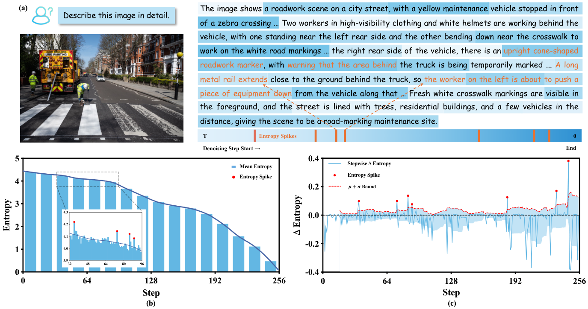

### TL;DR

*StepRefine*, a plug-and-play decoder for multimodal diffusion language models (MDLMs) that detects entropy *spikes* during denoising and switches between discrete denoising and latent refinement; a controller returns to standard denoising once the output distribution stabilizes. Reduces hallucinations without extra training.

### Key idea

MDLMs hallucinate most at steps where the token distribution has a sudden entropy spike — the model is uncommitted and tends to confabulate. StepRefine watches entropy over the denoising trajectory; when it spikes, it detours through a *latent refinement* step (continue in continuous embedding space) instead of committing a discrete token, then resumes standard denoising when entropy relaxes. Training-free; just a decoder modification.

### Main finding

Reported improvements on hallucination benchmarks for multimodal diffusion LMs, with no fine-tuning or architectural changes — the method is a decoder-side intervention.

### Why it matters

Diffusion language models are an underexplored route to parallel decoding, and hallucination is one of the loudest objections. A training-free decoder-side fix that targets the specific step where hallucinations get committed is the kind of surgical intervention worth borrowing in other diffusion-LM stacks.

### Knowledge graph integration

**Builds on / relates to existing pages:**
- [../multimodal/README.md](../multimodal/README.md) — multimodal diffusion LMs class.
- [../inference/README.md](../inference/README.md) — decoder-side inference-time intervention.

**Suggested new pages:**
- `inference/steprefine.md` *(depth)* — entropy-spike-triggered latent refinement in MDLMs.
- `inference/_diffusion-lm-decoding.md` *(taxonomy)* — decoding tricks specific to diffusion / masked language models.

---

## 7. V-JEPA-LM: Video-Language Models That Read Dynamics Beyond Static, Text-Aligned Representations

**Authors:** Keuntae Kim, Dongjun Kim, Yong Suk Choi — *Affiliation not disclosed (names consistent with Hanyang University)*
**Links:** [arXiv:2611.17831](https://arxiv.org/abs/2611.17831) · [HF](https://huggingface.co/papers/2611.17831) · [AlphaXiv](https://www.alphaxiv.org/abs/2611.17831)
**Topics:** `multimodal`, `video`, `VLM`

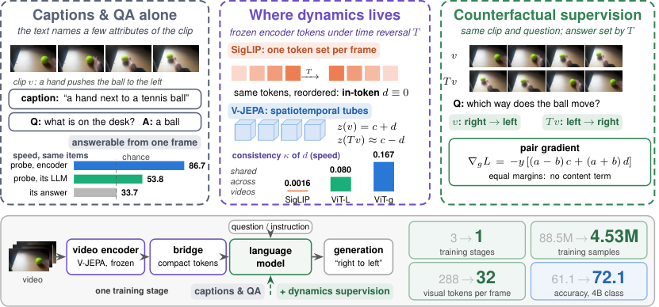

### TL;DR

Argues that video encoders like V-JEPA actually learn scene dynamics, but video-language models trained on captions/QA ignore that signal. Shows the dynamics information sits in a *subspace shared across videos* for predictive encoders (V-JEPA) but not for frame-wise encoders (SigLIP). Trains V-JEPA-LM (1B–8B) with *counterfactual supervision* — pairs of pixel-transformed videos whose text answers must diverge — so the LM must read the dynamics subspace. SOTA in size class on 11 video benchmarks.

### Key idea

Predictive video encoders encode "what changes" in a low-dimensional shared subspace. Standard caption/QA training doesn't force the LM to look there — captions describe the gist, not dynamics. Counterfactual supervision creates (video, perturbed-video) pairs where the correct answer flips only if the model reads dynamics, forcing the projection+LM to attend to that subspace.

### Main finding

V-JEPA-LM (1B–8B parameters) leads its size classes across **11 video benchmarks**. The dynamics subspace is identifiable and shared across videos only for predictive encoders — not for frame-aligned SigLIP, which explains why SigLIP-based VLMs plateau on dynamics-heavy tasks.

### Why it matters

Pins down a concrete reason mainstream VLMs stall on temporal reasoning: the encoder *has* the signal, but the training objective doesn't exercise it. Counterfactual supervision is a general recipe to force any multimodal LM to attend to a known-informative subspace rather than shortcutting through captions.

### Knowledge graph integration

**Builds on / relates to existing pages:**
- [../multimodal/README.md](../multimodal/README.md) — video-language modeling.

**Suggested new pages:**
- `multimodal/v-jepa-lm.md` *(depth)* — counterfactual-supervision recipe for dynamics-aware video LMs.
- `multimodal/video-encoders.md` *(depth)* — predictive (V-JEPA) vs frame-wise (SigLIP) encoder tradeoffs.

---

## 8. Loopback Transformer: Towards a Unified View of Residual Looped Transformers

**Authors:** Xuan Ouyang, Zefan Cai, Chenlong Zhang, Cheng Luo, Ke Wan, Junjie Hu — *University of Wisconsin–Madison*
**Links:** [arXiv:2611.07226](https://arxiv.org/abs/2611.07226) · [HF](https://huggingface.co/papers/2611.07226) · [AlphaXiv](https://www.alphaxiv.org/abs/2611.07226)
**Topics:** `architecture`, `efficient`

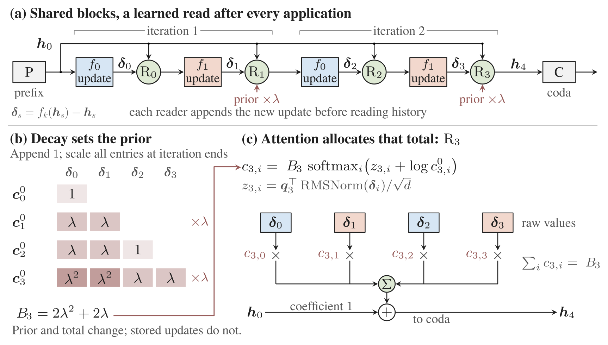

### TL;DR

A looped Transformer architecture that separately controls three knobs — *input strength* (how much of the original embedding each loop sees), *total update weight* (how much the loop can rewrite the residual), and *per-update allocation* (how the loop budget is split across iterations). Achieves lower validation loss and higher downstream accuracy than both standard and looped residual baselines while using fewer parameters.

### Key idea

Previous looped-Transformer variants entangle the "re-use" and "deep-residual" interpretations. The paper reparameterizes the loop as three independent scalar controls (input, total update, per-update), giving a unified recipe that collapses to prior designs at specific settings. Treats loop depth as a *budget* rather than extra layers, so the parameter count stays flat while effective depth varies.

### Main finding

Lower validation loss and higher downstream accuracy than standard and previously looped residual baselines at smaller parameter counts. The three-knob factorization makes it easy to isolate which component matters for which task.

### Why it matters

Looped / recurrent transformer variants keep coming back as a parameter-efficient depth lever, but the design space is a tangle. A clean factorization of three decoupled controls gives a fairer way to compare — and suggests looped designs may be a cheaper depth knob for inference-heavy settings where parameter count dominates memory.

### Knowledge graph integration

**Builds on / relates to existing pages:**
- [../architectures/transformer-block.md](../architectures/transformer-block.md) — the looped block sits on top of the standard residual transformer block.

**Suggested new pages:**
- `architectures/looped-transformer.md` *(depth)* — the three-knob (input / total / per-update) factorization.
- `architectures/_recurrent-transformers.md` *(taxonomy)* — Universal Transformer, ALBERT, looped, deep-equilibrium variants.

---

## 9. Aligning AI Teams

**Authors:** Siddarth Srinivasan, Morgan Jane Matthews, Jascha Sohl-Dickstein, Erik Jones — *Affiliation not disclosed on HF page*
**Links:** [arXiv:2611.17820](https://arxiv.org/abs/2611.17820) · [HF](https://huggingface.co/papers/2611.17820) · [AlphaXiv](https://www.alphaxiv.org/abs/2611.17820)
**Topics:** `safety`, `agents`, `alignment`

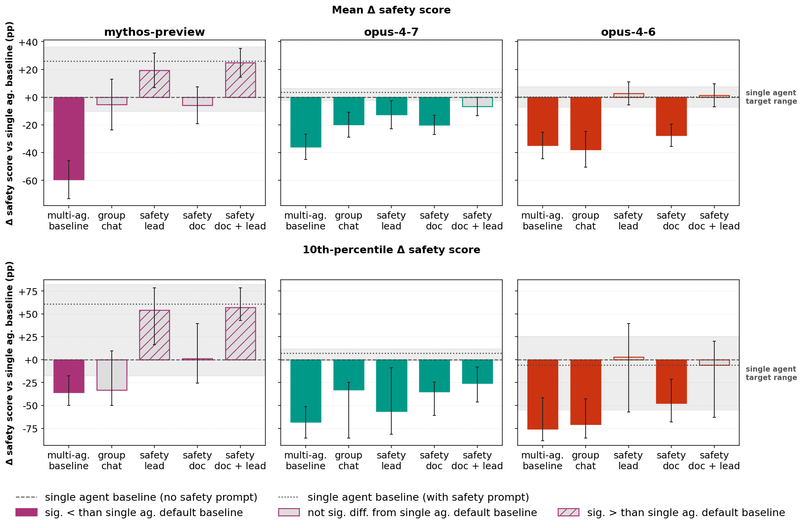

### TL;DR

Safety training on individual LLM agents often fails once those agents work in multi-agent teams. Studies two software-engineering tasks and ten consulting-proposal tasks; the single-agent/team safety gap doesn't track raw model capability, and standard fixes (critique rounds, group chat) don't close it. Root cause: *diffusion of responsibility* — team members check less and deflect blame more. Two interventions help: a designated **safety lead agent**, and a coordinator that publishes a **safety specifications document**. Releases `magelab` open-source orchestration framework.

### Key idea

Treat multi-agent LLM teams as a social system where safety responsibility diffuses the way it does in human teams. Measure: single-agent vs team safety deltas across tasks and models. Find the gap is a social failure mode, not a capability gap. Fix: inject role structure — a safety lead or an explicit safety spec — so responsibility is assigned instead of shared.

### Main finding

- Safety gap between single agents and teams does not scale with model capability.
- Agent-critique and group-chat interventions don't reliably close it.
- Safety-lead role and shared safety spec document both close most of the gap on the two task families studied.

### Why it matters

As LLM agents are composed into teams (Devin-style, multi-model orchestrators, agentic companies), aligning each agent in isolation is insufficient. This is one of the first papers to quantify the *team-level* safety regression and give actionable interventions — a cousin of human factors research for AI teams. The `magelab` release makes the setup reproducible.

### Knowledge graph integration

**Builds on / relates to existing pages:**
- [../safety/README.md](../safety/README.md) — alignment-at-deployment.
- [../safety/sandbagging.md](../safety/sandbagging.md) — related to responsibility diffusion as a channel for coordinated under-reporting.
- [../safety/cot-monitoring.md](../safety/cot-monitoring.md) — safety-lead role is monitor-style oversight within a team.
- [../agents/README.md](../agents/README.md) — multi-agent orchestration.

**Suggested new pages:**
- `safety/multi-agent-alignment.md` *(depth)* — diffusion-of-responsibility failure mode in LLM teams.
- `safety/safety-lead-agent.md` *(depth)* — role-based safety assignment inside an agent team.
- `agents/multi-agent-orchestration.md` *(depth)* — team structure, roles, coordinator patterns.

---

## 10. WebArena-Pro: A Heterogeneous, Multimodal, Reproducible Benchmark for Web Agents

**Authors:** Imene Kerboua, Xing Han Lù, Weijian Qi, Alexander Miller et al. — *McGill / Mila / Ohio State / ServiceNow AI / SNU*
**Links:** [arXiv:2611.17955](https://arxiv.org/abs/2611.17955) · [HF](https://huggingface.co/papers/2611.17955) · [AlphaXiv](https://www.alphaxiv.org/abs/2611.17955)
**Topics:** `agents`, `eval`, `multimodal`

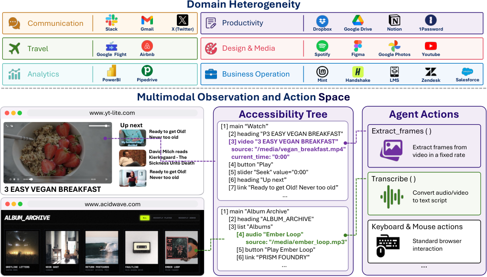

### TL;DR

A reproducible web-agent benchmark: 300 human-authored tasks over 20 self-hosted web apps across six domain categories. Treats audio and video as first-class observations (actions for transcribing audio, extracting video frames, or passing raw media to omni models). Each task runs in an isolated, seeded container so parallel evaluation is actually reproducible. Best headline scores: Codex w/ GPT 6.1 Sol and Claude Code w/ Claude Opus 5.5 at ~62.3%; best GenericAgent at 30.3%.

### Key idea

Fix three well-known WebArena pains: (1) *reproducibility* — every task runs in its own seeded container; (2) *modality coverage* — audio and video are core observation types, not scraped text; (3) *authoring quality* — tasks are human-authored through an annotator UI, LLM-triaged, and human-validated. The isolated-container design is what makes parallel runs comparable.

### Main finding

- Top configurations (coding-agent harnesses + frontier models) reach **62.3%** success.
- Best GenericAgent setup: **30.3%**.
- Substantial room for improvement: multimodal and long-horizon tasks still break current stacks.

### Why it matters

WebArena became a standard but its reproducibility and modality coverage lagged behind what real web agents must do. WebArena-Pro raises the bar on both. The 60% / 30% gap between frontier coding-agent harnesses and generic agent scaffolds is a clean signal that scaffold design matters as much as the base model.

### Knowledge graph integration

**Builds on / relates to existing pages:**
- [../evaluation/README.md](../evaluation/README.md) — agent benchmark class.
- [../agents/README.md](../agents/README.md) — web-agent evaluation.

**Suggested new pages:**
- `evaluation/webarena-pro.md` *(depth)* — isolated-container multimodal web-agent benchmark.
- `evaluation/_web-agent-benchmarks.md` *(taxonomy)* — WebArena, VisualWebArena, WebArena-Pro, Mind2Web.

---

## 11. JVT: Just Video Transformer makes pixel-space video diffusion simple

**Authors:** Jianjun Zhou, Hua Geng, Haoyu Guo — *Affiliation not disclosed on HF page*
**Links:** [arXiv:2611.18549](https://arxiv.org/abs/2611.18549) · [HF](https://huggingface.co/papers/2611.18549) · [AlphaXiv](https://www.alphaxiv.org/abs/2611.18549)
**Topics:** `diffusion`, `video`, `architecture`

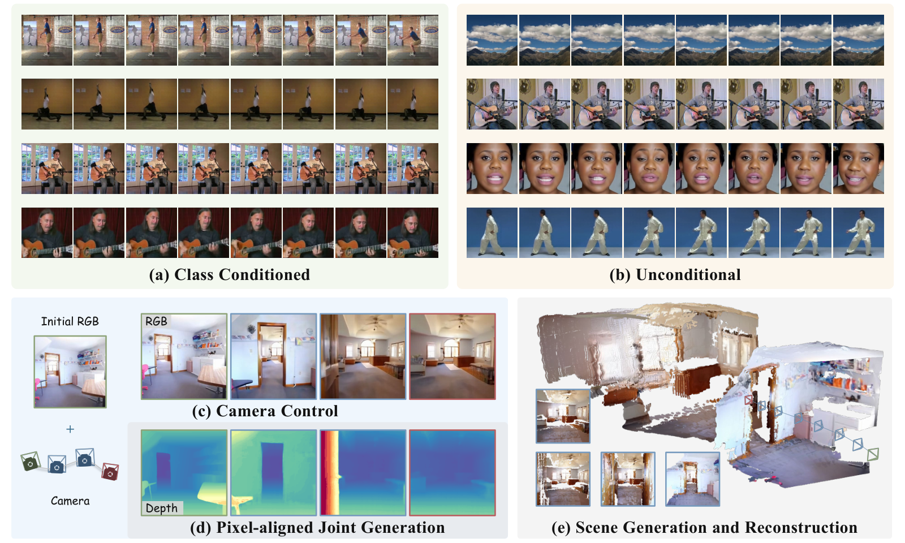

### TL;DR

A large-patch DiT-style transformer for video diffusion that works **directly in pixel space** — no pretrained VAE, no auxiliary refinement model, no cascade, no U-Net skip connections. Studies video patch embeddings, register tokens, and adaLN placement to find the compute/quality knee. Matches latent-diffusion baselines on class-conditioned and unconditional generation, and enables joint pixel-aligned outputs (demonstrated with RGB-disparity video from camera conditioning).

### Key idea

Drop the VAE. Use large video patches (e.g. 4×16×16) so the token count stays tractable in pixel space, then let a pure DiT learn both appearance and dynamics. Register tokens stabilize training; adaLN replaces skip connections. Because the model operates on pixels, you can jointly predict pixel-aligned channels (RGB + disparity) without a separate reconstruction head.

### Main finding

- Matches latent-diffusion baselines in class-conditioned and unconditional video generation.
- Camera-conditioned RGB-disparity joint generation outperforms RGB-only in camera following and produces scene geometry without a separate reconstruction model.

### Why it matters

Pixel-space diffusion has been dismissed as too expensive since Imagen/Stable Diffusion moved to latents. JVT re-opens the question for video, where VAE artefacts and temporal inconsistencies are a known pain. Removing the VAE also makes pixel-aligned joint outputs (depth, segmentation, normals) a clean modeling story rather than a hack.

### Knowledge graph integration

**Builds on / relates to existing pages:**
- [../architectures/transformer-block.md](../architectures/transformer-block.md) — DiT-style transformer block.

**Suggested new pages:**
- `multimodal/video-diffusion.md` *(depth)* — pixel-space vs latent video diffusion tradeoffs.
- `multimodal/jvt.md` *(depth)* — DiT with large video patches, register tokens, and joint pixel-aligned outputs.

---

## 12. AI Reviews Are Biased Towards the Appendix

**Authors:** Saptarshi Ghosh, Mohammad Saim, Tianyu Jiang — *University of Cincinnati (CincyNLP Lab)*
**Links:** [arXiv:2611.17811](https://arxiv.org/abs/2611.17811) · [HF](https://huggingface.co/papers/2611.17811) · [AlphaXiv](https://www.alphaxiv.org/abs/2611.17811)
**Topics:** `eval`, `LLM`, `safety`

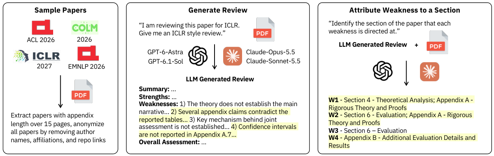

### TL;DR

Analyzes 2,000 papers from ACL, EMNLP, COLM, and ICLR to locate where LLM reviewers find weaknesses. Latest GPT and Claude models draw **roughly half or more** of their weaknesses from the appendix, across API, coding-agent, and web access methods. Human reviewers pull only **8.4%** of weaknesses from the appendix — and their concerns are about presentation and the paper's central idea, not technical details buried at the back.

### Key idea

LLM reviewers over-weight the appendix because it is dense with concrete technical detail they can easily critique, while humans anchor on the main contribution and the paper's framing. Reproduced across three access methods, suggesting the bias is a model-level behavior, not a tooling quirk.

### Main finding

- **~50%+** of LLM reviewer weaknesses come from the appendix (GPT and Claude families).
- Humans: **8.4%** appendix-sourced.
- LLM critiques are concentrated on fine-grained, non-central technical details.

### Why it matters

LLM-assisted peer review is in active use. This paper quantifies a specific bias that systematically misallocates reviewer attention — important as venues move toward AI-assisted triage. Suggests prompt/tool interventions (restrict the appendix, or weight the main-body concerns more heavily) as a short-term mitigation.

### Knowledge graph integration

**Builds on / relates to existing pages:**
- [../evaluation/README.md](../evaluation/README.md) — LLM-as-judge limitations.
- [../safety/README.md](../safety/README.md) — judge bias as deployed-system failure mode.

**Suggested new pages:**
- `evaluation/llm-judge-bias.md` *(depth)* — position / length / appendix biases in LLM reviewers.
- `evaluation/_llm-as-judge.md` *(taxonomy)* — judge configurations and their failure modes.

---

## 13. Interpreting Coding Agents Through Their Behavioral Trajectories

**Authors:** Not fully disclosed on HF page (correspondence: Ibragim Badertdinov) — *Nebius*
**Links:** [arXiv:2611.17440](https://arxiv.org/abs/2611.17440) · [HF](https://huggingface.co/papers/2611.17440) · [AlphaXiv](https://www.alphaxiv.org/abs/2611.17440)
**Topics:** `agents`, `interp`, `eval`

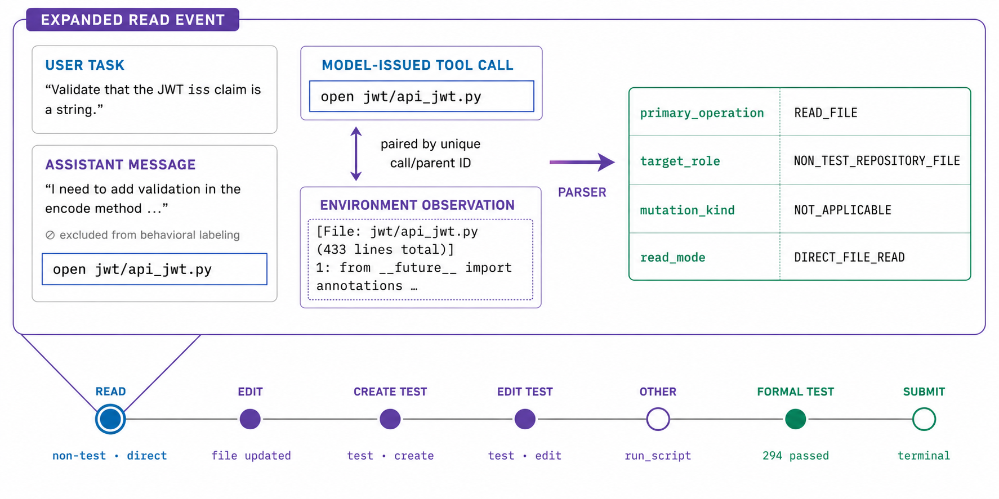

### TL;DR

Argues binary solve-rate benchmarks hide how coding agents work. Builds a rule-based parser over **143,209 execution trajectories** from **125 agent configurations** on **117 models** (SWE-rebench data) that maps raw traces from different harnesses to shared high-level actions (search, edit, run tests). Parser labels agree with a six-model LLM consensus on a 500-event audit. Agents with similar solve rates differ substantially in behavior; aggregate behavioral profiles can fingerprint the agent stack across unseen repositories and languages.

### Key idea

Build a *normalization layer* over heterogeneous agent harness traces: regex/rule-based classifiers for the common operations (grep, ls, patch, pytest, …), mapped to a small shared vocabulary of behaviors. Then analyze behavior as a distribution, not a scalar score. Validate the parser by consensus with LLM labelers on a 500-event audit.

### Main finding

- Similar solve rates, very different behavior — agents trade off exploration vs editing vs testing differently.
- **Agent-stack fingerprinting**: aggregate behavioral profiles identify the deployed stack on disjoint repos and languages (not just outcomes or token counts).
- Scaffold choice and reasoning effort shift search/edit/test allocations systematically.

### Why it matters

Opens interpretability for agents at the *behavioral* level — complementary to activation-level interp of the underlying model. A shared action vocabulary is the right primitive for cross-harness ablations and for teaching agents by *behavior* rather than outcome.

### Knowledge graph integration

**Builds on / relates to existing pages:**
- [../interpretability/README.md](../interpretability/README.md) — interpretability, extended to agent trajectories.
- [../agents/README.md](../agents/README.md) — coding-agent architecture.
- [../evaluation/README.md](../evaluation/README.md) — beyond-solve-rate agent evaluation.

**Suggested new pages:**
- `interpretability/behavioral-trajectories.md` *(depth)* — parsing agent traces to a shared behavior vocabulary.
- `evaluation/agent-fingerprinting.md` *(depth)* — identifying the agent stack from behavior distributions.

---

## 14. Disen-Forcing: Disentangling Semantic Anchoring from Motion for Autoregressive Video Diffusion

**Authors:** Zhengyang Yu, Akio Hayakawa, Masato Ishii, Qingtao Yu, Xuesong Li, Takashi Shibuya, Yuki Mitsufuji, Jing Zhang — *Affiliation not disclosed on HF page (authors overlap with Sony AI)*
**Links:** [arXiv:2611.02822](https://arxiv.org/abs/2611.02822) · [HF](https://huggingface.co/papers/2611.02822) · [AlphaXiv](https://www.alphaxiv.org/abs/2611.02822)
**Topics:** `diffusion`, `video`, `distillation`

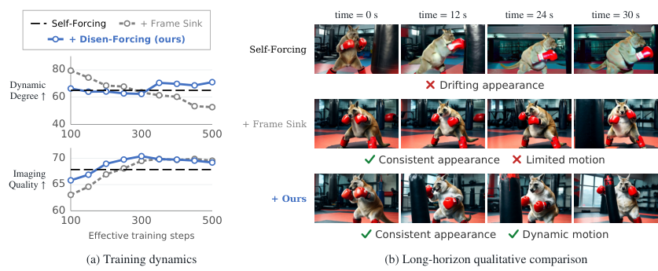

### TL;DR

Autoregressive video diffusion degrades past its training horizon. Prior "frame-sink" methods stabilize long rollouts by keeping initial frames in context — but doing so uniformly biases distillation toward low-dynamic teacher behavior. The paper finds long-range consistency is carried by a *sparse subset of attention heads*; proposes **Disen-Forcing**, a distillation-time plug-in that routes initial-frame context only to those anchoring heads and adds a motion-disentangling regularizer. Improves both long-range consistency *and* motion dynamics.

### Key idea

Per-head analysis: most attention heads handle local temporal dynamics; a sparse subset carries long-range semantic consistency. Frame-sink feeds every head the initial frames, which forces motion heads to match the teacher's static behavior during distillation. Disen-Forcing routes the sink to anchoring heads only, and adds a loss that disentangles anchoring from motion in the student.

### Main finding

Improves both long-range consistency and motion dynamics on long-horizon benchmarks — avoiding the tradeoff that sink-based methods normally pay (stability at the cost of motion).

### Why it matters

Long-horizon autoregressive video generation is one of the biggest remaining diffusion bottlenecks. A head-level routing fix is surgical — no retraining from scratch, applied at distillation time — and the insight (semantic vs motion specialization in heads) is a transferable interpretability finding for video transformers.

### Knowledge graph integration

**Builds on / relates to existing pages:**
- [../architectures/multi-head-attention.md](../architectures/multi-head-attention.md) — head-level specialization is the enabling observation.
- [../multimodal/README.md](../multimodal/README.md) — video generation class.

**Suggested new pages:**
- `multimodal/disen-forcing.md` *(depth)* — per-head context routing + motion-disentangling regularizer in video diffusion.
- `multimodal/autoregressive-video-diffusion.md` *(depth)* — frame-sink / long-rollout techniques for autoregressive video.

---

## Notes

- Borderline inclusions are flagged in-section with an italic *Borderline: …* note.
- Hero figures live in `assets/2026-11-16/` and are the first figure from each paper's arXiv HTML rendering (HF's social thumbnail CDN is proxy-blocked in this environment).
- This digest is informational. No existing concept files, `READING-LIST.md`, or `PAPERS.md` were modified to produce it.
