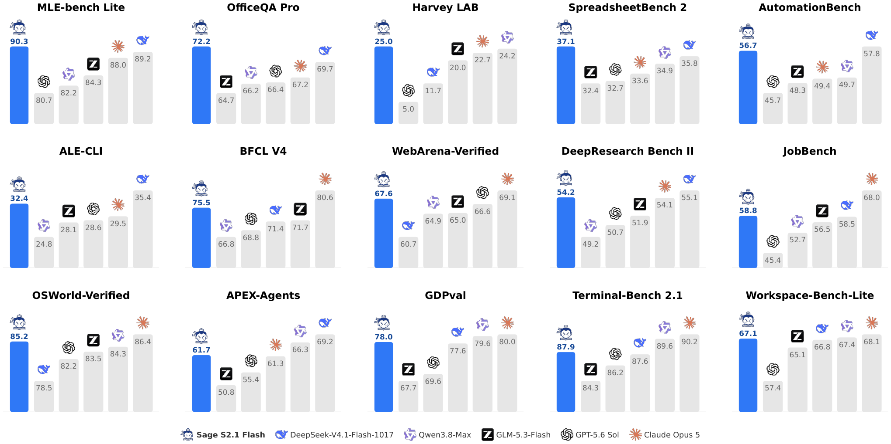
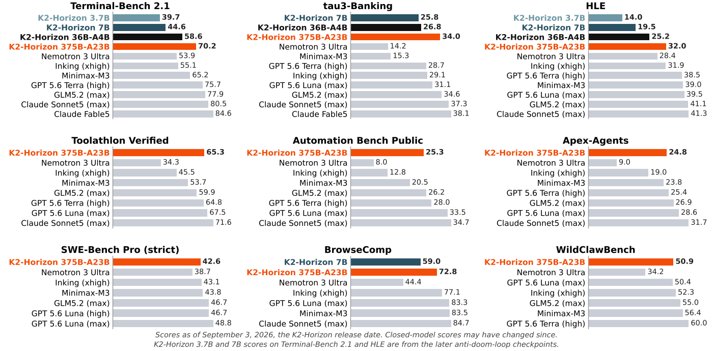
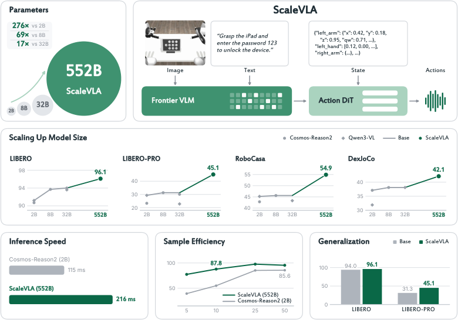
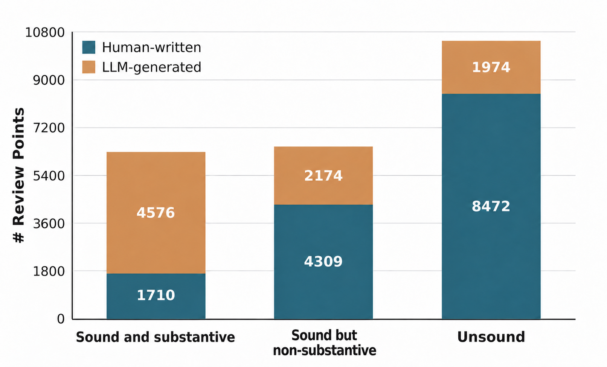
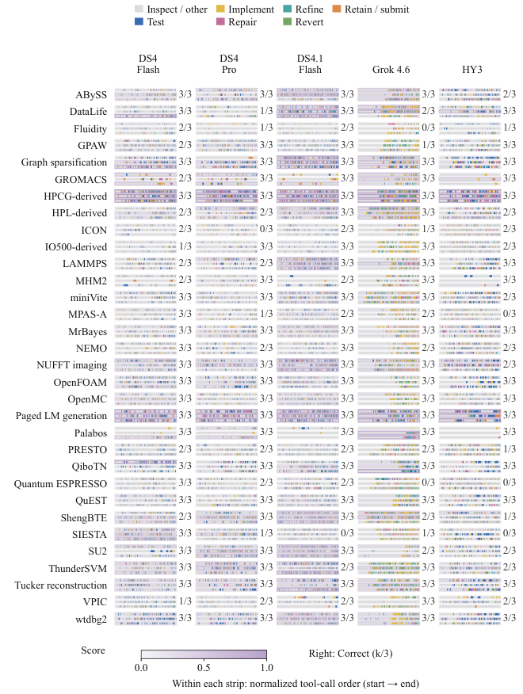
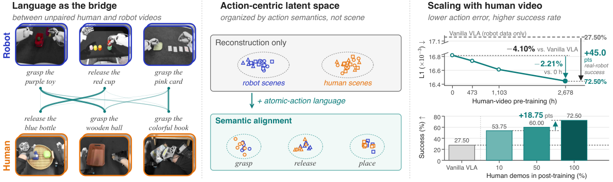
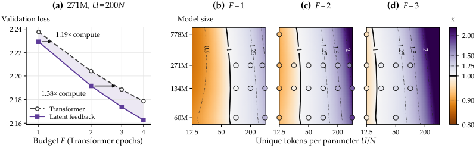
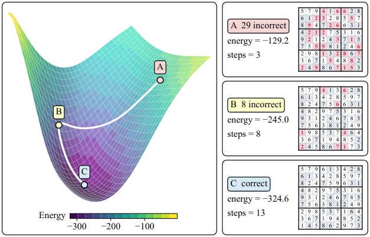

# Daily AI papers — 2026-11-17

*Curated from HF Daily Papers. 14 of 42 papers kept after relevance filter.*

## Papers at a glance

| # | Title | Topics | Org |
| --- | --- | --- | --- |
| 1 | [Sage S2.1 Flash Technical Report](#1-sage-s21-flash) | `LLM`, `tech-report`, `efficient-inference` | Sage |
| 2 | [K2-Horizon: A Frontier Fleet of Open Source Language Models](#2-k2-horizon) | `LLM`, `MoE`, `tech-report`, `attention` | MBZUAI |
| 3 | [SPILLWAY: Separating Target Admission from Sanitization](#3-spillway) | `safety`, `agents`, `prompt-injection` | (independent) |
| 4 | [SWE-CoWork: Benchmarking Coding Agents as Digital Employees](#4-swe-cowork) | `agents`, `eval`, `coding` | TokenWave AI |
| 5 | [ScaleVLA: Scaling VLA Models to 552B Parameters](#5-scalevla) | `multimodal`, `VLA`, `MoE`, `scaling` | Tsinghua / PKU / SJTU / Galbot |
| 6 | [PaperCritic: Training AI Reviewers to Assess Soundness](#6-papercritic) | `eval`, `RL`, `GRPO`, `reward-model` | (academic) |
| 7 | [Accelerate Bench: Evaluating Agents for Program Optimization](#7-accelerate-bench) | `agents`, `eval`, `coding` | (academic) |
| 8 | [SALA: Semantically Aligned Latent Actions for Embodied Scaling](#8-sala) | `multimodal`, `VLA`, `embodied` | Sharpa Robotics / SJTU |
| 9 | [Latent Feedback Is a Compute and Data Amplifier](#9-latent-feedback) | `pre-training`, `architecture`, `scaling-laws` | USC / CMU |
| 10 | [Energy-Based Reasoners: Recurrent Reasoner as EBM](#10-ebr) | `reasoning`, `architecture` | UIUC / Duke / Harvard |
| 11 | [LoopFill: Pipelined Speculative Decoding for Looped Transformers](#11-loopfill) | `efficient-inference`, `speculative-decoding` | Princeton / UIUC |
| 12 | [BitDecoding-FP4: Native FP4 KV Cache Decoding](#12-bitdecoding-fp4) | `quantization`, `inference`, `kv-cache` | Edinburgh / Tencent Hunyuan |
| 13 | [More Agents, More Samples, or More Thinking?](#13-more-agents) | `agents`, `eval`, `test-time-compute` | U. Nevada Reno |
| 14 | [Abstention Direction in LLMs: Mechanistic Interpretability](#14-abstention-direction) | `interp`, `steering`, `safety` | SB Intuitions |

---

## 1. Sage S2.1 Flash Technical Report

**Authors:** Sage team — *Sage*
**Links:** [arXiv:2611.21072](https://arxiv.org/abs/2611.21072) · [HF](https://huggingface.co/papers/2611.21072) · [AlphaXiv](https://www.alphaxiv.org/abs/2611.21072)
**Topics:** `LLM`, `tech-report`, `efficient-inference`

### TL;DR

Technical report for Sage S2.1 Flash, a small-footprint frontier chat model positioned as a faster, cheaper sibling to the Sage S2.1 reasoning line. The report covers pretraining mixture, mid-training continual-learning stages, post-training (SFT + RL), inference optimizations, and the full evaluation sweep across reasoning, instruction following, agentic tool-use, and safety benchmarks.

### Key idea

A Flash tier that trades depth of deliberation for latency: the same post-training stack as the reasoning parent, but with a shorter reasoning budget, aggressive distillation from the reasoner, and inference-side tricks tuned for low time-to-first-token. The report treats Flash as a design point on the compute-vs-quality curve rather than a separately-trained family.

### Main finding

Flash reaches within a few points of the larger S2.1 reasoning model on standard reasoning/code benchmarks at a fraction of the inference cost, with notable gains on tool-use and long-context tasks. The report documents concrete regression gaps to flag where Flash shouldn't be used over the full reasoner.

### Why it matters

Flash-tier releases are becoming the second half of every frontier launch — the reasoning model sets the quality ceiling, the Flash variant ships the volume. This report is a template for how a distilled Flash is built and evaluated side-by-side.

### Knowledge graph integration

**Builds on / relates to existing pages:**
- [../post-training/_post-training.md](../post-training/_post-training.md) — SFT+RL stack applied in a distilled Flash-tier recipe.
- [../post-training/reasoning/long-cot-rl.md](../post-training/reasoning/long-cot-rl.md) — Flash is distilled from the long-CoT reasoning parent.
- [../pre-training/mid-training.md](../pre-training/mid-training.md) — explicit mid-training stages feature in the Flash recipe.

**Suggested new pages:**
- `case-studies/sage-s2-1-flash.md` *(case study)* — full breakdown of the Flash tier, data, and eval sweep.

---

## 2. K2-Horizon: A Frontier Fleet of Open Source Language Models

**Authors:** MBZUAI team led by Hector Liu & Eric Xing — *Mohamed bin Zayed University of AI*
**Links:** [arXiv:2611.21003](https://arxiv.org/abs/2611.21003) · [HF](https://huggingface.co/papers/2611.21003) · [AlphaXiv](https://www.alphaxiv.org/abs/2611.21003)
**Topics:** `LLM`, `MoE`, `tech-report`, `attention`

### TL;DR

Six fully-open language models ranging from a 0.9B dense base to a 375B-A23B mixture-of-experts flagship. The release includes weights, intermediate checkpoints, pretraining and post-training data, and training code. Two architectural novelties are introduced — **Mixture-of-Value Attention (MoVA)** and a **softplus attention gate** — alongside a diffusion-based decoder adapter for faster sampling and ~10T synthetic pretraining tokens.

### Key idea

K2-Horizon rewrites the attention block twice: **MoVA** routes different value projections through an MoE-style gating, giving per-token specialization inside attention itself; the **softplus attention gate** replaces a sigmoid/softmax gate with a smooth, unbounded alternative that keeps gradients flowing at long contexts. The flagship MoE is 375B total / 23B active, with a diffusion adapter plugged on top for parallel decoding.

### Main finding

The 375B-A23B flagship is competitive with closed frontier models on standard reasoning and coding benchmarks while shipping with full training transparency — data, code, and intermediate checkpoints across six sizes. The diffusion decoder adapter reportedly delivers meaningful decoding speedups at matched quality.

### Why it matters

MBZUAI continues to be one of the most radical "open everything" labs in the frontier tier: the ability to study a 375B MoE's intermediate checkpoints and full data recipe is rare. The two attention changes also open a direction for the attention-variant taxonomy that isn't just MLA/GQA.

### Knowledge graph integration

**Builds on / relates to existing pages:**
- [../architectures/_moe.md](../architectures/_moe.md) — K2-Horizon's flagship is a 375B-total / 23B-active MoE.
- [../architectures/mla.md](../architectures/mla.md) — MoVA sits in the same design space as MLA's attention-block rewrites.
- [../architectures/multi-head-attention.md](../architectures/multi-head-attention.md) — MoVA mixes experts inside the value projection.
- [../pre-training/mtp.md](../pre-training/mtp.md) — diffusion decoder adapter aims at the same multi-token-prediction goal.
- [../case-studies/deepseek-v3.md](../case-studies/deepseek-v3.md) — comparable open-everything frontier release.

**Suggested new pages:**
- `case-studies/k2-horizon.md` *(case study)* — end-to-end breakdown of the fleet, data, and eval.
- `architectures/mova.md` *(depth)* — Mixture-of-Value Attention.
- `architectures/softplus-attention-gate.md` *(depth)* — the gating function used in the attention block.
- `inference/diffusion-decoder-adapter.md` *(depth)* — parallel decoding via a plug-in diffusion head.

---

## 3. SPILLWAY: Separating Target Admission from Sanitization to Defend Tool-Using Agents

**Authors:** Woosang Lim, Yeseul Chang, Jaewoo Lee — *affiliation not disclosed*
**Links:** [arXiv:2611.07222](https://arxiv.org/abs/2611.07222) · [HF](https://huggingface.co/papers/2611.07222) · [AlphaXiv](https://www.alphaxiv.org/abs/2611.07222)
**Topics:** `safety`, `agents`, `prompt-injection`

### TL;DR

A deterministic defense for tool-using agents against prompt injection. Two layered checks: (1) a **target-admission filter** that only allows an agent action whose target (e.g. an email recipient, a bank account) appears in a typed field of a read-only tool response or in the user's original request, and (2) a **context sanitizer** that strips instruction-like text from third-party content before the model sees it. Neither check calls an LLM.

### Key idea

Split the prompt-injection defense into two orthogonal, deterministic layers. **Admission** answers "is this action's target authorized?" by checking a whitelist derived from structured tool outputs and the user turn — no model-based classification, no per-task plan. **Sanitization** rewrites untrusted content to remove imperatives and role-play before it enters the context. Because both are deterministic, they provide a provable floor independent of model vigilance.

### Main finding

Zero in-scope attack success across the authors' standard templated prompt-injection benchmark, while preserving high task utility. The defense sits in front of the agent rather than inside it, and does not require fine-tuning.

### Why it matters

Most prompt-injection defenses are LLM-based detectors that themselves fail on novel attacks. SPILLWAY swaps the trust question for a structured-data question that *can* be answered without a model, aligning with the broader "trust boundary, not vibes" approach to agent security.

### Knowledge graph integration

**Builds on / relates to existing pages:**
- [../safety/_attacks.md](../safety/_attacks.md) — directly in the "prompt injection" and "agent misuse" cells; one of the first depth-level defenses.
- [../agents/README.md](../agents/README.md) — defense sits in the agent action loop.

**Suggested new pages:**
- `safety/prompt-injection.md` *(depth)* — the attack class, currently covered only in `_attacks.md`.
- `safety/spillway.md` *(depth)* — the admission+sanitization defense itself.

---

## 4. SWE-CoWork: Benchmarking Coding Agents as Digital Employees in Organizations

**Authors:** Xinping Lei et al., corresponding Jiaheng Liu, Stephen Huang, Eli Cheung, Weihao Xuan — *TokenWave AI*
**Links:** [arXiv:2611.20218](https://arxiv.org/abs/2611.20218) · [HF](https://huggingface.co/papers/2611.20218) · [AlphaXiv](https://www.alphaxiv.org/abs/2611.20218)
**Topics:** `agents`, `eval`, `coding`

### TL;DR

101 development assignments across 101 real repositories, embedded in simulated engineering organizations. Each task forces a coding agent to recover requirements from colleagues and workplace records, reconcile conflicting evidence, and finally implement a change that private executable tests grade.

### Key idea

Decouple the "which tests pass?" metric from the "did you figure out what was asked?" metric. Tasks require multi-stakeholder requirement elicitation before any code is written, with coworkers, docs, and chat logs as noisy, sometimes contradictory sources. Grading is done by hidden tests the agent never sees.

### Main finding

Across eleven frontier models, the top two agents pass ~63% of fail-to-pass tests but complete fewer than **8%** of full assignments. Sustained requirement tracking across a long, ambiguous session is the dominant failure mode.

### Why it matters

SWE-bench and its successors measure code-fix competence given a specification. SWE-CoWork measures the much harder skill of building the specification from scratch — closer to what "digital employee" really means in production.

### Knowledge graph integration

**Builds on / relates to existing pages:**
- [../agents/README.md](../agents/README.md) — benchmark feeds directly into the agent evaluation stack.
- [../evaluation/README.md](../evaluation/README.md) — new agent benchmark with executable grading.

**Suggested new pages:**
- `evaluation/swe-cowork.md` *(depth)* — benchmark description and leaderboard shape.

---

## 5. ScaleVLA: Scaling Vision-Language-Action Models to 552B Parameters

**Authors:** Dairu Liu, Xuchuan Chen, Zekun Qi, Zekai Li, Zhuo Cao, Luyang Niu, Yingsheng Zhang, Sikai Liang, Ke Fan, He Wang, Li Yi — *Tsinghua / PKU / SJTU / Galbot*
**Links:** [arXiv:2611.21607](https://arxiv.org/abs/2611.21607) · [HF](https://huggingface.co/papers/2611.21607) · [AlphaXiv](https://www.alphaxiv.org/abs/2611.21607)
**Topics:** `multimodal`, `VLA`, `MoE`, `scaling`

### TL;DR

First systematic scaling study of VLA models from 2B to 552B, built by freezing a 552B DeepSeek-V4.1-Flash backbone and plugging in a trainable action diffusion transformer. Across six matched backbone sizes they fit a scaling trend for action prediction error and real-world success, while keeping end-to-end latency at a median of 216 ms per action chunk.

### Key idea

Use a very large pretrained language-model backbone as a *frozen* perception/reasoning core, and bolt on a small, trainable **action diffusion transformer** that converts hidden states into action chunks. The large VLM provides world knowledge; the action head is cheap enough to retrain for new embodiments. The 552B/action-head split keeps serving latency bounded.

### Main finding

Sample efficiency and generalization scores on LIBERO-PRO improve roughly log-linearly with backbone size up to 552B, and the full stack completes real-world charger insertion with higher success than smaller backbones. Median per-chunk latency is 216 ms, feasible for closed-loop control.

### Why it matters

VLAs have been stuck at small backbones because the action head pulls the whole model into training. Freezing the backbone and training only a diffusion action head makes frontier-scale VLMs usable for embodied control — the first VLA scaling law aimed at "just use the biggest VLM you have."

### Knowledge graph integration

**Builds on / relates to existing pages:**
- [../multimodal/README.md](../multimodal/README.md) — new VLA scaling result on top of a multimodal backbone.
- [../architectures/_moe.md](../architectures/_moe.md) — DeepSeek-V4.1-Flash backbone is MoE.
- [../case-studies/deepseek-v3.md](../case-studies/deepseek-v3.md) — relies on the DeepSeek-V4 family lineage.

**Suggested new pages:**
- `multimodal/_vla.md` *(taxonomy)* — the class of vision-language-action models and how they differ (action-head placement, frozen vs full training, embodiment conditioning).
- `multimodal/action-diffusion-transformer.md` *(depth)* — the action head used here.

---

## 6. PaperCritic: Training AI Reviewers to Assess the Soundness of Papers

**Authors:** PaperCritic team — *academic (affiliations not clearly listed on HF page)*
**Links:** [arXiv:2611.17834](https://arxiv.org/abs/2611.17834) · [HF](https://huggingface.co/papers/2611.17834) · [AlphaXiv](https://www.alphaxiv.org/abs/2611.17834)
**Topics:** `eval`, `RL`, `GRPO`, `reward-model`

### TL;DR

A reviewer model trained only to assess *soundness* — the most objective axis of peer review — of ICLR-style AI papers. Supervised fine-tuning on high-quality reference review points is followed by GRPO with an F1 reward computed from separate soundness / substantiveness reward models (precision) and an LLM matcher (recall).

### Key idea

Separate review *soundness* (premises correct, concern substantive) from everything else reviewers do (interest, writing, accept/reject), and optimize only against the former. Dataset **PaperSound-23K** labels ~23K review points for 989 papers; the reward split lets a small 4B model reach frontier-level review precision without being pulled off-task by the subjective axes.

### Main finding

PaperCritic-4B hits **F1 = 45.1** on in-domain test, above trained 4B baselines and above DeepSeek-V4-Flash-0731 and Claude Opus 5 (both around 39). Transfers partially to Nature-style paper review, code review, legal contract review, and story feedback.

### Why it matters

LLM-judge evaluation is a load-bearing layer for both alignment and benchmarks, and most reward models for reviewing conflate subjective and objective criteria. Isolating soundness demonstrates that the rubric-decomposition idea generalizes beyond coding and math.

### Knowledge graph integration

**Builds on / relates to existing pages:**
- [../post-training/grpo.md](../post-training/grpo.md) — PaperCritic trains with GRPO on a decomposed reward.
- [../post-training/_rewards.md](../post-training/_rewards.md) — fits squarely in the rubric-reward family.
- [../post-training/cot-reward-model.md](../post-training/cot-reward-model.md) — closely related to CoT-based reward modeling.
- [../evaluation/README.md](../evaluation/README.md) — the LLM-as-judge literature is one of its main dependencies.

**Suggested new pages:**
- `post-training/rubric-reward.md` *(depth)* — the multi-axis-rubric reward decomposition used to separate soundness from other review criteria.

---

## 7. Accelerate Bench: Evaluating Agents for Application-Level Program Optimization

**Authors:** Accelerate Bench team — *affiliation not disclosed on HF page*
**Links:** [arXiv:2611.20882](https://arxiv.org/abs/2611.20882) · [HF](https://huggingface.co/papers/2611.20882) · [AlphaXiv](https://www.alphaxiv.org/abs/2611.20882)
**Topics:** `agents`, `eval`, `coding`

### TL;DR

A benchmark of 32 CPU optimization tasks drawn from scientific applications and supercomputing contests. Each task gives an agent a working reference program, a workload, correctness requirements, and timing limits, then lets it decide how to optimize. A verifier scores the submission by both correctness and speedup.

### Key idea

Separate "is it correct?" (binary) from "how fast is it?" (continuous) and make the agent responsible for the *tradeoff*. Agents can change build flags, runtime settings, algorithms, data structures — anything that preserves semantics under the correctness checks. The scoring function multiplies correctness by speedup, so winning is about *size* of speedup.

### Main finding

On Benchmark v1.1, 16 coding agents score between **25.5%** and **67.4%** on Score@1. Most produced programs are correct; the gap is almost entirely in how big a speedup they achieved. Replays show that build and runtime flags, and their interactions with code changes, drive end-to-end runtime.

### Why it matters

Agent coding evals so far mostly measure functional correctness. Accelerate Bench forces the model to understand real performance dynamics — a stepping stone toward agents that can do kernel-level engineering rather than just pass tests.

### Knowledge graph integration

**Builds on / relates to existing pages:**
- [../agents/README.md](../agents/README.md) — benchmark for coding-agent evaluation.
- [../evaluation/README.md](../evaluation/README.md) — new agent benchmark with continuous metrics.

**Suggested new pages:**
- `evaluation/accelerate-bench.md` *(depth)* — benchmark layout and scoring function.

---

## 8. SALA: Semantically Aligned Latent Actions Enable Dual-Axis Scaling

**Authors:** SALA team, corresponding zhijied@sjtu.edu.cn — *Sharpa Robotics / SJTU-Sharpa Joint Lab for Embodied AI*
**Links:** [arXiv:2611.17110](https://arxiv.org/abs/2611.17110) · [HF](https://huggingface.co/papers/2611.17110) · [AlphaXiv](https://www.alphaxiv.org/abs/2611.17110)
**Topics:** `multimodal`, `VLA`, `embodied`

### TL;DR

An alignment trick for latent action spaces across human video and robot video without any paired data. Language descriptions of unpaired human and robot clips are used to pull semantically-related human latent actions toward the corresponding robot latents; robot action reconstruction keeps the whole space grounded in actual control signals.

### Key idea

Use **language as a soft bridge** between human-video and robot-video latent actions: for each unpaired clip, drive its latent action toward latents of clips with similar language descriptions in the *other* domain. Combine this contrastive-in-language alignment with a reconstruction objective on robot actions so the aligned space can still control the robot.

### Main finding

Two scaling axes both work: (a) more *general* human video in pre-training lowers robot action prediction error; (b) more *task-specific* human video added in post-training raises real-world success rates. This is one of the clearer demonstrations that unpaired human video is usefully fungible with robot data.

### Why it matters

The bottleneck on VLA training has been the small size and narrow coverage of robot trajectory data. SALA is a data-amplification route that doesn't require paired human/robot demonstrations — it just needs captioned clips on both sides.

### Knowledge graph integration

**Builds on / relates to existing pages:**
- [../multimodal/README.md](../multimodal/README.md) — alignment-of-latent-spaces is core multimodal territory.
- [../data/README.md](../data/README.md) — effectively a cross-domain data-amplification technique.

**Suggested new pages:**
- `multimodal/sala.md` *(depth)* — the semantic-alignment-via-language-labels trick.

---

## 9. Latent Feedback Is a Compute and Data Amplifier

**Authors:** Chaitanya Dwivedi, Xuezhe Ma, Alexander Moreno, Hector Liu (and others) — *Institute of Foundation Models (USC) / CMU*
**Links:** [arXiv:2611.20404](https://arxiv.org/abs/2611.20404) · [HF](https://huggingface.co/papers/2611.20404) · [AlphaXiv](https://www.alphaxiv.org/abs/2611.20404)
**Topics:** `pre-training`, `architecture`, `scaling-laws`

### TL;DR

A small architectural change — feed each token's top-layer hidden state back into the next token's input — acts as both a compute amplifier and a data amplifier. Across 60M–778M-parameter models, latent-feedback Transformers reach any given loss with less FLOPs when data is abundant and with less unique data at matched epochs.

### Key idea

A **latent feedback** connection: the last layer's hidden state at position *t* is concatenated/added into the input embedding at position *t+1*. This is a form of recurrence through depth that preserves the vanilla Transformer forward pass but adds a one-step cross-token loop. The authors fit a scaling law whose held-out 778M run is predicted to within **0.3%** on validation loss.

### Main finding

At matched compute, latent-feedback models hit lower loss. At matched unique data and more epochs, they still beat the baseline, meaning the gain isn't just a better compute curve — it's also a data-reuse multiplier. Both effects scale with unique data per parameter and with repetition.

### Why it matters

Compute and data are the two scaling axes everyone fights over. A single change that improves both — with a published scaling law — is a very usable recipe. The architectural cost is minimal and preserves the parallelism of a standard Transformer.

### Knowledge graph integration

**Builds on / relates to existing pages:**
- [../architectures/transformer-block.md](../architectures/transformer-block.md) — latent feedback modifies the token-level recurrence of the Transformer block.
- [../pre-training/README.md](../pre-training/README.md) — directly in the scaling-law / data-repetition territory.
- [../pre-training/mtp.md](../pre-training/mtp.md) — related to multi-token-prediction in that it couples neighbouring positions through the top layer.

**Suggested new pages:**
- `architectures/latent-feedback.md` *(depth)* — the hidden-state-into-next-token-embedding recurrence and its scaling law.

---

## 10. Energy-Based Reasoners: Your Recurrent Reasoner Should Be an EBM

**Authors:** Alexi Gladstone, Zeyu Michael Li, Heng Ji, Yilun Du — *UIUC / Duke / Harvard*
**Links:** [arXiv:2611.08977](https://arxiv.org/abs/2611.08977) · [HF](https://huggingface.co/papers/2611.08977) · [AlphaXiv](https://www.alphaxiv.org/abs/2611.08977)
**Topics:** `reasoning`, `architecture`

### TL;DR

Recast looped / recurrent reasoners as energy-based models over latent reasoning states. The model learns an energy function; each reasoning iteration is a gradient-descent step on that energy. The energy's value scores candidate states, and its gradient magnitude signals when to stop.

### Key idea

Train a network **E(z, x)** whose value is low for states that are good partial solutions and high for bad ones, then run **z ← z − η ∇_z E** at inference as the recurrent reasoning loop. A dedicated **exploration-based training** procedure shapes the energy landscape so it has useful basins for both novel and known problems; the gradient norm doubles as a dynamic stopping criterion.

### Main finding

Matches or beats prior recurrent reasoners on four algorithmic benchmarks, including **99.9%** accuracy on Sudoku-Extreme with **345× less inference compute** than the next-best model. Also achieves state-of-the-art coverage of *distinct valid solutions*, meaning it finds a wider variety of correct answers.

### Why it matters

Chain-of-thought spends more tokens; looped reasoners spend more passes. Framing the loop as EBM gradient descent gives a principled stopping rule *and* a training objective that generalizes — a cleaner alternative to ad-hoc halting predictors.

### Knowledge graph integration

**Builds on / relates to existing pages:**
- [../post-training/reasoning/README.md](../post-training/reasoning/README.md) — recurrent reasoning is an alternative to long-CoT RL.
- [../post-training/reasoning/long-cot-rl.md](../post-training/reasoning/long-cot-rl.md) — contrasts with CoT by running the loop in *latents* rather than tokens.
- [../post-training/reasoning/length-penalty.md](../post-training/reasoning/length-penalty.md) — the gradient-norm stop replaces per-sample length penalties.

**Suggested new pages:**
- `post-training/reasoning/energy-based-reasoner.md` *(depth)* — the EBM recurrence and its exploration-based training.

---

## 11. LoopFill: Pipelined Multi-Token Speculative Decoding for Looped Transformers

**Authors:** Siqi Zhu, Suozhi Huang, Yi Zhao, Jiaxuan You — *Princeton / UIUC*
**Links:** [arXiv:2611.19649](https://arxiv.org/abs/2611.19649) · [HF](https://huggingface.co/papers/2611.19649) · [AlphaXiv](https://www.alphaxiv.org/abs/2611.19649)
**Topics:** `efficient-inference`, `speculative-decoding`

### TL;DR

A training-free speculative decoding algorithm specifically for **looped** LLMs (models that recurrently apply a block many times). It builds a single draft tree that combines multi-token suffix drafts with shallow-loop predictions, then verifies all branches in one pipelined pass.

### Key idea

For a looped Transformer, the same block is applied *k* times per output token, which is wasteful if most tokens would commit after fewer loops. LoopFill speculates at *two* axes at once: (1) multi-token suffix drafts in the token dimension, and (2) shallow-loop predictions in the depth dimension. Both branches live in one draft tree and are verified together, so successful short-loop drafts short-circuit deep ones.

### Main finding

Mean speedups of **5.85× on Ouro-2.6B** and **5.13× on Huginn-3.5B** over greedy autoregressive decoding across seven benchmarks — beating the strongest baseline, LoopAhead, by **40%** and **25%** respectively.

### Why it matters

Looped reasoners (Ouro, Huginn) and energy-based reasoners (paper #10 above) are rising as alternatives to long-CoT, and their inference cost is the open problem. A dedicated speculative scheme that exploits both axes closes a lot of that gap.

### Knowledge graph integration

**Builds on / relates to existing pages:**
- [../inference/README.md](../inference/README.md) — speculative decoding is a core inference topic.
- [../pre-training/mtp.md](../pre-training/mtp.md) — multi-token prediction uses similar draft-and-verify structure.

**Suggested new pages:**
- `inference/_speculative-decoding.md` *(taxonomy)* — the family (draft model, Medusa, EAGLE, lookahead, LoopFill).
- `inference/loopfill.md` *(depth)* — dual-axis (token × loop-depth) speculation for looped Transformers.

---

## 12. BitDecoding-FP4: Native FP4 KV Cache Decoding via Algorithm–System Co-Design

**Authors:** DaYou Du, Woon Yee Ng, Guangming Sheng, Nick Lau, Jianyi Cheng, Luo Mai — *University of Edinburgh / Tencent Hunyuan*
**Links:** [arXiv:2611.09825](https://arxiv.org/abs/2611.09825) · [HF](https://huggingface.co/papers/2611.09825) · [AlphaXiv](https://www.alphaxiv.org/abs/2611.09825)
**Topics:** `quantization`, `inference`, `kv-cache`

### TL;DR

An algorithm + kernel co-design that stores the KV cache in **native FP4** (NVFP4 or MXFP4) on Blackwell-class hardware. Algorithmic fixes address quantization error in queries, attention probabilities, and keys; system-level kernels remove softmax and quantization bottlenecks on FP4 Tensor Cores with paged KV caches.

### Key idea

Rather than quantizing the KV cache *post hoc*, BitDecoding-FP4 treats the whole attention path — Q, K, V, attention probs — as a jointly-quantized pipeline. On the algorithm side, error-shaping tricks preserve the distributions that softmax is sensitive to; on the kernel side, FP4 Tensor Cores drive the matmul while paged attention keeps memory layout friendly.

### Main finding

Within **0.5 points of BF16 KV accuracy with NVFP4** (within 1.0 with MXFP4) across the tested models, and **2.4–3.0× higher peak serving throughput than BF16 KV on NVIDIA B300** for Qwen3 models.

### Why it matters

KV cache is the dominant memory cost in long-context serving. Pushing it to FP4 without materially losing quality reshapes the cost-per-token curve and unblocks much longer context windows on fixed hardware — specifically for Blackwell's native MX formats.

### Knowledge graph integration

**Builds on / relates to existing pages:**
- [../quantization/_number-formats.md](../quantization/_number-formats.md) — uses NVFP4 and MXFP4 microscaling formats.
- [../quantization/fp8.md](../quantization/fp8.md) — same genre of algorithm+kernel co-design, one bit-width down.
- [../inference/README.md](../inference/README.md) — paged attention plus KV quantization is squarely inference work.

**Suggested new pages:**
- `quantization/fp4.md` *(depth)* — FP4 element formats and their LLM serving tradeoffs.
- `inference/kv-cache-quantization.md` *(depth)* — the KV-cache-specific flavor of quantization.

---

## 13. More Agents, More Samples, or More Thinking? Untangling Multi-Agent LLMs

**Authors:** Seyed Mahmoud Sajjadi Mohammadabadi — *University of Nevada, Reno*
**Links:** [arXiv:2611.17610](https://arxiv.org/abs/2611.17610) · [HF](https://huggingface.co/papers/2611.17610) · [AlphaXiv](https://www.alphaxiv.org/abs/2611.17610)
**Topics:** `agents`, `eval`, `test-time-compute`

### TL;DR

Meta-analysis of nine empirical studies covering **516 multi-agent LLM configurations**. The headline result: multi-agent systems typically score **below** single-agent baselines when sample counts and compute are matched, with a mean accuracy difference of about **−0.042**.

### Key idea

Decompose multi-agent systems into three primitives — **coordination** (agents talk), **ensembling** (multiple samples pooled), and **test-time compute** (more thinking per step) — and compare each in isolation against a single-agent baseline with the same total compute budget. The surprising finding is that most of the apparent gains from "more agents" is actually just more samples or more thinking.

### Main finding

Across the 516 configurations, communication between agents added no information when they shared identical evidence. Positive returns for multi-agent setups required *partitioned evidence*, *external verification*, or *diversity across heterogeneous models* — in other words, a specific reason that talking is better than sampling.

### Why it matters

A lot of multi-agent-LLM claims collapse once you match compute. This paper formalizes when the pattern should actually win, and gives practitioners an honest baseline (same tokens, single agent) to beat.

### Knowledge graph integration

**Builds on / relates to existing pages:**
- [../agents/README.md](../agents/README.md) — directly relevant to the agent architecture conversation.
- [../post-training/rejection-sampling.md](../post-training/rejection-sampling.md) — the "more samples" baseline is rejection-sampling-style aggregation.
- [../post-training/reasoning/README.md](../post-training/reasoning/README.md) — test-time compute is the reasoning folder's core theme.

**Suggested new pages:**
- `agents/_multi-agent.md` *(taxonomy)* — the coordination / ensembling / TTC decomposition and when each wins.

---

## 14. Abstention Direction in LLMs: Mechanistic Interpretability of Abstention

**Authors:** Jun Hirako, Hiroaki Yamagiwa (plus Koki Itai) — *SB Intuitions*
**Links:** [arXiv:2611.20441](https://arxiv.org/abs/2611.20441) · [HF](https://huggingface.co/papers/2611.20441) · [AlphaXiv](https://www.alphaxiv.org/abs/2611.20441)
**Topics:** `interp`, `steering`, `safety`

### TL;DR

Mechanistic analysis of *abstention* — an LLM's decision to withhold a response — across three distinct causes: **query ambiguity (Q)**, **knowledge limits (MK)**, and **safety alignment with human values (HV)**. Prior work focused only on HV; this paper looks at all three in one representation space.

### Key idea

Identify a shared **abstention direction** in the residual stream and run activation-steering experiments against it for each of the three causes separately. A single direction appears to carry the abstain-vs-answer signal, with activations in middle layers being the most causally effective targets.

### Main finding

Intervening in middle layers raises or lowers abstention across all three perspectives (Q, MK, HV) — the same steering handle moves abstentions due to ambiguity, knowledge gaps, and safety all together. No prior study had looked at the three jointly.

### Why it matters

Abstention is one of the primary safety-adjacent behaviors in deployed models (refuse, say "I don't know", answer anyway). Finding that a single internal direction mediates all three variants means both easier interpretability and a sharp knob for misuse — a steering vector that could, in principle, suppress refusals across the board.

### Knowledge graph integration

**Builds on / relates to existing pages:**
- [../interpretability/README.md](../interpretability/README.md) — directly in the activation-steering / probing space.
- [../safety/refusal-suppression.md](../safety/refusal-suppression.md) — the steering direction is the mechanism that could implement refusal suppression.
- [../safety/sleeper-agents.md](../safety/sleeper-agents.md) — single-direction control is a tractability lever for abstention-based safety training.

**Suggested new pages:**
- `interpretability/activation-steering.md` *(depth)* — the general method; abstention is one application of it.
- `interpretability/abstention-direction.md` *(depth)* — the specific direction for abstention.

---

## Notes

- Borderline inclusions are flagged in-section with an italic *Borderline: …* note where applicable. On 2026-11-17, no paper was in the clearly-borderline band.
- Hero figures live in `assets/2026-11-17/`. Six papers have no hero figure because neither the arXiv HTML preview nor the HF social-thumbnail CDN was reachable through the proxy.
- This digest is informational. No existing concept files, `READING-LIST.md`, or `PAPERS.md` were modified to produce it.
