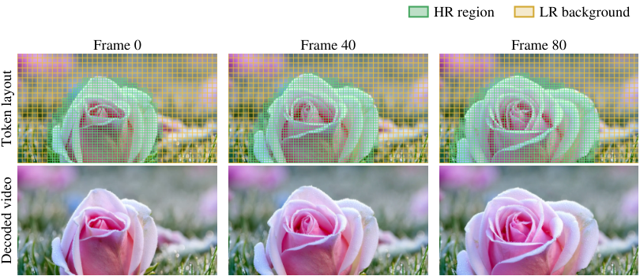
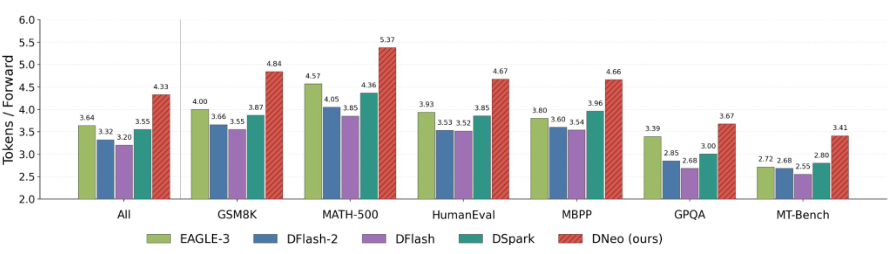
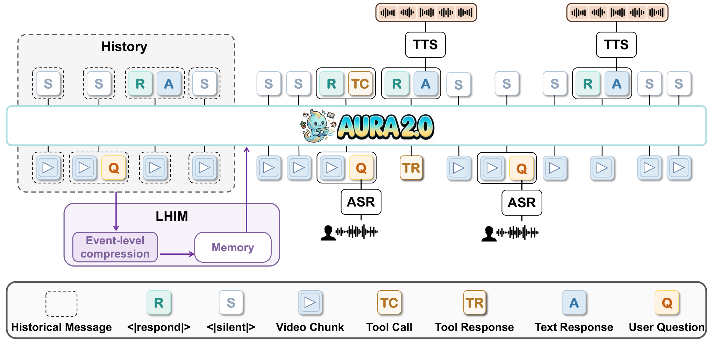
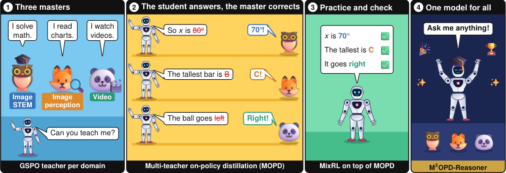
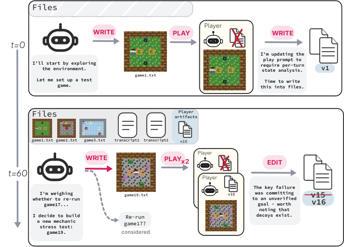

# Daily AI papers — 2026-11-18

*Curated from HF Daily Papers. 15 of ~40 papers kept after relevance filter.*

## Papers at a glance

| # | Title | Topics | Org |
| --- | --- | --- | --- |
| 1 | [TeleChat to Xing4: Advancing Frontier Agentic Models on Domestic Chips](#1-telechat-to-xing4) | `LLM`, `MoE`, `systems`, `agents`, `tech-report` | TeleAI |
| 2 | [Multi-Branch Transformer](#2-multi-branch-transformer) | `architecture`, `efficient-inference` | UIUC / Rice / Cornell |
| 3 | [TPHC: Improving Hyper-Connections with Tensor-Parallel Grouped Updates](#3-tphc) | `architecture`, `systems` | ShanghaiTech / Meituan |
| 4 | [Weight-Space Programming Doesn't Need Transformers](#4-weight-space-programming) | `interp`, `architecture`, `gradient-free` | POSTECH |
| 5 | [FastFrames: Video Generation at Interactive Latency](#5-fastframes) | `diffusion`, `video`, `efficient-inference` | Apple / Cornell |
| 6 | [MPEG-Diffusion: Mixed-Resolution Video Generation](#6-mpeg-diffusion) | `diffusion`, `video`, `efficient-inference` | Roblox / UT Austin |
| 7 | [DNeo: Your Parallel Draft Model Needs Better Target Feature Encoding](#7-dneo) | `efficient-inference`, `speculative-decoding` | Cerebras |
| 8 | [VideoNexus: Video Perception Beyond the Reasoning Context](#8-videonexus) | `multimodal`, `agents`, `video` | CUHK / KlingAI |
| 9 | [AURA 2.0: Learning to Speak First and Act in Streaming Video](#9-aura-2-0) | `multimodal`, `agents`, `video` | Huawei / HKUST / CUHK |
| 10 | [M3OPD-Reasoner: Multi-Teacher On-Policy Distillation for Multimodal Reasoning](#10-m3opd-reasoner) | `multimodal`, `RL`, `distillation`, `reasoning` | VinU / A*STAR |
| 11 | [RepoFactory: Scaling Long-Horizon Coding Agents with Environment Evolution Loop](#11-repofactory) | `agents`, `RL`, `data` | Beihang / SJTU / IQuest |
| 12 | [Agentic On-Policy Distillation Implicitly Reshapes LLMs' ReAct Patterns](#12-agentic-on-policy-distillation) | `agents`, `distillation`, `post-training` | PKU / USTC / NTU |
| 13 | [Self-Improvement Memory Enables Continual Recursive Self-Improvement](#13-self-improvement-memory) | `agents`, `self-improvement` | Google Cloud AI / DeepMind |
| 14 | [Do LLM Agents Still Need to Be Told How to Self-Improve?](#14-do-llm-agents-still-need-to-be-told) | `agents`, `eval`, `position` | Tübingen / MIT CSAIL |
| 15 | [The Novelty Exposed: Ablation, Reproducibility and Transparency in 40 Open-Weight LLM Reports](#15-novelty-exposed) | `eval`, `meta`, `position` | Ankara University |

---

## 1. TeleChat to Xing4

**Authors:** TeleAI team (full author list in Appendix A) — *China Telecom AI Research / TeleAI*
**Links:** [arXiv:2611.22115](https://arxiv.org/abs/2611.22115) · [HF](https://huggingface.co/papers/2611.22115) · [AlphaXiv](https://www.alphaxiv.org/abs/2611.22115)
**Topics:** `LLM`, `MoE`, `systems`, `agents`, `tech-report`

### TL;DR

A 285B-total / ~17B-active MoE LLM (plus a 29B-A4B open-weight sibling) pretrained entirely on Ascend 910C NPUs with the MindSpore HyperParallel stack — a full-system tech report in the DeepSeek-V3 / Qwen mold, built to show that a frontier training+serving pipeline can live on domestic Chinese silicon.

### Key idea

A stack of co-designed techniques: **MLA + DSA + IndexShare** for sparse long-context attention; **mHC** (manifold-constrained hyper-connections) in the 29B model; a **wider-and-shallower MoE** shape tuned to Ascend Cube units; **HSDP** (FSDP within SuperPoDs, replication across them) that eliminates pipeline parallelism; **owner-based Muon** that shards the Newton–Schulz step; and **DSpark**, a block-wise speculative decoder with a Markov dependency head on top of a five-layer DFlash drafter. Agent post-training runs through **TeleGym** + Slime + SGLang with partial-rollout async RL.

### Main finding

DSpark reports 2.67×–3.77× decode throughput vs. base decoding and 1.48–2.10× over MTP3 on six math/code benchmarks. In simulation, MLA+DSA+IndexShare delivers 4.68× prefill and 1.27× decode throughput vs. MLA. HSDP cuts per-step time from 36.4 s (PP-1F1B) to 31.8 s on a 1024-NPU profiler. The 285B model was pretrained on 8,192 Ascend 910C cards. No accuracy benchmarks are reported in the body.

### Why it matters

This is the first fully Ascend-native frontier-scale training report with a DeepSeek-V3-level breadth of co-designed tricks. It reframes several familiar ideas (hyper-connections, speculative decoding, Muon, sparse attention) with an Ascend bottleneck twist, and demonstrates that pipeline parallelism can be fully replaced by hybrid sharding on a large enough interconnect fabric.

### Knowledge graph integration

**Builds on / relates to existing pages:**
- [mla.md](../architectures/mla.md) — DSA/IndexShare extend MLA with sparse top-K attention
- [deepseek-moe.md](../architectures/deepseek-moe.md) — same MoE family (fine-grained + 1 shared expert), with a wider-shallower variant
- [aux-loss-free-balancing.md](../architectures/aux-loss-free-balancing.md) — load balancing follows the DeepSeek-V3 approach
- [mtp.md](../pre-training/mtp.md) — MTP retained as training objective; DSpark replaces it at inference
- [dualpipe.md](../systems/dualpipe.md) — HSDP is the alternative they pick vs. DualPipe-style PP
- [case-studies/deepseek-v3.md](../case-studies/deepseek-v3.md) — direct comparator for the stack-of-tricks shape

**Suggested new pages:**
- `case-studies/xing4.md` *(case study)* — the whole report
- `architectures/mhc-hyper-connections.md` *(depth)* — manifold-constrained hyper-connections
- `inference/dspark.md` *(depth)* — block-wise speculative decoding with Markov dependency head
- `pre-training/hsdp.md` *(depth)* — hybrid-sharded data parallelism replacing PP
- `pre-training/owner-based-muon.md` *(depth)* — sharded Muon with per-matrix owners
- `architectures/dsa.md` *(depth)* — DeepSeek Sparse Attention + IndexShare

---

## 2. Multi-Branch Transformer

**Authors:** Gaotang Li, Lingjie Chen, Chunyuan Deng, Zhiwei Xu, Hongzheng Chen, Christopher De Sa, Jingrui He, Yingheng Wang, Hanghang Tong — *UIUC / Rice / Michigan / Cornell*
**Links:** [arXiv:2611.19800](https://arxiv.org/abs/2611.19800) · [HF](https://huggingface.co/papers/2611.19800) · [AlphaXiv](https://www.alphaxiv.org/abs/2611.19800)
**Topics:** `architecture`, `efficient-inference`

### TL;DR

A third scaling axis for transformers: instead of making a block *wider* or stacking it *deeper*, run several full transformer blocks in parallel on the same residual stream and sum their outputs. A Joint-KV cache-sharing trick keeps memory and bandwidth sane during decode.

### Key idea

**MBT (Multi-Branch Transformer)** composes `B` parallel transformer blocks per position in the stack — each with its own attention + FFN — and sums the branch outputs into the residual stream. **Joint-KV** makes the branches share a single pooled KV cache so inference memory doesn't grow linearly with `B`. The branches end up learning diverse features, acting as an in-block mixture without MoE routing.

### Main finding

At matched training compute, MBT improves language-modeling quality vs. a standard transformer baseline, and the Joint-KV variant improves decoding throughput on a single H200 GPU. Branch count `B` acts as a drop-in capacity knob orthogonal to depth and width.

### Why it matters

Width-vs-depth scaling has plateaued on reasoning-heavy evals; branching is a fresh structural axis with a simple ablation story and an inference-friendly KV variant. If results hold at frontier scale, this is an easy win for any architect who's already decided on their total parameter budget.

### Knowledge graph integration

**Builds on / relates to existing pages:**
- [transformer-block.md](../architectures/transformer-block.md) — MBT is a block-level composition primitive
- [_moe.md](../architectures/_moe.md) — contrast: branching mixes *always*, MoE routes
- [multi-head-attention.md](../architectures/multi-head-attention.md) — Joint-KV is a cache-sharing generalization

**Suggested new pages:**
- `architectures/multi-branch-transformer.md` *(depth)* — the MBT block pattern + Joint-KV cache sharing

---

## 3. TPHC

**Authors:** Xinying Hu, You Wu, Haoyi Wu, Kefeng Zhang, Yuchen Xie, Kewei Tu — *ShanghaiTech / Meituan*
**Links:** [arXiv:2611.23026](https://arxiv.org/abs/2611.23026) · [HF](https://huggingface.co/papers/2611.23026) · [AlphaXiv](https://www.alphaxiv.org/abs/2611.23026)
**Topics:** `architecture`, `systems`

### TL;DR

Hyper-Connections (mHC) extend the residual stream to multiple parallel streams; TPHC aligns those streams with tensor-parallel shards so each shard's sublayer output writes back into *one* stream instead of being summed across all. The result: more diverse streams without extra sublayer parameters or FLOPs.

### Key idea

Standard mHC uses an `n`-stream residual and a shared sublayer whose output is broadcast to every stream. TPHC pairs each of the `n` streams with its own tensor-parallel group of the sublayer, so each stream receives a *different* fraction of the compute and writes back separately. Effectively free diversity: parameters and FLOPs are the TP-sharded totals, not `n×`.

### Main finding

On 1.1B models TPHC lowers validation loss vs. mHC at matched budget. On 8B models the overhead is ~9% training time at four streams, cheap enough to be a drop-in. The gain scales with both model size and stream count.

### Why it matters

Hyper-connections are gaining traction (used in Xing4 and some Qwen variants). TPHC turns the TP shard boundary — usually a constraint — into the natural grouping for stream specialization, making mHC's capacity bump essentially free when you already pay for TP.

### Knowledge graph integration

**Builds on / relates to existing pages:**
- [transformer-block.md](../architectures/transformer-block.md) — residual-stream variant
- [dualpipe.md](../systems/dualpipe.md) — related tensor-parallelism mechanics

**Suggested new pages:**
- `architectures/hyper-connections.md` *(depth)* — mHC + TPHC as one page covering the family

---

## 4. Weight-Space Programming Doesn't Need Transformers

**Authors:** Hyunjong Ok, Jaeho Lee — *POSTECH*
**Links:** [arXiv:2611.22055](https://arxiv.org/abs/2611.22055) · [HF](https://huggingface.co/papers/2611.22055) · [AlphaXiv](https://www.alphaxiv.org/abs/2611.22055)
**Topics:** `interp`, `architecture`, `gradient-free`

### TL;DR

When a frontier LLM writes the weights of a small model by hand (no gradient descent), it picks a *table* lookup structure, not a transformer. The resulting LLM-designed model beats the LLM-written transformer by a wide margin with ~1800× fewer parameters.

### Key idea

Give three frontier LLMs ten labeled examples and a sandbox and ask them to either (a) fill in the weights of a fixed-architecture transformer or (b) design their own architecture. All three independently converge on **sparse tables queried by a fixed procedure** — each row carries a labelled, human-readable fact, so a wrong answer localizes to one row and editing it fixes about one other answer. From this they derive an associative-memory model up to 17× faster on GPU than a same-sized transformer.

### Main finding

LLM-designed table models hit up to 54.4% test accuracy on multiple-choice tasks; the LLM-written transformers do far worse at similar parameter counts. Pretrained LLMs remain more accurate overall — the claim is about *which structure to write weights into*, not which structure wins when trained by gradient descent.

### Why it matters

A sharp counterpoint to the "transformers are universal" prior: gradient-friendly architectures and human-writable architectures are different design spaces. Opens a line in interpretability (the weights are literally readable English) and in neurosymbolic hybrids where the LLM is the optimizer.

### Knowledge graph integration

**Builds on / relates to existing pages:**
- [transformer-block.md](../architectures/transformer-block.md) — the baseline being argued against

**Suggested new pages:**
- `interpretability/weight-space-programming.md` *(depth)* — the setup + associative-memory structure that emerges

---

## 5. FastFrames

**Authors:** Guandao Yang, Fujun Luan, Lars Mescheder, Wei Dong, Stephan R. Richter, Vladlen Koltun — *Apple / Cornell*
**Links:** [arXiv:2611.23226](https://arxiv.org/abs/2611.23226) · [HF](https://huggingface.co/papers/2611.23226) · [AlphaXiv](https://www.alphaxiv.org/abs/2611.23226)
**Topics:** `diffusion`, `video`, `efficient-inference`

### TL;DR

A family of autoregressive video diffusion models whose per-frame latency is dominated by *everything except the denoiser*. Replacing the VAE decode and the KV-cache update with lightweight alternatives pushes a 1.3B model to 36 ms/frame on a single B200 and a 14B model to 45 ms/frame on a B200 node.

### Key idea

Profile the AR-diffusion inference loop; find that the VAE decoder and the attention-KV update together cost more than the denoiser itself; replace both with faster drop-in modules. The denoiser is kept standard; the latency win comes from the systems boundary.

### Main finding

**1.3B at 36 ms/frame on 1×B200; 14B at 45 ms/frame on 8×B200.** Both in the "interactive latency" regime for real-time video generation, which prior AR video diffusion missed.

### Why it matters

Autoregressive video diffusion is the frontier for *controllable* video generation (world models, in-context editing), but the latency was the thing keeping it out of real-time use. FastFrames is the latency-engineering half of the recipe — the natural counterpart to Wan / CogVideoX-style quality work.

### Knowledge graph integration

**Builds on / relates to existing pages:**
- (no direct existing page — `multimodal/` and `inference/` are still bare on video-diffusion)

**Suggested new pages:**
- `multimodal/fastframes.md` *(depth)* — the systems trick stack for AR video diffusion

---

## 6. MPEG-Diffusion

**Authors:** Tianpei Gu, Guande He, Aryan V S, Yanke Song, Nan Liu, Desai Xie, Xun Huang, Chenfeng Xu, Diana Marculescu — *Roblox / UT Austin*
**Links:** [arXiv:2611.12069](https://arxiv.org/abs/2611.12069) · [HF](https://huggingface.co/papers/2611.12069) · [AlphaXiv](https://www.alphaxiv.org/abs/2611.12069)
**Topics:** `diffusion`, `video`, `efficient-inference`

### TL;DR

Video diffusion wastes most of its FLOPs on unimportant image regions. MPEG-Diffusion generates a self-selected *high-resolution* region at full fidelity and the surrounding *low-resolution* backdrop coarsely, with dual-resolution attention tying them together.

### Key idea

Borrow the MPEG intuition (not every pixel deserves equal bits). A learned region selector picks the visually-important crop each denoising step; a **dual-resolution attention** block lets the hi-res crop attend to the lo-res backdrop; a mixed-resolution decoder stitches the result back to full resolution. ~30% of full-resolution tokens are ever actively denoised.

### Main finding

**4.8× faster denoising on Wan2.1-14B** at near-parity visual quality on Wan evals. The selection head is end-to-end-trained — no external saliency model.

### Why it matters

An efficiency win that's orthogonal to distillation, consistency models, or KV compression. Especially relevant for long videos where a few subjects move against a mostly-static backdrop — exactly the regime where naive full-res is most wasteful.

### Knowledge graph integration

**Builds on / relates to existing pages:**
- (no direct page — video diffusion coverage is thin)

**Suggested new pages:**
- `multimodal/mpeg-diffusion.md` *(depth)* — mixed-resolution denoising with dual-res attention

---

## 7. DNeo

**Authors:** Shane Bergsma, Mostafa Elhoushi, Bin Claire Zhang, Gavia Gray, Joel Hestness, Nolan Dey, Ferdinando Fioretto — *Cerebras / Syracuse*
**Links:** [arXiv:2611.21925](https://arxiv.org/abs/2611.21925) · [HF](https://huggingface.co/papers/2611.21925) · [AlphaXiv](https://www.alphaxiv.org/abs/2611.21925)
**Topics:** `efficient-inference`, `speculative-decoding`

### TL;DR

Parallel draft models (predict `k` future tokens at once from the target's hidden state) have been losing to sequential drafters on acceptance. DNeo closes the gap by rethinking how the drafter encodes the target's features — **Mixture-of-Features Attention** + a learned rejection memory — giving ~1.3× E2E speedup over DFlash-2 without growing the drafter.

### Key idea

Three pieces: (1) **Mixture-of-Features Attention** inside the drafter that attends across multiple layer hidden states of the target model instead of just the last layer; (2) a **rejection memory** that conditions the drafter on which positions were rejected in prior steps, so it learns to avoid the target's blind spots; (3) targeted improvements to feature-position encoding for the parallel setting.

### Main finding

**~1.3× faster generation than DFlash-2** at the same drafter size and no quality regression. Gains compound at longer outputs because the rejection memory grows richer.

### Why it matters

Parallel drafters are the right asymptotic — they use `k` tokens of the target's forward pass for `k` draft slots — but have been dominated empirically by sequential drafters. DNeo is the strongest parallel result so far, and it does it entirely by fixing the drafter's input, not its size.

### Knowledge graph integration

**Builds on / relates to existing pages:**
- [mtp.md](../pre-training/mtp.md) — MTP-style multi-position prediction, applied to speculative decoding

**Suggested new pages:**
- `inference/dneo.md` *(depth)* — parallel drafters with Mixture-of-Features Attention + rejection memory

---

## 8. VideoNexus

**Authors:** Yancheng Long, Xuanyu Zheng, Wei Chen, Luoyuan Zhang, Haoyang Xu, Bin Wen, Tingting Gao — *CUHK / HKUST / KlingAI Research*
**Links:** [arXiv:2611.21392](https://arxiv.org/abs/2611.21392) · [HF](https://huggingface.co/papers/2611.21392) · [AlphaXiv](https://www.alphaxiv.org/abs/2611.21392)
**Topics:** `multimodal`, `agents`, `video`

### TL;DR

A training-free agentic framework that separates video *perception* from video *planning*. A planner LLM dispatches perception sub-agents that inspect audio-video in isolated contexts and return compact, time-grounded "evidence cards" to the planner.

### Key idea

Rather than stuffing a whole long video into one model's context, treat perception as a tool. The planner proposes queries ("find the moment X talks about Y"), spawns sub-agent calls that each handle a small clip with their own VLM context, and merges the returned time-grounded evidence cards into its own reasoning. No fine-tuning — the sub-agents are pretrained VLMs.

### Main finding

**88.6% on LVBench** using Gemini 3.8 Flash — at **44% of the built-in agentic mode's measured API cost**. Beats native long-context video on both accuracy and dollars.

### Why it matters

Long-video evaluation has been dominated by increasingly expensive context windows; this is a clean argument that the right architecture for long video is agentic retrieval over the clip stream, not attention over the whole thing. A real competitor to "just throw more tokens at it".

### Knowledge graph integration

**Builds on / relates to existing pages:**
- (agents/multimodal folders are still lightly populated)

**Suggested new pages:**
- `multimodal/video-agents.md` *(depth)* — planner + perception-subagent pattern for long video

---

## 9. AURA 2.0

**Authors:** Huankang Guan, Xintong Guo, Yang Bo, Yuyang He, Dunyuan Xu, Jingyan Chen, Fang Liu et al. — *Huawei Research / HKUST / CUHK MMLab*
**Links:** [arXiv:2611.17048](https://arxiv.org/abs/2611.17048) · [HF](https://huggingface.co/papers/2611.17048) · [AlphaXiv](https://www.alphaxiv.org/abs/2611.17048)
**Topics:** `multimodal`, `agents`, `video`

### TL;DR

Most streaming video LLMs only *respond*. AURA 2.0 is one that **speaks first** — it initiates when the visual stream warrants a comment — *and* acts, calling external tools and visually grounding objects in both its inputs and outputs. Long-horizon memory lets it carry threads across minutes.

### Key idea

Decouple three capabilities a streaming VLM needs: (1) **turn-taking** (when to speak), modeled as a learned triggering head; (2) **tool calling** in-the-stream; (3) **visual grounding** both input→reference and output→overlay. A dedicated long-horizon memory module binds the history. Trained end-to-end on streaming video with explicit supervision for each capability.

### Main finding

Leads open-source streaming VLMs on the paper's public benchmarks (concrete numbers not available from the abstract). The "speak-first" behavior is the headline qualitative delta.

### Why it matters

Streaming video models are the foundation for always-on assistants and robot companions, where the agent can't wait for a prompt. Prior work ignored the proactive-utterance side — this paper puts it on-recipe.

### Knowledge graph integration

**Builds on / relates to existing pages:**
- (multimodal/ is still bare on streaming VLMs)

**Suggested new pages:**
- `multimodal/streaming-vlm.md` *(depth)* — proactive utterance + tool use in the stream

---

## 10. M3OPD-Reasoner

**Authors:** Hoang Phan, Shuo Sun, Longyin Zhang, AiTi Aw — *VinUniversity / A*STAR*
**Links:** [arXiv:2611.23034](https://arxiv.org/abs/2611.23034) · [HF](https://huggingface.co/papers/2611.23034) · [AlphaXiv](https://www.alphaxiv.org/abs/2611.23034)
**Topics:** `multimodal`, `RL`, `distillation`, `reasoning`

### TL;DR

A fully open recipe (data + code + checkpoints) for multimodal reasoning. Train one **GSPO** teacher per domain (image STEM, image perception, video reasoning), then distill all three into a single student using **on-policy distillation**; stack a MixRL stage on top to get the 9B release.

### Key idea

**Multi-teacher on-policy distillation**: each teacher is a GSPO-trained specialist; the student generates its own completions and matches a *per-domain* teacher's token distribution on each sample. Follow-up RL (MixRL) mixes domains with a verifier-based reward. The whole pipeline is "post-training only" — base model is Qwen2.5-VL-7B upgraded to 9B.

### Main finding

M3OPD-9B outperforms same-size open multimodal reasoning baselines across the three target domains. The per-domain-teacher → shared-student distillation beats mixing the teachers' data and training a single teacher directly.

### Why it matters

The first fully-open end-to-end recipe for post-training a multimodal reasoner. Fills the slot that OLMo filled for language — reproducible, inspected, and matched-performance to proprietary siblings in its weight class.

### Knowledge graph integration

**Builds on / relates to existing pages:**
- [grpo.md](../post-training/grpo.md) — GSPO is in the GRPO family (sequence-level policy gradient)
- [rlvr.md](../post-training/rlvr.md) — MixRL stage uses verifier rewards
- [long-cot-rl.md](../post-training/reasoning/long-cot-rl.md) — target behavior for reasoning teachers

**Suggested new pages:**
- `post-training/on-policy-distillation.md` *(depth)* — multi-teacher on-policy distillation
- `multimodal/multimodal-reasoning-recipe.md` *(depth)* — the three-domain teacher setup

---

## 11. RepoFactory

**Authors:** Yang Tian, Tianyu Zheng, Xiyuan Yang, Yaxin Du, Chengran Yang, Bo Zhao, Jian Yang, Bryan Dai — *Beihang / Shanghai Jiao Tong / IQuest*
**Links:** [arXiv:2611.21152](https://arxiv.org/abs/2611.21152) · [HF](https://huggingface.co/papers/2611.21152) · [AlphaXiv](https://www.alphaxiv.org/abs/2611.21152)
**Topics:** `agents`, `RL`, `data`

### TL;DR

A pipeline that turns real GitHub repositories into **verifiable training environments** for coding agents, plus an **Environment Evolution Loop** that cheaply filters environments for training value.

### Key idea

Each environment wraps one repository: a natural-language spec, a verifier (tests + static checks), and a sandbox. The evolution loop uses proxy signals — "can a weak model make any progress?", "do the tests actually constrain the agent?" — to prune environments that are too easy or too hard before paying for real RL rollouts. Training on 10,159 of the resulting environments lifts an open coding agent base across five benchmarks.

### Main finding

Qwen3.5-35B-A3B trained on RepoFactory environments gains on **NL2Repo-Bench** and across five other coding benchmarks vs. the same model trained without the evolution loop. The filtering gives the bulk of the gain for small environment counts.

### Why it matters

Scaling coding-agent RL is bottlenecked by environments, not by data. This is the first large-scale answer to "where do training environments come from?" with a reusable automated curation loop — the data-engineering analog of RLVR.

### Knowledge graph integration

**Builds on / relates to existing pages:**
- [rlvr.md](../post-training/rlvr.md) — verifiable rewards for coding tasks
- [rl-prompt-curation.md](../post-training/rl-prompt-curation.md) — related "which prompts are worth training on" idea
- [quality-filtering.md](../data/quality-filtering.md) — same shape, applied to environments

**Suggested new pages:**
- `agents/environment-evolution-loop.md` *(depth)* — repo-to-environment pipeline + evolution loop

---

## 12. Agentic On-Policy Distillation

**Authors:** Deyang Kong, Zhaoyi Li, Sijian Ren, Yuan Wei, Ying Wei, Defu Lian, Shikun Zhang, Wei Ye
**Links:** [arXiv:2611.19244](https://arxiv.org/abs/2611.19244) · [HF](https://huggingface.co/papers/2611.19244) · [AlphaXiv](https://www.alphaxiv.org/abs/2611.19244)
**Topics:** `agents`, `distillation`, `post-training`

### TL;DR

On-policy distillation works for some agent domains and *hurts* others. The authors isolate the mechanism: distillation reshapes ReAct trajectories (think/act balance, step length, tool-call frequency) in ways that don't transfer across domains.

### Key idea

Measure per-domain *ReAct patterns* before and after on-policy distillation on math, ALFWorld, and τ²-bench. Distillation can collapse a student toward the teacher's dominant pattern, hurting a source domain that rewarded a different pattern. **Position-selective distillation** — keeping the teacher's distribution only at trajectory positions the teacher strongly prefers — reduces the negative transfer, at a cost in source-domain learning.

### Main finding

Vanilla on-policy distillation **helps some agent benchmarks and hurts others** at the same hyperparameters. Position selection recovers most of the lost source-domain quality with a small sacrifice in target-domain gain.

### Why it matters

On-policy distillation is quickly becoming default for agent post-training (Qwen3-Agent, OpenAgent, etc.). This paper is the first careful "when does it break" analysis and gives a concrete diagnostic (ReAct-pattern diffs) and a mitigation.

### Knowledge graph integration

**Builds on / relates to existing pages:**
- [grpo.md](../post-training/grpo.md) — related on-policy family
- [_post-training.md](../post-training/_post-training.md) — fits as an advanced technique

**Suggested new pages:**
- `post-training/on-policy-distillation.md` *(depth)* — shared with #10; cover both motivations

---

## 13. Self-Improvement Memory

**Authors:** Xin Yu, Fei Xia, Jiaqi Pan, Youbao Tang, Chengzhi Liu, Adams Yu, Sicong Jiang, Yanfei Chen, Lingzhou Xue, Ting Yu — *Google Cloud AI / Google DeepMind / Penn State*
**Links:** [arXiv:2611.18856](https://arxiv.org/abs/2611.18856) · [HF](https://huggingface.co/papers/2611.18856) · [AlphaXiv](https://www.alphaxiv.org/abs/2611.18856)
**Topics:** `agents`, `self-improvement`

### TL;DR

Equipping an **optimizer agent** with a persistent "self-improvement memory" (rationales + predicted outcomes + observed outcomes + evaluation contexts) lets it reuse and revise its own prior improvements across benchmarks that change over time.

### Key idea

A harness-optimizer loop (think DSPy / TextGrad) that mutates a target prompt or policy. Normally each new round forgets why the last round changed what it did. **Self-improvement memory** stores (edit, predicted effect, observed effect, context), and retrieval over that memory conditions the next proposal. When the benchmark distribution shifts, the memory lets the optimizer *keep* improving instead of plateauing.

### Main finding

Continual self-improvement over changing benchmarks beats fresh-start continuation baselines on final scores. The gain grows with the number of rounds, which is the opposite of the usual plateau in self-improvement loops.

### Why it matters

Recursive self-improvement is a load-bearing assumption for a lot of agent-roadmap talk. This is a clean empirical demonstration that the "memory of prior edits" part is where the win is — not the edit mechanism itself.

### Knowledge graph integration

**Builds on / relates to existing pages:**
- (agents/ is still bare)

**Suggested new pages:**
- `agents/self-improvement-memory.md` *(depth)* — the memory structure + retrieval conditioning

---

## 14. Do LLM Agents Still Need to Be Told How to Self-Improve?

**Authors:** Cansu Sancaktar, Phillip Isola — *University of Tübingen / MIT CSAIL*
**Links:** [arXiv:2611.23219](https://arxiv.org/abs/2611.23219) · [HF](https://huggingface.co/papers/2611.23219) · [AlphaXiv](https://www.alphaxiv.org/abs/2611.23219)
**Topics:** `agents`, `eval`, `position`

### TL;DR

Give a frozen LLM agent tools, a compute budget, and a game, but *no* self-improvement loop prescription. Capable models spontaneously design their own self-regulated learning procedures and improve on held-out games; the strategies transfer to unrelated benchmarks.

### Key idea

A controlled study: hold the model, tools, and compute fixed; vary *whether the self-improvement procedure is specified*. Models that design their own loops end up with procedures that resemble human self-regulated learning (goal setting, monitoring, adjusting), not the pre-specified dollop-of-reflection pattern.

### Main finding

Capable frozen models **improve on held-out games** without being told how. The emergent procedures are **transferable** — they give gains on other benchmarks too. Smaller/less capable models still benefit from an explicit loop.

### Why it matters

An empirical push against the "you must prescribe the self-improvement loop" prior (Reflexion, STaR, SILVER). For frontier models, the loop is probably in the prior; what the research community has been doing is reinventing it with worse structure.

### Knowledge graph integration

**Builds on / relates to existing pages:**
- (agents/ is still bare)

**Suggested new pages:**
- (skip — position paper, no new technique to anchor a depth file)

---

## 15. The Novelty Exposed

**Authors:** Bahaeddin Türkoğlu — *Ankara University*
**Links:** [arXiv:2611.20003](https://arxiv.org/abs/2611.20003) · [HF](https://huggingface.co/papers/2611.20003) · [AlphaXiv](https://www.alphaxiv.org/abs/2611.20003)
**Topics:** `eval`, `meta`, `position`

*Borderline: included because the methodology for auditing LLM tech reports is directly useful to the knowledge-graph project.*

### TL;DR

Audit of 48 LLM architectures added to the HF transformers library in 2025 and 40 technical reports. Most "new" architectures reuse blocks; **only 19 of 73 novelty claims come with a controlled comparison**. Proposes seven minimum reporting rules for future reports.

### Key idea

Enumerate every novelty claim in a report, check whether it ships with (a) a baseline-matched ablation and (b) a reproducible config. Categorize claims as *validated* (both), *suggestive* (one), or *unsupported*. The resulting 19/73 number is a lower bound on how much of 2025's LLM architecture work is rigorously supported.

### Main finding

**19 of 73** novelty claims across 40 reports have controlled comparisons. The paper's seven rules target the usual gaps: matched compute, matched data, held-out eval, released configs, baseline hyperparam tuning, explicit ablation targets, and separation of architecture from data effects.

### Why it matters

A stake in the ground for a growing problem — tech reports are becoming marketing documents, and even useful techniques are published without the controlled evidence to tell which piece actually did the work. Useful as a referee's checklist and a case for taxonomy-level pages in llm-atlas rather than single-paper depth files.

### Knowledge graph integration

**Builds on / relates to existing pages:**
- [decontamination.md](../data/decontamination.md) — related rigor concern in evaluation

**Suggested new pages:**
- (skip — audit paper, not a technique; its rules could seed a `README.md` rubric but no depth file today)

---

## Notes

- Borderline inclusions are flagged in-section with an italic *Borderline: …* note.
- Hero figures live in `assets/2026-11-18/`. Only 5 papers had reliably-extractable figures — the rest had no accessible `og:image` or primary figure URL and the `![Hero figure]` line is intentionally omitted.
- This digest is informational. No existing concept files, `READING-LIST.md`, or `PAPERS.md` were modified to produce it.
