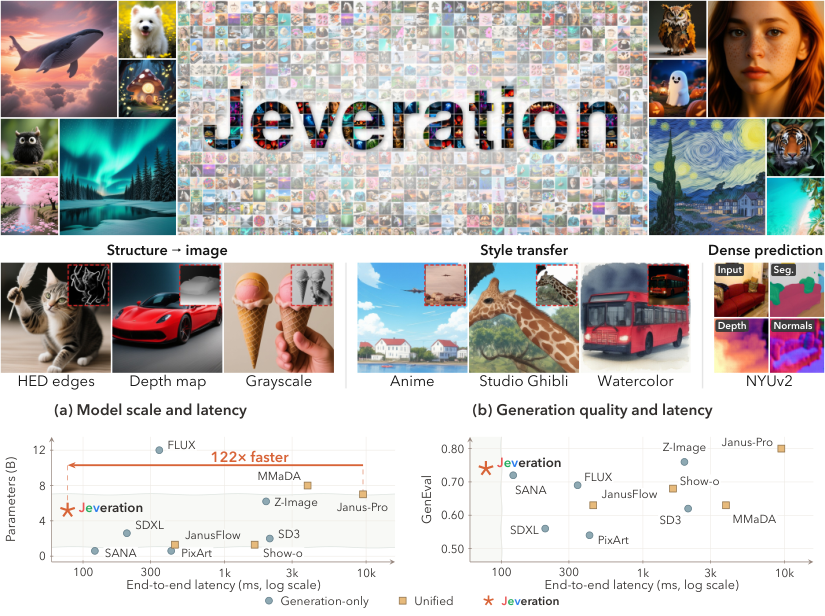
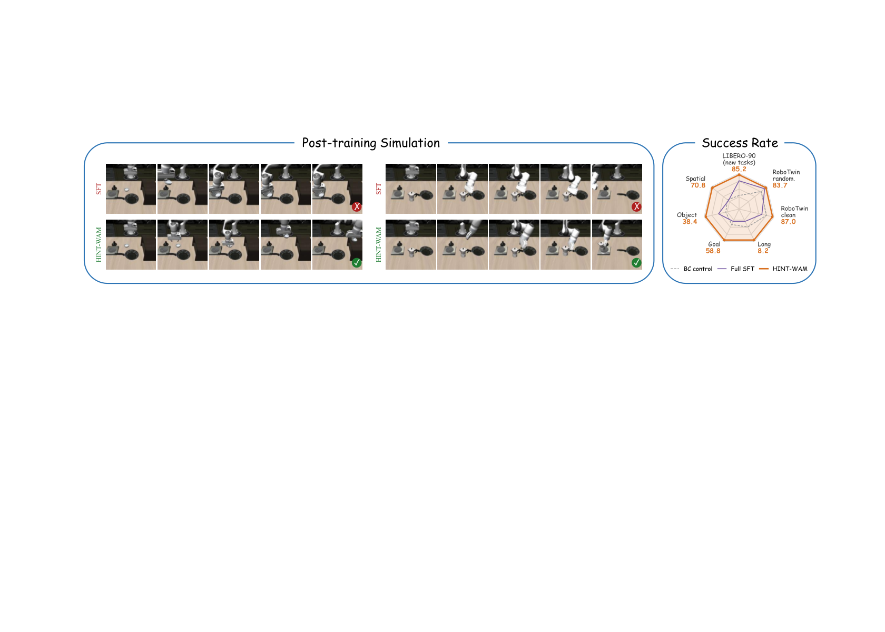
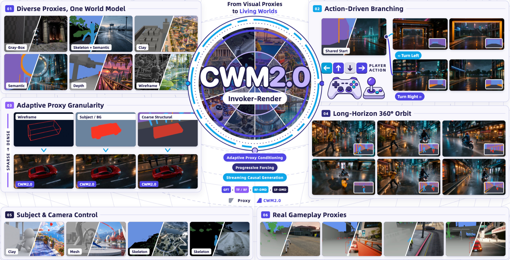

# Daily AI papers — 2026-11-19

*Curated from HF Daily Papers. 15 of ~50 papers kept after relevance filter.*

## Papers at a glance

| # | Title | Topics | Org |
| --- | --- | --- | --- |
| 1 | [Jeveration: System One Models Now Generate](#1-jeveration-system-one-models-now-generate) | `multimodal`, `diffusion`, `efficient-inference` | NUS |
| 2 | [Late Entry in Looped Language Models](#2-late-entry-in-looped-language-models) | `LLM`, `efficient-inference`, `architecture` | — |
| 3 | [QDA: Closed-Loop LLM Quantization Design with Agents](#3-qda-closed-loop-llm-quantization-design-with-agents) | `quantization`, `agents`, `LLM` | MIT, NVIDIA |
| 4 | [CurvDelta: Low-Curvature Delta Modeling for Learning and Unlearning](#4-curvdelta-low-curvature-delta-modeling-for-surgical-learning-and-unlearning) | `fine-tuning`, `safety`, `LLM` | SUFE, SUSTech |
| 5 | [HINT-WAM: Hindsight-Informed Training for World Action Models](#5-hint-wam-hindsight-informed-training-for-world-action-models) | `RL`, `multimodal`, `agents` | NUS |
| 6 | [Thinking Fast, Anywhere: One System-1 for Any Agent Workflow](#6-thinking-fast-anywhere-one-system-1-for-the-decision-points-of-any-agent-workflow) | `agents`, `efficient-inference`, `LLM` | USTC, NTU |
| 7 | [Decoding Without a Decoder: Direct Pixel Prediction from Diffusion Transformers](#7-decoding-without-a-decoder-direct-pixel-prediction-from-diffusion-transformers) | `diffusion`, `efficient-inference` | Stanford, Caltech, Luma |
| 8 | [AnisoFlow: Learning Anisotropic Prediction Targets for Flow Models](#8-anisoflow-learning-anisotropic-prediction-targets-for-flow-models) | `diffusion`, `flow-matching` | Stanford, Caltech |
| 9 | [Code World Model 2.0: Infinite Controllable Video Generation](#9-code-world-model-20-towards-infinite-controllable-video-generation) | `diffusion`, `multimodal`, `video` | Westlake, Inclusion AI |
| 10 | [MRPD: Replay, Don't Resample — Off-Policy Consolidation of RL Experts](#10-replay-dont-resample-off-policy-consolidation-of-long-horizon-rl-experts) | `RL`, `agents`, `reasoning` | UIUC, ANL |
| 11 | [Piccolo: Co-Evolving Decision Models and Data](#11-piccolo-co-evolving-decision-models-and-data-through-recursive-self-improvement) | `agents`, `multimodal`, `data` | Alibaba |
| 12 | [Tideway: Phase-Aware Tiered Memory Management for MoE Inference](#12-tideway-phase-aware-tiered-memory-management-for-moe-inference-on-consumer-devices) | `efficient-inference`, `MoE` | Duke |
| 13 | [PIPETTE: Prompt Injection Purple-Teaming for LLM Agents](#13-pipette-prompt-injection-purple-teaming-for-robust-llm-agents) | `safety`, `agents` | Waterloo, Zhejiang, KTH |
| 14 | [General Progress Substitutes for Specific Training Data](#14-general-progress-substitutes-for-specific-training-data-in-language-models) | `data`, `safety`, `eval` | — |
| 15 | [The Resolution Hypothesis: Agent Evolution's Key Is Identifying Improvements](#15-the-resolution-hypothesis-agent-evolutions-key-is-identifying-improvements) | `agents`, `eval` | ShanghaiTech |

---

## 1. Jeveration: System One Models Now Generate

**Authors:** Qi Li, Shihua Zhang, Xinchao Wang — *National University of Singapore*
**Links:** [arXiv:2611.24738](https://arxiv.org/abs/2611.24738) · [HF](https://huggingface.co/papers/2611.24738) · [AlphaXiv](https://www.alphaxiv.org/abs/2611.24738)
**Topics:** `multimodal`, `diffusion`, `efficient-inference`

### TL;DR

A "System-1" style image generator built on top of a frozen vision-language model. Instead of iterative denoising, Jeveration coordinates a single parallel forward pass through a VLM to produce the whole image — one checkpoint covers text-to-image, image-to-image and dense prediction, at 78 ms per 512×512 image on an H200.

### Key idea

Treat a frozen VLM as a parallel predictor whose spatial tokens are stitched into a coherent image by sharing a random state across the parallel decodes. No separate diffusion head, no decoder — the VLM itself emits pixels.

### Main finding

Up to 122× faster than existing unified multimodal generators at matched or better quality. One model covers three tasks with a single checkpoint.

### Why it matters

Challenges the assumption that generative image modeling needs an iterative (System-2) denoising stack. If a frozen VLM can produce competitive images in one shot, unification of understanding + generation gets much cheaper to serve.

### Knowledge graph integration

**Builds on / relates to existing pages:**
- [../multimodal/README.md](../multimodal/README.md) — unified multimodal model relevant to the folder's scope
- [../inference/README.md](../inference/README.md) — single-forward-pass generation is a fundamental inference-efficiency primitive

**Suggested new pages:**
- `multimodal/unified-generation.md` *(depth)* — covers single-forward-pass image generation from a VLM

---

## 2. Late Entry in Looped Language Models

**Authors:** anonymous / unlisted on HF page
**Links:** [arXiv:2611.24576](https://arxiv.org/abs/2611.24576) · [HF](https://huggingface.co/papers/2611.24576) · [AlphaXiv](https://www.alphaxiv.org/abs/2611.24576)
**Topics:** `LLM`, `efficient-inference`, `architecture`

### TL;DR

Looped language models (Ouro, Huginn) share a stack of layers and iterate it T times to deepen reasoning without growing parameter count. This paper shows that for *new* tokens appended to an already-computed context, the first few loop iterations can be skipped — "late entry" — if combined with a lightweight verifier.

### Key idea

For cached prefixes, every token has already been through all T passes. For new tokens, run only the last K of T passes and verify with a mechanism called **Wake**. Wake decides per-token whether late entry is safe; where it isn't, fall back to full T passes.

### Main finding

With light fine-tuning, late entry beats early-exit at matched compute. Greedy-exact speedups: 5.2× on Ouro-2.6B and 8.4× on Huginn-3.5B at T=64. Lossy speedups up to 12.5×.

### Why it matters

Early-exit methods are lossy by design. Late entry is the first inference-time trick tailored to looped/recurrent LMs that is both greedy-exact under verification and large (5–12×). Looped LMs become practical for latency-sensitive serving.

### Knowledge graph integration

**Builds on / relates to existing pages:**
- [../inference/README.md](../inference/README.md) — new class of exact-inference speedup
- [../architectures/README.md](../architectures/README.md) — concerns looped / shared-weight transformer stacks

**Suggested new pages:**
- `architectures/looped-language-models.md` *(depth)* — the Ouro/Huginn family and weight-tied iteration
- `inference/late-entry.md` *(depth)* — the skip-first-K-passes speedup with Wake verification

---

## 3. QDA: Closed-Loop LLM Quantization Design with Agents

**Authors:** Xingyang Li, Tianlang Zhao, Song Han, Ligeng Zhu — *MIT, NVIDIA*
**Links:** [arXiv:2611.23388](https://arxiv.org/abs/2611.23388) · [HF](https://huggingface.co/papers/2611.23388) · [AlphaXiv](https://www.alphaxiv.org/abs/2611.23388)
**Topics:** `quantization`, `agents`, `LLM`

### TL;DR

An LLM agent designs per-model, per-precision post-training quantization recipes by scoring candidates in minutes with KL divergence from the fp model, then long-generation sanity checks. Composes existing PTQ methods from a public library.

### Key idea

Close the loop between method proposal (LLM agent choosing which quantization tricks to compose), fast scoring (output KL on held-out reasoning traces), and slow validation (full generations to catch repetition loops). Search cost: 64 GPU-hours per model.

### Main finding

Across four reasoning models, QDA improves average accuracy over the strongest public PTQ recipe by +0.9 (W4A16), +1.4 (W4A8), +2.2 (W3A16) points. On GLM-5.3-Flash at NVFP4 W4A4, recovers 98.3% of FP8 accuracy vs 96.9% for the best vendor checkpoint.

### Why it matters

Quantization recipe design has been mostly manual. Making an LLM agent the designer — with cheap-to-score KL as the fitness signal — is a pattern that likely transfers to other hyperparameter-space searches (data mixtures, learning-rate schedules).

### Knowledge graph integration

**Builds on / relates to existing pages:**
- [../quantization/_number-formats.md](../quantization/_number-formats.md) — targets W4A16 / W4A8 / W3A16 / NVFP4 recipes
- [../quantization/fp8.md](../quantization/fp8.md) — QDA's reference ceiling is FP8 accuracy
- [../agents/README.md](../agents/README.md) — agent-driven method search is an application of agentic systems

**Suggested new pages:**
- `quantization/_ptq-recipes.md` *(taxonomy)* — PTQ recipe combinations (GPTQ, AWQ, SmoothQuant, Hadamard, etc.)
- `quantization/agent-ptq-search.md` *(depth)* — closed-loop LLM-agent PTQ design

---

## 4. CurvDelta: Low-Curvature Delta Modeling for Surgical Learning and Unlearning

**Authors:** Zeguan Xiao, Zhuocheng Liang, Yun Chen, Yong Wang, Guanhua Chen, Pinyan Lu
**Links:** [arXiv:2611.24654](https://arxiv.org/abs/2611.24654) · [HF](https://huggingface.co/papers/2611.24654) · [AlphaXiv](https://www.alphaxiv.org/abs/2611.24654)
**Topics:** `fine-tuning`, `safety`, `LLM`

### TL;DR

Both fine-tuning and unlearning collide with preserved capabilities when parameter updates move through high-curvature directions of the preservation loss. CurvDelta explicitly constrains updates to a low-curvature subspace via K-FAC + a factorized projection; CurvLoRA is the low-rank variant.

### Key idea

Approximate the Hessian of the preservation loss with K-FAC, project weight updates into its low-curvature eigenspace, then update there. Updates that barely change the preservation loss by construction.

### Main finding

On math reasoning and code generation fine-tuning: better retention of original abilities at matched target-task gain. On knowledge unlearning (TOFU, MUSE): cleaner "surgical" unlearning vs baselines.

### Why it matters

A unifying mechanism for the retain-vs-forget tradeoff that spans SFT, LoRA, and unlearning. The curvature view suggests the problem isn't "which parameters to touch" but "which directions in parameter space."

### Knowledge graph integration

**Builds on / relates to existing pages:**
- [../post-training/fine-tuning/README.md](../post-training/fine-tuning/README.md) — extends the LoRA family with a geometric constraint
- [../safety/README.md](../safety/README.md) — a mechanism for targeted capability removal

**Suggested new pages:**
- `post-training/fine-tuning/curvdelta.md` *(depth)* — low-curvature projection for safe fine-tuning and unlearning
- `safety/machine-unlearning.md` *(depth)* — the retain/forget problem at the method level

---

## 5. HINT-WAM: Hindsight-Informed Training for World Action Models

**Authors:** Phuong Tuan Dat, Qi Li, Xinchao Wang — *National University of Singapore*
**Links:** [arXiv:2611.24789](https://arxiv.org/abs/2611.24789) · [HF](https://huggingface.co/papers/2611.24789) · [AlphaXiv](https://www.alphaxiv.org/abs/2611.24789)
**Topics:** `RL`, `multimodal`, `agents`

### TL;DR

World action models predict both actions and the future visual rollout. HINT-WAM post-trains them by using the model itself as teacher, but feeding the teacher the *actual* future video ("hindsight") as privileged input. The student sees only normal inputs but is supervised on the trajectories it generates, and distilled against the hindsight-informed teacher's distribution.

### Key idea

Self-distillation on the student's own denoising trajectories, where the teacher is a hindsight-privileged version of the same model. Uses an **energy score** objective (distribution match on actions) instead of velocity matching — more robust when the student and teacher share weights.

### Main finding

Gains over SFT on LIBERO-90 and RoboTwin 2.0, with less forgetting of pretrained skills. No rewards, no simulator calls, no new data.

### Why it matters

A no-reward post-training recipe for foundation-model-style robot policies. The "privileged teacher as self-distillation target" pattern plugs into any model that already generates both actions and observations.

### Knowledge graph integration

**Builds on / relates to existing pages:**
- [../post-training/_rl.md](../post-training/_rl.md) — hindsight-based post-training sits next to GRPO/PPO in the RL taxonomy
- [../post-training/rejection-sampling.md](../post-training/rejection-sampling.md) — related family: supervised post-training with privileged signals
- [../multimodal/README.md](../multimodal/README.md) — relevant to VLA / world-model foundation policies

**Suggested new pages:**
- `agents/world-action-models.md` *(depth)* — action + future-rollout foundation policies
- `post-training/hindsight-self-distillation.md` *(depth)* — privileged-teacher self-distillation without rewards

---

## 6. Thinking Fast, Anywhere: One System-1 for the Decision Points of Any Agent Workflow

**Authors:** Rui Li, Zheng Zhang, Zhenya Huang, Qi Liu — *USTC, NTU*
**Links:** [arXiv:2611.23751](https://arxiv.org/abs/2611.23751) · [HF](https://huggingface.co/papers/2611.23751) · [AlphaXiv](https://www.alphaxiv.org/abs/2611.23751)
**Topics:** `agents`, `efficient-inference`, `LLM`

### TL;DR

AnyS1 compiles human-written skill procedures into a set of **decision points** and trains one 4B calibrated System-1 model to handle the easy routine ones in a single forward pass. Only uncertain cases escalate to a System-2 LLM.

### Key idea

A procedure is a set of branching decisions. Many are trivial (click-button, format-selection). Train a small model on these, with a confidence-calibrated head that gates handoff to the big model.

### Main finding

Across three unseen benchmarks and two System-2 model families: 75–91% lower episode cost and 63–92% lower model-call time vs uncompiled System-2 agents, with task reliability preserved.

### Why it matters

Mirrors the trend of speculative decoding and MoE routing: not every token / step deserves the big model. Compiling procedures into trainable decision points is a clean primitive for cost-efficient agent serving.

### Knowledge graph integration

**Builds on / relates to existing pages:**
- [../agents/README.md](../agents/README.md) — core concern of the agents folder
- [../inference/README.md](../inference/README.md) — small-model-gates-big-model is an inference-efficiency pattern

**Suggested new pages:**
- `agents/system1-system2-routing.md` *(depth)* — small-model-first, LLM-escalation routing for agents

---

## 7. Decoding Without a Decoder: Direct Pixel Prediction from Diffusion Transformers

**Authors:** Shengqu Cai, Jan Ackermann, Rayhan Zirvi, Gordon Wetzstein, Xinchen Yan, Leonidas Guibas — *Stanford, Caltech, Luma AI*
**Links:** [arXiv:2611.22287](https://arxiv.org/abs/2611.22287) · [HF](https://huggingface.co/papers/2611.22287) · [AlphaXiv](https://www.alphaxiv.org/abs/2611.22287)
**Topics:** `diffusion`, `efficient-inference`

### TL;DR

Latent diffusion models need a VAE decoder to go from latent back to pixels, which adds inference cost and causes warping in video. DWD attaches a **linear pixel head** to a finetuned DiT so it can emit pixels directly, while keeping the original denoising head anchored to the pretrained model.

### Key idea

A small auxiliary pixel head trained with pixel-space losses runs alongside the anchored denoiser. The anchor prevents drift; the pixel head short-circuits the VAE.

### Main finding

23% lower video warping error. ImageNet FID 1.43 among pixel-flow models.

### Why it matters

Decoder-free sampling reclaims latency and removes a known source of visual artifacts, especially in video. The anchor trick keeps pretrained diffusion knowledge intact — a reusable recipe for modifying frozen diffusion models.

### Knowledge graph integration

**Builds on / relates to existing pages:**
- [../multimodal/README.md](../multimodal/README.md) — diffusion decoding sits under multimodal generation

**Suggested new pages:**
- `multimodal/diffusion-transformer.md` *(depth)* — DiT architecture and training
- `multimodal/decoder-free-sampling.md` *(depth)* — pixel-direct diffusion decoding

---

## 8. AnisoFlow: Learning Anisotropic Prediction Targets for Flow Models

**Authors:** Hansheng Chen, Gordon Wetzstein, Leonidas Guibas — *Stanford, Caltech*
**Links:** [arXiv:2611.17767](https://arxiv.org/abs/2611.17767) · [HF](https://huggingface.co/papers/2611.17767) · [AlphaXiv](https://www.alphaxiv.org/abs/2611.17767)
**Topics:** `diffusion`, `flow-matching`

### TL;DR

Flow-matching models are trained on a hand-chosen prediction target (velocity, x0, noise). AnisoFlow learns a per-direction noise weight in a learnable basis, equivalent to learning the prediction target itself.

### Key idea

Replace a global scalar prediction target with an **anisotropic**, direction-specific one: each learned basis direction gets its own noise weighting. Closed-form map recovers the velocity target.

### Main finding

ImageNet 256×256 FID: 1.90 → 1.55 over the JiT baseline. Also fewer patch-seam artifacts under reduced-precision inference for pixel-space text-to-image.

### Why it matters

The prediction-target choice was treated as a fixed design decision (v-prediction vs x0 vs epsilon). This paper shows it should be *learned* and that doing so yields a meaningful quality bump — clean, general improvement to flow training.

### Knowledge graph integration

**Builds on / relates to existing pages:**
- [../multimodal/README.md](../multimodal/README.md) — flow models sit in the multimodal/generative folder
- [../post-training/_rl.md](../post-training/_rl.md) — loosely: any training-objective design question

**Suggested new pages:**
- `multimodal/_flow-matching.md` *(taxonomy)* — flow matching, rectified flow, consistency models
- `multimodal/anisotropic-flow.md` *(depth)* — learnable per-direction prediction targets

---

## 9. Code World Model 2.0: Towards Infinite Controllable Video Generation

**Authors:** Ruoyu Wang, Hao Zhong, Yanming Yang, Jiahao Tian, Lin Liu, Biao Gong, Guoshan Lu, Yiding Tian, Chunhua Shen, Zhenzhong Lan, Chi Zhang — *Westlake, Inclusion AI, Zhejiang*
**Links:** [arXiv:2611.22925](https://arxiv.org/abs/2611.22925) · [HF](https://huggingface.co/papers/2611.22925) · [AlphaXiv](https://www.alphaxiv.org/abs/2611.22925)
**Topics:** `diffusion`, `multimodal`, `video`

### TL;DR

Invoker-Render: a proxy-conditioned renderer paired with a four-step causal streaming diffusion model, trained with **Progressive Forcing** to stabilize long rollouts. Takes structural proxies + appearance reference + text and generates controllable video indefinitely.

### Key idea

Bidirectional creation model produces proxies; a causal streaming model renders them in four steps. Progressive Forcing gradually weans the model off teacher-forced frames during training.

### Main finding

Beats recent streaming baselines; stable 30-minute racing-game rollouts (an unusually long horizon for diffusion video).

### Why it matters

Controllable, infinite-horizon video generation is the headline capability for world-model demos (Genie-family). Separating "scene control" from "rendering" and training the renderer with forcing curricula is a reusable recipe.

### Knowledge graph integration

**Builds on / relates to existing pages:**
- [../multimodal/README.md](../multimodal/README.md) — video generation sits under multimodal
- [../case-studies/README.md](../case-studies/README.md) — candidate for a case study if adopted widely

**Suggested new pages:**
- `multimodal/streaming-video-diffusion.md` *(depth)* — causal few-step video diffusion for interactive rollouts
- `multimodal/progressive-forcing.md` *(depth)* — curriculum for weaning streaming models off teacher-forced context

---

## 10. Replay, Don't Resample: Off-Policy Consolidation of Long-Horizon RL Experts

**Authors:** Gongxiaohui Chen, Huimin Zeng, Honglei Zhuang, Jiashuo Sun, Zhen Han, Dong Wang — *UIUC, ANL*
**Links:** [arXiv:2611.24059](https://arxiv.org/abs/2611.24059) · [HF](https://huggingface.co/papers/2611.24059) · [AlphaXiv](https://www.alphaxiv.org/abs/2611.24059)
**Topics:** `RL`, `agents`, `reasoning`

### TL;DR

MRPD (Multi-expert Replay Policy Distillation) consolidates several domain-specific RL experts into one student by **replaying the experts' own training trajectories** in the order they were learned from — no new rollouts, no environment, no reward model.

### Key idea

For each expert, you logged (prefix, sampling-prob, action, reward) tuples as they trained. Feed those to the student in temporal order; have it recompute the policy gradient on that data and distill the final expert's next-token distribution at the logged prefixes. Order matters more than quantity.

### Main finding

On three long-horizon agentic domains (reasoning, search, SQL): MRPD beats online RL and multi-teacher on-policy distillation from the same experts, at a fraction of the cost.

### Why it matters

Suggests expert consolidation can be done offline from logs alone — a dramatic cost reduction for "RL per domain, merge into generalist" workflows that are now standard (DeepSeek-R1, Kimi-K1.5).

### Knowledge graph integration

**Builds on / relates to existing pages:**
- [../post-training/_rl.md](../post-training/_rl.md) — new entry under RL post-training methods
- [../post-training/grpo.md](../post-training/grpo.md) — related: policy-gradient RL at scale
- [../case-studies/deepseek-r1.md](../case-studies/deepseek-r1.md) — relevant to the "expert merge" step
- [../case-studies/kimi-k1-5.md](../case-studies/kimi-k1-5.md) — same

**Suggested new pages:**
- `post-training/mrpd.md` *(depth)* — replay-based multi-expert policy distillation

---

## 11. Piccolo: Co-Evolving Decision Models and Data through Recursive Self-Improvement

**Authors:** Piccolo Team (Model: Zhenqing Ling, Qirui Jiao, Daoyuan Chen; Data: Cheng Chen, Xinji Mai, Haowen Gao; Infra: Zhuo Zhang et al.; Steering: Zhaoyang Liu, Yaliang Li, Bolin Ding, Jingren Zhou) — *Alibaba (inferred from author overlap)*
**Links:** [arXiv:2611.24651](https://arxiv.org/abs/2611.24651) · [HF](https://huggingface.co/papers/2611.24651) · [AlphaXiv](https://www.alphaxiv.org/abs/2611.24651)
**Topics:** `agents`, `multimodal`, `data`

### TL;DR

Piccolo is a family of multimodal decision models (0.8B–27B) whose training data co-evolves with the model via **agentic data engineering** — each generation, the current model selects and reshapes data for the next.

### Key idea

Treat data and model as co-evolving artifacts. The agent system curates and synthesizes training batches tailored to the current model's weaknesses; the model trains; repeat.

### Main finding

Piccolo-27B tops the Decision Index Vision Full leaderboard. Three findings worth flagging: (1) backbone-recipe fit beats model recency; (2) targeted curation lets 4B–9B models match 27B on specialized workflows; (3) training loss is a weak proxy for discrete decision accuracy.

### Why it matters

Formalizes "recursive self-improvement via data curation" at a scale meaningful enough to produce a leaderboard winner. Signals to builders that small + well-curated often > large + generic.

### Knowledge graph integration

**Builds on / relates to existing pages:**
- [../data/_data-curation.md](../data/_data-curation.md) — directly extends the data-curation taxonomy
- [../data/quality-filtering.md](../data/quality-filtering.md) — related quality signal
- [../agents/README.md](../agents/README.md) — multimodal decision agent

**Suggested new pages:**
- `data/agentic-data-engineering.md` *(depth)* — LLM-driven, recursive, model-aware data curation
- `case-studies/piccolo.md` *(case study)* — if this becomes a widely used family

---

## 12. Tideway: Phase-Aware Tiered Memory Management for MoE Inference on Consumer Devices

**Authors:** Yifei Wang, Tsun-yu Yang, Yechen Xu, Hancheng Ye, Qinsi Wang, Baijun Zhou, Tingjun Chen, Hai "Helen" Li, Danyang Zhuo, Yiran Chen — *Duke*
**Links:** [arXiv:2611.14848](https://arxiv.org/abs/2611.14848) · [HF](https://huggingface.co/papers/2611.14848) · [AlphaXiv](https://www.alphaxiv.org/abs/2611.14848)
**Topics:** `efficient-inference`, `MoE`

### TL;DR

MoE inference on consumer PCs is bottlenecked by paging experts between VRAM, RAM and SSD. Tideway treats RAM + VRAM as a single unified pool and uses phase-specific layouts (prefill vs decode), with CUDA Graph execution preserved under expert paging.

### Key idea

Separate memory layouts for compute-bound prefill (bandwidth-optimized, large batches of weights streamed) and memory-bound decode (latency-optimized, hot-expert caching) + unified RAM/VRAM accounting so the scheduler plans across the whole pool.

### Main finding

Over the fastest baseline: 1.97× end-to-end, 2.40× TTFT, 1.61× TPOT — on local consumer hardware.

### Why it matters

Local-first MoE deployment is a growing use case (small open MoEs on laptops). Phase-aware memory management is a well-defined systems primitive that should generalize beyond this paper's exact system.

### Knowledge graph integration

**Builds on / relates to existing pages:**
- [../architectures/_moe.md](../architectures/_moe.md) — MoE inference efficiency
- [../inference/README.md](../inference/README.md) — new inference-systems technique

**Suggested new pages:**
- `inference/expert-offloading.md` *(depth)* — RAM/VRAM/SSD-aware MoE expert paging for local inference

---

## 13. PIPETTE: Prompt Injection Purple-Teaming for Robust LLM Agents

**Authors:** Lipeng He, Yihan Wang, Jiawen Zhang, N. Asokan — *Waterloo, Zhejiang, KTH*
**Links:** [arXiv:2611.24362](https://arxiv.org/abs/2611.24362) · [HF](https://huggingface.co/papers/2611.24362) · [AlphaXiv](https://www.alphaxiv.org/abs/2611.24362)
**Topics:** `safety`, `agents`

### TL;DR

Red-teaming methods that achieve high attack success rates can still fail as a source of adversarial training data — they collapse to a few attack modes. PIPETTE uses a **dictionary-learning reward** to force attack diversity and an on-policy adversarial training loop that preserves benign task performance.

### Key idea

Mode collapse ruins adversarial training. Reward the red-team policy for producing attacks that are representable by *different* dictionary atoms (learned online), not just successful. Then adversarially train the agent on this diverse attack distribution.

### Main finding

Near-zero attack success against static attacks and resilience against adaptive attacks on AgentDojo and ASB, with benign task performance preserved.

### Why it matters

Operationalizes "coverage, not just success" as the right objective for red-teaming meant to improve robustness. Agent safety is dominated by prompt-injection in the wild; this is the first adversarial-training method that doesn't trade off benign performance.

### Knowledge graph integration

**Builds on / relates to existing pages:**
- [../safety/_attacks.md](../safety/_attacks.md) — new attack / purple-team method
- [../safety/_jailbreaks.md](../safety/_jailbreaks.md) — same taxonomy
- [../safety/evil-system-prompt.md](../safety/evil-system-prompt.md) — related attack surface
- [../agents/README.md](../agents/README.md) — agent-targeted attack

**Suggested new pages:**
- `safety/prompt-injection.md` *(depth)* — the attack class itself
- `safety/purple-teaming.md` *(depth)* — adversarial training with coverage-aware rewards

---

## 14. General Progress Substitutes for Specific Training Data in Language Models

**Authors:** Mark Marosi, Peter Antal
**Links:** [arXiv:2611.24844](https://arxiv.org/abs/2611.24844) · [HF](https://huggingface.co/papers/2611.24844) · [AlphaXiv](https://www.alphaxiv.org/abs/2611.24844)
**Topics:** `data`, `safety`, `eval`

### TL;DR

Withholding training data for a target skill (e.g. a programming language, chess) *delays* but does not *prevent* a model from acquiring the skill. A withholder-trained model can regain the ability with a much smaller amount of the withheld data than a from-scratch model would need.

### Key idea

Controlled withholding experiments across chess, Othello, molecular strings, bracket languages, web text, and a programming language withheld from a 7B model. Measure how much withheld data is needed to recover the skill after general training.

### Main finding

Recovery is cheap — a small fraction of the data required from scratch — across all tested skills. "General capabilities" transfer to the withheld domain.

### Why it matters

Direct relevance to **capability-withholding as a safety measure**: this paper gives quantitative evidence that withholding is a speed bump, not a lock. Policy-relevant for dangerous-capability mitigations.

### Knowledge graph integration

**Builds on / relates to existing pages:**
- [../data/_data-curation.md](../data/_data-curation.md) — data filtering / withholding is the class
- [../data/decontamination.md](../data/decontamination.md) — adjacent: removing specific data from training
- [../safety/README.md](../safety/README.md) — capability-mitigation safety

**Suggested new pages:**
- `safety/capability-withholding.md` *(depth)* — data-withholding as a (limited) safety control, with the cross-skill recovery evidence

---

## 15. The Resolution Hypothesis: Agent Evolution's Key Is Identifying Improvements

**Authors:** Yuanhao Zeng, Shaocheng Lan, Ao Lu, Kuang Yan, Heng Lin, Xinang Xu, Yuan Luo, Yueting Wang, Yexin Li, Ruo Shan, Kan Ren — *ShanghaiTech*
**Links:** [arXiv:2611.23068](https://arxiv.org/abs/2611.23068) · [HF](https://huggingface.co/papers/2611.23068) · [AlphaXiv](https://www.alphaxiv.org/abs/2611.23068)
**Topics:** `agents`, `eval`

### TL;DR

Self-improving agents stall not because they fail to propose better candidates, but because their evaluators are too noisy to reliably tell better from worse. The authors call this the **Resolution Hypothesis**: the bottleneck is evaluation signal, not proposal quality.

### Key idea

Reframe self-improving agent loops as a signal-vs-noise detection problem. Measure "resolution" of an evaluator = its ability to rank true improvements. Show that method-level comparisons and candidate-level comparisons both suffer from noise.

### Main finding

Empirical support at both levels: when the evaluator is noisy, even clearly better candidates fail to be selected and progress stalls. Resolution gains dominate proposal gains.

### Why it matters

Reorients the self-improvement research agenda: improve your evaluator before your proposer. Also a useful lens for inference-time search (verifier quality bounds search quality).

### Knowledge graph integration

**Builds on / relates to existing pages:**
- [../evaluation/README.md](../evaluation/README.md) — evaluator-quality is the central object
- [../agents/README.md](../agents/README.md) — self-improving agents
- [../post-training/reasoning/prm.md](../post-training/reasoning/prm.md) — adjacent: verifier/PRM quality as a bottleneck

**Suggested new pages:**
- `evaluation/evaluator-resolution.md` *(depth)* — signal-vs-noise view of self-improving-agent evaluators

---

## Notes

- Three papers have hero figures (Jeveration, HINT-WAM, Code World Model 2.0). The rest returned HTML error pages for the standard arXiv figure URLs; omitted rather than linking broken images.
- No tech-report-scale paper landed today — Phase 3 (case study PR) will be skipped.
- This digest is informational. No existing concept files, `READING-LIST.md`, or `PAPERS.md` were modified to produce it.
