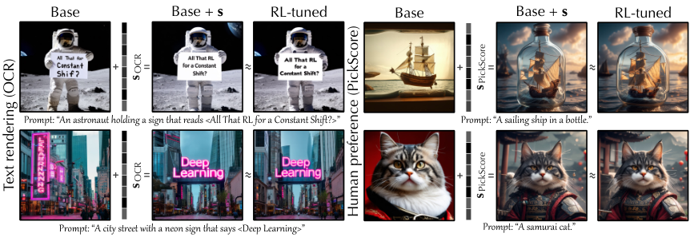
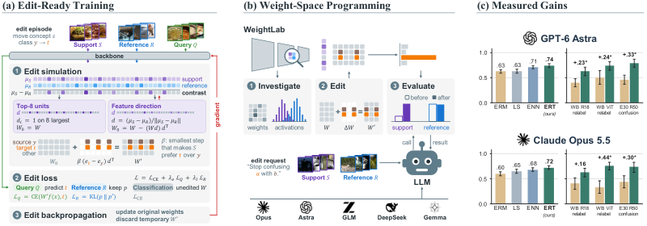
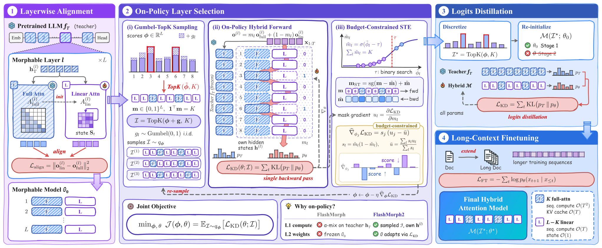
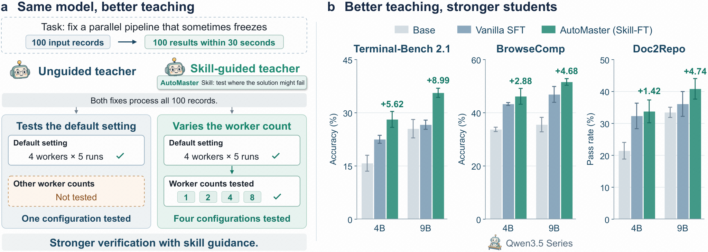
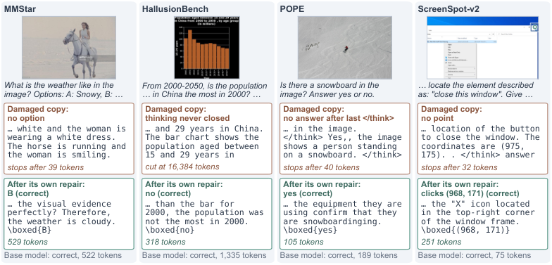
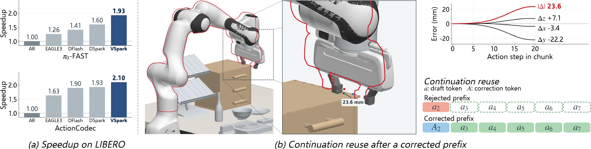
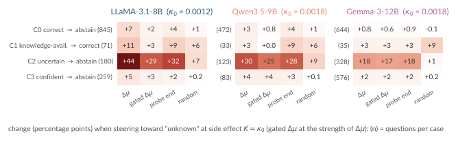
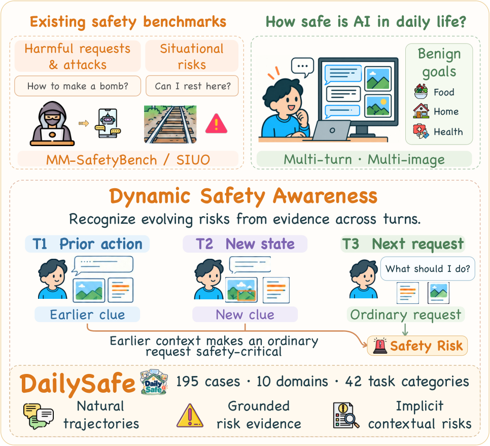
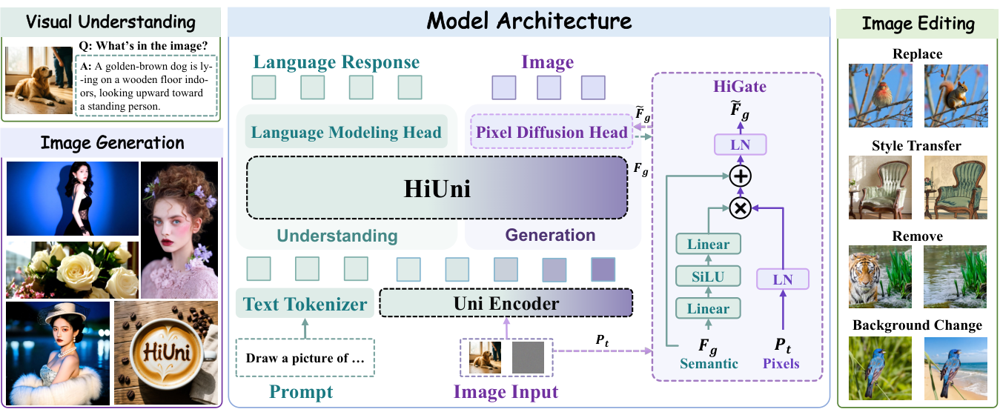

# Daily AI papers — 2026-11-20

*Curated from HF Daily Papers. 15 of ~50 papers kept after relevance filter.*

## Papers at a glance

| # | Title | Topics | Org |
| --- | --- | --- | --- |
| 1 | [Posterior Matching Distillation](#1-posterior-matching-distillation) | `diffusion`, `distillation` | (unspecified) |
| 2 | [AltRA-Test: An Alternative Annotator Test for LLM Judges Without Shared Annotators](#2-altra-test) | `eval`, `LLM-judge` | Technion / Haifa / Google |
| 3 | [RL Post-Training in Diffusion Transformers Is Activation Steering](#3-rl-is-activation-steering) | `diffusion`, `RL`, `interp` | fal / Georgia Tech / IBM / Virginia Tech |
| 4 | [Training Vision Models for LLM-Driven Weight-Space Programming](#4-weight-space-programming) | `interp`, `agents`, `fine-tuning` | Ulm (project page) |
| 5 | [Accelerating Mixture of Block Attention (LightningMoBA)](#5-lightningmoba) | `attention`, `efficient-inference`, `systems` | Tencent |
| 6 | [On-Policy Morphing into Hybrid Attention Models (FlashMorph2)](#6-flashmorph2) | `architectures`, `efficient-inference` | ByteDance Seed / NTU |
| 7 | [AutoMaster: Autonomous Post-Training by Making the Same Model a Better Teacher](#7-automaster) | `post-training`, `agents`, `SFT` | Renmin U. |
| 8 | [Twice-Told Critiques: Claim-Level Homogenization of Peer Review in the LLM Era](#8-twice-told-critiques) | `eval`, `LLM-usage-study` | (independent) |
| 9 | [Language Models Can Rewrite Their Own Weights](#9-self-editing-weights) | `interp`, `post-training`, `agents` | UIUC / CMU / Princeton / Rutgers / Stanford |
| 10 | [VSpark: Speculative Decoding for Autoregressive Vision-Language-Action Models](#10-vspark) | `efficient-inference`, `VLA`, `multimodal` | KAIST AI |
| 11 | [A CPU Inside an LLM: Zero-Gradient Compilation of Exact Circuits into Pretrained Weights](#11-cpu-inside-llm) | `interp` | (unspecified) |
| 12 | [Do Probing and Steering Favor the Same Directions Within and Across Language Models?](#12-probing-vs-steering) | `interp` | Fraunhofer IAIS |
| 13 | [NarrowSpec: Draft Hidden Width Need Not Match the Target in Speculative Decoding](#13-narrowspec) | `efficient-inference` | NVIDIA |
| 14 | [DailySafe: Benchmarking Dynamic Safety Awareness in Everyday Multi-Turn Multimodal Interactions](#14-dailysafe) | `safety`, `multimodal`, `eval` | Ant Group / Tsinghua / RUC / NTU |
| 15 | [HiUni: Harmonizing Understanding and Generation in Shared Visual Space](#15-hiuni) | `multimodal`, `diffusion` | (unspecified) |

---

## 1. Posterior Matching Distillation

**Authors:** (not disclosed on HF page)
**Links:** [arXiv:2611.26629](https://arxiv.org/abs/2611.26629) · [HF](https://huggingface.co/papers/2611.26629) · [AlphaXiv](https://www.alphaxiv.org/abs/2611.26629)
**Topics:** `diffusion`, `distillation`

### TL;DR

A new entry in the distribution-matching family of diffusion distillation. PMD trains a stochastic few-step student to recover the teacher's *per-noise-level posterior* instead of only its mean, by matching exponentially-tilted posterior means. Reports best 4-step FID on both SDXL and FLUX.2 [klein] 4B plus stronger intra-prompt diversity vs. prior distillation baselines.

### Key idea

Previous distribution-based distillers (DMD / SiD-style) collapse to the teacher's posterior mean and lose the modes. PMD parameterises a *family of tilted posteriors* at each noise level; the student matches each tilt's mean rather than one point estimate, so it keeps mode coverage while still converging in 4 steps.

### Main finding

State-of-the-art 4-step FID on SDXL and on FLUX.2 [klein] 4B — the first few-step distiller validated on a 4B-parameter flow-matching teacher — with measurably higher intra-prompt diversity (fewer mode-collapse artefacts).

### Why it matters

Pushes few-step diffusion distillation past the "match the mean, lose the variance" failure mode that has haunted DMD-style methods since 2023. Having a technique that holds up on 4B flow-matching backbones is notable because that's the scale most frontier image/video models are converging toward.

### Knowledge graph integration

**Builds on / relates to existing pages:**
- [../post-training/_post-training.md](../post-training/_post-training.md) — distillation is a supervised-signal post-training class; this sharpens the diffusion branch.

**Suggested new pages:**
- `multimodal/_diffusion-distillation.md` *(taxonomy)* — DMD, SiD, consistency distillation, PMD.
- `multimodal/posterior-matching-distillation.md` *(depth)* — the PMD mechanism.

---

## 2. AltRA-Test

**Authors:** Nagham Omar, Rotem Dror, Avigdor Gal, Roi Reichart, Nitay Calderon — *Technion / University of Haifa / Google Research*
**Links:** [arXiv:2611.26073](https://arxiv.org/abs/2611.26073) · [HF](https://huggingface.co/papers/2611.26073) · [AlphaXiv](https://www.alphaxiv.org/abs/2611.26073)
**Topics:** `eval`, `LLM-judge`

### TL;DR

A statistical "can this LLM replace a human annotator?" test that works even when annotators of different items don't overlap — the common case for large crowdsourced datasets. AltRA-Test resamples items and labels, swaps one human label for an LLM label, and checks whether inter-annotator agreement stays non-inferior. Passes on about half of the tested (LLM, dataset) pairs in real-world experiments.

### Key idea

The usual "alternative annotator test" (AAT) requires that every item has labels from the same panel of annotators. AltRA-Test lifts that constraint via a nested resampling scheme: inner resample picks a human annotator to drop and compares the LLM against them; outer bootstrap gives a null distribution for the agreement delta under exchangeability.

### Main finding

AltRA-Test is proven consistent, dominates existing baselines in simulations, and in real settings certifies ~50% of the evaluated LLM-judge configurations as valid replacements for a human annotator at matched agreement level.

### Why it matters

Most modern LLM-judge setups quietly assume "this LLM agrees with humans well enough" without a principled test on datasets with sparse annotator overlap (RM training, preference data, DPO pairs). AltRA-Test gives a usable statistical gate before you let a judge into the loop.

### Knowledge graph integration

**Builds on / relates to existing pages:**
- [../evaluation/README.md](../evaluation/README.md) — adds a formal LLM-judge validation procedure to the Reward-model-eval gap in the eval folder.
- [../post-training/_rewards.md](../post-training/_rewards.md) — LLM judges are often used as surrogate RMs; this gates when that's defensible.

**Suggested new pages:**
- `evaluation/llm-as-judge.md` *(depth)* — LLM judges and the AAT family (incl. AltRA-Test).

---

## 3. RL Post-Training in Diffusion Transformers Is Activation Steering

**Authors:** Kaan Oktay, Alec Helbling, Atakan Kara, Duen Horng Chau, Pinar Yanardag — *fal / Georgia Tech / IBM Research / Virginia Tech*
**Links:** [arXiv:2611.26627](https://arxiv.org/abs/2611.26627) · [HF](https://huggingface.co/papers/2611.26627) · [AlphaXiv](https://www.alphaxiv.org/abs/2611.26627)
**Topics:** `diffusion`, `RL`, `interp`

### TL;DR

Argues that most of the reward gain from RL-finetuning a diffusion transformer can be reproduced by adding a small set of **constant steering vectors** to the frozen base model's block outputs — no weight updates, no reward in the objective. Across six image and two video DiTs, these vectors recover 90–112% of the RL gain; trained directly with online RL, steering-only *beats* weight-based RL on two SD3.5-M benchmarks.

### Key idea

Fit per-block bias vectors to minimise the velocity-prediction gap between an RL-tuned DiT and its frozen base. These few-parameter vectors act as an activation-steering patch that replicates most of the policy shift RL induces. Flipping the pipeline — doing online RL *on the steering vectors themselves* — then outperforms full weight RL on reward.

### Main finding

- 90–96% of RL reward gains on 6 image DiTs, ~90–112% on 2 video DiTs, with zero weight edits.
- Steering-only online RL exceeds full-parameter RL on ImageReward and PickScore for SD3.5-M.

### Why it matters

RL post-training for diffusion is expensive and destabilising. If the reward signal mostly concentrates into a low-dimensional activation shift, you can decouple "the thing RL discovered" from "the weights of the model," opening the door to cheap, swappable preference adaptors in generative stacks — the diffusion analogue of LoRA-vs-full-FT and of activation-steering debates in LLM interp.

### Knowledge graph integration

**Builds on / relates to existing pages:**
- [../post-training/_rl.md](../post-training/_rl.md) — recasts weight-updating RL as recoverable by activation steering.
- [../interpretability/README.md](../interpretability/README.md) — activation steering at DiT block outputs, directly analogous to LLM steering-vector work.

**Suggested new pages:**
- `interpretability/activation-steering.md` *(depth)* — covers LLM and diffusion steering-vector methods.
- `multimodal/diffusion-rl-steering.md` *(depth)* — the specific mechanism in this paper.

---

## 4. Training Vision Models for LLM-Driven Weight-Space Programming

**Authors:** (not disclosed on HF page) — *University of Ulm (project page viscom.uni-ulm.de/wsp)*
**Links:** [arXiv:2611.26408](https://arxiv.org/abs/2611.26408) · [HF](https://huggingface.co/papers/2611.26408) · [AlphaXiv](https://www.alphaxiv.org/abs/2611.26408)
**Topics:** `interp`, `agents`, `fine-tuning`

### TL;DR

Introduces a benchmark where **LLMs edit the weights of CNNs and ViTs** to carry out relabeling and error-correction tasks across four datasets. Compares standard training, label smoothing, gradient-based "editable" training, and the authors' **Edit-Ready Training (ERT)**, which rehearses the closed-form weight edits that LLMs apply. Preparing networks for editing roughly doubles LLM-edit success on normally hard-to-edit backbones; ERT tops the mean score for two of the five tested LLM editors.

### Key idea

If you expect an LLM to patch another model's weights, you can *train* the target to be edit-ready: during optimisation, rehearse the family of closed-form rank-1 edits an LLM might later issue, so that gradients push the model into a basin where those edits actually generalise.

### Main finding

ERT yields the highest mean edit-success score for two of five LLM editors on four vision datasets; across editors, "edit-ready" preparation is the main driver — even gradient-based editable training alone materially raises LLM-edit success vs vanilla training.

### Why it matters

An unusual intersection of *agents that write weights* and *training recipes that make weights amenable to being written*. Points toward a world where fine-tuning is replaced by LLM-emitted closed-form weight patches, and the training objective is partly "be easy to patch." Related in spirit to paper #9 (self-editing LLMs).

### Knowledge graph integration

**Builds on / relates to existing pages:**
- [../post-training/fine-tuning/README.md](../post-training/fine-tuning/README.md) — a non-gradient alternative to adapter-style fine-tuning.
- [../interpretability/README.md](../interpretability/README.md) — closed-form LLM weight edits sit next to classical model-editing (ROME/MEMIT).

**Suggested new pages:**
- `interpretability/_model-editing.md` *(taxonomy)* — ROME, MEMIT, weight-space programming, self-editing.

---

## 5. LightningMoBA

**Authors:** (not disclosed on HF page) — *Tencent (per GitHub org)*
**Links:** [arXiv:2611.26268](https://arxiv.org/abs/2611.26268) · [HF](https://huggingface.co/papers/2611.26268) · [AlphaXiv](https://www.alphaxiv.org/abs/2611.26268)
**Topics:** `attention`, `efficient-inference`, `systems`

### TL;DR

An inference-time acceleration of **Mixture of Block Attention (MoBA)** — Kimi's sparse long-context attention — with three changes: (i) dynamic routing with a score threshold instead of fixed top-k, (ii) a **KV-centric** execution plan that groups work by (query head, KV block) and bounds per-task fanout, and (iii) runtime pipelining that overlaps K/V transfers with Hopper Tensor-Core compute. Delivers 1.20–1.60× end-to-end generation speedup at matched Top-16 retention across five checkpoints, with mean RULER rising 74.42 → 75.28.

### Key idea

Vanilla MoBA assigns each query a fixed top-k set of KV blocks, which (a) picks irrelevant blocks on easy queries and (b) hurts kernel locality because consumers are query-centric but memory is KV-centric. LightningMoBA swaps to a per-query *score threshold* budget, re-pivots the schedule around KV blocks (splitting hot columns into bounded tasks), and pipelines K/V-copy with MMA.

### Main finding

1.20–1.60× end-to-end decode speedup on five checkpoints at matched retention, with RULER quality *improving* (74.42 → 75.28) — showing the dynamic budget trims noisy blocks rather than losing signal.

### Why it matters

MoBA (Kimi, 2025) is the leading open-source sparse-attention mechanism for long context. If its inference cost drops ~1.5× without loss, it becomes a much stronger alternative to sliding-window + dense recall hybrids like Jamba / FlashAttention-v3-with-bias.

### Knowledge graph integration

**Builds on / relates to existing pages:**
- [../architectures/mla.md](../architectures/mla.md) — another block-sparse / low-rank attention mechanism; MoBA and MLA sit in the same family.
- [../architectures/multi-head-attention.md](../architectures/multi-head-attention.md) — MoBA generalises MHA with block routing.
- [../inference/README.md](../inference/README.md) — serving-side sparse-attention scheduling.

**Suggested new pages:**
- `architectures/_sparse-attention.md` *(taxonomy)* — MoBA, Native Sparse Attention, MInference, Quest, sliding-window variants.
- `architectures/moba.md` *(depth)* — MoBA itself (missing from the graph).
- `inference/lightning-moba.md` *(depth)* — the KV-centric scheduling trick.

---

## 6. FlashMorph2

**Authors:** Xuanda Wang, Jianbin Zheng, Huafeng Kuang, Wei Tang, Yu Cheng — *ByteDance Seed / NTU*
**Links:** [arXiv:2611.24809](https://arxiv.org/abs/2611.24809) · [HF](https://huggingface.co/papers/2611.24809) · [AlphaXiv](https://www.alphaxiv.org/abs/2611.24809)
**Topics:** `architectures`, `efficient-inference`

### TL;DR

Converts a pretrained Transformer into a **hybrid full-attention + linear-attention** model under a fixed layer budget, by jointly learning the per-layer selection scores and model weights **on policy**: sampled discrete hybrid architectures are rolled out end-to-end on their own hidden states, fixing the off-policy mismatches in the earlier FlashMorph. Beats FlashMorph on RULER, LongBench, and recall-intensive tasks across Qwen3 sizes; layer selection finishes in <4 GPU-hours for 8B models.

### Key idea

Prior layer-swap methods score each layer in isolation (off-policy over architectures *and* activations). FlashMorph2 samples a full discrete hybrid, runs it, and backprops through a straight-through gate — so the selection signal sees the activations the final hybrid would actually produce.

### Main finding

Across Qwen3 1.7B / 4B / 8B with multiple linear-attention variants, consistent gains over FlashMorph on RULER, LongBench, and recall tasks. Selection converges in <4 GPU-hours up to 8B.

### Why it matters

Hybrid attention (full + linear/Mamba/MoBA) is becoming the default for long-context serving. The practical bottleneck is *which layers to keep full* — FlashMorph2 makes that choice cheap enough to do per-model, so hybridisation stops being a hand-tuned art.

### Knowledge graph integration

**Builds on / relates to existing pages:**
- [../architectures/multi-head-attention.md](../architectures/multi-head-attention.md) — baseline the hybrid replaces at selected layers.
- [../architectures/mla.md](../architectures/mla.md) — another approach to cutting attention cost; complementary.
- [../post-training/fine-tuning/README.md](../post-training/fine-tuning/README.md) — hybridisation is a surgical post-training step.

**Suggested new pages:**
- `architectures/_hybrid-attention.md` *(taxonomy)* — Jamba, Zamba, FlashMorph-style conversions, SSM-interleaved designs.
- `architectures/flashmorph2.md` *(depth)* — the on-policy morphing recipe.

---

## 7. AutoMaster

**Authors:** Shuang Sun, Fanzhe Meng, Xinyu Tang, Ruihua Song, Wayne Xin Zhao — *Gaoling School of AI, Renmin University of China*
**Links:** [arXiv:2611.26510](https://arxiv.org/abs/2611.26510) · [HF](https://huggingface.co/papers/2611.26510) · [AlphaXiv](https://www.alphaxiv.org/abs/2611.26510)
**Topics:** `post-training`, `agents`, `SFT`

### TL;DR

Argues that successful teacher trajectories alone are bad SFT fuel for agents — they still contain unsupported assumptions, repetitions, or shallow checks. Introduces **Skill-FT** (natural-language "skills" steer teacher rollouts toward targeted behaviours) and **AutoMaster**, an LLM agent that *designs* skills, selects data, and refines both from student evaluations. Beats standard teacher-trajectory SFT on Terminal, Search, and SWE tasks with 4B and 9B students.

### Key idea

Decompose "what makes a teacher trajectory good" into natural-language skills. The teacher rolls out *conditioned on a skill prompt*, producing cleaner demonstrations; an agentic controller (AutoMaster) iterates the skill set, the data mix, and the training loop based on student eval feedback.

### Main finding

4B and 9B students trained with AutoMaster-selected Skill-FT data outperform students trained on the same teacher's successful raw trajectories across Terminal, Search, and SWE benchmarks. Keeping skill instructions in the training inputs helps even though they're removed at eval.

### Why it matters

Agent SFT quality has become the dominant lever for mid-tier open agents (GLM-4.6, Qwen3-Coder-flash). AutoMaster automates the handcrafted-rubric step that frontier labs do manually (Anthropic's agentic SFT recipe, DeepSeek's trajectory filtering). The "same model as teacher" framing also removes the frontier-API dependency that hobbles smaller labs.

### Knowledge graph integration

**Builds on / relates to existing pages:**
- [../post-training/_post-training.md](../post-training/_post-training.md) — adds a method to the Supervised branch (Distillation SFT row).
- [../post-training/rejection-sampling.md](../post-training/rejection-sampling.md) — Skill-FT subsumes rejection-sampling-SFT when skills are the scoring axis.
- [../agents/README.md](../agents/README.md) — agent SFT is the native setting.

**Suggested new pages:**
- `post-training/fine-tuning/skill-ft.md` *(depth)* — the Skill-FT + AutoMaster recipe.

---

## 8. Twice-Told Critiques

**Authors:** Ilya Gusev — *affiliation not listed on HF page*
**Links:** [arXiv:2611.26286](https://arxiv.org/abs/2611.26286) · [HF](https://huggingface.co/papers/2611.26286) · [AlphaXiv](https://www.alphaxiv.org/abs/2611.26286)
**Topics:** `eval`, `LLM-usage-study`

### TL;DR

Measures claim-level overlap across peer reviews of the same paper at ICLR, NeurIPS, ICML, F1000, and PLOS. Overlap rose at ICLR between 2026 and 2027 and increased year-on-year elsewhere. Using the MELD detector, pairs flagged as LLM-generated share more critiques than un-flagged pairs. Concludes that reviews of a single paper are becoming less diverse — evidence of LLM homogenisation of scientific feedback.

### Key idea

Build a claim-level overlap metric (not surface-form text match) and look at its distribution over same-paper review pairs across years and venues. Cross-reference with an LLM-text detector to attribute the trend.

### Main finding

Statistically significant year-on-year rise in cross-review claim overlap; flagged "LLM-written" pairs have substantially higher overlap than un-flagged pairs. Effect visible at venues with explicit LLM policies too.

### Why it matters

Direct evidence that uncoordinated LLM use is narrowing the space of critiques in a system (peer review) whose value depends on independent sampling. Methodologically relevant to any pipeline that uses LLM reviewers / judges — a reminder that correlated errors scale with LLM usage.

*Borderline: included because it's a rigorous study of LLM use in a core research workflow, with direct implications for LLM-judge calibration.*

### Knowledge graph integration

**Builds on / relates to existing pages:**
- [../evaluation/README.md](../evaluation/README.md) — LLM-judge diversity / correlated-error failure modes.

---

## 9. Language Models Can Rewrite Their Own Weights

**Authors:** Neil He, Changyi Yang, Andy Mao, Xi Zhu, Chaoran Cheng, Kaiqu Liang, Shuaike Shen, Zetian Li, Ruihan Guo, Ge Liu — *UIUC / CMU / Rutgers / Princeton / Stanford*
**Links:** [arXiv:2611.21885](https://arxiv.org/abs/2611.21885) · [HF](https://huggingface.co/papers/2611.21885) · [AlphaXiv](https://www.alphaxiv.org/abs/2611.21885)
**Topics:** `interp`, `post-training`, `agents`

### TL;DR

A 27B open LM, prompted to reason about its own weight matrices, emits closed-form edits that **improve itself without any gradients**: +6.6 accuracy points on 490 held-out problems in a pre-registered paired test. When given a corrupted copy of itself, it diagnoses the damaged matrix and repairs it; the repair, discovered on math text, transfers to restore image-benchmark accuracy on the same corrupted copy. The capability emerges only at scale (2B does nothing, 4B/9B break the model, 27B improves it).

### Key idea

Treat weight matrices as objects the model can reason about via natural language. Query "which block is broken, and how should it be patched?", let the model emit a rank-structured edit, apply it. No gradient, no reward model, no external verifier.

### Main finding

- +6.6 accuracy points on an unseen 490-problem set, pre-registered paired design.
- Single-text math prompt produces an edit that recovers image-benchmark accuracy on a corrupted copy.
- Emergent: 27B helps, smaller models harm.

### Why it matters

Collapses the boundary between "model" and "agent that edits models" and gives a clean emergence signal — consistent with the paper #4 hypothesis that networks can be made easier to patch, and with paper #3's finding that reward gains concentrate in a low-rank activation shift. If these three lines converge, non-gradient model surgery becomes a first-class post-training mode.

### Knowledge graph integration

**Builds on / relates to existing pages:**
- [../interpretability/README.md](../interpretability/README.md) — cousin of model-editing (ROME/MEMIT) but driven by the model itself.
- [../post-training/_post-training.md](../post-training/_post-training.md) — a non-gradient alternative to the SFT/DPO/RLVR stack.
- [../safety/_scheming.md](../safety/_scheming.md) — self-editing is a load-bearing capability for autonomous-AI safety cases.

**Suggested new pages:**
- `interpretability/self-editing-llms.md` *(depth)* — the closed-form, non-gradient self-improvement mechanism.
- `interpretability/_model-editing.md` *(taxonomy)* — ROME, MEMIT, self-editing, weight-space programming (#4).

---

## 10. VSpark

**Authors:** Suho Yoo, Youngjoon Jang, Hyebin Cho, Taeyeop Lee, Jaewook Jeong, Joon Son Chung — *KAIST AI*
**Links:** [arXiv:2611.22666](https://arxiv.org/abs/2611.22666) · [HF](https://huggingface.co/papers/2611.22666) · [AlphaXiv](https://www.alphaxiv.org/abs/2611.22666)
**Topics:** `efficient-inference`, `VLA`, `multimodal`

### TL;DR

Speculative decoding for autoregressive Vision-Language-Action models. Three changes make a draft model practical for VLAs: train the draft on action-noise-calibrated rollouts, align its hidden features with the VLA's, and reuse predictions from rejected drafts. Reports **lossless 1.28–2.10× speedup** on 4 VLAs × 4 manipulation benchmarks.

### Key idea

Vanilla speculative decoding (EAGLE / Medusa) was built for text LMs: the draft's rejections are discarded, and the draft is trained on plain teacher-forced token streams. VSpark re-fits all three assumptions to VLAs — rollouts with calibrated action noise, feature-aligned draft, and rejected-draft prediction reuse.

### Main finding

1.28–2.10× end-to-end lossless speedup across 4 VLA families and 4 manipulation benchmarks, with policy quality held constant.

### Why it matters

VLAs generate actions token-by-token at policy frequencies that control real hardware — latency is as critical as it is for interactive chat. Transferring spec-decoding into the VLA setting is one of the clearest routes to usable closed-loop robot control at frontier model sizes.

### Knowledge graph integration

**Builds on / relates to existing pages:**
- [../inference/README.md](../inference/README.md) — speculative decoding is already slated for this folder (currently empty of depth files).
- [../multimodal/README.md](../multimodal/README.md) — VLAs are a multimodal application area.

**Suggested new pages:**
- `inference/_speculative-decoding.md` *(taxonomy)* — EAGLE, Medusa, DFlash, VSpark, NarrowSpec.
- `inference/vspark.md` *(depth)* — the VLA-specific adaptations.

---

## 11. A CPU Inside an LLM

**Authors:** (not disclosed on HF page)
**Links:** [arXiv:2611.26450](https://arxiv.org/abs/2611.26450) · [HF](https://huggingface.co/papers/2611.26450) · [AlphaXiv](https://www.alphaxiv.org/abs/2611.26450)
**Topics:** `interp`

### TL;DR

A method for writing **exact multi-digit arithmetic and Boolean circuits directly into pretrained LLM weights** — no gradients, no tool use. The patched model runs 6-digit arithmetic with high accuracy, keeps its natural-language benchmark scores, and seamlessly resumes free-form text after producing the answer.

### Key idea

Design hand-built, exact circuits (ripple-carry adders, multipliers, Boolean gates) and *compile* them into transformer blocks as closed-form weight edits. The compiler decides which heads/MLPs to repurpose and keeps the rest of the model untouched, so language capability is preserved.

### Main finding

High-accuracy 6-digit arithmetic (previously error-prone even for frontier LLMs), negligible natural-language regression, and clean compositional behaviour (the model writes words right after the compiled answer).

### Why it matters

An existence proof that LLM weights are *programmable* with exact, non-statistical semantics — related to paper #4 (weight-space programming) and paper #9 (self-editing). For interpretability, it inverts the usual game: instead of probing for emergent circuits, build the circuit and install it.

### Knowledge graph integration

**Builds on / relates to existing pages:**
- [../interpretability/README.md](../interpretability/README.md) — circuits as first-class objects, now installable rather than discovered.

**Suggested new pages:**
- `interpretability/circuit-compilation.md` *(depth)* — compiling exact circuits into pretrained weights.

---

## 12. Probing vs Steering Directions

**Authors:** Afshin Sadeghi, Daniel Becker — *AI Assurance & Assessments, Fraunhofer IAIS*
**Links:** [arXiv:2611.19499](https://arxiv.org/abs/2611.19499) · [HF](https://huggingface.co/papers/2611.19499) · [AlphaXiv](https://www.alphaxiv.org/abs/2611.19499)
**Topics:** `interp`

### TL;DR

Asks whether the hidden-state direction that *best detects* a concept is the one that *best steers* a model toward it. Across three instruction-tuned LMs: usually not. Best steering directions sit closer to the raw concept-vs-non-concept mean-difference; best probes live elsewhere. Transfer across models also differs — a linearly-mapped probe keeps most of its accuracy, a linearly-mapped steering vector keeps less. As an application, steering toward "unknown" on PopQA mostly converts confident-wrong answers to abstentions.

### Key idea

Probe-direction learning (supervised classifier) and steering-direction search (effect on generation) are not optimising the same objective, so in general they're not the same vector. Mean-difference ("MD-pool") is close to the latter but not the former.

### Main finding

Best probing ≠ best steering in 3 of 3 instruction-tuned models; steering directions transfer worse than probing directions under linear maps between models; abstention steering on PopQA shifts errors into refusals.

### Why it matters

Clean empirical counterpoint to the "linear probes find the concept" folklore, and a practical caveat for safety-steering work: do not reuse probe directions for intervention without validating.

### Knowledge graph integration

**Builds on / relates to existing pages:**
- [../interpretability/README.md](../interpretability/README.md) — linear-probe vs linear-steering literature, directly.
- [../safety/refusal-suppression.md](../safety/refusal-suppression.md) — "steer to abstain" is the inverse direction of refusal suppression.

**Suggested new pages:**
- `interpretability/linear-probes.md` *(depth)* — probes, their directions, and their limits.
- `interpretability/activation-steering.md` *(depth)* — shared target with paper #3.

---

## 13. NarrowSpec

**Authors:** Corresponding author email `avalliappan@nvidia.com` — *NVIDIA*
**Links:** [arXiv:2611.23835](https://arxiv.org/abs/2611.23835) · [HF](https://huggingface.co/papers/2611.23835) · [AlphaXiv](https://www.alphaxiv.org/abs/2611.23835)
**Topics:** `efficient-inference`

### TL;DR

Shows that the **draft model's residual stream can be 2× or 4× narrower than the target's** with largely unchanged acceptance — contrary to the usual "match the target width" rule. For DFlash, the trained output adapter can be folded into the target's vocabulary projection, leaving logits bitwise-equivalent. Measured on Qwen3-8B and GPT-OSS-20B across a B200 and a DGX Spark (GB10): 1.06–1.12× speedup on B200 and 1.13–1.44× on GB10 at batch 1, up to 1.21× at larger batch sizes.

### Key idea

Decouple draft *representation width* from target width. The draft only needs enough capacity to propose high-acceptance tokens; the output projection then mediates back to the target's vocabulary. Keeping that mediation linear preserves logit equivalence after folding.

### Main finding

- Up to 1.44× end-to-end decode speedup on GB10 at batch 1.
- Speedups hold at larger batch sizes (up to 1.21×).
- For DFlash, logits unchanged after folding the adapter into the target's lm-head.

### Why it matters

Pure engineering win for speculative decoding deployments — narrower drafts are smaller to host and faster to run. Suggests the "match width" convention in EAGLE / Medusa was a historical accident.

### Knowledge graph integration

**Builds on / relates to existing pages:**
- [../inference/README.md](../inference/README.md) — another knob for the (currently empty) speculative-decoding corner.

**Suggested new pages:**
- `inference/narrowspec.md` *(depth)* — the narrow-draft trick.

---

## 14. DailySafe

**Authors:** Xinhao Deng, Wenzheng Jiang, Ziheng Peng, Siyuan Liang, Wenke Huang, Pablo Arbeláez, Mang Ye — *Ant Group / Tsinghua / RUC / NTU / Universidad de Los Andes*
**Links:** [arXiv:2611.26298](https://arxiv.org/abs/2611.26298) · [HF](https://huggingface.co/papers/2611.26298) · [AlphaXiv](https://www.alphaxiv.org/abs/2611.26298)
**Topics:** `safety`, `multimodal`, `eval`

### TL;DR

A benchmark for **Dynamic Safety Awareness** in multimodal LLMs: 195 naturalistic multi-turn, multi-image interactions across 10 everyday domains and 42 task categories, annotated for safety risks that *emerge* as the task unfolds. Targets the gap that most safety benchmarks test isolated harmful prompts or adversarial jailbreaks, not slowly-materialising risks in ordinary tasks.

### Key idea

Risk doesn't have to be in the first turn. DailySafe scripts everyday multi-turn interactions where the safety-relevant condition only becomes visible after several turns or image swaps, forcing the model to track evolving context rather than pattern-match on each message.

### Main finding

A new eval surface (195 cases × 42 task types) for MLLM safety under multi-turn, multi-image conditions, released publicly on GitHub. Baselines and gap analysis against existing single-turn jailbreak benchmarks are in the paper.

### Why it matters

Fills a well-known blind spot in MLLM safety evaluation — real users operate over long tasks, not one-shot adversarial prompts. Complements the attacks-focused benchmarks the graph already covers.

### Knowledge graph integration

**Builds on / relates to existing pages:**
- [../safety/_attacks.md](../safety/_attacks.md) — DailySafe is adjacent-but-distinct: emergent risk in benign tasks, not adversarial jailbreak.
- [../safety/README.md](../safety/README.md) — a new evaluation axis for the folder.
- [../multimodal/README.md](../multimodal/README.md) — multi-image, multi-turn stress test for MLLMs.

**Suggested new pages:**
- `safety/dailysafe.md` *(depth)* — the benchmark.
- `safety/_safety-benchmarks.md` *(taxonomy)* — jailbreak / multi-turn / agent / vision safety evals.

---

## 15. HiUni

**Authors:** Project lead Zhenyu Zhang; core contributors Jiahao Hu, Jingdong Du, Yichen Zhang, Yi Song; advisor Shuohuan Wang — *affiliation not listed on HF page*
**Links:** [arXiv:2611.26107](https://arxiv.org/abs/2611.26107) · [HF](https://huggingface.co/papers/2611.26107) · [AlphaXiv](https://www.alphaxiv.org/abs/2611.26107)
**Topics:** `multimodal`, `diffusion`

### TL;DR

A unified multimodal model built from a pretrained VLM that keeps the **same visual encoder and dense backbone for both understanding and generation**, confining task-specific computation to the output side. Adds a Pixel Diffusion Head for generation and a lightweight HiGate pathway that reinjects fine spatial detail. Reports understanding scores near the base VLM with competitive generation/editing.

### Key idea

Previous "unified" generators (SEED, Show-o, Chameleon) split the backbone or vocabulary between understand/generate. HiUni argues both modes can share a dense backbone if generation is confined to an output-side diffusion head plus a thin gating pathway that recovers lost spatial detail.

### Main finding

Understanding scores close to the base VLM (unlike designs that degrade understanding to enable generation), with competitive text-to-image and image-editing numbers. Evidence that a shared dense backbone can host both tasks without a routing/MoE split.

### Why it matters

Moves the unified-MLLM debate back toward **one backbone, two heads**, which is attractive for serving (one KV cache, one set of weights). If replicated, it undercuts the "you need to split into expert branches" argument that motivated designs like Chameleon-Fuyu and Show-o.

### Knowledge graph integration

**Builds on / relates to existing pages:**
- [../multimodal/README.md](../multimodal/README.md) — unified understanding+generation sits in this folder.
- [../architectures/_moe.md](../architectures/_moe.md) — alternative to expert-split designs for unified MLLMs.

**Suggested new pages:**
- `multimodal/_unified-mllm.md` *(taxonomy)* — Chameleon, Show-o, Transfusion, HiUni.
- `multimodal/hiuni.md` *(depth)* — the shared-backbone + diffusion-head design.

---

## Notes

- Borderline inclusions are flagged in-section with an italic *Borderline: …* note (see §8).
- Hero figures live in `assets/2026-11-20/`. Five papers (2, 5, 8, 11, 13) have no figure available on the HF/arXiv HTML pages used by the scraper — the `![Hero figure]` line is omitted for those.
- This digest is informational. No existing concept files, `READING-LIST.md`, or `PAPERS.md` were modified to produce it.
