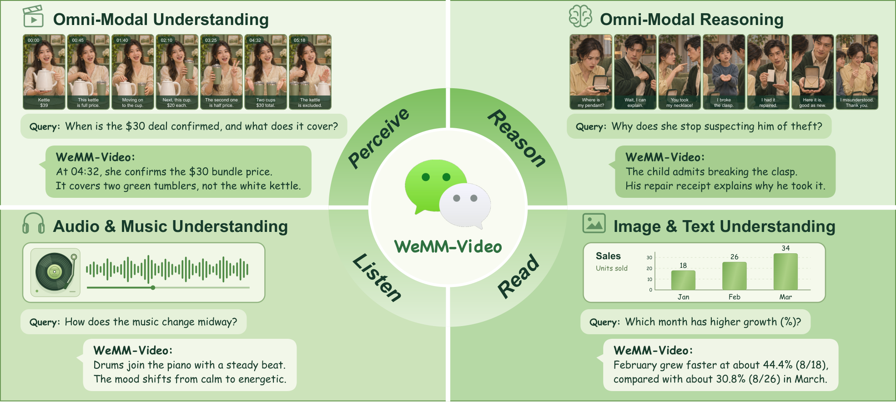
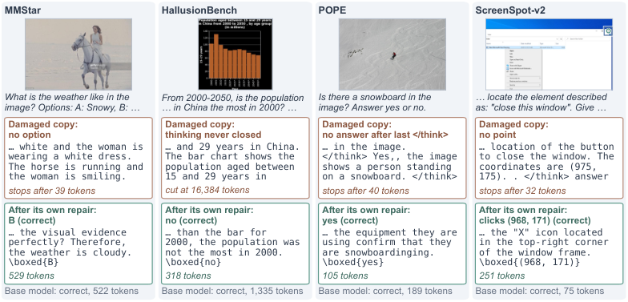
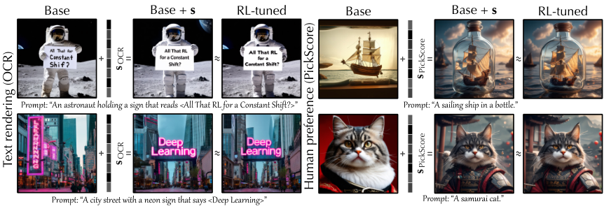
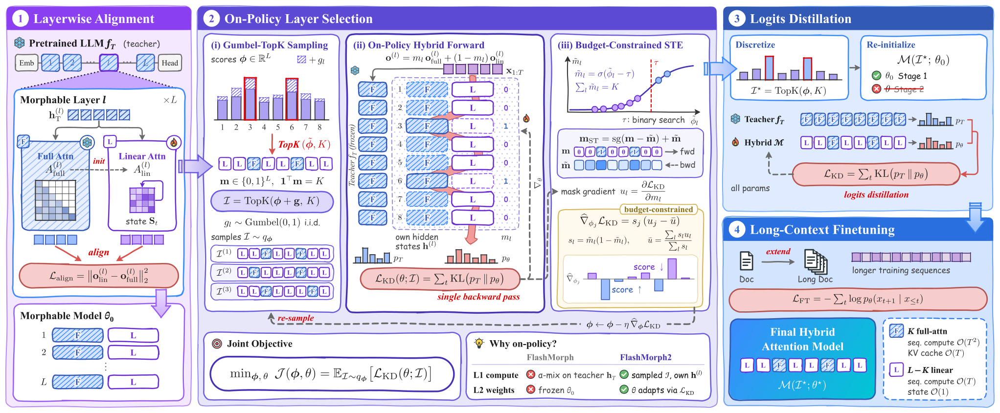
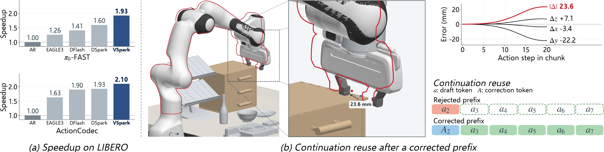
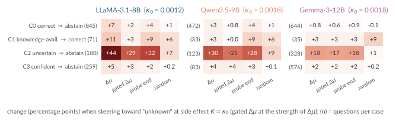
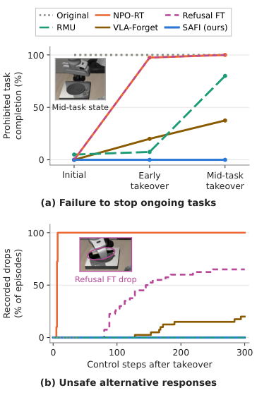
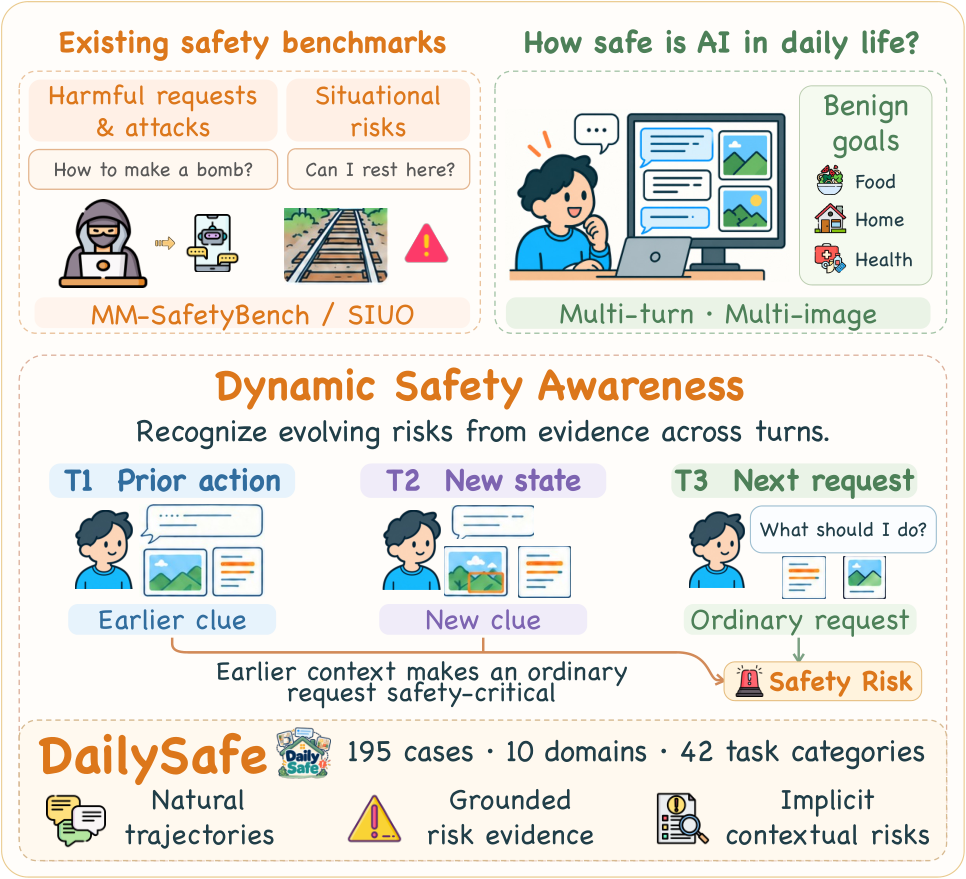
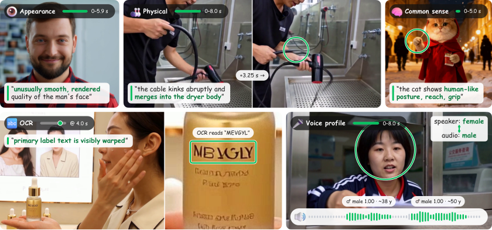

# Daily AI papers — 2026-11-22

*Curated from HF Daily Papers. 15 of ~50 papers kept after relevance filter.*

## Papers at a glance

| # | Title | Topics | Org |
| --- | --- | --- | --- |
| 1 | [WeMM-Video: Open-Source Omni-Modal Video Understanding](#1-wemm-video) | `multimodal`, `omni-modal`, `video` | WeChat / Tencent · Tsinghua |
| 2 | [Language Models Can Rewrite Their Own Weights](#2-self-rewriting-weights) | `LLM`, `interp`, `self-improvement` | UIUC · CMU · Rutgers · Princeton · Stanford |
| 3 | [RL Post-Training in Diffusion Transformers Is Activation Steering](#3-rl-is-activation-steering) | `diffusion`, `RL`, `interp`, `steering` | fal · Georgia Tech · IBM · Virginia Tech |
| 4 | [AutoMaster: Autonomous Post-Training by Making the Same Model a Better Teacher](#4-automaster) | `post-training`, `SFT`, `agents` | Renmin University |
| 5 | [FlashMorph2: On-Policy Morphing into Hybrid Attention Models](#5-flashmorph2) | `architectures`, `hybrid-attention`, `efficient-inference` | ByteDance Seed · NTU |
| 6 | [LightningMoBA: Accelerating Mixture of Block Attention](#6-lightningmoba) | `architectures`, `attention`, `efficient-inference` | (unspecified) |
| 7 | [NarrowSpec: Draft Hidden Width Need Not Match the Target in Speculative Decoding](#7-narrowspec) | `inference`, `speculative-decoding`, `efficient-inference` | NVIDIA |
| 8 | [VSpark: Speculative Decoding for Autoregressive VLA Models](#8-vspark) | `inference`, `speculative-decoding`, `multimodal`, `VLA` | KAIST AI |
| 9 | [Posterior Matching Distillation](#9-posterior-matching-distillation) | `diffusion`, `distillation` | (unspecified) |
| 10 | [A CPU Inside an LLM: Zero-Gradient Compilation of Exact Circuits](#10-cpu-inside-an-llm) | `interp`, `architectures` | (unspecified) |
| 11 | [Do Probing and Steering Favor the Same Directions?](#11-probing-vs-steering) | `interp`, `activation-steering` | Fraunhofer IAIS |
| 12 | [AltRA-Test: Alternative Annotator Test for LLM Judges](#12-altra-test) | `eval`, `LLM-judge` | Technion · U. of Haifa · Google Research |
| 13 | [Teaching Vision-Language-Action Models to Stop Safely](#13-safi) | `safety`, `VLA`, `multimodal` | Notre Dame · Georgia Tech · MIT |
| 14 | [DailySafe: Dynamic Safety Awareness in Multi-Turn Multimodal Interactions](#14-dailysafe) | `safety`, `eval`, `multimodal` | Ant Group · Tsinghua · Renmin · NTU · Uniandes |
| 15 | [WeVisForensics: Self-Evolving Agent for AI-Generated Video Detection](#15-wevisforensics) | `agents`, `eval`, `forensics` | WeChat Vision · Nanjing U. |

---

## 1. WeMM-Video

**Authors:** Changli Tang, Jie Yang, Tianyi Wang, Lei Li, Daoze Zhang, Zijie Xin, Zhan Liu, Li Li, Jinchang Xu, Fengyun Rao, Chao Zhang, Jing Lyu — *WeChat Vision, Tencent · Tsinghua University*
**Links:** [arXiv:2611.26409](https://arxiv.org/abs/2611.26409) · [HF](https://huggingface.co/papers/2611.26409) · [AlphaXiv](https://www.alphaxiv.org/abs/2611.26409)
**Topics:** `multimodal`, `omni-modal`, `video`

### TL;DR

An open-source family of Chinese-English bilingual omni-modal models (2B / 4B / 9B / 35B-A3B) that jointly process text, image, audio, and video. The flagship 35B MoE and the 9B dense model both top Qwen3-Omni on video understanding, released with reproduction code and an eval pipeline over 120 benchmarks.

### Key idea

A single transformer backbone trained on ~1.2T tokens across four modalities with explicit dual-mode decoding: a "fast" non-thinking mode and a step-by-step thinking mode selectable at inference time. The 35B variant is MoE (A3B = 3B active), extending the trend of large-MoE / small-active that DeepSeek-V3 popularized into the omni-modal regime.

### Main finding

The 35B-A3B model sets a new open-source SOTA for omni-modal video understanding across 120+ benchmarks; the 9B dense version beats Qwen3-Omni-30B-A3B-Instruct despite being a third the active size. Weights, training code, and the eval pipeline are released.

### Why it matters

Closes a measurable open-source gap on video understanding and makes omni-modal thinking-mode recipes reproducible at the 9B scale a lab can reasonably train on. Also a public artifact that the benchmark saturation / contamination debate can be run against.

### Knowledge graph integration

**Builds on / relates to existing pages:**
- [../architectures/_moe.md](../architectures/_moe.md) — 35B-A3B active-expert sparsity follows the DeepSeek-MoE lineage.
- [../multimodal/README.md](../multimodal/README.md) — omni-modal (text + image + audio + video) training recipe.
- [../case-studies/qwen2-5.md](../case-studies/qwen2-5.md) — directly compared against the Qwen3-Omni line; same family of recipes.

**Suggested new pages:**
- `multimodal/omni-modal-training.md` *(depth)* — joint text/image/audio/video pretraining & dual-mode decoding recipe.
- `case-studies/wemm-video.md` *(case study)* — end-to-end 2B–35B omni-modal release with full training stack.

---

## 2. Self-Rewriting Weights

**Authors:** Neil He, Changyi Yang, Andy Mao, Xi Zhu, Chaoran Cheng, Kaiqu Liang, Shuaike Shen, Zetian Li, Ruihan Guo, Ge Liu — *UIUC · CMU · Rutgers · Princeton · Stanford*
**Links:** [arXiv:2611.21885](https://arxiv.org/abs/2611.21885) · [HF](https://huggingface.co/papers/2611.21885) · [AlphaXiv](https://www.alphaxiv.org/abs/2611.21885)
**Topics:** `LLM`, `interp`, `self-improvement`

### TL;DR

A 27B open LLM is shown to improve itself by directly rewriting its own weights — no gradients, no training loop. It diagnoses its failures, proposes weight edits, and tests them. The emergent ability appears only at the largest scale in a four-model family.

### Key idea

The model is used as both the programmer and the target: it is asked to localize the circuit responsible for a failure, write a weight edit, apply it, and evaluate. Everything is done through prompting plus small symbolic operations on parameter tensors; no backprop and no retraining of a side module. The "weight-space programming" paradigm is a gradient-free alternative to RLHF/SFT for narrow self-correction.

### Main finding

The self-edit improves accuracy by 6.6 points on 490 held-out problems. The same mechanism also *repairs* a deliberately corrupted copy of itself, and the repair generalizes to downstream image benchmarks. The capability is emergent: it shows up only at the top of a four-size family.

### Why it matters

Pushes on a question the field has mostly dodged: can a frontier-scale LLM act as a *compiler for itself*? If this holds up, "self-improvement" shifts from an RL training-loop phenomenon (STaR-style) to a reasoning-at-inference phenomenon that could run after deployment. Also raises obvious oversight questions — a model that rewrites itself is a different safety case.

### Knowledge graph integration

**Builds on / relates to existing pages:**
- [../post-training/rejection-sampling.md](../post-training/rejection-sampling.md) — closest relative in the self-improvement family (same loop, model-generated edits, keep-if-better).
- [../interpretability/README.md](../interpretability/README.md) — the diagnosis step is essentially mech-interp used by the model on itself.
- [../safety/situational-awareness.md](../safety/situational-awareness.md) — self-modification is a situational-awareness-adjacent capability.

**Suggested new pages:**
- `post-training/weight-space-programming.md` *(depth)* — the self-rewriting loop as a post-training alternative.
- `safety/self-modification.md` *(depth)* — the safety-case angle on models that edit their own weights.

---

## 3. RL Is Activation Steering

**Authors:** Kaan Oktay, Alec Helbling, Atakan Kara, Duen Horng Chau, Pinar Yanardag — *fal · Georgia Tech · IBM Research · Virginia Tech*
**Links:** [arXiv:2611.26627](https://arxiv.org/abs/2611.26627) · [HF](https://huggingface.co/papers/2611.26627) · [AlphaXiv](https://www.alphaxiv.org/abs/2611.26627)
**Topics:** `diffusion`, `RL`, `interp`, `steering`

### TL;DR

Finds that policy-gradient RL post-training of diffusion transformers can be replaced, at most of its gain, by a small set of **fixed steering vectors** added to activations of a *frozen* model. The vectors are fit by matching the RL-tuned model's velocity predictions, so no reward model is needed at inference.

### Key idea

Treat the RL-finetuned DiT as a black-box target and ask what minimal intervention on the base model reproduces its behavior. Answer: a few constant activation deltas. Fitting is done by regressing the base model's velocity to the RL model's velocity along the sampling trajectory — a reward-free supervised objective. At sampling time, the vectors are added and the base weights stay untouched.

### Main finding

"A constant shift suffices for most of the gain of policy-gradient RL post-training." Demonstrated across several image and video diffusion models; the gap to full RL tuning is small, and the storage cost is a few vectors versus a full adapter.

### Why it matters

Unifies two separate strands: RLHF-style post-training and activation steering (SAE-era interpretability). If RL gains are mostly a bias in activation space, the "RL for generative models" story becomes much simpler — and much more controllable. Opens a route to cheap, composable, reward-free post-training for diffusion/video generation.

### Knowledge graph integration

**Builds on / relates to existing pages:**
- [../post-training/_rl.md](../post-training/_rl.md) — reframes policy-gradient RL post-training as a linear activation intervention.
- [../post-training/ppo.md](../post-training/ppo.md), [../post-training/grpo.md](../post-training/grpo.md) — specific algorithms whose output is approximated by steering vectors.
- [../interpretability/README.md](../interpretability/README.md) — direct application of activation-steering theory to generative diffusion.

**Suggested new pages:**
- `interpretability/activation-steering.md` *(depth)* — finally document activation steering with this paper as the diffusion-side source.
- `post-training/diffusion-rl.md` *(depth)* — policy-gradient RL for diffusion transformers and its linear-shift reduction.

---

## 4. AutoMaster

**Authors:** Shuang Sun, Fanzhe Meng, Xinyu Tang, Ruihua Song, Wayne Xin Zhao — *Gaoling School of AI, Renmin University*
**Links:** [arXiv:2611.26510](https://arxiv.org/abs/2611.26510) · [HF](https://huggingface.co/papers/2611.26510) · [AlphaXiv](https://www.alphaxiv.org/abs/2611.26510)
**Topics:** `post-training`, `SFT`, `agents`

### TL;DR

An autonomous post-training pipeline where the *same* model is prompted with natural-language "skills" to act as a better teacher, rolls out improved trajectories, then fine-tunes a student copy on them. An outer agent (AutoMaster) designs the skills and selects which rollouts to train on.

### Key idea

**Skill-FT**: condition rollouts on explicit skill text ("plan before acting", "check output before returning", etc.) that makes the teacher-mode generations higher quality than the un-conditioned student. Fine-tune the student on those traces *with* the skills in-context. The outer AutoMaster loop proposes new skills, scores their effect on evaluation tasks, and curates the training set — all using the same base model.

### Main finding

On terminal, search, and software engineering tasks with 4B and 9B students, Skill-FT beats standard SFT on successful unguided rollouts by 1.42–8.99 points. Keeping the skill text in training inputs helps even though it's absent at eval time — the model internalizes the skill when conditioned on it, then still acts on it unconditioned.

### Why it matters

Agent post-training keeps running into the "task success alone doesn't tell you what to reinforce" problem. AutoMaster is a clean reframing: let the model propose the dimensions worth reinforcing (skills) and curate its own data. No separate teacher model, no human-written rationales.

### Knowledge graph integration

**Builds on / relates to existing pages:**
- [../post-training/rejection-sampling.md](../post-training/rejection-sampling.md) — same expert-iteration backbone with a learned skill prior added.
- [../post-training/_post-training.md](../post-training/_post-training.md) — a new entry in the autonomous-SFT taxonomy.
- [../agents/README.md](../agents/README.md) — agent-domain application: terminal / search / SWE.

**Suggested new pages:**
- `post-training/skill-conditioned-sft.md` *(depth)* — skill-text-conditioned SFT as a self-teaching recipe.

---

## 5. FlashMorph2

**Authors:** Xuanda Wang, Jianbin Zheng, Huafeng Kuang, Wei Tang, Yu Cheng — *ByteDance Seed · NTU*
**Links:** [arXiv:2611.24809](https://arxiv.org/abs/2611.24809) · [HF](https://huggingface.co/papers/2611.24809) · [AlphaXiv](https://www.alphaxiv.org/abs/2611.24809)
**Topics:** `architectures`, `hybrid-attention`, `efficient-inference`

### TL;DR

Converts pretrained Transformers into hybrid full+linear-attention models **on-policy**: discrete architectures are actually sampled and evaluated end-to-end, so layer-selection scores are optimized under the true recovery objective rather than an off-policy proxy.

### Key idea

Prior work (FlashMorph v1) scored layers off-policy — scores learned on one architecture used to pick another. FlashMorph2 fixes two gaps: (1) it samples full architectures and evaluates them during search, and (2) it jointly optimizes layer-selection probabilities and the model weights under the same recovery loss. A single run yields a converted hybrid model; no separate retraining pass.

### Main finding

Beats FlashMorph v1 on RULER, LongBench, and recall-intensive benchmarks under matched compute budgets. Search cost is modest: 0.72–3.57 GPU-hours across 0.6B–8B models.

### Why it matters

The "convert-a-transformer-into-hybrid" track (Mamba-in-Llama, MOHAWK) has been hamstrung by weak layer selection. Making the selection on-policy is the obvious right move but has been slow to land at scale. This paper makes the recipe cheap enough that applying it to every open-source release is plausible.

### Knowledge graph integration

**Builds on / relates to existing pages:**
- [../architectures/multi-head-attention.md](../architectures/multi-head-attention.md) — hybrid models replace a subset of these layers.
- [../fundamentals/attention.md](../fundamentals/attention.md) — relevant background on full vs linear attention.

**Suggested new pages:**
- `architectures/_hybrid-attention.md` *(taxonomy)* — hybrid full+linear attention models (Mamba-in-Llama, MOHAWK, FlashMorph, FlashMorph2).
- `architectures/flashmorph2.md` *(depth)* — the on-policy layer selection + joint weight recovery recipe.

---

## 6. LightningMoBA

**Authors:** Not stated on HF page — *(unspecified)*
**Links:** [arXiv:2611.26268](https://arxiv.org/abs/2611.26268) · [HF](https://huggingface.co/papers/2611.26268) · [AlphaXiv](https://www.alphaxiv.org/abs/2611.26268)
**Topics:** `architectures`, `attention`, `efficient-inference`

### TL;DR

An inference-time acceleration of Mixture-of-Block-Attention (MoBA) that drops the fixed Top-k block budget, reorganizes compute around KV blocks instead of queries, and pipelines the stages on Hopper. Yields 1.20–1.60× end-to-end speedup at the same retention quality.

### Key idea

Three changes to the MoBA kernel: (1) **threshold-based dynamic routing** — accept a block whenever its score exceeds a learned threshold, instead of always picking the top-k; (2) **KV-centric execution** — group work by (query head, KV block) so the KV block is streamed once and reused; (3) **runtime pipelining** — overlap scoring, loading, and attention compute on Hopper's async copy engines.

### Main finding

Across five checkpoints, mean RULER rises from 74.42 to 75.28 at matched Top-16 retention while end-to-end generation is 1.20–1.60× faster. The speedup compounds the gain from dynamic routing with the GPU-level pipelining.

### Why it matters

MoBA is the sparse-attention mechanism most frontier open-source labs are converging on (Kimi, Qwen). Any order-of-magnitude-ish speedup here changes the long-context economics meaningfully. Also a case study in kernel design where dynamic routing + hardware pipelining unlock each other.

### Knowledge graph integration

**Builds on / relates to existing pages:**
- [../fundamentals/attention.md](../fundamentals/attention.md) — MoBA is a sparse-attention variant.
- [../inference/README.md](../inference/README.md) — KV-centric execution is an inference-kernel design pattern.

**Suggested new pages:**
- `architectures/moba.md` *(depth)* — Mixture-of-Block-Attention with dynamic routing (LightningMoBA as the kernel reference).

---

## 7. NarrowSpec

**Authors:** Not fully stated; corresponding author at NVIDIA (avalliappan@nvidia.com) — *NVIDIA*
**Links:** [arXiv:2611.23835](https://arxiv.org/abs/2611.23835) · [HF](https://huggingface.co/papers/2611.23835) · [AlphaXiv](https://www.alphaxiv.org/abs/2611.23835)
**Topics:** `inference`, `speculative-decoding`, `efficient-inference`

### TL;DR

Shows that in speculative decoding the **draft model's hidden width** doesn't have to match the target's. Halving or quartering the draft width preserves most of the acceptance rate, and the output adapter can be folded into the target's vocab projection for the DFlash-style drafter — pure wall-clock win.

### Key idea

Previous spec-decoding wisdom was to keep the draft's hidden dim equal to the target's so the drafter inherits the target's representation. The paper shows acceptance is dominated by the drafter's *vocabulary-aligned* output head, not its interior width. Narrowing the hidden dim and absorbing the up-projection into the target's existing `W_out` gives a lossless speedup.

### Main finding

With Qwen3-8B and GPT-OSS-20B as targets, applied to DFlash and EAGLE-3 drafters: end-to-end speedups at batch size 1 on B200 and DGX Spark (GB10), with acceptance largely preserved under 2× and 4× narrowing.

### Why it matters

Spec-decoding draft cost is a direct tax on every output token. Narrowing the drafter is the first *architectural* lever left after the EAGLE-3 wave, and it composes with existing tricks. For single-user, batch-size-1 inference (chat UIs, coding agents), this is immediately practical.

### Knowledge graph integration

**Builds on / relates to existing pages:**
- [../inference/README.md](../inference/README.md) — speculative decoding is a core topic here (no dedicated depth file yet).
- [../pre-training/mtp.md](../pre-training/mtp.md) — multi-token prediction is the training-side cousin of the drafter architecture.

**Suggested new pages:**
- `inference/_speculative-decoding.md` *(taxonomy)* — drafter families: n-gram, EAGLE/Medusa, DFlash, NarrowSpec.
- `inference/narrow-spec.md` *(depth)* — the narrowed-draft recipe with vocab-head folding.

---

## 8. VSpark

**Authors:** Suho Yoo, Youngjoon Jang, Hyebin Cho, Taeyeop Lee, Jaewook Jeong, Joon Son Chung — *KAIST AI*
**Links:** [arXiv:2611.22666](https://arxiv.org/abs/2611.22666) · [HF](https://huggingface.co/papers/2611.22666) · [AlphaXiv](https://www.alphaxiv.org/abs/2611.22666)
**Topics:** `inference`, `speculative-decoding`, `multimodal`, `VLA`

### TL;DR

Lossless speculative decoding for autoregressive Vision-Language-Action models. Three tricks: train the drafter with **calibrated action noise** in the rollouts; align drafter features to the target's hidden features; and reuse predictions from drafts the target rejected.

### Key idea

Spec decoding generalizes poorly out-of-box to VLAs because the action-token distribution is tighter and more skewed than text tokens — a naive drafter rarely matches the target. VSpark (1) injects calibrated noise into the training rollouts so the drafter sees the error distribution the target would correct, (2) adds a feature-alignment loss on the drafter's hidden states, and (3) salvages information from rejected drafts by reusing them as context for the next step.

### Main finding

Across four VLA backbones (varied action tokenizers) and four manipulation benchmarks, **1.28–2.10× speedup** with lossless decoding. The gain holds for both continuous and discrete action tokenizers.

### Why it matters

VLAs ship at the "waiting for a 30Hz control loop" end of the latency budget, and spec-decoding has been under-adapted to their token distributions. Getting ~2× without changing the target policy makes real-time VLA deployment materially more feasible.

### Knowledge graph integration

**Builds on / relates to existing pages:**
- [../inference/README.md](../inference/README.md) — specialization of speculative decoding to a new domain.
- [../multimodal/README.md](../multimodal/README.md) — VLA models (a subclass of multimodal).

**Suggested new pages:**
- `inference/_speculative-decoding.md` *(taxonomy)* — same taxonomy as NarrowSpec; VSpark covers the VLA variant row.
- `multimodal/vla.md` *(depth)* — vision-language-action models as a concept (no page yet).

---

## 9. Posterior Matching Distillation

**Authors:** Not stated on HF page — *(unspecified)*
**Links:** [arXiv:2611.26629](https://arxiv.org/abs/2611.26629) · [HF](https://huggingface.co/papers/2611.26629) · [AlphaXiv](https://www.alphaxiv.org/abs/2611.26629)
**Topics:** `diffusion`, `distillation`

### TL;DR

A new objective for distilling diffusion models into few-step generators: match an **exponentially reweighted average of student samples to the teacher's posterior mean**. Under Gaussian corruption each target reduces to a single frozen-teacher evaluation at a shifted input, making training cheap.

### Key idea

Previous few-step distillers (consistency distillation, score distillation, etc.) match the student to the teacher at specific noise levels or along the trajectory. PMD instead matches the *posterior distribution* that the teacher implies, through a tractable surrogate: an exponentially-weighted average of student outputs → teacher posterior mean at a shifted input. The authors prove this objective identifies the teacher's full conditional posterior at the optimum.

### Main finding

Best FID among 4-step methods on SDXL and FLUX.2-Klein-4B, with improved intra-prompt diversity (many consistency-distillation methods collapse modes).

### Why it matters

Few-step diffusion distillation is converging quickly toward "one method everybody uses". PMD's claim is that it gives both stronger quality *and* intra-prompt diversity, which has been the main objection to consistency-style distillation. If the diversity improvement replicates, it changes which method frontier image/video labs ship.

### Knowledge graph integration

**Builds on / relates to existing pages:**
- (No direct existing depth file on diffusion distillation yet — this paper highlights the gap.)
- [../post-training/_post-training.md](../post-training/_post-training.md) — adjacent taxonomy context.

**Suggested new pages:**
- `multimodal/_diffusion-distillation.md` *(taxonomy)* — consistency / score / posterior-matching distillation as a class.
- `multimodal/posterior-matching-distillation.md` *(depth)* — the PMD objective and the Gaussian reduction.

---

## 10. CPU Inside an LLM

**Authors:** Not stated on HF page — *(unspecified)*
**Links:** [arXiv:2611.26450](https://arxiv.org/abs/2611.26450) · [HF](https://huggingface.co/papers/2611.26450) · [AlphaXiv](https://www.alphaxiv.org/abs/2611.26450)
**Topics:** `interp`, `architectures`

### TL;DR

A zero-gradient compiler that writes deterministic algorithms (exact multi-digit arithmetic, Boolean and parity circuits) *directly* into the weights of a pretrained LLM. No training examples, no runtime hooks. Beats a 12.8K-sample LoRA on 6-digit arithmetic.

### Key idea

Instead of teaching the model arithmetic through examples, treat the forward pass as a programmable substrate and *compile* the circuit. Closed-form weight edits implement exact signed integer +, −, × on IBM Granite 4.2 3B and Alibaba Qwen 3.5 4B, plus Boolean / parity operations. A factorized sparse "sidecar" holds the circuit without disturbing the base weights unnecessarily.

### Main finding

Outperforms a 12.8K-sample LoRA baseline on 6-digit arithmetic with **zero training examples**. Memory cost of the sidecar is measured and bounded.

### Why it matters

Arithmetic failures are the canonical "LLMs can't reliably compute" bug; LoRA and tool-use patches it from outside. This paper argues it's compilable from the inside — the weights can *literally* execute the algorithm. If the technique generalizes to e.g. list manipulation or small graph algorithms, it's a very different paradigm for closing capability gaps than more data.

### Knowledge graph integration

**Builds on / relates to existing pages:**
- [../interpretability/README.md](../interpretability/README.md) — the inverse direction of circuit discovery: circuit *installation*.
- [../post-training/fine-tuning/README.md](../post-training/fine-tuning/README.md) — contrasts with LoRA / SFT as a capability-insertion method.

**Suggested new pages:**
- `interpretability/circuit-compilation.md` *(depth)* — zero-gradient compilation of deterministic circuits into LLM weights.

---

## 11. Probing vs Steering

**Authors:** Afshin Sadeghi, Daniel Becker — *AI Assurance and Assessments (AAA), Fraunhofer IAIS*
**Links:** [arXiv:2611.19499](https://arxiv.org/abs/2611.19499) · [HF](https://huggingface.co/papers/2611.19499) · [AlphaXiv](https://www.alphaxiv.org/abs/2611.19499)
**Topics:** `interp`, `activation-steering`

### TL;DR

The direction in a model's hidden state that best *probes* a concept (truthfulness, sentiment) is **not** the direction that best *steers* the model toward it. Steering prefers directions closer to the mean difference between concept-positive and concept-negative activations; probes transfer across models better than steering vectors do.

### Key idea

A systematic study across three instruction-tuned models that disentangles two uses of "a concept direction": reading it (probing) vs writing it (steering). They evaluate best-probe-as-steerer and best-steerer-as-probe across truthfulness and sentiment. The directions are *not* the same and the gap is replicable.

### Main finding

Probe directions transfer across models; steering directions do not. Steering toward "unknown" on PopQA converts uncertain errors into abstentions — a small but real safety-flavored application.

### Why it matters

The interp community has often glossed over the difference between "we found the direction" and "we can push the model along it." This paper pins down that confusion empirically, with implications for how safety steering interventions should be designed and evaluated. It also partially explains why some published steering interventions fail to replicate.

### Knowledge graph integration

**Builds on / relates to existing pages:**
- [../interpretability/README.md](../interpretability/README.md) — direct contribution to the mech-interp toolbox.
- [../safety/refusal-suppression.md](../safety/refusal-suppression.md) — probes-vs-steering distinction matters for refusal-direction edits.

**Suggested new pages:**
- `interpretability/probing-vs-steering.md` *(depth)* — the probe/steer-direction separation.

---

## 12. AltRA-Test

**Authors:** Nagham Omar, Rotem Dror, Avigdor Gal, Roi Reichart, Nitay Calderon — *Technion · University of Haifa · Google Research*
**Links:** [arXiv:2611.26073](https://arxiv.org/abs/2611.26073) · [HF](https://huggingface.co/papers/2611.26073) · [AlphaXiv](https://www.alphaxiv.org/abs/2611.26073)
**Topics:** `eval`, `LLM-judge`

### TL;DR

A statistical test for deciding when an LLM judge can replace human annotators — without requiring that the same humans label every item. Resample items, swap one human label per item for the LLM's, and check whether inter-annotator agreement drops by more than an adaptive margin.

### Key idea

Alt-Test (prior work) required a shared annotator pool across items, which rarely exists in practice. AltRA-Test relaxes that: given item-level sets of human annotators (possibly different per item), it resamples items + annotations, substitutes one human with the LLM at each item, and tests whether the agreement distribution shifts. The margin is adapted from the observed human-human agreement.

### Main finding

Consistent under the paper's assumptions; outperforms existing baselines in simulations; roughly 50% of tested LLM–dataset combinations pass, across text, image, audio, and video annotation tasks.

### Why it matters

"Can LLM-as-judge replace humans here?" is the live question gating a lot of eval infrastructure. A principled, implementable test that doesn't require redoing your annotation pipeline is useful, and the ~50% pass rate is a sobering reality check on claims of universal LLM-judge equivalence.

### Knowledge graph integration

**Builds on / relates to existing pages:**
- [../evaluation/README.md](../evaluation/README.md) — new entry in the LLM-as-judge evaluation toolkit.

**Suggested new pages:**
- `evaluation/_llm-judge.md` *(taxonomy)* — LLM-as-judge methodology: Alt-Test, AltRA-Test, pairwise comparison, agreement analysis.
- `evaluation/altra-test.md` *(depth)* — the specific statistical test, with the shared-annotator-free design.

---

## 13. SAFI

**Authors:** Chuhan Wang, Jinduo Guo, Yue Huang, Xiangchi Yuan, Ningshan Ma, Meng Jiang — *Notre Dame · Georgia Tech · MIT*
**Links:** [arXiv:2611.26239](https://arxiv.org/abs/2611.26239) · [HF](https://huggingface.co/papers/2611.26239) · [AlphaXiv](https://www.alphaxiv.org/abs/2611.26239)
**Topics:** `safety`, `VLA`, `multimodal`

### TL;DR

VLA models can refuse a prohibited task at step 0 yet still complete it when control is taken over midway. **State-Aware Fallback Imitation (SAFI)** teaches the policy to *hold still* as a fallback, trained jointly alongside the original actions.

### Key idea

A refused task is usually enforced only at the policy's first action. If an external controller nudges the robot into a mid-execution state of the prohibited task, the VLA will often complete it. SAFI adds training data where the target action for prohibited-task states is a safe "hold" (no end-effector motion, no object release), while retaining the original action distribution for permitted tasks. The fallback is thus state-triggered, not just prompt-triggered.

### Main finding

On LIBERO tasks, post-takeover success on prohibited tasks drops to **1.3%**, with no recorded physical incidents (drops, saturation). Success on retained tasks stays high.

### Why it matters

The "jailbreak via control takeover" attack on VLAs is specific to embodied models but conceptually identical to "deceptive compliance" in language models — refusing the question doesn't mean refusing the behavior. SAFI is a clean existence proof that the refusal can be *behavioral and state-conditioned*, not surface.

### Knowledge graph integration

**Builds on / relates to existing pages:**
- [../safety/refusal-suppression.md](../safety/refusal-suppression.md) — the embodied analogue of the refusal-direction literature.
- [../safety/_attacks.md](../safety/_attacks.md) — "control takeover" belongs in the attack taxonomy.

**Suggested new pages:**
- `safety/vla-safety.md` *(depth)* — refusal and safe fallback behaviors for vision-language-action models.

---

## 14. DailySafe

**Authors:** Xinhao Deng, Wenzheng Jiang, Ziheng Peng, Siyuan Liang, Wenke Huang, Pablo Arbelaez, Mang Ye — *Ant Group · Tsinghua · Renmin · NTU · Universidad de Los Andes*
**Links:** [arXiv:2611.26298](https://arxiv.org/abs/2611.26298) · [HF](https://huggingface.co/papers/2611.26298) · [AlphaXiv](https://www.alphaxiv.org/abs/2611.26298)
**Topics:** `safety`, `eval`, `multimodal`

### TL;DR

A benchmark for **dynamic** safety awareness in MLLMs — the risk emerges over a multi-turn, multi-image interaction, not from a single toxic prompt. 195 cases across 10 everyday domains with per-turn safety annotations.

### Key idea

Existing MLLM safety evals score the model on isolated harmful requests. Real-world risk often builds up: harmless image + harmless image + benign request → unsafe recommendation. DailySafe instruments this by making each case a multi-turn trajectory and labeling the step at which safety awareness should trigger, so you can distinguish "never flagged" from "flagged late".

### Main finding

Introduces the metric and benchmark (no dominant model on it); the paper serves primarily to open a measurable axis the field hasn't had, rather than to crown a winner.

### Why it matters

Most of the real MLLM safety failures users encounter are not single-turn jailbreaks but cumulative multi-turn drift. Moving the benchmark frontier from "did you refuse this prompt" to "did you catch the risk at the right turn" is overdue.

### Knowledge graph integration

**Builds on / relates to existing pages:**
- [../safety/_attacks.md](../safety/_attacks.md) — multi-turn drift is a specific attack-surface shape.
- [../safety/cot-monitoring.md](../safety/cot-monitoring.md) — same per-step-monitoring stance applied to user interactions instead of model CoT.
- [../evaluation/README.md](../evaluation/README.md) — multi-turn multimodal safety eval.

**Suggested new pages:**
- `safety/multi-turn-drift.md` *(depth)* — emergent safety risks across multi-turn multimodal interactions.

---

## 15. WeVisForensics

**Authors:** Yipeng Du, Yuxi Li, Ying Zhang, Chong Sun, Chen Li, Jing Lyu, Ying Tai — *WeChat Vision · Nanjing University*
**Links:** [arXiv:2611.21373](https://arxiv.org/abs/2611.21373) · [HF](https://huggingface.co/papers/2611.21373) · [AlphaXiv](https://www.alphaxiv.org/abs/2611.21373)
**Topics:** `agents`, `eval`, `forensics`

### TL;DR

An agentic AI-generated-video detector: a top-level investigator agent coordinates a self-evolving library of forensic sub-agents (visual, audio, motion). Trained with a dual-timescale policy optimization (DTPO) that moves the investigator fast and the inspectors slow. 95.2% detection accuracy, ~9 points over prior detectors.

### Key idea

Deepfake detectors keep losing to the next generator. WeVisForensics trades monolithic detectors for a hierarchy: the investigator chooses which inspectors to call per video, and the inspector library expands with new specialists as new generator failure modes appear. **DTPO** (dual-timescale policy optimization) trains the investigator with RL quickly while the inspectors are refined on a slower schedule so the scheduler doesn't chase a drifting backend.

### Main finding

**95.2% average accuracy** across in-domain, out-of-domain, and agentic benchmarks — **~9.0 points** above the strongest prior detector. The ForenCue-30K dataset and the inspector-library weights are released.

### Why it matters

As video generators (Sora, Veo, FLUX-video, Direct3D-V3) proliferate, "forensics" is drifting toward an adversarial, agentic game. This paper shows that treating the problem that way — hierarchical agents with asynchronous RL — materially outperforms monolithic classifiers. The DTPO recipe is interesting in its own right as an agentic-RL training pattern.

### Knowledge graph integration

**Builds on / relates to existing pages:**
- [../post-training/_rl.md](../post-training/_rl.md), [../post-training/ppo.md](../post-training/ppo.md) — DTPO is a dual-timescale generalization.
- [../agents/README.md](../agents/README.md) — hierarchical investigator / inspector agent architecture.

**Suggested new pages:**
- `post-training/dtpo.md` *(depth)* — dual-timescale policy optimization for hierarchical agents.
- `evaluation/ai-generated-video-detection.md` *(depth)* — the evaluation axis and ForenCue-30K.

---

## Notes

- 4 of 15 papers have no hero figure (2611.26268 LightningMoBA, 2611.23835 NarrowSpec, 2611.26450 CPU-Inside-LLM, 2611.26073 AltRA-Test) — their arXiv HTML renderings didn't expose a usable teaser image.
- Hero figures live in `assets/2026-11-22/`. All are first-figure teasers pulled from the arXiv HTML renderings; HF's `og:image` was a generic gradient thumbnail for every paper on this date.
- Borderline inclusions are none today — everything maps cleanly into the keep-list topics.
- This digest is informational. No existing concept files, `READING-LIST.md`, or `PAPERS.md` were modified to produce it.
