# Daily AI papers — 2026-11-23

*Curated from HF Daily Papers. 15 of 26 papers kept after relevance filter.*

## Papers at a glance

| # | Title | Topics | Org |
| --- | --- | --- | --- |
| 1 | [cmHC: Balancing Stream Mixing in Hyper-Connections via Geometric Contraction](#1-cmhc) | `architecture`, `MoE`, `efficient-inference` | Huawei / HKUST(GZ) |
| 2 | [Non-penetrating World Models](#2-nopewolrd) | `multimodal`, `diffusion`, `world-model` | (unspecified) |
| 3 | [Clover-35B-A3B-Preview Technical Report](#3-clover) | `diffusion`, `MoE`, `LLM`, `agents` | DiffuSpace |
| 4 | [Learning Video Foresight Reasoning from Unlabeled Videos via On-Policy Self-Distillation](#4-future-opsd) | `multimodal`, `reasoning`, `RL` | UB / Stony Brook / JHU / Duke / UMD |
| 5 | [MemOnce: A Scalable Memory Architecture for Large Language Models](#5-memonce) | `architecture`, `efficient-inference`, `long-context` | Nanjing U. / USTC |
| 6 | [Duopra: From Full-Duplex Conversation to Full-Duplex Agency](#6-duopra) | `agents`, `multimodal`, `RL` | SJTU (consortium) |
| 7 | [Lost in the Hallway: Benchmarking Persistent Spatial Memory Across Revisits](#7-respacebench) | `eval`, `multimodal`, `memory` | Tsinghua LeapLab |
| 8 | [Intent Contracts: Taking Tools Away from Agents](#8-intent-contracts) | `agents`, `safety` | Georgia Tech / UMass / UIUC |
| 9 | [Prune to Expand: Training Prompt Enhancers with Less to Imitate](#9-p2e) | `diffusion`, `data`, `fine-tuning` | CityU HK / CUHK-Shenzhen |
| 10 | [How Feedback-Free Self-Evolution Reshapes Agent Skills: A Systematic Study](#10-skilldiff) | `agents`, `eval` | HKUST(GZ) / HKUST / Knowin |
| 11 | [Search From the Start: Search-Native Pretraining for Language Models](#11-querylm) | `pre-training`, `retrieval` | EPFL / U. Toronto |
| 12 | [Motion-Aware Reward Modeling for Instruction-Guided Video Editing](#12-motion-aware-reward) | `diffusion`, `video`, `reward-model` | Texas A&M / Adobe / Vanderbilt / USC |
| 13 | [Explicit Style Extraction for Personalized Long-Form Text Generation](#13-sp-refine) | `LLM`, `fine-tuning`, `eval` | Multi-university + Adobe / Cisco |
| 14 | [GameWM: Interaction-Centric Video-Game World Models](#14-gamewm) | `diffusion`, `video`, `multimodal` | SJTU (lead) |
| 15 | [AgentRoboCritic: Capability of Frontier Agents on Direct Robot Control](#15-agentrobocritic) | `agents`, `multimodal`, `eval` | CMU / UIUC / Bosch |

---

## 1. cmHC

**Authors:** Haowei He, Ziwen Zhao, Chenshuo Pan, Gang Lin, Zhihao Yang, Chao Wang, Xinzhang Liu, Kaidong Yu, Han Gao, Dongfang Li, Menglin Yang, Shuangyong Song, Yongxiang Li — *Huawei (Ascend) / HKUST(GZ) / Harbin Institute of Technology (Shenzhen)*
**Links:** [arXiv:2611.27193](https://arxiv.org/abs/2611.27193) · [HF](https://huggingface.co/papers/2611.27193) · [AlphaXiv](https://www.alphaxiv.org/abs/2611.27193)
**Topics:** `architecture`, `MoE`, `efficient-inference`

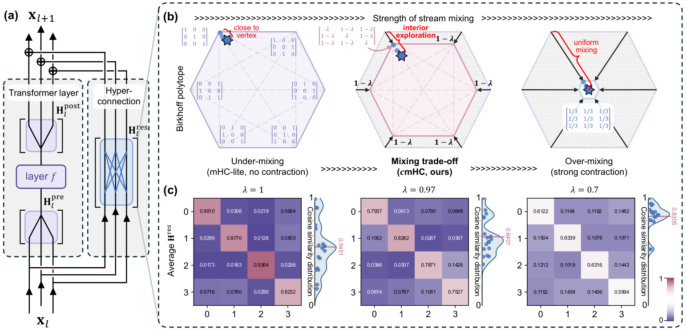

### TL;DR

Manifold-constrained Hyper-Connections (mHC) extend residual streams by learning stream-mixing matrices on the Birkhoff polytope (doubly-stochastic matrices). The authors show this constraint creates a brittle under-/over-mixing trade-off: boundary points collapse streams toward independence, deep stacks over-blend them. cmHC adds a parameter-free geometric contraction toward the polytope's interior, with layer-depth-aware strength, and fuses the whole op on Ascend NPUs.

### Key idea

Replace the raw doubly-stochastic mixing matrix `P` with a contracted version `cP + (1−c)·(J/n)` (interior point of the polytope), where `c` is a learned scalar with heavier contraction at shallow layers. No new parameters beyond the scalar; the regularization is purely geometric.

### Main finding

Reports improvements on dense and MoE training stability and loss curves vs vanilla mHC, with fused Ascend NPU kernels cutting hyper-connection op latency by **up to 44.8%**.

### Why it matters

Hyper-Connections are an emerging alternative to vanilla residual streams (used in recent DeepSeek-style stacks). cmHC gives a principled fix to their main pathology and a practical recipe for deploying them at scale without extra parameters or kernel cost — pushing residual-stream design past the "add more streams" era.

### Knowledge graph integration

**Builds on / relates to existing pages:**
- [transformer-block.md](../architectures/transformer-block.md) — residual-stream variant that this paper modifies
- [_moe.md](../architectures/_moe.md) — results include MoE training stability
- [deepseek-moe.md](../architectures/deepseek-moe.md) — same architectural family where hyper-connections first shipped at scale

**Suggested new pages:**
- `architectures/cmhc.md` *(depth)* — the contraction trick + layer-depth schedule
- `architectures/hyper-connections.md` *(depth)* — base mHC concept this paper fixes (upstream primary source)

---

## 2. NoPeWorld

**Authors:** (not listed in extractable page content) — *(affiliations undisclosed in HF page)*
**Links:** [arXiv:2611.27963](https://arxiv.org/abs/2611.27963) · [HF](https://huggingface.co/papers/2611.27963) · [AlphaXiv](https://www.alphaxiv.org/abs/2611.27963)
**Topics:** `multimodal`, `diffusion`, `world-model`

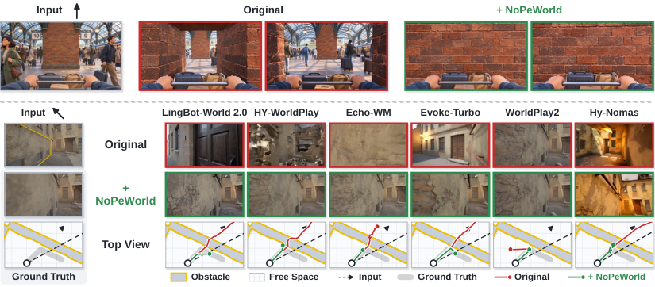

### TL;DR

Interactive video world models routinely let cameras or objects pass through solid obstacles. The authors release **NoPeBench** (a penetration-violation benchmark) and show open-source world models violate on ~74% of attempts. They then show a frozen DiT's hidden states *already* encode enough signal to predict unsafe actions, and train a small head on top (**NoPeWorld**) that rewrites unsafe actions into nearest safe variants.

### Key idea

Rather than retrain the world model for physical constraints, add a thin **action-safety head** on frozen DiT features that classifies whether a commanded action will cause penetration; at inference, project unsafe actions onto the closest safe alternative in intent space.

### Main finding

Averaged across six world models, the violation rate drops from **74% to 16%** without retraining the base model. Zero-shot generalization to open-domain images, third-person views, and moving obstacles.

### Why it matters

Physical plausibility is the current hard failure of interactive video world models (GameWM, Genie-class, driving sims). This paper establishes that (a) failures are measurable, (b) the base model *knows* enough to prevent them, and (c) a lightweight head is a viable path — turning a "retrain the world model" problem into a "train a safety filter" problem.

### Knowledge graph integration

**Builds on / relates to existing pages:**
- (no world-model pages yet in the graph — this is a gap)

**Suggested new pages:**
- `multimodal/_world-models.md` *(taxonomy)* — covers interactive video world models as a class
- `multimodal/no-penetration-filter.md` *(depth)* — the frozen-features action-safety head

---

## 3. Clover

**Authors:** Jingdi Chen, Zizhao Chen, Shengliang Deng, Xiachong Feng, Shansan Gong, Yujin Huang, Lingpeng Kong, Mukai Li, Qi Peng, Guicheng Qi, Jianhao Ruan, Zirui Wu, Jinwei Yao, Jiacheng Ye, Shiying Zhang, Zongpu Zhang, Jiatong Zhu — *DiffuSpace*
**Links:** [arXiv:2611.24636](https://arxiv.org/abs/2611.24636) · [HF](https://huggingface.co/papers/2611.24636) · [AlphaXiv](https://www.alphaxiv.org/abs/2611.24636)
**Topics:** `diffusion`, `MoE`, `LLM`, `agents`

### TL;DR

Clover-35B-A3B is a **mixture-of-experts diffusion language model** (35B total / 3B active) that adapts **Gated Delta Networks** to a block-diffusion training/inference regime. It targets agentic coding and reports **73.6 on SWE-bench Verified** and **~680 tokens/s on one NVIDIA GB300**. A "decision model" variant jointly predicts answers to grouped related questions.

### Key idea

Three stacked bets: (1) block diffusion as the LM objective instead of pure autoregression, (2) Gated Delta Networks as the sequence mixer, adapted to tolerate block diffusion's non-causal within-block structure, and (3) MoE scaling with the diffusion objective for inference throughput.

### Main finding

73.6% on SWE-bench Verified with only ~3B active parameters, running at ~680 tok/s on a single GB300 — competitive with much larger AR coding models while using the diffusion path for parallel decoding.

### Why it matters

Diffusion LMs have mostly stayed research-scale. Clover is the first ~frontier-class open result on a hard agentic benchmark from the diffusion-LM track, suggesting the parallel-decoding + non-causal-attention advantages of diffusion might finally be practical at MoE scale. Also a stress test for Gated Delta Networks outside pure AR settings.

### Knowledge graph integration

**Builds on / relates to existing pages:**
- [_moe.md](../architectures/_moe.md) — MoE sparsity at 35B/3B active
- [deepseek-moe.md](../architectures/deepseek-moe.md) — reference open MoE recipe
- [humaneval.md](../evaluation/humaneval.md) · [livecodebench.md](../evaluation/livecodebench.md) — coding-eval cousins

**Suggested new pages:**
- `case-studies/clover-35b-a3b.md` *(case study)* — full system breakdown
- `architectures/block-diffusion-lm.md` *(depth)* — block diffusion as an LM training objective
- `architectures/gated-delta-networks.md` *(depth)* — the mixer, since this is the first large deployment

---

## 4. Future-OPSD

**Authors:** Qingqiao Hu, Dingqiang Ye, Yuqi Jia, Yijun Liang, Di Fu, Yunjie Tian, Dongdi Zhao, Changyou Chen — *UB / Stony Brook / JHU / Duke / UMD*
**Links:** [arXiv:2611.26954](https://arxiv.org/abs/2611.26954) · [HF](https://huggingface.co/papers/2611.26954) · [AlphaXiv](https://www.alphaxiv.org/abs/2611.26954)
**Topics:** `multimodal`, `reasoning`, `RL`

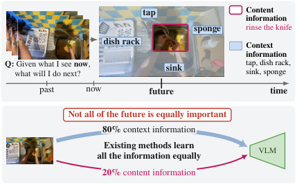

### TL;DR

Future-OPSD learns **video foresight reasoning** — predicting what happens next in a scene and planning from that — from raw past-future video pairs, with no labels or external LLM supervision. Learning is on-policy self-distillation gated by a learned **"foresight score"** that weights frames by their decision-relevance.

### Key idea

Treat naturally occurring video temporal structure as the reward signal: sample rollouts of future-scene predictions from the current policy, score them with a foresight head that upweights decision-critical content, and distill back on-policy. No action labels, no reward model, no judge LLM.

### Main finding

**+14.2 on open-ended prediction** and **+15.9 on closed-ended planning** relative to supervised video-LLM baselines, on standard VLM video benchmarks.

### Why it matters

RLVR has transformed text reasoning but video reasoning is still mostly SFT on labeled traces. Future-OPSD provides a credible unsupervised-RL path for video using temporal self-consistency as the verifier — a recipe that scales naturally with raw video.

### Knowledge graph integration

**Builds on / relates to existing pages:**
- [long-cot-rl.md](../post-training/reasoning/long-cot-rl.md) — same "RL on rollouts" family, video modality
- [rlvr.md](../post-training/rlvr.md) — Future-OPSD replaces the verifier with a temporal foresight score

**Suggested new pages:**
- `multimodal/video-foresight-reasoning.md` *(depth)* — the foresight-score + on-policy self-distill loop

---

## 5. MemOnce

**Authors:** Chaoyou Fu, Songlin Liu, Yiqing Hu, Caifeng Shan — *Nanjing University / USTC*
**Links:** [arXiv:2611.27973](https://arxiv.org/abs/2611.27973) · [HF](https://huggingface.co/papers/2611.27973) · [AlphaXiv](https://www.alphaxiv.org/abs/2611.27973)
**Topics:** `architecture`, `efficient-inference`, `long-context`

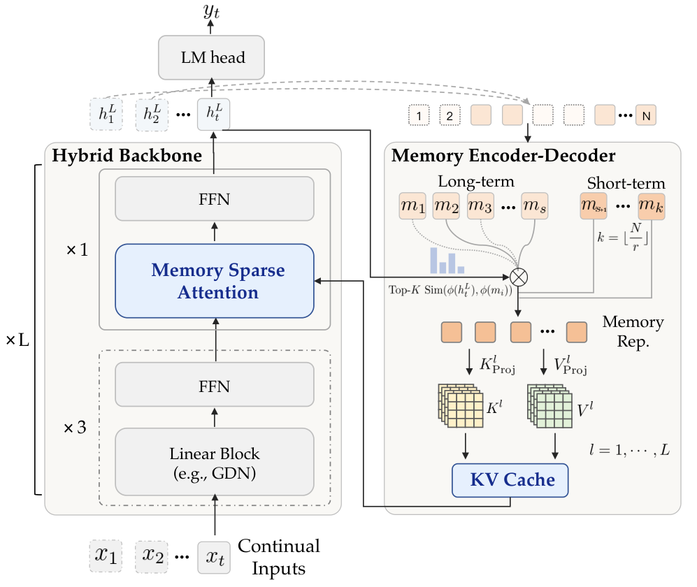

### TL;DR

MemOnce caches a small subset of **final-layer hidden states** as compact long-horizon memory, then re-expands them into per-layer KV caches on demand. Sparse attention uses retrieval indices computed **once across all layers**, trading cache size for a one-time compute cost.

### Key idea

Compress per-layer KV caches into a single final-layer hidden-state memory ("memory tokens"), then use a tied projection to reconstruct per-layer K/V when needed. The attention sparsity pattern is also tied — one retrieval decision is reused at every layer, so the cost is amortized.

### Main finding

At **1M-token contexts**, lower memory and latency than full-KV Transformers and linear-time baselines, plus zero-shot transfer to retrieval tasks (the memory tokens behave like a learned index).

### Why it matters

Long-context inference is bottlenecked by KV cache growth; current solutions either sacrifice fidelity (linear/SSM) or pay full memory (quantization helps but doesn't change scaling). MemOnce proposes a middle path: full-fidelity memory at a linear-sized cache, with cross-layer tying making sparse attention cheap.

### Knowledge graph integration

**Builds on / relates to existing pages:**
- [mla.md](../architectures/mla.md) — related KV-compression line (per-layer latent)
- [dca.md](../fundamentals/dca.md) — long-context attention variant family

**Suggested new pages:**
- `architectures/memonce.md` *(depth)* — the final-layer memory + cross-layer tied sparse attention
- `inference/_long-context-kv.md` *(taxonomy)* — class of KV-compression / long-context memory tricks

---

## 6. Duopra

**Authors:** Chiyu Chen, Pengzhou Cheng, Yuezhao Ma, Xiaocheng Li, Can Liu, Haonan Hu, Yao Yao, Yifei Yang, Yijie Lu, Taolei Wang, Yansi Li, Muhuan Wu, Chenglu Sun, Gongshen Liu, Zhuosheng Zhang — *SJTU-led consortium*
**Links:** [arXiv:2611.25773](https://arxiv.org/abs/2611.25773) · [HF](https://huggingface.co/papers/2611.25773) · [AlphaXiv](https://www.alphaxiv.org/abs/2611.25773)
**Topics:** `agents`, `multimodal`, `RL`

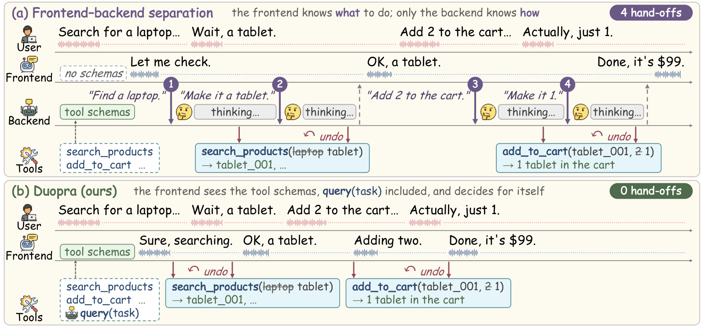

### TL;DR

Duopra adds **task execution** to full-duplex speech models by treating a backend agent as a tool receiving a self-contained natural-language request. Training stacks protocol-aware SFT, RL that rewards timely + complete execution, and a projector-only repair stage.

### Key idea

The "full-duplex" problem (speech + response can interleave in time) is reframed as a **tool-call-while-talking** problem: the speech model learns to emit well-formed task requests mid-conversation to a downstream agent, and to resume speaking coherently once the agent replies. RL is on the joint "listen / speak / dispatch" trajectory.

### Main finding

On Full-Duplex-Bench v3, Pass@1 jumps from **4.7% → 44.7%** with the same backend, **47.7%** when calling tools directly, **49.3%** with a DeepSeek backend. First serious result on conversational + executive dual-channel speech.

### Why it matters

Voice assistants have been stuck on "ASR → text LLM → TTS" pipelines. Duopra shows a native full-duplex speech model can issue structured tool calls without losing conversational fluency, a precondition for real agentic voice UIs.

### Knowledge graph integration

**Builds on / relates to existing pages:**
- [_rl.md](../post-training/_rl.md) — RL on agentic trajectories
- [_post-training.md](../post-training/_post-training.md) — SFT→RL staged post-training

**Suggested new pages:**
- `agents/full-duplex-agents.md` *(depth)* — the dispatch-while-talking formalism + RL reward shape
- `agents/_agent-training.md` *(taxonomy)* — class of agent post-training recipes (longer-term)

---

## 7. ReSpaceBench

**Authors:** Henry Zheng, Weibo Gong, Yang Yue, Rui Huang, Yang Zhang, Gao Huang — *Tsinghua LeapLab*
**Links:** [arXiv:2611.21485](https://arxiv.org/abs/2611.21485) · [HF](https://huggingface.co/papers/2611.21485) · [AlphaXiv](https://www.alphaxiv.org/abs/2611.21485)
**Topics:** `eval`, `multimodal`, `memory`

### TL;DR

ReSpaceBench measures whether VLM agents **remember space across revisits** — 3,244 questions across 590 synthetic and real-home scenes, 9 task types. Strongest zero-shot VLM hits 50.5% vs 90.1% human; agentic scaffolding does not help; fine-tuning Qwen3-VL-8B on the paper's RS-30K set lifts an 8B model to 60.4%.

### Key idea

Decouple **spatial perception** (handled well by VLMs) from **persistent spatial memory** (handled poorly): design tasks that require re-entering a scene and reasoning about what's still where. Pair with a matched training set (RS-30K) so progress is measurable with just fine-tuning.

### Main finding

Agentic scaffolds (plan+search, self-reflection) **do not improve over direct inference** on persistent-memory tasks, implying the bottleneck is model-internal state rather than reasoning procedure. Fine-tuning raises Qwen3-VL-8B from 35.5% → 60.4%.

### Why it matters

Embodied agents can't yet remember rooms they've walked through — a stark gap vs humans. This benchmark isolates the deficit from scene understanding and shows training data can close most of it.

### Knowledge graph integration

**Builds on / relates to existing pages:**
- [ifeval.md](../evaluation/ifeval.md), [mmlu.md](../evaluation/mmlu.md) — eval family (benchmark-release paper)

**Suggested new pages:**
- `evaluation/respacebench.md` *(depth)* — the 9-task persistent-spatial-memory benchmark
- `multimodal/_spatial-memory.md` *(taxonomy)* — class of persistent-memory evals and fixes

---

## 8. Intent Contracts

**Authors:** Genliang Zhu, Xiaobo Chen, Chu Wang — *Georgia Tech / UMass Amherst / UIUC*
**Links:** [arXiv:2611.24025](https://arxiv.org/abs/2611.24025) · [HF](https://huggingface.co/papers/2611.24025) · [AlphaXiv](https://www.alphaxiv.org/abs/2611.24025)
**Topics:** `agents`, `safety`

### TL;DR

Intent Contracts is an authorization interface for tool-using agents where the **planner holds no tools**. Each step, the planner emits a logged "contract" with a goal, a verbatim user quotation, and scope fields; a small trusted model validates it against the user's words and writes the actual tool call.

### Key idea

Separate **intent proposal** (large model, no privileges) from **tool-call authoring** (small trusted model, no planning freedom). The verbatim-quote-plus-scope contract is auditable and refusable, and the trusted authorizer has a constrained surface.

### Main finding

On AmPermBench, contracts **complete more of the user's task when the planner adds unrequested work** — but do **not** reliably reduce unauthorized actions. Ambiguous object references stay the dominant failure mode.

### Why it matters

Current agent safety relies on monolithic jailbreak-resistant planners or post-hoc action monitors. Intent Contracts is a structural alternative that mirrors capability-based security: the planner literally can't call a tool. The negative result on unauthorized actions is instructive — the quote-grounded scope is not yet precise enough.

### Knowledge graph integration

**Builds on / relates to existing pages:**
- [_scheming.md](../safety/_scheming.md) — adjacent framing: constrain the model's action space, not just its outputs
- [cot-monitoring.md](../safety/cot-monitoring.md) — same "trusted-small-model as guard" pattern

**Suggested new pages:**
- `agents/intent-contracts.md` *(depth)* — the planner / authorizer split and scope-field design

---

## 9. Prune to Expand (P2E)

**Authors:** Qilin Sun, Tianhe Wu, Kede Ma — *CityU HK / CUHK-Shenzhen*
**Links:** [arXiv:2611.27229](https://arxiv.org/abs/2611.27229) · [HF](https://huggingface.co/papers/2611.27229) · [AlphaXiv](https://www.alphaxiv.org/abs/2611.27229)
**Topics:** `diffusion`, `data`, `fine-tuning`

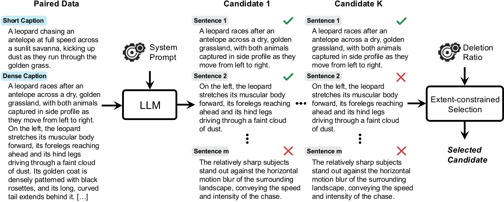

### TL;DR

Prompt-enhancement SFT normally pairs short user prompts with dense captions; P2E shows **removing redundant sentences** from the dense captions improves prompt enhancers more than training on captions that caused the largest image-gen gains.

### Key idea

Dense captions carry supervision noise — image-specific detail only weakly tied to user intent. P2E is a text-only pruner: delete sentences up to a per-example budget while preserving explicit user requests and informative visual structure; train on the pruned pairs.

### Main finding

P2E-trained enhancers improve human-preference alignment and visual quality over dense-caption SFT across multiple image generators — under **identical** training configs — overturning the "captions with bigger image-gen gains make better SFT targets" heuristic.

### Why it matters

Prompt enhancement is table stakes for consumer image models; P2E is a drop-in data pipeline change. Also a methodological point: the right SFT signal for a prompt rewriter isn't "which target most helps the downstream model" but "which target best isolates user intent."

### Knowledge graph integration

**Builds on / relates to existing pages:**
- [_data-curation.md](../data/_data-curation.md) — SFT data curation family
- [quality-filtering.md](../data/quality-filtering.md) — related filter-vs-rewrite move

**Suggested new pages:**
- `data/p2e-caption-pruning.md` *(depth)* — the per-example deletion-budget rewriter

---

## 10. SkillDiff

**Authors:** Litao Guo, Man Chen, Xinli Xu, Jinsong Zhou, Zixin Zhang, Ying-Cong Chen — *HKUST(GZ) / HKUST / Knowin*
**Links:** [arXiv:2611.25534](https://arxiv.org/abs/2611.25534) · [HF](https://huggingface.co/papers/2611.25534) · [AlphaXiv](https://www.alphaxiv.org/abs/2611.25534)
**Topics:** `agents`, `eval`

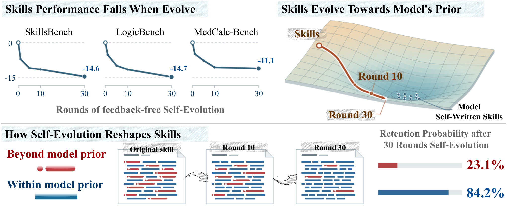

### TL;DR

When agents rewrite their own expert-written **skill descriptions** without any feedback, every tested model gets worse — ~15-point drop in SkillsBench pass rate over 30 rounds. Rewrites drift toward what the base model would write unprompted; expert-specific content outside that prior is lost first.

### Key idea

Feedback-free self-evolution is a **regression to the base model's prior**. Fix with **SkillDiff**: mark expert-specific content in place without touching the skill text, so it survives rewrites. Pass rate recovers to +4.8 over the (already-fallen) baseline.

### Main finding

Across all models tested, SkillsBench pass rate drops ~15 points after 30 rounds of unsupervised self-rewriting. The content that gets lost is specifically the content a from-scratch generation wouldn't produce. SkillDiff recovers 4.8 points on average.

### Why it matters

Self-improvement loops without external signal are popular for agents, and this is clean empirical evidence that they **monotonically degrade** without an anchor. It also pins down the mechanism (prior-regression) rather than treating it as model-specific noise.

### Knowledge graph integration

**Builds on / relates to existing pages:**
- [rejection-sampling.md](../post-training/rejection-sampling.md) — adjacent "self-improvement needs a verifier" lesson
- [_scheming.md](../safety/_scheming.md) — adjacent model-rewrites-own-prompt failure mode

**Suggested new pages:**
- `agents/feedback-free-self-evolution.md` *(depth)* — the prior-regression finding + SkillDiff anchoring

---

## 11. QueryLM / Search-Native Pretraining

**Authors:** Kaustubh Ponkshe, Gyung Hyun Je, Stefan Taga, Colin Raffel, Martin Jaggi — *EPFL / University of Toronto*
**Links:** [arXiv:2611.26809](https://arxiv.org/abs/2611.26809) · [HF](https://huggingface.co/papers/2611.26809) · [AlphaXiv](https://www.alphaxiv.org/abs/2611.26809)
**Topics:** `pre-training`, `retrieval`

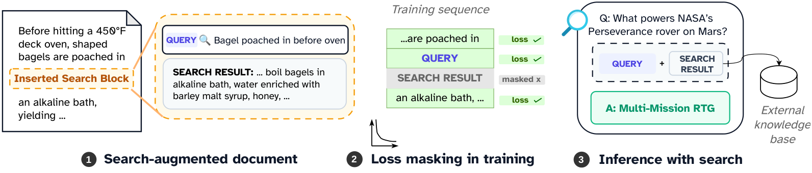

### TL;DR

QueryLM augments **pretraining** text with web-search queries and locally retrieved results so that next-token prediction *includes* learning when and how to search. 360M–3.3B scale on Wikipedia + DCLM-Edu; a 1.4B QueryLM matches a FLOP-matched 3.3B baseline on knowledge-intensive tasks.

### Key idea

Don't bolt retrieval on top with RAG or a post-train step — interleave `<query>…</query>` + `<result>…</result>` blocks directly into the pretraining corpus so the model learns the search/read/continue rhythm at the token-prediction level.

### Main finding

**1.4B QueryLM ≥ 3.3B baseline** on knowledge-intensive tasks at FLOP parity. The retrieval-following behavior survives standard SFT. Weights and training artifacts released on HF.

### Why it matters

Agentic LMs typically bolt tool use on post-training, where it has to overcome the model's base behavior. QueryLM shows the alternative — bake it into pretraining — is cheaper per unit of knowledge. Likely to influence the next wave of agent-capable base models.

### Knowledge graph integration

**Builds on / relates to existing pages:**
- [mid-training.md](../pre-training/mid-training.md) — adjacent stage for injecting new behaviors into base models
- [mtp.md](../pre-training/mtp.md) — related "modify the pretraining objective" line

**Suggested new pages:**
- `pre-training/search-native-pretraining.md` *(depth)* — the query/result interleaving recipe

---

## 12. Motion-Aware Reward Modeling

**Authors:** Xiangbo Gao, Bo Ni, Samyadeep Basu, Viet Dac Lai, Jing Shi, Seunghyun Yoon, Gang Wu, Yu Wang, Thien Huu Nguyen, Tyler Derr, Franck Dernoncourt, Zhengzhong Tu, Yue Zhao — *Texas A&M / Vanderbilt / Adobe / UGA / Amazon / USC*
**Links:** [arXiv:2611.22495](https://arxiv.org/abs/2611.22495) · [HF](https://huggingface.co/papers/2611.22495) · [AlphaXiv](https://www.alphaxiv.org/abs/2611.22495)
**Topics:** `diffusion`, `video`, `reward-model`

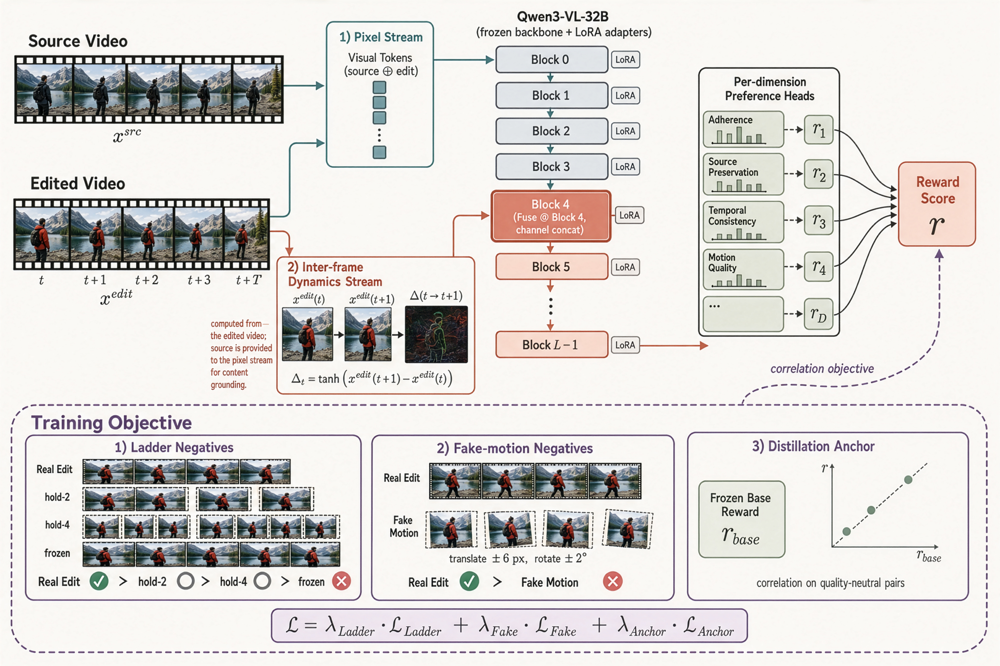

### TL;DR

Reward models for instruction-guided video editing reward **temporal consistency so hard they punish actual motion** — a failure the authors name "motion collapse." Their fix: a second **RGB frame-difference** stream in the reward model plus negatives that strip or fabricate motion.

### Key idea

Add a motion-explicit branch to the reward model (frame-diff features), train with motion-suppressed and fabricated-motion hard negatives, and distill from a human-preference anchor to prevent regressing on general quality.

### Main finding

Avoids selecting motion-suppressed candidates on the VE-Bench motion ladder; **0.57 Spearman** with human ratings; preserves motion during reward-guided fine-tuning of the generator.

### Why it matters

Reward-guided video generation inherits whatever pathology its RM has. Motion collapse is subtle because it rewards "clean" outputs; this paper identifies the failure and shows a compact fix. The RM-dataset recipe is transferable to other video RMs.

### Knowledge graph integration

**Builds on / relates to existing pages:**
- [_rewards.md](../post-training/_rewards.md) — reward-model-design class
- [cot-reward-model.md](../post-training/cot-reward-model.md) — adjacent specialized-RM line

**Suggested new pages:**
- `post-training/motion-aware-reward.md` *(depth)* — the frame-diff branch + motion-negatives recipe

---

## 13. SP-Refine / StylePrism

**Authors:** Sameeksha Kini, Amulya Rayasam, Anisa Dye, Abhinav Sharma, Sai Karthik Navuluru, Bo Ni, Li Li, Junda Wu, Tong Yu, Nedim Lipka, Xiaolei Huang, Tyler Derr, Yue Zhao, Zhengzhong Tu, Yu Wang, Hongjie Chen, Thien Huu Nguyen, Nesreen K. Ahmed, Franck Dernoncourt, Ryan A. Rossi — *multi-university + Adobe / Cisco / Zillow*
**Links:** [arXiv:2611.27211](https://arxiv.org/abs/2611.27211) · [HF](https://huggingface.co/papers/2611.27211) · [AlphaXiv](https://www.alphaxiv.org/abs/2611.27211)
**Topics:** `LLM`, `fine-tuning`, `eval`

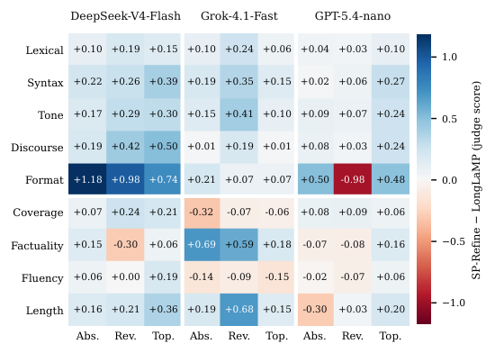

### TL;DR

Personalized long-form generation usually dumps a user's past writing into context and hopes the model copies the style. SP-Refine first **extracts an explicit style profile** across 28 StylePrism aspects (grouped in 7 categories), drafts, then revises against the profile twice.

### Key idea

Make style-matching **inspectable**. The 28-aspect schema is a checklist; the model extracts aspect values from retrieved samples, uses them to guide revision, and the whole chain is human-auditable.

### Main finding

Wins **25 of 27** ROUGE/METEOR comparisons across LongLaMP tasks × 3 LLMs. **+10.2% average**, +35.8% max. Explicit profiles outperform implicit style transfer *when used for revision*, not as a drop-in for the samples themselves.

### Why it matters

Shows that explicit intermediate representations (style profile here, chain-of-thought elsewhere) keep paying off as outputs get longer and style harder to measure. Also a usable schema (StylePrism) for future long-form personalization work.

### Knowledge graph integration

**Builds on / relates to existing pages:**
- [_post-training.md](../post-training/_post-training.md) — adjacent inference-time refinement pattern

**Suggested new pages:**
- (none — primarily an inference-time prompting pipeline; doesn't fill a graph gap on its own)

*Borderline: included because the StylePrism schema is a usable primitive for personalization research.*

---

## 14. GameWM

**Authors:** (not listed in extractable page content; corresponding author davidbinghe@gmail.com; project lead at SJTU) — *SJTU-led*
**Links:** [arXiv:2611.19247](https://arxiv.org/abs/2611.19247) · [HF](https://huggingface.co/papers/2611.19247) · [AlphaXiv](https://www.alphaxiv.org/abs/2611.19247)
**Topics:** `diffusion`, `video`, `multimodal`

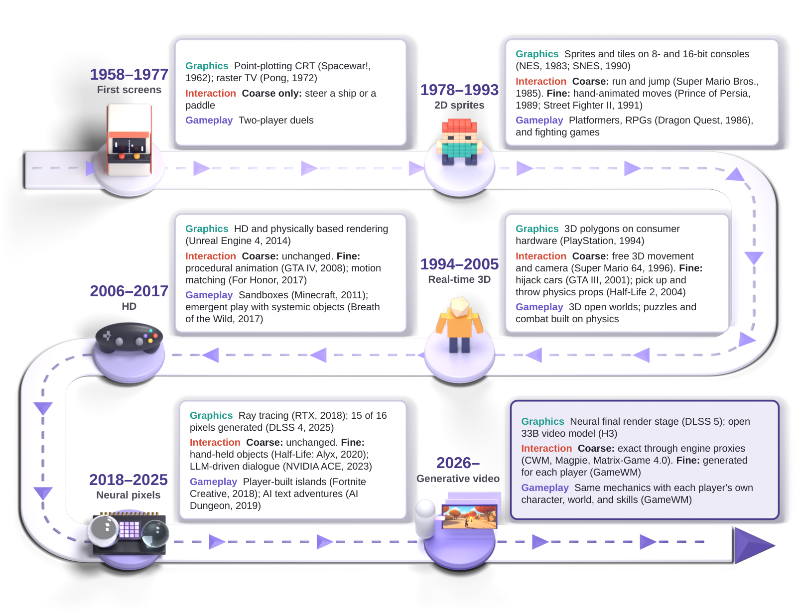

### TL;DR

GameWM splits a video-game world model into a **GameWM-engine** (rules, state, camera, world layout — exact and symbolic) and a **GameWM-VM** (visual appearance + interaction detail — generative). The same mechanic can be re-skinned across many visual styles while outcomes stay authoritative.

### Key idea

Use classical game-engine semantics as the system-of-record and diffusion as the renderer — the visual model never gets to decide collision, physics, or game state. Trained with an interaction-focused data engine; 5B–33B family with a real-time causal variant.

### Main finding

Produces coherent interactive video games where re-skinning the visual branch doesn't break the game logic. Scales from 5B to 33B; a causal variant runs real-time.

### Why it matters

The current world-model line (Genie, Oasis, …) blends game logic into the visual model, which is why they drift. GameWM factors the problem cleanly — a design pattern likely to recur in long-horizon simulators.

### Knowledge graph integration

**Builds on / relates to existing pages:**
- (no world-model pages in graph yet — same gap as #2)

**Suggested new pages:**
- `multimodal/_world-models.md` *(taxonomy)* — shared with #2; covers interactive video world models
- `case-studies/gamewm.md` *(case study)* — if Phase 3 picks it up; borderline since this is more design pattern than tech report

---

## 15. AgentRoboCritic

**Authors:** Yiyang Du, Yuxuan Kuang, Qitao Zhao, Yixuan Wang, Zhanqiu Guo, Yi Xu, Xin Li, Wenbin He, Liu Ren, Chenyan Xiong — *CMU / UIUC / Bosch Research NA / BCAI*
**Links:** [arXiv:2611.26613](https://arxiv.org/abs/2611.26613) · [HF](https://huggingface.co/papers/2611.26613) · [AlphaXiv](https://www.alphaxiv.org/abs/2611.26613)
**Topics:** `agents`, `multimodal`, `eval`

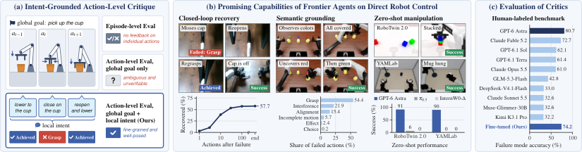

### TL;DR

AgentRoboCritic is an **intent-grounded per-action critic** for frontier multimodal agents on direct robot control. Across 12 manipulation benchmarks it isolates where agents actually fail: grasping, alignment, uneven recovery; ships a 12,844-action annotated dataset and a fine-tuned open critic (**Muse-Glimmer-30B**).

### Key idea

Judge **one action at a time, against the declared intent**, rather than scoring whole trajectories. The critic doubles as a dataset labeler (12,844 actions) and as a trainable model (Muse-Glimmer-30B), enabling both evaluation and downstream RL.

### Main finding

Frontier agents are decent at recovering from local failures and at zero-shot manipulation, but weak at grasping, alignment, and asymmetric recovery (some failure types recover far better than others). Release includes the action-annotated dataset and the fine-tuned critic.

### Why it matters

Robot-control agents have been evaluated end-to-end, which hides where they're broken. AgentRoboCritic gives per-action signal that directly plugs into RL/DPO-style fine-tuning. The released Muse-Glimmer-30B critic is useful on its own as a verifier.

### Knowledge graph integration

**Builds on / relates to existing pages:**
- [ifeval.md](../evaluation/ifeval.md) — related eval-infrastructure paper
- [_post-training.md](../post-training/_post-training.md) — critic as RL verifier line

**Suggested new pages:**
- `evaluation/agent-robo-critic.md` *(depth)* — the per-action intent-grounded evaluation + critic model

*Borderline: included because the critic-as-dataset-labeler pattern transfers to non-robot agent RL.*

---

## Notes

- Hero figures are the first non-logo figure from each arxiv HTML page. Three papers had no inline figures in the HTML (Clover tech report, ReSpaceBench, Intent Contracts) — their sections have no `![Hero figure]` line.
- No existing concept files, `READING-LIST.md`, or `PAPERS.md` were modified to produce this digest.
