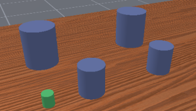
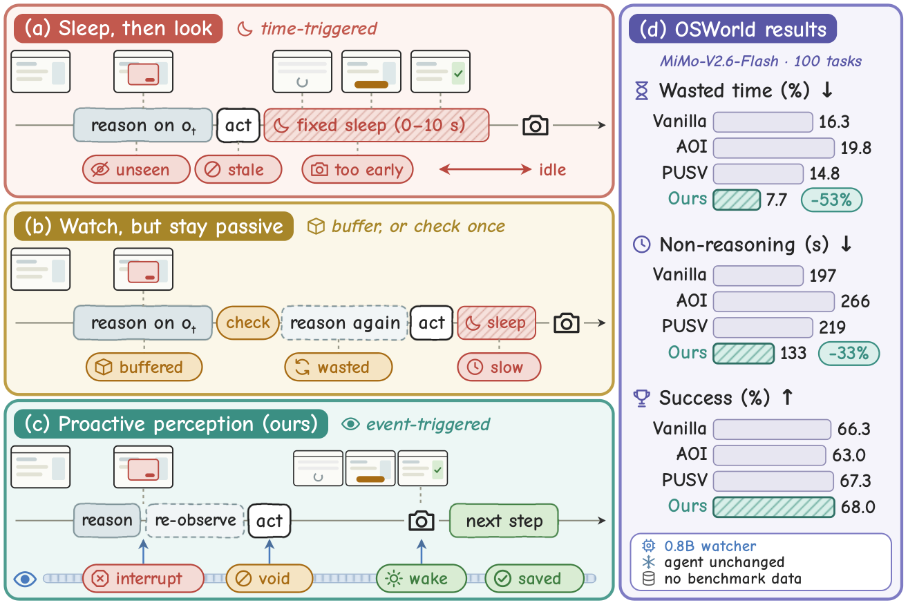
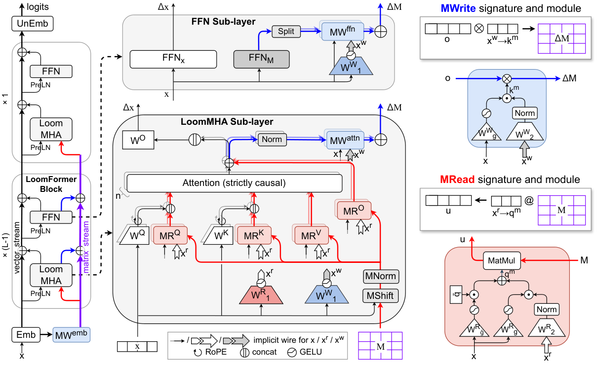
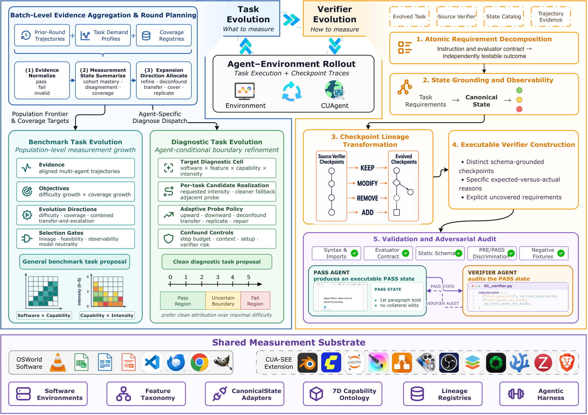
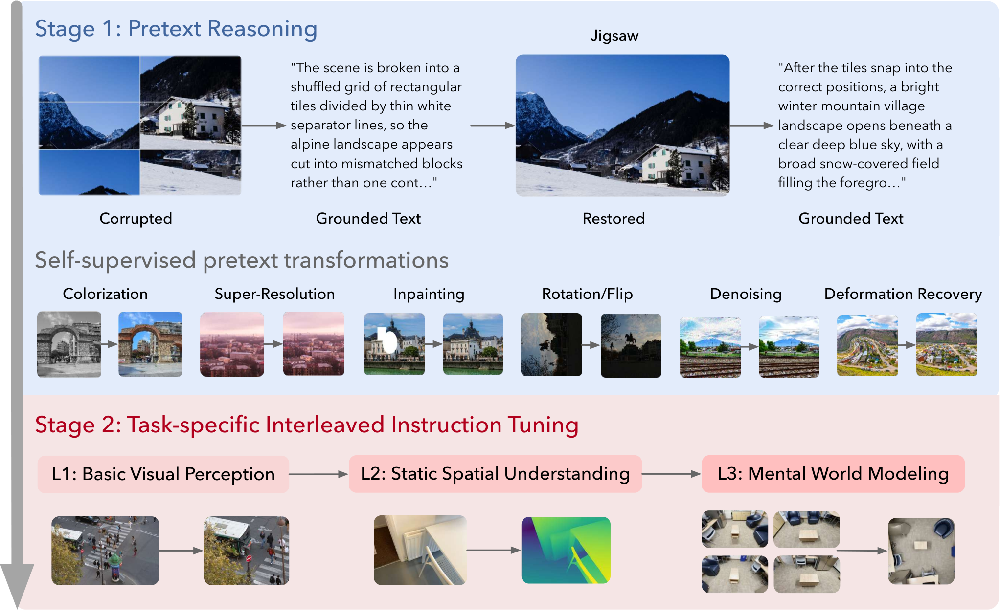
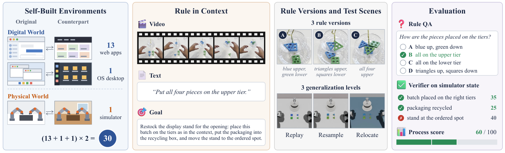
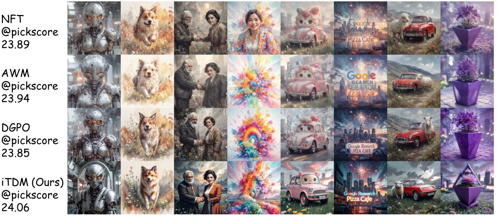
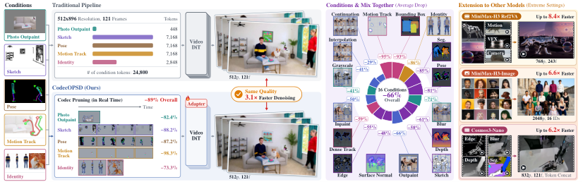

# Daily AI papers — 2026-11-25

*Curated from HF Daily Papers. 14 of ~60 papers kept after relevance filter.*

## Papers at a glance

| # | Title | Topics | Org |
| --- | --- | --- | --- |
| 1 | [Lazy Agents: RL with Verifiable Beliefs](#1-lazy-agents-rl-with-verifiable-beliefs) | `agents`, `RL`, `reasoning` | NTU Singapore |
| 2 | [Don't Sleep, Keep Watch: Proactive Perception for Computer-Use Agents](#2-dont-sleep-keep-watch) | `agents`, `multimodal` | A*STAR CFAR |
| 3 | [Rewirable Circuits in Transformers with Loom Attention](#3-rewirable-circuits-with-loom-attention) | `architecture`, `efficient-inference` | BUPT, ColorfulClouds |
| 4 | [Self-Evolving Evaluation Environments for Computer-Use Agents](#4-cua-see-self-evolving-eval) | `agents`, `eval` | Alibaba Token Hub |
| 5 | [ThinkMorph-SSL: Interleaved Multimodal Reasoning](#5-thinkmorph-ssl) | `multimodal`, `reasoning` | Multi-institutional |
| 6 | [Qwen-Image-HD: Autoregressive Diffusion for HD](#6-qwen-image-hd) | `diffusion`, `efficient-inference` | Alibaba Qwen |
| 7 | [ICLWorld: ICL Benchmark Across Digital and Physical Worlds](#7-iclworld) | `eval`, `agents` | Tsinghua |
| 8 | [iTDM: Reinforcing Diffusion via Trajectory Distribution Matching](#8-itdm-reinforcing-diffusion) | `diffusion`, `RL` | HKUST |
| 9 | [Measuring Layer-wise Intrinsic Dimensionality of FFNs](#9-intrinsic-ffn-pca) | `interp` | — |
| 10 | [Distill to Loop: Pretrained DiTs into Looped Models](#10-distill-to-loop) | `diffusion`, `efficient-inference` | — |
| 11 | [InstructReplay: Preserve General Behavior During Factual SFT](#11-instructreplay) | `fine-tuning` | BAAI |
| 12 | [Steerable by Design: Conditional Pretraining for Control](#12-steerable-by-design) | `pretraining`, `safety` | MIT, Harvard |
| 13 | [RECAP: Long-horizon Agents with Context Compaction](#13-recap) | `agents`, `RL` | EPFL, ETH Zürich |
| 14 | [CodecOPSD: On-Policy Codec Distillation for Video Gen](#14-codecopsd) | `diffusion`, `efficient-inference` | Adobe |

---

## 1. Lazy Agents: RL with Verifiable Beliefs

**Authors:** Peilin Feng, Wenbin Wang, Soujanya Poria — *DeCLaRe Lab, Nanyang Technological University*
**Links:** [arXiv:2611.32884](https://arxiv.org/abs/2611.32884) · [HF](https://huggingface.co/papers/2611.32884) · [AlphaXiv](https://www.alphaxiv.org/abs/2611.32884)
**Topics:** `agents`, `RL`, `reasoning`

### TL;DR

Long-horizon agents often commit to an answer before they have gathered enough evidence — they answer against their own beliefs. This paper trains them to defer answering when uncertain by shaping RL with the simulator's exact posterior over the hidden ground-truth answer as a dense process reward.

### Key idea

Reinforcement Learning with Verifiable Beliefs (RLVB): in a simulator that exposes the true posterior `p(y | h_t)` given the agent's history `h_t`, use the step-wise entropy of that posterior as a verifiable reward signal. The agent gets credit for information-gathering actions that sharpen the belief, and is penalized for committing while the belief is still diffuse.

### Main finding

Across three vision-language long-horizon benchmarks plus a new Pro-Worlds visual puzzle suite, RLVB-trained agents outperform both the base models and several outcome-reward-only RL baselines — the gap is largest on tasks where early-commit is rewarded by shortcuts in the base policy.

### Why it matters

Outcome-only RL post-training rewards lucky guesses equally with earned confidence; the "lazy" failure mode this paper names is a general flaw of long-horizon RL. Verifiable belief-shaped rewards are a concrete alternative to process reward models (PRMs) when the environment itself can compute the posterior.

### Knowledge graph integration

**Builds on / relates to existing pages:**
- [rlvr.md](../post-training/rlvr.md) — RLVB is RLVR with a belief-tracking verifier instead of an outcome checker
- [grpo.md](../post-training/grpo.md) — the training objective is a GRPO-style group-relative advantage shaped by the belief reward
- [prm.md](../post-training/reasoning/prm.md) — process rewards; RLVB is an environment-grounded alternative
- [long-cot-rl.md](../post-training/reasoning/long-cot-rl.md) — same long-horizon RL regime, different reward source
- [cot-reward-model.md](../post-training/cot-reward-model.md) — related: CoT-shaped reward

**Suggested new pages:**
- `post-training/reasoning/rlvb.md` *(depth)* — RL with verifiable beliefs as a posterior-shaped process reward

---

## 2. Don't Sleep, Keep Watch

**Authors:** Jie-Jing Shao, Yichen Liu, Long-Kai Huang, Haiyan Yin, et al. — *NUS, A\*STAR CFAR, SenseTime, HKBU*
**Links:** [arXiv:2611.28947](https://arxiv.org/abs/2611.28947) · [HF](https://huggingface.co/papers/2611.28947) · [AlphaXiv](https://www.alphaxiv.org/abs/2611.28947)
**Topics:** `agents`, `multimodal`

### TL;DR

Computer-use agents today look at the screen only when they're about to act. The paper proposes NightWatch, a plug-and-play layer where a small 0.8B watcher model keeps watching the screen continuously, interrupting the main agent when the UI changes, invalidating stale actions, and only waking it when the screen has settled.

### Key idea

Decouple perception from reasoning. A lightweight 0.8B VLM runs at high frequency against the screen stream; it emits three signals — **interrupt** (change detected, kill the in-flight thought), **void** (planned action is no longer valid), and **wake** (screen is stable, request a new plan) — into the main agent's control loop.

### Main finding

On OSWorld-Verified, NightWatch cuts non-reasoning wall-clock time by 33% with task success on par with the baseline. On DynaCU-Bench, which emphasizes dynamic UIs, task success rises from 39.5% → 44.2% when paired with the large VLM agent.

### Why it matters

Computer-use agents are rate-limited by their perception cadence. This separates "when to look" from "when to think" without retraining the main agent, which is the pattern frontier CUA stacks will need to compete with humans on dynamic interfaces (video calls, chat apps, live dashboards).

### Knowledge graph integration

**Builds on / relates to existing pages:**
- [agents/README.md](../agents/README.md) — computer-use agents; this sits above any specific agent policy
- [partial-rollouts.md](../systems/partial-rollouts.md) — related rollout-scheduling idea; here, the scheduler is driven by a perception signal

**Suggested new pages:**
- `agents/proactive-perception.md` *(depth)* — continuous watcher + interrupt/void/wake control signals for CUAs

---

## 3. Rewirable Circuits with Loom Attention

**Authors:** Da Xiao, Shengping Li, Xingyuan Yuan — *Beijing University of Posts and Telecommunications; ColorfulClouds Technology*
**Links:** [arXiv:2611.30634](https://arxiv.org/abs/2611.30634) · [HF](https://huggingface.co/papers/2611.30634) · [AlphaXiv](https://www.alphaxiv.org/abs/2611.30634)
**Topics:** `architecture`, `efficient-inference`

### TL;DR

Standard Transformers wire attention heads in a fixed, residual-stream-shaped way. LoomFormer lets the wiring change per token by adding a *second* residual stream — a per-token matrix memory — over which heads attend to one another's outputs. The resulting dual-stream Transformer matches ~3× bigger standard baselines at the same training budget.

### Key idea

Loom attention: each attention head reads from (a) the usual token stream and (b) the outputs of prior heads via a per-token matrix memory. The memory acts as a second residual stream whose contents rewire which heads feed which, token by token, implementing "circuits" dynamically.

### Main finding

Across model sizes and training budgets, LoomFormer matches standard Transformers trained with >3× the compute, and matches recent residual-stream baselines. LoomPythia-2.8B trained on 300B tokens adds ~2% FLOPs over Pythia-2.8B and matches or exceeds Pythia-12B on downstream tasks.

### Why it matters

Mechanistic-interpretability work has shown that Transformer computation is organized around *circuits* of heads. Letting the model learn to rewire its own circuits per token is a direct architectural answer to that observation — and the compute-matching results suggest the parameter savings are real, not noise.

### Knowledge graph integration

**Builds on / relates to existing pages:**
- [multi-head-attention.md](../architectures/multi-head-attention.md) — base operation being extended
- [transformer-block.md](../architectures/transformer-block.md) — the dual-residual-stream design is a drop-in block replacement
- [attention.md](../fundamentals/attention.md) — same primitive, operating over head outputs not tokens
- [mla.md](../architectures/mla.md) — related: a KV-efficient attention variant, complementary mechanism

**Suggested new pages:**
- `architectures/loom-attention.md` *(depth)* — second residual stream + attention over head outputs

---

## 4. CUA-SEE: Self-Evolving Eval Environments

**Authors:** Panrong Tong, Quyu Kong, Pengxiang Li, Haowen Yang, Chenglin Cai, Siheng Chen, Yue Wang — *Alibaba Token Hub, SJTU*
**Links:** [arXiv:2611.30962](https://arxiv.org/abs/2611.30962) · [HF](https://huggingface.co/papers/2611.30962) · [AlphaXiv](https://www.alphaxiv.org/abs/2611.30962)
**Topics:** `agents`, `eval`

### TL;DR

Computer-use agent benchmarks age out — once agents solve them, you need harder tasks. CUA-SEE is a closed-loop evaluation environment that generates new tasks and executable verifiers from agent-rollout evidence, so the benchmark keeps up with the agents it evaluates.

### Key idea

Three-objective decomposition: (1) **scope expansion** — mine the agents' successful rollouts for templates of new tasks; (2) **diagnosis** — surface the capability axes where the agent fails; (3) **verification precision** — upgrade the task-success checker as the agents learn to cheese it. All three are loops seeded by the agents' own behavior.

### Main finding

Across several agent families and multiple rounds, CUA-SEE produces tasks that are harder on average than the seed set while preserving process-level evidence (per-step grading remains available). No single-number headline; the result is a methodology for benchmark aging, not a score.

### Why it matters

Benchmark contamination and ceiling effects are already the dominant threat to agent evaluation. A self-evolving environment treats the benchmark itself as a trainable artifact — the same closed-loop pattern used in training frontier reward models, applied to evaluation.

### Knowledge graph integration

**Builds on / relates to existing pages:**
- [evaluation/README.md](../evaluation/README.md) — evaluation landscape
- [decontamination.md](../data/decontamination.md) — related concern: aging benchmarks vs. evolving them
- [agents/README.md](../agents/README.md) — CUA stack

**Suggested new pages:**
- `evaluation/self-evolving-benchmark.md` *(depth)* — closed-loop task + verifier generation from agent rollouts

---

## 5. ThinkMorph-SSL

**Authors:** Linjie Li, Yiming Liu, Yunzhuo Hao, et al. — *UW, Tsinghua, Zhejiang, NUS, Fudan, HKU, CUHK, UR, Stanford (21 authors)*
**Links:** [arXiv:2611.32183](https://arxiv.org/abs/2611.32183) · [HF](https://huggingface.co/papers/2611.32183) · [AlphaXiv](https://www.alphaxiv.org/abs/2611.32183)
**Topics:** `multimodal`, `reasoning`

### TL;DR

Interleaved multimodal reasoning — alternating text and intermediate images — needs supervision that doesn't exist at scale. ThinkMorph-SSL stages the training: self-supervised visual pretext tasks (colorization, denoising, inpainting) first, then instruction tuning on auto-constructed question-driven demonstrations.

### Key idea

Decouple *the ability to produce and read intermediate images* (Stage 1, no instructions — just pretext) from *the ability to use them for a goal* (Stage 2, instruction tuning). The pretext stage gives the model a vocabulary of visual operations it can later be instructed to deploy.

### Main finding

The full recipe adds an average of +11.33 accuracy points across 12 benchmarks over the base model, with the Stage 1 pretext training alone accounting for a large share of the gain.

### Why it matters

Chain-of-thought with intermediate images is one of the clearest paths to visual reasoning beyond text-only CoT. Scaling it requires either enormous human-authored interleaved data or a bootstrap — this paper is the clearest bootstrap recipe to date.

### Knowledge graph integration

**Builds on / relates to existing pages:**
- [multimodal/README.md](../multimodal/README.md) — interleaved vision-language training
- [long-cot-rl.md](../post-training/reasoning/long-cot-rl.md) — related: CoT RL, here extended with image tokens
- [mcts.md](../post-training/reasoning/mcts.md) — a related reasoning scaffold, different modality

**Suggested new pages:**
- `multimodal/interleaved-reasoning.md` *(taxonomy)* — class of methods that interleave text + image tokens in CoT

---

## 6. Qwen-Image-HD

**Authors:** Zihao Liu, Zekai Zhang, Shengming Yin, et al. (+6) — *Alibaba Qwen team*
**Links:** [arXiv:2611.32736](https://arxiv.org/abs/2611.32736) · [HF](https://huggingface.co/papers/2611.32736) · [AlphaXiv](https://www.alphaxiv.org/abs/2611.32736)
**Topics:** `diffusion`, `efficient-inference`, `multimodal`

### TL;DR

Extends Qwen-Image 2.0 to 4K generation by **blockwise autoregressive diffusion**: generate the scene tile by tile, conditioning each tile on its already-generated upper and left neighbors plus a compressed thumbnail of the global scene. A Wavefront-AR schedule generates tiles on the same anti-diagonal in parallel across GPUs.

### Key idea

Local 1K-tile training + AR composition at inference time. Each tile is a conditional 1K generation; the condition is (upper-tile, left-tile, scene-thumbnail). This gives you 4K coherent images without a single-pass 4K denoiser, and the Wavefront-AR schedule amortizes the AR dependency across GPUs instead of time.

### Main finding

On Qwen-Image-Bench at 4K, outperforms direct 4K FLUX-3-Image-Klein generation and beats full-image 4K fine-tuning at a lower training compute budget and faster inference. The Wavefront-AR schedule hides most of the AR latency.

### Why it matters

High-resolution diffusion has been bottlenecked by the cost of training a denoiser at full resolution. Tile-wise AR with thumbnail conditioning is a credible path to arbitrary resolution without re-training per resolution — and the scaling trick (anti-diagonal parallelism) is reusable for other spatial-AR models.

### Knowledge graph integration

**Builds on / relates to existing pages:**
- [case-studies/qwen2-5.md](../case-studies/qwen2-5.md) — same model family, different modality
- [dualpipe.md](../systems/dualpipe.md) — related: pipeline schedules; Wavefront-AR is a spatial analog

**Suggested new pages:**
- `multimodal/blockwise-ar-diffusion.md` *(depth)* — tile-AR high-resolution diffusion with thumbnail conditioning

---

## 7. ICLWorld

**Authors:** Jieming Li, Pei-lin Li, Shenghan Zheng, Ruize Yang, Sunqi Fan, Deyao Hong, Huan-ang Gao, Meng-Hao Guo, Shuojin Yang — *Tsinghua*
**Links:** [arXiv:2611.32649](https://arxiv.org/abs/2611.32649) · [HF](https://huggingface.co/papers/2611.32649) · [AlphaXiv](https://www.alphaxiv.org/abs/2611.32649)
**Topics:** `eval`, `agents`, `multimodal`

### TL;DR

A benchmark for testing whether an agent can learn a task's *rules* from in-context demonstrations and then act on them, across 160 tasks split between computer use and robot use, each given in three rule versions and either text or video demos.

### Key idea

Separate rule recognition from rule execution. Each task specifies a rule (e.g. "double-click opens, single-click moves"); the agent sees demonstrations and must act in a world governed by that rule. By varying the rule across versions of the same task, contamination in the base model doesn't help — the agent must actually read the demonstration.

### Main finding

Six frontier agents evaluated: all do substantially better on computer tasks than on robot tasks, and a recurrent failure mode is **rule recognition without rule execution** — the agent describes the right rule in text but does not change its actions accordingly.

### Why it matters

In-context learning is often measured on text-only tasks whose rules are near-contaminated. This benchmark tests the operational form of ICL that agents need — read a demo, change behavior. The recognition-without-execution gap is a sharp target for RL post-training.

### Knowledge graph integration

**Builds on / relates to existing pages:**
- [evaluation/README.md](../evaluation/README.md) — benchmarks landscape
- [agents/README.md](../agents/README.md) — multi-turn agent eval

**Suggested new pages:**
- `evaluation/iclworld.md` *(depth)* — ICL benchmark for agents, rule-recognition vs. rule-execution split

---

## 8. iTDM: Reinforcing Diffusion

**Authors:** Yihong Luo — *HKUST*
**Links:** [arXiv:2611.30986](https://arxiv.org/abs/2611.30986) · [HF](https://huggingface.co/papers/2611.30986) · [AlphaXiv](https://www.alphaxiv.org/abs/2611.30986)
**Topics:** `diffusion`, `RL`

### TL;DR

Argues that most forward-diffusion RL methods (DGPO, DiffusionNFT, AWM) reduce to a reward-weighted regression centered on the *policy* velocity, which breaks under classifier-free guidance, off-policy data, or imperfect self-consistency. iTDM uses an auxiliary denoiser that tracks the *behavior* velocity to keep the baseline invariant.

### Key idea

Instantaneous Trajectory Distribution Matching (iTDM): train an auxiliary denoiser to model the current behavior policy's velocity at each diffusion step; subtract it as a baseline from the reward signal. This keeps the advantage estimator well-centered even when rollouts use CFG, off-policy data, or stale self-consistency.

### Main finding

Reports SOTA on compositional generation (GenEval2), text rendering, and preference alignment, including ~3× faster convergence on GenEval2 vs. DiffusionNFT, and scales to the 5.6B FLUX.3 Klein Base model.

### Why it matters

Diffusion RL is now where language-model RL was pre-PPO — unstable, baseline-dependent, and sensitive to policy drift. A principled baseline (behavior-velocity denoiser) is the exact fix PPO's value-function gave text RL. Expect this template to spread across diffusion RL post-training.

### Knowledge graph integration

**Builds on / relates to existing pages:**
- [ppo.md](../post-training/ppo.md) — same role as the value baseline in PPO
- [grpo.md](../post-training/grpo.md) — same role as the group-relative baseline in GRPO
- [_rl.md](../post-training/_rl.md) — RL taxonomy; this is diffusion-RL

**Suggested new pages:**
- `post-training/itdm.md` *(depth)* — diffusion RL with a behavior-velocity baseline

---

## 9. Intrinsic Dimensionality of FFNs via PCA

**Authors:** (not listed on HF page) — single-author submission
**Links:** [arXiv:2611.32782](https://arxiv.org/abs/2611.32782) · [HF](https://huggingface.co/papers/2611.32782) · [AlphaXiv](https://www.alphaxiv.org/abs/2611.32782)
**Topics:** `interp`, `architecture`

### TL;DR

Applies PCA to the input of each FFN down-projection across 58 open-weight LLMs; defines per-layer intrinsic dimensionality as the fewest principal components needed to reach a fixed cosine-similarity reconstruction. Middle layers consistently need more dimensions than edge layers. Using this profile to allocate FFN width in a distillation student beats uniform allocation.

### Key idea

A calibration-stable, model-agnostic measurement of how much "room" each FFN actually uses. The profile is a signature of the model (different families have different shapes) and is robust across English vs. Chinese calibration data.

### Main finding

Width allocated by intrinsic dimensionality outperforms uniform width in knowledge distillation at matched total parameters: +2.3 to +2.5 points on a five-task average on the two teachers with the most uneven profiles. The gain persists after SFT.

### Why it matters

Width is the cheapest axis to vary in a distillation student. Tying per-layer width to a measurable property of the teacher gives a principled way to spend the parameter budget — more concretely useful than depth-vs-width heuristics.

### Knowledge graph integration

**Builds on / relates to existing pages:**
- [interpretability/README.md](../interpretability/README.md) — layer-wise probing landscape
- [transformer-block.md](../architectures/transformer-block.md) — FFN sits inside the block

**Suggested new pages:**
- `interpretability/ffn-intrinsic-dim.md` *(depth)* — PCA-based per-layer FFN dimensionality; use as a distillation width prior

---

## 10. Distill to Loop

**Authors:** Shengwei An, et al. — *affiliation not clearly shown*
**Links:** [arXiv:2611.31977](https://arxiv.org/abs/2611.31977) · [HF](https://huggingface.co/papers/2611.31977) · [AlphaXiv](https://www.alphaxiv.org/abs/2611.31977)
**Topics:** `diffusion`, `efficient-inference`, `architecture`

### TL;DR

Distills a pretrained non-looped diffusion Transformer into a **looped** student that shares a small block stack along depth and reuses it N times at test time. The number of loops N is an inference-time knob — no retraining per depth — and "loop guidance" uses earlier-loop outputs to improve samples.

### Key idea

Weight sharing along depth via distillation, decoupled from pretraining. The student has ~37% of the teacher's parameters; a looped forward pass of depth N approximates the teacher's fixed-depth stack. Loop guidance is a classifier-free-guidance analog that steers each loop's output using the previous loop's result.

### Main finding

On SD3-medium, the looped student at 2–4 loops matches the teacher, with ~37% of the teacher's parameters. The looped-depth knob lets practitioners trade compute for quality at serve time.

### Why it matters

Looped Transformers were a parameter-efficiency bet whose main obstacle was that they trained poorly from scratch. Distilling *into* a looped model sidesteps that. Combined with the inference-time depth knob, this is a serve-time Pareto improvement for diffusion models.

### Knowledge graph integration

**Builds on / relates to existing pages:**
- [transformer-block.md](../architectures/transformer-block.md) — the shared block is the Transformer block, reused along depth

**Suggested new pages:**
- `architectures/looped-transformer.md` *(depth)* — depth-wise weight sharing with an inference-time depth knob

---

## 11. InstructReplay

**Authors:** Xiaofeng Shi, Qian Kou, Hua Zhou — *Beijing Academy of Artificial Intelligence (BAAI)*
**Links:** [arXiv:2611.32918](https://arxiv.org/abs/2611.32918) · [HF](https://huggingface.co/papers/2611.32918) · [AlphaXiv](https://www.alphaxiv.org/abs/2611.32918)
**Topics:** `fine-tuning`, `post-training`

### TL;DR

Fine-tuning an instruction-tuned LLM on new facts collapses its general capabilities (−35 points on average across benchmarks, plus answer-length collapse). InstructReplay freezes a snapshot of the initial model's answers to a general instruction set and uses them as replay targets during fine-tuning.

### Key idea

Behavior replay from self: before fine-tuning, record the initial model's answers to a fixed general-instruction pool. During fine-tuning on new facts, add an auxiliary loss pushing the model to reproduce its own prior answers on that pool. This anchors general behavior to a specific, reproducible target.

### Main finding

Across three model families and two factual domains, InstructReplay reduces the average decline on five general benchmarks from 28.1 → 2.4 points, while learning new facts about as well as standard SFT.

### Why it matters

Factual fine-tuning is a persistent production problem: every new fact trades against old capability. Self-generated replay is cheap (one forward pass before training) and model-specific. This is the simplest regularizer against catastrophic forgetting that has worked at this scale.

### Knowledge graph integration

**Builds on / relates to existing pages:**
- [post-training/fine-tuning/README.md](../post-training/fine-tuning/README.md) — SFT landscape
- [model-souping.md](../pre-training/model-souping.md) — related philosophy: anchor on prior weights

**Suggested new pages:**
- `post-training/fine-tuning/instruct-replay.md` *(depth)* — self-generated replay as a regularizer against catastrophic forgetting

---

## 12. Steerable by Design

**Authors:** Henry Castillo, Yanchen Liu, Claudio Mayrink Verdun, Dylan Hadfield-Menell — *MIT, Harvard*
**Links:** [arXiv:2611.32199](https://arxiv.org/abs/2611.32199) · [HF](https://huggingface.co/papers/2611.32199) · [AlphaXiv](https://www.alphaxiv.org/abs/2611.32199)
**Topics:** `pretraining`, `safety`

### TL;DR

Argues that steerability (the robustness of behavior to a control signal) should be a pretraining objective, not a post-hoc patch. Proposes conditional pretraining with a structured control signal that the model is trained to depend on in a prescribed way, making downstream steering reliable.

### Key idea

Condition pretraining on a factorized control signal designed so that each factor has a clean causal lever at inference. The training setup penalizes the model for using any factor in a way the designer didn't intend — i.e., steerability-by-construction, not steerability-by-prompt.

*Borderline: included because the abstract is not available from the arXiv HTML, so the "key idea" above is inferred from the title, author group (MIT CSAIL + Harvard, Hadfield-Menell's alignment group), and visible section titles.*

### Main finding

Not available from the extracted content; results require reading the PDF.

### Why it matters

Steerability has mostly been an RLHF/activation-steering problem — done after the model is already a mess. Pretraining the lever in as a first-class input could make alignment training cheaper and more auditable, and this group has a track record of making such claims substantive.

### Knowledge graph integration

**Builds on / relates to existing pages:**
- [pre-training/README.md](../pre-training/README.md) — pretraining recipes
- [safety/README.md](../safety/README.md) — related control-at-pretraining discussion
- [interpretability/README.md](../interpretability/README.md) — activation steering is the post-hoc analog

**Suggested new pages:**
- `pre-training/conditional-pretraining-for-steering.md` *(depth)* — factored control signals during pretraining

---

## 13. RECAP

**Authors:** not listed on HF page — correspondence to EPFL (mbrbic@epfl.ch) and ETH Zürich (michael.moor@bsse.ethz.ch)
**Links:** [arXiv:2611.31258](https://arxiv.org/abs/2611.31258) · [HF](https://huggingface.co/papers/2611.31258) · [AlphaXiv](https://www.alphaxiv.org/abs/2611.31258)
**Topics:** `agents`, `RL`, `efficient-inference`

### TL;DR

Long-horizon LLM agents blow their context budget on stale history. RECAP trains an agent to compact its own history with an RL objective that defines a "good" summary as one that preserves the behavior the original history would produce — a behavior-distortion loss.

### Key idea

Behavior-equivalent compaction: for a trajectory `h`, learn a compactor `C` such that the policy `π(· | C(h))` closely matches `π(· | h)`. Train with RL on a behavior-distortion reward plus the task reward, so the compactor is rewarded for discarding what doesn't change actions.

### Main finding

Beats task-reward-only RL baselines by +4.6% on BrowseComp-Plus and +4.3% on SWE-bench Verified, using Qwen3.5-4B. Ablations show that supervising both summary *generation* and post-compaction behavior matters — either alone underperforms.

### Why it matters

Long-horizon agent training has hit a context-length wall: KV cost dominates, and naive sliding windows drop crucial state. A policy-equivalent compactor is the right objective — RECAP is the first scaled instance of it that beats the obvious baselines on practical benchmarks.

### Knowledge graph integration

**Builds on / relates to existing pages:**
- [rlvr.md](../post-training/rlvr.md) — RL with a verifiable (behavior-match) reward
- [grpo.md](../post-training/grpo.md) — same family of RL objective
- [long-cot-rl.md](../post-training/reasoning/long-cot-rl.md) — related: trajectory-level RL for long contexts
- [agents/README.md](../agents/README.md) — agent training landscape

**Suggested new pages:**
- `agents/context-compaction.md` *(depth)* — RL-trained summarizer with a behavior-equivalence reward

---

## 14. CodecOPSD

**Authors:** not shown on HF page; part of the work done at Adobe Research (internship)
**Links:** [arXiv:2611.31184](https://arxiv.org/abs/2611.31184) · [HF](https://huggingface.co/papers/2611.31184) · [AlphaXiv](https://www.alphaxiv.org/abs/2611.31184)
**Topics:** `diffusion`, `efficient-inference`, `multimodal`

### TL;DR

Uses classical video-codec signals (motion vectors, residuals) to prune redundant condition tokens in all-in-one video diffusion, then on-policy self-distillation trains a DiT adapter to work with the pruned condition stream.

### Key idea

Codec signals already tell you what moved and what didn't; carry that information forward to the diffusion transformer by dropping tokens from the condition stream in regions where the codec says nothing changed. On-policy self-distillation (student = teacher distilled against its own pruned conditions) stabilizes the adapter.

### Main finding

Across 16 condition types, ~66% of condition tokens are dropped on average with little quality loss; denoising throughput roughly doubles and KV-cache memory drops by up to 73%. Gains carry over to other pretrained image and video models.

### Why it matters

Video generation at serving scale is memory-bound on the condition stream, not the latent. Reusing the free compute the encoder has already done (codec motion/residuals) is a more realistic lever than yet another attention trick. Expect this to show up in production video stacks.

### Knowledge graph integration

**Builds on / relates to existing pages:**
- [inference/README.md](../inference/README.md) — KV-cache optimization landscape
- [multimodal/README.md](../multimodal/README.md) — video DiTs

**Suggested new pages:**
- `inference/codec-guided-token-pruning.md` *(depth)* — using classical video-codec signals to prune diffusion condition tokens

---

## Notes

- 10 of 14 papers have hero figures; the other 4 (2611.32782, 2611.32199, 2611.32918, 2611.31258) had no extractable figure on the arXiv HTML preview at fetch time.
- Paper 12 (Steerable by Design) is marked borderline: the abstract is missing from the arXiv HTML preview. Key-idea text is inferred from title and author group and should be verified before relying on it.
- This digest is informational. No existing concept files, `READING-LIST.md`, or `PAPERS.md` were modified to produce it.
