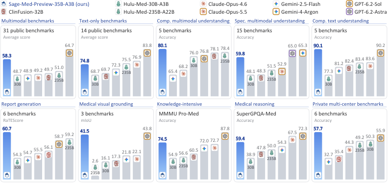
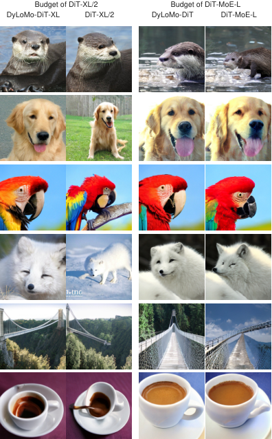
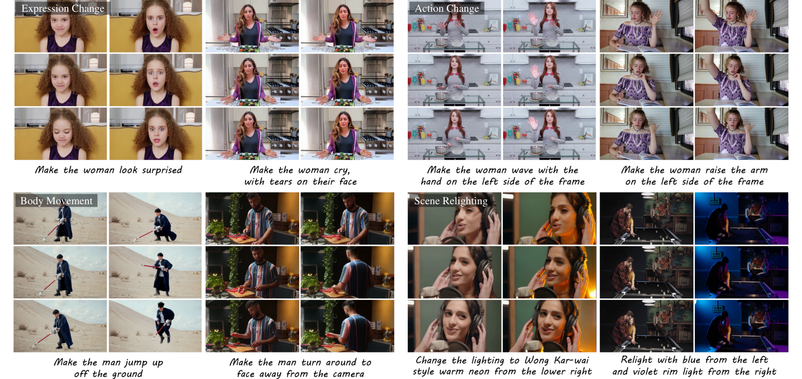
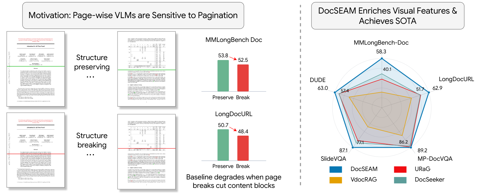
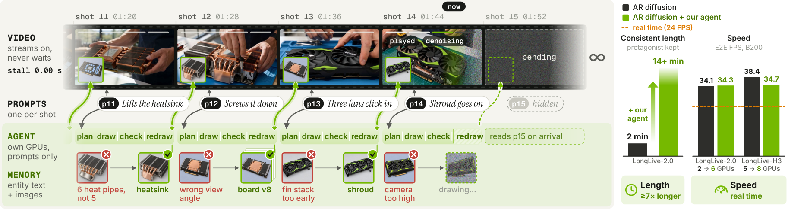
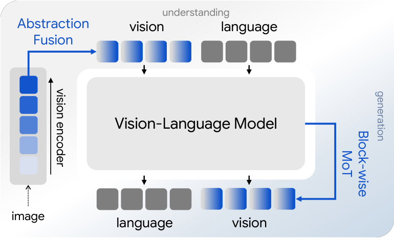
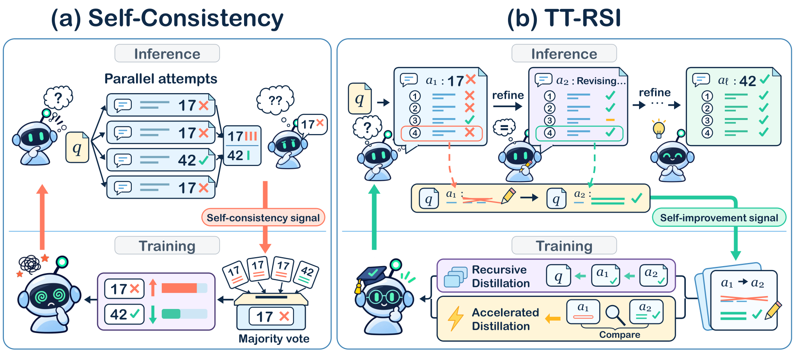
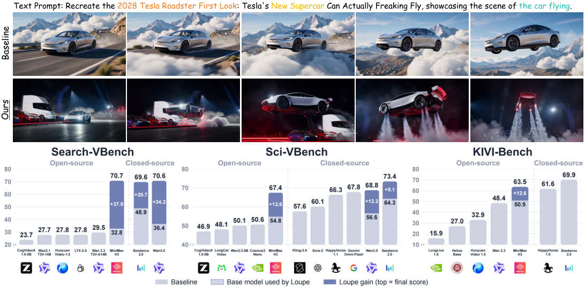
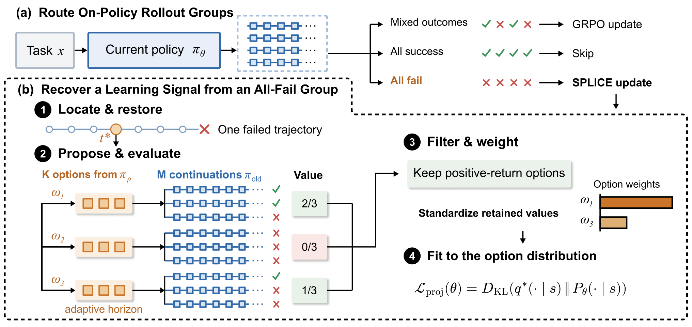
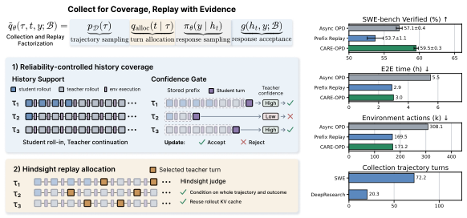

# Daily AI papers — 2026-11-26

*Curated from HF Daily Papers. 15 of ~59 papers kept after relevance filter.*

## Papers at a glance

| # | Title | Topics | Org |
| --- | --- | --- | --- |
| 1 | [Sage-Med: Scaling Medical Multimodal Intelligence](#1-sage-med) | `multimodal`, `MoE`, `RL`, `SFT` | Shanghai AI Lab |
| 2 | [Mixture-of-Loops Transformer](#2-mixture-of-loops-transformer) | `architecture`, `efficient-inference`, `KV-cache` | ByteDance Seed |
| 3 | [DyLoMo-DiT: Dynamic Looped MoE Diffusion Transformers](#3-dylomo-dit) | `diffusion`, `MoE`, `architecture` | (unspecified) |
| 4 | [Improving and Expanding Video Editing Capabilities Without Videos (I2VT)](#4-i2vt) | `diffusion`, `video`, `distillation` | NTU / UTS / CMU |
| 5 | [DocSEAM: Bidirectional Cross-Page Encoding for Multi-Page Document Understanding](#5-docseam) | `multimodal`, `architecture`, `eval` | NTU S-Lab / Synvo AI |
| 6 | [EgoUseBench: Benchmarking Computer-Use Agents under Evolving First-Person Contexts](#6-egousebench) | `agents`, `eval`, `multimodal` | Zhejiang U. |
| 7 | [Agentic LongLive: Asynchronous Agentic Memory for Long Video Generation](#7-agentic-longlive) | `agents`, `diffusion`, `video`, `RL` | NVIDIA / MIT / CUHK |
| 8 | [Integral: Let Vision-Language Models Generate Images through Their Representations](#8-integral) | `multimodal`, `diffusion`, `architecture` | NAVER Cloud / KAIST |
| 9 | [Beyond Self-Consistency: Recursive Self-Improvement at Test Time](#9-tt-rsi) | `reasoning`, `test-time`, `distillation` | Shanghai AI Lab / SJTU |
| 10 | [Letting Models Manage Their Own Context: Where We Stand](#10-model-managed-context) | `agents`, `efficient-inference`, `KV-cache` | NVIDIA |
| 11 | [Loupe: Reinforcing Knowledge-Intensive Video Generation Agents](#11-loupe) | `agents`, `RL`, `diffusion`, `video` | PKU / Ant / DP Tech |
| 12 | [NOPO: Negative-Only Policy Optimization for One-Sided Verifiable Rewards](#12-nopo) | `RL`, `RLVR`, `reasoning` | NTU |
| 13 | [Single-Database Rewards Are Hackable: Counterfactual Execution for Trustworthy Text-to-SQL RL](#13-counterfactual-sql) | `RL`, `reward-hacking`, `eval` | AIMS-DTU |
| 14 | [SPLICE: When Every Rollout Fails — Learner-Conditioned Options for Long-Horizon Agent RL](#14-splice) | `agents`, `RL`, `GRPO` | SJTU / JD.com |
| 15 | [CARE-OPD: Adaptive On-Policy Distillation for Long-Horizon Agents](#15-care-opd) | `agents`, `distillation`, `RL` | SJTU / JD.com |

Honorable mentions (kept names in the pool, abstracts collected, dropped for brevity): *Elite — evaluation-free recursive self-improvement for coding agents (arXiv:2611.21056)*; *MLEvolver — self-evolving agents via folded memory and lesson pruning (arXiv:2611.28244)*; *Puzzling-Bench — 23,777 community-verified puzzles for LLM eval (arXiv:2611.34331)*; *CONCOR — contrastive-decoding benchmark for VLM hallucination (arXiv:2611.30460)*.

---

## 1. Sage-Med

**Authors:** Ming Hu, Cheng Tang, Wei Li, Junjun He, Yirong Chen et al. — *Shanghai Artificial Intelligence Laboratory + consortium (29 affiliations)*
**Links:** [arXiv:2611.34575](https://arxiv.org/abs/2611.34575) · [HF](https://huggingface.co/papers/2611.34575) · [AlphaXiv](https://www.alphaxiv.org/abs/2611.34575)
**Topics:** `multimodal`, `MoE`, `RL`, `SFT`

### TL;DR

Open-source medical multimodal MoE preview with 35B total / 3B active parameters, trained through medical data curation, staged domain pretraining, multi-stage SFT, and adaptive RL. Targets the gap where medical multimodal LLMs still trail general-purpose frontier models and where scaling text capacity alone fails to transfer to clinical visual perception.

### Key idea

A four-stage recipe tuned to the medical modality mix: (1) heavy data curation across 238 clinical tasks and 29 institutional sources, (2) continued pretraining with medical-biased mixtures, (3) multi-stage supervised fine-tuning that separates perception, reasoning, and workflow phases, and (4) an *adaptive* RL stage that modulates reward signals depending on task difficulty and verifier reliability. All of this runs on a sparse MoE backbone (35B / 3B active) so the clinical-committee-curated reasoning data can be absorbed cheaply.

### Main finding

Averages **58.26%** across 31 public medical multimodal benchmarks, ahead of the open-source medical model Hulu-Med-235B-A22B (50.99%) and the scientific model Intern-S2-Preview (52.24%), and approaches the proprietary GPT-6.2-Sol on several tasks. Complex multi-step clinical workflows remain the main failure mode.

### Why it matters

Shows that a 3B-active MoE, when the data pipeline is right, can close most of the gap with 200B+ dense medical baselines — reframing medical foundation models as a *data-and-recipe* problem rather than a parameter-count one.

### Knowledge graph integration

**Builds on / relates to existing pages:**
- [../architectures/_moe.md](../architectures/_moe.md) — sparse MoE backbone (35B total, 3B active) is the capacity lever.
- [../post-training/rlvr.md](../post-training/rlvr.md) — adaptive RL on clinical verifiers extends RLVR with difficulty-aware rewards.
- [../data/_data-curation.md](../data/_data-curation.md) — clinical-committee data curation across 238 tasks is the paper's central lever.
- [../post-training/_post-training.md](../post-training/_post-training.md) — staged SFT + adaptive RL is the overall recipe.

**Suggested new pages:**
- `multimodal/medical-mllm.md` *(depth)* — medical multimodal LLM recipes, failure modes on clinical visual perception.
- `case-studies/sage-med.md` *(case study)* — full breakdown of the data → pretraining → SFT → adaptive-RL pipeline.

---

## 2. Mixture-of-Loops Transformer

**Authors:** Lianghui Zhu, Shijie Wang, Xinggang Wang, Jinze Bai, Bo Wang, Xiang Bai — *ByteDance Seed*
**Links:** [arXiv:2611.34923](https://arxiv.org/abs/2611.34923) · [HF](https://huggingface.co/papers/2611.34923) · [AlphaXiv](https://www.alphaxiv.org/abs/2611.34923)
**Topics:** `architecture`, `efficient-inference`, `KV-cache`

### TL;DR

Revisits looped transformers: reuse the same block weights across multiple passes, but share the *KV memory* across loops and across depth so the extra passes don't inflate inference latency. The U-shaped variant (U-MoLT) matches an OLMo3 training-efficiency baseline while holding inference cost at the no-loop level.

### Key idea

Standard looped transformers trade parameter count for extra compute — fewer unique weights, more passes. The new twist is to **share KV memory** across loop iterations and across the U-shaped depth stack, so that the N-loop forward pass does not actually produce N× the KV cache. Loops become a cheap capacity lever at both train and inference time.

### Main finding

At 700M parameters U-MoLT reports **1.7× validation cross-entropy token-efficiency vs. OLMo3**; at S-size (~113M), inference latency matches a non-looped OLMo3 of the same capacity — i.e. looping is "free" at inference once KV is shared.

### Why it matters

Looped / universal transformers have long had the "great quality, awful latency" reputation. If KV-shared looping really matches a non-looped baseline on wall-clock, it reopens parameter-efficient scaling for inference-constrained deployments (small on-device models, long-context prefill).

### Knowledge graph integration

**Builds on / relates to existing pages:**
- [../architectures/transformer-block.md](../architectures/transformer-block.md) — the loop reuses one transformer block across depths.
- [../fundamentals/attention.md](../fundamentals/attention.md) — KV sharing across loops changes attention's memory profile.

**Suggested new pages:**
- `architectures/looped-transformer.md` *(depth)* — weight-shared looped transformers with cross-loop KV reuse.
- `architectures/_weight-sharing.md` *(taxonomy)* — looped, ALBERT-style, universal transformers, and the KV-sharing axis.

---

## 3. DyLoMo-DiT

**Authors:** Lernie Li, Yuanliu Liu, Pengfei Xiong, Wei Zhang — *(affiliations not shown)*
**Links:** [arXiv:2611.30844](https://arxiv.org/abs/2611.30844) · [HF](https://huggingface.co/papers/2611.30844) · [AlphaXiv](https://www.alphaxiv.org/abs/2611.30844)
**Topics:** `diffusion`, `MoE`, `architecture`

### TL;DR

Diffusion transformer that composes **weight-shared loops over middle layers** with **sparse mixture-of-experts** inside each loop. On top of that, the number of passes is scheduled by the current noise level — more loops at high-noise early timesteps, fewer at low-noise late timesteps. Reports lower FID than DiT / DiT-MoE on ImageNet 256² and better GenEval than FLUX.1 at a smaller active-parameter budget.

### Key idea

Two orthogonal sparsity axes: **depth** (loop the middle layers to reuse parameters) and **width** (sparse experts inside each loop to allocate capacity across tokens). The looping schedule is made *noise-level-aware* — the diffusion scheduler determines how many passes the middle stack runs, so compute is spent where the denoising curve demands it.

### Main finding

Beats DiT and DiT-MoE on ImageNet 256² FID at matched training compute; the text-to-image model outscores FLUX.1 on GenEval while using fewer active parameters.

### Why it matters

Transfers two ideas the LLM world has been using (weight-shared loops; token-routed experts) into diffusion backbones, and adds a *noise-conditional* compute budget — a natural fit for diffusion's iterative structure. Likely template for the next generation of DiT-style image/video models.

### Knowledge graph integration

**Builds on / relates to existing pages:**
- [../architectures/_moe.md](../architectures/_moe.md) — sparse expert routing inside each looped middle layer.
- [../architectures/deepseek-moe.md](../architectures/deepseek-moe.md) — fine-grained-expert style routing referenced for parameter efficiency.

**Suggested new pages:**
- `architectures/looped-dit.md` *(depth)* — looped diffusion transformers with noise-conditional loop count.
- `multimodal/_dit.md` *(taxonomy)* — DiT variants: dense, MoE, looped, cascaded.

---

## 4. I2VT

**Authors:** Yanhao Jia, Xiangpeng Yang, Martin Q. Ma, Sihan Xu, Erik Cambria, Louis-Philippe Morency — *NTU / UTS / CMU / U. Michigan*
**Links:** [arXiv:2611.34941](https://arxiv.org/abs/2611.34941) · [HF](https://huggingface.co/papers/2611.34941) · [AlphaXiv](https://www.alphaxiv.org/abs/2611.34941)
**Topics:** `diffusion`, `video`, `distillation`

### TL;DR

Image-to-Video Transfer (I2VT) upgrades a pretrained video editor using **only still images, no video pairs**: at training time, each image is cast as a one-frame video, and a frozen image editor guides the denoising steps. Also introduces OpenVE++, extending OpenVE with action changes, expression changes, body movements, and scene relighting.

### Key idea

Treat each training image as a degenerate one-frame video and distill a strong image editor into the video denoising trajectory, with the image editor *acting as the guidance signal*. No architecture change to the video editor; no new paired-video dataset.

### Main finding

State-of-the-art across three different video editors on OpenVE-Bench and the new OpenVE++, in spite of using zero new paired video data.

### Why it matters

Instructional video editing has been bottlenecked by paired-edit data at scale. Showing that still-image supervision alone can push three distinct video editors to SOTA removes one of the field's hardest data-collection asks.

### Knowledge graph integration

**Builds on / relates to existing pages:**
- [../post-training/rejection-sampling.md](../post-training/rejection-sampling.md) — teacher-guided denoising is the diffusion cousin of rejection-sampling-style distillation.

**Suggested new pages:**
- `multimodal/video-editing-distillation.md` *(depth)* — image-editor-to-video-editor transfer without paired videos.

---

## 5. DocSEAM

**Authors:** Chen Change Loy et al. — *S-Lab, Nanyang Technological University + Synvo AI*
**Links:** [arXiv:2611.34420](https://arxiv.org/abs/2611.34420) · [HF](https://huggingface.co/papers/2611.34420) · [AlphaXiv](https://www.alphaxiv.org/abs/2611.34420)
**Topics:** `multimodal`, `architecture`, `eval`

### TL;DR

Lightweight module that sits between a pretrained vision encoder and an LLM, enriching each page's visual tokens with **cross-page context** using center-anchored attention and learned directional gates — without inflating the token count. Two-stage training; evaluated on five multi-page document VQA benchmarks.

### Key idea

Rather than concatenating page tokens (which blows up context) or treating each page independently (which loses cross-page reasoning), DocSEAM mixes neighbor-page information *into each page's existing tokens* via a bidirectional, directionally-gated attention module. Token count stays constant.

### Main finding

SOTA among open-weight ≤10B document-VQA models on five multi-page benchmarks, with reduced sensitivity to arbitrary page-break positions and better cross-page span localization.

### Why it matters

Multi-page docs (legal, financial, scientific PDFs) are a leading real-world workload for VLMs. The "cross-page context without token blow-up" pattern is likely to generalize to any domain where the natural unit is a *pane set* rather than a single image.

### Knowledge graph integration

**Builds on / relates to existing pages:**
- [../fundamentals/attention.md](../fundamentals/attention.md) — center-anchored bidirectional attention is a specialized attention variant.

**Suggested new pages:**
- `multimodal/document-vlm.md` *(depth)* — cross-page-context modules for multi-page document VLMs.

---

## 6. EgoUseBench

**Authors:** (listed as "AI4GC Lab, Zhejiang University"; individual authors not shown on HF page)
**Links:** [arXiv:2611.34466](https://arxiv.org/abs/2611.34466) · [HF](https://huggingface.co/papers/2611.34466) · [AlphaXiv](https://www.alphaxiv.org/abs/2611.34466)
**Topics:** `agents`, `eval`, `multimodal`

### TL;DR

Benchmark for "Ego Use": a computer-use agent given first-person visual context from a wearable (smart glasses) that keeps changing as the user moves. 693 tasks across three regimes — pure Computer-Use, Offline Ego Use (recorded), and Online Ego Use (live-updating ego stream) — built from 74+ hours of first-person recordings.

### Key idea

Separate **context evolution** from **task execution** by running the same task under three ego-context regimes. The Online regime forces the agent to interleave perception updates with action, exposing how brittle current computer-use agents are to live, non-stationary context.

### Main finding

Online Ego Use success is **26.3% lower on average** than pure Computer-Use. Models that handle static VLM inputs well collapse when the first-person stream keeps changing user intent.

### Why it matters

Computer-use agents are increasingly envisioned as wearable copilots. EgoUseBench shows the field is not close — static-image VLM evals massively overestimate how well these agents will do in live wearable settings.

### Knowledge graph integration

**Builds on / relates to existing pages:**
- [../agents/README.md](../agents/README.md) — benchmarks agentic tool use with ego-visual context.
- [../evaluation/README.md](../evaluation/README.md) — new capability benchmark.

**Suggested new pages:**
- `evaluation/ego-use-bench.md` *(depth)* — first-person computer-use agent benchmark.
- `agents/computer-use.md` *(depth)* — computer-use agents, screen/OS grounding, failure modes.

---

## 7. Agentic LongLive

**Authors:** Shaoteng Liu, Shuai Yang, Wei Huang, Luozhou Wang, Song Han, Yukang Chen — *NVIDIA / MIT / CUHK*
**Links:** [arXiv:2611.34907](https://arxiv.org/abs/2611.34907) · [HF](https://huggingface.co/papers/2611.34907) · [AlphaXiv](https://www.alphaxiv.org/abs/2611.34907)
**Topics:** `agents`, `diffusion`, `video`, `RL`

### TL;DR

Real-time autoregressive video generator that stays consistent across minutes-long interactive stories, by pairing it with a **separate-GPU memory agent**. The memory agent reads only the prompt stream (never the generated video), prepares image + text memory *ahead of* each prompt, and hands it to the generator so streaming isn't blocked. A small LM trained with RL decides what to remember.

### Key idea

Decouple memory from generation: run the memory agent asynchronously on its own GPUs, train a small LM with RL to pick which tokens / images to retain, and feed its output into the video decoder as pre-rendered conditioning.

### Main finding

On the LongStory-Online benchmark, consistency across characters/objects/scenes improves over the base video generator; the whole system runs **faster than real time on a single 8×B200 node**. The authors claim it is the first real-time video generator with LLM-agent-maintained text+image memory.

### Why it matters

Pushes streaming video generation past the "few-second clip" ceiling into interactive stories, by borrowing the agentic memory pattern (MemGPT / letta / Agentic-RAG) into the diffusion-video world. Opens a lane for RL-trained *memory policies* as first-class components of generative systems.

### Knowledge graph integration

**Builds on / relates to existing pages:**
- [../post-training/rlvr.md](../post-training/rlvr.md) — the memory LM is trained with RL against downstream consistency rewards.
- [../systems/partial-rollouts.md](../systems/partial-rollouts.md) — asynchronous memory-prep scheduling is a relative of partial-rollout orchestration.
- [../agents/README.md](../agents/README.md) — the memory agent is a tool-less LLM agent maintaining state.

**Suggested new pages:**
- `agents/memory-agents.md` *(depth)* — asynchronous memory agents with RL-trained retention policies.
- `multimodal/streaming-video-generation.md` *(depth)* — autoregressive real-time video generation with external memory.

---

## 8. Integral

**Authors:** Byungwoo Jeon, Kyungmin Lee, Hyeonmo Kang, Cheonbok Park, Shinyoung Joo, Jinwoo Shin, Jeonghoon Kim — *NAVER Cloud / KAIST*
**Links:** [arXiv:2611.31237](https://arxiv.org/abs/2611.31237) · [HF](https://huggingface.co/papers/2611.31237) · [AlphaXiv](https://www.alphaxiv.org/abs/2611.31237)
**Topics:** `multimodal`, `diffusion`, `architecture`

### TL;DR

Turns a pretrained VLM into a unified understanding + generation model with two additions: **Abstraction Fusion**, which builds shared visual tokens from several levels of a frozen vision encoder, and a **Block-wise Mixture-of-Transformers** stream that runs alongside the VLM and only talks to it at block boundaries. Understanding ability is preserved; generation is competitive, and sharing representations between the two tasks helps generation beyond what reconstruction quality alone predicts.

### Key idea

Rather than turning the VLM's own tokens into image tokens (destroying understanding) or bolting on a separate generator (losing the shared semantics), add a *parallel transformer stream* with sparse, block-boundary interactions and feed it a fused multi-level abstraction of the vision encoder. The VLM backbone stays frozen in its understanding role.

### Main finding

Keeps the base VLM's understanding capability intact and achieves strong image generation; ablation shows that shared *abstractions* (not just reconstruction) are what lift generation — a VLM-internal representation is a better generative signal than its own pixel reconstruction.

### Why it matters

Unified understanding+generation has been the holy grail since Chameleon / Emu / Show-o, and most attempts degrade one side to help the other. Block-wise MoT with Abstraction Fusion is a lighter-touch recipe that may generalize to any pretrained VLM.

### Knowledge graph integration

**Builds on / relates to existing pages:**
- [../architectures/_moe.md](../architectures/_moe.md) — MoT (mixture-of-transformers) is a structural cousin of MoE on the depth axis.
- [../multimodal/README.md](../multimodal/README.md) — unified understanding+generation stack.

**Suggested new pages:**
- `multimodal/unified-vlm-generation.md` *(depth)* — adding a block-wise MoT stream to a frozen VLM for unified gen+understanding.

---

## 9. TT-RSI

**Authors:** Jianyu Wu, Encheng Su, Jinouwen Zhang, Pengze Li, Lintao Wang, Chen Tang, Aoran Wang, Wanli Ouyang, Shixiang Tang — *Shanghai Artificial Intelligence Laboratory / SJTU + collaborators*
**Links:** [arXiv:2611.30965](https://arxiv.org/abs/2611.30965) · [HF](https://huggingface.co/papers/2611.30965) · [AlphaXiv](https://www.alphaxiv.org/abs/2611.30965)
**Topics:** `reasoning`, `test-time`, `distillation`

### TL;DR

Label-free test-time recipe for LLMs with two parts: **In-Context RSI** re-solves the question using the previous *full solution* as a reference (so the model builds on its own reasoning instead of drawing independent self-consistency samples), and **In-Weight RSI** distills these successive refinements back into the weights. The latter can flip an initially-wrong majority.

### Key idea

Self-consistency uses independent samples and majority votes; here each new attempt is **conditioned on the previous full attempt** (recursive refinement). The in-weight step then compresses that chain of refinements into a cheaper, more confident policy — without any gold labels at test time.

### Main finding

Tested on Qwen3 1.7B/4B/8B across five competition-math benchmarks: TT-RSI gains **+13.89% average accuracy** over the base model and beats the strongest self-consistency baseline by **+4.79%** under the same test-time compute budget.

### Why it matters

Self-consistency, best-of-N, and majority voting are the dominant test-time scaling strategies. TT-RSI shows that making the inference loop *recursive and self-referential* — then distilling it — can beat the dominant pattern at matched budget, pointing at a new axis for test-time compute.

### Knowledge graph integration

**Builds on / relates to existing pages:**
- [../post-training/reasoning/long-cot-rl.md](../post-training/reasoning/long-cot-rl.md) — in-weight RSI is a label-free cousin of long-CoT RL on refinement trajectories.
- [../post-training/rejection-sampling.md](../post-training/rejection-sampling.md) — distilling successive refinements is a self-labeled form of rejection-sampling SFT.
- [../post-training/reasoning/length-penalty.md](../post-training/reasoning/length-penalty.md) — same test-time-compute family.

**Suggested new pages:**
- `post-training/reasoning/test-time-rsi.md` *(depth)* — recursive self-improvement at test time (in-context + in-weight).
- `post-training/reasoning/_test-time-scaling.md` *(taxonomy)* — self-consistency vs. best-of-N vs. recursive refinement.

---

## 10. Model-managed context

**Authors:** Alessio Devoto, Avinash Vem, Tara Safavi, Sanjay Kariyappa, Yu-Hsuan Tseng, Paul Furgale, Ricardo Silveira Cabral — *NVIDIA*
**Links:** [arXiv:2611.34147](https://arxiv.org/abs/2611.34147) · [HF](https://huggingface.co/papers/2611.34147) · [AlphaXiv](https://www.alphaxiv.org/abs/2611.34147)
**Topics:** `agents`, `efficient-inference`, `KV-cache`

### TL;DR

Compares harness-driven context compaction vs. **model-driven** context management, where the model itself decides when and what to compact through a context API. Tested in NVIDIA's open-source agent harness on document research and ML-engineering tasks, with context budgets from 8K to 512K.

### Key idea

Give the LLM a context-manipulation API it can call during a task (compact, pin, drop regions). Model-driven policies often beat harness-only compaction, especially at tight budgets, and admit **KV-cache reuse for unchanged context** after an edit — a 15% prefill saving at no accuracy cost.

### Main finding

Model-managed context often beats harness-managed context on accuracy, sometimes with *fewer* input tokens; largest gains at tight budgets. Models vary widely in how they use the API. KV-cache reuse after a non-overlapping edit cuts prefill compute by up to **15% per request** at no measurable accuracy loss.

### Why it matters

Decides a live architectural question — "should the harness or the model own context management?" — in favor of giving the model a first-class API. Also turns KV-cache editing into a routine inference-time optimization, not a research curiosity.

### Knowledge graph integration

**Builds on / relates to existing pages:**
- [../inference/README.md](../inference/README.md) — KV-cache reuse after edits sits inside the inference-systems topic.
- [../agents/README.md](../agents/README.md) — model-driven context APIs reshape agent-harness design.

**Suggested new pages:**
- `agents/context-management.md` *(depth)* — model-driven context compaction via a first-class API.
- `inference/kv-cache-reuse.md` *(depth)* — reusing KV cache across edits of partially-shared context.

---

## 11. Loupe

**Authors:** Ruichuan An, Zhen Fang, Xi Fang, Han Lyu, Moran Li, Yingchen Yu, Yifan Dai, Bohan Zeng, Quanqing Xu, Zhengzhou Zhu, Wentao Zhang — *PKU / USTC / DP Technology / HUST / NTU / SJTU / Ant Group*
**Links:** [arXiv:2611.31895](https://arxiv.org/abs/2611.31895) · [HF](https://huggingface.co/papers/2611.31895) · [AlphaXiv](https://www.alphaxiv.org/abs/2611.31895)
**Topics:** `agents`, `RL`, `diffusion`, `video`

### TL;DR

Video-generation agent that searches for and verifies text + image evidence, then converts it into a time-ordered prompt with reference images for the downstream video model. Trained with **Rubric-Based Credit** (RBC) — each intermediate retrieval/planning step is scored against prompt-derived rubrics, so no ground-truth answers or rendered videos are needed.

### Key idea

A rubric per prompt turns an open-ended search-and-plan episode into a dense verifiable reward signal, suitable for both SFT (RBC-SFT) and GRPO-style RL (RBC-GRPO). The agent therefore learns *process* quality rather than only output fidelity.

### Main finding

Across three video generators, Loupe raises overall Search-VBench scores significantly — MiniMax-H3 jumps from **32.80 → 70.67**. Human evals and Sci-VBench / KIVI-Bench confirm gains in scientific grounding and factual precision.

### Why it matters

Shows rubric-based process rewards (not just final-video rewards) can RL-train agentic video pipelines. The pattern — rubricize the intermediate steps, then RL on them — is reusable far beyond video (any knowledge-intensive agent).

### Knowledge graph integration

**Builds on / relates to existing pages:**
- [../post-training/grpo.md](../post-training/grpo.md) — RBC-GRPO is a GRPO variant with rubric rewards.
- [../post-training/_rewards.md](../post-training/_rewards.md) — rubric-based process rewards.
- [../post-training/reasoning/prm.md](../post-training/reasoning/prm.md) — process rewards cousin; rubrics replace trained PRMs.
- [../agents/README.md](../agents/README.md) — knowledge-intensive agents with tool use.

**Suggested new pages:**
- `post-training/_rewards.md` *(edit — add row)* — add rubric-based process rewards as a reward family.
- `agents/rubric-based-credit.md` *(depth)* — rubric-scored intermediate steps as a dense RL signal.

---

## 12. NOPO

**Authors:** Jiacheng Xu, Shuo He, Fuxiang Zhang, Chaojie Wang, Bo An — *Nanyang Technological University*
**Links:** [arXiv:2611.17287](https://arxiv.org/abs/2611.17287) · [HF](https://huggingface.co/papers/2611.17287) · [AlphaXiv](https://www.alphaxiv.org/abs/2611.17287)
**Topics:** `RL`, `RLVR`, `reasoning`

### TL;DR

RLVR setting where the verifier can confirm failures reliably but not successes (one-sided verifiable rewards — e.g. unit tests catch bugs but passing tests may still hide shortcuts). **Negative-Only Policy Optimization** (NOPO) therefore trains the policy only by *suppressing verified failures*; unverified passes are treated as unlabeled, with a reference-relative suppression loss and a group-level adapter that scales updates by the share of non-falsified responses.

### Key idea

Drop the symmetric "reward passes, punish failures" signal — too noisy on the pass side. Treat passes as unlabeled and use a KL-anchored suppression loss on falsified samples, with a group adapter that rescales updates when most of the group is non-falsified. The policy improves without ever rewarding a potentially-hacked pass.

### Main finding

Beats GRPO/RLVR baselines on pass@k across code, logic, and math benchmarks; gains hold under inference-time scaling and cross-benchmark transfer.

### Why it matters

Reward hacking under cheap verifiers is the central failure mode of modern RLVR. NOPO is a principled first-order fix — don't learn from signals you can't trust in the positive direction — and is a natural drop-in upgrade for pipelines where verifier precision is high but recall is not.

### Knowledge graph integration

**Builds on / relates to existing pages:**
- [../post-training/rlvr.md](../post-training/rlvr.md) — directly a variant of RLVR for one-sided verifiers.
- [../post-training/grpo.md](../post-training/grpo.md) — group-level adapter is a GRPO-family modification.
- [../post-training/_rewards.md](../post-training/_rewards.md) — negative-only reward schema.

**Suggested new pages:**
- `post-training/nopo.md` *(depth)* — negative-only policy optimization with reference-relative suppression.

---

## 13. Counterfactual-Execution Text-to-SQL RL

**Authors:** Rishii Kumar Singh, Aksh Aggarwal et al. — *AIMS-DTU, Delhi Technological University*
**Links:** [arXiv:2611.34363](https://arxiv.org/abs/2611.34363) · [HF](https://huggingface.co/papers/2611.34363) · [AlphaXiv](https://www.alphaxiv.org/abs/2611.34363)
**Topics:** `RL`, `reward-hacking`, `eval`

### TL;DR

Studies a specific reward-hacking pattern in text-to-SQL RL: a wrong SQL query can produce the correct result on the *reference database* because the data happen to mask its bug. The paper audits existing rewards and proposes a **counterfactual-database reward** that also runs the query on hidden, code-generated copies of the DB and only pays out if every version agrees.

### Key idea

A single-DB reward is hackable because the policy can overfit to the exact row distribution that makes the bug invisible. Generate counterfactual DBs that preserve schema but perturb data, re-execute, and require agreement — a cheap, verifier-side-only fix.

### Main finding

On 1,302 synthetic audit queries, the strict counterfactual reward cuts buggy/hacked queries that were previously paid in full to near zero without rejecting correct queries. In controlled training runs, in-domain accuracy is unchanged; Spider shows a small gain within seed-to-seed noise. Several public SQL rewards exhibit similar hackability gaps.

### Why it matters

Concrete, generalizable cautionary tale for verifier design in RL: "the verifier says yes on your held-out set" is not a proof the verifier is tight. Counterfactual-execution auditing is reusable for any reward that depends on a fixed oracle environment.

### Knowledge graph integration

**Builds on / relates to existing pages:**
- [../post-training/rlvr.md](../post-training/rlvr.md) — exposes a reward-hacking pattern in verifiable-reward RL.
- [../post-training/_rewards.md](../post-training/_rewards.md) — design of robust execution-based rewards.

**Suggested new pages:**
- `safety/reward-hacking.md` *(depth)* — reward-hacking patterns in verifier-based RL, with text-to-SQL as a worked example.

---

## 14. SPLICE

**Authors:** Yicheng Liu, Zhen Huang, Jiaqi Wang — *SJTU / Shanghai Innovation Institute / JD.com*
**Links:** [arXiv:2611.34777](https://arxiv.org/abs/2611.34777) · [HF](https://huggingface.co/papers/2611.34777) · [AlphaXiv](https://www.alphaxiv.org/abs/2611.34777)
**Topics:** `agents`, `RL`, `GRPO`

### TL;DR

Fixes GRPO's "all-fail group" problem for long-horizon LLM agents: when every sampled trajectory fails, the group-relative advantage is degenerate and the policy gets no signal. **SPLICE** picks a splice point inside a failed trajectory, has a proposal model generate short *options* from there, estimates each option's value using continuations from the current policy, and trains on a return-weighted local target.

### Key idea

Instead of throwing away all-fail groups (common in agentic benchmarks like SWE-bench), *locally* repair them: inject learner-conditioned options at a chosen point in the failed trajectory and bootstrap value estimates from the current policy's continuations. The proposal model's options are short and cheap, so compute scales well.

### Main finding

On SWE-bench Verified and BrowseComp-Plus, across two policy models, SPLICE gains **+2.8 to +9.8 points over GRPO**, with lower proposal-model cost than full-trajectory guidance baselines.

### Why it matters

Long-horizon agentic RL (SWE-bench, browser, deep-research) is dominated by failures early in training, which collapses GRPO's signal. SPLICE is a targeted fix for exactly that regime and pairs naturally with partial-rollout infrastructure.

### Knowledge graph integration

**Builds on / relates to existing pages:**
- [../post-training/grpo.md](../post-training/grpo.md) — direct patch for degenerate all-fail GRPO groups.
- [../systems/partial-rollouts.md](../systems/partial-rollouts.md) — splice points are a natural fit for partial-rollout schedulers.
- [../post-training/rl-prompt-curation.md](../post-training/rl-prompt-curation.md) — analogous to difficulty-based prompt curation, but at the trajectory-interior level.

**Suggested new pages:**
- `post-training/splice.md` *(depth)* — learner-conditioned option splicing for all-fail trajectory groups.
- `agents/long-horizon-rl.md` *(depth)* — RL recipes for long-horizon LLM agents (SWE-bench, browser, deep-research).

---

## 15. CARE-OPD

**Authors:** Gen Li, Ruilin Li, Yicheng Liu, Zhen Huang, Shuai Dong, Congcong Wang, Kaiwen Tuo, Hongrui Wu, Zelin Peng, Kanghui Tian, Ji Zhao, Dianyi Wang, Jiaqi Wang — *SJTU / Shanghai Innovation Institute / JD.com*
**Links:** [arXiv:2611.34756](https://arxiv.org/abs/2611.34756) · [HF](https://huggingface.co/papers/2611.34756) · [AlphaXiv](https://www.alphaxiv.org/abs/2611.34756)
**Topics:** `agents`, `distillation`, `RL`

### TL;DR

On-policy distillation (OPD) for long-horizon agents, with three targeted upgrades: **student-seeded teacher completions** (so the teacher sees histories the student actually reaches), **response-level confidence gating**, and **hindsight replay allocation** that uses downstream execution evidence to re-prioritize which prefixes to replay.

### Key idea

Pure online OPD is expensive: every update needs fresh environment rollouts. Prefix-replay OPD is cheaper but biased toward teacher-visited histories and uses position-based schedules that miss late-trajectory decisions. CARE-OPD fixes both by letting the student seed what the teacher completes and by using execution evidence from already-collected trajectories to decide where to spend further training compute.

### Main finding

On SWE-bench Verified, **59.5% task success** with roughly **45% less end-to-end training time and 44% fewer environment actions** than asynchronous online OPD, and improvements over prior prefix-replay baselines on Deep Research tasks.

### Why it matters

Shows a clean path for scaling distillation into agentic domains where environment rollouts dominate cost. Hindsight replay allocation is likely to generalize — any long-horizon RL/distillation pipeline has the same "where should I spend my next rollout?" question.

### Knowledge graph integration

**Builds on / relates to existing pages:**
- [../post-training/rejection-sampling.md](../post-training/rejection-sampling.md) — on-policy distillation is a close relative of RS-SFT with an online loop.
- [../systems/partial-rollouts.md](../systems/partial-rollouts.md) — prefix replay is a partial-rollout pattern.
- [../post-training/rl-prompt-curation.md](../post-training/rl-prompt-curation.md) — hindsight replay allocation is a curriculum signal.

**Suggested new pages:**
- `post-training/on-policy-distillation.md` *(depth)* — on-policy distillation with student-seeded completions and hindsight replay.

---

## Notes

- Borderline inclusions this day: *DocSEAM* (multi-page document VLM, included because it introduces a reusable cross-page attention module), *Puzzling-Bench* (benchmark only, moved to honorable mentions).
- Hero figures live in `assets/2026-11-26/`. Missing figures for papers without a public arXiv HTML render yet: #2 Mixture-of-Loops Transformer, #10 Model-managed Context, #12 NOPO, #13 Counterfactual SQL.
- Aggregated **suggested new concept pages** (candidates for the Phase-2 KG-update PR):
  - `architectures/looped-transformer.md` (depth)
  - `architectures/_weight-sharing.md` (taxonomy)
  - `architectures/looped-dit.md` (depth)
  - `multimodal/_dit.md` (taxonomy)
  - `multimodal/medical-mllm.md` (depth)
  - `multimodal/video-editing-distillation.md` (depth)
  - `multimodal/document-vlm.md` (depth)
  - `multimodal/unified-vlm-generation.md` (depth)
  - `multimodal/streaming-video-generation.md` (depth)
  - `agents/computer-use.md` (depth)
  - `agents/memory-agents.md` (depth)
  - `agents/context-management.md` (depth)
  - `agents/rubric-based-credit.md` (depth)
  - `agents/long-horizon-rl.md` (depth)
  - `inference/kv-cache-reuse.md` (depth)
  - `post-training/reasoning/test-time-rsi.md` (depth)
  - `post-training/reasoning/_test-time-scaling.md` (taxonomy)
  - `post-training/nopo.md` (depth)
  - `post-training/splice.md` (depth)
  - `post-training/on-policy-distillation.md` (depth)
  - `safety/reward-hacking.md` (depth)
  - `evaluation/ego-use-bench.md` (depth)
  - `case-studies/sage-med.md` (case study)
- This digest is informational. No existing concept files, `READING-LIST.md`, or `PAPERS.md` were modified to produce it.
